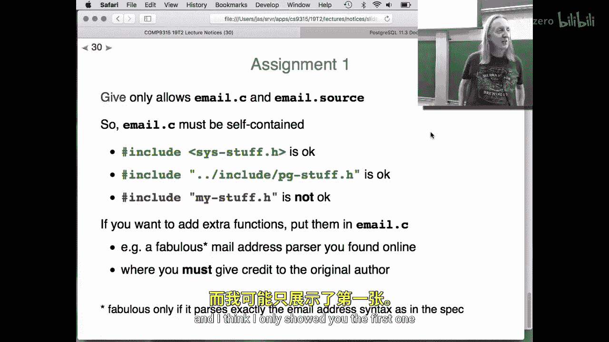
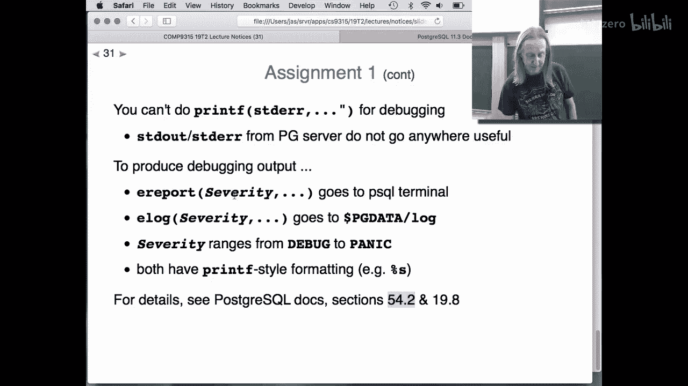
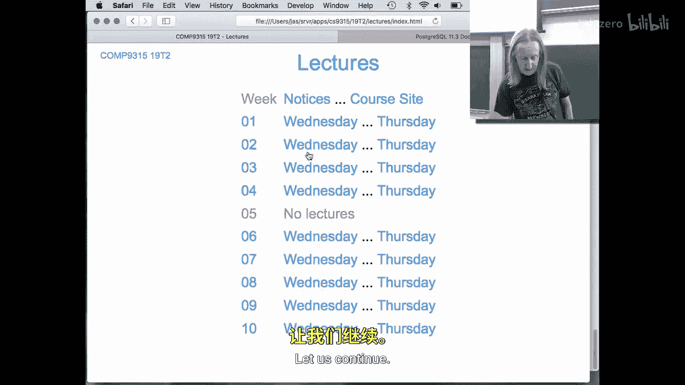
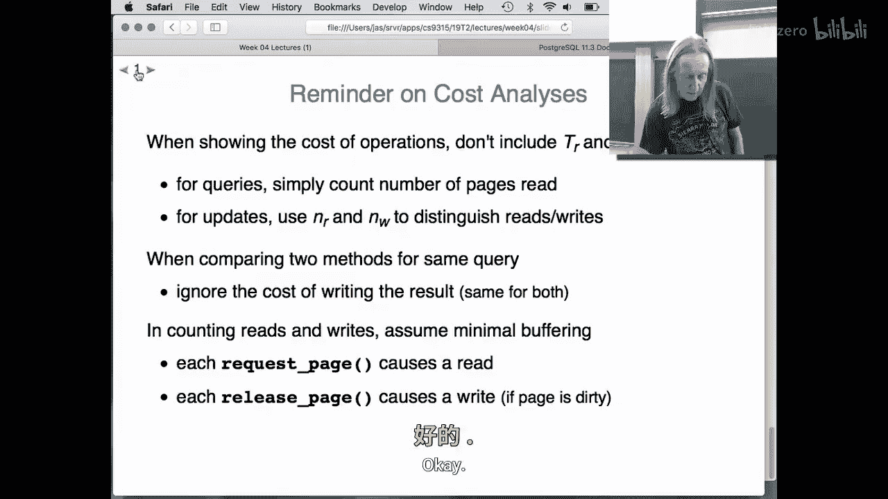
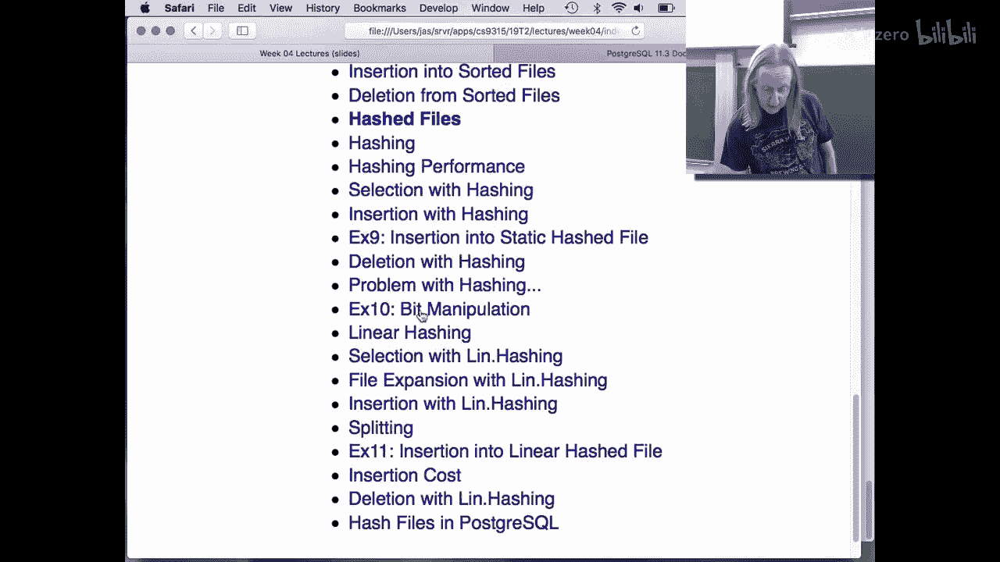
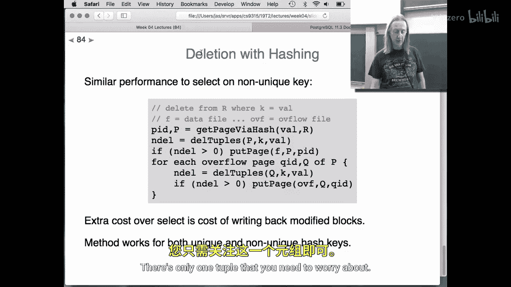
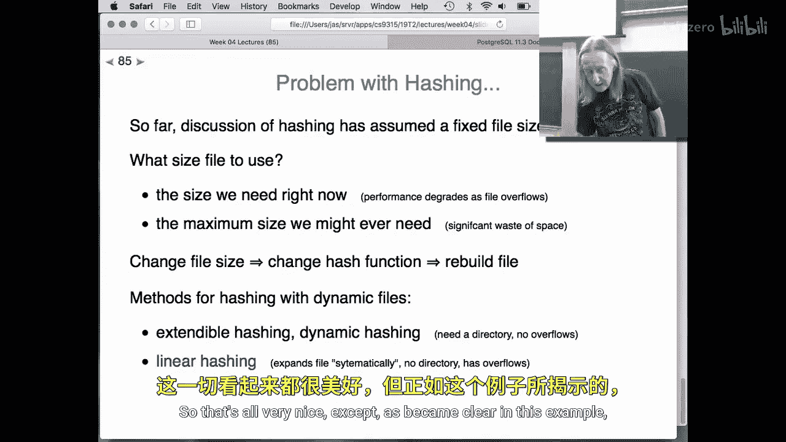
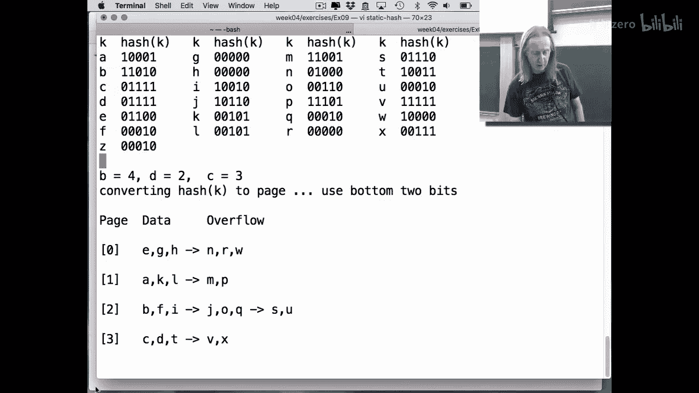
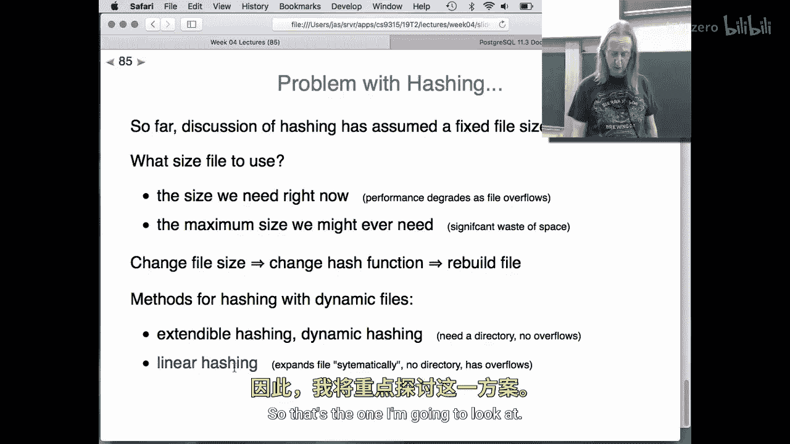
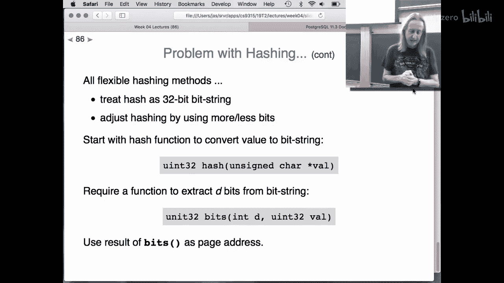

# Postgres数据库实现原理：16：动态哈希

在本节课中，我们将学习如何调试Postgres服务器中的代码，并深入探讨动态哈希技术，特别是线性哈希，以解决静态哈希文件在数据增长时性能下降的问题。

## 调试Postgres服务器代码

上一节我们介绍了作业1的相关内容。本节中我们来看看如何调试在Postgres服务器中运行的C代码。当服务器崩溃时，直接向屏幕输出信息是无效的，因此需要将调试信息写入日志。

以下是两种可用于在服务器中报告信息的关键函数：

*   **`ereport`**：此函数用于向客户端（如`psql`控制台）报告错误信息。例如，当尝试插入一个已存在的主键值时，客户端会收到错误消息。
*   **`elog`**：此函数用于将信息写入服务器日志文件。日志文件在启动`postgres`服务器时配置，是记录调试信息的主要位置。

这两个函数都接受一个表示错误严重程度的参数，范围可以从简单的调试信息到导致服务器崩溃的致命错误。它们的语法较为特殊，需要查阅相关手册来了解具体用法。

当服务器崩溃时，应立即使用这些调试辅助函数来收集信息。

## 哈希文件中的删除操作

现在，让我们继续讨论哈希文件的操作。在哈希文件中执行删除操作时，流程如下：

1.  使用哈希函数定位到相应的数据页。
2.  在该页（及其溢出链）中搜索匹配的元组。
3.  找到匹配的元组后，通过设置其`xmax`值将其标记为已删除。
4.  如果对页面进行了任何修改，必须将其写回磁盘。

对于非唯一键，需要扫描整个溢出链，并删除所有匹配的元组。对于唯一键，在找到并删除目标元组后即可返回。

## 静态哈希的局限性

上述操作在数据量可控时是有效的。然而，正如之前示例所示，如果持续向一个固定大小的哈希文件中插入数据，溢出链会变得越来越长。虽然哈希函数将搜索范围缩小到总数据的一部分（例如四分之一），但当数据总量达到10万时，四分之一仍有2.5万元组，搜索效率依然很低。

一个自然的想法是扩大哈希文件（增加桶的数量）。例如，如果有1万个桶来存放1万个元组，在理想均匀分布下，每个页只存放一个元组，这会造成空间浪费。但更关键的问题是：如果我们使用简单的取模函数（如 `hash_value % B`，其中`B`是桶的数量），并且在文件创建后增加了`B`的值，那么哈希函数就完全改变了。虽然部分元组的新旧哈希值可能相同，但许多元组的哈希值会发生变化，导致我们无法再找到它们。

## 动态哈希解决方案

因此，我们需要能够动态调整大小的哈希方法。内存哈希中解决冲突的方法（如二次哈希、线性探测）在这里不适用。以下是三种适用于文件系统的动态哈希技术：

*   **可扩展哈希**：使用一个目录。目录大小与哈希值使用的位数相关。当需要增加文件大小时，增加哈希位数，目录大小随之翻倍。目录中存储的是指向数据页的指针（页ID）。
*   **动态哈希**：同样使用目录结构，原理与可扩展哈希类似。
*   **线性哈希**：**不需要目录**。它可以一次只增加一个页面来扩展文件大小。虽然它可能仍有溢出链，但随着文件扩展，线性哈希的机制会逐渐减少溢出链的长度。

这些方法（尤其是可扩展哈希和动态哈希）通过“分裂”已满的页来避免溢出链。当目录翻倍时，可能会出现多个目录项指向同一个页面的情况。线性哈希因其良好的扩展性和相对简单的实现，成为了一个非常实用的基于文件的哈希方案。

## 哈希值的处理

在Postgres的上下文中，哈希函数通常生成一个32位的值。在实际应用中，几乎不需要使用全部32位来寻址，因为那意味着需要2^32个页面，这是一个极其庞大的数量。

通常的做法是，我们只取这个哈希值的低`k`位来定位页面，其中`k`根据文件当前的大小动态决定。

---

本节课中我们一起学习了如何调试Postgres服务器进程，分析了静态哈希文件在数据增长时面临的挑战，并介绍了可扩展哈希、动态哈希和线性哈希这三种动态哈希技术。我们重点了解了线性哈希无需目录、可渐进扩展并能管理溢出链的特性，这使其成为解决数据库文件中哈希索引动态扩展问题的有效方案。