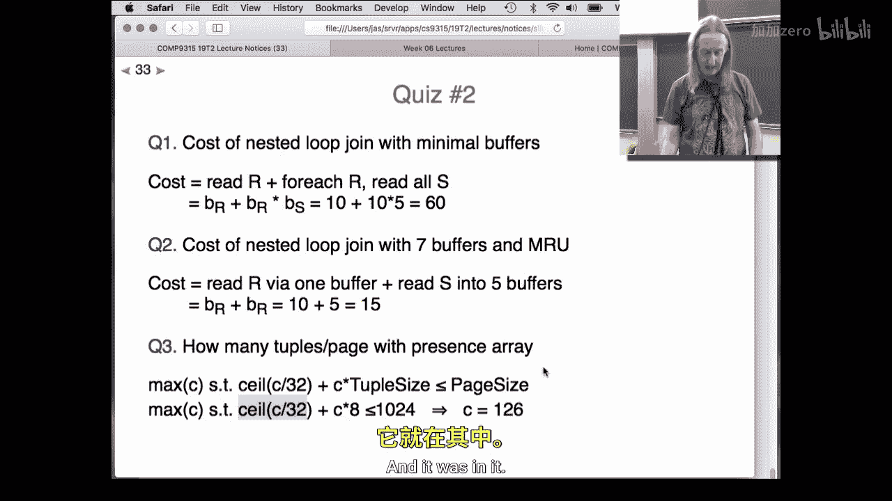
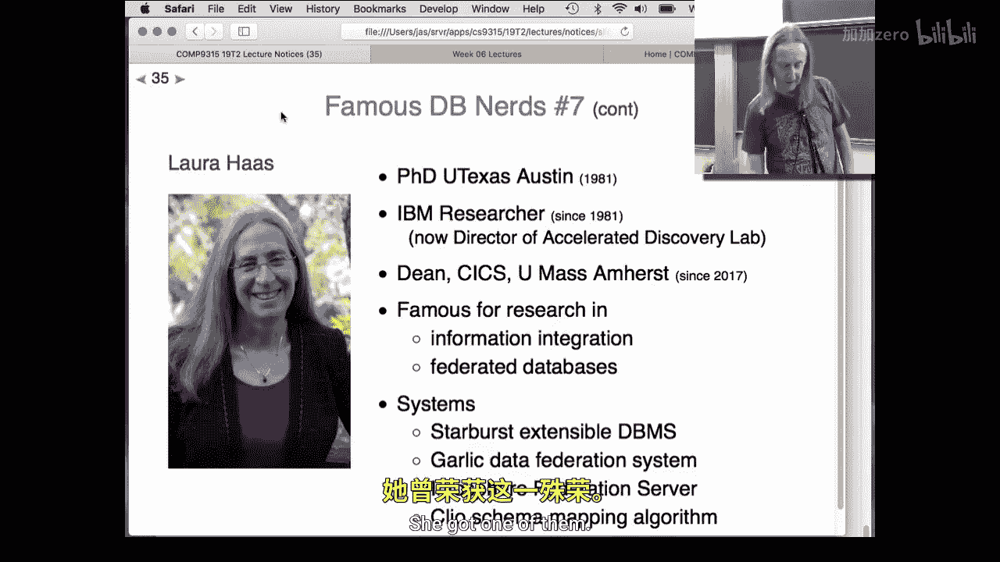
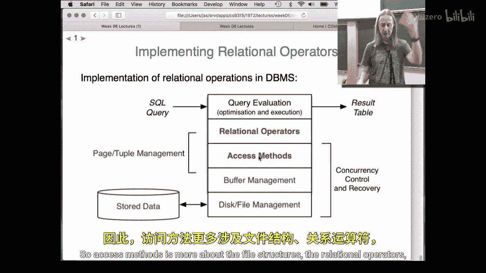
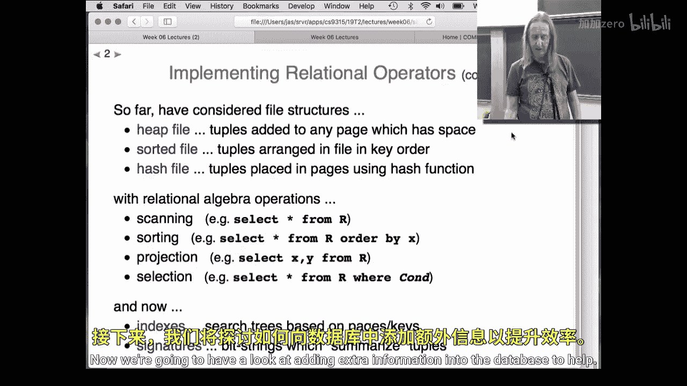
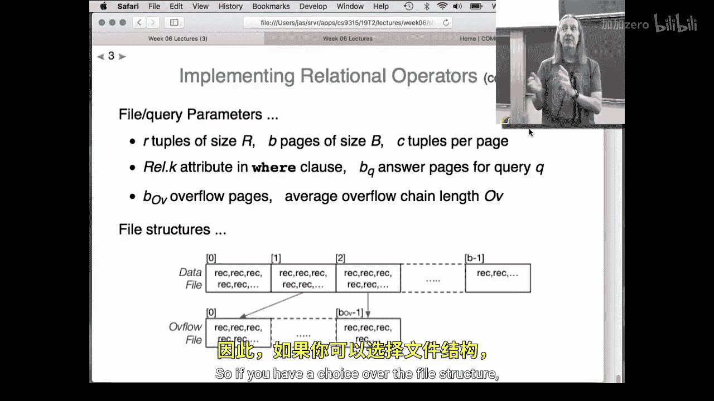

# 新南威尔士大学【中英⚡Postgres数据库实现原理｜COMP9315 2018 Postgres Implementation】 p17 P17 -BV1qXoqYHErC_p17-

Okay。Here we are， six， did you enjoy the first assignment？なか。No。老人了。All right。

 second assignment is going to be just like that， except harder。😊，No， it's not。走他静。

We'll step outside postbs and write some pure see to implement some aspects of query evaluation like join。

And sword。Anyway， so that is I'm going to be out next week。

 don't forget is a quiz it's been out for longer than I was expecting。😊，But it's due tomorrow。

 so make sure you would hurt that。So today we'll talk about more different ways of implementing selection。

Hello。And hopefully early next week。We get on to how you implement join。Let's say， oh， oh。

Lets see right， so quiz do very briefly the first one was asking cost of nested loop join and there were minimal number of buffers one input buffer each for the。

For the relations and one output buffer。So the way that's going to work。

 you read page by page into the R input buffer for each page that you've read in there。

 you've got to read all the yes pages，'s no buffering to know maintain stuff， so that's the total。

10 plus 50。For the second one， we had just enough buffers。

 one buffer to hold the inputs from our page by page。

One output buffer leaving five buffers which by coincidence is just enough to hold the entire S relation so you read the first page of RN and then you read page zero of S page one of S by well。

 blah， you fill out the buffer pool with those buffers and when you go back to。诶。I'm nice。

Should be BS when you go back to really the next page of R。

 you've still got all of the S buffers floating around so just that's the absolute minimum that you can do for an nurse to bt join。

The best case is the sum of the two。Relation sizes and finally that one that asks you how many doubles can you stick into a page that has a bit array at the start to indicate whether a tuple exists or not so that's not what Postgre does remember it's got the whole other st at the start of each tuple that tells you whether the tuple still exists or top。

This is handled by an array of bits at the start of。TheAt the start of the page， so。

How many bytes of presence information do we need， we need that many。

 so C is is the value that we're trying to work out， how many tus can we stack into the page？

So that's how many bits we need to represent that， remember all these things we got these floor and ceiling floating around it ceiling because if it comes out to 5。

3，You need six wood to hold the。Presence bits and you're wasting some of the bits and never too bad and of course each tuple told us each tuple was a bit a bit a by and so that's the total number of the total amount of space that's going to be used by the tuple so that's the presence bit of A that's total tuples and that value has to be we have to choose the value of C so that the total of those two is less than 1024 and we want to have a w in you can easily do that by saying C equals1 that's a bit boring though。

So you pick the largest value of C that satisfies those and that's the value。系。That it was it。

All right， he's another famous Db nerd， why is he bit scared by this picture because it's a woman but he looks a a little bit like a guy。

给。The only giveaway is the necklace， maybe， maybe。Anyway， she's very well known database scientist。

 her name is Laura Haas， she for a long time worked at IBM at the Almaden labb。And she's。

 and now she's moved to the University of Massachusetts。She's famous for all the work she did on。

Schema integration effectively so we want to take data from different databases I think I've talked about this before and you want to treat them like a single large database they potentially have information have data about the same kind of stuff but the schema might be structured totally differently so somehow it's an interesting problem to try and make those two two or three or four databases work together and look like a single database and there' some of the systems that she worked on。

Very well known has won a couple of awards。😔，There's an award that's given out test of time or something like that。

 so if someone comes up with an idea and it gets picked up by a whole bunch of other people over a long period of time and sort of what they did for seminal to this whole branch of database research。

 they get an award from the ACM she got one of them。

All right。Letつ on2。Oh。嗯。The stuff for this week right。

 so the green stuff is what we've already looked at， how do you represent tus。

 you know in a page on the disc？How do you deal with collections of pages that you want to keep in memories like the buffer pool。

 how do we manage tupps within a page so we've looked at all that kind of stuff already and we're in the middle of looking at how we implement the various access methods。

So at the moment we're talking about how do we scan databases， how do we scan relations。

 and in particular， how do we scan them if we're doing a select。XQL statement with the wear clause。

 so we've given some information and we want tuples that satisfy that information。

And next we'll talk about， well， we're kind of mixing the two things up relational operators here we're talking about joint and so on。

And I guess it in some extent selection as well so access methods is more about the file structures the relational operators is how you implement things on top of that So what we've looked at so far we look at the heaps which are just。

Collections of tus stuffed into pages。If we're careful。

 we can make sure that they're stuffed into the pages in sorted order。

 which helps us to find them more quickly because we can do binary research on data。嗯。

We can also use hashing to determine whether the tuples belong in the pages and。

We can use that information， a query time to zero in very quickly on a particular page。

 but only if we ask certain types of queries and I've talked a little bit about different types of queries as well。

the various relational algebra writers that we've kind of looked at already， scanning。

 simply reading through all the tuples in a table， making the tu sorted if they're not already。

 projecting out just some of the information from each tu and finding tuples that satisfy a condition。

So。We've really done that in this kind of context now we're going to have a look at adding extra information into the database to help。

Make selection faster right than that selection is an extremely common operation if you've ever sat there in PSQl。

 I'm sure you typed select a lot with wear clause。And so making it work efficiently is very important now there are all these different kinds of queries that you've asked and I've tried to characterise them as one queries range queries。

 partial Metro retrieval queries and so on every one of those different kinds of queries has a different strategy for a particular file structure so。

To some extent you need to know a little bit about he database is going to be used。

 so if you have a choice over the file structure， you might want to choose a file。

