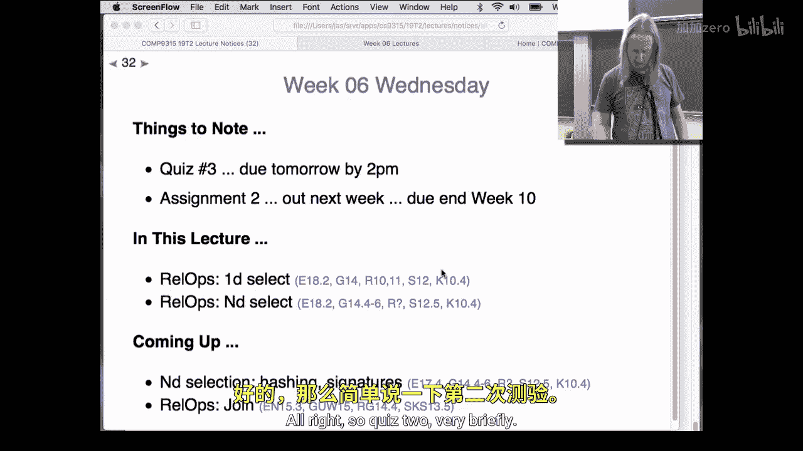
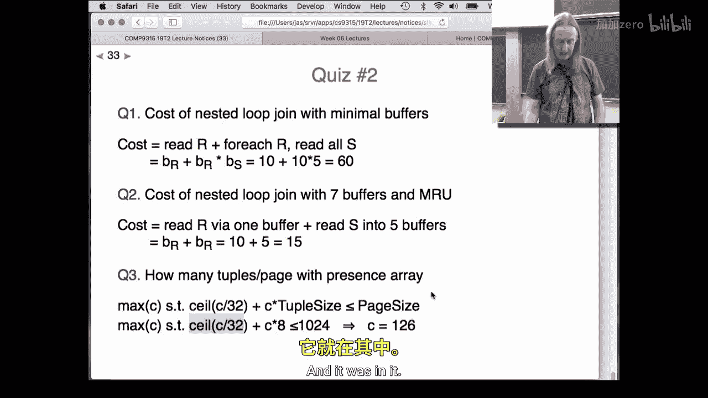
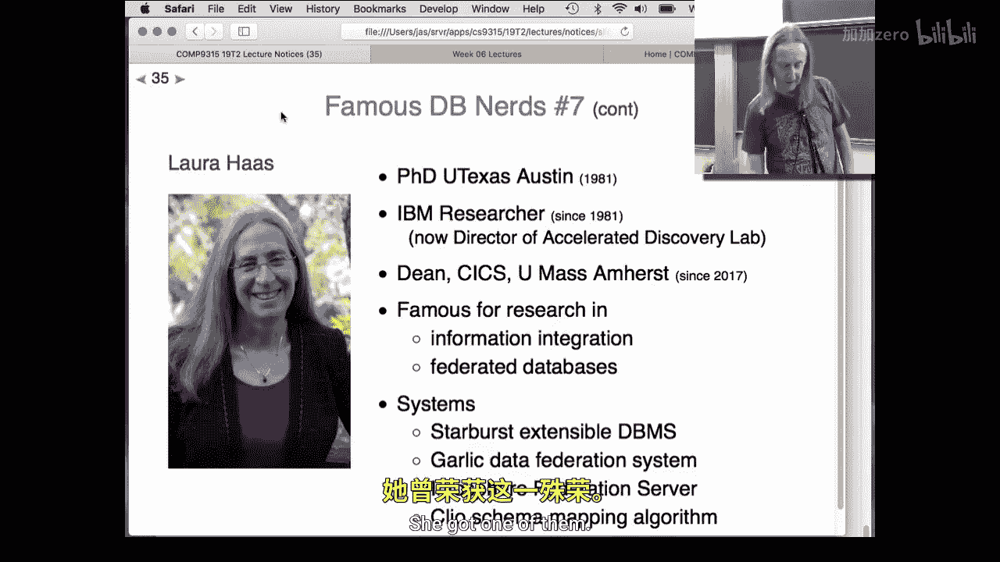
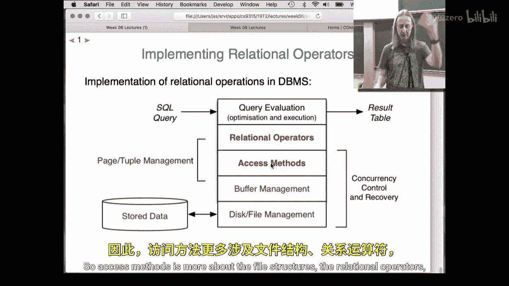
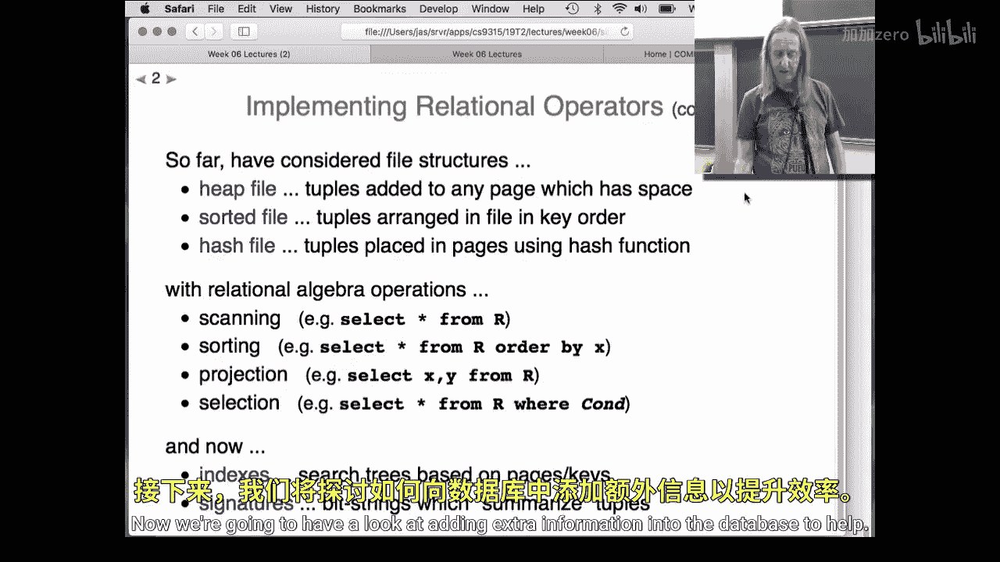
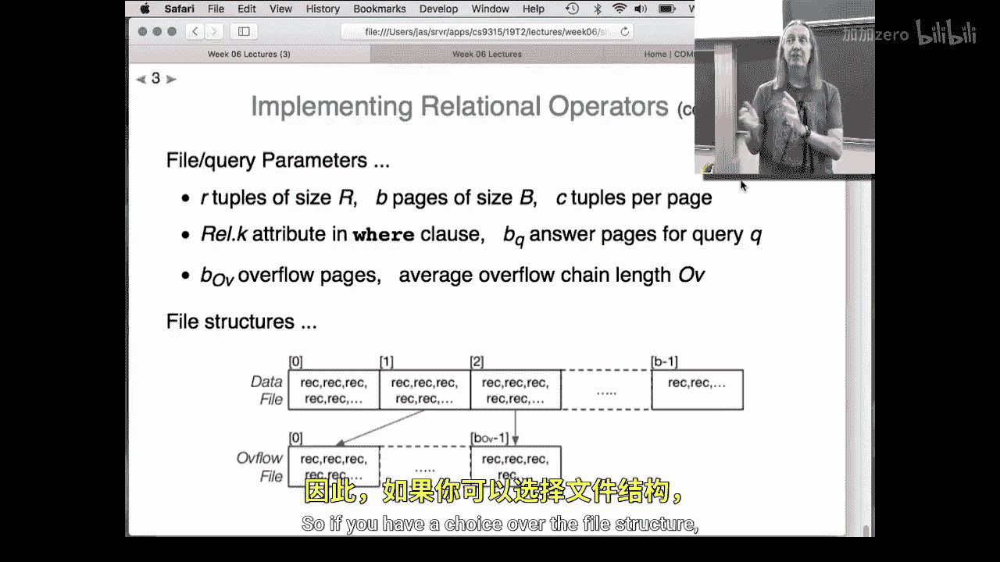

# Postgres数据库实现原理：P17：选择操作的实现策略

在本节课中，我们将学习如何高效地实现数据库中的选择操作。我们将回顾不同的文件结构（如堆文件、排序文件和哈希文件）如何影响查询性能，并探讨如何利用索引等额外信息来加速选择操作。这对于理解数据库查询优化的核心至关重要。

上一节我们介绍了不同的文件结构和基本的关系操作。本节中我们来看看如何具体实现选择操作，特别是带有WHERE子句的查询。

---

## 课程回顾与作业提醒

第一份作业已经结束。第二份作业将要求我们在Postgres之外，使用纯C语言来实现查询求值的一些方面，例如连接操作。这会是更具挑战性的实践。

另外，请勿忘记完成在线测验，它将于明天截止。

---

## 测验题简要解析

以下是关于嵌套循环连接成本计算和页面存储计算的测验题解析：

*   **第一题**：计算了嵌套循环连接在最小缓冲区配置下的成本。需要为两个关系各分配一个输入缓冲区，以及一个输出缓冲区。其总成本是关系R和关系S的页面数之和，即 `Cost = Pages(R) + Pages(S)`。
*   **第二题**：探讨了当有足够缓冲区能容纳整个较小关系时的最佳情况。此时，连接成本同样为两个关系页面数之和，但避免了重复读取。
*   **第三题**：计算了在页面头部使用位图数组（而非Postgres的每元组头部信息）来标记元组存在性时，一个页面能存储的最大元组数 `C`。需要求解满足 `ceil(C/8) + C * tuple_size <= Page_Size` 的最大整数 `C`。

---

## 数据库领域人物：Laura Haas

这位是著名的数据库科学家Laura Haas。她长期在IBM阿尔马登实验室工作，现在任职于马萨诸塞大学。她因在模式集成方面的开创性工作而闻名，即如何将来自不同数据库、具有不同结构模式的数据整合，使其能像一个统一的大型数据库一样工作。她的研究成果获得了ACM颁发的“时间检验奖”等奖项。

---

## 本周内容概览

截至目前，我们已经学习了以下内容：
*   如何表示磁盘页面中的元组。
*   如何管理内存中的页面集合（缓冲区池）。
*   如何管理页面内的元组。

我们正在研究如何实现各种访问方法。目前，我们正在讨论如何扫描关系和表，特别是在执行带有WHERE子句的SELECT语句时，如何找到满足条件的元组。

接下来，我们将讨论连接等关系操作符的实现。访问方法更多关乎底层文件结构，而关系操作符则是在此之上如何实现查询逻辑。

我们已经看过的文件结构包括：
*   **堆文件**：元组简单地填入页面。
*   **排序文件**：如果精心组织，我们可以确保元组按顺序存入页面，这有助于通过二分查找更快地定位数据。
*   **哈希文件**：我们可以使用哈希来确定元组属于哪个页面，并在查询时利用此信息快速定位到特定页面，但这通常只对特定类型的查询有效。

我们也初步了解了各种关系代数操作符的实现，例如扫描、排序、投影和选择。

---

## 选择操作的重要性与优化策略

选择操作是极其常见的操作。在PostgreSQL中，带有WHERE子句的SELECT语句被频繁使用。因此，高效地实现它至关重要。

用户会提出各种不同类型的查询，我们可以将其分类为：
*   点查询
*   范围查询
*   部分匹配检索查询

对于每一种查询类型，不同的文件结构都有其对应的优化策略。因此，在一定程度上，你需要了解数据库将被如何使用。如果你有权选择文件结构，可以根据预期的查询负载来选择最合适的结构。

---

## 总结

本节课中，我们一起学习了选择操作在数据库中的核心地位。我们回顾了堆文件、排序文件和哈希文件如何支持不同类型的查询，并强调了了解查询模式以选择最佳底层存储结构的重要性。我们还简要解析了关于连接成本和页面存储的测验题，并认识了数据库领域的杰出研究者Laura Haas。下一节，我们将深入探讨如何具体实现高效的连接算法。