# 新南威尔士大学【中英⚡Postgres数据库实现原理｜COMP9315 2018 Postgres Implementation】 p18 P18 -BV1qXoqYHErC_p18-

Okay， let's continue get off the phone， look what it describe。It's worse talking on the phone。

 shopping。Worth and texty。 Allright， anyway， so。All of the queries I've been talking about so far are basically where you've got something like select from some table where a particular attribute either has a range of values or equals some particular value。

 here what we're interested in queries that involve more than one attribute in the work。

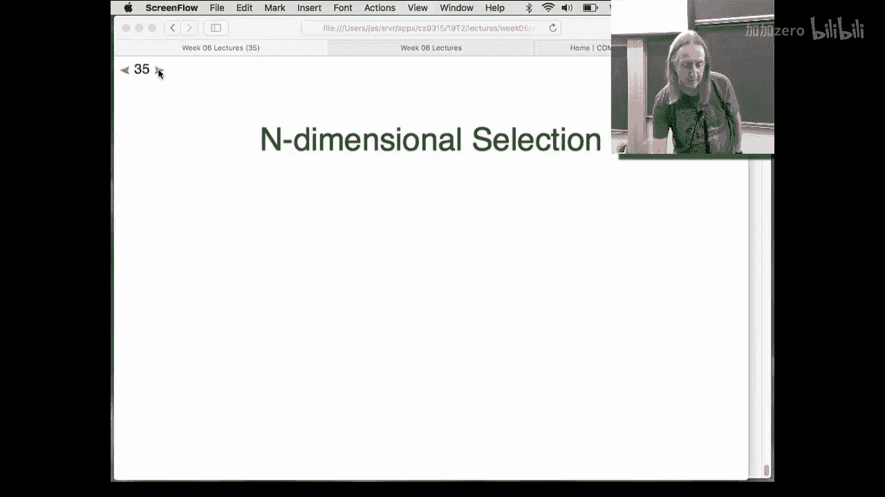

So that's what I mean by ndial， so that first one is one dimensional， that's also one dimensional。

So there's only a single attribute who we have to worry about。

And we've looked at all of those approaches， and now what we're interested in is trying to come up with approaches to efficiently answering queries that involve several attributes now it may turn out and you see a lot of this kind of thing in query optimization that you don't try to use the information for some of the attributes。

 you happen to know that this attribute is a primary key and it has an index on it。

 so to solve the query efficiently， you effectively treat it like one query。And go back to。

Something like this。 So， you know， you could have a query that says select stuff from my where A equals K and B is greater than 5。

So you happen to know this is a primary key with an index on it。

 so I forget about the B greater than five， I just find the tus the tuple in that case that satisfies that。

 get that tuple and check whether be is greater than five。And so there's no point trying to。

 you know？Do something with B to try and improve the efficiency。

So one dimensional queries because they're constraining the tuples more tend to produce fewer results。

 on the other hand to get there requires to consider more stuff， more data。

 potentially more data values。

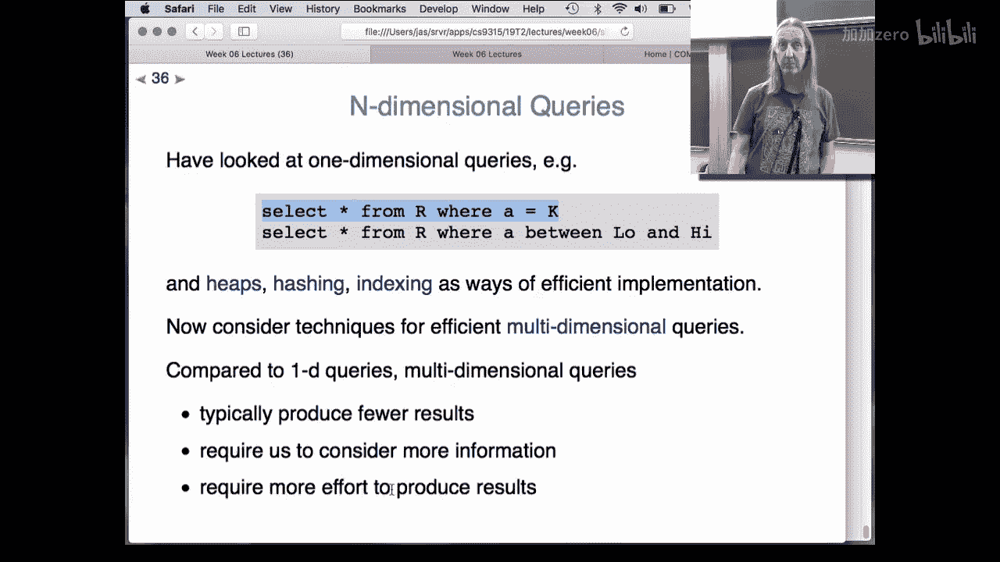

And often require more effort to produce the results。 So here's some examples。

Indimenalque basically means the We clause has got several attributes involved， there's an example。

 it's partial me retrieval because all of the conditions are equality checks。

So I want to find all of the male managers。😔，And space queries。

Ones where we've got multiple attributes， but we're dealing with ranges of values on each of those attributes。

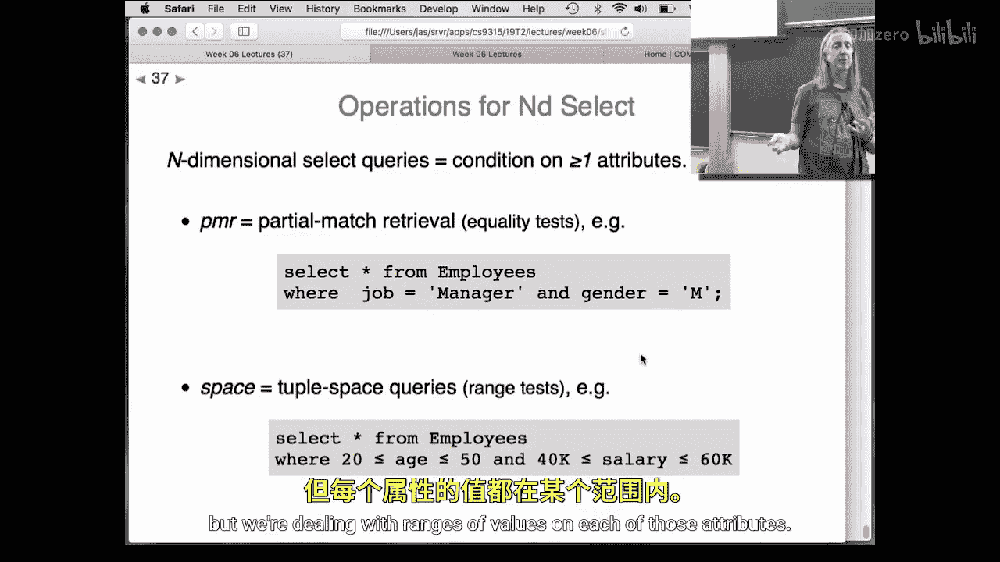

And let me see， do I have。Do I have， Do I have no， I don't。

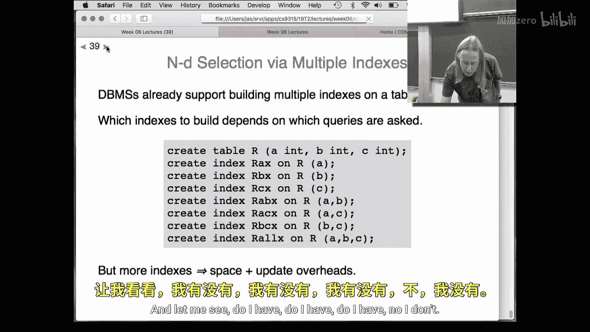

I thought I had an example of what。Of what space queries look like in terms of a tu space。

But effectively， if you think of the set of tus for a particular table as defining。

A multidimensional space， defining some points in a multidimensional space。

 what that kind of query is trying to do is pick out a region of that space and get all of the tops that sit inside that region。

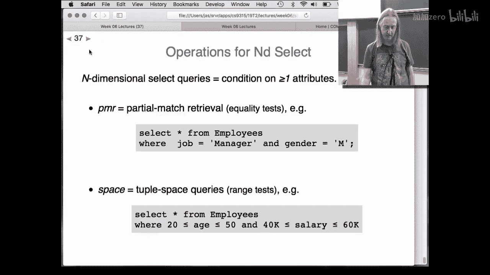

Where actually gets his figure and in the same vein what this is going to do。

 it's going to pick out a set of points in the tuple space。

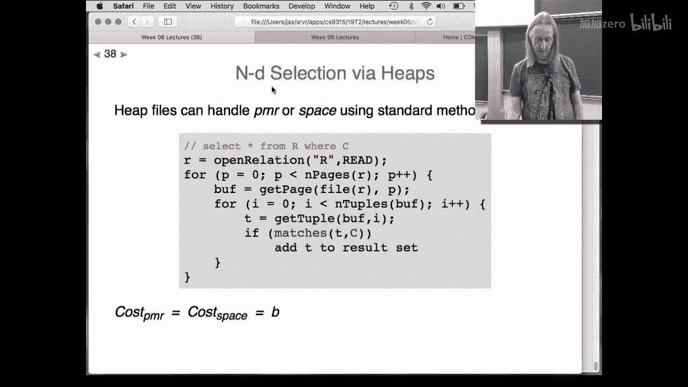

I suppose that is too， but it's really defining a region by those bounds。

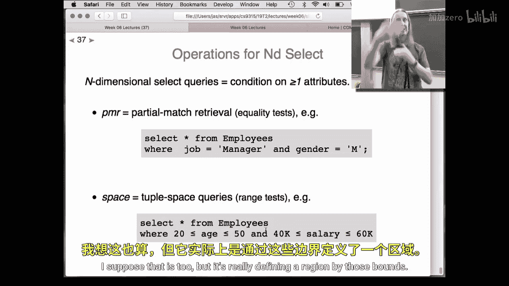

Allright， so you can easily handle partial matchch retrieval and space queries if you've got a heap。

 just scan the heap from start to finish， look at each tu， does it satisfy the condition。

 yes or no ends up in the results if it does， so the cost。

There's always read all of the pages in the Heap file。

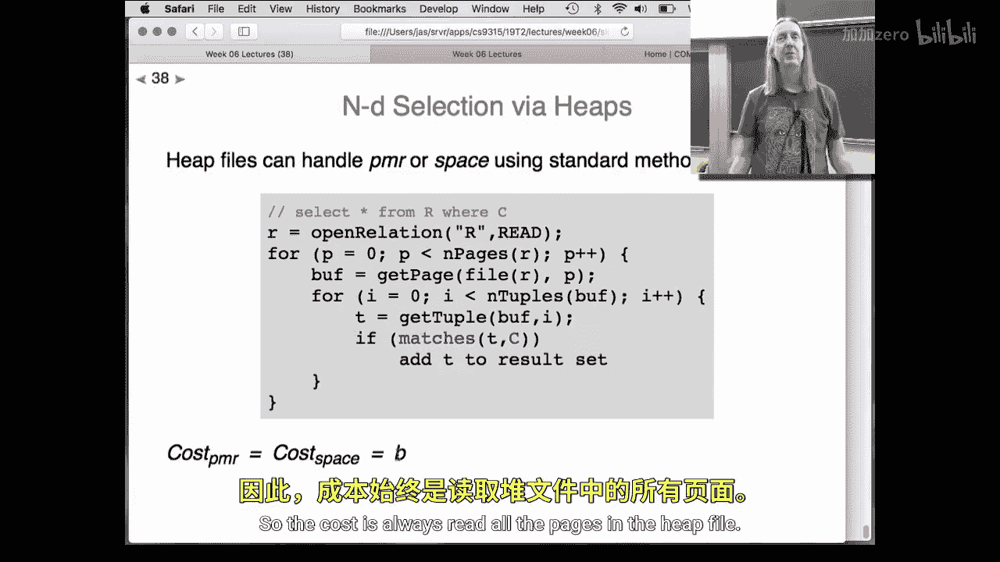

That would be a last resort and its the worst case。And if we had overflow pages， you'd add plus。

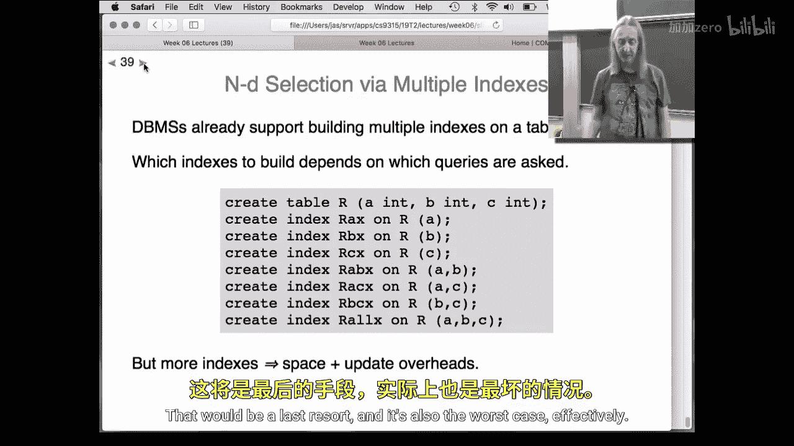

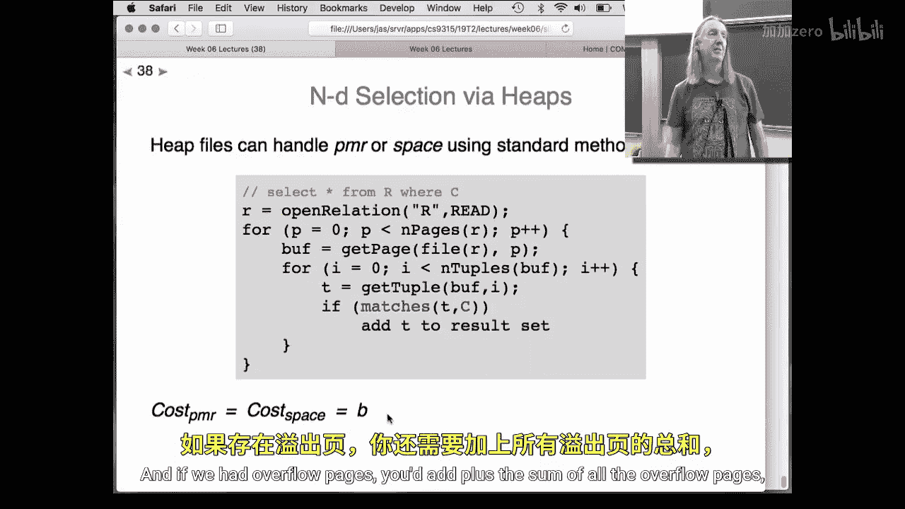

The sum of all the overflow pages because you'd have to read them。😔，As well。

Another possible way of handling， remember I said before that you can create indexes on several attributes or even on combinations of attributes。

嗯。If you wanted to carry that to extreme。Then you could try and create an index for every possible type of query that might be asked。

😔，So you might have queries just on the attribute A， you might have queries just on the attribute B。

 you might have queries just on the attribute C for each of those attributes you make an。

And then of course if you're worried about oh I might have a query that involves A and B and I can make a new index on that this would be a rather silly thing to do because making that many indexes is obviously going to substantially increase the cost of inserting and deleting tuples because you've got to modify everyone。

In the world， potentially many of the different indexes。

So cost to store the indexes and cost to maintain。

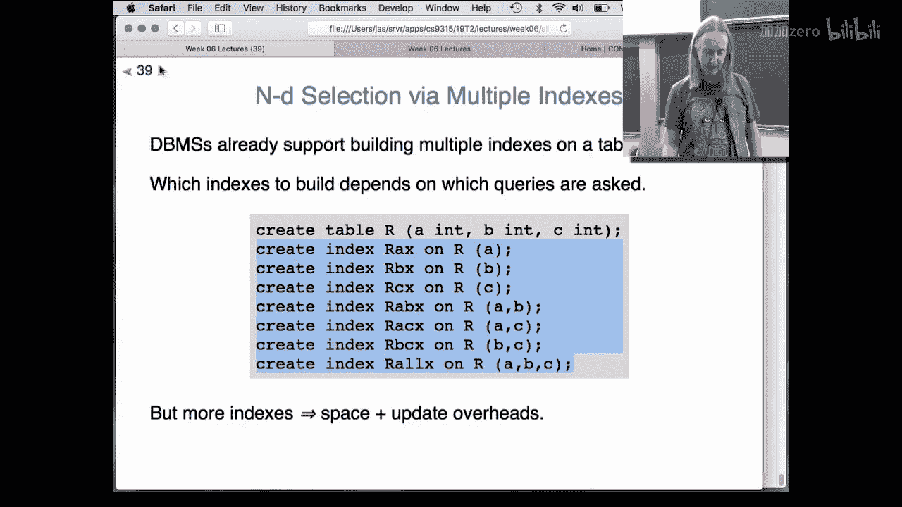

It's significant cost。Okay， so generalised view of these。Types of queries。

 we've got several attributes involved and。Various operations on the attribute they all quality operations into partial retrieval。

 if some of them arrangequeries in space。So if we were using this multiple index style strategy。

We could do one of two things， well if we weren't using the multiple index style strategy and we happen to know that at least one of the attributes in the query had an index on it。

 like I said before， we could just forget about the rest of the condition and just treat it like a query on that particular attribute。

 fetch all of the matching doubles and then。Check the conditions for the rest of the way clothes on all of the attributes。

 all of the tuples that we've fetched。Could do it that way。

An alternative would be to actually use all of the indexes。

 remember that when we're running these indexes we don't fetch tuples every time we identify one in the index。

What we do is we collect the pages that those tuples are on and we。So as we scan the index。

 that's what we do at the end of the index scan we've got a set of pages and we then go and read those pages if we had multiple indexes we could。

Scan each of those indexes， collect a set of pages for each of those indexes and since we're talking about conjunctions here。

 if we take the intersection of those set of pages then。

Those are the only pages that can possibly match all of the conditions in the wear clause。

Is that a useful way to do things， not sure。

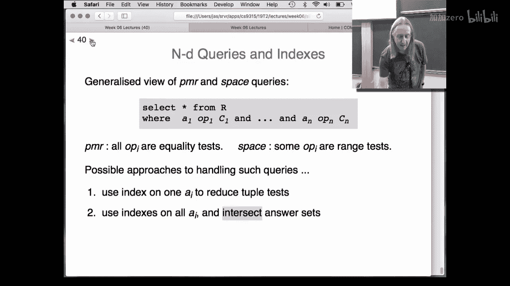

Deciding。So if we've got several indexes， which one do we use and of kind of giving the gateway a bit there？

I keep saying if we've got a primary key we use that one because we know there's only going be one match so in general if we don't have any primary keys we use the attribute that's likely to produce the least number of results so the one that's most selective in。

Well。诶。How many tus it'll produce？So working out the selectivity depends a little bit on the。

Size of the attribute domain so if we're talking about something like。H。

There's about100 values potentially。Maybe more feel lucky。うん。So this。

That domain has got a relatively small number of。Vues， but if you look at something like name there。

Wils and what of different name that is， so the thing is if I ask for a particular name。

 there may not be many matches for that particular name， but if I ask for an age。

 especially a common age like mid 20s or something， then there's likely to have be lots。

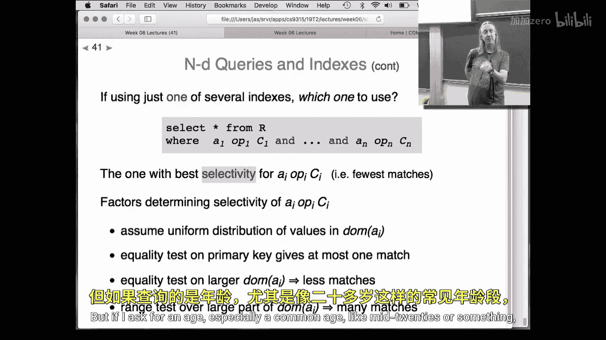