# Postgres数据库实现原理：P18：多维查询处理

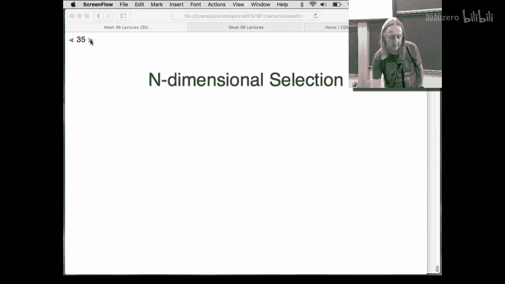

在本节课中，我们将要学习如何处理涉及多个属性的数据库查询，即多维查询。我们将探讨其定义、挑战以及可能的处理策略。

---

## 多维查询的定义

上一节我们介绍了基于单一属性的查询处理。本节中我们来看看当查询条件涉及多个属性时的情况，这被称为多维查询。

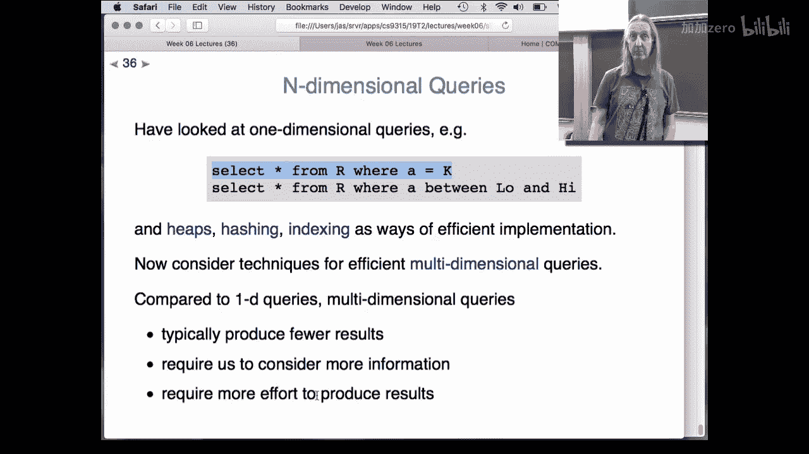

以下是一些多维查询的例子：
*   **部分匹配检索**：查询条件包含多个属性，且均为等值比较。例如，查找所有男性经理。
*   **空间查询**：查询条件包含多个属性，且每个属性都涉及一个取值范围。例如，查找年龄在20到30岁之间且工资在5万到7万之间的所有员工。

从概念上讲，可以将一个表中的所有元组视为多维空间中的点。一个多维查询的目标就是选取该空间中特定区域内的所有点。

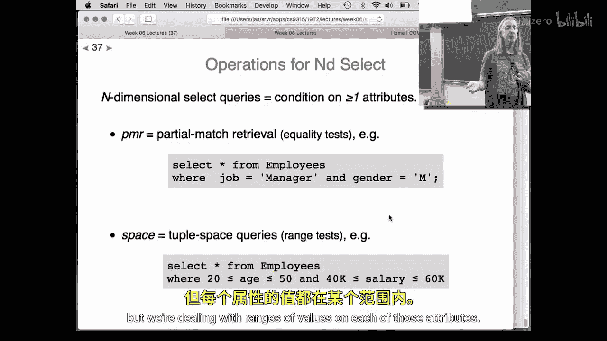

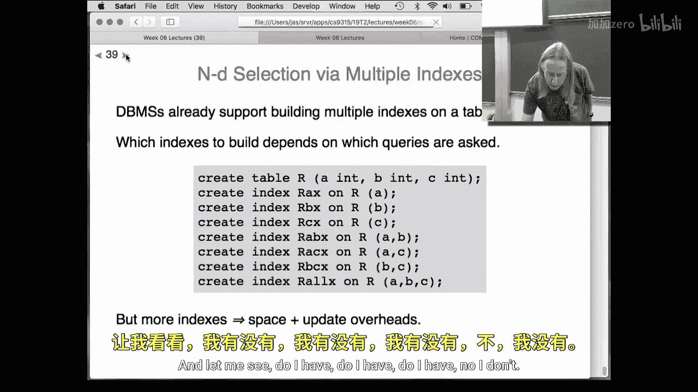

---

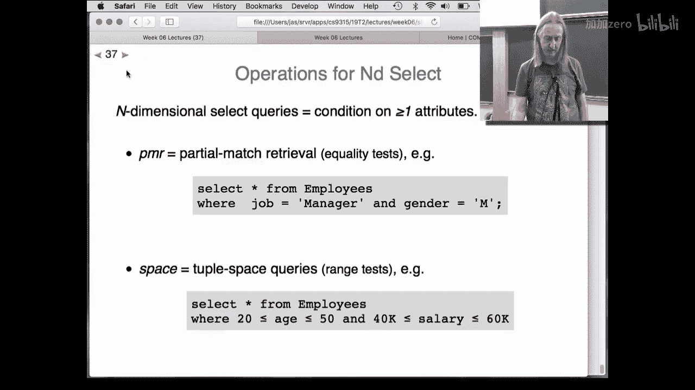

## 基础处理方法

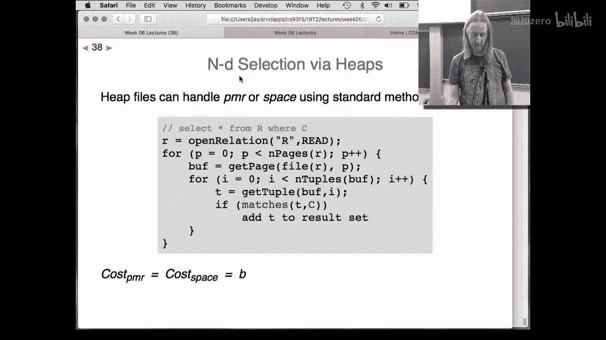

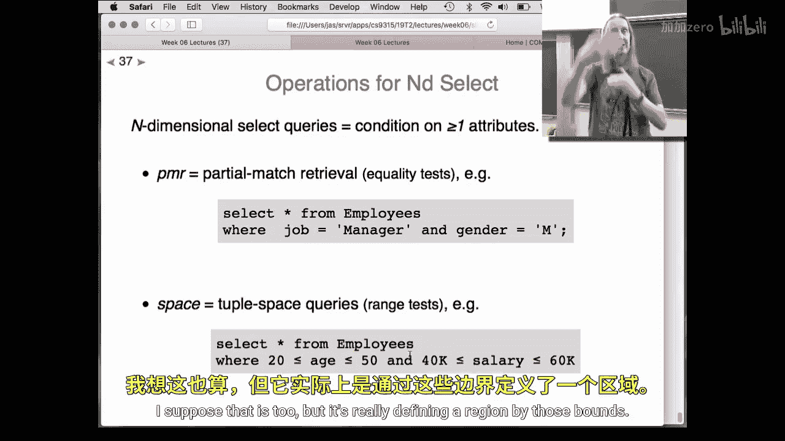

处理多维查询最直接的方法是扫描整个堆文件。

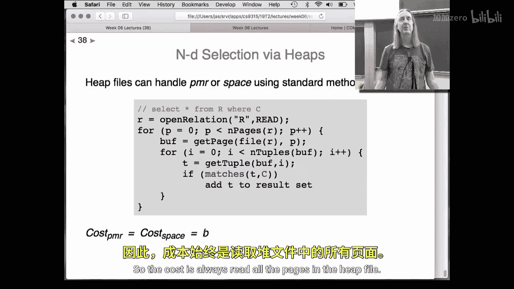

以下是具体步骤：
1.  读取堆文件中的每一个数据页。
2.  检查页中的每一个元组。
3.  判断该元组是否满足查询中的所有条件。
4.  如果满足，则将其加入结果集。

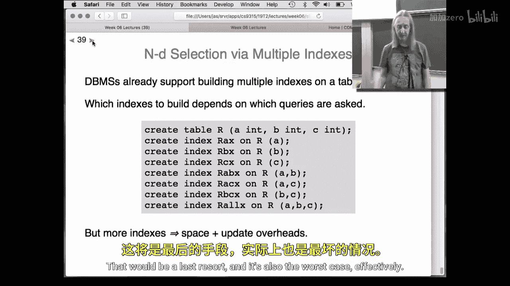

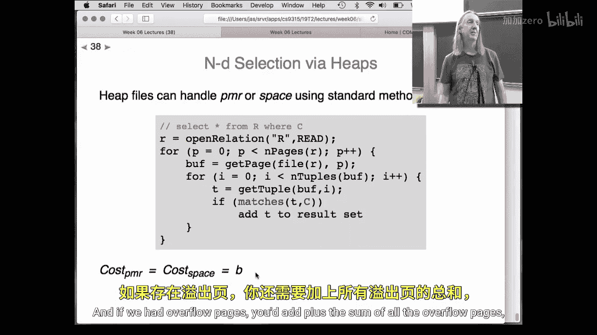

其成本公式为：
`Cost = b`，其中 `b` 是堆文件中的数据页总数。
如果存在溢出页，则成本为 `Cost = b + sum(overflow_pages)`。

这是一种最后的手段，通常效率最低。

---

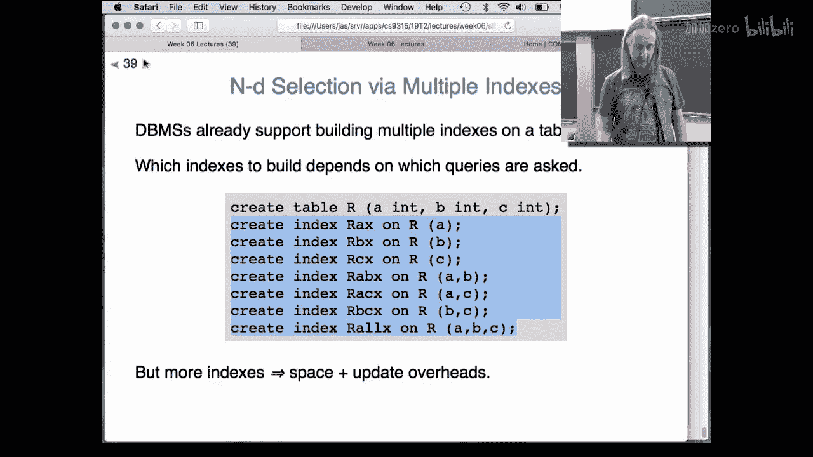

## 使用多个索引的策略

另一种策略是为查询中涉及的每个属性都建立索引。理论上，可以为所有可能的查询组合都创建索引，但这会带来显著的存储和维护成本。

当面对一个涉及多个属性的查询时，如果这些属性上都有索引，我们可以采用以下两种策略之一：

**策略一：使用选择性最强的单个索引**
1.  选择预计返回结果最少的那个属性上的索引（即选择性最强的索引）。
2.  使用该索引找到所有匹配的元组。
3.  从磁盘获取这些元组后，再在内存中检查它们是否满足查询的其他条件。

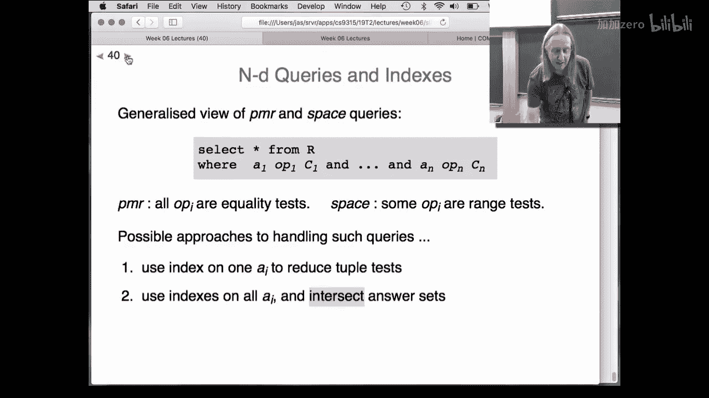

**策略二：使用多个索引的交集**
1.  分别扫描查询中涉及的每个属性的索引。
2.  每个索引扫描会收集到一批可能包含匹配元组的**数据页ID**。
3.  对这些数据页ID集合取**交集**。
4.  最终，只有出现在所有集合中的那些数据页，才可能包含完全满足所有查询条件的元组。
5.  最后读取这些页并获取元组。

选择哪个属性索引作为“入口”取决于其选择性。例如，在“性别”和“姓名”两个属性上都有索引的查询中，“姓名”通常具有更高的选择性（因为重复值少），因此可能优先使用“姓名”上的索引。

---

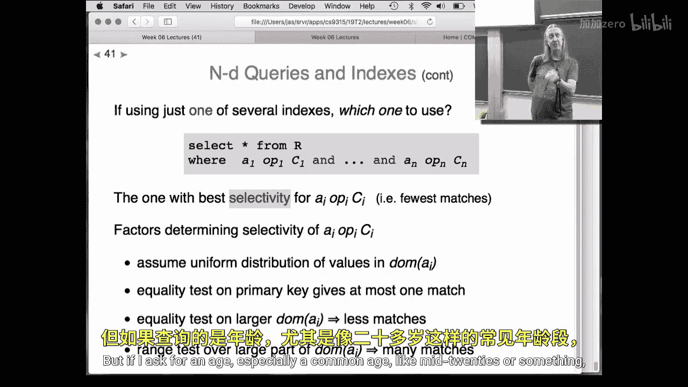

本节课中我们一起学习了多维查询的概念、基础的全表扫描处理方法，以及利用多个索引进行优化的两种策略。理解这些策略有助于在数据库查询优化中做出更明智的选择。