# 新南威尔士大学【中英⚡Postgres数据库实现原理｜COMP9315 2018 Postgres Implementation】 p19 P19 -BV1qXoqYHErC_p19-

Go。All right， so quiz3 is finished if you didn't do it， bad luck。Simon2， coming soon。To。

Website near you。So today I want to keep talking about， oh， now we finished 1 D select。

 talk about multi multi attribute。Seelection type operations。

And maybe get on to some other kinds of multidimensional selection as well and next week we're going to talk about join。

And。

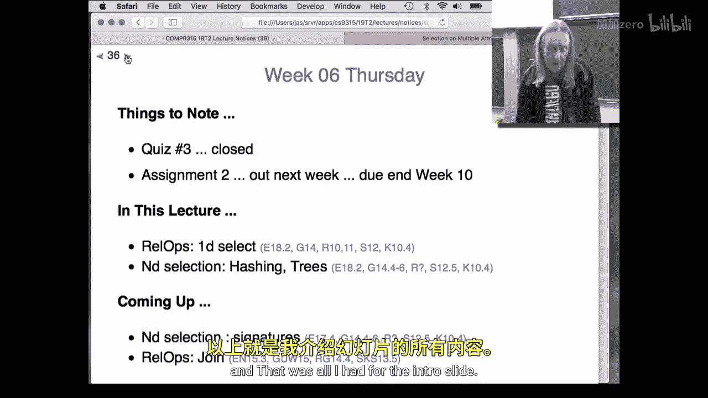

That was all I ahead for。The intro slide， no nerd， no discussion of quiz3 because I didn't have time to prepare it。

😔。

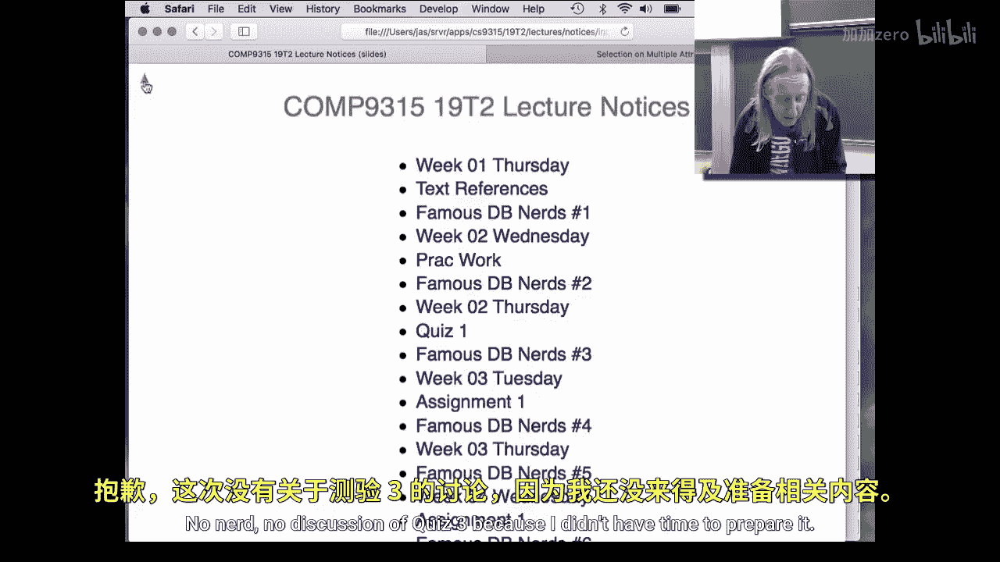

All right， so last time we got to the point of talking about multiattribute hashing。

 remember the deal there is you take a hash of each of the individual attributes。

 gives you a bit string and you pull out some of the bits from that bit string。

 put them together and get a composite hash。Which has got bits and pieces from。There different。

Attribute hashes。Some attributes don't have to be included and we can see that that hasn't been included。

And we've taken one bit from each of these， how do we decide how many bits from each attribute。

 how do we decide which bits， theres thing called a choice vector。

 which basically tells us that this bit here comes from the lower or a bit of the first attribute。

 this bit here comes from the lower or a bit of the second attribute and so on。

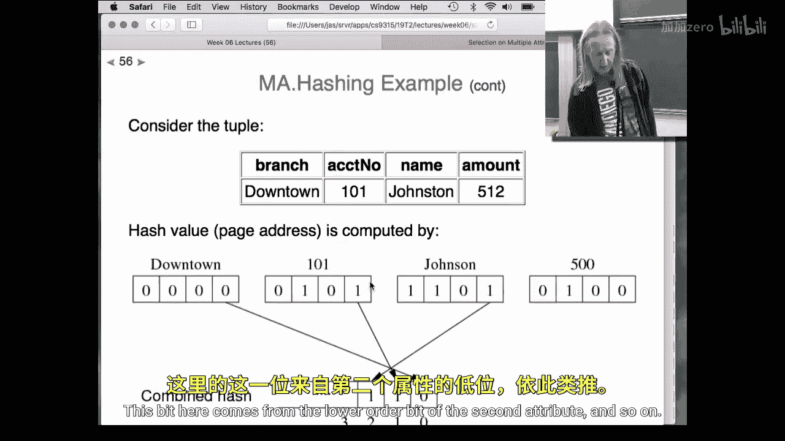

All right， how do we compute such a hash function or one thing we need。

 we need to be out and pull out。The eye be from a hash value。

 which is what that's doing a little bit of bit manipulation。And。Choice factor。

 remember that each component of choice factor is a pair。

 one first part of the pair tells you which attribute。

 second part tells you which bit and we've got an array of such pairs and we need a hash function obviously in fact we can use multiple hash functions if you really want doesn't matter I've kind of assumed that we'll be using postgressors hash any function which some of you。

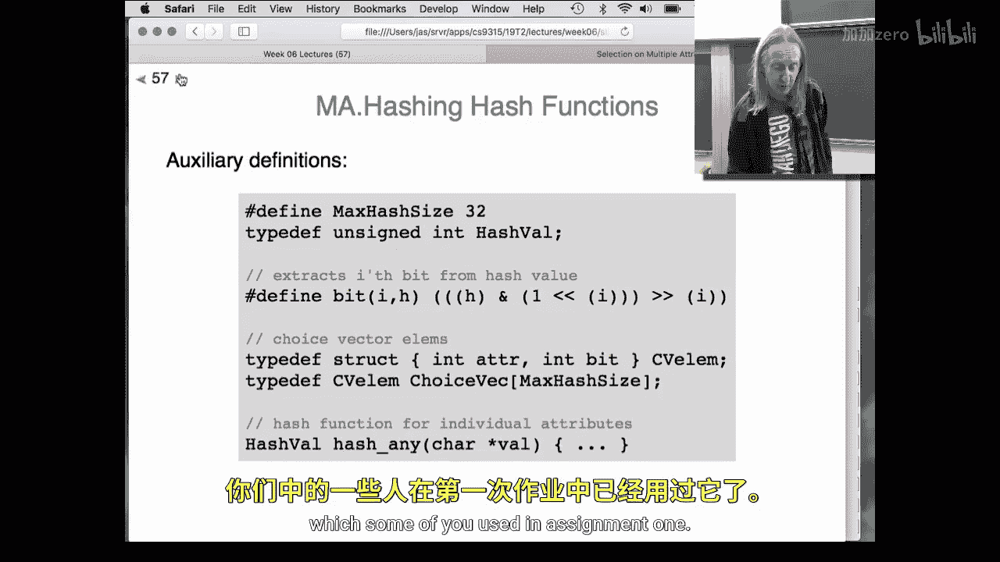

Used in assignment 1。ほくねあほ。Do you like jump。

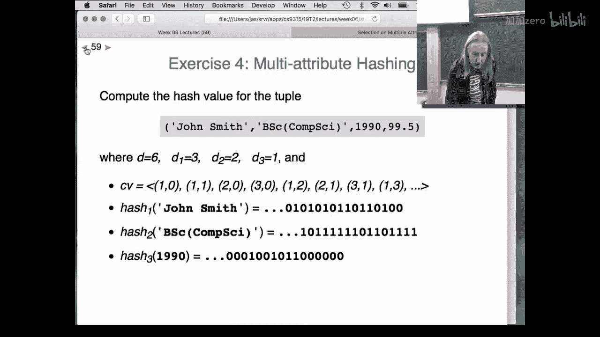

へスまして。Jump too far all right， so how do we produce this Dbit hash value for a tuple so we want D bits to be set we've got our choice factor and we've got our tuple。

哎哎。All right。We can compute the value H based on， I'm not sure why we're doing that。

 but in any case we need to get these combined hash value res initialised to zero and we want to gradually set bit by bit based on the choice factor and the hash it's owner what that is。

Computer array size， naughty， naughty， don't do it in C seems to work sometimes。

 but not always all right so that's。The array of hash value。

 so what we can do first and we can do we can run through all of the attributes。

 computer hash value for each attribute and stick it in our hash array。

Then we run through the number of bits we want， so we want D bits。

 that's one of the parameters of the function for each of those bits。

 we grab the corresponding pair from the choice factor， work out which attributes involved。

 work out which bit of that attribute we want， and then we extract the beat bit from the hash value for attribute A。

That gives us a single bit which obviously is either going to be one or zero and then we poke that bit into the appropriate position in our composite hash so we just left shift it by I position so obviously the first bit goes in the lower order get shifted by zero next bit goes in the next。

Le significant bit and so on and so we run through that to get as many bits set in hash value as we want and that gives us our composite hash。

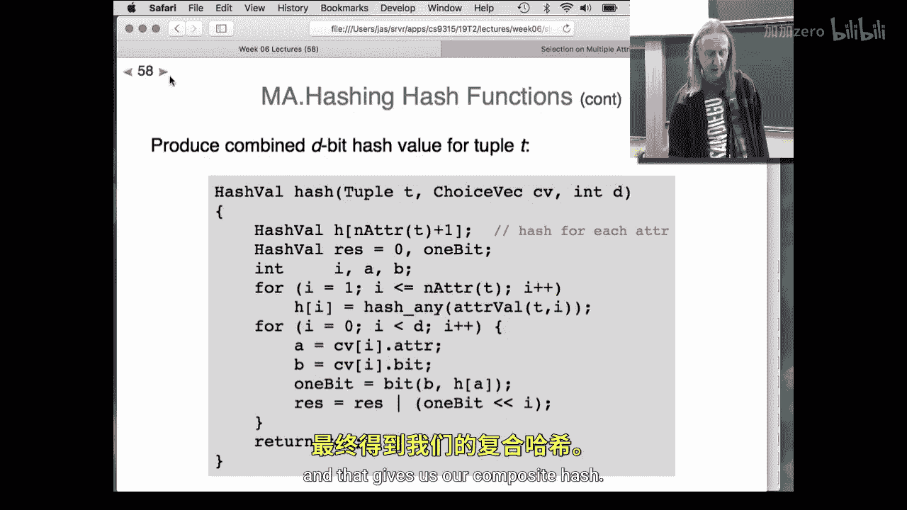

Let me see how many of these exercises will I do， yeah I guess I can take a look at this one。

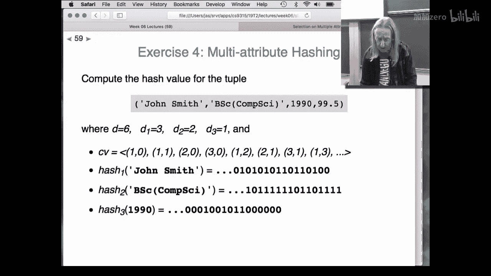

Oops。

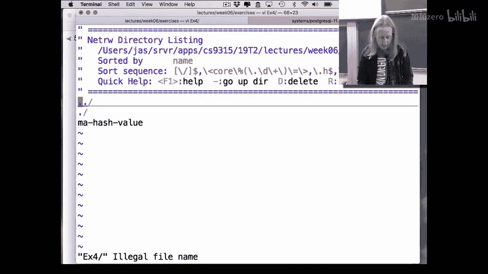

That wasn't quite smart't。That's all。so there's our choice vector。

 there's our individual hash values and we want to produce hash values for our composite hash。

So the choice vector tells us that the。Lower order bit of the composite hash comes from attribute one and position zero in that hash so we look at attribute one。

 we look at the hash value for attribute one and that's a bit that we put in there the next bit comes from attribute one again and it comes from a bit add position number one so that's talking about that bit there so we stick down into bit one in the composite hash。

Bit two comes from the least significant bit from attribute number two。

 this is the hash for attribute number two， so that's talking about that bit there。

So that's where that one comes from next bit comes some least significant bit of attribute threes hash value。

 that's that one。Next one comes from our attribute one position number two。

 so we're talking about that bit and so on and so on so we can run through and produce as many bits as we like how many bits do we produce electrical on how large the file。

So if the file sizes two to the five， then we only five bits。Address forward pages。あ。

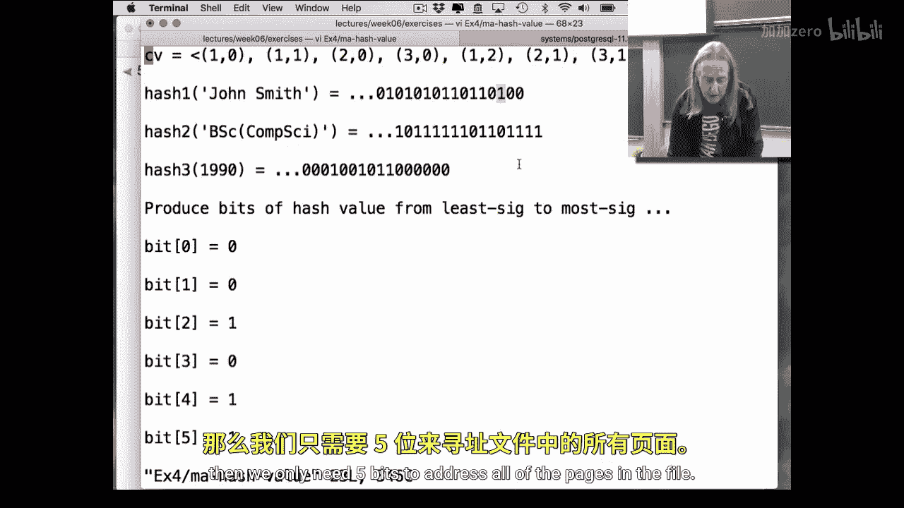

So producing multi attribute hash values。

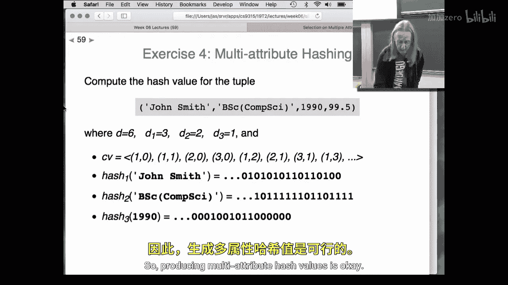

Okay， how do we use this stuff for doing queries so remember that we're basically doing multi attribute hashing for partial match retrieval queries where we've got。

A conjunction of equalities on different attributes。Some of the attributes we know the value for。

 so we know the branch is bright and we know the name is green， but we don't know。The account number。

 and we don't know the value。Yeah， the balance。All right， so that。

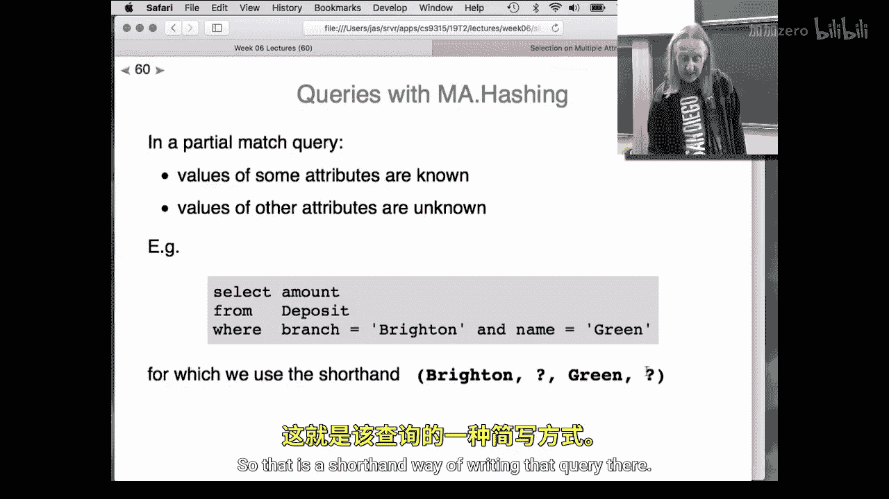

Here's a shorthand by providing that query there。All right， so what can we do given that information。

 oh that's all right， given a different query where we only know the name green。

We can produce a hash value for that and using the choice vector we can say all right the less significant bit of green has to go in there what about the other bits well we don't have values for them and we introduce this notional unknown bit value star and by the choice vector and I'm pretty sure it's the same choice vector is we had a couple slides ago we take that bit from attribute number one and that goes to that position there the next thing in the choice vector comes from attribute number two and it's a less significant bit that's an unknown bit so that goes there so that gives us a query hash which has got some bits that are known could be zero this one happens to be one but there could also be unknown so。

The way we work at which pages that we need to look at， remember this is all hashing。

 so basically what we're trying to compute is what pages。Are likely to hold。

Tuubles that satisfy this property here。Right， will any trouble with the name agree？

Has to have had one in this bit position so here is assuming we've only got eight pages so we un three bits of hash so what pages could this tu be on？

Well， given that we don't know anything about these other valuess。

 potentially they can be either zero or one， either of those speeds could be either zero or one。

 so we basically have to take all the possible combinations so if there's an account or a deposit。

Account。Associated with green， it could be。Wello， there are several of them。

They could be either in there or in that page or in that page or in that page。

 so we simply generate all possible combination of bits for the unknown bits and we have to look at those pages。

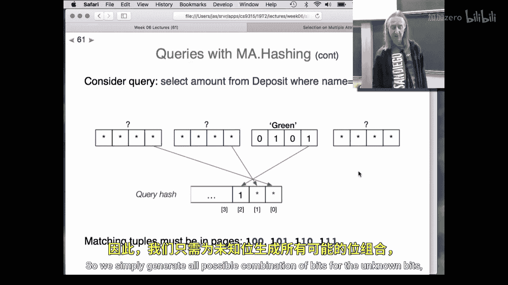