# 数据库实现原理：第19讲：多属性哈希与查询处理 🗄️


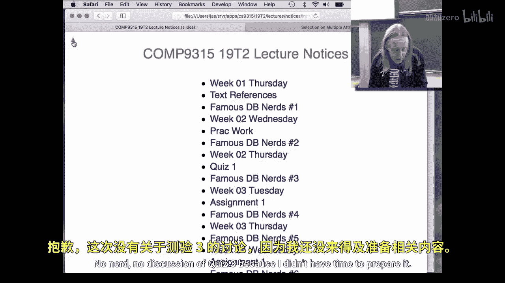

在本节课中，我们将要学习多属性哈希（Multi-attribute Hashing）的实现原理，以及如何利用它来处理包含多个属性的部分匹配查询。我们将从回顾多属性哈希的基本概念开始，然后深入探讨如何计算复合哈希值，并最终学习如何利用这些哈希值来高效地执行数据库查询。

## 回顾：多属性哈希

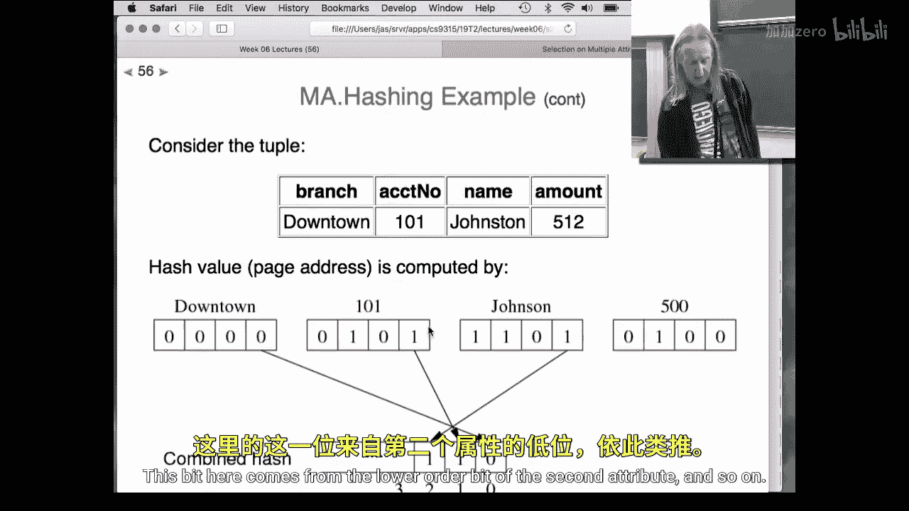

上一节我们介绍了单属性选择操作。本节中，我们来看看如何处理涉及多个属性的选择操作。

多属性哈希的核心思想是：为元组的每个属性分别计算哈希值，得到一个比特串。然后，从一个称为“选择向量”的结构中，提取每个属性哈希值的特定比特位，并将这些比特位组合起来，形成一个复合哈希值。

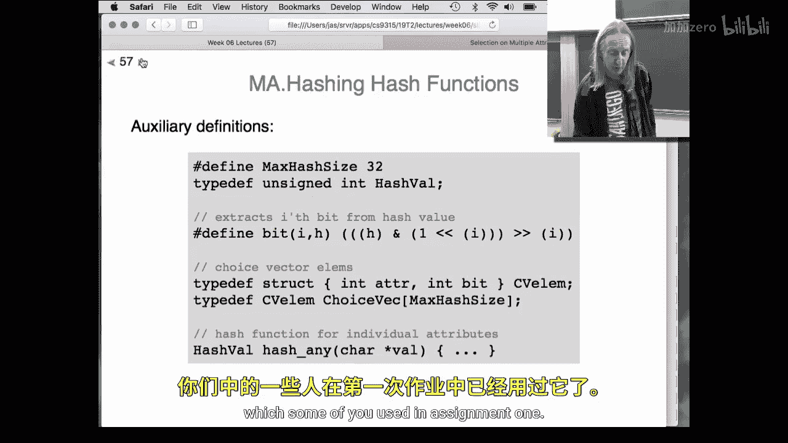

**公式**：复合哈希值 `H_combined` 的构建可以表示为：
`H_combined = (bit_from_attr1 << pos1) | (bit_from_attr2 << pos2) | ...`
其中，`bit_from_attrN` 是从第N个属性的哈希值中提取的特定比特，`posN` 是该比特在复合哈希值中的目标位置。

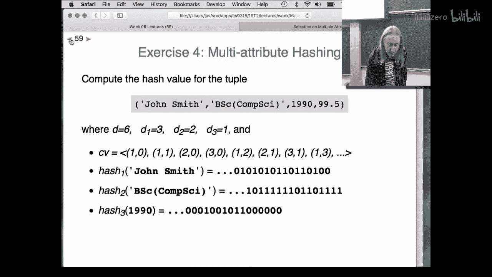

选择向量决定了如何组合这些比特。它是一个数组，其中每个元素是一个数对 `(a, b)`：
*   `a` 指定使用哪个属性（例如，属性1、属性2）。
*   `b` 指定从该属性的哈希值中提取第几位（例如，最低有效位是第0位）。

## 计算复合哈希值

理解了概念后，我们来看看如何具体计算一个元组的复合哈希值。

以下是计算复合哈希值的逻辑步骤：

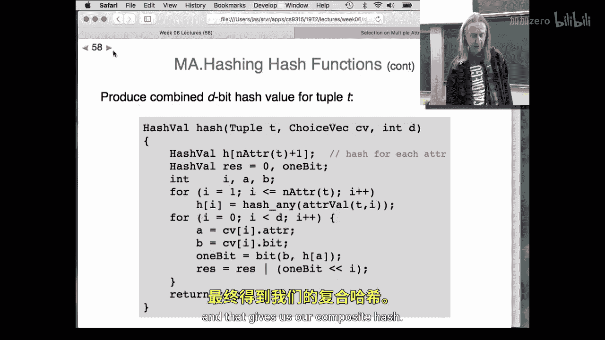

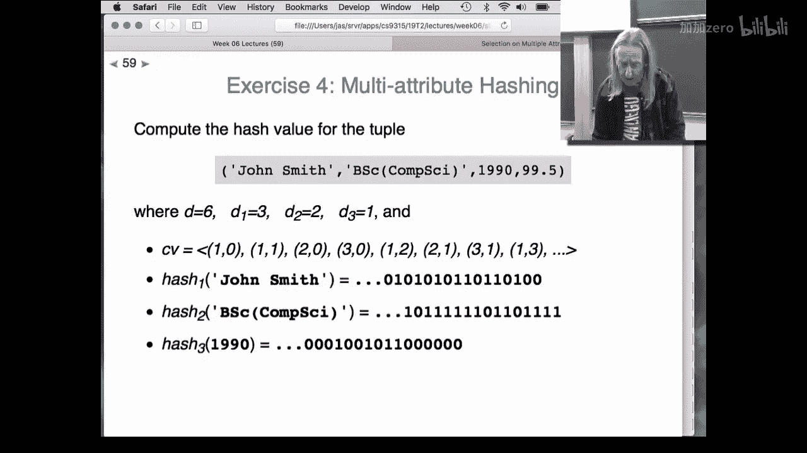

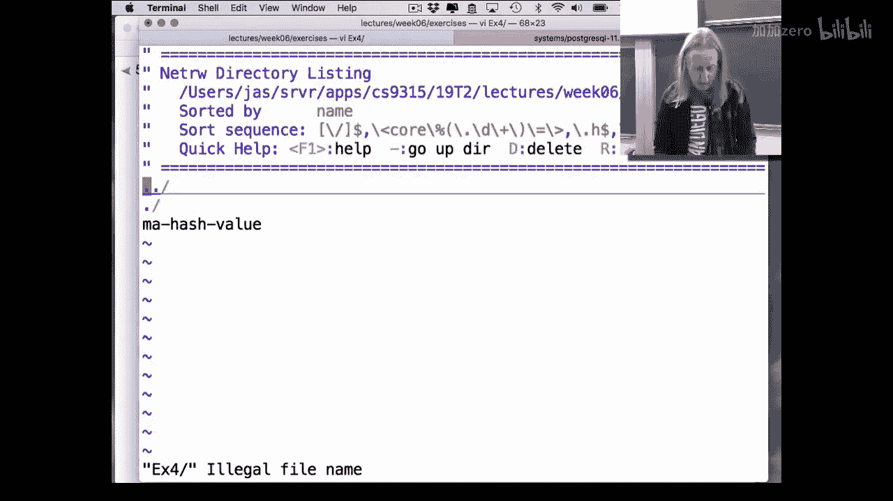

1.  **初始化**：将复合哈希结果 `res` 初始化为0。
2.  **计算属性哈希**：遍历元组的所有属性，为每个属性计算其独立的哈希值，并存储在一个数组中。
3.  **组合比特位**：根据我们需要的哈希值位数 `D`（这通常取决于文件大小，例如，如果文件有 `2^5` 页，则需要5位地址），进行 `D` 次循环：
    *   从选择向量中获取第 `i` 个数对 `(attr_idx, bit_pos)`。
    *   根据 `attr_idx` 找到对应属性的哈希值 `hash_val`。
    *   从 `hash_val` 中提取第 `bit_pos` 位的值（0或1）。
    *   将这个比特值左移 `i` 位（即放入复合哈希值的第 `i` 位），然后通过“或”操作设置到 `res` 中。

**代码**：核心计算逻辑的伪代码如下：
```c
int computeCompositeHash(Tuple t, ChoiceVector cv, int D) {
    int res = 0;
    int attr_hash[NUM_ATTRS];
    // 步骤1: 计算每个属性的哈希
    for (int a = 0; a < NUM_ATTRS; a++) {
        attr_hash[a] = hash(t.attributes[a]);
    }
    // 步骤2: 根据选择向量组合比特
    for (int i = 0; i < D; i++) {
        int attr_idx = cv[i].attr_index;
        int bit_pos = cv[i].bit_position;
        // 提取属性哈希值的特定位
        int bit = (attr_hash[attr_idx] >> bit_pos) & 1;
        // 将该位设置到复合哈希的对应位置
        res |= (bit << i);
    }
    return res;
}
```

## 利用多属性哈希进行查询

现在我们已经知道如何为数据构建哈希，接下来看看如何利用它来回答查询。

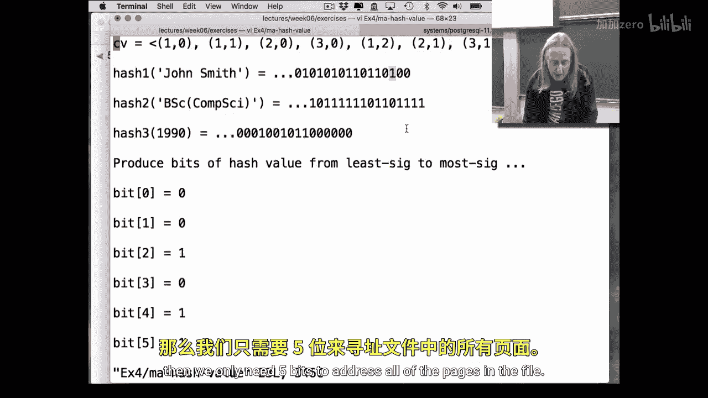

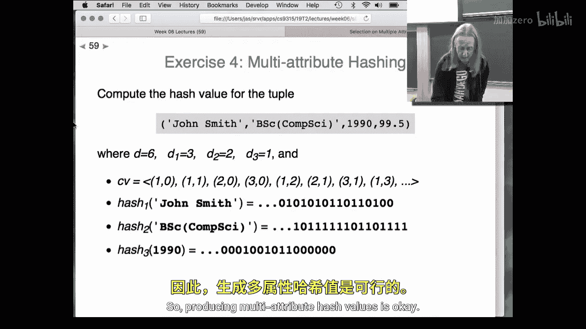

我们主要针对**部分匹配检索查询**，即查询条件是多个属性上等值条件的合取，但可能只指定了其中一部分属性的值。例如，一个查询可能指定了 `branch='Brighton'` 和 `name='Green'`，但没有指定 `account_number` 和 `balance`。

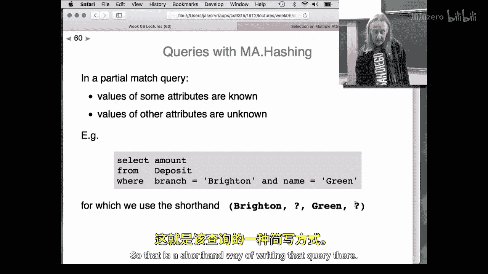

给定一个查询，我们可以为已知属性值计算其哈希位。对于未知的属性，其对应的哈希位我们用一个特殊的符号（例如星号 `*`）来表示，表示该位可能是0或1。

**处理流程**：
1.  **生成查询模式**：根据选择向量，为查询中已知的属性值生成确定的比特位，为未知的属性生成 `*`。
2.  **确定候选页**：这个查询模式定义了一个“可能页”的集合。我们需要检查所有那些在确定位上与查询模式匹配，并且在 `*` 位上可以是任意值的页面。
3.  **具体来说**：如果哈希地址有 `D` 位，其中 `K` 位是已知的（0或1），`U` 位是未知的（`*`），那么我们需要检查的页面数量是 `2^U`。我们需要生成所有 `U` 个未知比特位的可能组合（0或1），从而得到 `2^U` 个具体的页号，并检查这些页面。

**示例**：假设我们有一个3位的哈希地址（对应8个页面），查询模式是 `1**`（即最高位是1，其余两位未知）。那么我们需要检查的页面就是所有最高位为1的页面，即页号4(`100`)、5(`101`)、6(`110`)、7(`111`)。

## 总结

本节课中我们一起学习了多属性哈希在数据库查询处理中的应用。我们首先回顾了通过选择向量组合多个属性哈希值来构建复合哈希的方法。接着，我们详细探讨了如何为元组计算这种复合哈希值。最后，我们学习了如何利用这种机制来处理部分匹配查询：通过为已知属性生成确定比特、为未知属性生成通配符来形成查询模式，并据此确定需要访问的所有可能数据页。这种方法能够有效地将查询范围缩小到有限的几个页面，从而提升查询性能。

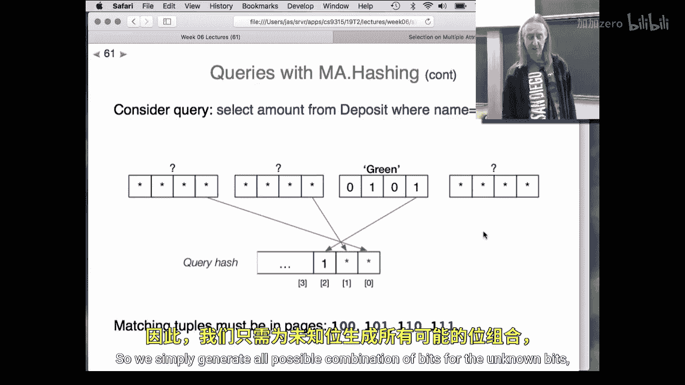

下周我们将讨论连接操作。