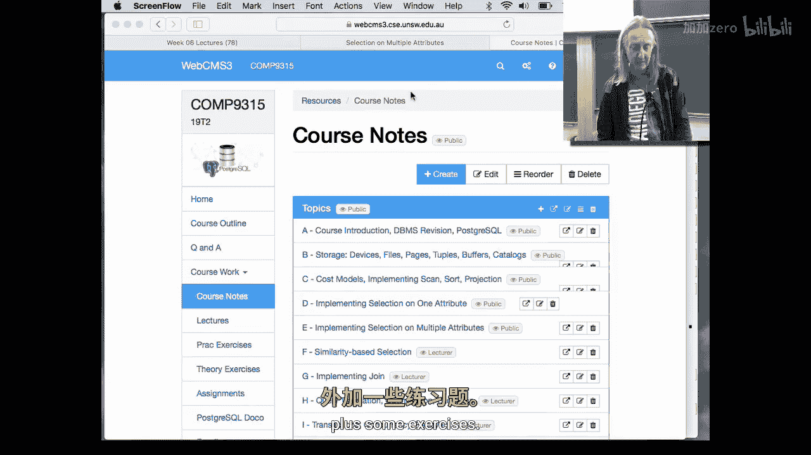
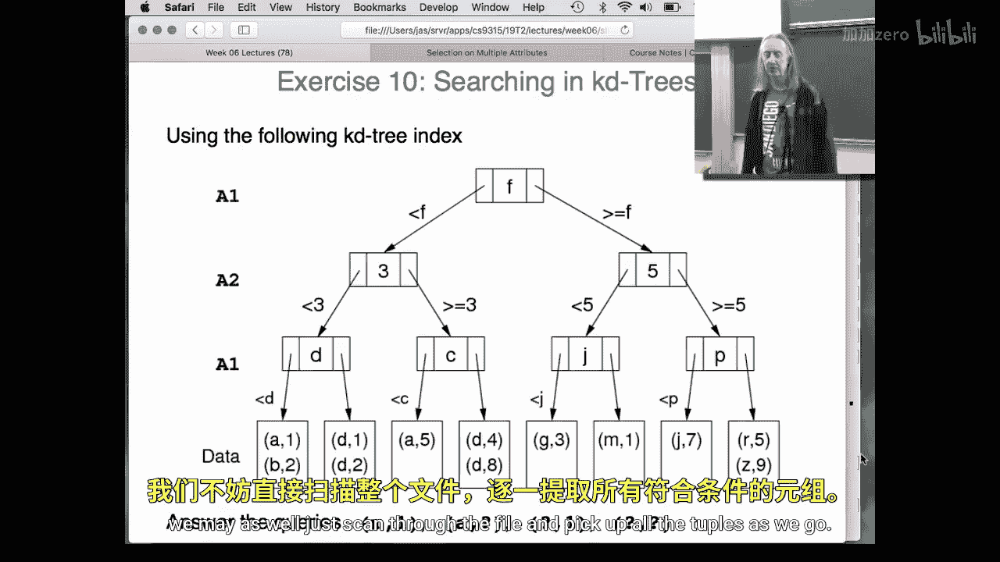
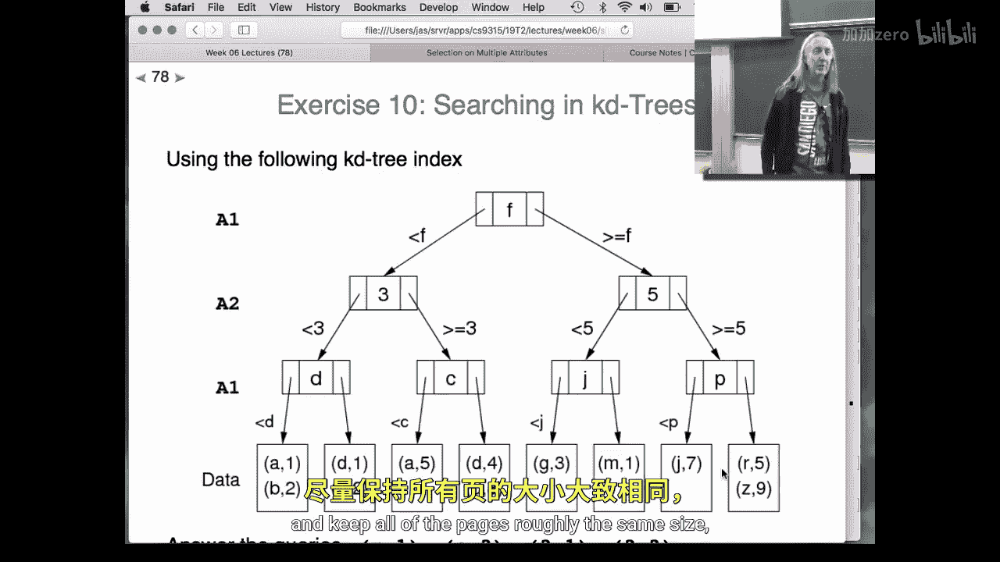
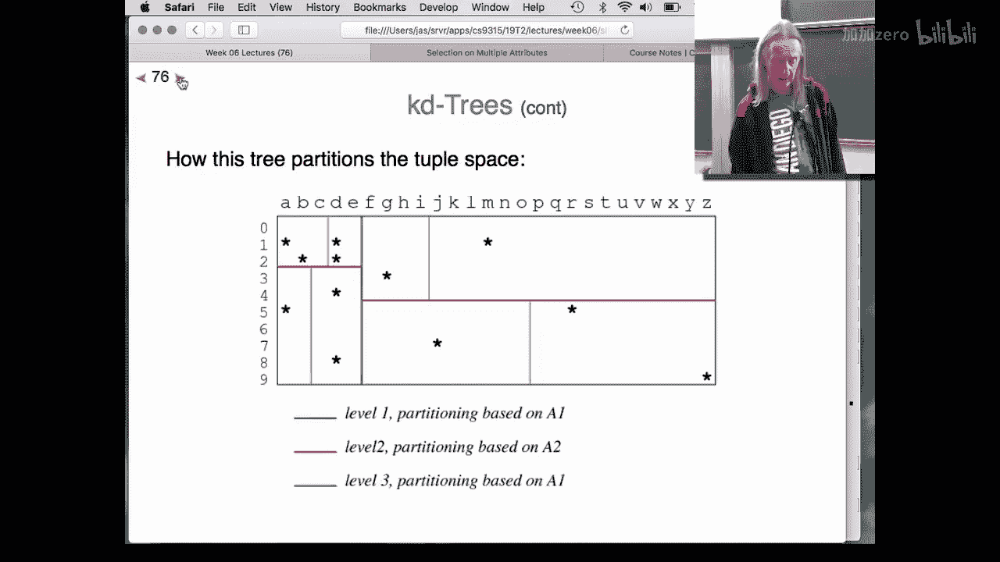
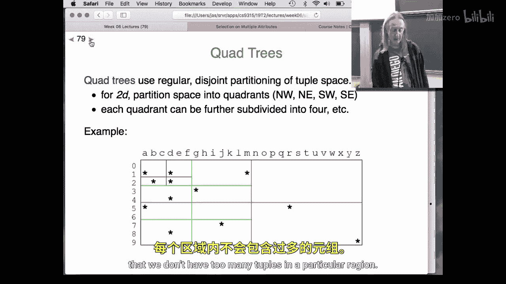
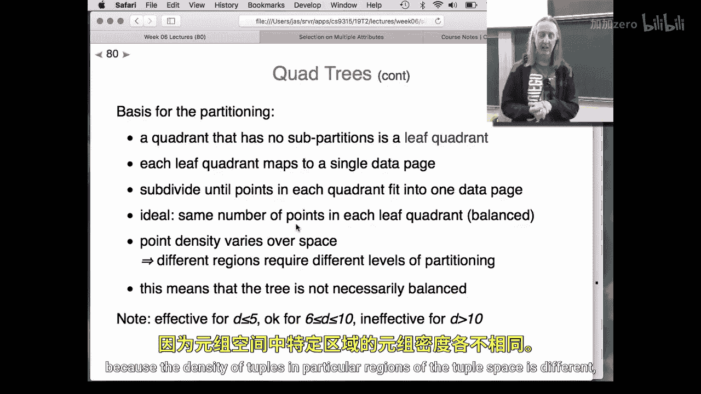

# 新南威尔士大学【中英⚡Postgres数据库实现原理｜COMP9315 2018 Postgres Implementation】 p20 P20 -BV1qXoqYHErC_p20-

Okay。Yeah， all of this stuff I talk about in lectures is supposed to be available under course notes。

 some of it you can see I haven't finished working on it， so I'm not going to put it up。🤢。

And I forgot to make that public， but that's the stuff I'm talking about today so。Very good。诶。

The slides are basically a summary of what's on here。

 if you' go and look at that there's a whole lot of stuff that's not on the slides。😔。

a whole lot more details out on the slides， I don't think。

 there may be an occasional topic that I didn't talk about。Didn't mention at all ins。

But most of it is the slides in lectures are a summary of what's in the course notes plus some exercises。

So， hopefully。And I don't normally put， well sometimes I'll put the slides up because I don't know how far I'm going to get and I'm going to give you 200 slides if only cover。

10 of them。And when I find mistakes on the slides on those extremely rare occasions。

Then I like to fix them before I， I make slides available。All right， so here's Kd tree。

 here's some queries on that Kd tree， M1， we're trying to find a topple which has x value of M。

 y value of one。So。First thing we're going to do at the top level。

 we're going to look at attribute one， which is M， and that'll tell us go down here。

Next thing we're going to do， we're going to look at At two， which has the value one。

 so we'll decide to go down here。Next thing we're going to do。

 we're going to go back and look at attributes one again and work out how that relates to J and then go down here and bingo we find。

M1 in this particular data page。What about this query here？So we've got a value for a。

 but we don't have a value for oh sorry， we've got a value for A1。 don't have a value for A2。

 All right， so we can start and we know we have to go。Down here， because we're dealing with I。

We don't know。诶。We haven't got to value for A2， so we basically just have to look at both these nodes。

 so we'll go down to this node here。And once Gm will consider attribute1， that's a value of A。

 so we go down here， that takes us to a data page and then we examine that data page and discover that there is a topple there that has the value for A for attribute A1。

But we're not done， we didn't need to consider this data page because we know that all the topples in this data page have an aim on value greater than D。

We're grated that are equal to。Which is not what a。 All right， But we do need to consider this node。

And once again we consider attribute A1， which has a value A。

 we go down to this data page and once again we find another tuple that has an a value for that attribute。

And we're done， that's all the tree that we need to consider。For this particular query here。

 we don't know which way to go an if so we have to consider both of the child knowns。

And once we get to a child node， we look at attribute A2， which has a value one。

 so we know that we don't have to consider this branch of the anymore。

 but we do need to consider this one。Once we get down to here， we don't know。😔。

Which way to go so we need to follow both branches that Hagers to two different data pages which we have to read and scan through the tuples looking for any tuple that has a one in a second attribute so we'd find a one。

这个吗？But we're not done because we need to consider this side of the tree as well。

 so looking at attribute A2 that is value one so we know we don't need to consider this part of the tree anymore we come down here。

嗯。When you。We need to look at both of these branches and they take date of ages。

 which we then need to read and。We discover this data page also has a tople with one as its second tri value。

So eventually we'd look at this data page， this data page， this data page。

 and this data page to get our solutions。For this query here， what does the tree do for us， nothing？

Because we don't know anything。So if we got a query like that。

 we may as well just scan through the file and pick up all the tumbles as we go。

嗯。I can't remember whether the slides talk about insertion now I go straight to qua trees。😔。

All right， interesting question， what about inserting stuff into？This files structure。

So essentially we start with a search and that'll take us to and conveniently when we're inserting something we know the values for all the attributes。

 so there's a single path that we have to follow， that'll take us down to a data page if it happens to come to this page。

 let's say B。啊， before。Could end up in here so we can insert the tu into that page。

If the page is full， then we can handle in two ways if we don't want to fiddle with a tree。

 we could just introduce an overflow page， or if we do want to fiddle with a tree。

 we'd need to add an extra node down this branch and that would presumably be based on A2 again。

So these trees don't necessarily have to be balanced。

And the basis for deciding how far you want to break things up is basically to try and keep all the pages roughly the same size。

 which in terms of this basically of means each of these things ought to have。

Roughly the same number of elements in as much as you can manage， so you decide not to split。

 so imagine we got partitioned here。And then we partition here and then we decide well we've got two there and three there。

 that's good enough， so we wouldn't necessarily have to do any more partitioning down there。

All right， so slightly the different。Approach。Is basically to do。😔，Regular type partitioning。

Where each time we partition， we break the region up into or the sub region up into four components。

 so we got the northwest， northeast， southeast， southwest component。When we do that。

 we can do that by splitting。The region， in the half。For each of the quadrants。

We decide at this point that there's no point splitting this any further because it's only got one oh it's got no topples in it。

 this one's got two， okay， that's good enough。This region here has a lot of tuples。

 so in building the tree we decide all right， this needs to be partitioned。

intoto the four quadrants and we look at the quadrants and we decide these three were small enough。

 no need to partition further， but this quadrant has a lot of tuples in。

 so we need to do more partitioning。So。It breaks the。Tuple space into regular。

Regions but can go deeper and deeper in particular regions to make sure that we don't have too many tuples in a particular region。

So。A leaf quadrant doesn't necessarily have to be a leaf in the tree。

 it's simply a point in the tree where the reference coming out at that point isn't to a subre it's directly to a data page。

So yeah， basically， what I was saying before that we keep subdividing until we've got roughly equal numbers of。

Tuubled in each quadrant。Of course， you'll never be able to achieve that perfectly because。

The density of tuples in particular regions of the tuple space。

