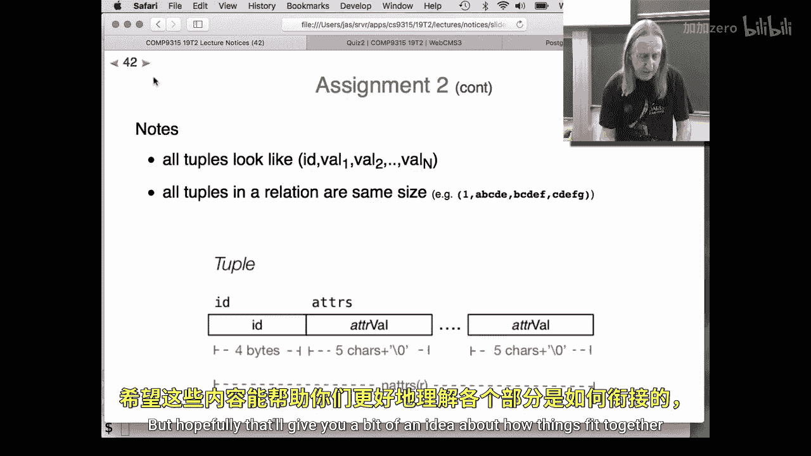
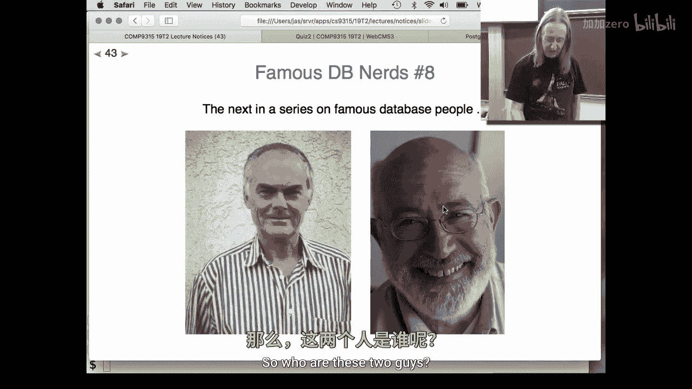
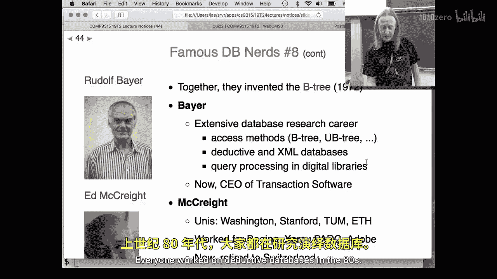

# 新南威尔士大学【中英⚡Postgres数据库实现原理｜COMP9315 2018 Postgres Implementation】 p21 P21 -BV1qXoqYHErC_p21-

Okay， week sevens where is assignment2 you say？Still working on it。

I could have taken the easy route and just grabbed one of the old ones。😔。

From last year or the year before， back I decided I had to do a brand new and just few。

So it takes time to。Get the sea into water， get all the bugs out for a start。

Bgging code to work from。But。Half two thirds is away done。

 so it'll be out soon and Queen number four is going to be up tomorrow and June。Thursday， next week。

So today we'll be talking about those topics and。嗯诶。

Tomorrow I'll be finishing off join hopefully and next week we can talk about query execution。

All right， it' speaking out the assignment， here is a preview for you。😊。

So what you're going to have to do， I give you a framework。

 we've just got pages and topples and relations。ADTs for all of those kind of things， there's more。

 but I didn't put them。And a few。Commands， so this is all command like。

 so you say create relation R and it'll create relation R and all you have to tell it is how many attributes you want in your relation。

And then there's a thing to generate random tus so you can stick lots of tus into your database that you've just into your table that you've just created。

And in fact， you pipe the output of Gen data into the insert function and that fills up your database and then you can dump。

Out and have a look。All right， so that kind of stuff will already be available。

What you have to implement is three more。😔，Commands， select， so join。

And also above a pool to sit behind all of it。So there'll be another ADT for scanning so we talked about iterators once before you set up for a scan and then you just say next next next next and it handles all the backend stuff of getting the next page and then getting the first tu from that page and when you run out of topples on that page go to the next one and so on so that's something else you'll have to write I didn't put here that's been silly well maybe I'll write I'm still working this out how much I give you and how much I want you to write anyway theres three commands unfortunately Unix already has a command called sort it already has a command calledJo so to avoid confusion。

I renamed them so it's called SO and J join just so that when you type the command。

 you don't get the wrong one。All right， so you have to write those three commands and plus。

Buff a pool and iterator， Okay， so the way it structures the data。A relation has two files。

 ones the data file， one is a file that contains the metadata。

 which is things like how many attributes does this table have for this relation。

 what's the relation name， how big are the tuples， and the reason you can store that in the metadata is that for a given relation。

 all the tuples are exactly the same size。hi is one simplification of put here the other metadata。

 how many pages are in the data file， how many toggles are in the data file。

 so all that kind of information is contained in this R dot info where R is the name of the relation can call it whatever you like。

So the name that you get there is the name that you  type in when you say create。

 so if you say create R with three attributes， then you'll get R dot data and r dot info if you say create S with four attributes。

 you'll get S dot data and S dot info。Okay， so that's the structure over。The file structure tip。

One of the files look like well the data files are extremely simple and make them as simple as possible because fiddling around with variable size records is a bit。

 so every tu is the same size。For a given table and a page just a date page just consists of a whole bunch of tus stuffed in one earth to the other as a sequence of bys rounded up to。

哎呀。Of。Multiple of four。By a multiple of four you'll see when Ill show you what a tuple looks like so just a sequence of tubles you can find out how many tus might be in a page there's a thing called end slots which is part of the met data stored in R do info and tub size tells you how big each tuple is so you can。

嗯。Yeah， so you can use that to work your way throughout a page， no head is in the page。

 it's all just doubled data。So what does a tuple look like so all tus have this kind of structure they have an I which is an integer four bytes long and then they have。

In。Values in attribute values， every attribute value is a five character English word。

So I pinched the dictionary from somewhere and the gen data function will generate random tuples that have an ID value followed by。

In English words。So that means all the tus in a relation will be the same site。

 so here's an example of a a relation that has four attributes。

 so we include ID the ID value in the number of attributes。And then we got the rest of these things。

😔，So。The way that I've defined tus， so they're astruct。With an integer I at the start， and then。

Attributes is defined as a child one。Okay， so it's one of those variable size structures。

Even though we know that all structuress in a particular relation of the same size。

 not all relations have the same size topples。So we use the same。

Tubble framework for each relation regardless of how the attribute it is。😔。

So that's pretty much all I'm going to tell you about the Simon2 at this stage。

 but hopefully they'll give you a bit of an idea about how things fit together so that when you start reading the code makes a little bit more sense。

😔。

Of course， my code is beautiful and easy to understand so you should have no trouble working out what's going on All right。

 a couple of database nerds。😊，One of the peak is really old。One of the pictures is new。

 guess which is which。You can tell a look at the color in that classic 1970s photo I would guess and this is a more modern one so who are these two guys？

😊。

Did something useful， they invented bee trees。Back in knowledge 72。So that kind of data structure。

Obviously was extensively used in early relational database systems and it's still used today because it's quite an effective structure。

So Rudolph Bay went on to stick around in university and do a whole lot of database research。

 various kinds of indexing schemes following on from the Bree did a thing called UBTe which handles high dimensionional indexing kind of stuff that we were talking about last time。

 it's different to all the schemes that I talked about and had I realized that he did this then I would have chucked that into the notes。

And by the way， I should say the notes for high dimensionional indexing and join already up the high dimensionional indexing notes have a whole bunch of stuff that I didn't talk about in lectures。

 these are different effectively indexing approaches to dealing with high dimensional data and the UB tree is one such approach but I didn't put it in my notes maybe I will for next time。

He worked on deductive databases， everyone worked on deductive databases in the 80s。

 everyone worked on XM health databases in the 90s， both of those。

