# 新南威尔士大学【中英⚡Postgres数据库实现原理｜COMP9315 2018 Postgres Implementation】 p22 P22 -BV1qXoqYHErC_p22-

Okay， so I lie taking peanuts。But I'm sure everyone's rested。I saw people meditating。

I saw them meditating during the lecture。All right， anyway， he's sorry we talking about。

Signature based indexing， so we've got tuples and we've got corresponding signatures。

 one signature for each tuple very signatures bit string roughly have to be set to one。

And the way we're going to。Fect or the way we're going to do selection is to run through this signature file。

 working how which of。The tubbles is relevant and then we'll go to the data file and actually you'll look at those tus in fact we're going to work out which tus are relevant and then we're going to work out which page those tus belong to and only go and look at those pages。

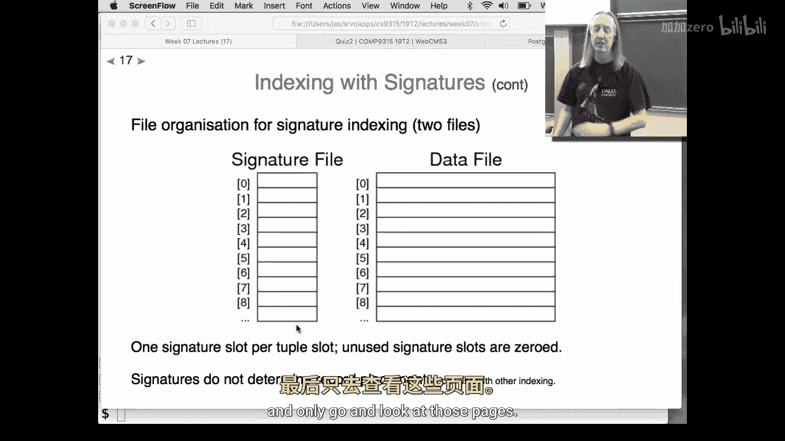

All right， what are we up to Oh some examples All right so here's how we do it。

 So we've got a tuple with these names in it， Which textbook does that come from You should all know。

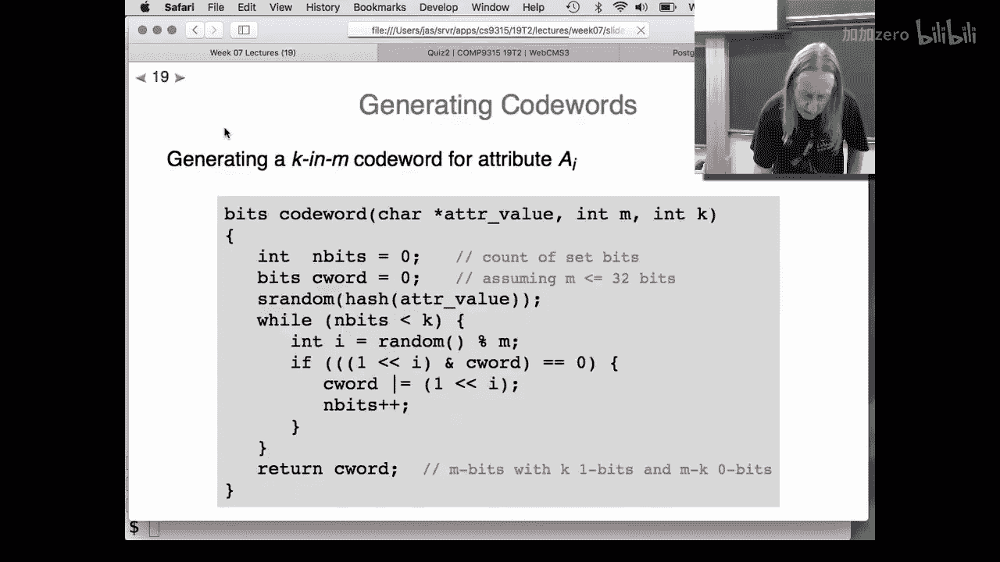

No， no。I shouldn't have ask。I that's the blue one with the yachts on。😊。

whoever that's all right in any case there's your irrelevant so we can form a code word for the first attribute and that happens to be that bit string there here we're talking about very small code words you generally wouldn't have ones that are quite as small as this account number 102 gives us that code word。

Now， the bit strings randomly generated based on a seed coming from。The attribute value。Hs。

Gives us there， 400 gives us set and we all all of those together。

 hopefully correctly giving us that so roughly half the bits are set to one。

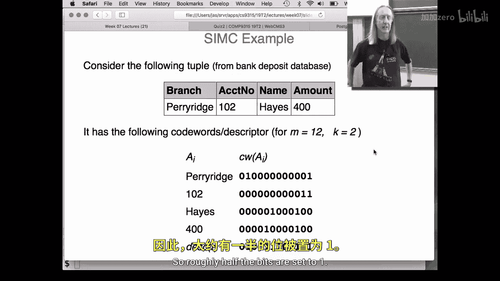

So how are we going to answer queries based on this？

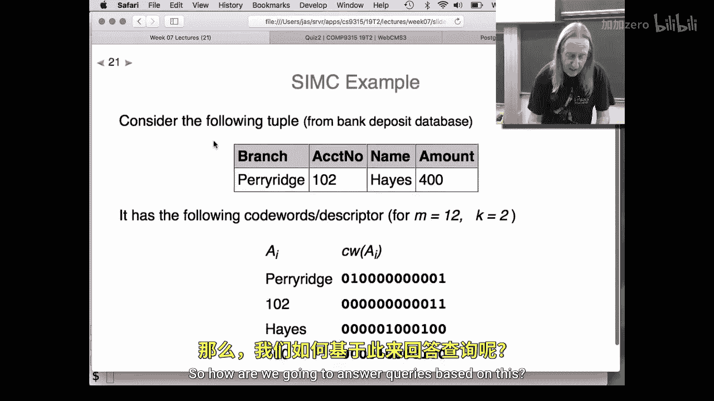

We form a query descriptor and once again were talking partial match retrieval here so we know the values for some of the attributes。

 but we want to find out the values for the rest of them。So。

We can form a query descriptor by forming code words for each of the known attributes and oring them altogether together the unknown attributes don't give us any information so we just leave their code words a zero in fact we don't even consider them so that's going to give us the query descriptor for that particular query there so。

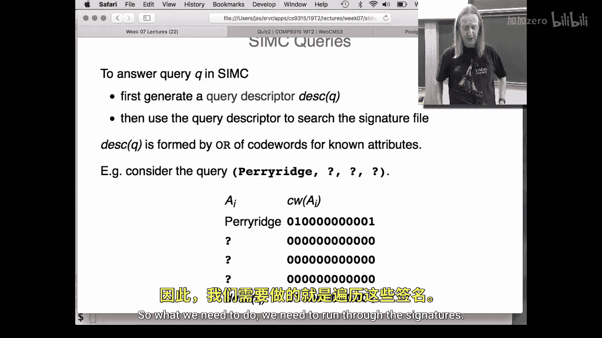

What we need to do in it to run through the signatures。

 let's just back up to this one and any tuple that has Perry ridge as its first attribute。

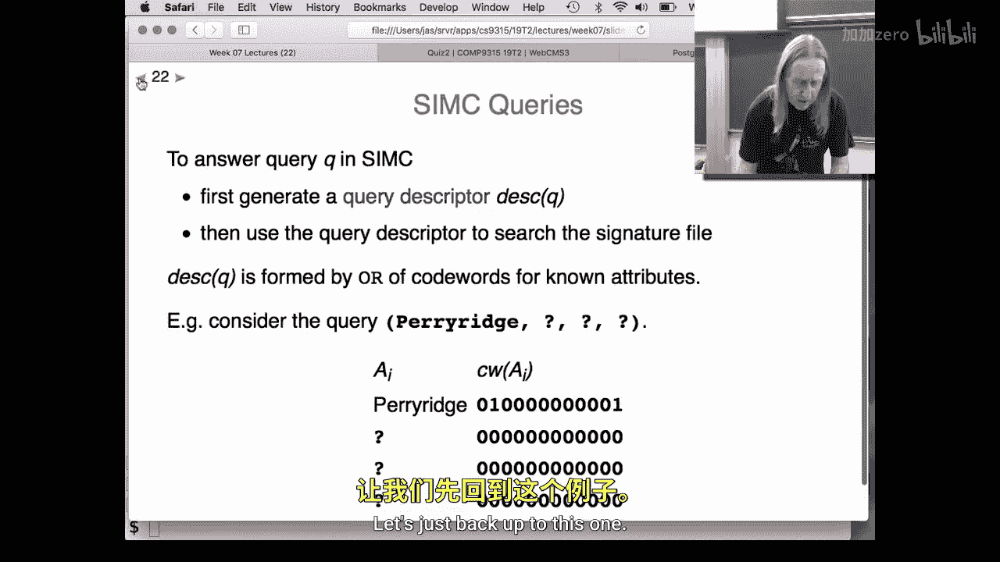

Is going to have。These two bes said。

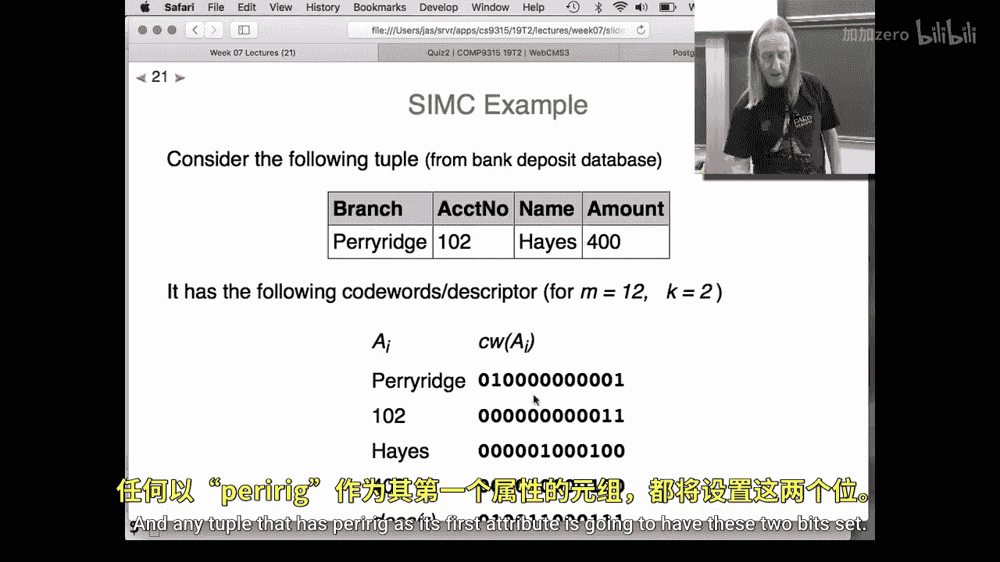

Okay， so it'll have some other bits set as well， but that's fine as long as it's got those two bits set。

 it's a potential match。

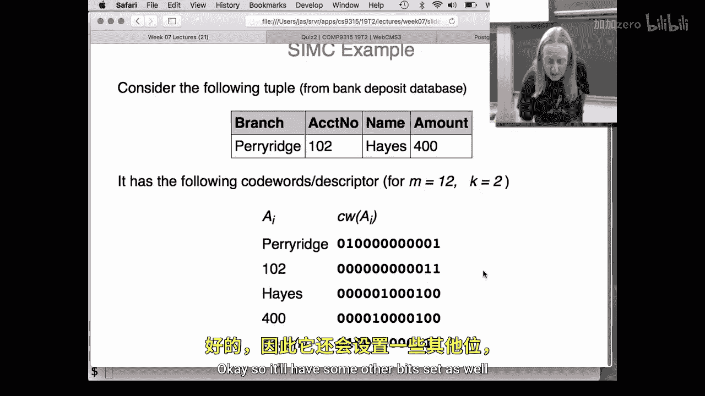

So that's how we're going to do the。The initial scan of the signatures naked。

Retty soon you'll see a potential problem here that we got a one because of Perry Ridge but we also ended up with a one because of 102 and if one of these other tus had set a one bit here。

 one of these other attributes said a one bit here。

 then we would have ended up with something that looked a bit like Perry Ridge， but wasn't。

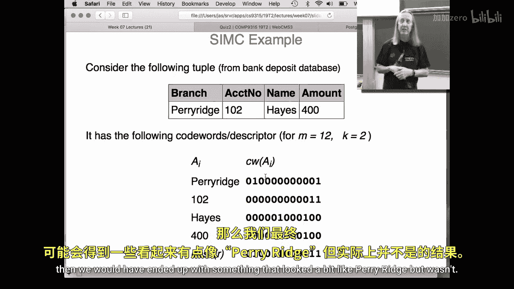

So that's where false matches can come from。

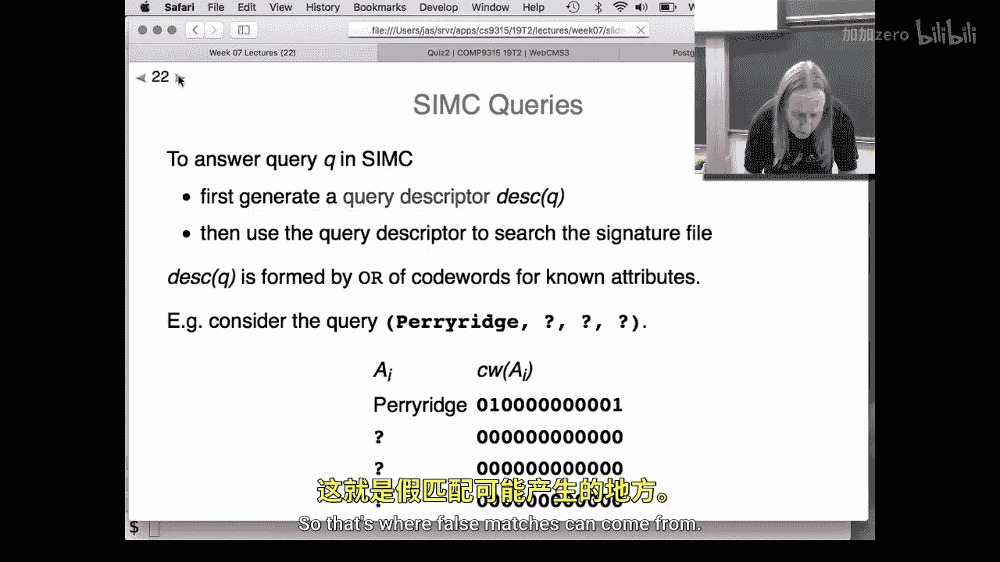

In any case， getting back too。How we search the signature files。

 so we scan through all of the descriptors， signatures。

I keep changing my terminology to code word is coming from one attribute。

 a descriptor or a signature comes from。All of the code words all together。

And so we take a signature， we match it against the query signature， and if they do match。

Then we have to work out whether this page is of interest or the page containing this tuple is of interest。

 we can work out in the Tle ID and we can extract the page from the double ID we've seen how Tle IDs are formed by a page ID and an offset within that page。

So we can get a page ID and we can keep。Building up a set of pages that we need to check we've done similar kind of thing with some of the other indexing heads as well right and then we scan through all those pages and scan through all the tus in each of those pages looking for once it actually do match so here we're going to actually have to do a match。

That checks a topple against the query tuple and says Perry Ridge， Perry Ridge， question mark， okay。

 question mark， okay， question mark， okay， that's a match。So the matching function is really easy。

 all we've got to do is end the query descriptor and the record descriptor or this query signature and record signature。

 and if the query signature is a subset of the bits contains subset of the bits in the record descriptor then it's a potential match。

And that operation is really fast on typical modern hardware。

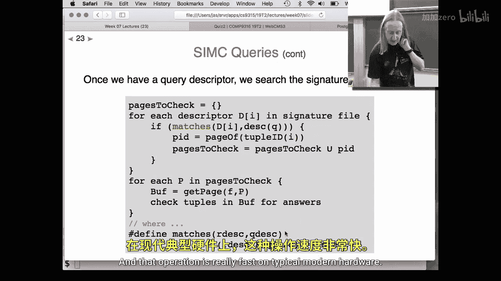

So that is really not going to cost as much。 So here's an example， and this one shows that the。

The horrible possibility of a false match so there's our query。

 there's a tuple containing Perry Ridge that happens to have one in both the appropriate positions。

 is a tu that doesn't contain Perry Rige but unfortunately ended up with a one in both positions。If。

These two tus happen to be in the same page and we haven't lost anything at all because we would have had to go and look at that page anyway。

 if they're in different pages then we end up having to look at a page that we didn't need to look at。

 assuming that there are no other matching tuple from that page。So a true match and a false match。

 so false matches are an interesting possibility here and what we'd like to do is keep the likelihood of a false match small。

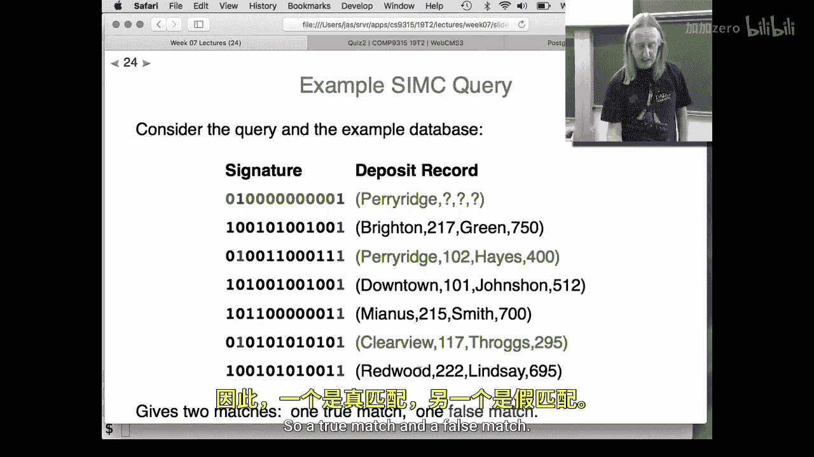

How do we do that， we make the descriptors bigger because then that gives us more possible values that we can store in our signatures and de the less likelihood of clashes like that。

And the other thing of course is we use a different hash function for each attribute that was what I mentioned before。

 so we don't have ABC in attribute one in one tuple matching against ABC in attribute4 is another tuple。

So that will prevent that problem。Make the descriptors bigger and choose an appropriate value of k so that when we form a signature for a word。

 we got roughly half to bid set， which as I said before gives us the maximum spread of values。

Of course， making the descriptors of signatures larger means the signature file is larger。

 which means more reading。看一下 we。We're going to get less false matches。

 but we've got to do in a sense， more work to get to that point。And if we make K2 small of course。

 if we have one bit then and we got a 32 bit signature， there's only 32 possible values。

 if we're generating these signatures from names lots of names are going to have a one bit。

That be position lots of different names are're going to have a one there。

 so we're going to have lots of hash collisions， so we need to have K a little bit bigger than。啊。

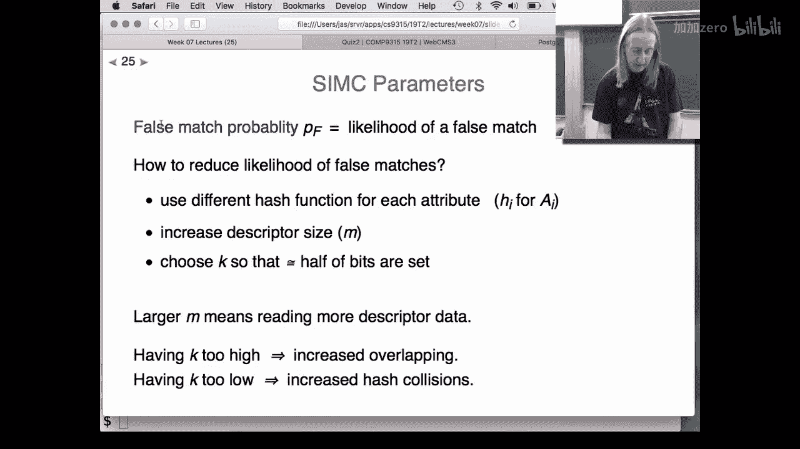

All right， so you kind of get the idea that there might be an optimal combination of M and K and it turns out that there is and we've done a little bit of work to come up with formulas for giving a false match probability that we find acceptable。

We can then use these formulas to generate good values that M K。So if you reckon。

 I don't want to get more than one false match in 10，000。Pretty good。诶。Then。

We can run it through here， run through these formula， and that'll give us values for M K。

And then M K， of course， a configuration for as for the signature indexing setup。

 So once we fixed them， then all of our signatures are going to be。

Genrated justen codes words with K bits in M bits。

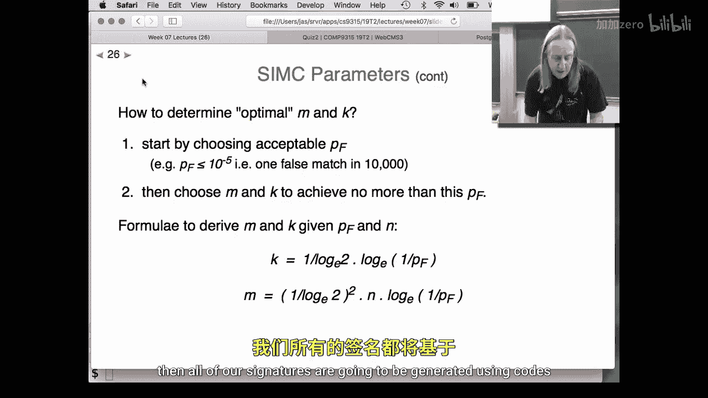

All right， so he， does it actually cost？

Two enter a query using superimposed codes。