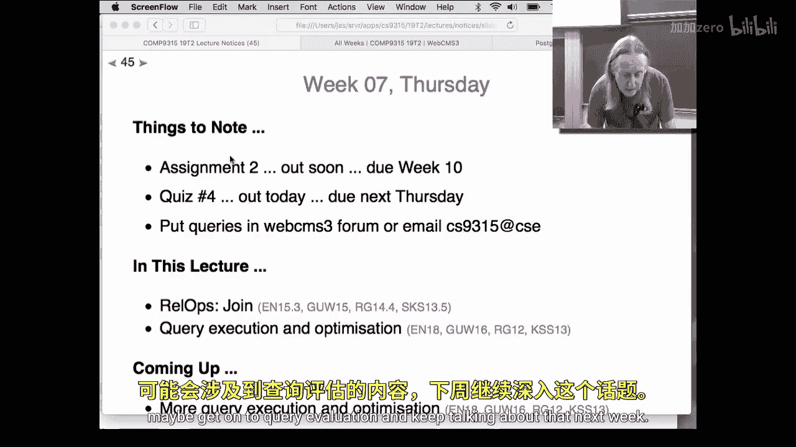
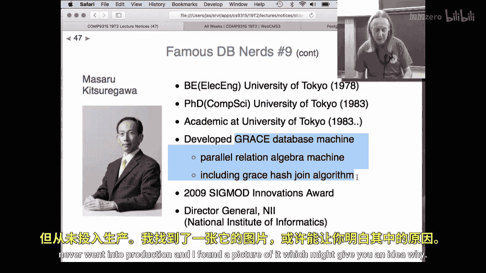
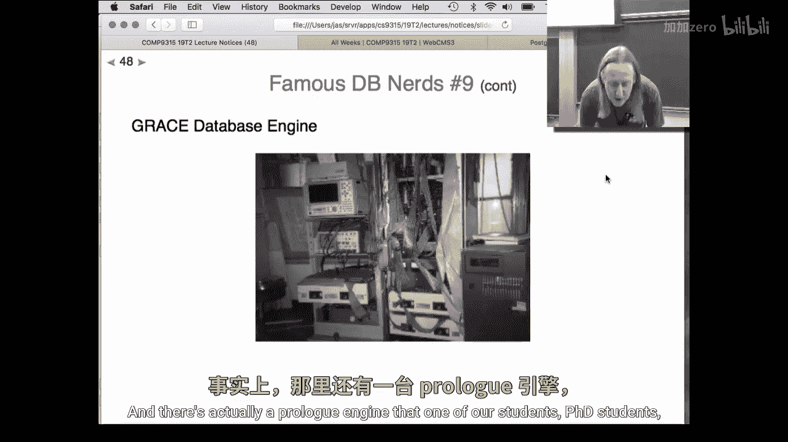
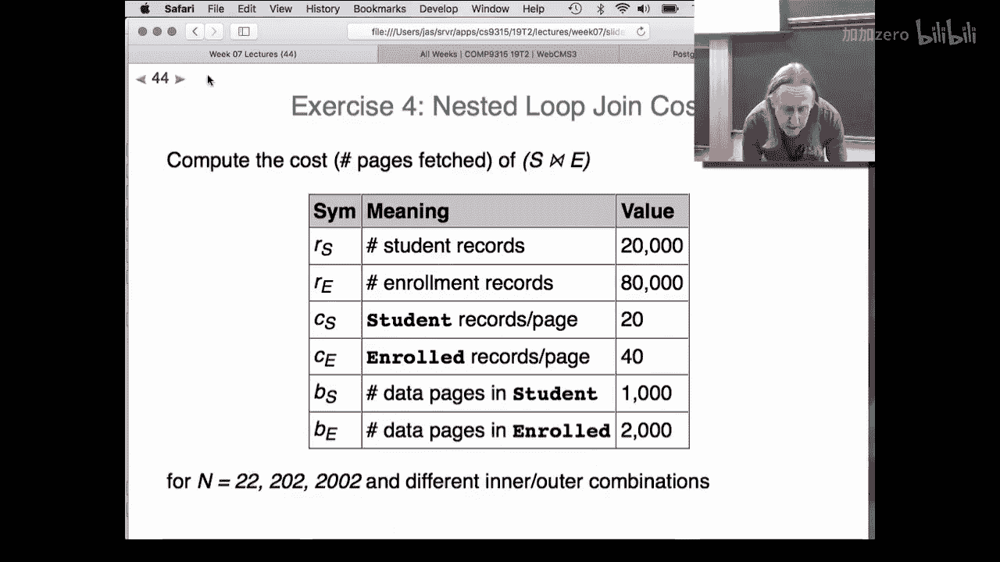
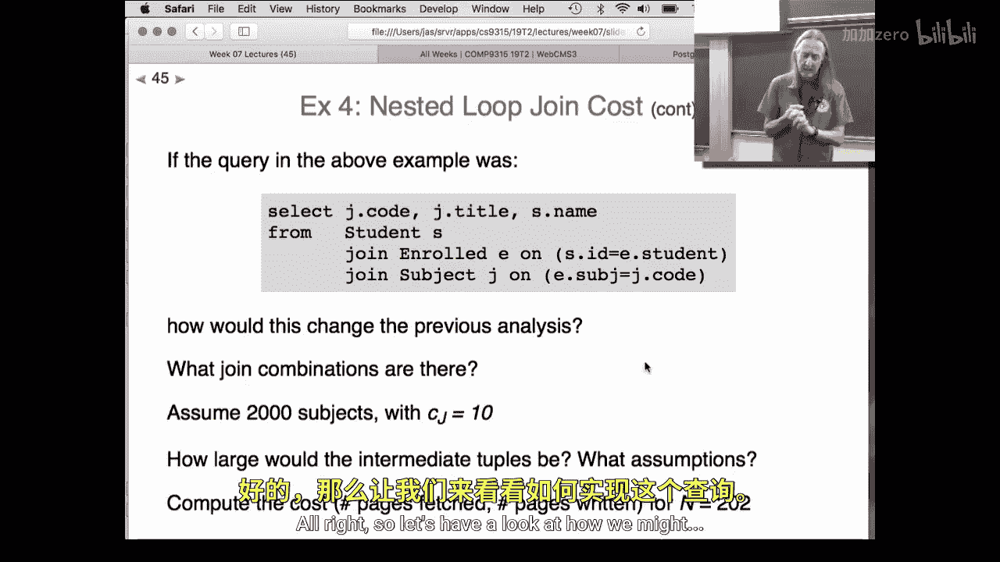
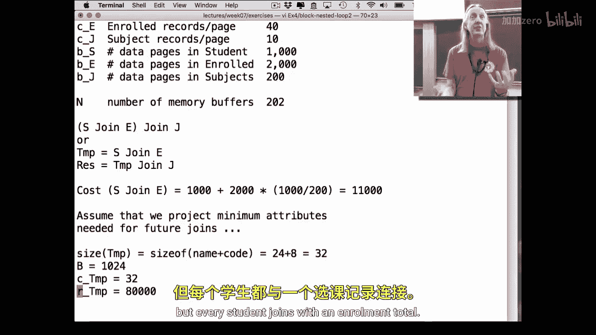

# 新南威尔士大学【中英⚡Postgres数据库实现原理｜COMP9315 2018 Postgres Implementation】 p23 P23 -BV1qXoqYHErC_p23-

清楚。Musster hit the wall， I guess。Where is everybody？One day。

 I'm going to come in and be one person sitting。Then have to keep going。The show must go on。

 no matter how many people are here。😔，All right， things to know to Simon， I'm still working on it。算。

Quz every second is a quiz gets released and it's due Thursday after and if you're going to send me questions。

 don't email to Ja。Send them either on the forum or to CSs 9315。If you send them to my inbox。

 my inbox grows by it's going to grow by 50 messages while I'm giving this lecture and if your message comes in just at the start of the lecture it's going to be two screens down the inbox by the time I get out so I'm not going to see it。

So yeah， if you mail， if you mail there then it tags it nicely。

 so it's obvious that it's a 9315 question， but similarly if you're mail to the。

So the class account gets tagged nicelyly as well。All right， today talking about join。

 maybe get on to query evaluation and keep talking about that next week。

All right， another Db news。けつわないってやよ。Anyone。I can' be asking every time no knows。

You could always you know I was talking about image search the other day if I'd put these up early enough you could do a reverse Google image search to try and find out who it is so it's my rule Ki around Dlawa。

😊，Who。Obviously， Japanese。And so he didn't like him to the un of Tokyo。Back in those days。

 those days， no one did computer science degrees， they did exist just but in any case we went on saw the light went on did PhD in computer science has been working at the University of Tokyo ever since stuck in aut maybe。

His claim to fame as far as being a database nerd is that he did one of those things that were big in the 80s and 90s。

 building special purpose machines for various。Computational tasks， so。

The team at Uni Togo built a database machine called Grace。

 I couldn't find out what the GACE stood for， maybe it's not an acronym， maybe it's just a name。

I don't know any case it was interesting because it was quite parallel the idea was that you could that it would do relational algebra operations really fast and do them in parallel and also it had a smart hash showing algorithms that we'll be talking about later today he got one of the SigMoid Award SigMoid is the ACM Special interest group on management of data so the big database conference it here is called the SigMoid database conference。

As with all these wonderful ideas that came up in the 90s and 80s of having special purpose machines。

😊，It failed。It was good as a research idea， never went into production， and I found a picture of it。

Which might give an idea why。Looks like a bit of a mess looks quite large。

 You actually want to see one of these special purpose machines live go to level one of K17 and there's actually a prolo engine in that。

😊，One of our students， PhD students built a while ago。

Also， not in production。Good for getting PhDs anybody， All right so。

Back to business last time I was talking about nested loop join。

 block nested loop join where you read a chunk of one of the tables into memory and then you scan through the other table。

And compare each tuple that you get with all of the tuples here in any that match。

Go to the airport and it's join tuples。嗯。If you're lucky。

This table fits totally in memory and then you can just scan through this table and you end up with a minimal cost join。

 which is basically read one table once and read the other table once and you're done。啊。

So depending on how many memory buffers you can afford to throw out this problem and depending on how large the size of art is。

 you're going to have to do multiple scans of the S table and need one。

Minimum number of chunks of like save if you can get one in that。当然。So。Where had we got up to。

We've beenoo。I actually jumped to him myself Oh that's right so he looked at one example。嗯。

Using that student enrollment database。This one and we saw the more you know it's kind of obvious。

 the more buffers you're willing to throw out the problem。

 the faster or the more efficient you can make it and that got down to quite a relatively small number of read and write operations whereas that number of buffers has a larger number。

 the minimum number of buffers you need to solve one of these problems is three。Input buffers。

 the R relation， input buffers， the S relation and an output buffer to hold the joint tus。

 but 22 sounds like you got a lot， but even so it ended up with quite a lot of page reads。

All right。Here's a slightly more complicated query meant we've got another table called subject。

 I think yeah the original query was just students and enrolled。If we got a subject table。

 we're going to use that to extract the title of the course in the previous queries all we were interested in was the course codes like CO9315 and the student's name now we're interestednc9315 DBMS implementation and the student's name。

All right， so。

Let's have a look at。How we might know。就是简单。is。Okay。So I never got。粉是。That's not the one。

Because I had two in that dirt。One called that， All right， so these three tables。

So how can we arrange for this to be evaluated and this is kind of looking forward to what's going to what we'm going to talk about with query optimization and so on so here's one way we could do it we could join the student in enrolment table kind of like what we're doing in the original query and then take the result of that and join it with the。

Subjects titled。All right， so given 202 memory buffers。

 we can do the calculation how much it's going to cost that's the number of page reads involved。嗯。

The other thing， when you've got an intermediate result like this。

In theory these joins you can just take an entire S tu and an entire E tu and stick them together if you know where you're heading you know what the final result looks like then you're really to carry forward as many attributes as A you need for the join so if you knock out some attributes you need for the join then you're a bit stuffed and also the attributes that you need for the final results so in order order to solve this query all we need to carry forward is the。

Student name and the course code， because we can use the course code to join with the subjects table。

And we need it for the final result anyway。 So that's how big outcomes intermediate results are。

 That's how many。诶。I then it's the size of a page。That's the capacity of a page given that each tuple is 32 bytes long。

 that's the total number of tus if remember we're joining 80，000 enrollment tuples with 20。

000 student tus。But every student joins with an enrollment tool， so we end up with 80，000。

