# 新南威尔士大学【中英⚡Postgres数据库实现原理｜COMP9315 2018 Postgres Implementation】 p24 P24 -BV1qXoqYHErC_p24-

是 right。系结婚见议。Get it off face。

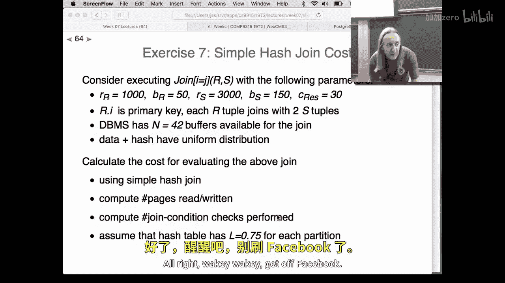

What thickened approach to Hah join。Is rather than。Building a single hash partition at a time。

We build hash partitions for all of a file and then we run through through them might sound like it's going to cost more upfront。

 but it's not too bad。So the best case cost once again， it's。Related to BR plus BS， in fact。

 it's three times BR plus Bs in this case but。We need to have enough buffers so that we can hold the largest partition of the outer relation in memory if we want to get this optimal cause。

And since we're partitioning it and then we're reading the partitions back one at a time。

 then square root of the number of buffers is or the number of pages in。It's about what we need。If。

We end up with having not enough buffers or you have a rubbish hash function once again。

 then like we had in the previous example we'll need to scan。S multiple times。

 but in this case we won't need to scan the whole of S。 We' just need to scan part of S。

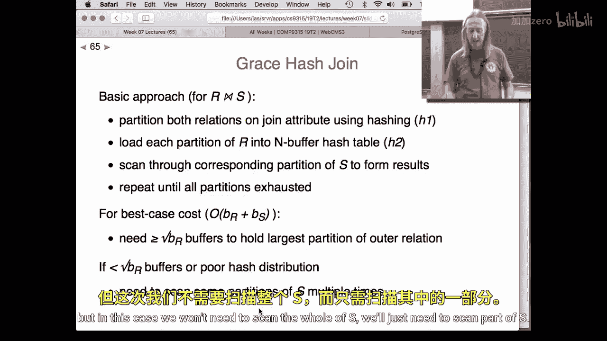

All right， so。These diagrams basically describe it perfectly， I think， so here's an input relation。

We read page by page into an input buffer within then user a hash function to decide which of these output buffers it goes into each of those output buffers represents a partition of the input data and we write these partitions to output files。

So we end up within minus one partians if we've got in bufferuffs。And we do that for， oh no。

 we don't。Who when me say。

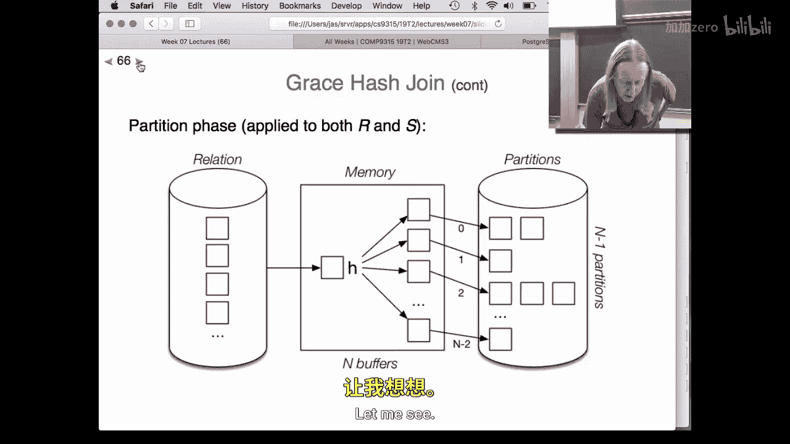

Yes， we do， we do that for both the both of the。File so we've got a whole load of partitions of R。

 a whole load of partitions of S， how much what's it going to cost to do that。

 read each file and write it out again， not quite。

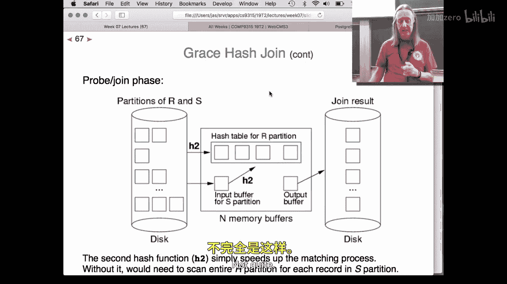

That simple because we're reading in all of these pages。

 we're building these partitions eventually the one of the。

Pages in one of the partitions is going to be not full。

 so we're not optimally filling up this one way of looking at it is we've kind of got fragmentation in each partition so the number of pages here is likely to be more than the number of pages here but。

Not substantially more。

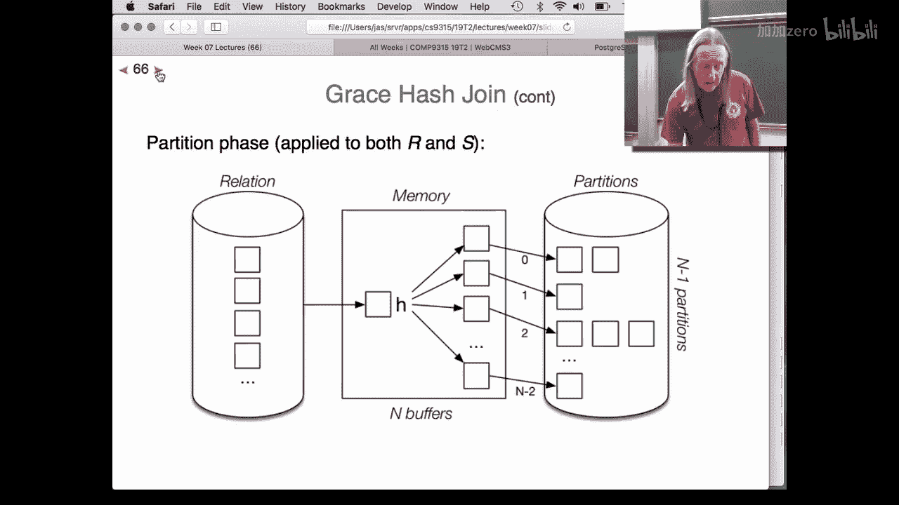

In any case， all right， so we've got partition of R， partitions of R， we've got partitions of S。

 and we know because we use the same hash function on each that the zero partition of R and the zero partition of S must contain。

嗯。Join matches。So in order to work out those joint matches。We could kind of， if we wanted to。

 we could use a nested loop joint just on the partitions。

 maybe that would be one way to do an alternative approach which is kind of like using the simple hash joint that we had before is to load one of the partitions fully into memory into the hash table。

 that's why we need to make sure A we've got a reasonably uniform distribution from the hash function and B enough inmem buffers。

And if we've got square root that total number of pages in B then that's probably going be good enough so get a partition load it into a hash table using a different hash function this time if we use the same hash function they'd all hash into just one of these buckets which wouldn't be helpful and then we read and there the corresponding S partition and use the same hash function and for regest tuple that we read into here we hash and then we just go and scan that particular page so it's the same kind of deal as we saw with a simple hash and of course if we find a match we stick it in the output buffer in the output buffer fills up。

We can ride it。To the output。放下嗰好。Wherever we're writing the results to。嗯。So yeah。

 what the second hash function is doing， it's kind of doing what the hash function did in the simple hash case it's just reducing the amount of checks that we have to do if we didn't have this then wed have to scan the entire partition。

For each。嗯。Tuple in the yes part。So that's Grace Hash join。

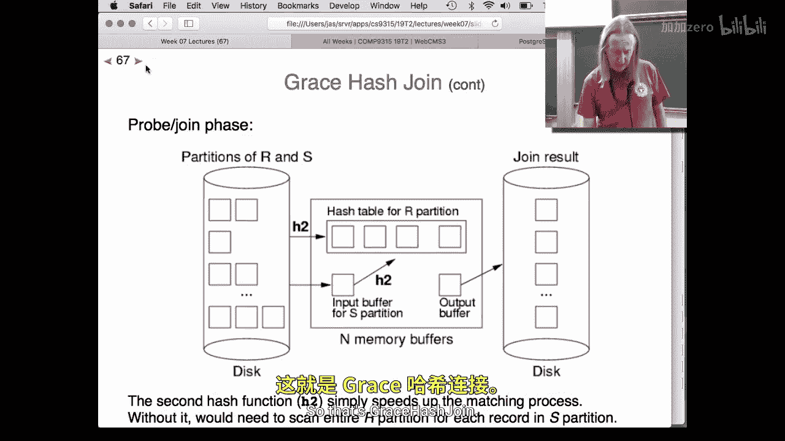

How much is it going to cost well， as I said， the number of pages in the total number of partition files is likely to be a little bit more than the number of pages in the original input file。

诶。The total costs are right。 Let's assume that it is the same。

So the cost to read in our and then write out the same number of pages is going to be2 be up。

Same with forming the partitions of the S relation and then the。Second phase where we read in the S。

Tubles， where。Where we're read S Ts page by page from a S partition， before we do that。

 we load up be memory hash table with the corresponding up partition。

And the overall costs doing that is just going to be there。 so we load in an our partition。

 we scan to the corresponding S partition， we load the next our partition scanned to the corresponding S partition。

And so on and so on。So if the total number of pages in the R partitions are like that， as I said。

 it's likely to be a little bit more than VR and the total number of partitions in the yes total is that？

And that's going to be the overall cost。So like I said， that may be slightly larger than BR。

 that may be slightly larger than BS。Those two things would also be slightly lower than B P， but。

We're going to end up with。A total cost is of that order。

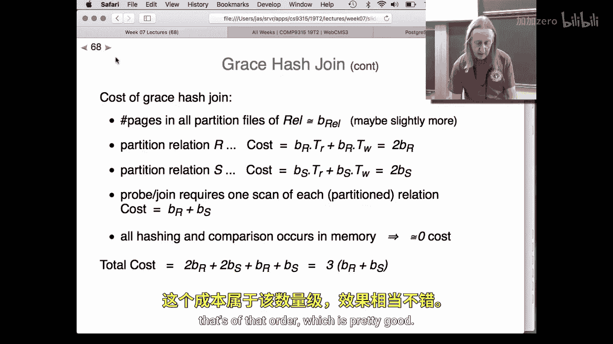

Which is pretty good。Alright， so let's take a look at。An example of how much it's likely to costs。😔。

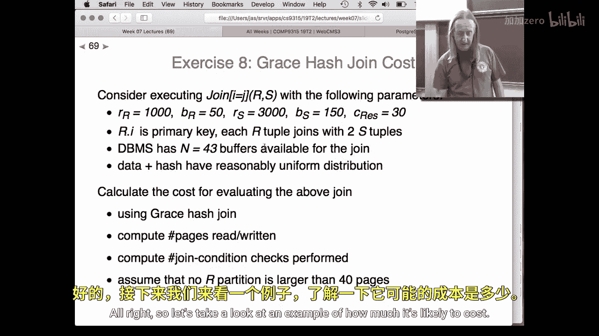

H。

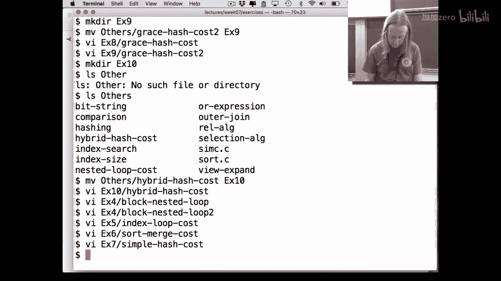

Okay， Sir la。In this case， what I had done away， I had 42。Is it helpful。

Certainly not helpful in the first pass you're going to end up with。

41 partitions because you've got one input buffer and the rest you can use to distribute the tuples into the partitions。

嗯。

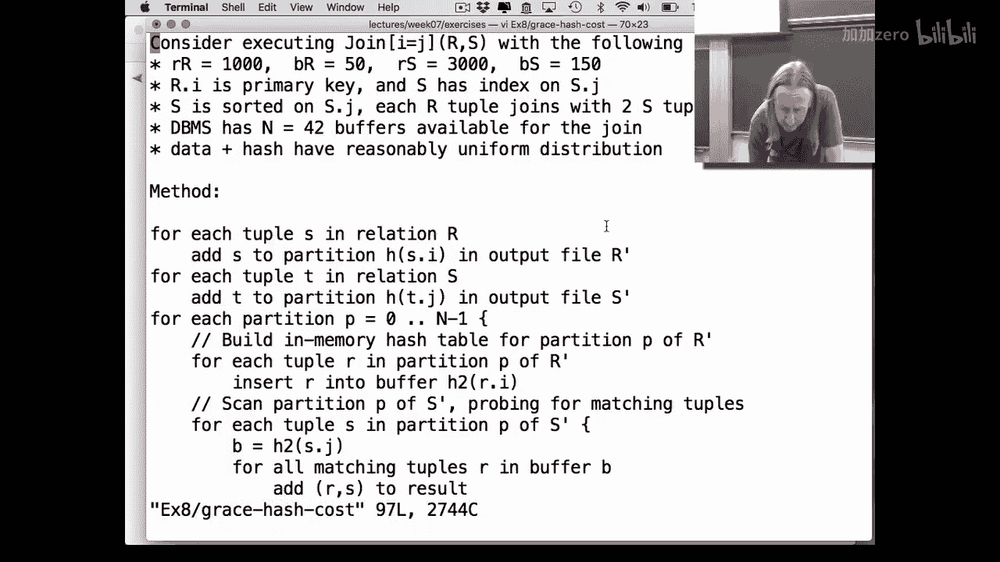

啦啦啦啦啦。All right， Sir。The our partition， we got 41 of them if each。

 so given the total number of tuples in the R table。

 then if things are recently uniformly distributed we're going to have roughly two pages in each of these partitions and each page will have roughly 25 tuples。

Okay， so if you multiply that by that by that， hopefully you'll end up with the total number of tuples in our。

And similarly for S， so we're doing exactly the same partitioning otherwise the whole thing doesn't work。

 the S tus apparently are smaller and maybe there are more of them。

And so we end up with roughly that many pages in each。Partition。So。Sorry， we got the。

Total number of pages in the art partitions， 82， total number of pages in。

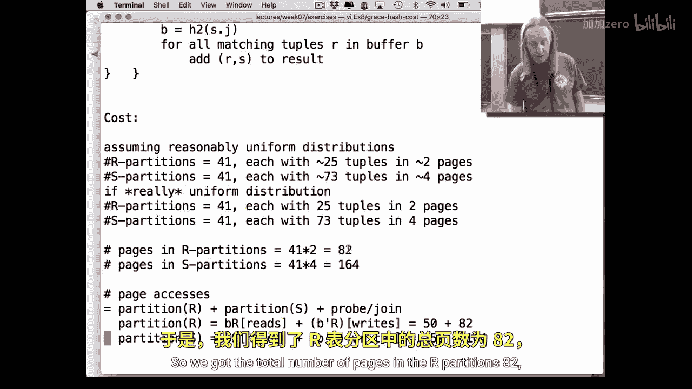