# 新南威尔士大学【中英⚡Postgres数据库实现原理｜COMP9315 2018 Postgres Implementation】 p25 P25 -BV1qXoqYHErC_p25-

21 week 8， did all the midterm exams in his last week called something。

seemed to be more people than usual。All right， maybe it's cause of assignment too。诶 so。Designment 2。

I changed my mind， that's my prerogative， which Simon I was going to run and I'll talk about the new one in a moment。

So I basically wasted 15 minutes at the start of last Wednesday's lecture telling you about an assignment which I have now banned。

Quzquiz4 is running at the moment due at 2 pm tomorrow don't forget。

Today talk about query execution and optimization。All right。

 so I sat there heing away on the brand new lovely assignment2 that I was going to do and。😊。

It started to become a mess， so I gave up and wrote a simple one。😔。

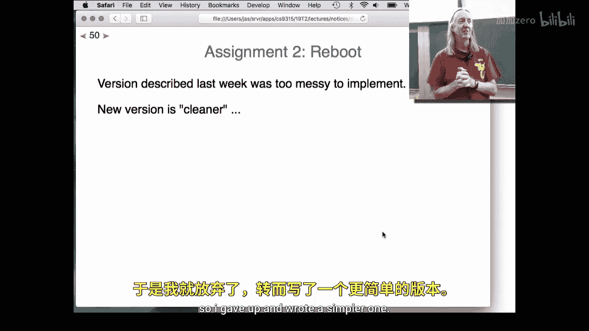

All right， sorry。Multi attribute linear hashing should ring a bell from a couple of weeks ago。

 does it？gosh at least at least it does with one person。

 the rest of you have to go back and relearn it， I suspect so。😊，So for this project。

 there's a few little well little implementation， probably a couple hundred lines of C to write。

So I've given you this big framework， I'll have a look at it in a moment。

And you got to fill in some missing bits to make it work probably as a multi attribute linear hashing system at the moment it is a single attribute hashing system。

And the file never expands， so it's not linear and it's not multi attribute。

So you got to fill in the bits to make it behave that way。So。The system manipulates relations。

 the structure of relations is kind of a little bit like what I was talking about last week。

 so we've got。An info file which I think we had， we got a data file but this time because we're doing hashing and potentially hash buckets can fill up。

 we also have overflow。So I'm giving you a whole bunch of C code。

 which you'll probably hate because you you won't like my coding style， but hey yes。

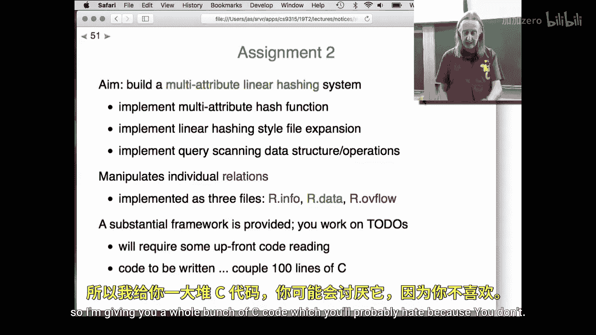

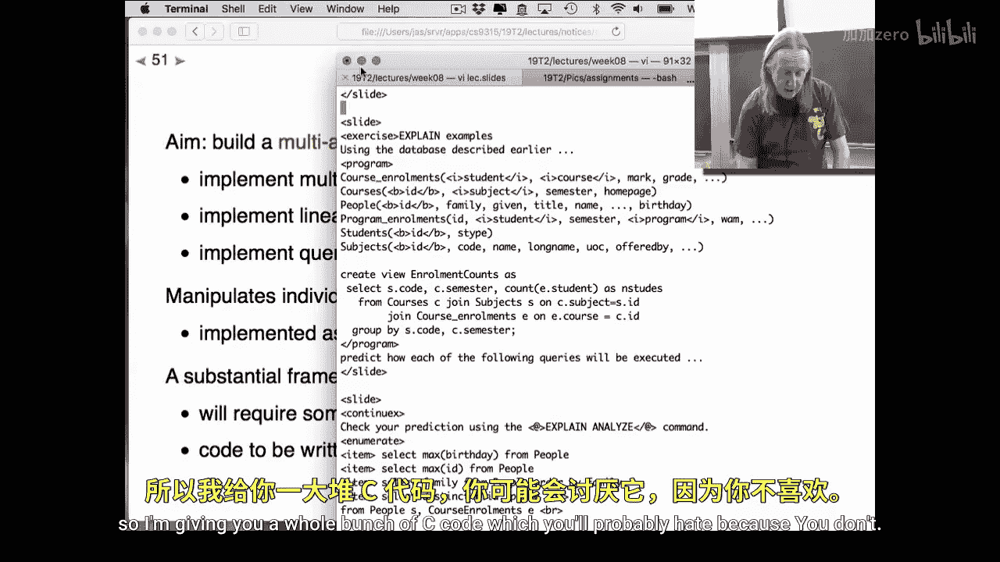

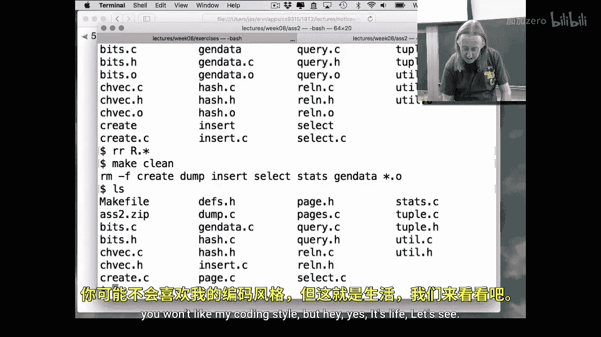

我。Let's see。 let's go。

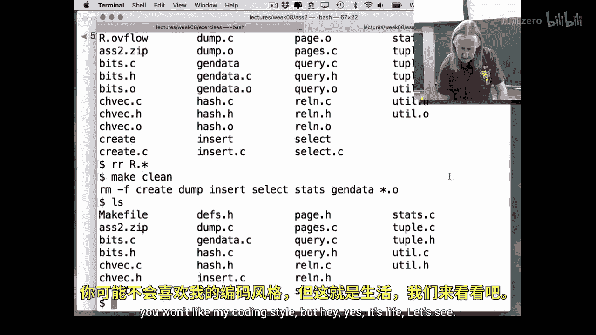

All right， so here's what you get， so there's S2。 zip。Is in the class account， I just copied it here。

 I unzipped it， I go all this other stuff if I type make。

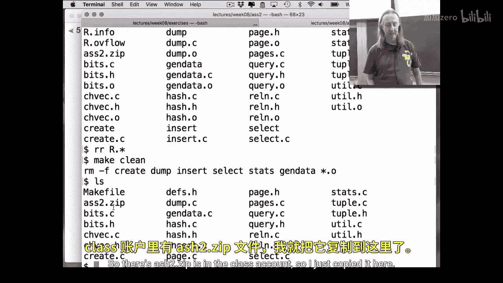

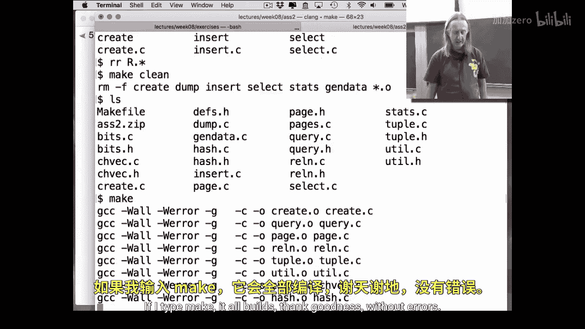

A little build thank goodness where there is， and then I can start playing with relations。

And the way you do that you've got to create a relation to start with。

 give it a simple name I always call it for some reason and then oh I can stop there and it'll give you a usage message so to create relation you've got to say how many attributes it has and how many pages you want the file to have initially so yougan pick any number alike I normally pick a relatively small one and you also have to supply a choice of vector。

All right， so let's make relation with three attributes and eight pages。

 so basically that means if you've got eight pages and you're doing hashing you need three bits of hash value to generate a page number。

So z it me three interesting。Three interesting hash bids， however。

 with the choice vector you can specify as many hash bids as you want。诶。

That's potentially useful as specified by more than three because the files going to grow。And。

And what choice vector look like。You say， which tribute？

And which bit from that attribute and it goes from。

Le significant or most significant sos love order bit is this first thing so the zero the least significant bit of attribute zero contributes to the least significant bit of the final hash value because it's all bit of a fastce at the moment because it doesn't actually use the joy spec but its still build it for you then what do we want let's say that we want to use。

Bit0 from attribute one， as the next bit， we could specify that that way。 Let's say we want to。

 we want to use。The less significant bit from At two is the next bit in the hash value。

And we could go back to attribute zero and pick bit number one and if we want。

 if you remember the way I was designing the multi attribute hashing setup。

 how many bits do we want from each attribute， you can kind of make a decision like that。

And Dan let's type that beat。I don't think this system is very careful about if I say zero comma0。

0 comma0， zero comma 0， we just go ahead and do it， even though that kind of doesn't make sense。

Allright， so that creates a table， it creates new relation， sorry， and it prints out a lot of crap。

 but it's interesting because here you can see these bits using the choice vector that I gave。

Once you run out a bits in the choice vector， it just fills up the rest by starting from the most significant bid of attribute zero and then the most significant bit of attribute one。

 blah， blah， blah， and just fills up the other。How many did we start with we started with five fills like the other 27 bits like that so if you really want to you could just put an empty choice factor in it would give you。

I would set it up for you。But anyway， we like to have the。

The impression that we're actually doing something， all right。

 so I can find out information about this relation。And it'll tell me three attributes， eight pages。

 no tuples yet depth of the file is three if you remember that devvalue from our linear hashing discussion and the split pointer is currently at the start of the file now at the moment the implement the code that I've given you doesn't do anything with a split pointer just ignores it basically so it just starts stuff stuffing tuples into the buckets and when they fill up it makes overflow pages and it'll just keep making more overflow pages without making the file any larger so that's what you have to do is make the file bigger and I think with all these bits。

You can probably do them in any order。 You can implement the linear hashing part， just using this。

Rubish has function or works。Or you could implement the proper hash function and then do the linear hashings and so on all right so what it tells you here。

 eight pages index from zero to seven this。This tells us that it's in the data file and page zero and the data file has no topples。

 it has 1012 bytes of free space。P come it doesn't have 1024。

 because the other 12 are used for some header information that we'll get in a moment。

 And this is appointeder to the overflow page。 And since there are no overflow pages we set to a distinct value that can't possibly be an overflow page index。

And you can see they're all the same， so basically it's created eight empty pages All right if you want to start filling them up。

We can use an insert operation which reads from standard input and it reads tuples。

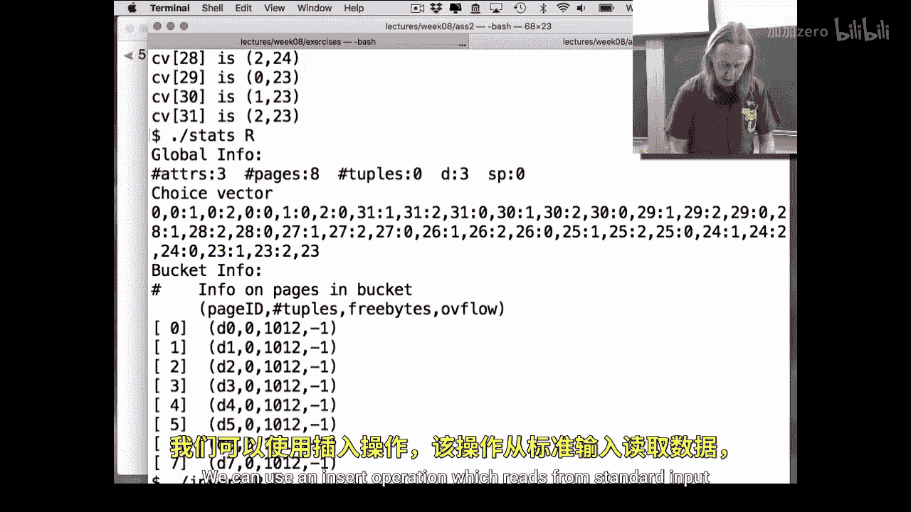

That。Satisfy。At least this property here they have three attributes so double I can put anything I like here in fact。

 let's just copy what was in the。

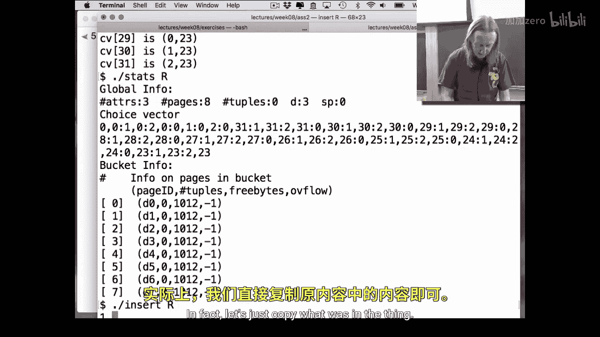

thinkSo that'll put a towelple with those three bands in into the。Into the database。

 it happens if you look at the hash value here， the last three bits are 110。

 so it ought to have put it into page six。So let's make sure I don bug if I go back and do stats。

 thank goodness， right now there' one topple in date of page six。

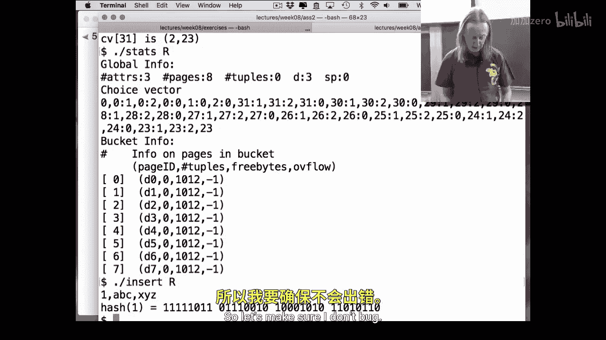

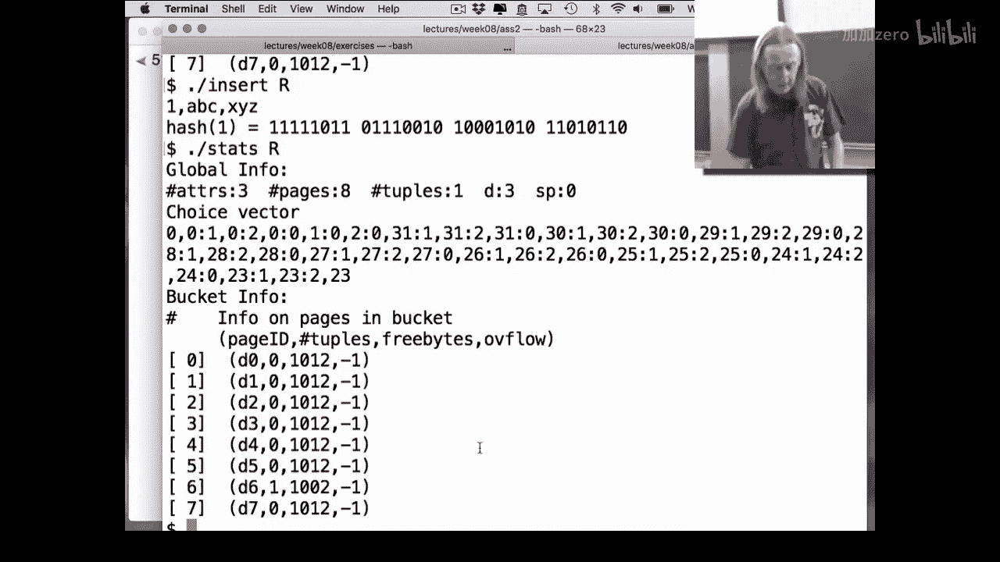

ItGet to be tedious to type in coupleples like that so there's a。

