# COMP9315 数据库实现原理：第8周：查询执行与优化 📊

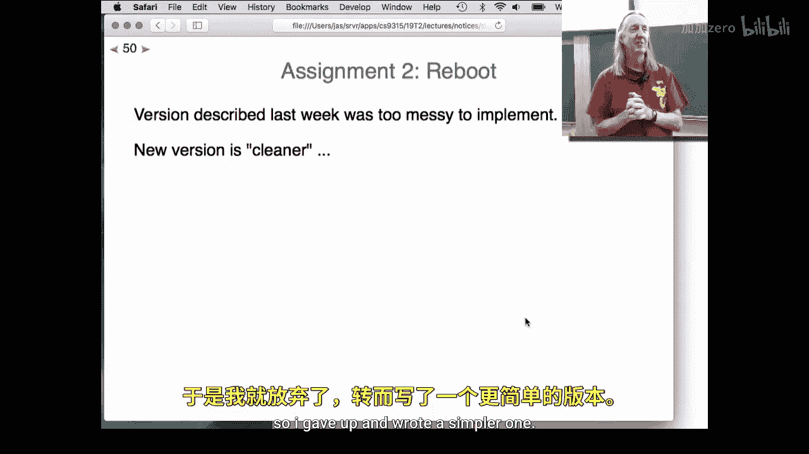

在本节课中，我们将学习数据库查询的执行与优化过程。上一周我们讨论了期中考试，本周我们将专注于数据库系统的核心操作。

## 概述

本节课将介绍查询执行与优化的基本概念，并详细讲解一个新的课程项目——多属性线性哈希系统的实现。我们将从项目框架开始，逐步理解如何扩展一个简单的单属性哈希系统，使其支持多属性和线性扩展功能。

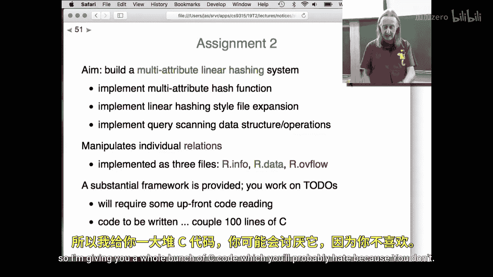

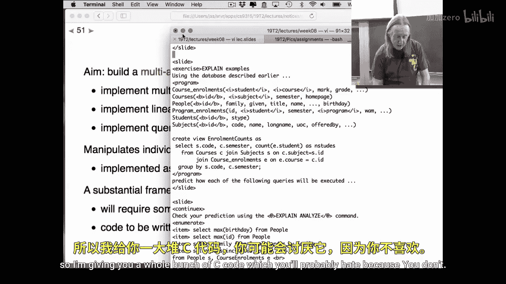

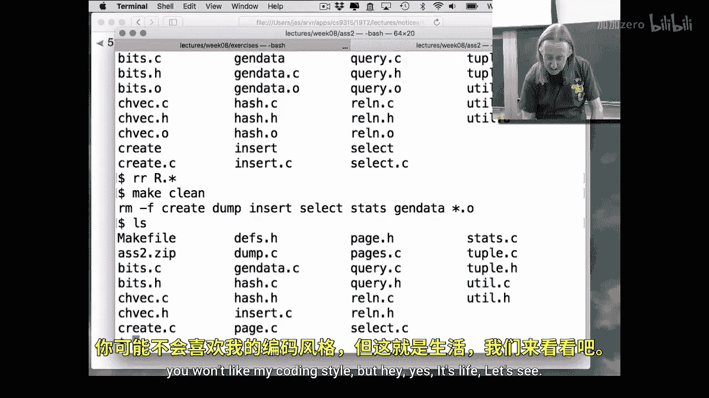

## 项目介绍：多属性线性哈希系统

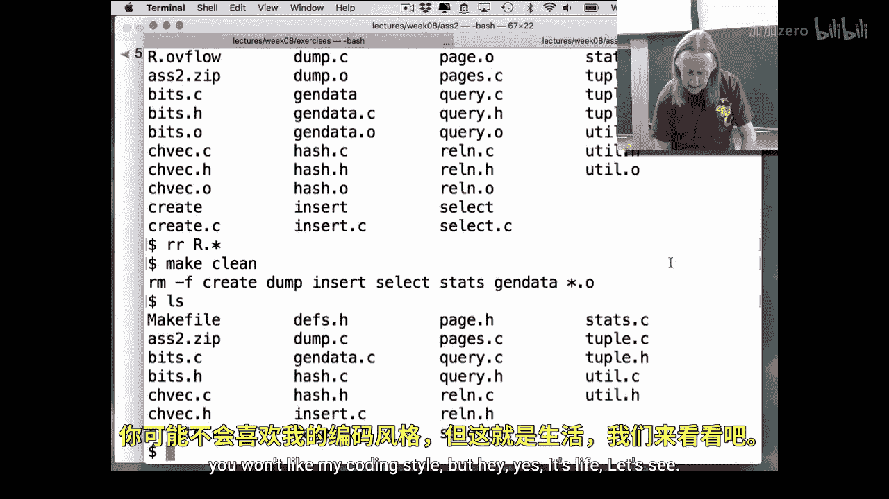

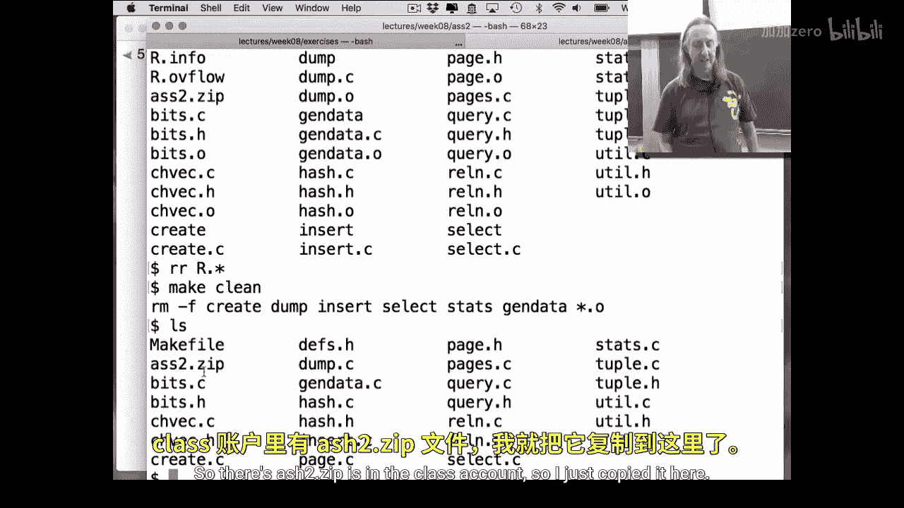

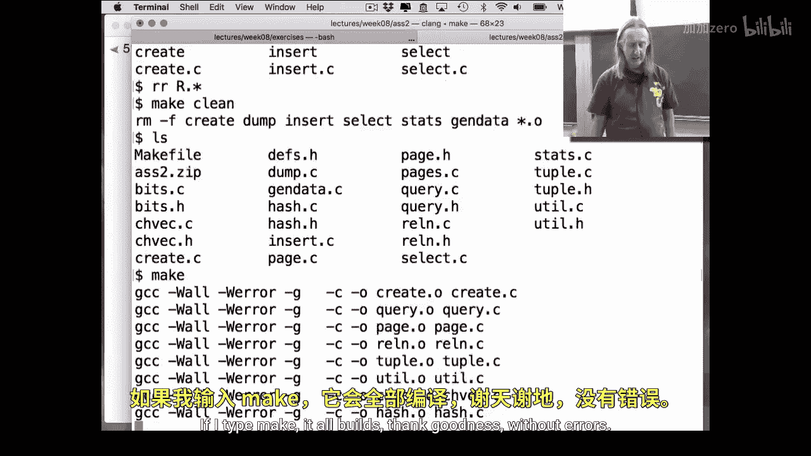

上一节我们介绍了查询执行的基本概念，本节中我们来看看本课程的新项目。该项目要求你实现一个多属性线性哈希系统。目前提供的代码框架是一个单属性哈希系统，且文件不会扩展。你的任务是填补缺失的代码部分，使其具备多属性和线性扩展的能力。

系统操作关系（表），其结构类似于上周讨论的内容。我们有以下组件：
*   一个信息文件（`.info`）
*   一个数据文件（`.data`）
*   由于哈希桶可能被填满，我们还有一个溢出文件（`.ovflow`）

项目提供了一个完整的C语言代码框架。你需要编写大约几百行C代码来完成核心功能。

以下是项目框架的基本操作流程：

1.  **构建项目**：在解压项目文件后，运行 `make` 命令进行编译。
2.  **创建关系（表）**：使用 `create` 命令初始化一个新表。需要指定属性数量、初始页数以及一个选择向量。
    *   **选择向量**：定义了如何从多个属性中提取比特位来共同构成最终的哈希值。其格式为 `属性索引, 比特位索引`。例如，`0,0` 表示使用第0个属性的最低有效位（比特0）。
3.  **查看关系信息**：使用 `stats` 命令可以查看表的详细信息，如属性数量、页数、元组数、文件深度和分裂指针位置。
4.  **插入数据**：使用 `insert` 命令可以从标准输入读取符合表结构的元组并插入数据库。系统会根据哈希值计算目标页。
5.  **批量插入**：为了便于测试，项目可能提供从文件批量插入数据的功能。

### 选择向量详解

选择向量决定了哈希值的构成方式。例如，对于一个3属性的表，初始有8页（需要3位哈希值），可以指定如下选择向量：
`0,0 1,0 2,0 0,1`
这表示：
*   哈希值最低位（比特0）来自：属性0的比特0。
*   哈希值下一位（比特1）来自：属性1的比特0。
*   哈希值再下一位（比特2）来自：属性2的比特0。
*   哈希值再下一位（比特3）来自：属性0的比特1。

如果选择向量指定的比特位数少于所需的哈希值位数（例如文件扩展后需要更多位），系统会用默认规则（例如从属性0的最高有效位开始）自动填充剩余的位。

### 当前框架的限制与你的任务

目前的代码框架存在以下限制，需要你来完善：
*   **非多属性**：哈希值仅基于单个属性计算。
*   **非线性**：当桶满时，仅创建溢出页，不会触发文件扩展（即线性哈希的分裂操作）。
*   **分裂指针无效**：`stats` 命令显示的分裂指针当前被忽略。

你的实现任务可以按任意顺序进行，例如：
1.  先实现正确的多属性哈希函数。
2.  再实现线性哈希扩展机制（使用分裂指针，在桶满时分裂文件，而不仅仅是添加溢出页）。

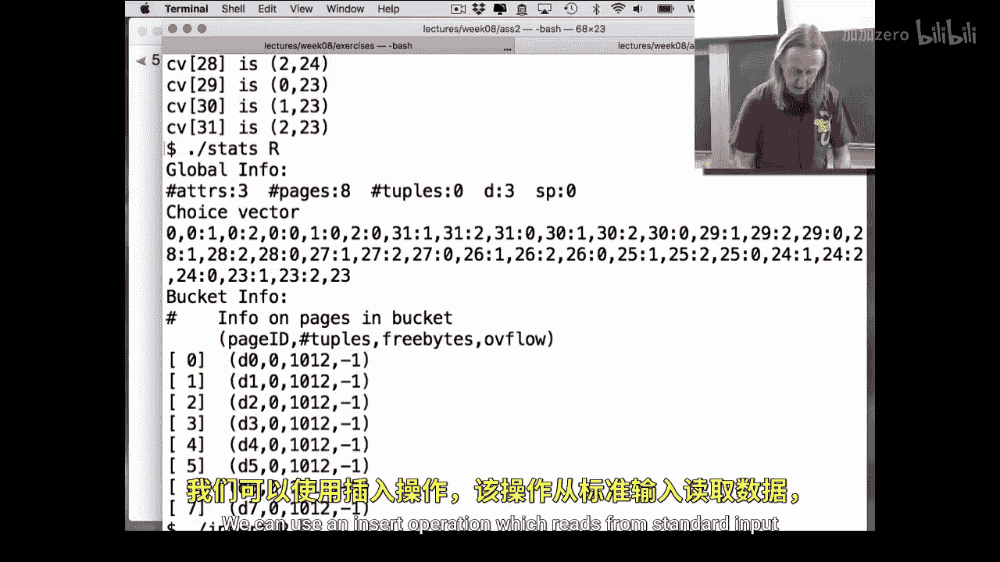

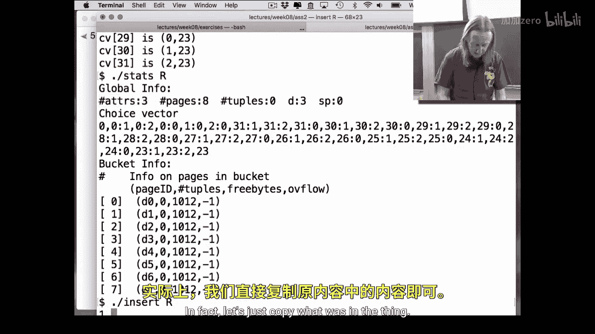

## 总结

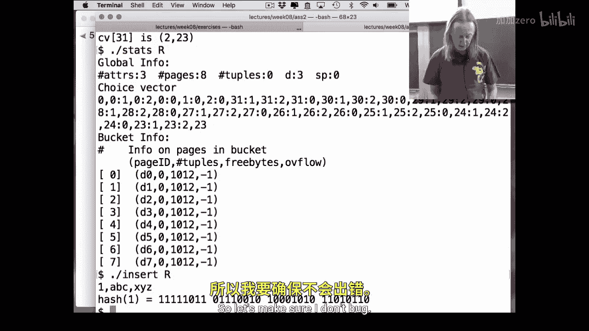

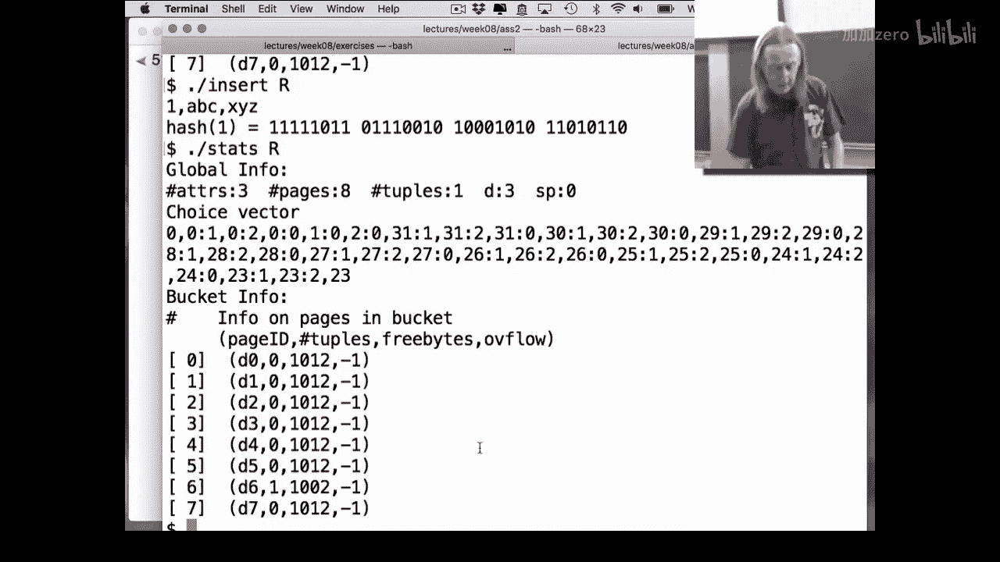

本节课我们一起学习了数据库查询执行与优化的引入，并详细剖析了COMP9315课程的新项目——多属性线性哈希系统的实现。我们了解了项目框架的结构、核心操作命令以及选择向量的工作原理。目前该系统仅是一个基础的单属性静态哈希，你的核心挑战在于为其添加多属性哈希支持与线性扩展能力，使其成为一个真正可扩展的多属性线性哈希数据库组件。