# 新南威尔士大学【中英⚡Postgres数据库实现原理｜COMP9315 2018 Postgres Implementation】 p26 P26 -BV1qXoqYHErC_p26-

All right。ょ。I turned the microphone on All right， already found some bug， were they not bug so much。

 however。

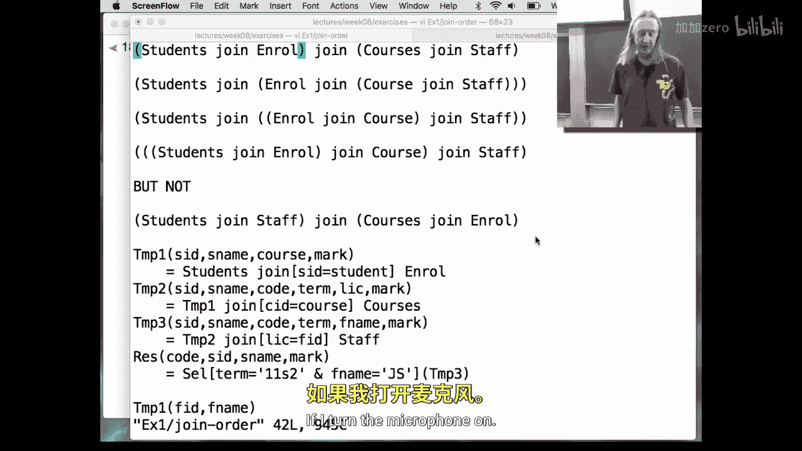

The make file， I forgot to add。

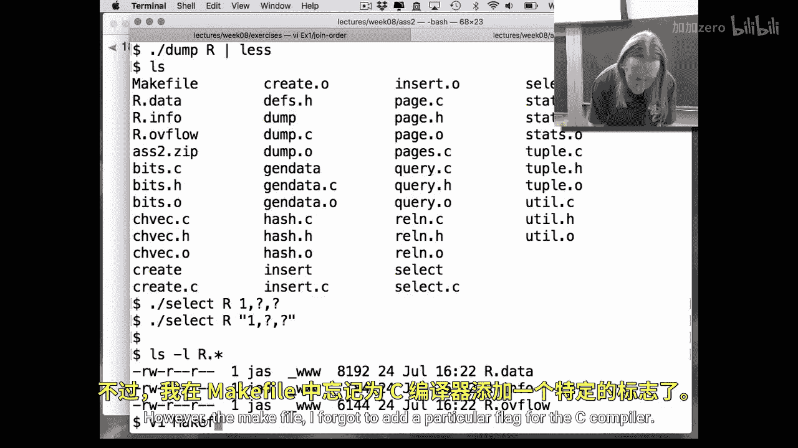

系系啲住啦。Flagged for the second par， so all those four loops were in。

Defins a variable in the full loop needA flag。😔。

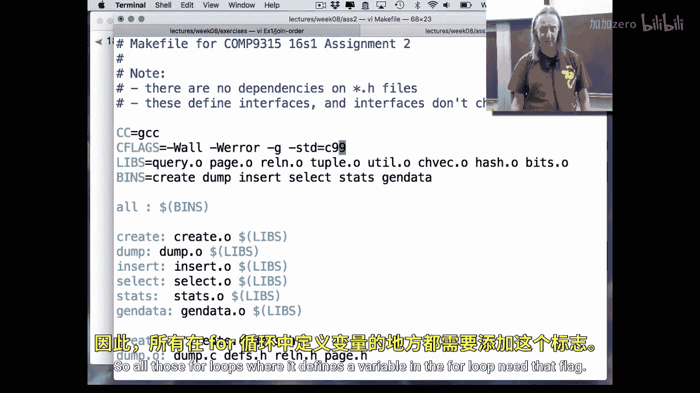

The other pro。Less solvable is the fact that G has different libraries to the libraries on the rest of the CSE server。

It'll work fine as long as you don't do it on grief this time。😔。

So having told you you do any work on Greek， don't do it on Greek。Otherwise， it learned come。See。

 you know it works fine on all the other CZ worksspaces。

 it works fine on Mac why it doesn't it work on Greek while different libraries。

 maybe I can work out a way to make it portable to Greek but。

I should have tested it on Greek before releasing but anyway， if you've already grabbed it。

 make sure you add that C flag to use C99 syntax。And。If you haven't grabbed it。

 or just fixed the zip files， so whether it be one zip will have the right thing in it。

And don't do it on Greek。s累啊。And keep sending， you know。

 post to the forum if you find any other bugs and I'll fix them。

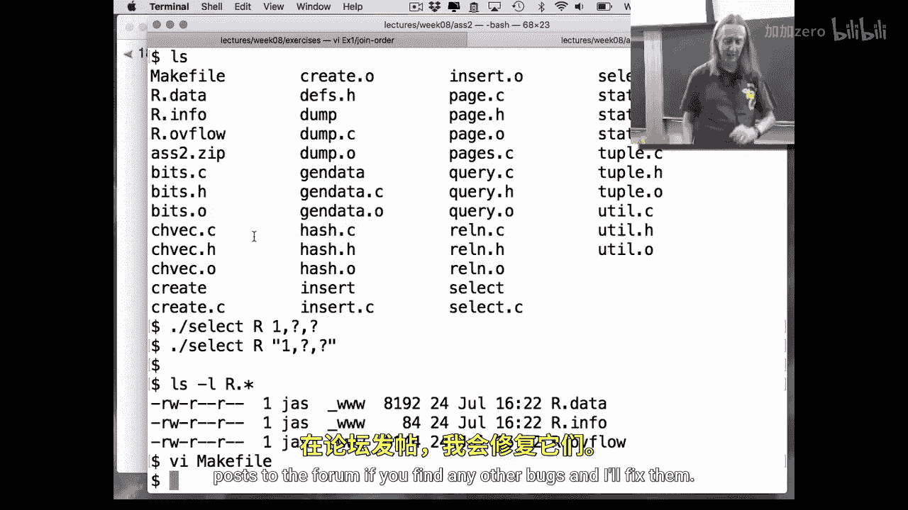

All right， so talking about。Deciding which。Particular。

Concrete relational algebra access method we were going to use for an operation in the query plan。

And like I said， if we got an index to an index select。

 if the two tables are sorted to a sort merge joint and so on。

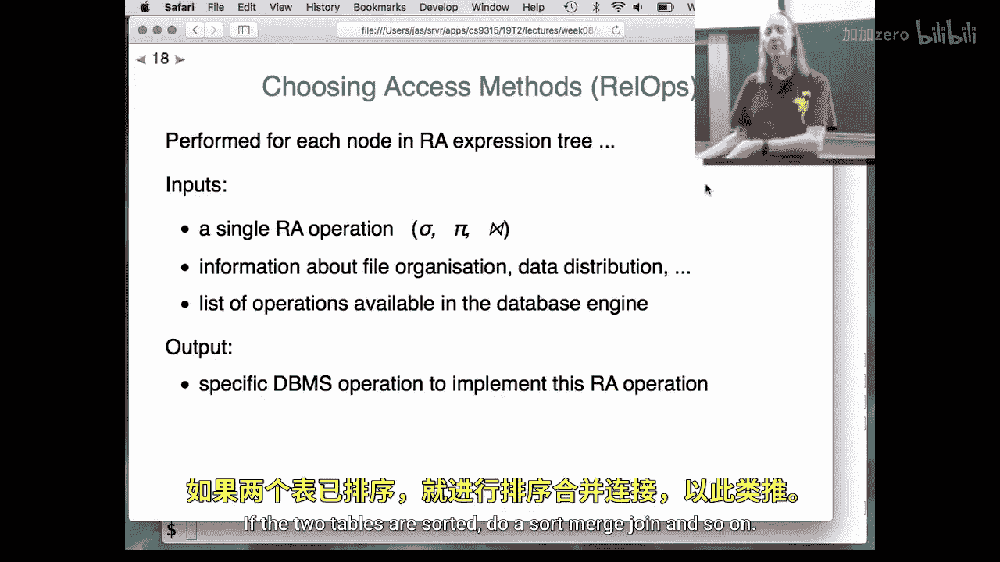

And here's another example of this， so if we're doing a select for a particular user and a particular age and we know that the Bre index the relation has Bry In on name then we use that relational algebra transformation that we talked about before where we can split the selection condition and we do select age greater than 21 on the result of select name equals John on student。

And select name equal John O student， we can use a B search。

 so in theory that's efficient and possibly will produce not too many results。

 and then it's not going to be too bad to do a linear search。2。

Work out all the tuples that satisfy that condition。If we have to write intermediate results to disk。

 obviously that's a disk right so that's slow U， so new a technique called pipelinning which is basically writing the results that one relational operation is producing into a buffer that can then be consumed by the downstream relational algebra operation。

 so that's pretty clear here， the big research puts its results into a buffer。

 which are then consumed by the linear search。Through those results to find。

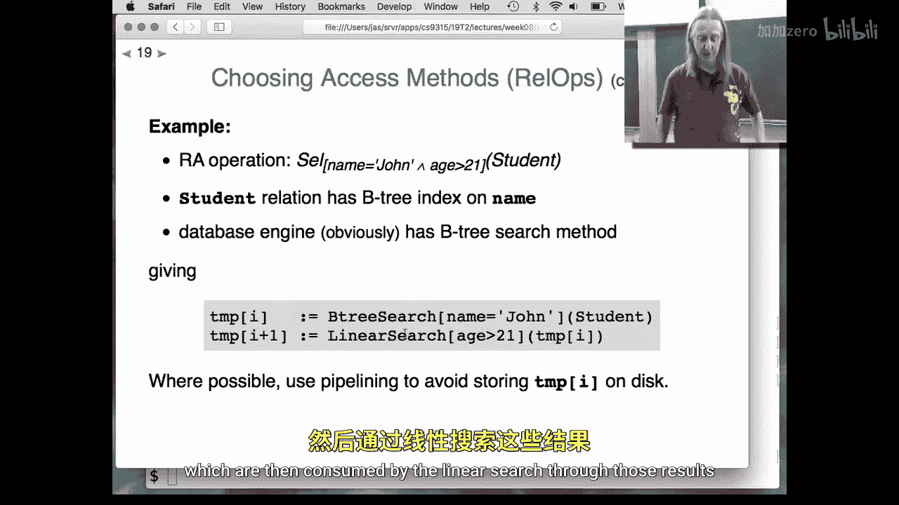

Tuples that satisfy the additional condition。Right so there's a lot of obvious rules that you can use if a relation has an index then you do an index search。

 if a relation is hashed on the particular attribute that you're searching for then you can do the hash based search if it's sort you can do a binary search and so on so the assumption is that all of these kind of selection operations are going to be available in your database in your DBMS and if not then you don't have the choice of doing it that way。

What else cost the des？So we know that there are going to be multiple search results， but obviously。

 we've got an index。 So reduce that index to at least find the first topple without having to read the rest of the。

The table， and then we can scan。And if we've got a hash function， well， then we。

If we're searching on a greater than a equal type condition on a hash file with stuff。

 so all we can do is linear search so that's kind of the fall back position if there's a structure of our file doesn't lend itself to doing anything else。

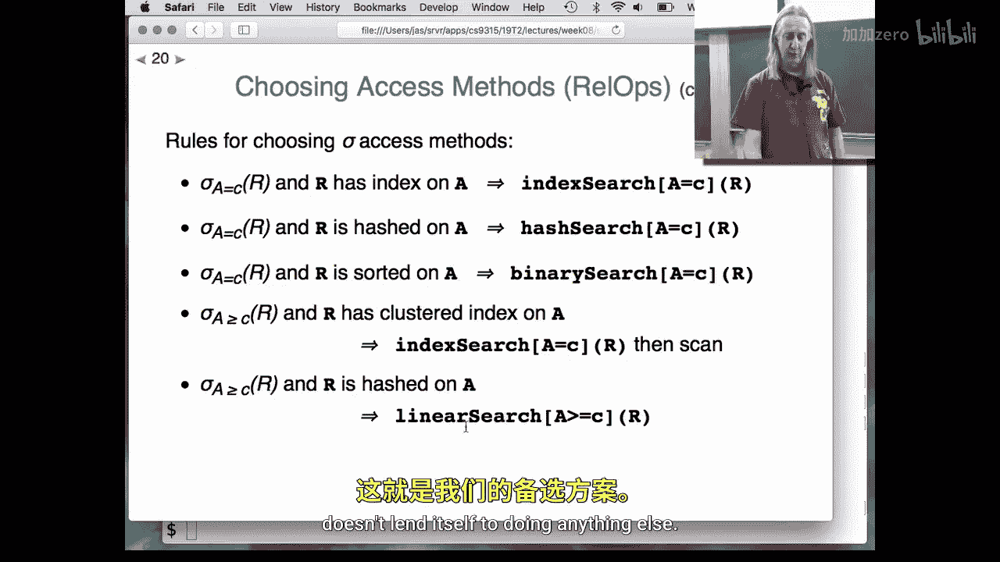

And similarly， if it joints， you know， if you know， for example。

 that one of the tables fits into your memory buffers， then you use block nested lu joint loader。

R for example， and then scan through the topples of S if happens to know the other one fits in memory buffers then you flip the order of the tables and use a block as join if you happen to know that both tables are sorted on the join at booth then you can do that and so on and so on。

And I guess the worst case scenario。😔，Would be， well。

 either a hash joint if we're doing the quality tests。

Or a nest of loop joint is kind of the last resort， it's the joint version of linear surge。

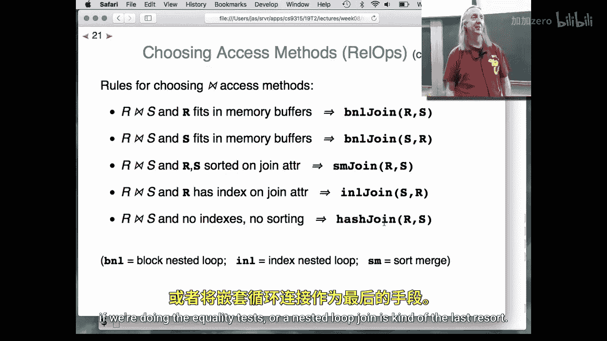

part of the deal is it's handy to know the likely size of the output from a particular operation because that's going to affect the downstream。

 the cost of the downstream operations。And the only way we can work out the real size of down is to execute the operation。

 but we don't want to do that so we try to estimate the cost。

We can look at various properties so we can look at total number of tus。

Maybe the average size of the tuple， that's going to determine the size of the output。来到怎么。

The number of distinct values of a particular attribute that will allow us to have a slight handle on estimating the likely number of tuples that we're going to get out of selection queries and maybe knowing the minimum and maximum value of an attribute is useful。

Or estimating greater than type queries。If we know。

 you know there's a certain range of values and with us the query we're asking greater than something close to the top end of that range than we know we're not going to get many results。

 but is we ask for greater than right down to the bottom， we're going to get a lot of involved。

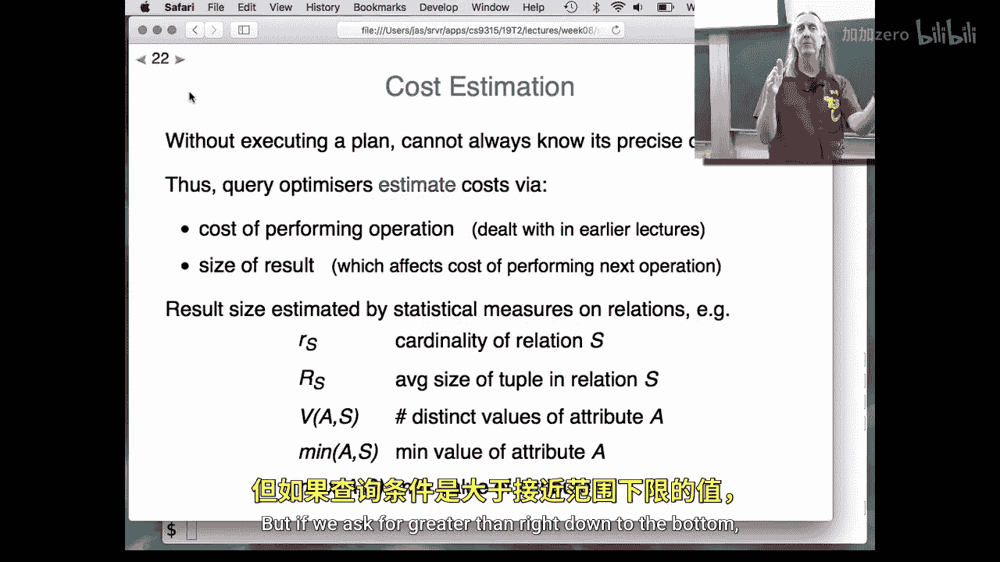

All right， so some things are easy to do projection results。The number of tuples is dead zip。

 it's just the same number of tuples as were in the original table unless we happen to do select distinct。

If we don't， then SQL remember doesn't have set semantics。

 it has bag semantics so we can have duplicates。So whatever projection we do。

 we're going to end up with the same number of tus in the output。

How big are the tuples in the output were they just the combination of the size of all the attributes plus whatever overhead there is for tuples。

 so that gives us a good handle on the size of the output of a projection。Relation。

How do we work out if they？The queryery does ask for select distinct， well that depends on himony。

Duplicates， there are。If we're cutting the total number of tus in the output in half。

 then obviously the size is going to be half， but working that out is a。

Is something that's pretty tricky to do。

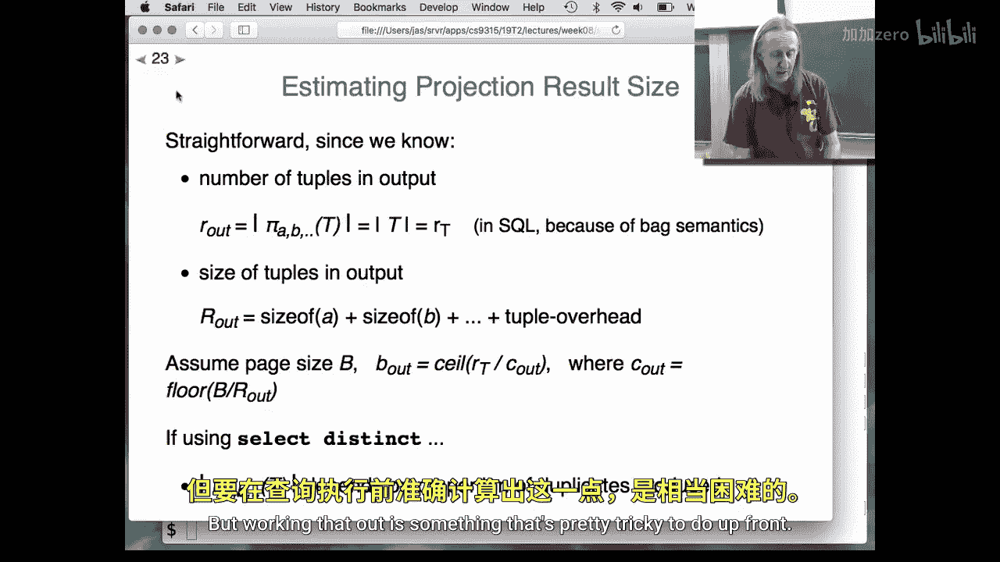

Fruit。For selection type operations， then we can estimate things based on some assumptions。

 one assumption， the distribution of values for the particular attribute is uniform， so we've got。

If it's a primary key， that's obviously true， every value appears only once。

 if it's not a primary key and there can be duplicates， you know， we've got roughly 10。

Values of tight red， 10 doubles with green， 10 doubles with blue。

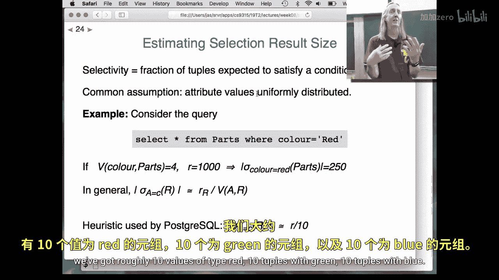

嗯。