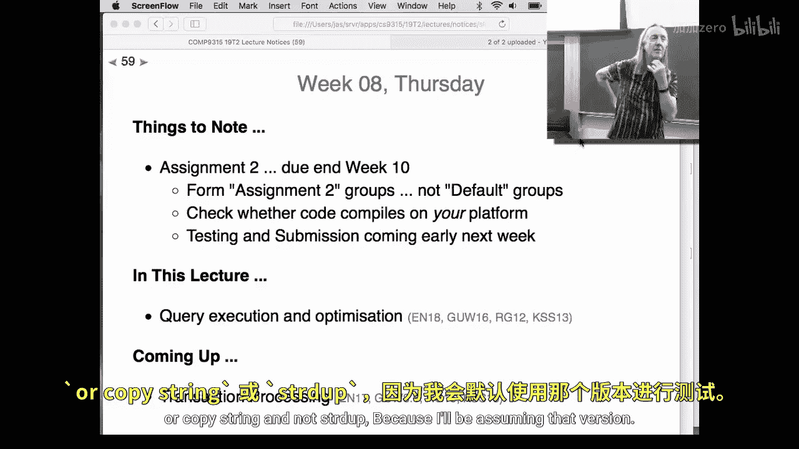
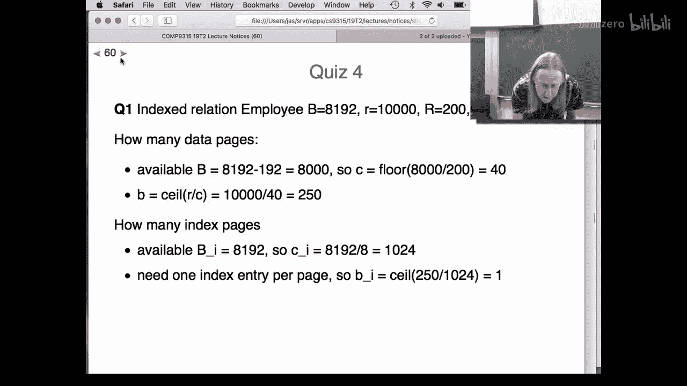
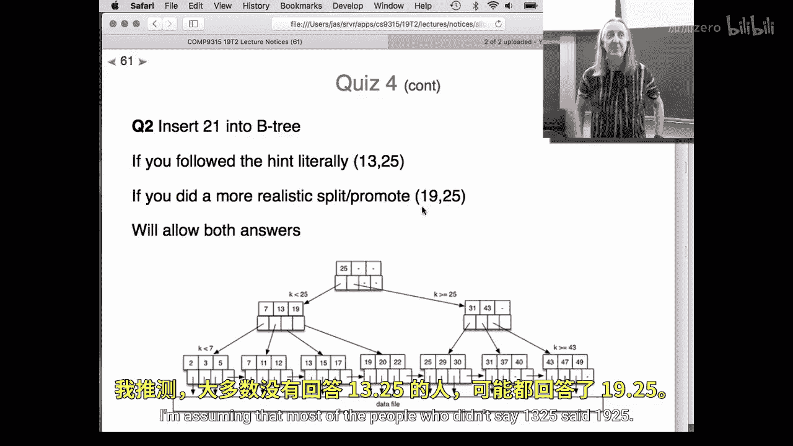
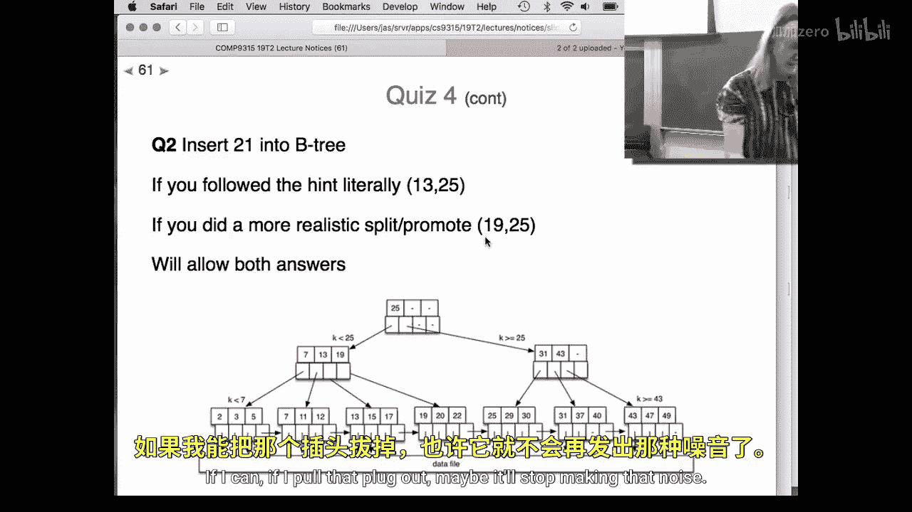

# 新南威尔士大学【中英⚡Postgres数据库实现原理｜COMP9315 2018 Postgres Implementation】 p27 P27 -BV1qXoqYHErC_p27-

All right， I think today is going to be quickke。Because I got ahead of myself yesterday and I haven't prepared my transaction slides yet。

😔，So there aren' many more things to look at for query evaluation， but。We shall see， all right。

 so Simon2， I had no I hate portability and well， I don't。😊，But getting it right。

 how many people have managed to make it compile straight out of just unzip S2。

 zipip make and it worked nobody。😊，Do。How many people have unziped it？No you玻璃。All right。Ill assume。

And it's going to work， it worked for me。😔，And all the places that I told you about in the notice。

 if it doesn't work for you let me know and I'll see what other port debacles we've had so the problem was。

For some unknown reason， the function istia dupe。Which makes a copy of a string was deprecated in C 99。

On the other hand， we need C99， I thought。Because I've used local variables in full loops。So。

Easy enough to write your own is to dope。It's a three line function， do it as an exercise。

For yourself that in any case， the current version of A3。

 zipip has a local version of STR do called copypy string。

And then the other problem was the range of number generator。

Once upon a time it was called randomand or once upon a time it was called Rand。

 then it was a version called random came along and that random seems to be part of some other version of Linux so I've gone back to calling it Rand。

So if that doesn't work on your machine。Change it to random， simple the only issue。Let me think。

Changing it to random， the only place it' used is in gene data and who cares how the data is generated。

 I'll be generating it myself when I test。Stream copy。

You need to make sure that you submit the version that uses string copy and not or copy string and not STR dupe。

Because I'll be assuming that version。All right， what else are you check whether it compiles obviously no one's done that no one person has。

 they sent me email saying it compiled perfectly on my machine， which is good。

Which was some box running good Btu。Oh yeah， assignment two groups。

I wondered why nobody had made assignment one groups and everyone had use the default group。😔，And。

Then I checked yesterday today and discovered that assignment one groups had been disabled。

 so you couldn't see them。😔，Assignment。So we'll just assume default is assignment one， right？

Can you now see assignment two as a potential group type？

Go I can't check these things because I can't become a student。

 so if someone had a look that would be。Useful。And I'll do some testing and submission make the submission available real soon。

 do you see assignment2？As's a group， yeah， they are cool。嗯。too many switches。

 it not this in webt CMs， not nearly as bad as Moodle， but still possible to mess things up。😊，关注。

Assignment2。Is that a value an an available group type？One persons telling me， yes。Are you love Dean？

All right， if one person can find it， any else can shortly。

So it was you All， Quiz4 finished at 2 pm if you didn't do it， bad luck。

70 minutes ago so remember the first question was about how big a relation is and how big the index associated with that relation might be these were the interesting parameters。

 pages are 8K we got 10，000 records。Each record is 200 bytes long。And each index entry is 8 by long。

 So first four bytes would be the Id value。 The second four bytes would be。Would毕。

Would be the employee ID value， the second four bytes would be the record I corresponding to that ID or at least a page number that contains the record。

🎼ほ不会たと waitト waitた。つかろね。🎼C。私？要。分你分你。云月咧。really你。来我们那块。

No know yes again hasn't done that before anyway so how many data pages a the data pages remember it also told you that was 192 by Eder so our effective amount of the used for storing records was 8000 so how many records can we stick in a page to record is 200？

And we got 8000 bytes so we can stick 40 records in a page。How many pages do we need in total。

 so we got 10，000 recordss 40 per page， so 250。Remember the？The possible answers to this。

 the choices had how many data pages and how many index pages， so 250 is a number of data pages。

That's relatively straightforward， the number of index pages potentially a little bit trickier。

That's what you do with multiple choice， can't make them too always。So。😊，Index pages are also okay。

 just like data pages and since each index is  eight bytes and since we don't have a page header in the index pages we can stack 024 of them。

Into a page。I think it didn't mention anything about page headers fact it won't affect the result anyway now the trick for this one was that it said that the data file was sorted。

And therefore we only need one index entry per page of the data file。

 all we've got to do is have the index of the lowest key value in the data page and we can look at that。

Index the value of the loss key value in the next page and we at the bound of key values within that particular page so we can use the index like that so given that we only ending one index entry per page that's how many pages we had 1024 did we we only had sorry know that's how many index entries we can stick in a page that's how many。

That's how many data pages we've got left around underneath need one index page if you weren't careful about working that out you might have assumed one index entry per record and I think one of the other options gave that as a choice but most people got that right so that's okay。

Next， this one。I' forgot to be at least from last to。It was a little bit contentious。

 so if you just followed the hint that said the middle value is promoted， you would have said okay。

 I'm inserting 21 it goes in this node， bang 20 has to go up here and therefore 13 goes up here and the answer would have been 1325。

Only 63 people got this right。So I assume that some of the others would have。And。

Being a little bit cleverer with the way they promoted stuff and ended up with 19。In the root page。

 which is a feasible thing to do anyway， if you draw the final beat tree。

19 is a sensible value to have up there。So。U so I'll accept both those answers。

 I'm assuming that most of the people who didn't say 1325 say 1925。

