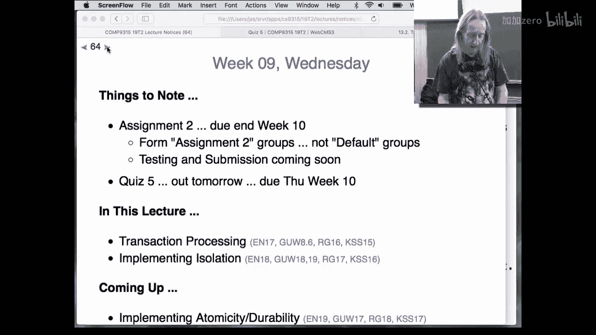
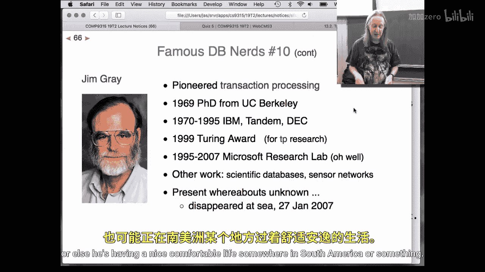
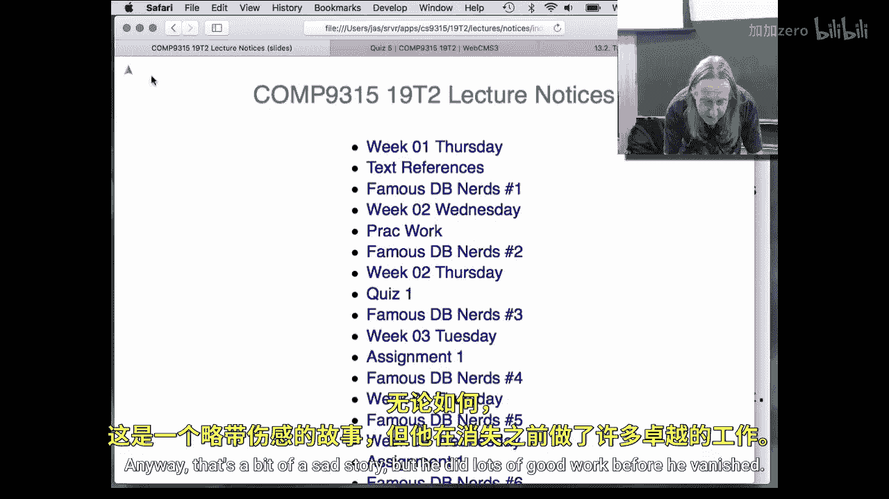
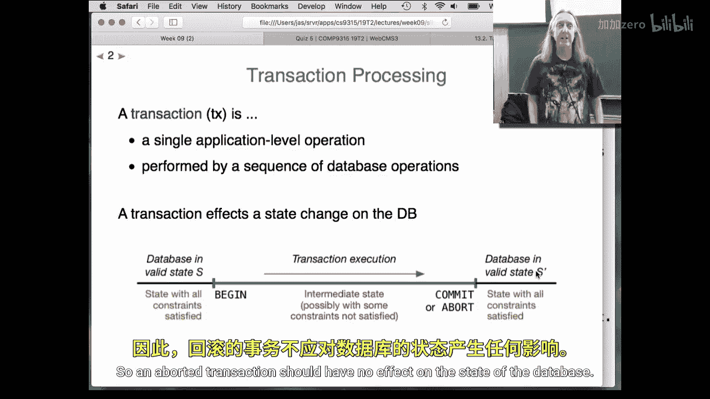
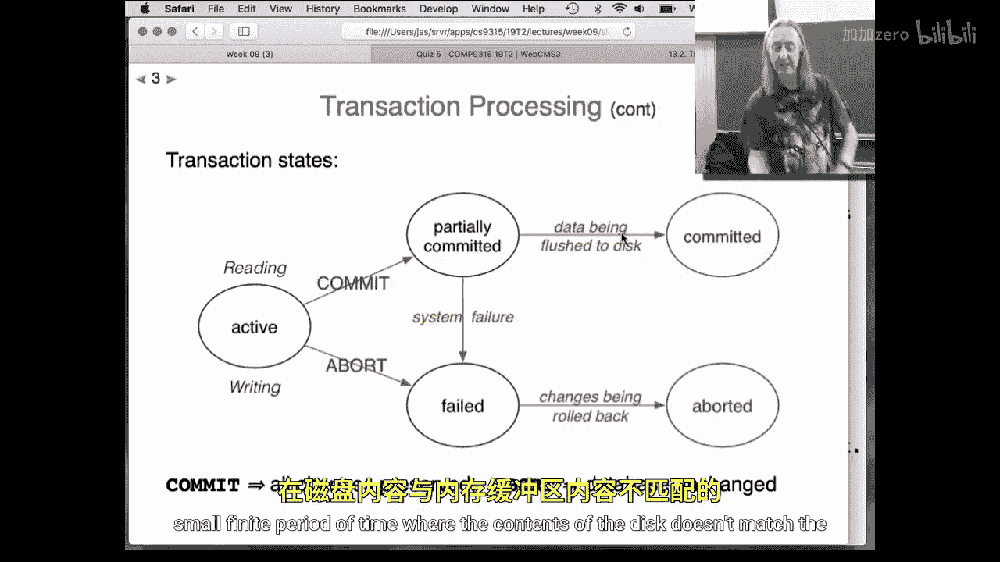

# 新南威尔士大学【中英⚡Postgres数据库实现原理｜COMP9315 2018 Postgres Implementation】 p28 P28 -BV1qXoqYHErC_p28-

Still no。Okay， week nine， wow， how time flies when you're doing unS done tree plus。そ。

I forgot forgot to check。Camera， rightright， Simons Julianne next week。

Form your groups using the assignment to group type。Most of you have， I think， if you formed。

Your group using default， then please go back and。Forit for assignment 2。

And your the testing is coming real soon now but real soon。Quz five out tomorrow。

 so today we're talking about transactions。

Speaking of transactions， he is a famous transaction person。t couldnで界啲。Look for could say了。

Seems to have a mask behind him seems to be out of the water。

Very well known transaction processing person， Jim Gray。

So that is bio because he did so much clever work on transaction processing eventually got Ting award。

Nobel Prize and Comp Science Fields Middle， but if you want to call it。

 unfortunately he sold out to the dark side and worked for Microsoft ages。

Involved in SQL Ser and in fact Microsoft got a whole lot of useful computer scientists to work on SQL servers though it's actually not too bad。

 but of course proprietary。And he did some subsequent work on scientific。

Da basis were basically talking about。Storing doubles had huge numbers of numeric attributes and his most。

His most recent famous activity is to go missing at sea。In 2007。There's a bit of a。

 I seem sad to say a loser effort， but his mum died and he was taking her ashes out to sea to scatter them at sea because she'd asked him to。

Before she know， but he never came back。And everyone got really excited about this all these computer science nerds were getting satellite images and writing algorithms to scan。

 seeing if they could see a trace of Jim Gray's boat， but they never found it。So since it's 2007。

HeGetting a bit old， I think or elses he's having a nice。

 comfortable life somewhere in South America。😊。

Or something。Anyway， that's bit of a sad story， but he did lots of good work before he vanished。😔。

All right， so transaction processing so we talked。All this stuff we've talked about so far has basically been inside an engine。

Of course databases want to get used in applications and they want to be used by lots of people concurrently so this part of the subject is talking about these kind of aspects so first thing using a database in an application。

One things that happen is that you've got an application level operation。

 which you want to treat as a single unit of work。But you're transferring money between two accounts。

 that's an obvious one， transfer $200 from this account to this account。

You don't want to take the money out of that account and then give up。

Because the person who owned that account and the person who owned that account are both going to be annoyed。

A， because he lost the money out of his accountant fee because she didn't get the money。

Into her account so we've got these application level operations and the critical thing is that they involve a number of database operations in order to accomplish this single unit of work。

So the idea of a transaction is it's going to make a change to the state of the database。

Now I've already seen command SQL savings a do， you do an， you do an update。

 you do a delete it changes the state of the database importantly when you do one of those operations there's a whole lot of constraint checking that goes on to make sure that the database satisfies all of the properties that you。

Initially， you hoped it would satisfy in which you specified in all of the various constraints。

 so you know if you've got firing keys， uniqueness in a table， things like that。

So at the start of a transaction， we assume that the databases。

Worked its way into a state where all the constraints are satisfied， you begin your transaction。

 you start executing database operations， some of the things that those database operations do may leave the database in a state where it's not satisfying all the constraints now of course if the operations are doing the individual operations themselves obviously aren'm going to mess up。

But。And the individual operations themselves will still be subject to all the constraint checking that normally happens but。

For example， if you've got。An accumulation column in one table that reflects the content of another table。

 so for example， I think I use this example last time you've got a courses table and inside that table and you've got a account of the number of students enrolled but the actual enrolments are stored in the enrol table and we want to make sure that。

The number of students enrolled in that course in the enrolment table， if you count them all up。

 it adds up to that number stored in the courses table。At some point during the。

Doing a transaction where a student unenrolled fail。

 then you remove the entry from the enrollment record。But you haven't yet changed the courses table。

 so you've got 239 students in the enrollmentrolments table and 200 account of 240 in the。

In the courses table， of course the next thing you're going to do decrement the count for the courses table if you're even smarter you'd actually do it using a trigger so as soon as you deleted the enrolment entry it would automatically get updated。

 but even that there's some period of time。Between when you do one。

Table change do the next table change in any case， so having done all of those operations you commit the transaction and you end up with a database in a new state so there are 239 enr entries the count in the courses table is 239 so all the constraints still satisfied。

So that's if the operation succeeds， if the operation fails for some reason。

Why might that or you say I want to unenroll student X Y Z and there's no such student X Y Z so you'd start doing it and discover oops。

 there's a mistake so anything that I've done already I'd better back out and set the database back into a consistent state so if I've done some of the intermediate operations。

 I want to make sure they're all undone。系啦。So you end up with the database in a new state if you commit if the transaction succeeds。

 S prime may be different to S， if the transaction fails and youllboard the transaction。

 then S prime will be equal to S。So。An a border transaction should have no effect on the state of the database。

So a little bit more fine grain detail about the states that a transaction can find itself in。

 it can be active， it's reading and writing and all the time I'm talking about reading and writing here by the way。

 I'm really probably talking about。Copying stuff into an hour of buffers so you've already loaded stuff from the disk you got it in a memory buffer shared between multiple processes。

 multiple transactions potentially and when you say right changes the buffer eventually the change to the buffer gets committed to the disk becomes。

Permanent， so。The database is doing the transaction doing reading and writing。

 the transaction finishes successfully and you say commitit at this point all of the data is still sitting in the memory buffers and eventually it has to be pushed。

To disk。 So there's a。A small， finite period of time where the contents of the disk doesn't match the contents of。

