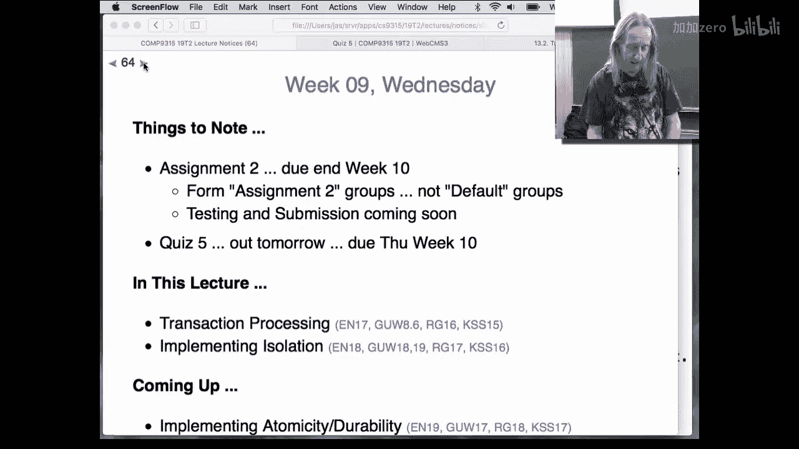
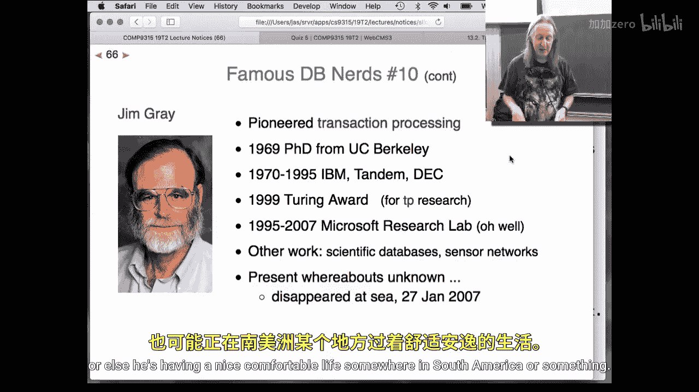
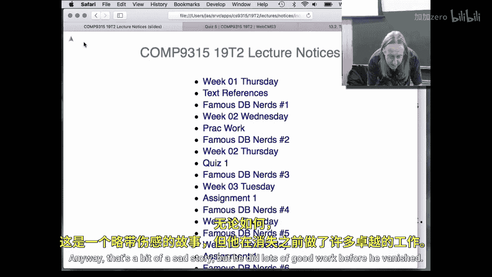
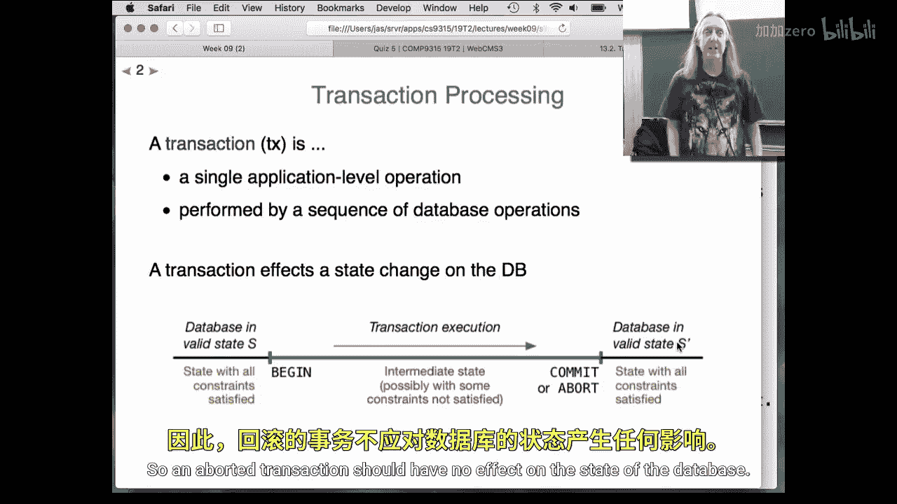
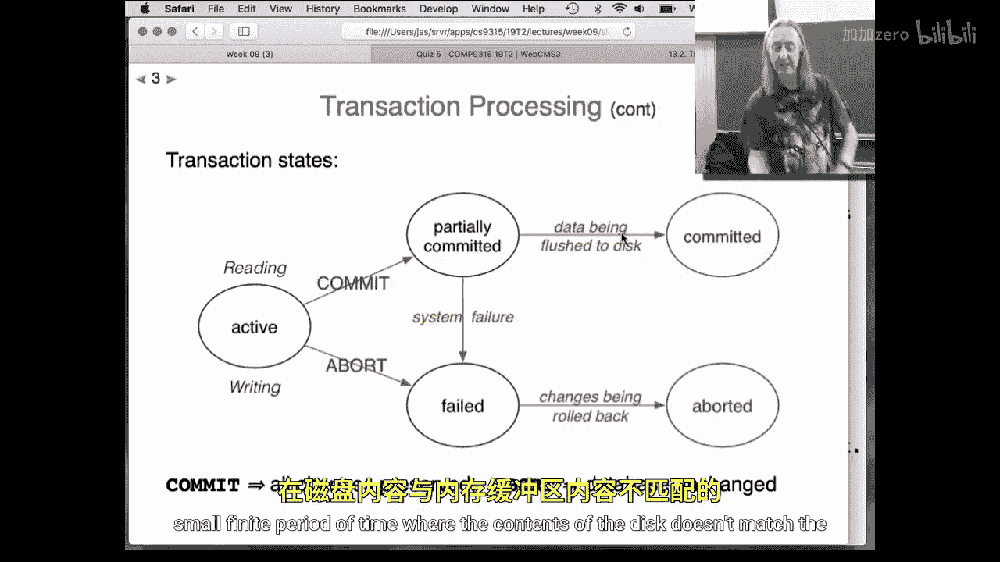

# 数据库实现原理：09：事务处理

在本节课中，我们将要学习数据库事务处理的基本概念。事务是数据库应用中确保数据一致性和操作原子性的核心机制。我们将探讨事务的定义、状态以及它在实际应用中的重要性。

---

上一节我们介绍了数据库引擎内部的各种机制。本节中我们来看看数据库如何被应用程序使用，特别是当多个用户并发操作时，如何保证操作的完整性和一致性。首先，我们需要理解应用程序级别的操作。

在应用程序中，有些操作需要被视为一个单一的工作单元。例如，在两个账户之间转账。

*   **转账操作示例**：从账户A转出200元到账户B。
*   **关键点**：这个单一的应用级操作需要由多个数据库操作（如扣款、存款）共同完成。

事务的概念由此产生。事务将对数据库的状态进行更改。我们之前见过的SQL命令，如`UPDATE`、`DELETE`，都会改变数据库状态。重要的是，执行这些操作时，会进行大量的约束检查，以确保数据库始终满足我们定义的所有属性（如外键、唯一性约束）。

事务开始时，我们假设数据库处于一个所有约束都得到满足的状态（状态S）。事务开始执行数据库操作。这些操作中的某些步骤可能会暂时使数据库处于不满足所有约束的状态。当然，每个单独的操作本身会进行约束检查，但跨表的关联操作可能存在时间差。

以下是跨表操作可能产生临时不一致的例子：

*   **场景**：有一个`courses`表，其中包含一个记录学生人数的`enrolment_count`字段。实际的选课记录存储在`enrolments`表中。
*   **目标**：确保`enrolments`表中对某门课的记录总数，与`courses`表中该课程的`enrolment_count`值相等。
*   **事务过程**：在一个学生退课的事务中，首先从`enrolments`表中删除该学生的记录，然后更新`courses`表中对应课程的`enrolment_count`（例如减1）。
*   **临时不一致**：在删除`enrolments`记录之后、更新`courses`表之前，数据库处于临时不一致状态（`enrolments`记录数已减，但`count`值未变）。即使用触发器自动执行，这两个操作之间也存在微小的时间差。

完成所有操作后，提交事务，数据库进入一个新的、所有约束再次得到满足的状态（状态S‘）。如果操作因任何原因失败（例如，尝试退课的学生不存在），则需要撤销（回滚）事务中已执行的所有操作，使数据库恢复到事务开始前的状态（状态S）。因此，一个回滚的事务应对数据库状态没有影响。

---

上一节我们介绍了事务的基本目标和“全有或全无”的特性。本节中我们来看看一个事务在其生命周期中可能经历的具体状态。

事务可以处于以下几种状态：

*   **活动状态**：事务正在执行读/写操作。这里的“读/写”通常指的是在内存缓冲区中进行操作。数据先从磁盘加载到由多个进程（可能对应多个事务）共享的内存缓冲区中。“写”操作会更改缓冲区内容，最终这些更改会被提交并永久写入磁盘。
*   **部分提交状态**：事务的所有操作都已完成，但更改仍在内存缓冲区中，尚未写入磁盘。此时执行`COMMIT`命令。
*   **提交状态**：成功将缓冲区的所有更改持久化到磁盘后，事务进入提交状态。此时更改永久生效。
*   **失败状态**：事务无法继续正常执行（例如，遇到错误或违反约束）。
*   **中止状态**：事务失败后，数据库系统将回滚该事务已做的所有更改，使数据恢复到事务开始前的状态。
*   **终止状态**：事务已完成（无论是提交还是中止）并退出系统。

需要特别注意“部分提交”到“提交”的过渡。在`COMMIT`命令执行后、数据实际写入磁盘前，有一个短暂但确定的时间窗口，此时内存中的数据与磁盘上的数据是不一致的。数据库系统必须确保即使在此阶段发生故障，也能通过恢复机制（如日志）保证事务的原子性和持久性。

---

本节课中我们一起学习了数据库事务的核心概念。我们了解到事务是将多个数据库操作捆绑为一个逻辑工作单元的方法，它保证了操作的原子性（要么全部完成，要么全部撤销）和一致性（事务将数据库从一个有效状态转换到另一个有效状态）。我们还探讨了事务在其生命周期中可能经历的各种状态，特别是提交过程中数据在内存与磁盘间同步的关键阶段。理解这些是掌握并发控制和故障恢复等高级主题的基础。