# 新南威尔士大学【中英⚡Postgres数据库实现原理｜COMP9315 2018 Postgres Implementation】 p29 P29 -BV1qXoqYHErC_p29-

All right。So in that were those previous examples， some of the。And the when we saw a few slides back。

 it's interesting to know what we're supposed to do。When one of the transactions board。So。

If we want this to live database in a sensible state， we can't really。

Leave that value of y that we produced because it was based on a value of x that's no longer valid。

So。If we ended up with。So one thing we could do。Is we could say。

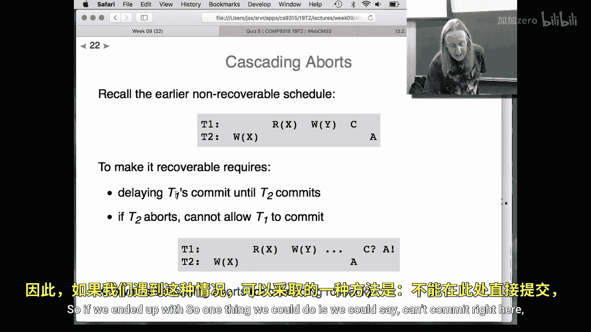

Cant commit right here。 You've got to wait until the transaction that。

That you read from has finished。And if we do that。Then we end up in this scenario here where we can't really commit。

This transaction， because the data， because it values that it's produced are based on invalid results because the transaction that was waiting on aor。

So we can do a commit there we have to award T1 as well if we want the database to definitely be in a consistent state so that's。

Slightly annoying， you know， this transaction here went happily on its way， sort it was done。

 committed， da， da， da。

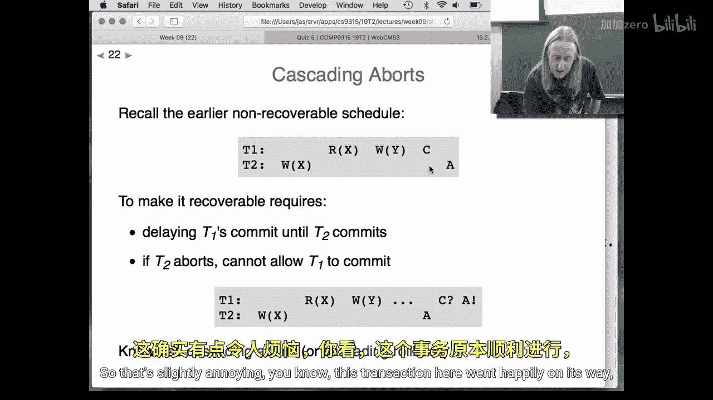

And， you know， we can have even worse scenarios where we have a whole bunch of transactions that have to be rolled back because one of the transactions failed。

And。Even though T1 is not at all related to T3， the fact that T3 failed means that T2 faileds and T2 is directly related to T1 and therefore T1 has to fail。

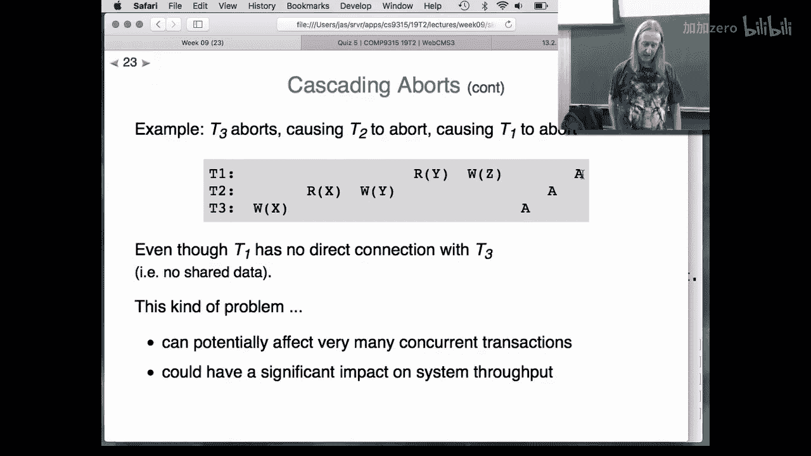

So if we end up doing things like that， that's slightly annoying。

So cascadingbors can be avoided if transactions only read values written by committed transactions。

 basically what that would mean is if you're trying to read something and you know that there something you want to read is being manipulated by another transaction then you have to wait until that transaction。

Commits or until a transaction ends actually if it fails。

 then sure you can read the old value that's fine if the transaction that you're waiting for succeeds then。

In that case X has a new value and that's also fine。

 so basically backing up to the previous so run not that one， even the one before that。

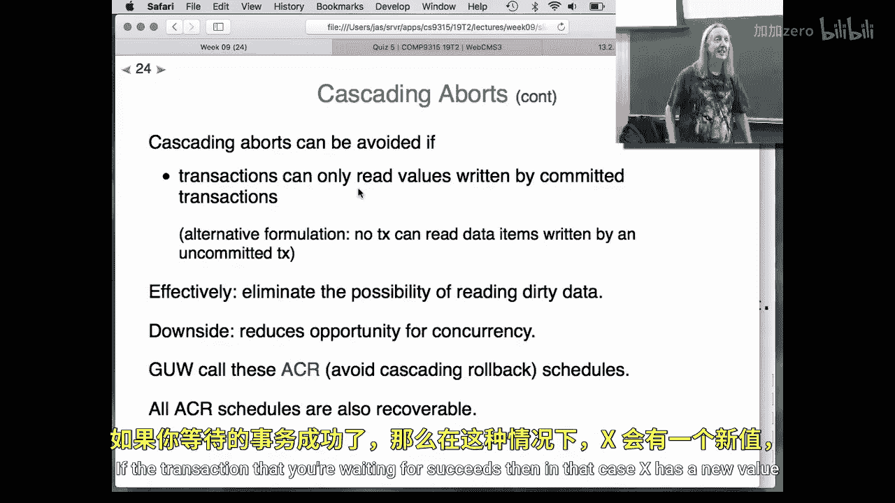

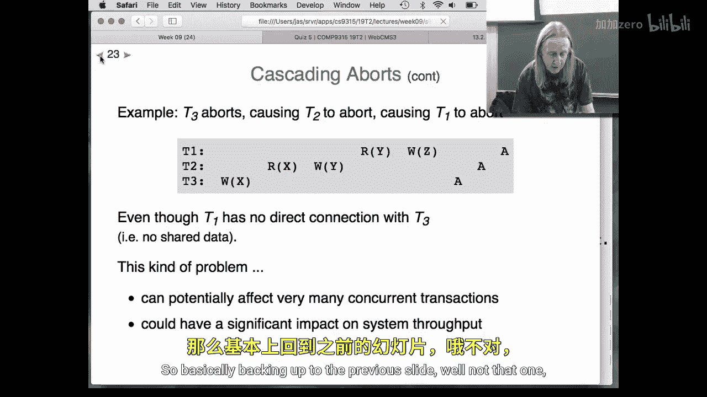

嗯。If T1 has to wait until T2 finishes， then everything's okay。

 whether it finishes by an abt or whether it finishes by a commit and we wait until is completely done。

 we don't end up in that scenario had before we start doing our work before the commit or the abor has finished。

 then everything is okay。

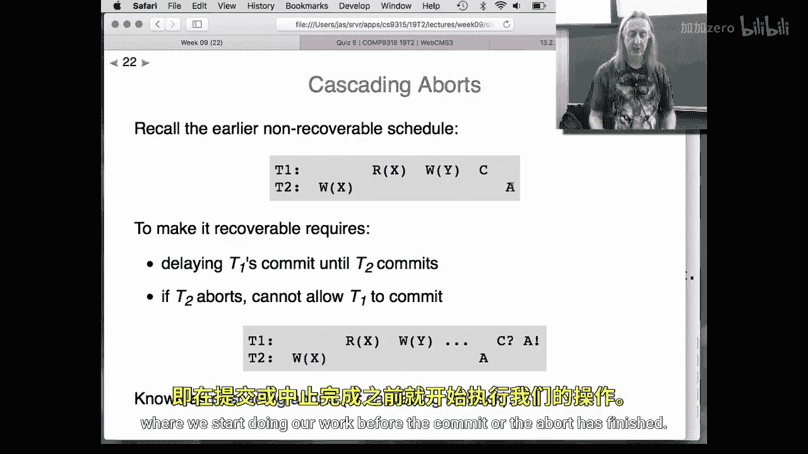

So one thing that does eliminates the prospect of reading dirty data， so we can't read a data item。

That's in the process of being manipulated by another transaction。

 but may eventually be rolled back by that transaction。Obviously。

 and this is true of all of these approaches that we end up reducing the amount of concurrency that we allow in the system。

GW is the Garsier Uman Widom book。They call these things。ACR schedules， so。

Any transaction that avoids cascading rollback or if sorry any schedule that avoids cascading rollback is going to be recoverable。

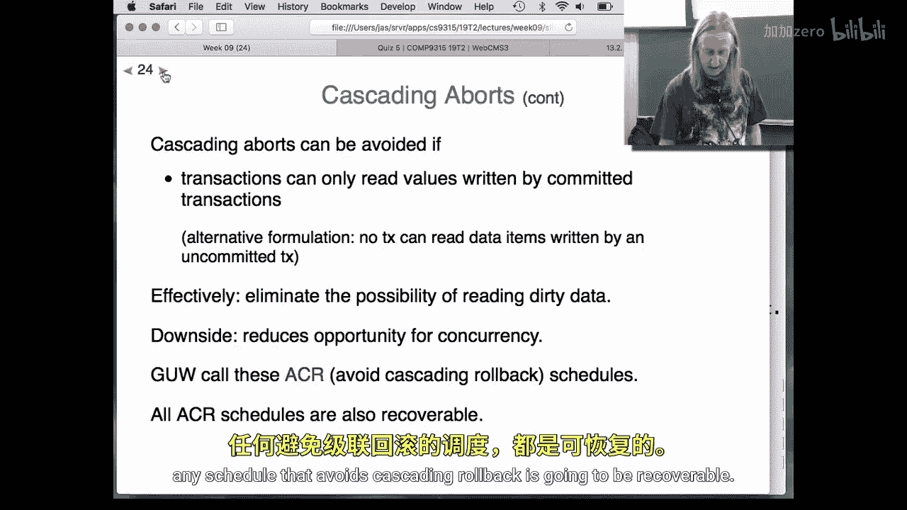

Another property of schedules could be strictness and the first property is basically the ACR property。

But。Another one is that you can't write a data item。

That was written by another transaction if that transaction hasn't yet committed。

So strictness is also a useful property for schedules and there's an example of a nonstrict schedule。

 I't worry too much about that but basically you know you have complexity classes for algorithms。

 you can have classes of schedules based on their properties so the strictest class is serial and that gives you lots of strong guarantees about consistency of the database。

 strict schedules。

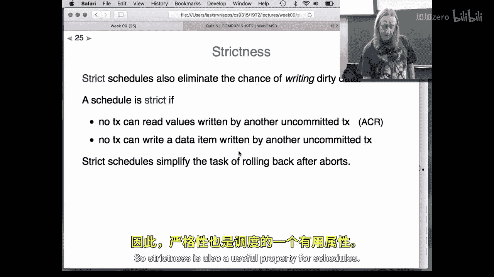

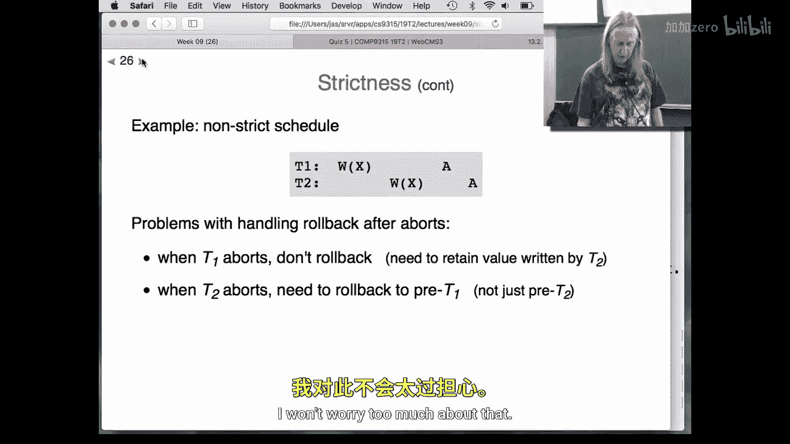

Allow some things that aren't serial but still give these decent guarantees and you've got avoiding cascading rollbacks。

 serializable schedules encompass those but there are other serializable schedules that are。

Sttripped or recoverable as we saw and then the set of all schedules is actually much larger than shown on that。

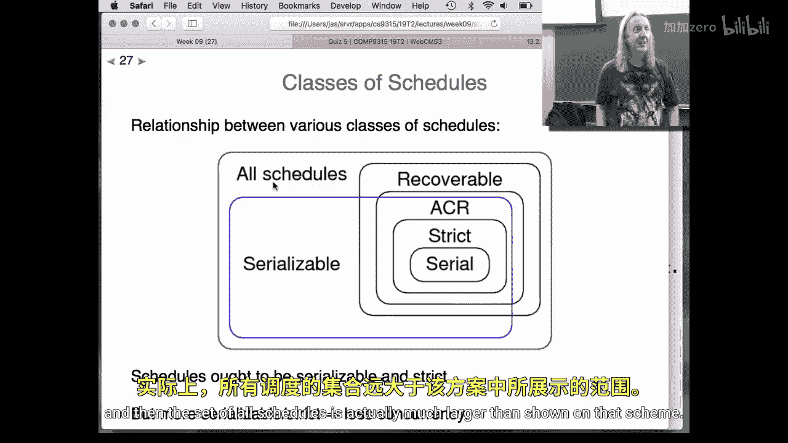

Sme。So if schedules are serializable and strict， that's good， but。

From the sense of you you've got some guarantees about the correctness of the final outcome。

 but you have less concurrency。So a lot of database systems will allow you to say， okay。

 I am happy not to have a serializable schedule as long as I have a recoverable schedule。

 which would mean youd fit into one of the schedules in that little bit。And that may allow more。

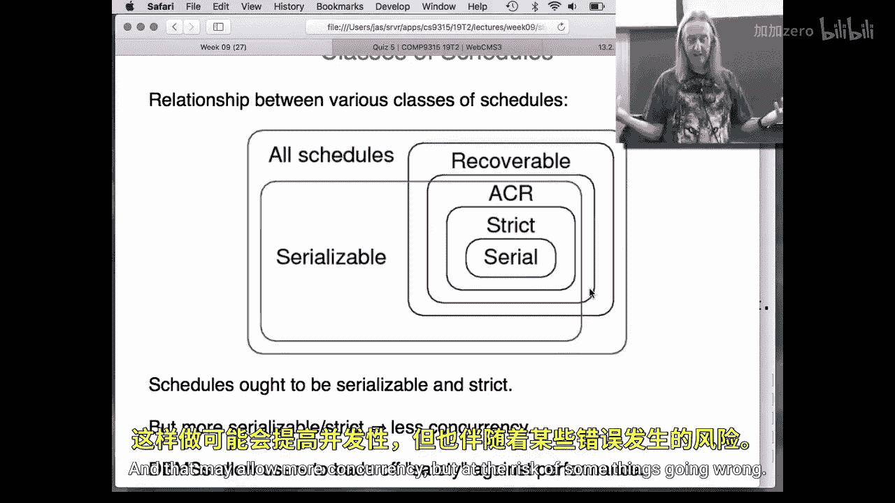

Concurrency。But at the risk of。

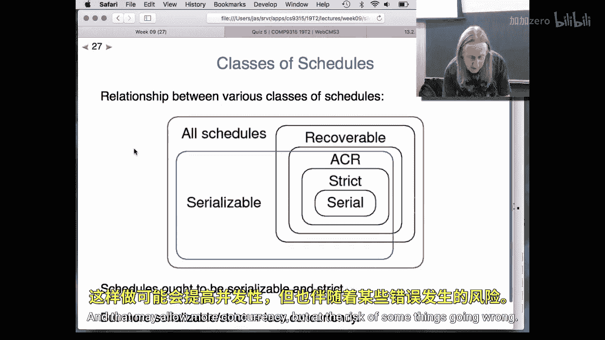

Some things going wrong。All right， so another approach to basically inch to trying to ensure concurrency and this happens in the database engine is to have some。

kindind of system that schedules the read and write requests if you've got a system like that then sure these reads and write can come in from arbitrary transactions。

 but the scheduler can decide what order should I do these things so that I don't end up with。

Schedules that are going to produce invalid results。

So the transaction manager sends in a sequence of readwrite requests they get put into the schedule which orders the operation of those readrite requests and then interacts with the buffer pool manager to get the actual object。

Right so the whole deal was concurrency control schemes is that we try to let our transactions execute concurrently。

We've got some safeness guarantees now of course if you've got two transactions and they're manipulating totally different data objects then who cares about the interleaving。

 they could actually run in parallel with arbitrary interleaving of results and then be no problem。

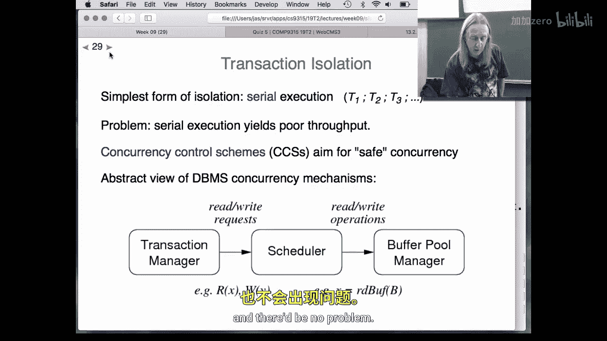

So we need to identify things like that and this is just giving the definition of serializability in a little bit more detail than what I said before。

 but it also introduces the notion of equivalentence of schedules so basically two schedules are equivalent if they leave the database in the same state once they've committed。

And a serializable schedule is a concurrent schedule。

 a concurrent schedule which leaves the database in the same state as some serial schedule。

 we don't care which to one and that may result in the actual state of the database being。

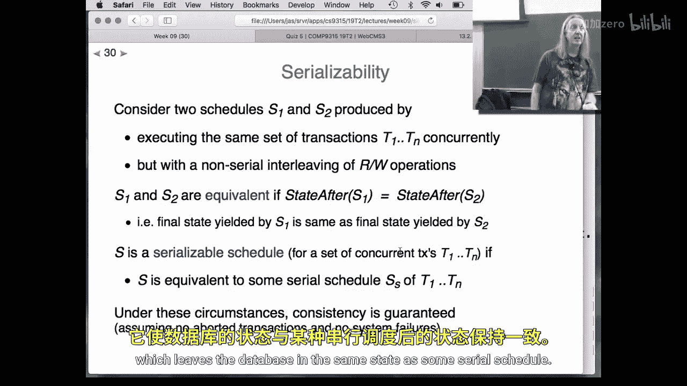

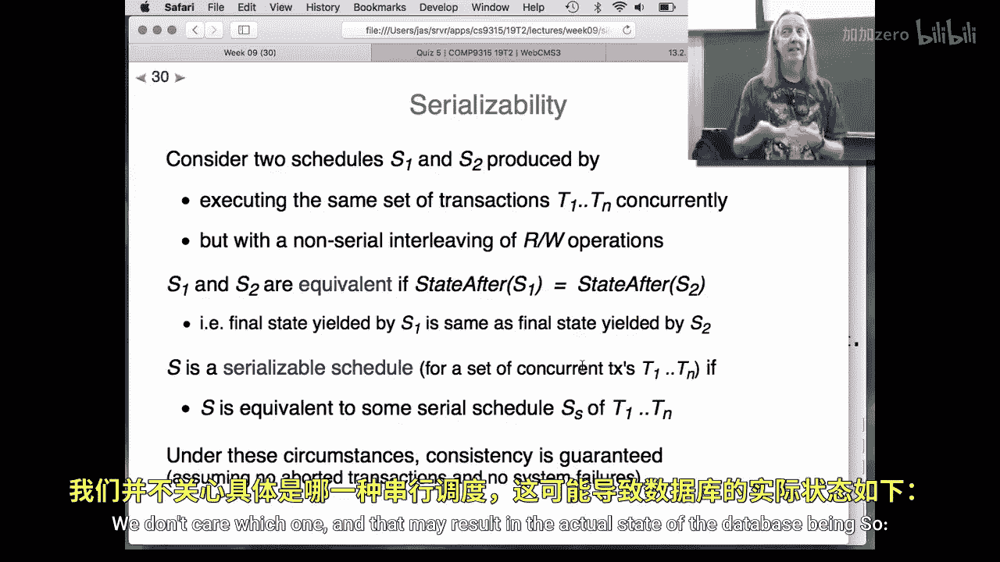

Different， so if you execute transactions in one order。

 you may get a different result as if you're executing them in a different order。

 or at least you may end up with a different final state， but as long as the concurrent。

Schedule is equivalent to one of those serial schedules。

 then we are happy we've got those consistency guarantee。

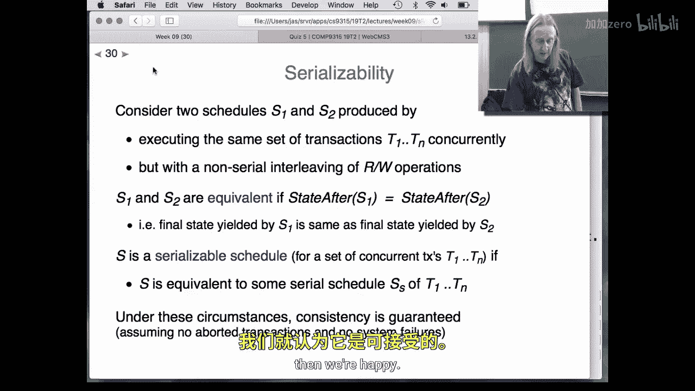

Now of course there's two formulations of serializability。

 you can look for conflicting operations and make sure they happen in the right order。

 or you can look at who produces。The values of particular variables and who reads who consumes the value of particular variables and who produces the final result。

诶。And I assume。That you've seen these in your first database course。 Is that true。Yes。😊。

only one person。

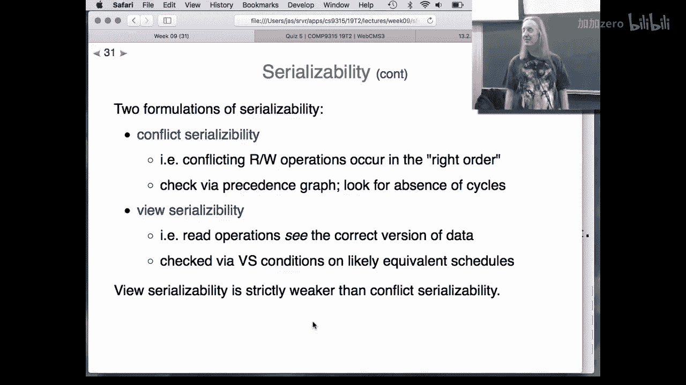

被公司。All right， if you haven't， I'll put it on the。