# 新南威尔士大学【中英⚡Postgres数据库实现原理｜COMP9315 2018 Postgres Implementation】 p30 P30 -BV1qXoqYHErC_p30-

I just give the lecture to an empty room， make the video bin go oh， okay， Thursday， week。

Simon do make sure you form your groups at least before you submit。

Which should be easy because you can me here because I haven't set up some Michel。呃，微信。The quizzes。

 I can't remember maybe get to released at 4 pm anyway， it's due next Thursday。

Today I'll talk about more about implementing isolation。

Tk me tea and next week we'll talk about some other topics。😔。

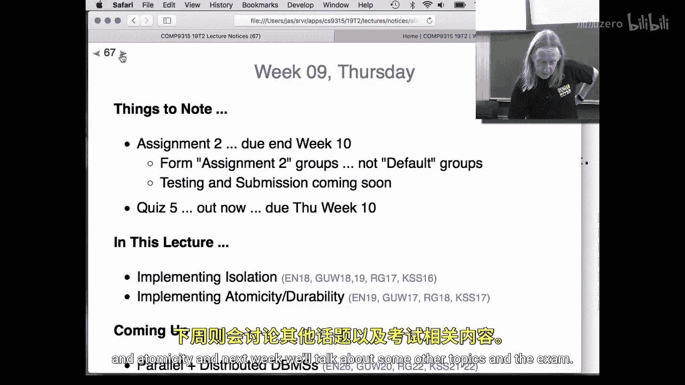

Andy say。There are assignment to a couple of questions。

On the forumroom it made me realize that maybe rather than asking you to submit just some select。

Source files， that might be better， easier just to submit everything。😔，Notock dot O， of course。

 not binaries to solar dot Z all the dot H。be的。They're ending up with submissions that are， oh dear。

 I forgot to submit my fabulous implementation of choice factors。Which has happened in the past。

 so just anyway help' change the spec to tell you what to do。

And you can even submit or create select In by blah。

 blah even though I'm not going to use your submitter ones' going to use the original ones。

 so you've got to make sure that all of the library code that you submit works with the original versions。

And the simplest way to do that don't change the original version。The other thing I realized？

Is there it's going to be hard to auto map I'm sure I'll get away。

 but not all of the outputs are necessarily the same even for correct solutions。

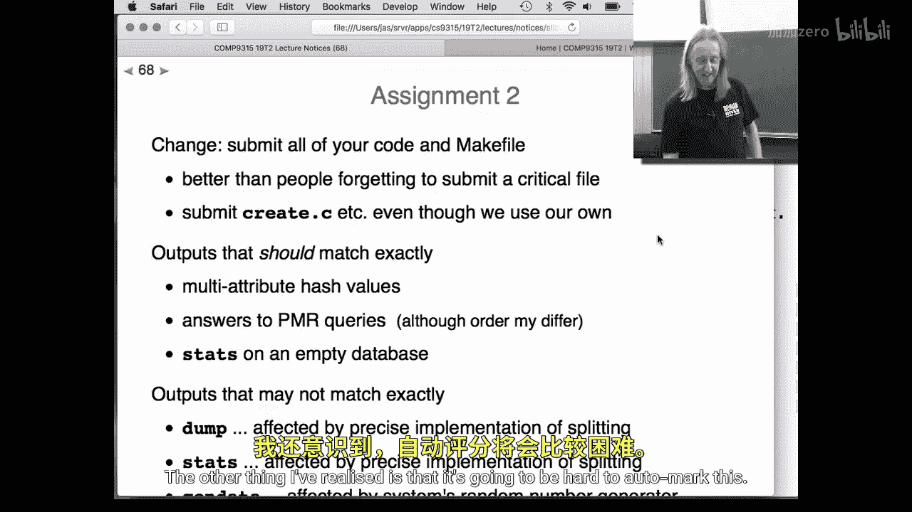

Things that should be exactly the same， the multi attributee has values that are being dumped when you're doing in。

They should be the same regardless of what machine you landeded on。

So if your hash values look different。To the ones I put in the testing thing。

 then you might want to check。One thing it could do is dump the hash value for each of the individual attributes and make sure that the right bits are being taken and put in the right places in the multiat hash value。

You should if you insert the same bunch of tubbles as me and then you do a search。

 you ought to get the same set of answers now they may not come out in the same order。

 all of this is dependent on how you do youre splitting basically。嗯嗯嗯。But。

That's fine as long as you get the same set of answerss， then it's correct。And also。

 when you create a database and you run stats， then it ought to。M exactly。

It'sBa because the nursing used any of your code probably unless you change something about relations。

😔，Other outputs that might not match exactly if you do a dumbb you've inserted a thousand tuples。

 it's possible that。You might have not done a split。😔，That I assumed you were going to do。

And when you do a split。I think I said in the spec， you do it after every C insertions or something。

Whether you do it before the insert happens or whether you do the insert and then do the split could have an effect on what the final result that you see。

Neither is incorrect， it's all correct， especially if you get the same set of answers。

It's going to be hard to insist that you do it a certain way without telling you too much how to do it。

😔，Assembly with stats， you might get different results depending on when you did the split。

And as we discovered in the last couple of days， when you run gen data on Greek。

 you get a different set of results to what I get on my Mac。Which surprised me slightly。

 I thought the two RA functions were。Implemented the same on both machines， but apparently not。😔。

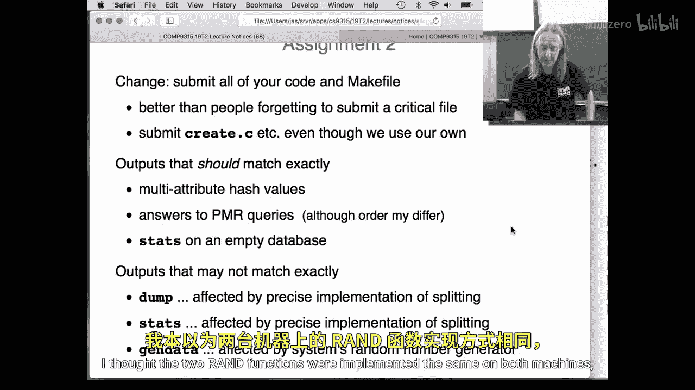

And I guess they'd argue， well， it doesn't mean that they're random number generators who cares whether you get the same sequence of random values on two different machines。

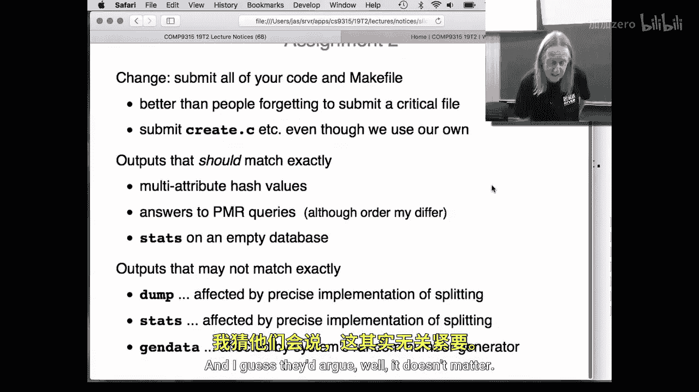

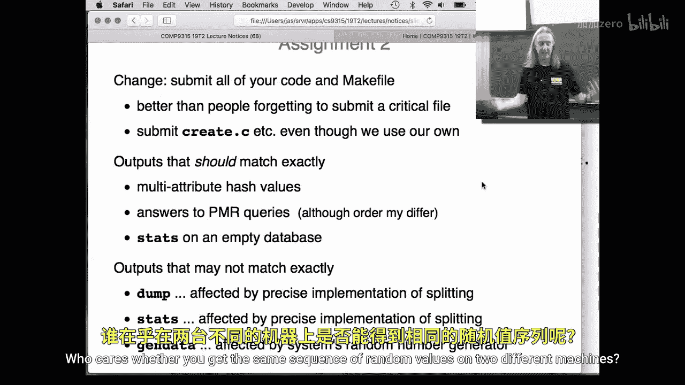

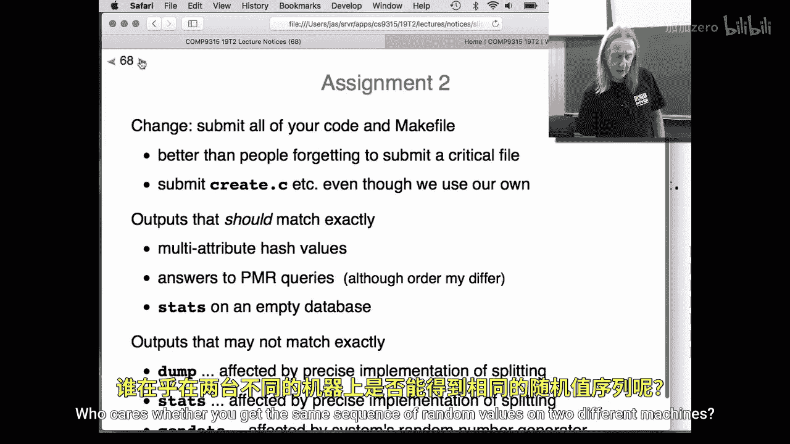

So in any case， when I do the testing， or'm going to give you more testing I'll give you files of tuples。

So that we know we're both working from the same set rather than relying on gen data。

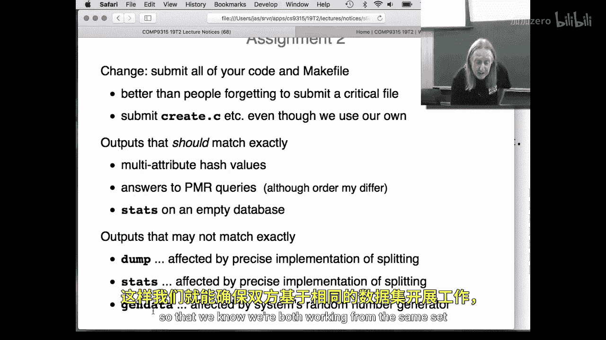

To provide a set。

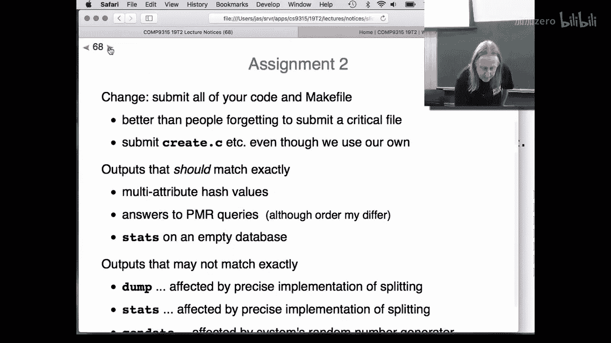

All right， it's another D。我发给你。Cesy green I'll admit that。Anyone know。No words there no knows。No。

Which means you haven't been looking at the stuff his name is Mohan and the C is a very long Indian name so I won't bother try and pronounce it。

 but he's extremely well known for his work on recovery which is one of the topics I'm going to talk about today。

SigOd is the main sort of professional body that database people look to。

 the main database conference or there are two main database conferences。

 but SigMd is the main database conference in every 10 years or so。

Or maybe I think it's every 10 years you can certainly see it that's Strenville DB but they give an award for someone who did something a while ago which is a big impact on research and maybe on the industry as well so he's won a couple of those awards for the。

Recovery system called A。He's made other contributions in different areas of databases as well。

He started out at IVM， as you may have guessed。😊，What a pair of glasses。IVM Almaden。

 which is where systemma was built or was actually built at the San Jose Lab button。Close enough。

 and he went to India for a while。 Then he came back to Armaan， and I think。

The Wikipedia page said he was currently a visiting professor in China。So once again。

 another very influential database person。

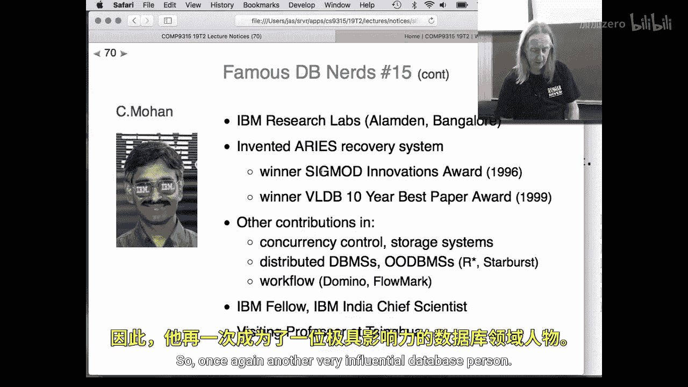

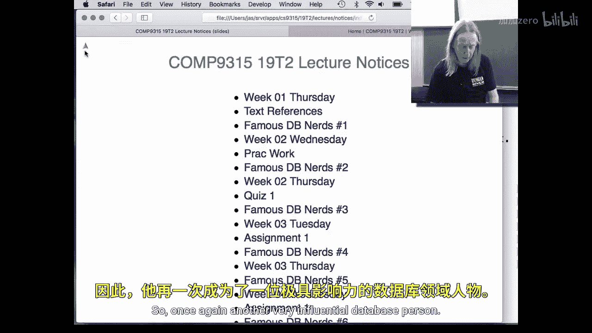

So he justifies the title famous database nerd。

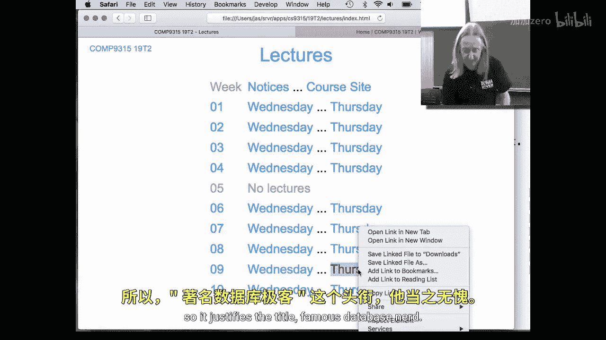

All right，Yesterday was all about transactions， serializability and locking to do concurrency control and the reason we want to do that is we want transactions to satisfy a certain bunch of properties。

 atity， the entire transaction happens or none of it happens。

 remembering that transactions are made up of sequences of individual database operations。

 consistency， basically means that the transactions correct， it does what you wanted。

 it transforms the database from one valid state to another。D is durability。

 which we'll be talking about later today and I for isolation。

 which basically means that you're trying to control the concurrency so that each transaction gets the impression that it's the only thing happening in the system。

So。If transaction don't run concurrently， if they just run one after the other， in other words。

 they're serial。There's no problem。If you can create concurrent transactions that are equivalent to some serial transaction。

 then that's good and it will certainly avoid some of the updatedomalies that we looked at yesterday。

嗯。Seralizability is a fairly strict interpretation of isolation and the more strict you make things the less concurrency you're going to get so if you want to relax things a little bit and maybe allow for updateomalies to potentially happen。

Then you can get more concurrency。 So there's a bit of a trade off there。

 And there's four different levels of。诶。Isolation， only two of which Postgreth actually implements。

We giveive to the syntax for the elder， but they don't exist and we saw yesterday say you can't do really un committedm。

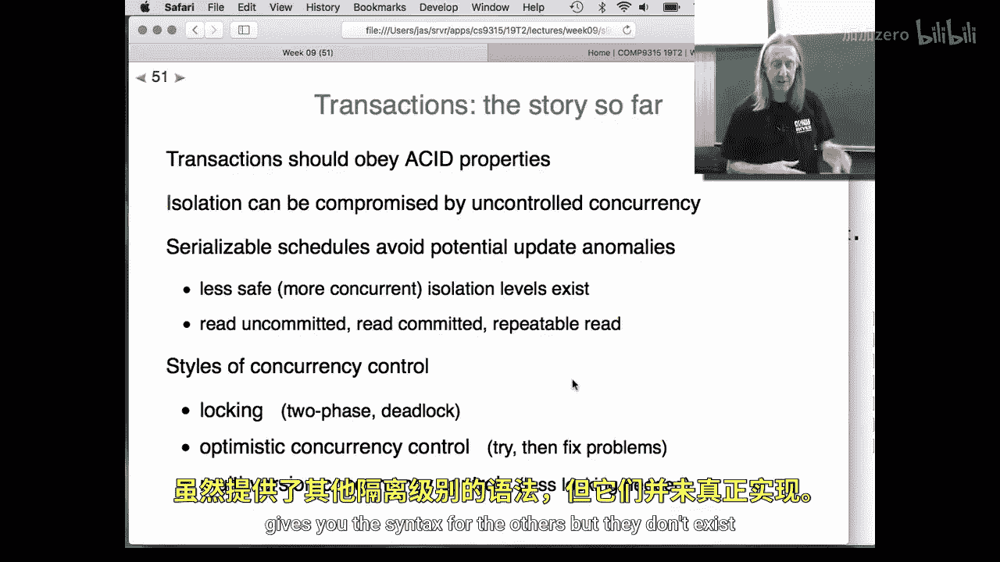