# Postgres数据库实现原理：P30：事务隔离与恢复概述

在本节课中，我们将继续探讨数据库事务的隔离性实现，并初步介绍事务的持久性（Durability）与恢复（Recovery）机制。我们将回顾事务的核心属性，分析不同隔离级别的权衡，并了解一位在数据库恢复领域做出杰出贡献的研究者。

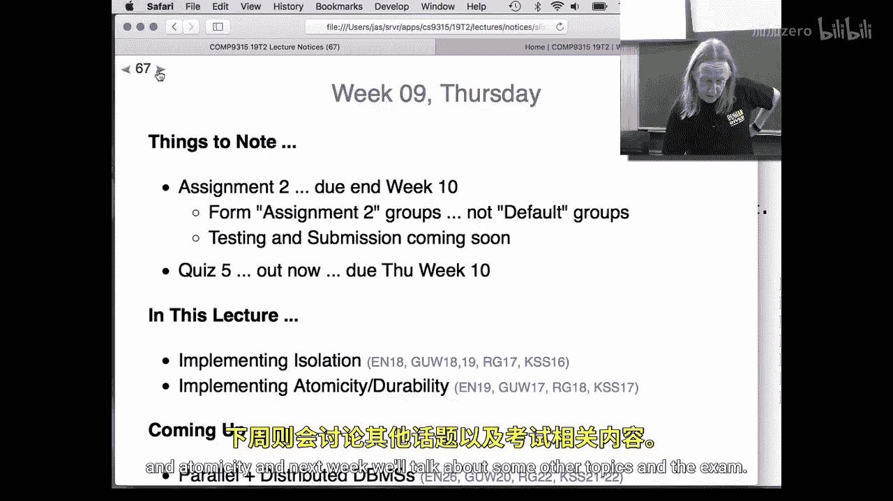

---

## 课程管理与作业说明

上一节我们介绍了事务隔离的基本概念，本节开始前，先对课程管理和作业提交进行几点说明。

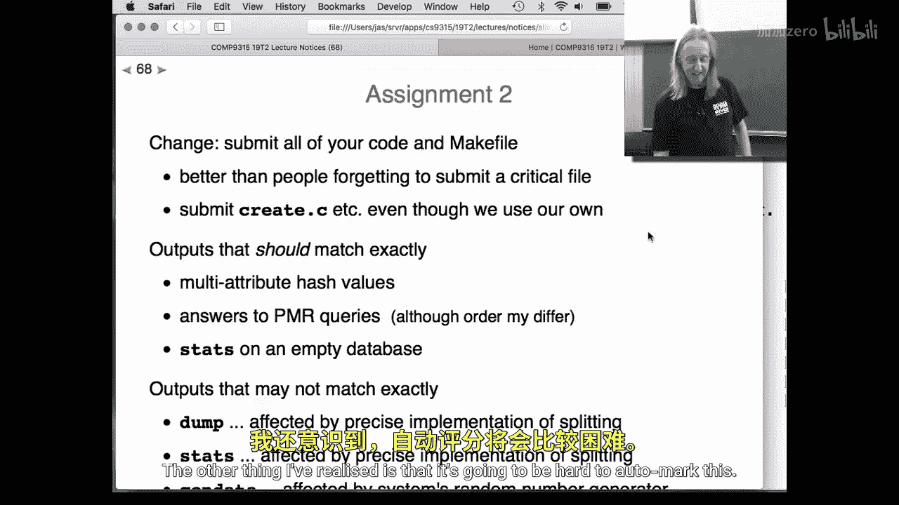

首先，请确保在提交作业前完成小组组建。这应该很容易，因为你们可以在这里联系到我。

关于测验，我记不清具体发布时间，可能是下午4点，但截止日期是下周四。

今天我将更深入地讲解如何实现隔离。下周我们会讨论其他主题。

以下是关于作业提交和测试的重要说明列表：

*   **提交内容**：与其只提交部分选定的源文件，不如提交所有相关文件更为简便。这包括所有 `.c`、`.h` 文件，当然不包括二进制文件或 `.o`、`.z` 文件。此举是为了避免过去发生的情况：有同学提交时遗漏了自己实现的关键部分（如选择因子）。
*   **代码兼容性**：即使你提交了自己的 `select` 等文件版本，评分时我仍会使用原始版本进行测试。因此，你必须确保你提交的所有库代码能与原始版本协同工作。最简单的方法是：不要修改原始版本。
*   **输出一致性**：自动评分会面临一些挑战。对于正确的解决方案，并非所有输出都必然完全相同。
    *   **应相同的输出**：在执行插入等操作时，多属性哈希值（multi-attribute hash values）的输出应该完全相同，不受运行机器的影响。如果你的哈希值与测试用例不同，可能需要检查。一个方法是：转储每个单独属性的哈希值，确保正确的位被提取并放置到多属性哈希值的正确位置。
    *   **可能不同的输出**：如果你插入与我相同的一组元组后进行搜索，应该得到相同的答案集合，但**顺序可能不同**。这取决于你实现分割（splitting）的具体方式。只要答案集合相同，就是正确的。
    *   **统计信息输出**：创建数据库并运行统计信息（stats）时，输出应该完全匹配，除非你修改了关系相关的代码。
    *   **分割时机的影响**：如果你插入一千个元组后执行转储（dump），输出可能因分割时机而异。规范中提到，每插入 C 个元组后进行分割。是在插入前分割，还是插入后分割，可能会影响最终看到的结果。两种方式都不算错误，特别是当你能得到相同的答案集合时。很难在不透露过多实现细节的情况下，强制要求某种特定方式。
*   **测试数据**：我们最近发现，在希腊服务器和我的 Mac 上运行 `gen_data` 会产生不同的结果。这让我有些惊讶，我原以为两个平台的随机数生成器（RNG）实现是相同的。但或许可以这样理解：只要它们是随机数生成器，在不同机器上是否产生相同的随机序列并不重要。因此，为了确保测试一致性，我将提供包含相同元组的文件供测试使用，而不是依赖 `gen_data` 生成。

---

## 著名数据库研究者介绍

在深入技术内容之前，我想介绍一位在数据库领域，特别是恢复机制方面极具影响力的研究者。

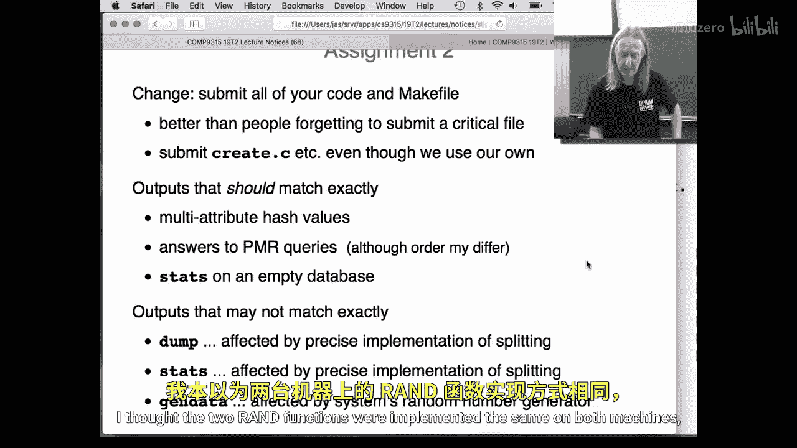

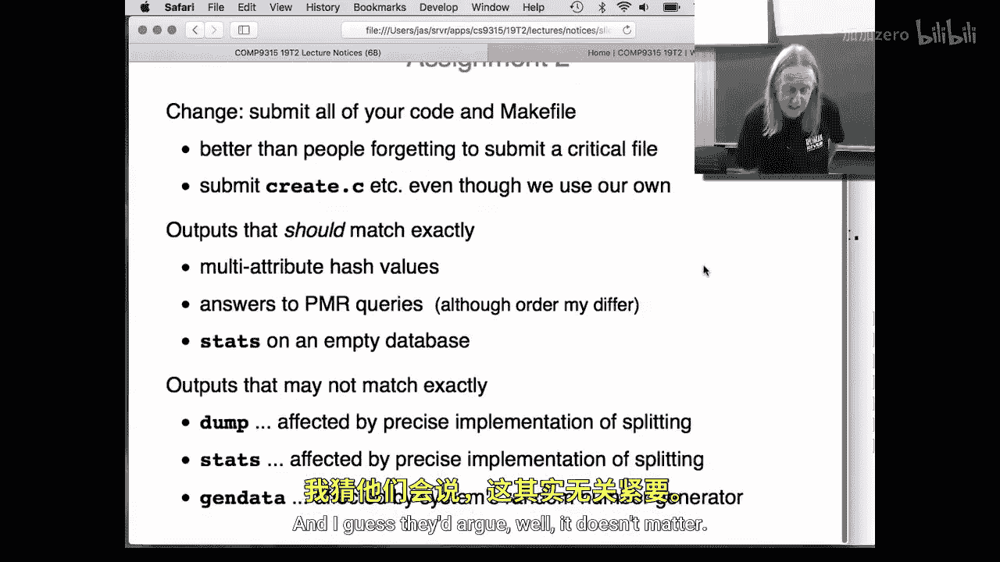

有人认识这位吗？看来没有。这说明你们还没有查阅相关材料。他的名字是莫汉（Mohan），姓氏是一个很长的印度名，我就不尝试发音了。他以在恢复领域的工作而闻名，这也是我今天要讨论的主题之一。

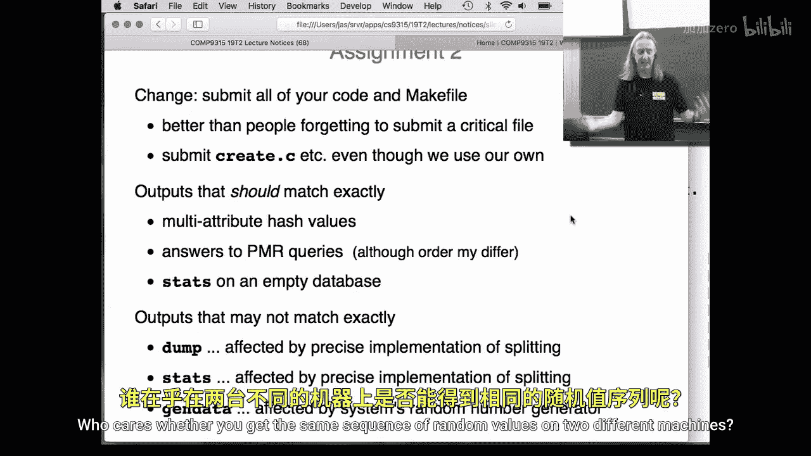

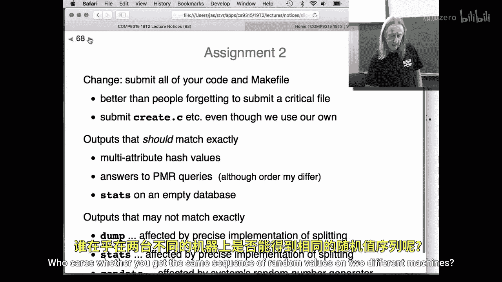

ACM SIGMOD 是数据库领域研究人员主要关注的专业组织，也是主要的数据库会议之一。大约每十年，他们会颁发一项奖项，表彰那些对研究和工业界产生重大影响的早期工作。莫汉因其设计的 ARIES 恢复系统而多次获得此类奖项。他在数据库的其他领域也有诸多贡献。

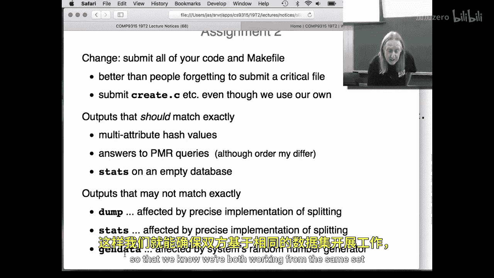

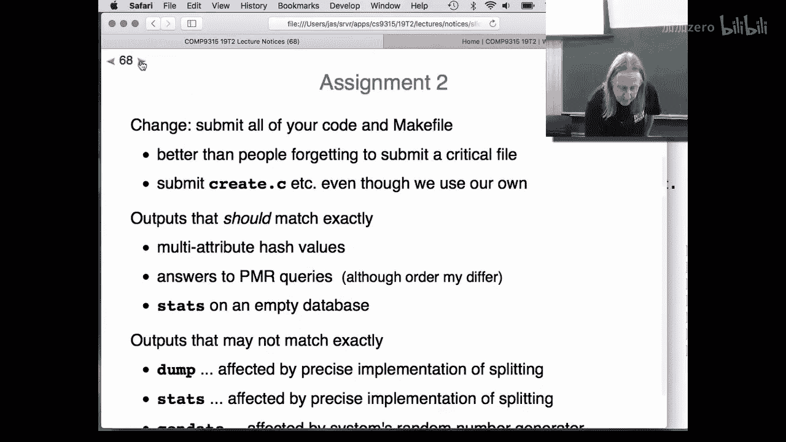

他最初在 IBM 阿尔马登研究中心（IBM Almaden）工作，那里也是 System R 的诞生地（实际上是在圣何塞实验室建造的）。之后他曾回到印度一段时间，后来又回到了阿尔马登。根据维基百科，他目前是中国的一名访问教授。这再次证明了他是一位极具影响力的数据库人物。

因此，他完全配得上“著名数据库极客”这个头衔。

---

## 事务属性与隔离级别回顾

好了，言归正传。昨天我们讨论了事务、可串行化以及用于并发控制的锁。我们这样做是为了让事务满足一系列特定属性：

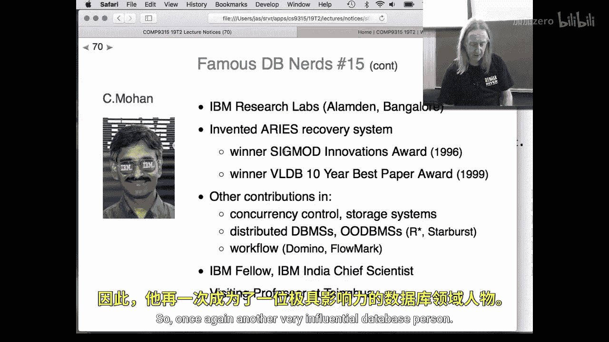

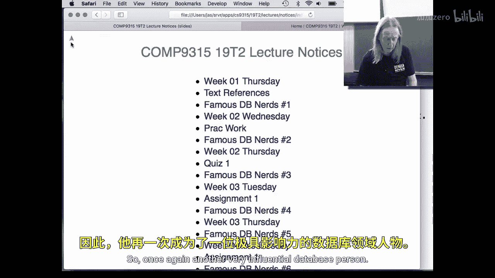

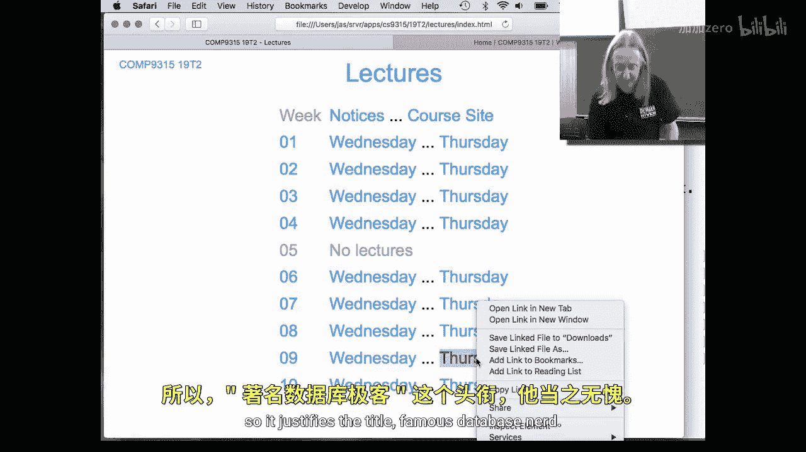

*   **原子性（Atomicity）**：整个事务要么全部发生，要么完全不发生。记住，事务由一系列独立的数据库操作组成。
*   **一致性（Consistency）**：基本上意味着事务是正确的，它完成了你的预期，将数据库从一个有效状态转换到另一个有效状态。
*   **持久性（Durability）**：我们今天稍后会讨论。
*   **隔离性（Isolation）**：其基本目标是控制并发，使得每个事务都感觉自己是系统中唯一在运行的事务。

如果事务不并发运行，而是一个接一个地串行执行，那就没有问题。如果你能创建出等价于某个串行事务的并发事务，那将是理想的，并且肯定能避免我们昨天看到的一些更新异常。

可串行化是对隔离性相当严格的解释。规定越严格，你能获得的并发度就越低。因此，如果你希望稍微放宽要求，或许允许某些更新异常潜在发生，那么你可以获得更高的并发度。这里存在一种权衡。

有四种不同的隔离级别，但 PostgreSQL 实际上只实现了其中两种。它提供了设置其他级别的语法，但它们并不真正存在。我们昨天看到，你无法真正设置“读未提交”级别。

---

## 本节课总结

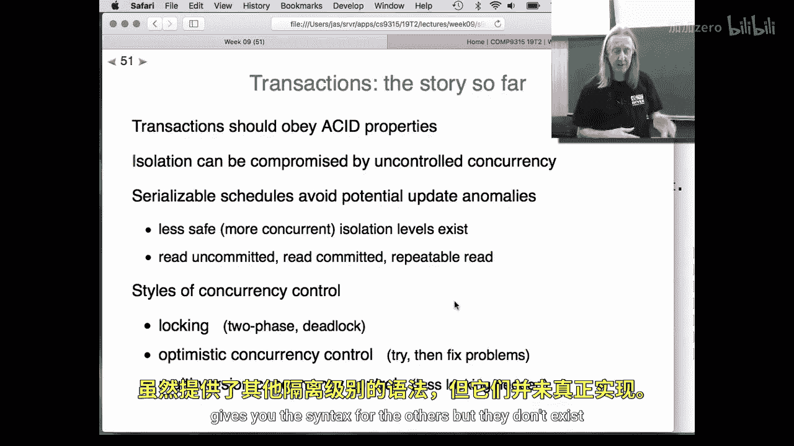

在本节课中，我们一起学习了关于作业提交和测试一致性的重要注意事项，认识了对数据库恢复机制有卓越贡献的研究者莫汉，并回顾了事务的 ACID 属性，特别是隔离性的不同级别及其在并发控制中的权衡。下一讲，我们将开始深入探讨事务的持久性和具体的恢复机制。