# 新南威尔士大学【中英⚡Postgres数据库实现原理｜COMP9315 2018 Postgres Implementation】 p31 P31 -BV1qXoqYHErC_p31-

Ooh， I just see something else wrong too。

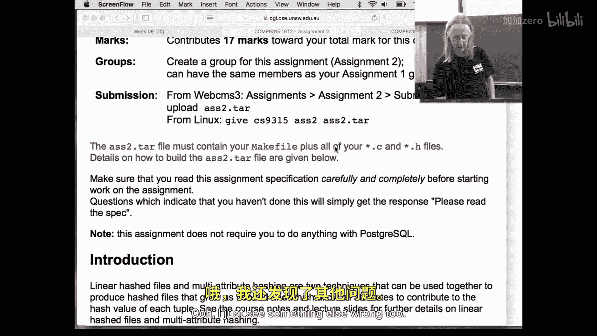

Oh， no。你。Is it， I think that's supposed to be8 to you。Everywhere else。Because the outlined and so on。

 I said it was 12 and 18。And for some reason， on the assignment pick up with 3 7。Anyway。

 so is the assignment spec， this part he used to talk about you It have to submit certain files I'd give up。

I've done that in the past and invariably you get half the groups don't submit stuff that's needed to make the system work。

 so just submit everything including the make file。😔。

What trigger it up was someone asking about using the meth water？我们的。The forum last night。

So they'd have to update the make file to do that。You don't need to use the methodologythography。

 I'm sure they're using it to do powers。There's a much more efficient way of doing powers of two。

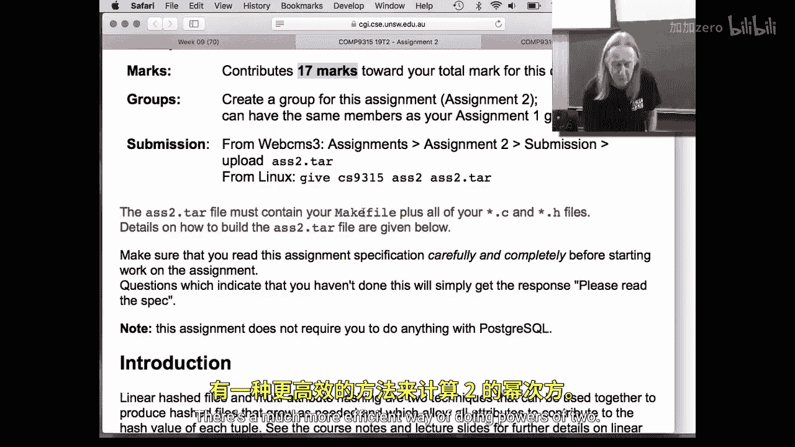

Which is probably appearing somewhere else and there's a section down the bottom that I added this morning about。

😔。

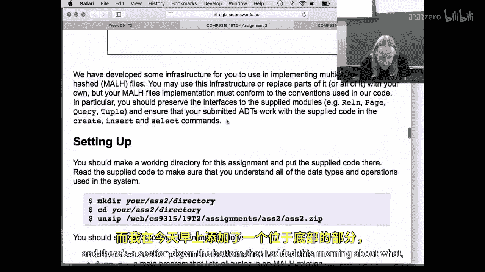

How we're going to do test so basically we're going to untie what you submit and then over the top of that we're going to unt our main programs like selectlect。

C and Korea。C and so on and then we're going to run make and if you submitted everything wrong it should just compile。

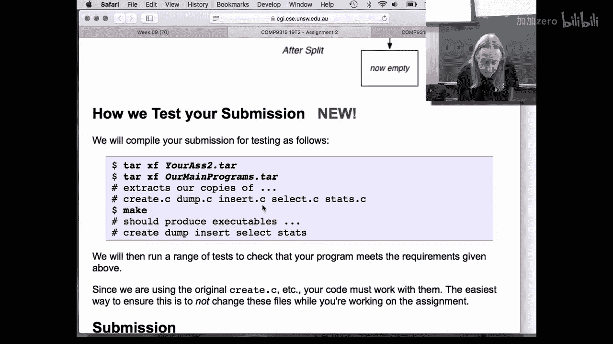

So make sure you do that。And on the testing notice I change we're not running Gen data and feeding it into insert。

 we're reading it from a file， which is that's a link you can click on that and get the actual text which will give you exactly these tuples so you should get exactly these multi attribute a hash value。

So you could actually use deep。To compare， or even。呃，不 b b。And similarly。

 you ought to get this because I had so few tuples that I was expecting no splits would occur。

So by the time you reach this stage you should have a few tus in one bucket and a few tuples in the other one if you got extra pages。

 remember that we started with two pages， actually found a bug when that was doing this if you try to have it start with a single page it fails。

If you want to have a look through the code， you can find out why。I's an assumption that D。

The depth of the file is greater than zero。And if you have one page， it ain't。So anyway。

 you should get that as well if your multi attributee hashing is correct。

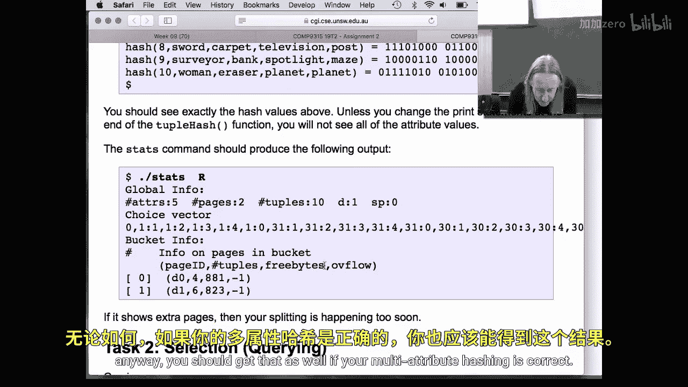

All right， let's press on。All right， so remember we want transactions to be atomic。

 which basically means either。All of the effects， all of the intended effects occur。

 or none of the intended effects occur。So that's aity。

 durability basically saying if you do a commit and even if something catastrophic happens to the database system or the computer system that's running on。

 those values ought to，Be available in the future whether you have to do a recovery thing when you restart the system and get it to fix the data。

 some of which may have been written as part of a commit。

 some of which may not have been written as part of a commit then they're more subtle。

System failures as well， but they'd be handled a little bit differently。

Turns out that the implementation of these two things is。

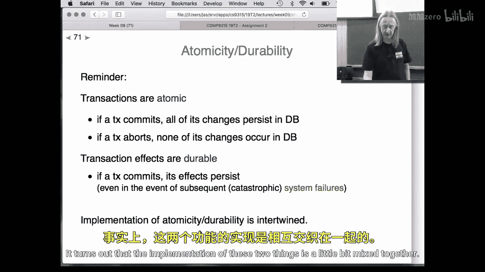

Next together get的。All right， so what kind of system phases do we have to worry about something as simple as a bit being flipped？

Can it happen。Easy to fix， that's what we have parody bits for， storage medium， going bum。呃。

Entire disk device going then。A Postgre process crashing probably isn't going to break the database it may break the transaction that was running on that particular instance of the server but hopefully it won't break anything else。

 our rating system goes down partway through some transactions committing or maybe someone completely maybe case 17 catches fire and Greek is utterly destroyed and all of the data that was stored on Greek is gone。

That would be unfortunate， but we can recover， well。

 to some extent because we've got offside backups。

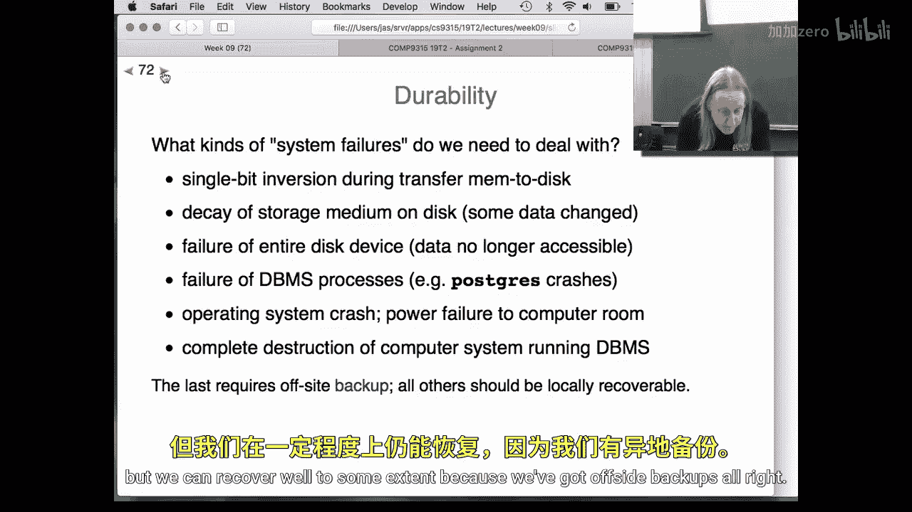

All right， so here's a scenario so you've got a bunch of transactions or running T1 runs and it commits。

 T2 runs and commits。Very close to the crash on， but the fact that this process is finished。

 there's an assumption that it's。Put its stuff onto persistent storage already and these other two transactions were still running when the system died。

So because T1 and T2 had completed， then we better make sure that whatever changes they made end up in the database after we recover from the crash and for T3 and T4 they may have made some intermediate changes we want to make sure that all that stuff is undone。

 so it's as if T3 and T4 never actually ran。

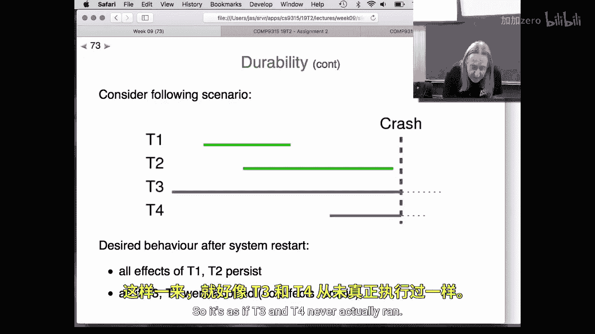

All right， well first of all， you got to have a stable underlying Dis system？And in particular。

 I think， I think I put page and get page earlier on I might have used for getting data from the buffer pool here I'm kind of。

Suggesting that put page actually writes the disk， get page reads from the disk， so the deal is。

If you write a bunch of data to the disk and then you subsequently read it back and no one else wrote to the disk。

 you ought to see the same stuff as what you wrote。嗯。

So all of those other kind of failures I talked about in the previous slide can be fixed in various standard ways。

 so parity checking， marking bad blocks。If you're smart。

 you'll have a bit of redundancy in your disc storage and for destruction of the computer system。

 you'll have offsite backups。😔。

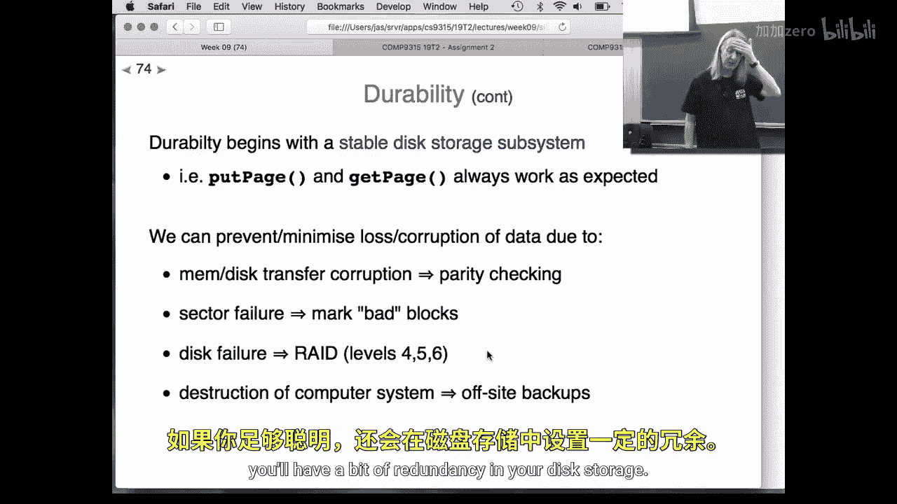

All right， so the things that we really need to worry about and which can be dealt with by the DBMS well。

 the DBm itself failing， the operating system crashing and。

Maybe to some extent failure of transactions when they are bought。

 we kind of expect that that may happen every so often anyway so that's not particularly bad。

So standard way of managing these is to keep some kind of log of how the database is changed over time and make sure that log is pushed to disk。

And hes persistent。Generally pushing the log to disk is you're pushing relatively small data items。

 whereas if you're talking about。Updating the database and making larger changes。

But if you can push all the log items to disk and you've got them and you can use them to try and restore the state and there's a couple of different strategies for this so here's how the architecture fits in to think so there's our buffer manager still that's the one that。

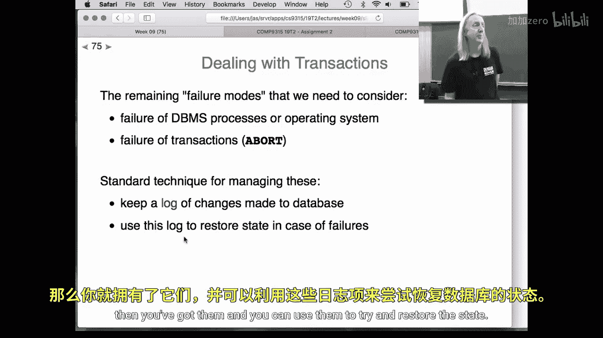

All of the data from the database goes through， we've got a log manager probably that's going to be talking directly to that but it would have made the diagram too messy that query process so then that's basically that stack of stuff that I've been showing。

In other slides and of course something to manage recovery。

 making use of the stuff that the log manager has produced， they don't directly talk to each other。

 recovery manager will go。vire and啲。

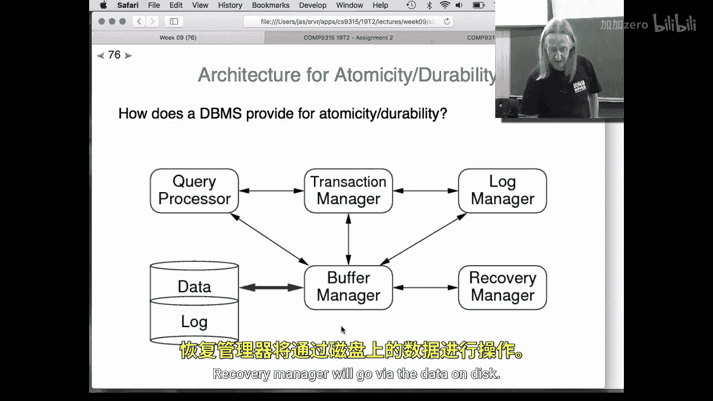

Der on disk。All right。When you're running a transaction。

 you've got a particular item of data and it actually exists in three different places。

There's a version of it stored on the disc。😔，There's a version of it that's loaded into one of the memory buffers and potentially there's a version of this item that's in the local memory of the transaction that's manipulating it。

 so you may have three totally different values for what we're thus saying。

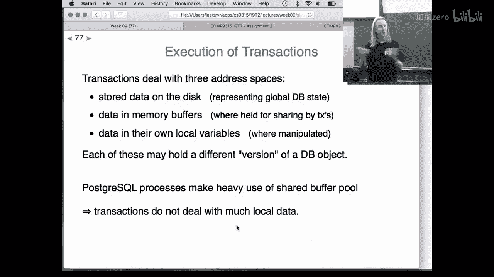