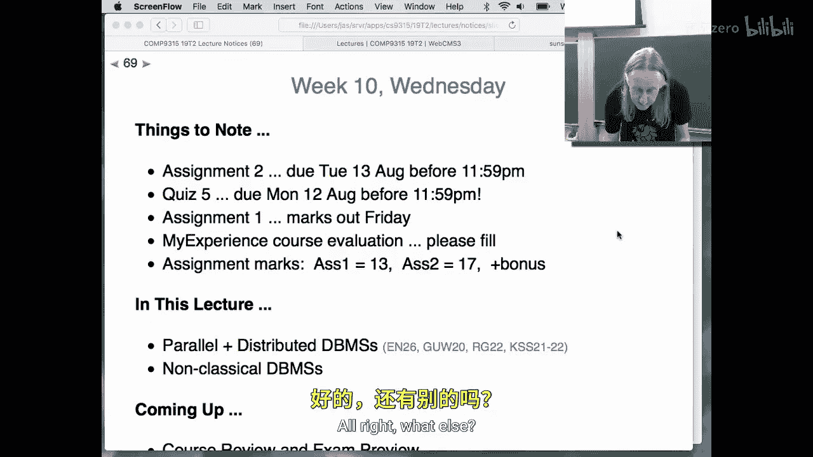
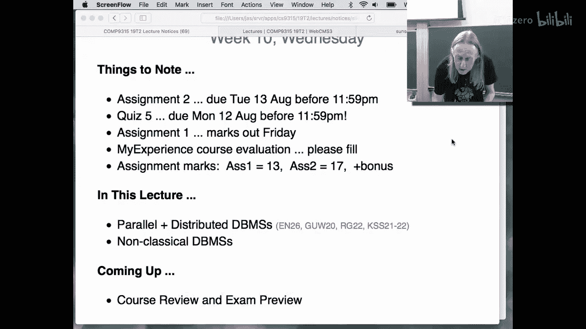
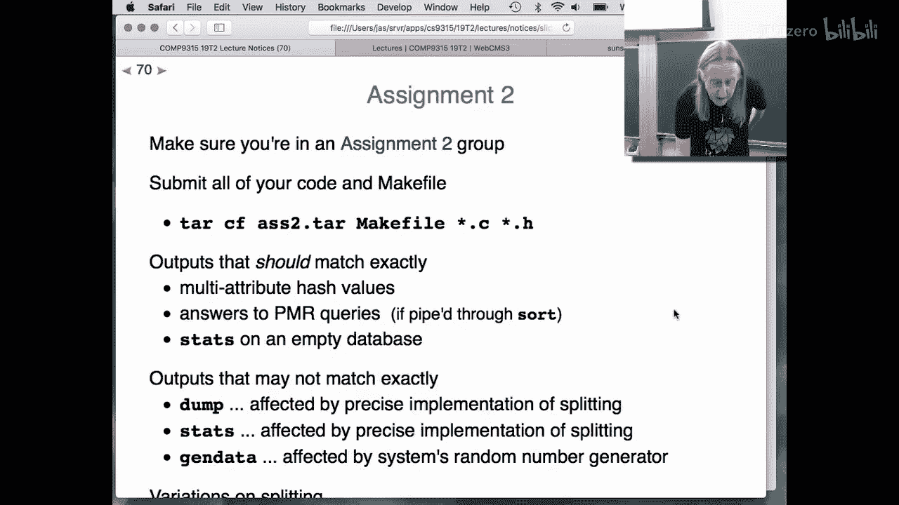
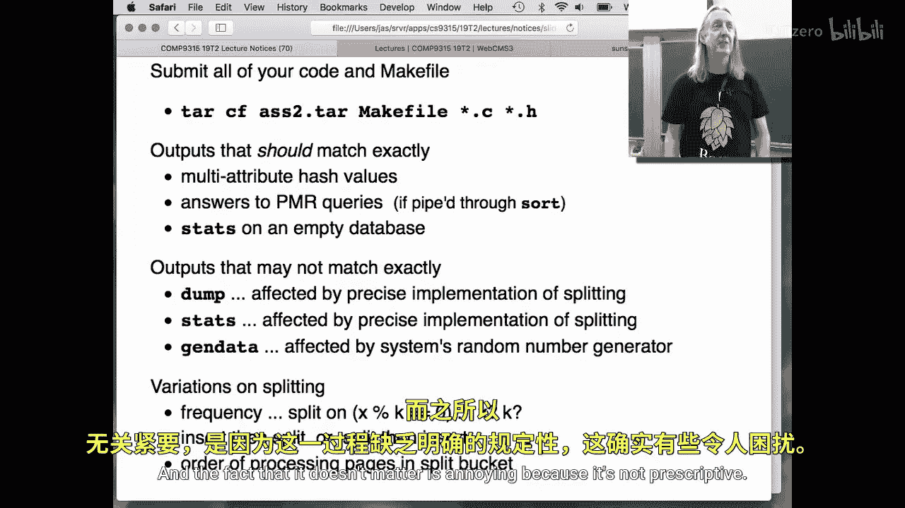
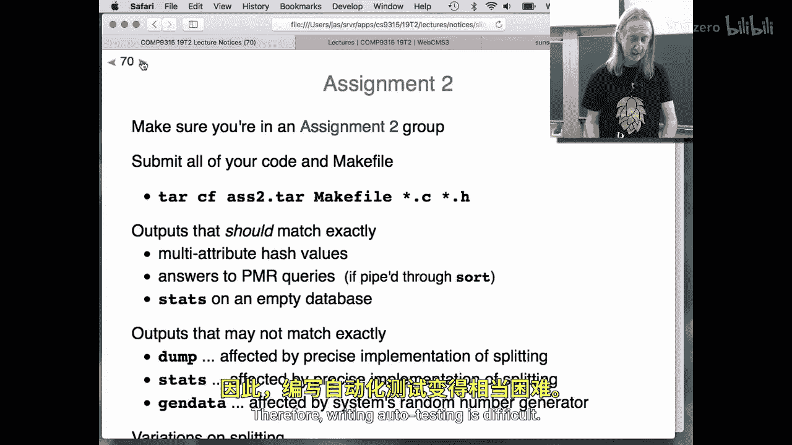

# 新南威尔士大学【中英⚡Postgres数据库实现原理｜COMP9315 2018 Postgres Implementation】 p32 P32 -BV1qXoqYHErC_p32-

3，2，1， week 10。Wait 10 is the last week thank goodness。嗯。不说。Last year。

 because it wouldn't have been the last week。 We have had another two weeks to go。Al right。

 so I moved the assignment to due date， so I'm a bit skeptical about that。

 that's if you don't want to cut into your stewveac， your pitiful three days duevek。

And they do the assignment earlier。And I guess everyone else who's not here is off doing assignmentsquiz5 I did something weird with quiz5 I can't remember what it was maybe I didn't release it till yesterday or something and I wonder why no one was doing it。

嗯。So anyway， we're supposed to live about a week so that'll do。😔，嗯。So I at one。

It would be so nice if everyone got up working because then I could just run my testing scripts and it had produced some marks for me。

 but when people crash the server， go into infinite loops， dump huge core filess，😔，Take time。Anyway。

 it's almost done， so it'll be out on Friday if I really wondered I could release the marks for all the people who got full marks instantly。

That'll make you all wait。My experience is running now， fill it out。

 we we need the people higher up are obsessed with response rates。

 I'm not sure that they care what you say， I just want you to say something so make sure you go fill it out。

😊，And oh yeah， the assignment map， there some confusion。😊。

Who looked at the course outline and thought， oh， 12 and 18。😔，And then who looked at the assignment。

 specs themselves， and it said 3 and 70。So I decided to go with what was in the assignment since no one ever reads the course outline doesn't matter。

 did you？😔，There were like two monthss written on the course outlineline as well。There were one Oh。

 really。 Oh， beautiful。 All right， So it was any room in one place。我。In the critical place。

 all right anyway， it's 13， 17， of course you can get 14 and 18 inrusive early by the way。

 that one week early well， was yesterday。But it'll apply from starting yesterday All right what else that's about it all for that stuff so today we'll talk about these topics probably won't finish them all I'll finish them off tomorrow and then talk about the exam。

Which I'm sure you're keenly interested in。Maybe， maybe。

Maybe you think piece of cake that'll be good all right。

 make sure you're in the assignment two group if you're not I'll assume you did the assignment by yourself and give a mark to the person who submitted。

If there was another person working with them and you didn't tell me about it， oh， well。😔。

You'll have to tell me about it afterwards and say， where's my mark？Once again， submit all the code。

The multi attributed host value should match you exactly。

In the testing stuff I piped all the output through sort just to avoid the problems that you may have put。

Tuups in different points in the bucket so you may have even had different amounts of splitting。

I'll talk about that， Naminina。If you do a sta or an empty database it oughtt be the same。

 so other things， if you do a dump， that tells you exactly what page a topppple occurs in。

Whether it's in data page or an overflow page， now the important point is the tuple is in the correct bucket。

Doesn't matter whether it's in the data page or whether it appears in the overflow page。

 and that might be affected by how you do your splitting。

There's no point trying to do a dump and compare your dump to my dump that's going to look different。

Quite possibly。Unless I was a lot more prescriptive in he should do the splitting。

Assembly with stats。That should be a little bit closer。😔，In fact。

 that might be that should be decided。放了。Depends how do split once again and gender。

 we've already seen that is affected by the system's random number generator。

 So how can you vary the splitting。

How frequently do you do it？好听个。I've already given two suggestions。

 I forgot there was a suggestion in spec and then someone asked， and I made up another one。

 you could even set it to some arbitrary constant value。

So if I set it to splitting after every 200 tuples， what's the effect？It'll still work。

The file will still grow linear like we expect， but we'll have slightly longer overflow chain。

 so the less often we split the longer the average overflow chain。

 like if you split after every insertion， well you're going to have a lot of pages with one tu in them。

And that's not going to be particularly good use of space。

So there's a lot of scope for how often you split。 Do aren't the ones in the。

The thing if you like that actually， I think leaves the pages a little bit wide on。

What I should have done is specified a load factor。😔，And so I say。

 I want the pages or the blankets on average to be three quarters full or something like that。嗯。Also。

 howck can you vary the split whether you could say， allright。

 I would need to insert a new tuple ahuh， it's a split time so I'll do the split and then I'll insert the new tuple or you can insert a new tuple and then say ah。

 I'll check and I'll do the split and that could end up with full a different results if the young tuple that you're inserting is in the bucket that's being split。

And also what order do you process the pages in the split bucket so you've got data page plus some number of overflow pages if you decide to start with the overflow page and。

Put the tus into the appropriate pair of pages。And then you split the and then you take the data page and you partition the tops there。

 you might end up with slightly different results。All the tus will go into the correct bucket。 Well。

 if you've done the split right， but if you end up with overflow pages， then。

Some troubles might end up in an openflow page if you're doing one order or they might end up in a date page if you do it in another order doesn't really。

咩的。And the fact that it doesn't matter is annoying because it's not prescriptive。

 therefore writing auto testing is difficult。

he's the more famous D nerds， He's dozens of them。🤢，Can anyone name one person in that picture。

I'll give them you this big scope。 You can just pull a name out or' not in the picture。

 So no point trying that。咋。All right， let's hears some names。There's the name Tom Lane ring a bell。

 if you've been looking through Postgre stuff at all， you may well have seen his name。😔。

So he's basically the lead guy who looks after the whole system and he does a lot of the implementation。

or at least， you know， he's kind of light the lineness for the clinics so he's。

Pretty much in charge of the things so people make suggestions for changes。

 he'll vet them and he'll install them in that new version of the system。Similarly， this guy here。

 Josh Burs looks a bit like a hobbit， but he's also one of the lead implementers this guy here is actually an Aussie。

And he's I don't know where he is now actually once gave a lecture in this course about 10 years ago。

 he's sort of a PostgreQL consultant advocate， da da da and this guy here。

 Bruce Mongen may if you've looked at Postgre textbooks or Postgre talks at various conferences。

 he's likely to be the guy who gave him。And the others。

 I don't know but there's an image map we can go and play with and find out who all of these people are。

Who。