# 新南威尔士大学【中英⚡Postgres数据库实现原理｜COMP9315 2018 Postgres Implementation】 p33 P33 -BV1qXoqYHErC_p33-

All right，Let's continue。So we looked at how we can exploit parallelism in databases。One thing。

That I suggested was that we could store part of a table on one note， another part of the table。

 another note， another part of a table on another note and the notion was that these would be collections of topples from the original table that's only one way of splitting up a relation we'll have a look at some others in the context of distributed database。

Basically and there's really two kinds of distributed databases that I'm kind of messing up in the discussion here。

 one is where you've got multiple instances of a particular database and you've got a welldefined schema and all of the instances are manipulating that schema。

So， that's。You can call out a distributed database and it's kind of like you know a wide area version of the parallel database that we've just talking about。

An alternative is that each of the nodes in the system has its own。Chunk of data。

Whi is generally related to the data on the other nodes。

 but may not necessarily come from the same schema， may not necessarily come from the same source。

We'll see examples of that in a minute and it may not even be run by the same DBMSMS。

 so you might have an oracle server on one node， you might have Postgres on another node and so on and so on。

That kind of database would be called a federated database system more than， well。

 it's still a distributed DBMS， but。We call it feddererated。

The idea of distributed DVMS is that it can take whatever kind of backend you've got。

 whether it's multiple databases or a single database server。

 maybe with multiple different schemas on the different servers。

 but it can make them all look like a single unified database， that's the real goal here。

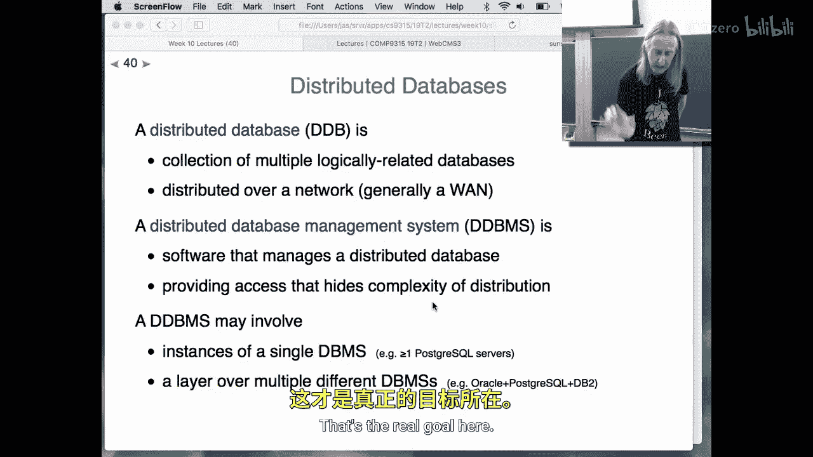

哦。All right， so what the user see， they just see this thing。

 which happens to have a whole bunch of data in， but where does the data come from。

 what servers and still don't what database is serving it， we don't know。

Was actually happening at the back end。

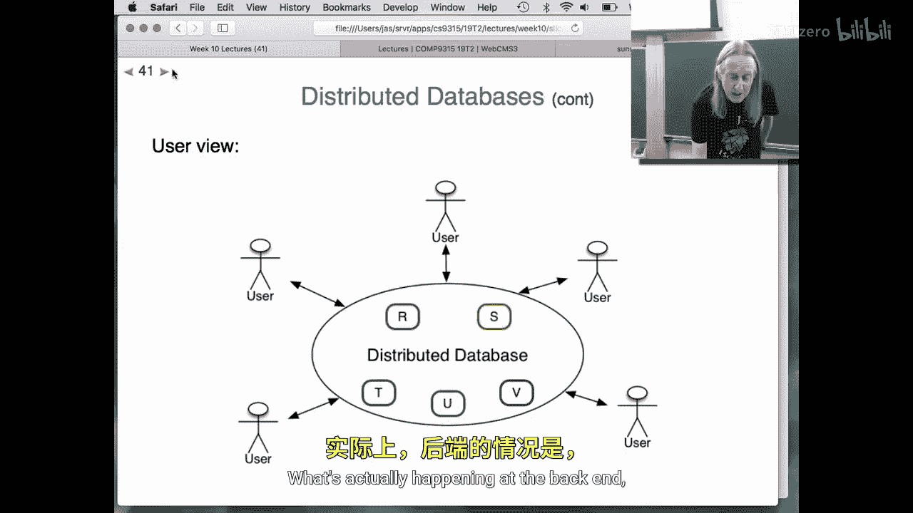

Is that we've got a bunch of different DBMSs accessing their own data。

 maybe some databases have a copy of data stored on another server。

 maybe they have their own database which is totally different structure， but the user comes along。

 they access it。A front end on their own system and that front end has to somehow merge all of this stuff together and give them the view that they're dealing with a single database。

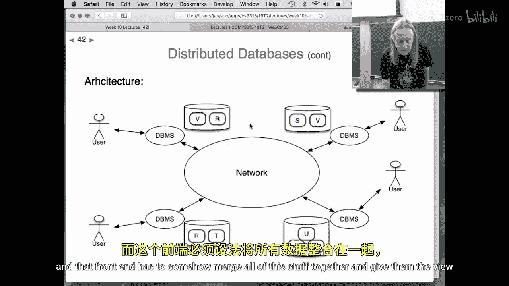

So。That is basically a federated database and the alternative is to simply have。

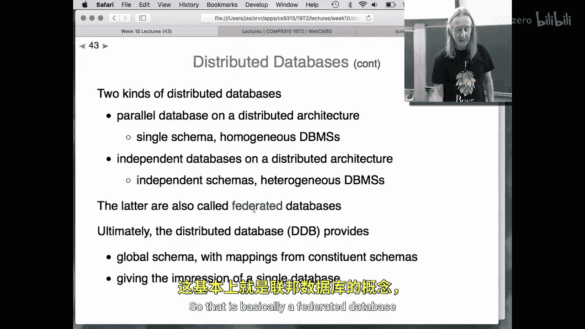

A parallel database where you're talking about a single schema， single type of DBMS， but。

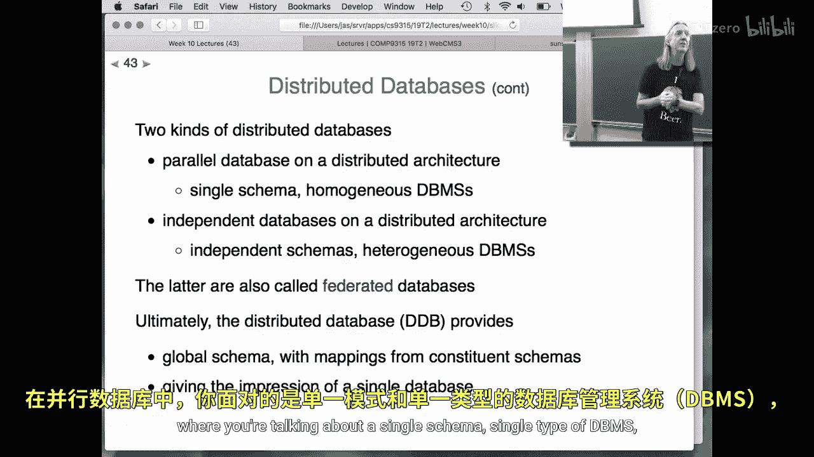

The servers are running on different nodes， connected through the network。

Whatever the back end looks like， the front end that the users eventually see is like a single schema。

Whether it's derived from a single， a real single schema under a particular server or whether it's a whole bunch of different database servers with a whole bunch of different schemas that are being integrated or federated together to give the appearance of a single server doesn't matter。

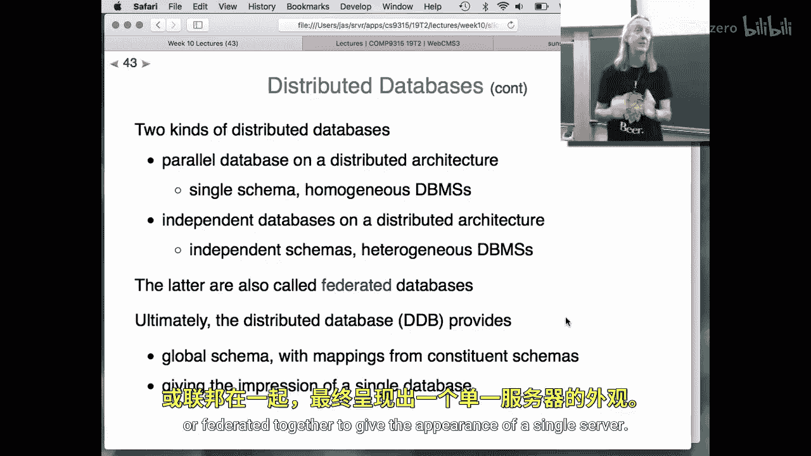

So why do we want distributed databases， well we can have multiple databases and we can get all database merge together if we want。

 we can have some replication， obviously that's useful for reliability。

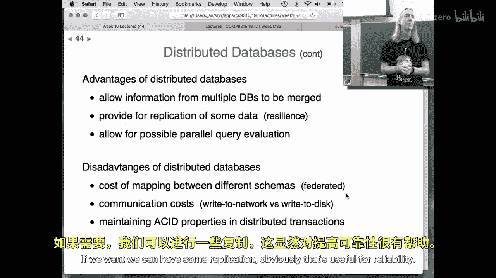

And potentially we can do some parallel query evaluation as well。

 if we have to collect a bunch of data from an oracle database over here。

 collect another bunch of data from a Postgres database over here。

 obviously those two things are going to run in parallel。嗯。

Because the databases may have different schemas， there has to be something that maps onto this global schema where we see。

The view that we give to the user， so there's going to be a cost in doing that mapping。😔，Obviously。

 there's a networking cost because the database is spread over the network and。Interestingly。

 in the context of last week， weve got to work out how to keep the asset properties of transactions that are distributed across multiple servers and possibly multiple different DBA me。

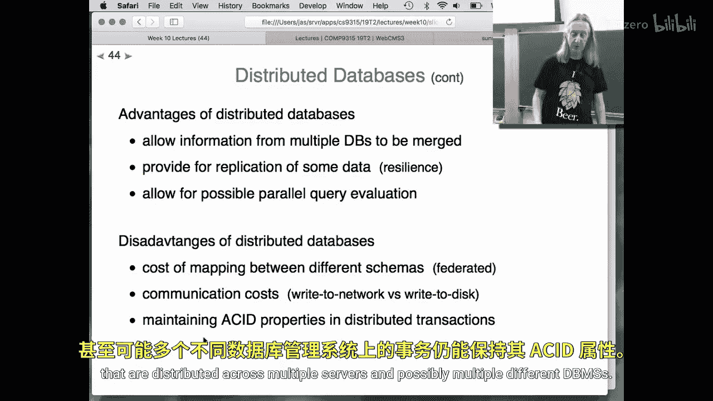

Some examples of where you might。Do things like this， so if you' go a bank with multiple branches。

 maybe it stores the account data for that branch。In a server at that branch。

 So that would just have information about accountss。And then maybe you got a bunch of data。

 human resources， information， a list of all the branches and so on stored on a central server。

And also maybe there's some kind of other central register related to customers。

And so what the bank wants to see is an overview of all this information。

 obviously it needs to know about the accounts， needs to know human resources information and creditworthiness and a similar kind of scenario for a bunch of departments stores say it store the transaction as in money changing hands。

Locally。And then。Provide a view for the company where they can see all of that data together now nowadays you know you kind of get the feeling that everything's going to be maintained in a central database anyway because networks are fast enough that every time you do a transaction on an account you could send that information off to a central server and it can be updated there it similarly point of sales stuff probably sends a request of。

Set consent information about the transit。To a central server。

 but in theory we could structure the system like that。

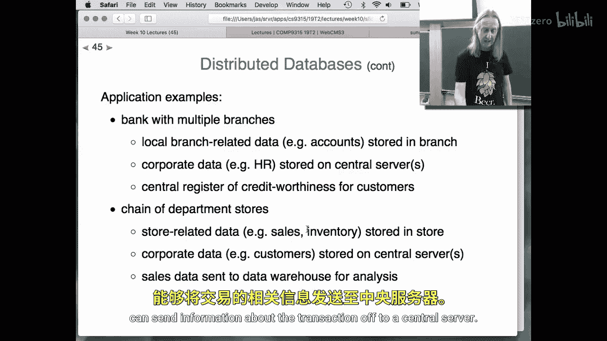

So。In both scenarios， we want the。To give a single corporate schema view of。The system。

What else so the accounting example， each branch maintains its own data。

 but the bank needs to know all the information about all of the accounts。

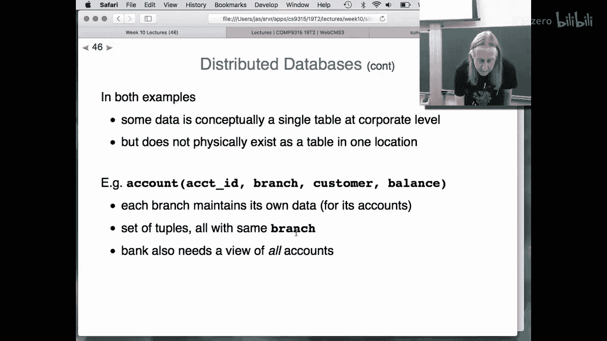

Right， so we talked about partitioning the context of。Parael databases also comes up here。

 sometimes it just comes up naturally because we' have a oracical database here and a Postgres database here and obviously they've got different data sets。

 but even if we don't。哦。It's possible that we might want to have part of a table on one node。

 part of a table on。Not that。So potentially we could have no partitioning just on the whole table。

Horizontal partitioning is the kind of partitioning I was talking about earlier with parallel databases。

 but you could also do vertical partitioning where you store some of the columns on one server。

 some of the columns on another server and if you really do have。

Different database servers with different schemas， but the schemas need to be merged。

 it's quite possible that the columns here and the columns here form part of a larger entity。

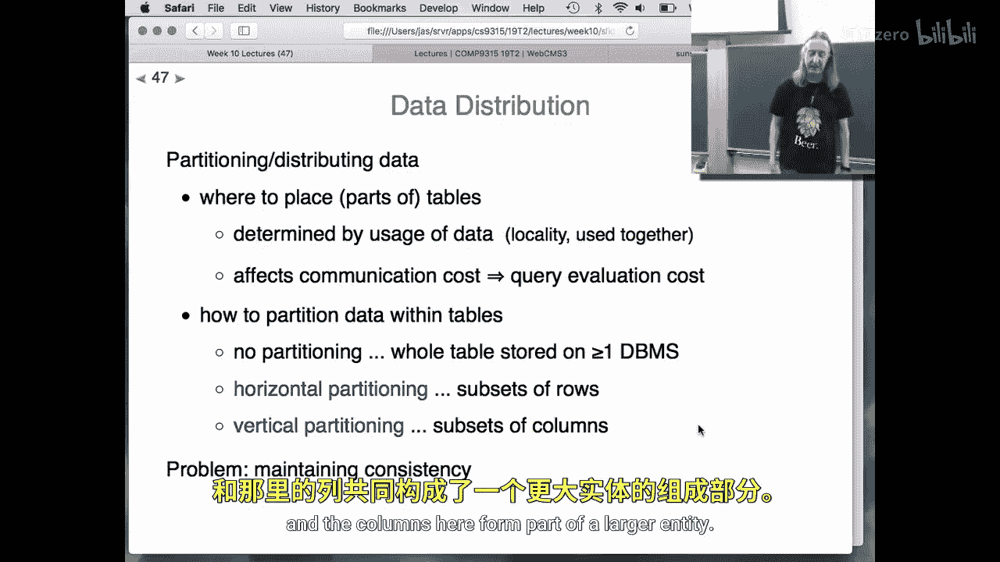

And of course， there's the issue of transactionality。

If we've got a table and it's horizontally partially to me the subset of the tuples are here。

 subset of the tuples are here， subset of the tus are here。

We can split the table up in a lot of different ways。

 but we need to make sure that every tuple is represented somewhere。

That we can reconstruct the original table by taking。

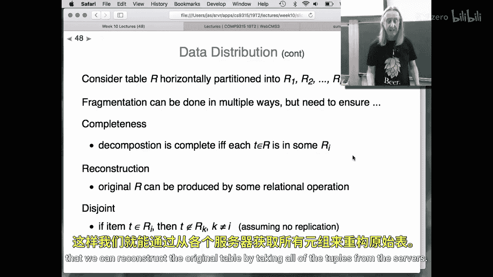