# 新南威尔士大学【中英⚡Postgres数据库实现原理｜COMP9315 2018 Postgres Implementation】 p34 P34 -BV1qXoqYHErC_p34-

Okay， nothing was，'s plenty to note， youve got a quiz。

 youve got an assignment and you've got to fill in my experience， who's done it？😊。

你让。Factfully， you'll get angry。If we don't get at least 50% feel rate。😔。

So today I'll continue that stuff and in fact， I decided that yesterday's effort on Hadoop was so bad that I had to read do these slides and I'll do it again today。

😊，And part of the that was I edited out that crappy bit of Hado。And when I did it on E。

 somehow I screwed up the。Video I'll have to try and fix it。 I can see the how video is there。

 but it's only showing one minute。Of the whole lecture。

 which is bit a bit silly anyway I'll fix that so let's echo the YouTube video is fine。As always。

 and that's what I do。All right， what else then we'll talk about the exam。

And what's coming in doesnt much。

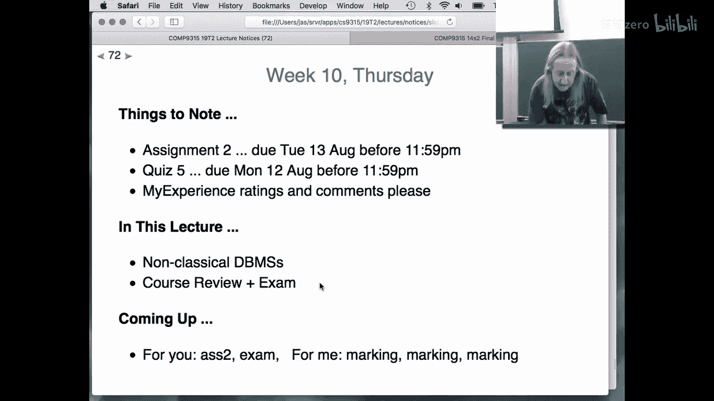

you have to do video。 All right。He's another Db nerd， who is that？No， brilliant。

Yeah absolutely correct， so that's not the trick on this slide， the trick is where am I？😊，Yes。

 who said that correct， Have you been Yeah， that's。 It's a bit of a giveaway。

 It's got the word Oracle that was Oracle H Q。😊，Go name 98 maybe for you yeah， yeah。嗯。Yeah。

 down to the airport in New San Francisco。Didn't get an invite to go in。

 but I had a look at the answer。谂佢落倾。I was actually working it。

IBM at the time were at least doing study leave。😔，All right， Dell， do。

 let's see if I can do a better job。On my headop。

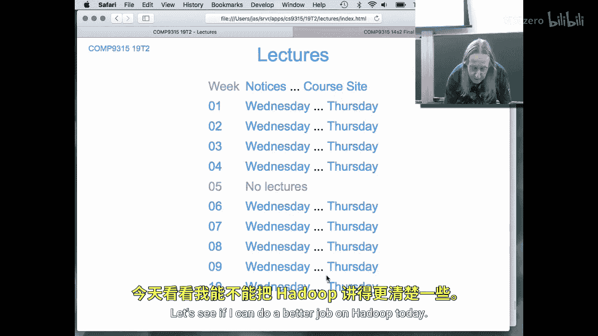

All right， so Hado is a distributed file system。And it presents an interface that looks kind of like Unix。

 you know it's got a hierarchy， it's got a route， it's got directories and it's got files。

 so that's what the user。

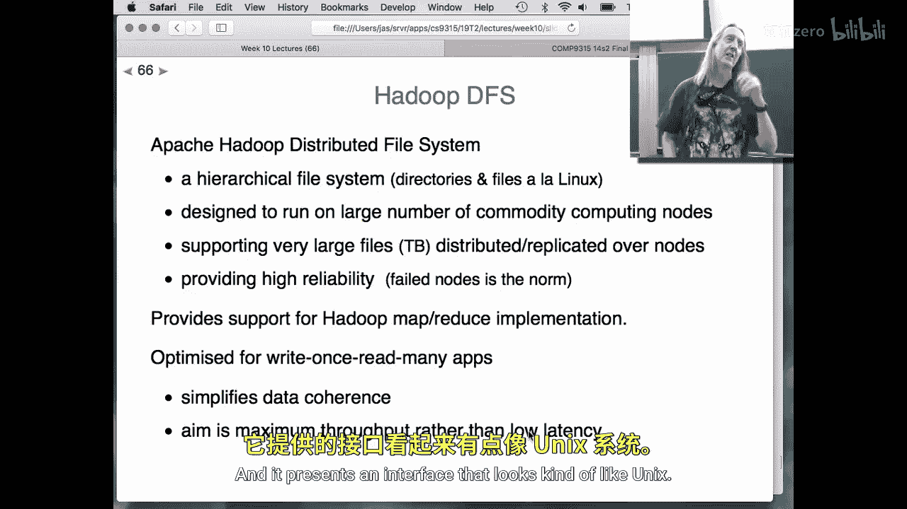

Cs of client as they call them later on。😔。

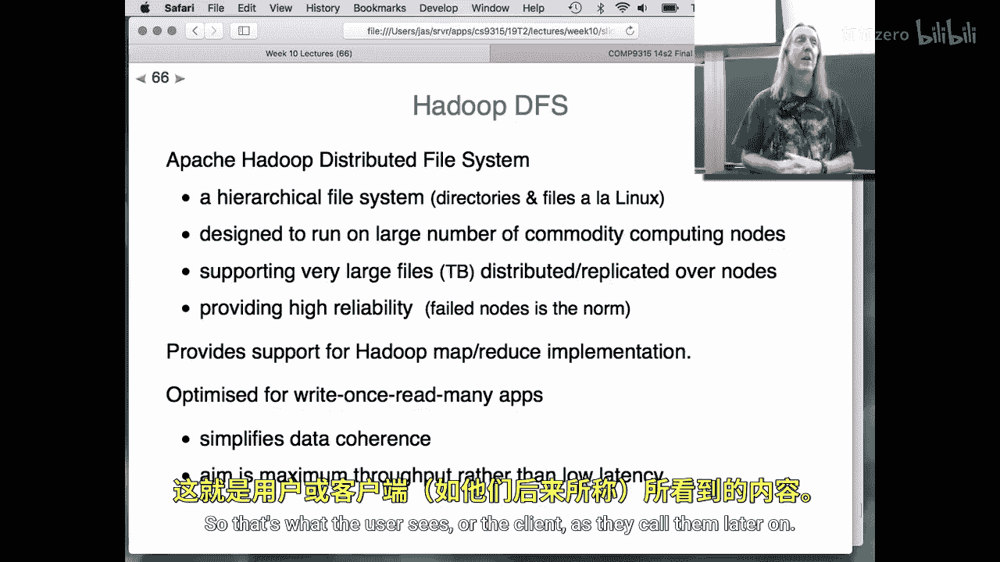

The idea is it's meant to run on large numbers of relatively simple computing nodes。And the。

Deal is that it typically your large number of computing nodes is initially structured as a data centre with racks of very simple nodes all in a big room。

Of course， nothing to prevent you having some of your nodes in the data centre and some of them in a different data centre。

 somewhere else in the world。One of the goals is to support extremely large files。

And larger than the kind of files that you can support in regular operating systems like Linux。

And also the idea is to distribute the data from the files over the node and in particular to replicate the files。

Because the assumption is at any given point in time， one of the nodes is going to be non functional。

Or at least one of the nodes is going to be non functionalal。

 so we need to make sure that we've got multiple copies of every data block so that if someone requests that it's always going to be there。

One of the deals with the Hadoop。Distributed file system is that it's part of a suite of software which includes an implementation of map reduce and part of the design is that it's trying to optimally support。

诶。Applications that use Macreduce。One of the things that they're focusing on is that you can't update files in the middle of a file so you can't go to the middle of a pull a page out the middle of a file。

 make changes to it and write it back what you can do is write the file once you can append things to it but the intended use of the file is that you just keep you read it。

 you read it， you read it so it's almost like right once read many times Now assuming that you're doing things like that or setting up the structure so it is like that means that it's a little bit easy to or easier to make sure that all of the copies are consistent because you're not constantly changing the file。

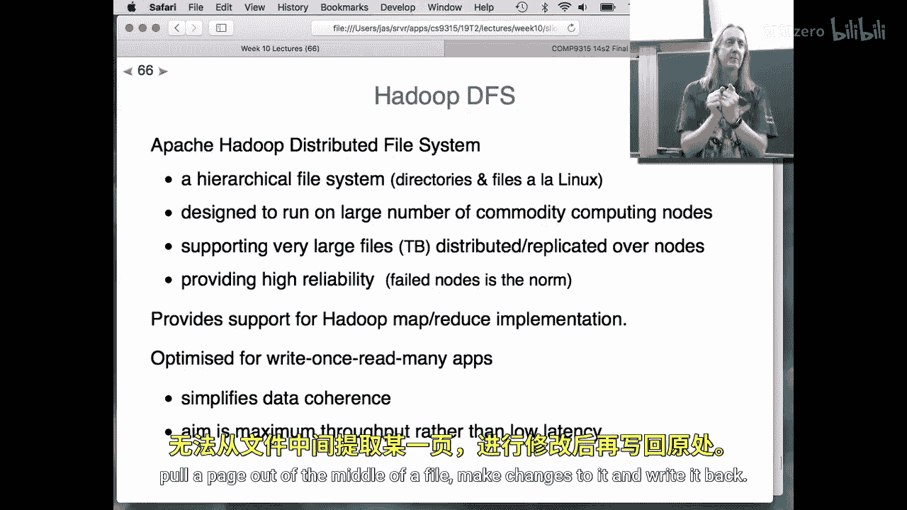

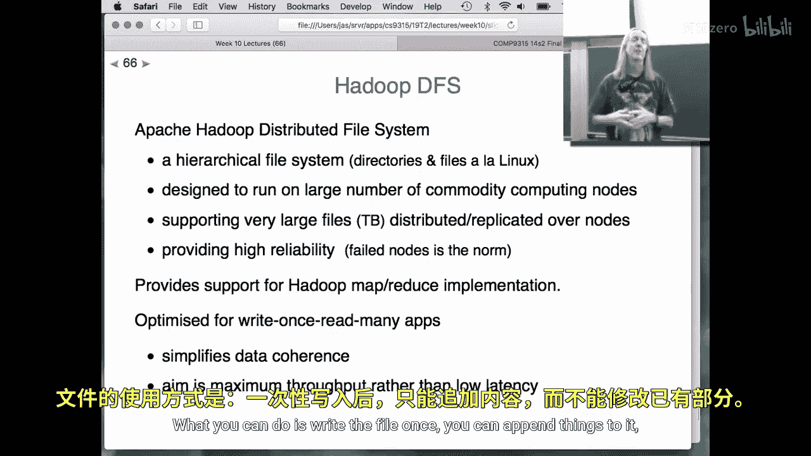

And the other thing about that is they want to make sure that if as soon as you ask to access a file。

 you're going to be able to。

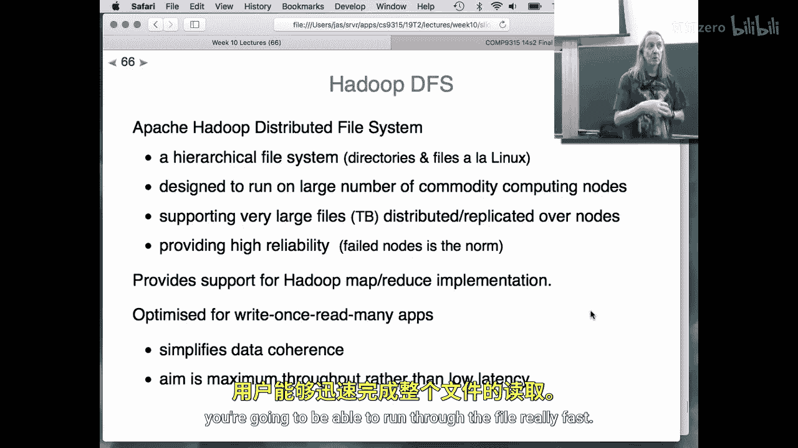

Run through the file really fast。 So maybe you get the first block from one node。

 the second block from another node， third block from another node。

 and you keep spreading the load of。

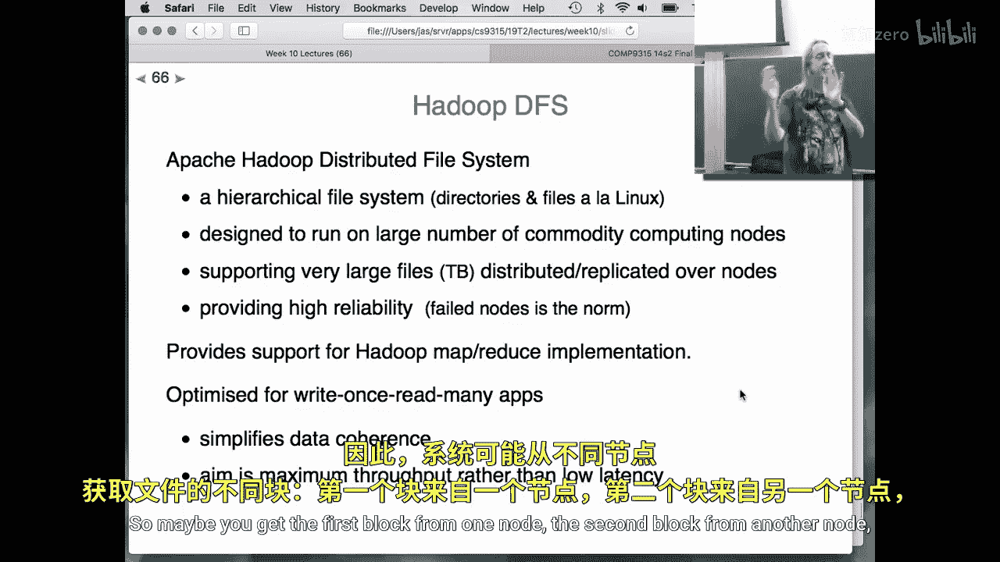

Getting stuff off the disc across all of the nodes so you can do a lot of it in parallel so they're not really aiming to be able to instantly fetch something。

 but once you've got access to it， you can turn your way through it really fast and you want to do that because you're dealing with very large files。

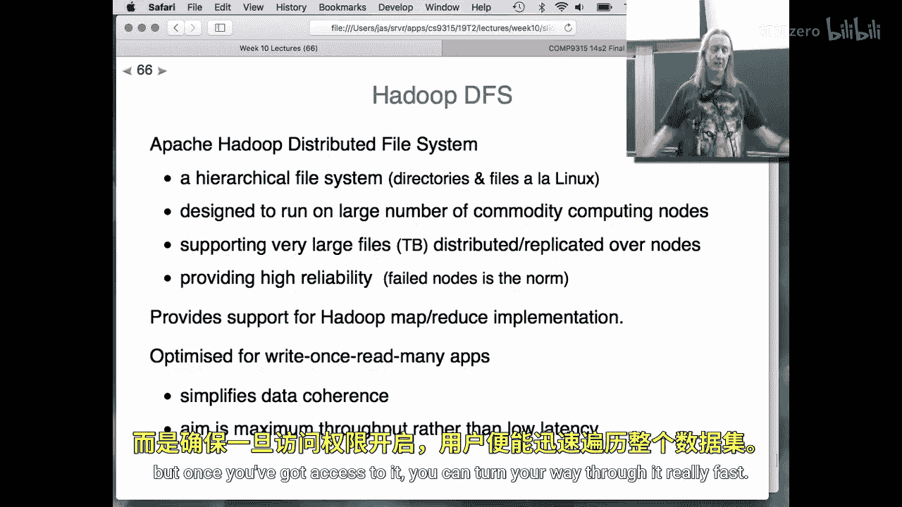

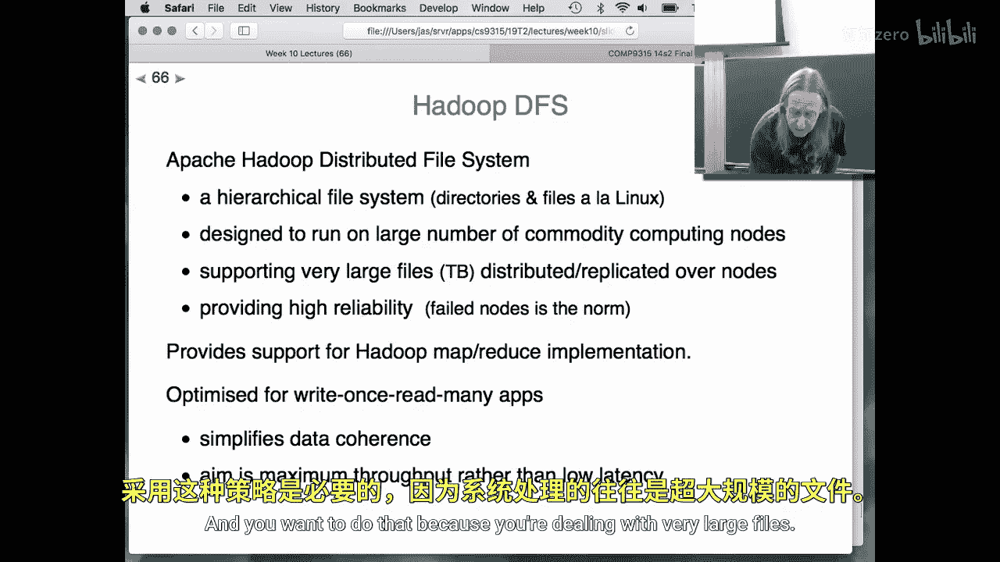

So， he is。Had the young。Health system fits together。 So everything's。Strd around cluster。

And the cluster has a master which is this name node thing which is the thing that basically holds all the information about the file system so know there's a chunk of data called Fred and Fred has 200 blocks and those blocks are located on various data nodes the actual data blocks themselves live in these things now all of these nodes can be the same kind of hardware that just there's a particular node that looks after。

the structure of the file system and to some extent controls what these things do。

 so if a client comes along and they want to look at a file。

 then he standard Linux thing you open the file， that request goes to the name note which knows whereabouts and file system you're talking about。

And it also knows where the data for that file resides on the data nodes。

 so once it's opened the file， it knows where data nodes are knows where the client eat the client obviously running on some computer and it can say。

 all right。This block， the client is interested in this block A1。

 well it's available here and it's available here so I can decide which of those versions I'm going to give to the client。

😔，And。The fact that we're talking about racks here is if the client happens to be running on a note on RAC1。

 then you'd obviously give it that version well that's available on RA one as well but let me see if there was another choice oh no yeah A3 so if the client trying to read A3 it could either read it from there or it could read it from there and the name note would tell it where to read it from。

Knowing information about if I go to this particular data mode， it's going to be that fast。

 if I go to this particular data note， it's going to be that fast and if there's a difference。

 then I can choose the fastest one。What else data nodes just contain blocks？

The blocks are stored in regular files on the regular file system here。🤢。

So we've got a master name node containing all of the metadata and we got these data nodes that contain the actual data in fixed size blocks。

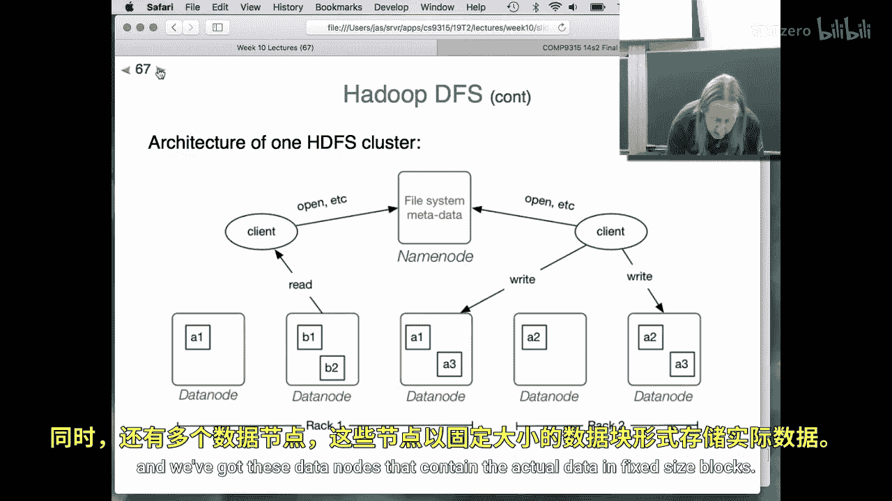

All right so what else so what the data nodes do they implement the readr and append operations on the data so it once a client opened a file which it does through the name note then all the subsequent operations on the file。

Reading， reading， reading， for example， are going to be sent direct to the data node。

 which the name node would provide to the client。The other thing that data nodes have to do is they have to periodically tell the name node what's going on them。

So a file into aoop is a collection of f eyes blocks。

 I guess that was a little bit obvious from the previous slide and the blocks that spread over all of the nodes on a cluster。

and possibly across on a separate where the cluster may be in a single data centre or there may be component elements of the cluster load elsewhere in a different data centre。

 so what are these reports that the data node send back。

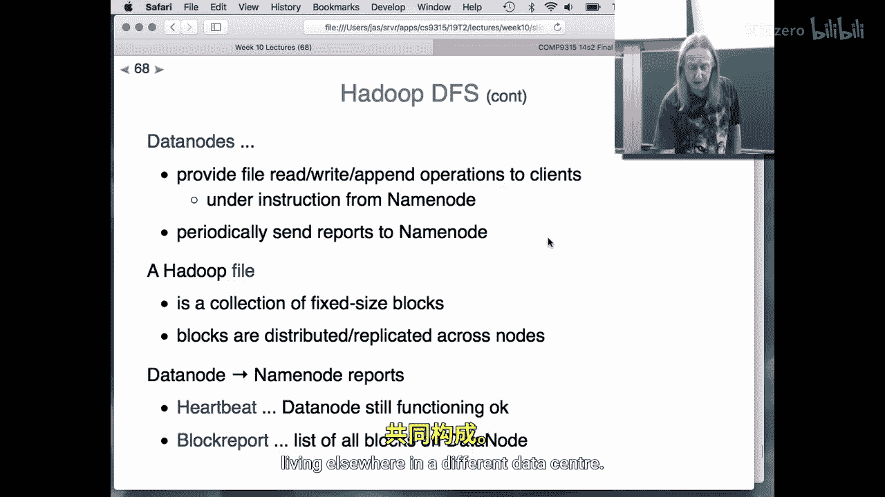