# Postgres数据库实现原理：P34：Hadoop分布式文件系统（HDFS）详解

## 概述

在本节课中，我们将深入学习Hadoop分布式文件系统（HDFS）的核心架构与工作原理。HDFS是支撑大规模数据处理的关键组件，其设计理念与PostgreSQL等传统数据库系统有显著不同。我们将重点解析其如何管理元数据、存储数据块，以及如何通过分布式架构实现高可靠性与高吞吐量。

---

## 课程内容回顾与引入

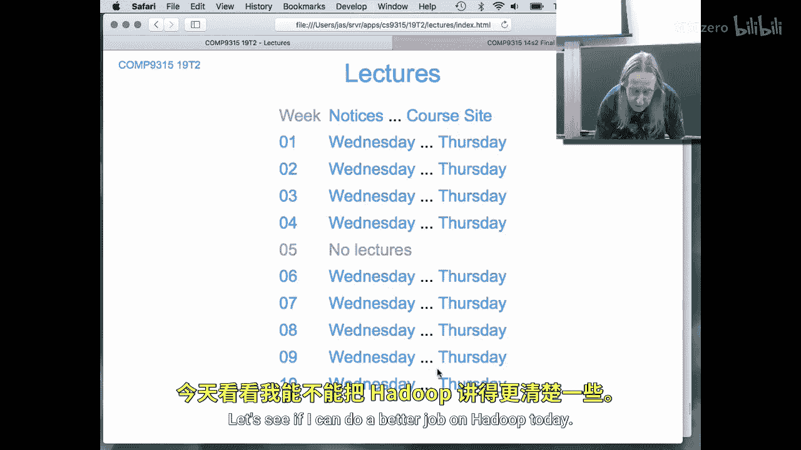

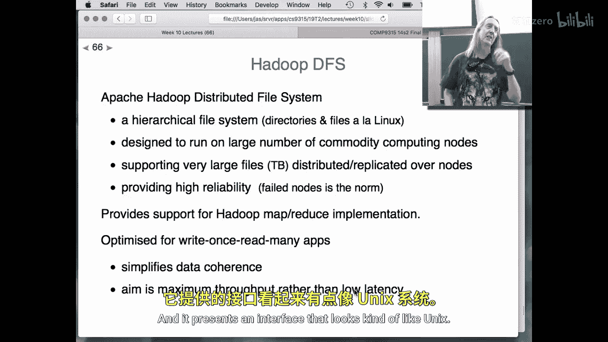

上一节我们介绍了分布式系统的基本概念。本节中，我们来看看Hadoop分布式文件系统（HDFS）的具体实现细节。HDFS旨在运行在由大量相对简单的计算节点组成的集群上。

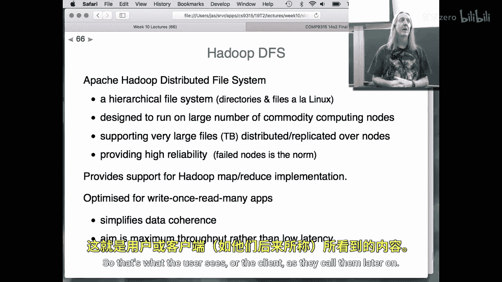

## HDFS 核心设计目标

HDFS的设计围绕几个核心目标展开。

以下是其主要设计目标：

*   **运行于大规模简单节点集群**：集群通常初始结构为数据中心内的机架，但节点也可分布于全球不同数据中心。
*   **支持超大文件**：支持比常规操作系统（如Linux）所能处理的更大文件。
*   **数据分布与复制**：将文件数据块分布到多个节点，并进行复制。其假设是，在任何给定时间点，都可能会有节点失效，因此需要确保每个数据块有多个副本，以保证数据始终可用。
*   **优化MapReduce支持**：HDFS是包含MapReduce实现的软件套件的一部分，其设计旨在为使用MapReduce的应用程序提供最优支持。
*   **“一次写入，多次读取”模型**：文件不能被中间更新（即不能修改文件中间部分），但可以写入一次并追加内容。这种“写一次，读多次”的假设简化了确保所有副本一致性的工作。
*   **高吞吐量顺序访问**：确保一旦开始访问文件，就能非常快速地顺序读取。通过从不同节点并行获取数据块，将磁盘I/O负载分散到所有节点，从而实现高速流式读取，这对于处理超大文件至关重要。

## HDFS 架构组成

HDFS的架构围绕集群概念构建。

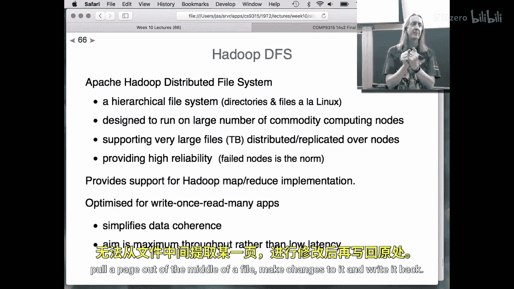

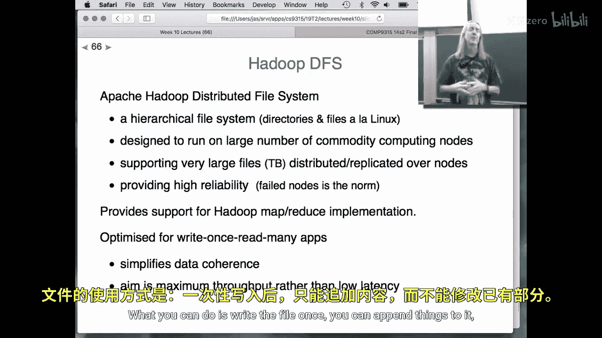

以下是其核心组件：

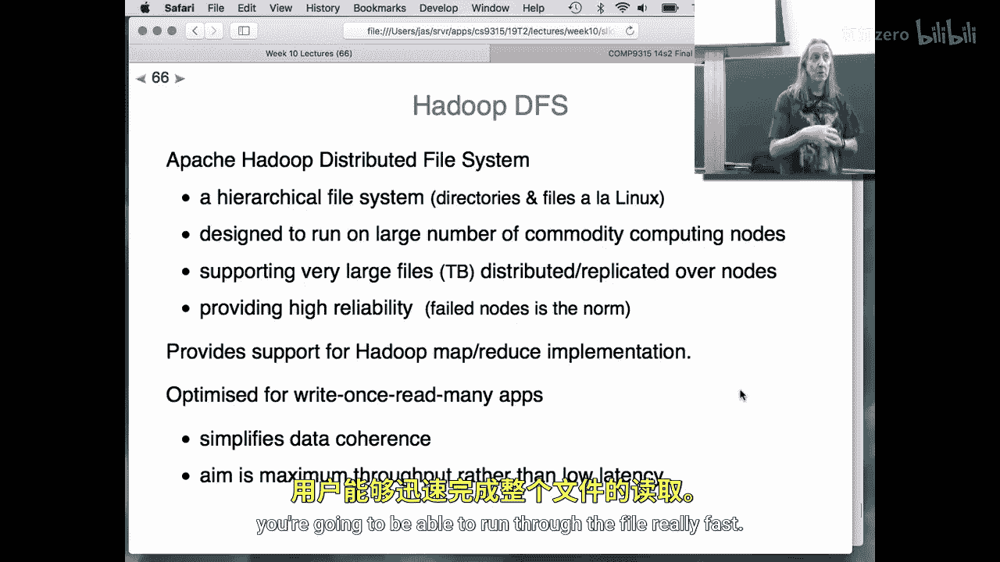

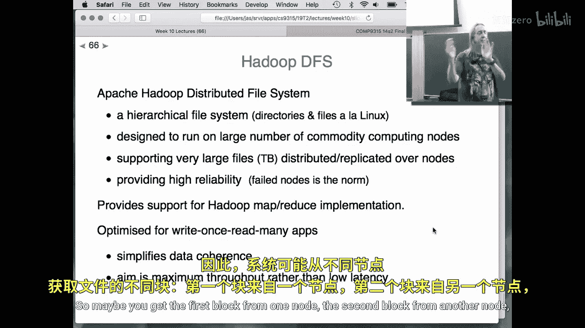

*   **名称节点（NameNode）**：作为主节点，存储整个文件系统的所有元数据。它知道文件（如“Fred”）由哪些数据块组成，以及这些数据块位于哪些数据节点上。
*   **数据节点（DataNode）**：存储实际的数据块。数据块以固定大小的块形式，存储在数据节点本地操作系统的普通文件中。
*   **客户端（Client）**：访问HDFS的应用程序。

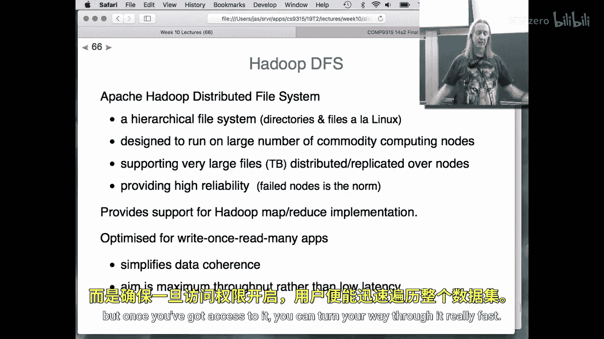

**工作流程简述**：
当客户端要打开一个文件时，请求首先发送到名称节点。名称节点根据其维护的元数据，确定该文件的数据块位于哪些数据节点上，并将这些信息（例如数据块位置列表）返回给客户端。之后，客户端可以直接与相应的数据节点通信进行读写操作。

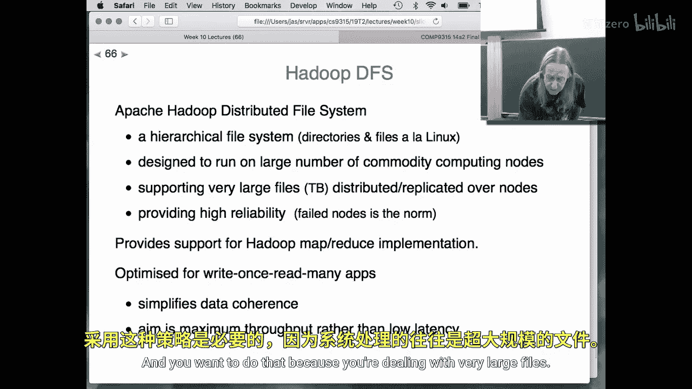

## 数据节点与名称节点的协作

数据节点不仅存储数据，还与名称节点紧密协作以维持系统状态。

以下是数据节点的关键职责：

*   **执行数据操作**：实现针对数据块的读取和追加操作。一旦客户端通过名称节点打开文件，后续的读取等操作将直接发送到名称节点提供的特定数据节点。
*   **定期向名称节点报告**：数据节点必须周期性地向名称节点发送报告，告知其自身状态以及所存储数据块的信息。这对于名称节点掌握集群全局视图、进行故障检测和副本管理至关重要。

## 文件与数据块的组织

在HDFS中，文件被切分为固定大小的数据块。

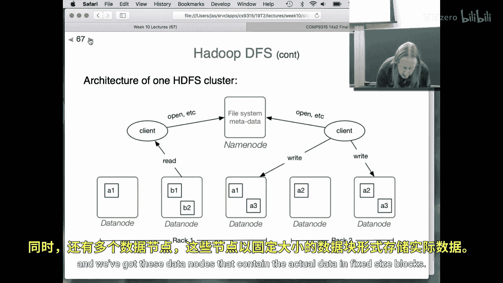

以下是其组织方式的关键点：

*   一个HDFS文件是**数据块（Blocks）** 的集合。
*   这些数据块分布在集群的所有节点上。
*   集群可能位于单个数据中心，也可能部分组件位于世界各地的不同数据中心，以实现地理分布。

## 总结

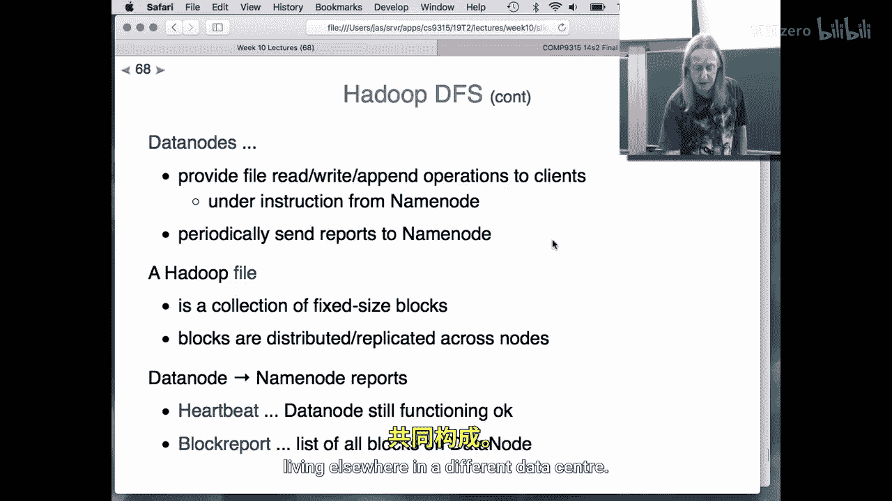

本节课中，我们一起学习了Hadoop分布式文件系统（HDFS）的核心原理。我们了解到HDFS通过**名称节点（NameNode）** 集中管理元数据，通过分布在众多**数据节点（DataNode）** 上的数据块副本实现可靠存储，并采用“一次写入，多次读取”模型来优化大规模顺序处理。其设计核心在于通过数据分布、复制和节点间协作，在由廉价硬件组成的大型集群上实现高可靠性与高吞吐量的数据存储与访问，为上层计算框架（如MapReduce）提供了坚实的基础。理解HDFS的架构是掌握现代大数据处理技术栈的重要一步。