# 001：课程介绍与RISC-V ISA 🚀

## 概述
在本节课中，我们将学习高级数字系统设计课程（CSCE 611）的总体介绍，并回顾RISC-V指令集架构的基础知识。课程将涵盖硬件描述语言（HDL）和现场可编程门阵列（FPGA）的使用，目标是设计并实现一个CPU。

---

## 课程大纲与政策 📋

### 课程基本信息
本课程使用系内的Moodle/Dropbox系统（dropbox.cs.sc.edu）发布材料、提交作业和展示成绩。所有讲座将被录制并上传至YouTube频道。

### 课程安排与资源
课程在周一进行讲座。实验课根据学生所在的小组（Section 1或Section 2）分别在周三或周五进行，地点在3D22 Linux实验室。实验室有门禁，当前密码为45213。

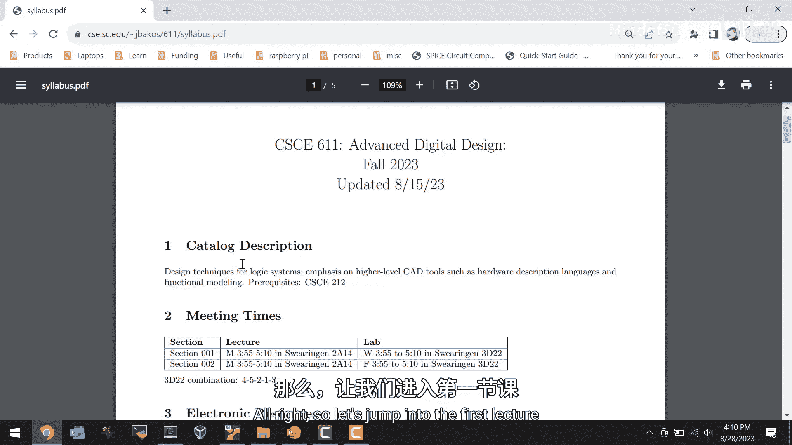

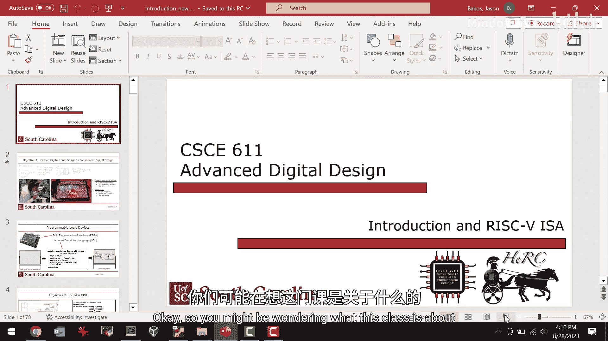

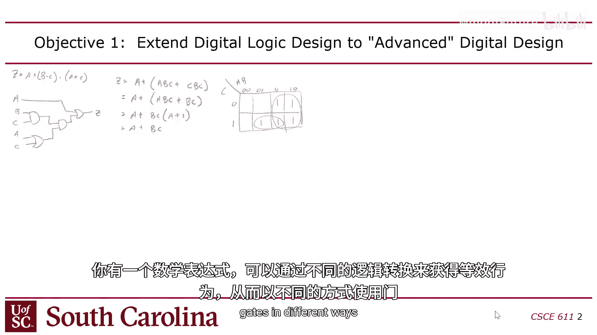

我们将使用安装在系内Linux实验室的CAD软件。课程所需的特定硬件仅在三楼实验室提供。其他课程也会使用该实验室，具体时间表将发布在Dropbox上。

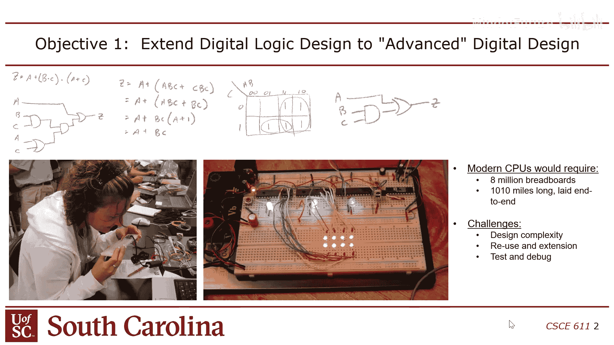

### 教材与学习成果
课程推荐教材为《Computer Organization and Design: The Hardware/Software Interface》。在本课程中，你将学习一种称为SystemVerilog的硬件描述语言，并在FPGA开发板上进行数字设计。

### 评分结构
课程评分基于四个实验项目、每周测验、期中考试和期末考试。总权重为117.5%，这为学生提供了一定的灵活性，例如可以选择不参加期末考试或放弃第四个项目。研究生或荣誉学分的学生需要完成额外的第五个实验。

### 学术诚信与协作
由于本课程使用的工业级CAD工具复杂且有时不稳定，鼓励学生之间互相帮助解决工具使用问题。然而，严禁抄袭设计代码。小组项目（占总成绩近50%）要求合作完成，但个人在测验和考试中的表现将独立评分。

### 项目提交与演示
项目通过Dropbox提交。评分主要通过课堂演示进行，学生需要向助教展示代码工作原理。即使项目未完全成功，也可以通过解释设计思路和遇到的问题获得部分分数。迟交罚分为每个上学日5%，最高扣30%。所有项目必须在12月8日（学期最后一天）前提交。

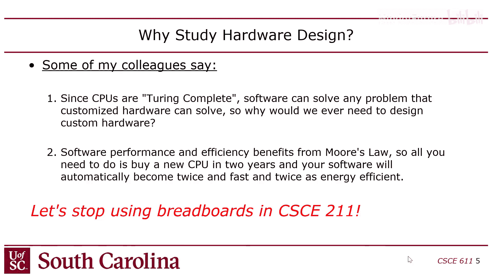

---

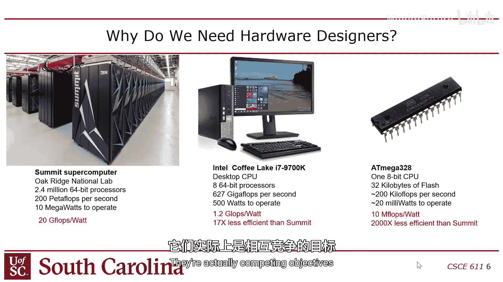

## 课程核心内容：从逻辑门到现代硬件设计 🔧

上一节我们介绍了课程的基本框架和政策，本节中我们来看看本课程要解决的核心工程问题及其背景。

在之前的数字逻辑课程（如CSCE 211）中，你通过布尔代数和原理图设计过逻辑电路，甚至可能在面包板上用TTL芯片搭建过它们。然而，用这种方法设计现代CPU是不切实际的。一个现代CPU包含数十亿晶体管，若用面包板搭建，将需要数百万块，绵延上千英里，且无法调试、复用或升级。

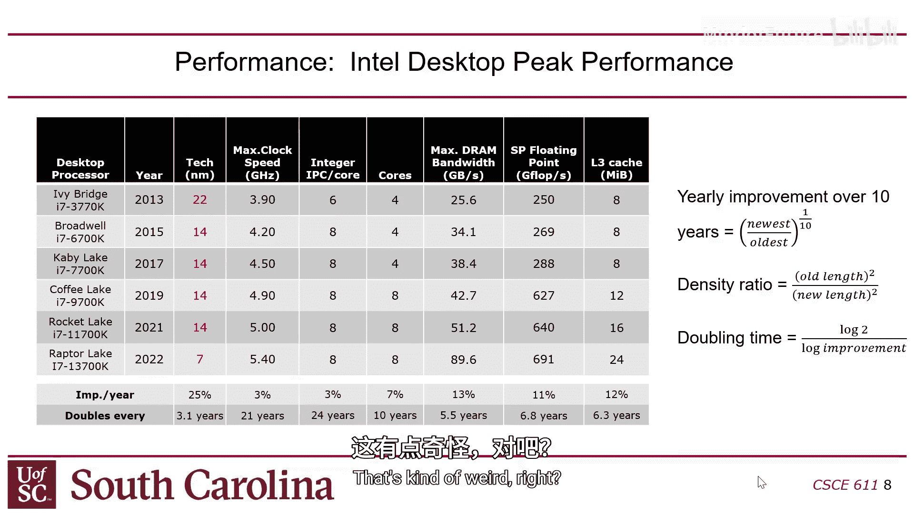

因此，本课程采用工业界实用的方法：
1.  **使用现场可编程门阵列（FPGA）**：FPGA是一种可电子编程的芯片。通过下载一个比特流文件，可以将其配置为任何你设计的数字逻辑电路，而无需实际制造芯片。这允许快速原型设计和测试。
2.  **使用硬件描述语言（HDL）**：使用类似高级编程语言的语法来描述硬件行为，然后通过**逻辑综合**工具将其转换为底层的数字逻辑网表。这比直接绘制原理图的抽象层级更高，更易于设计复杂系统。

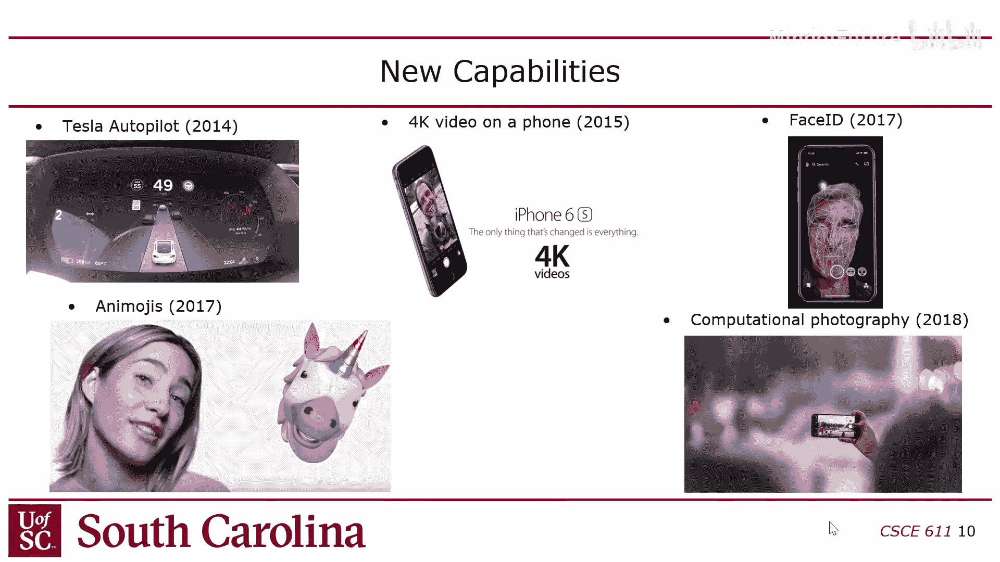

**FPGA vs. ASIC**：FPGA的时钟速度通常比专用集成电路（ASIC）慢约10倍，且能容纳的逻辑门数量也少约10倍。但FPGA的优势在于无需制造，可快速迭代。许多公司在流片前会用FPGA验证设计。

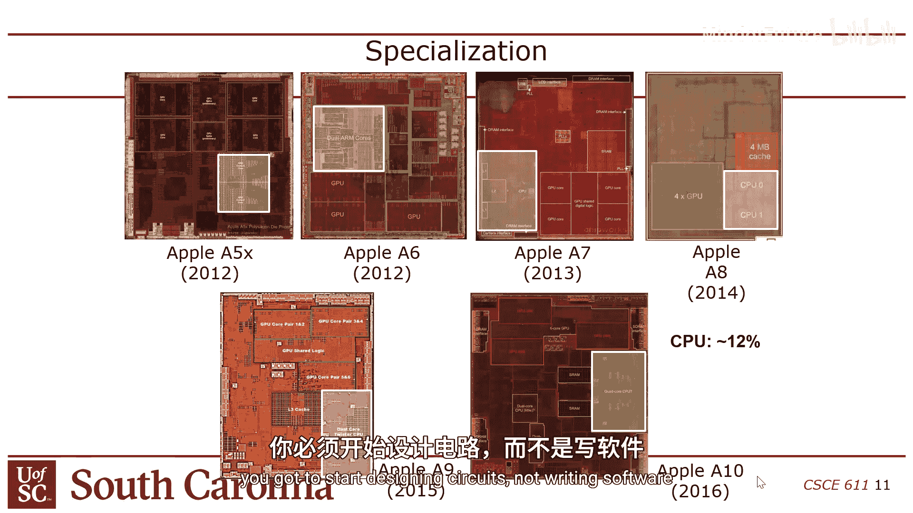

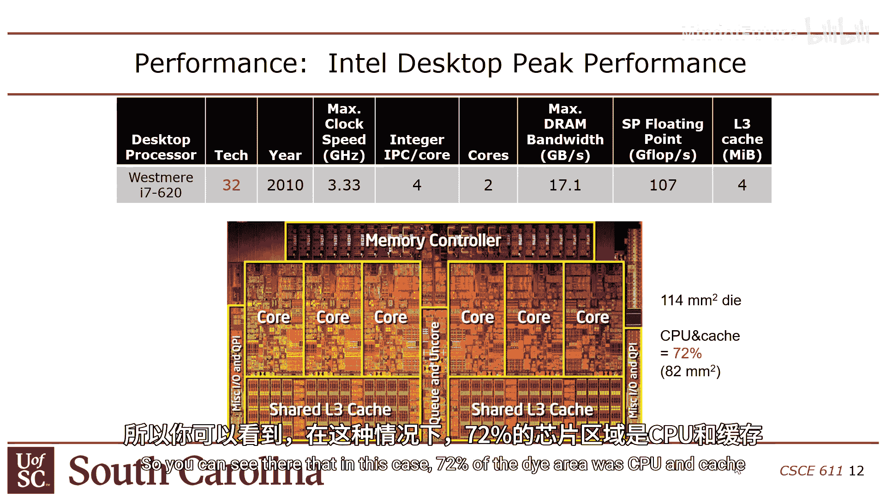

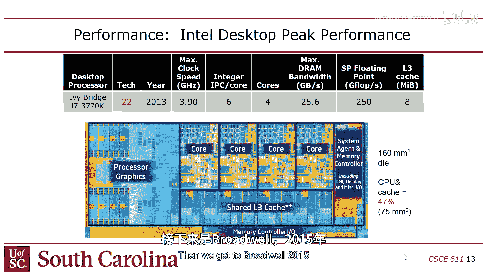

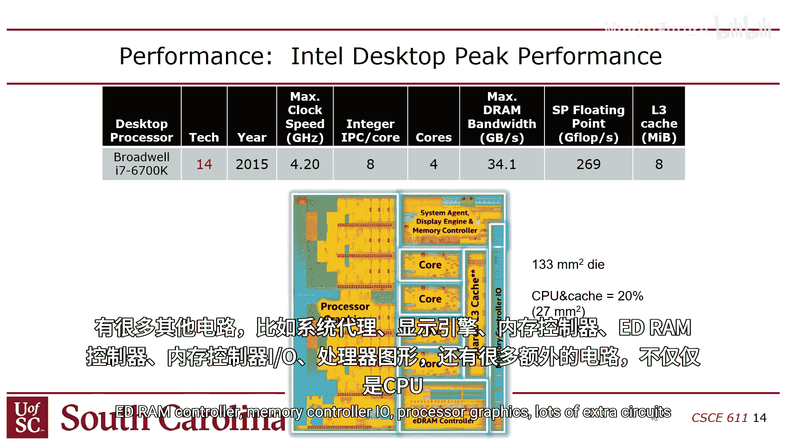

**HDL的并发语义**：与Java、Python等**顺序执行**的语言不同，HDL具有**并发语义**。HDL中的每一行代码都代表一个同时工作的电路模块，代码的书写顺序不影响其功能。

### 为何要学习硬件设计？
有人质疑，既然所有计算问题都能通过软件在通用CPU上解决，且过去CPU性能遵循摩尔定律快速提升，为何还要学习定制硬件设计？原因如下：
1.  **性能与能效墙**：通用CPU的性能提升已显著放缓（“后摩尔定律时代”）。同时，它们能效不高。专用硬件（如Google的TPU）通过为特定领域（如矩阵乘法）优化，可以获得比通用CPU高数个数量级的性能和能效。
2.  **现代芯片的构成**：观察现代处理器（如苹果A系列、英特尔酷睿）的芯片显微照片可以发现，通用CPU核心所占面积比例越来越小（从早年的~70%降至~20%），大部分区域被GPU、AI加速器、视频编解码器等**专用硬件**占据。新功能（如人脸识别、计算摄影）主要依靠这些定制电路实现，而非软件。
3.  **职业价值**：硬件设计是一项高度专业化的技能，相关岗位的薪酬通常显著高于软件岗位。

因此，本课程的目标是让你获得设计定制计算硬件的实践经验。

---

## RISC-V指令集架构（ISA）回顾 💻

上一节我们探讨了定制硬件设计的重要性，本节中我们将回顾实现CPU所需理解的软件接口——指令集架构，特别是RISC-V。

### ISA与微架构
*   **指令集架构（ISA）**：是CPU呈现给软件（汇编语言）的视图。它定义了指令格式、寄存器、内存访问方式等。ISA通常是公开的（如RISC-V、x86、ARM）。
*   **微架构**：是ISA的具体硬件实现电路。它决定了指令如何被一步步执行（时钟周期级）。微架构通常是公司的核心机密。

本课程中，你将设计一个能执行RISC-V指令子集的微架构。

### 为何学习汇编语言？
虽然在实际工作中很少直接编写长篇汇编程序，但理解汇编对于硬件设计至关重要。因为CPU本质上就是一个执行汇编指令的电路。编译器将高级语言（如C）编译为汇编指令，CPU硬件则执行这些指令。

### RISC-V基础
RISC-V是一种**精简指令集计算机（RISC）** 架构，与MIPS类似。RISC架构指令简单，每条指令完成的工作量小，导致程序指令条数多，但硬件实现可以更高效、快速。

**核心组件**：
*   **32个通用寄存器**：命名为`x0`-`x31`。`x0`是硬连线到0的寄存器，常用于提供常数0或构造其他操作。
*   **指令类型**：我们将重点关注以下类型：
    *   **算术/逻辑/移位指令**：例如 `add x1, x2, x3` （`x1 = x2 + x3`）。操作数都在寄存器中。
    *   **立即数指令**：例如 `addi x1, x2, 4` （`x1 = x2 + 4`）。包含一个编码在指令中的常数。
    *   **分支指令**：例如 `beq x1, x2, label`。比较两个寄存器，若相等则跳转到`label`处。用于实现`if`和循环。
    *   **跳转指令**：例如 `jal label`。无条件跳转，用于函数调用。
    *   **加载/存储指令**：例如 `lw x1, offset(x2)` 和 `sw x1, offset(x2)`。在寄存器和内存之间传输数据。RISC-V是**加载-存储型架构**，运算指令只能操作寄存器。
    *   **系统/控制寄存器指令**：例如 `csrrw`。我们将用它来实现FPGA板上的输入/输出（如读取开关、驱动数码管）。

**本课程的简化**：为了让项目更易管理，我们设计的CPU将**不实现加载/存储指令**和内存子系统。所有计算仅通过寄存器完成，并通过特殊的IO指令与FPGA板交互。你的第一个实验就是编写一个在模拟器中运行的RISC-V程序（例如计算平方根），该程序后续将用于测试你设计的CPU硬件。

### 汇编编程的挑战
以下是编写汇编程序时的常见难点：
1.  **显式的加载与存储**：所有数据必须先用`load`指令从内存（或通过IO）读到寄存器，运算完成后再用`store`指令存回。无法直接对内存地址进行运算。
2.  **寄存器分配与管理**：程序员必须手动跟踪哪个变量在哪个寄存器中，并在寄存器不够用时重复利用它们，这很容易出错。
3.  **条件逻辑的反转**：在高级语言中，`if (a < b) { ... } else { ... }` 的逻辑是直接的。在汇编中，为了效率，通常测试相反条件并跳过`else`块。例如，汇编中可能实现为 `if (a >= b) jump to ELSE_LABEL; ... (if block) ... ELSE_LABEL: ... (else block)`。这需要程序员进行逻辑转换。

---

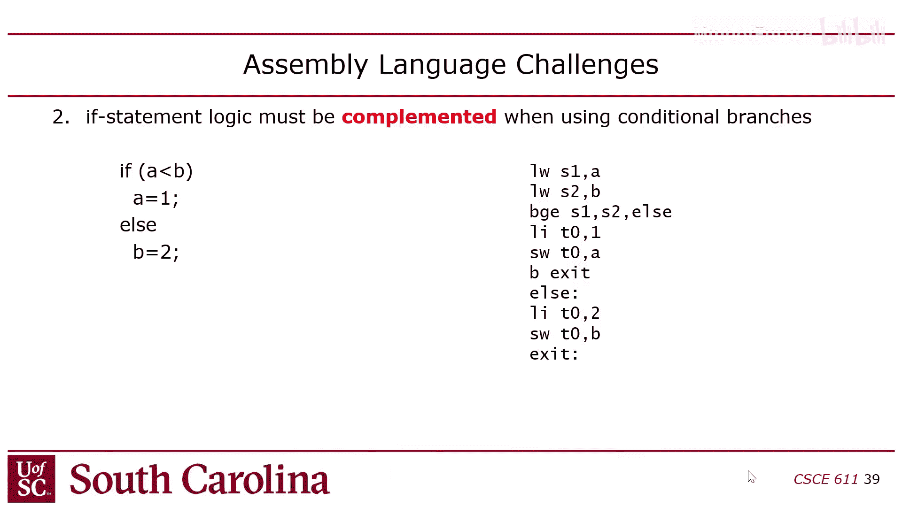

## 总结 🎯
本节课我们一起学习了CSCE 611课程的整体介绍。我们了解了课程政策、评分方式以及项目提交的流程。更重要的是，我们探讨了从低层次逻辑门设计转向使用HDL和FPGA进行现代数字系统设计的必要性，并回顾了作为CPU设计基础的RISC-V指令集架构的核心概念。在接下来的课程中，我们将开始深入学习SystemVerilog硬件描述语言，并着手进行第一个实验项目。