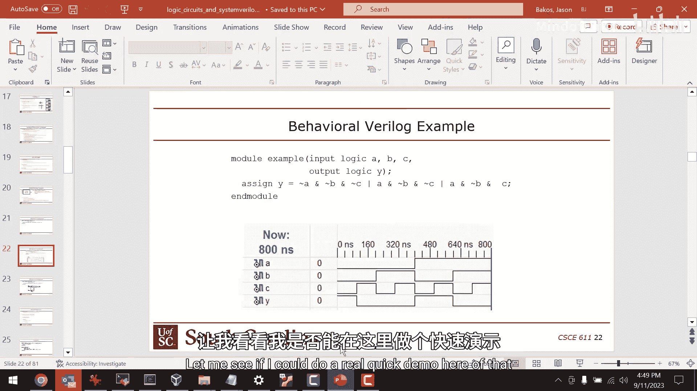
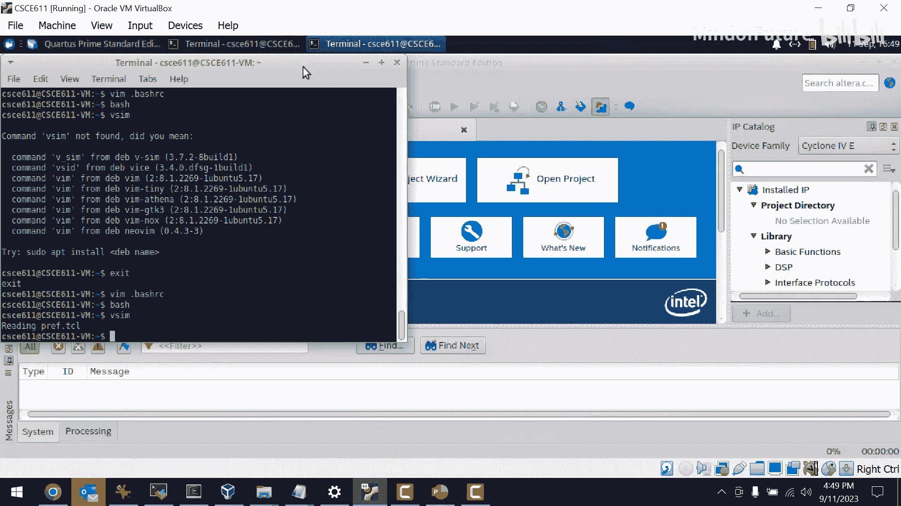
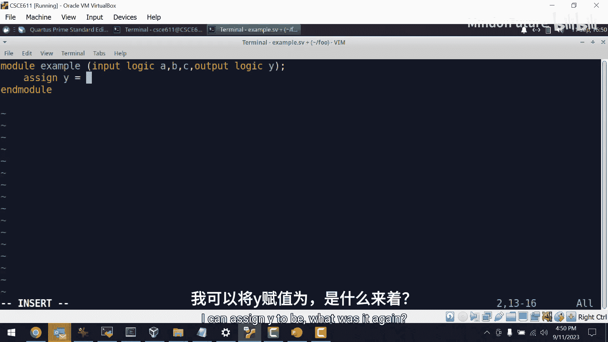
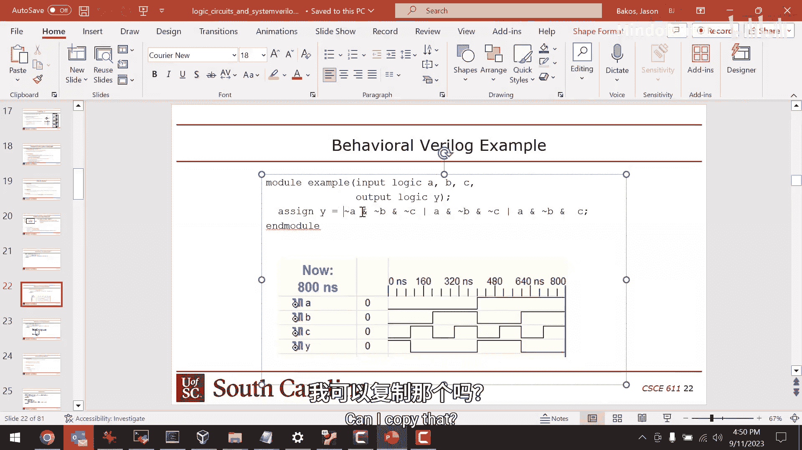
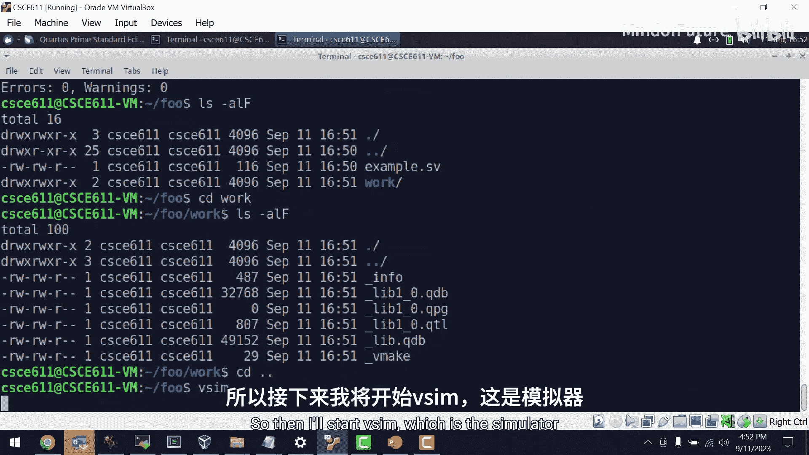
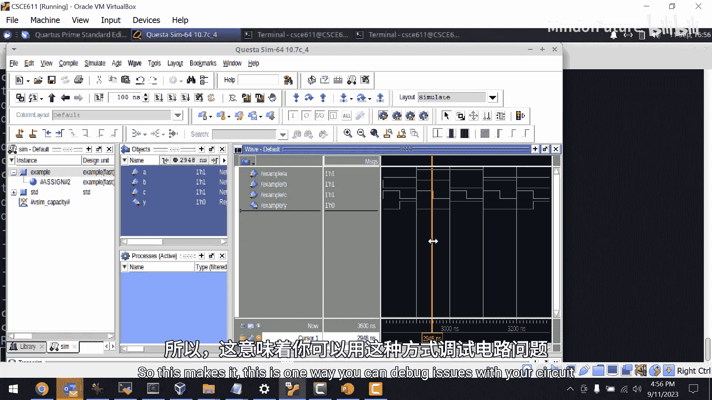
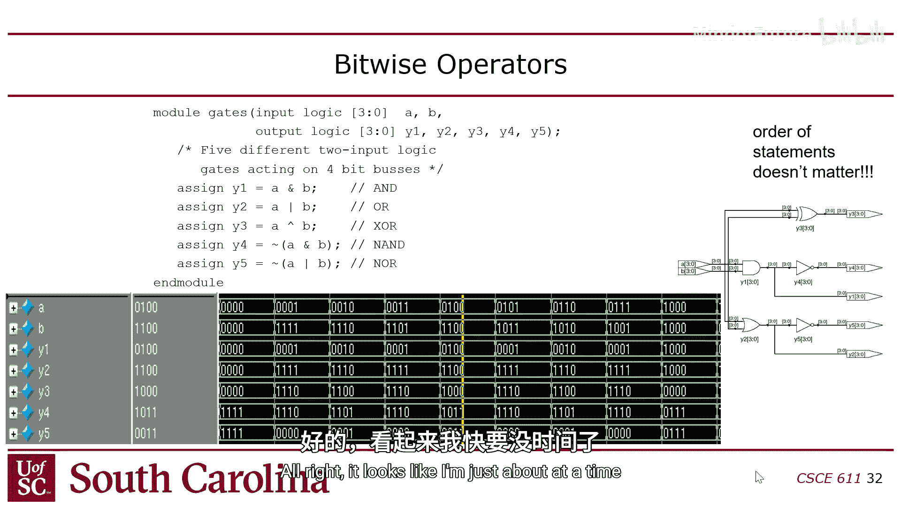

# 003：逻辑电路与SystemVerilog

## 概述
在本节课中，我们将学习数字逻辑电路的基本概念，以及如何使用SystemVerilog硬件描述语言来描述和设计这些电路。我们将从布尔代数和逻辑门开始，逐步深入到模块化设计、层次结构和硬件描述语言的核心思想。

---

## 逻辑电路与硬件描述语言

上一节我们回顾了布尔代数与逻辑电路的关系。本节中，我们来看看硬件描述语言（HDL）如何作为现代数字设计的核心工具。

在数字逻辑设计中，我们通常使用三种表示方式：
1.  **行为描述**：使用布尔代数或高级语言（如SystemVerilog）描述电路的功能。
2.  **结构描述**：使用逻辑门和连线构成的原理图来表示电路。
3.  **物理实现**：将结构描述映射到实际的物理器件上，如芯片或FPGA。

在本课程中，我们将使用SystemVerilog作为行为描述语言。你编写的SystemVerilog代码会被一个称为**逻辑综合器**的工具处理，该工具类似于编译器，它会自动将你的高级描述转换为优化后的布尔逻辑（结构描述），并最终映射到FPGA的物理资源上。

---

## HDL设计的核心概念：抽象、层次与规整

硬件描述语言围绕三个核心概念构建：**抽象**、**层次**和**规整**。

*   **抽象**：通过将复杂设计分解为模块来隐藏内部细节。每个模块只暴露必要的接口，使得顶层设计保持简洁。
*   **层次**：设计被组织成树状结构。顶层模块实例化子模块，子模块可能进一步实例化更底层的模块，直到最底层的逻辑门和触发器。
*   **规整**：通过最大化模块的复用，减少设计中独特模块的数量。例如，一个CPU中的多个核心可以是同一个模块的多个实例。

以下是一个从CPU到逻辑门的层次结构示例：
1.  **顶层**：FPGA设计（包含CPU）。
2.  **CPU**：可能包含多个处理器核心。
3.  **处理器核心**：包含浮点运算单元、寄存器堆等。
4.  **浮点加法器**：包含比较器、移位器和加法器。
5.  **整数减法器**：内部包含一个加法器。
6.  **加法器**：由多个全加器构成。
7.  **全加器**：由异或门等基本逻辑门构成。

这种层次结构纯粹是为了方便人类理解和设计。在综合并部署到FPGA后，所有层次都会被“展平”，变成由大量逻辑门和连线构成的网状结构。

---

## 逻辑电路基础回顾

在深入SystemVerilog之前，让我们快速回顾一些逻辑电路的基础知识。

逻辑电路分为两大类：
*   **组合逻辑电路**：输出仅取决于当前输入值的电路，不包含记忆元件（如触发器）。例如：与门、或门、加法器。当输入变化时，输出会随之更新。
*   **时序逻辑电路**：输出取决于当前输入和电路历史状态（即包含记忆）的电路。例如：触发器、寄存器、计数器。

在阅读原理图（结构描述）时，需要注意连线规则：
*   两条线呈 **T型连接** 时，表示它们电气相连。
*   两条线 **交叉** 时，默认不相连。如果相连，会在交叉点画一个 **实心圆点**。

在SystemVerilog中，每个命名的变量（信号）都代表一根**连线**。关键规则是：**一根连线只能有一个驱动源**（即一个电路负责设置它的值），但可以被多个电路读取（扇出）。如果多个驱动源同时驱动一根线，会导致信号冲突（`X`），在物理上可能造成短路并损坏芯片。

SystemVerilog使用**四态逻辑**来模拟这些情况：
*   `0`：逻辑低电平
*   `1`：逻辑高电平
*   `X`：未知或冲突值
*   `Z`：高阻态，表示没有驱动源

---

## SystemVerilog简介与历史

目前广泛使用的硬件描述语言主要有两种：VHDL和Verilog/SystemVerilog。

*   **VHDL**：起源于20世纪80年代初，由美国国防部主导开发，基于Pascal语言，语法冗长但可读性强，在学术界应用较多。
*   **Verilog/SystemVerilog**：起源于20世纪80年代中期的工业界，语法更接近C语言，简洁但稍难阅读，是工业界的首选。SystemVerilog是其功能扩展版本。

这两种语言非常相似，学会一种后很容易掌握另一种。本课程将使用SystemVerilog。

---

## SystemVerilog模块入门

SystemVerilog的设计围绕**模块**展开，模块类似于Java中的类，是实现抽象、层次和规整的基本单元。

一个简单的模块示例如下：
```systemverilog
module example (
    input logic A, B, C,
    output logic Y
);
    assign Y = (A & B & C) | (A & ~B & ~C) | (~A & B & ~C) | (~A & ~B & C);
endmodule
```
代码解析：
*   `module example` 定义了一个名为 `example` 的模块。
*   `input logic A, B, C` 声明了三个输入端口，类型为 `logic`。
*   `output logic Y` 声明了一个输出端口。
*   `assign Y = ...` 是一个**连续赋值语句**，它描述了一个组合逻辑电路，将右侧的布尔表达式结果持续驱动到信号 `Y` 上。这创建了一个组合逻辑电路。

模块通常保存在与模块同名的文件中（例如 `example.sv`）。

---

## 测试与仿真

我们无法像运行软件程序一样直接运行硬件描述代码，必须使用**仿真器**。仿真器会模拟电路的行为，并生成时序图供我们分析。



测试一个模块的基本方法是：
1.  编写一个**测试平台**，为模块的输入提供一系列激励信号（测试向量）。
2.  在仿真器中运行，观察输出信号是否与预期值匹配。
3.  对于小型电路，可以进行**穷举测试**（遍历所有输入组合）。对于大型电路，则需要设计有针对性的测试用例。







在仿真器中，你可以看到信号随时间变化的波形图，通过设置输入信号（如使用时钟信号模拟变化），可以验证输出逻辑是否正确。



---

## 层次化设计：实例化模块



真正的设计通常包含多个模块层次。要在上层模块中使用下层模块，需要进行**实例化**。

假设我们有一个已有的 `and3`（三输入与门）模块：
```systemverilog
module and3 (
    input logic A, B, C,
    output logic Y
);
    assign Y = A & B & C;
endmodule
```
现在，我们在一个顶层模块 `my_design` 中实例化它：
```systemverilog
module my_design (
    input logic A, B, C,
    output logic Y
);
    logic n1; // 内部连线声明

    // 实例化 and3 模块
    and3 and_gate_inst (
        .A(A),       // 将顶层端口 A 连接到实例的端口 A
        .B(B),       // 将顶层端口 B 连接到实例的端口 B
        .C(C),       // 将顶层端口 C 连接到实例的端口 C
        .Y(n1)       // 将实例的输出端口 Y 连接到内部连线 n1
    );

    // 可以继续使用 n1 驱动其他逻辑...
    assign Y = ~n1; // 例如，反相后输出
endmodule
```
实例化要点：
*   `and3` 是**模块名**（要实例化的模板）。
*   `and_gate_inst` 是**实例名**（这个特定副本的标识符，用于仿真和调试）。
*   使用 `.端口名(连接线)` 的语法进行连接。**连接顺序无关**。
*   通过内部连线（如 `n1`）可以将一个模块的输出传递给另一个模块的输入。

---

## 多比特信号与向量

在实际设计中，我们经常需要处理多比特数据（如32位加法器）。在SystemVerilog中，可以使用**向量**来表示。

声明一个4位向量的语法如下：
```systemverilog
module vector_example (
    input logic [3:0] A, // 4位输入，位宽为3:0（MSB:LSB）
    input logic [3:0] B,
    output logic [3:0] Sum
);
    assign Sum = A + B; // 4位加法
endmodule
```
注意：
*   位宽声明 `[3:0]` 放在数据类型 `logic` 之后、信号名之前。
*   `[3:0]` 表示最高位（MSB）索引为3，最低位（LSB）索引为0。虽然 `[0:3]` 在语法上也有效，但约定俗成使用降序。
*   `A` 和 `B` 现在各自代表4根并行的导线。

---

## 总结



本节课我们一起学习了数字逻辑设计与SystemVerilog的基础。我们回顾了逻辑电路的组合与时序特性，理解了硬件描述语言中抽象、层次和规整的重要性。我们介绍了SystemVerilog模块的基本结构，包括端口声明、连续赋值语句 `assign`，以及如何通过实例化来构建层次化设计。我们还学习了如何使用向量处理多比特信号，并了解了通过仿真器验证设计的基本流程。掌握这些概念是后续设计复杂CPU的基石。