# 004：SystemVerilog 语法深入与工具使用 🧠

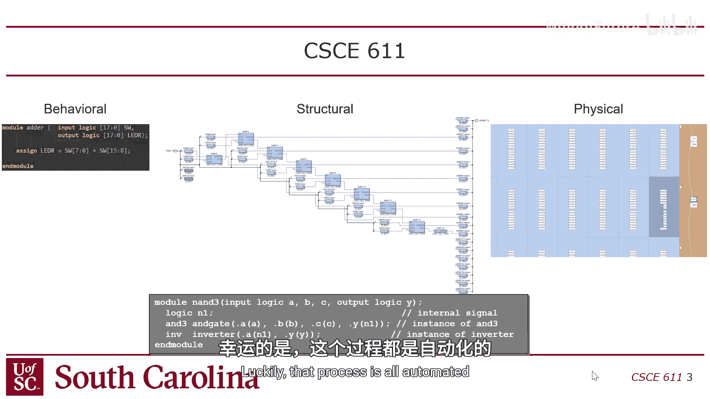

在本节课中，我们将深入学习 SystemVerilog 的更多语法细节，包括多比特信号、常用运算符、常量表示以及 `always` 语句。同时，我们也将介绍用于仿真和综合的关键工具：ModelSim 和 Quartus。掌握这些内容是完成后续实验的基础。

---

上一节我们介绍了 SystemVerilog 的基本模块结构和数据类型。本节中，我们来看看如何处理多比特信号以及 SystemVerilog 中丰富的运算符。

## 多比特信号与向量操作

在硬件设计中，我们经常需要处理多位宽的数据，例如32位的寄存器或8位的数据总线。SystemVerilog 使用一种独特的语法来声明向量。

**代码示例：声明4位输入和输出**
```systemverilog
module example (
    input  logic [3:0] a, // 4位输入a
    input  logic [3:0] b, // 4位输入b
    output logic [3:0] y  // 4位输出y
);
```
需要注意的是，向量索引范围写作 `[n-1:0]`（例如 `[3:0]`），这表示最高有效位（MSB）在左侧。虽然也可以写作 `[0:3]`，但前者是更常见的惯例。

## 常用运算符与常量表示

SystemVerilog 的运算符大多与 C/Java 类似，但专为硬件设计增加了一些特性。

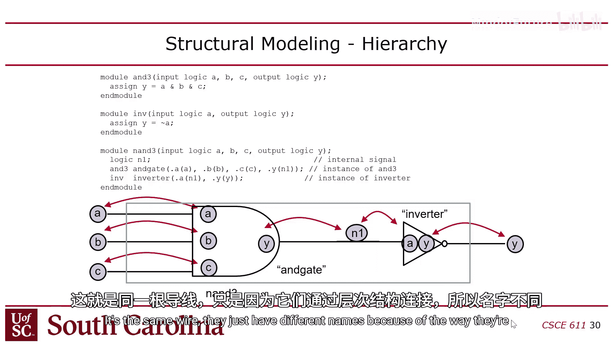

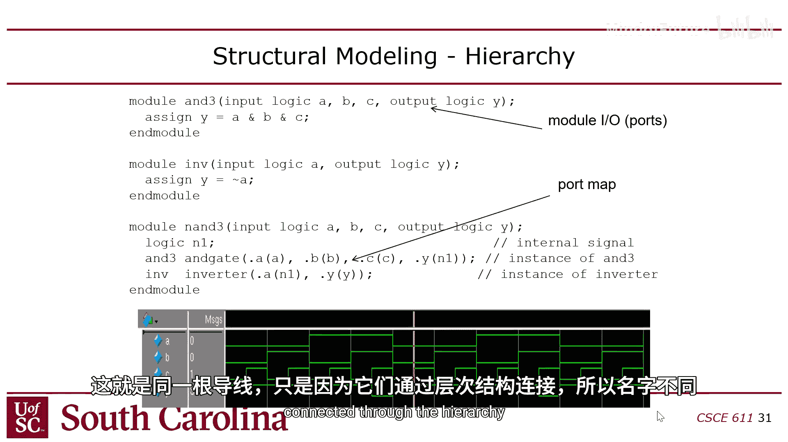

以下是需要特别注意的运算符：
*   **条件运算符 (`? :`)**：它直接对应一个多路选择器（MUX），是描述数据通路的关键。
    ```systemverilog
    assign y = (sel == 1‘b1) ? in1 : in0; // 一个2选1 MUX
    ```
*   **移位运算符**：`<<` 和 `>>` 是逻辑移位；`<<<` 和 `>>>` 是算术移位（考虑符号位）。
*   **相等运算符**：`==` 和 `!=` 用于可综合代码的比较；`===` 和 `!==` 用于仿真测试台，可以比较 `X` 和 `Z` 状态。
*   **缩减运算符**：对向量的所有位进行运算，产生一位结果。例如，`&a` 会对向量 `a` 的所有位执行与操作。

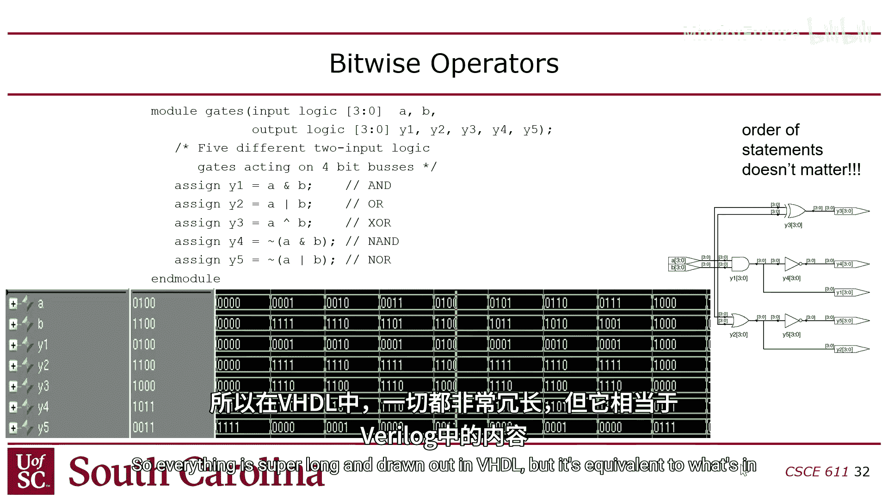

对于常量，建议始终指定位宽和基数，格式为：`<位宽>'<基数><数值>`。下划线 `_` 可用于提高可读性。

**公式/代码示例：常量与位拼接**
```systemverilog
logic [7:0] data;
assign data = 8‘b1100_0011; // 8位二进制常量

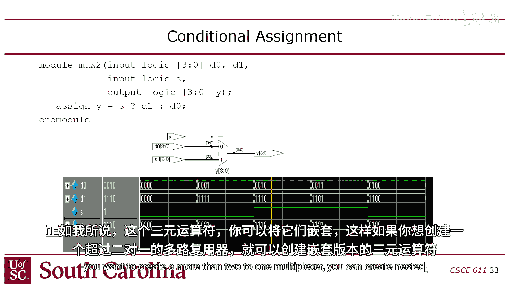

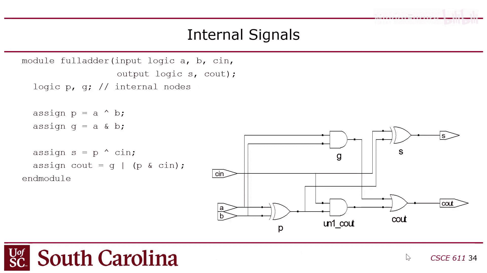

logic [15:0] extended;
assign extended = { {16{imm[11]}}, imm[11:0] }; // 12位立即数符号扩展至28位
// {16{imm[11]}} 表示将 imm[11] 这位重复16次
// 整体表示：高16位为符号位，低12位为原始立即数
```

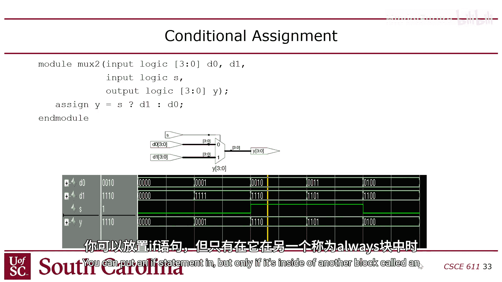

---

理解了基本运算符后，我们需要一种方法来描述更复杂的行为逻辑，而不仅仅是简单的连线或表达式。这就是 `always` 语句的用武之地。

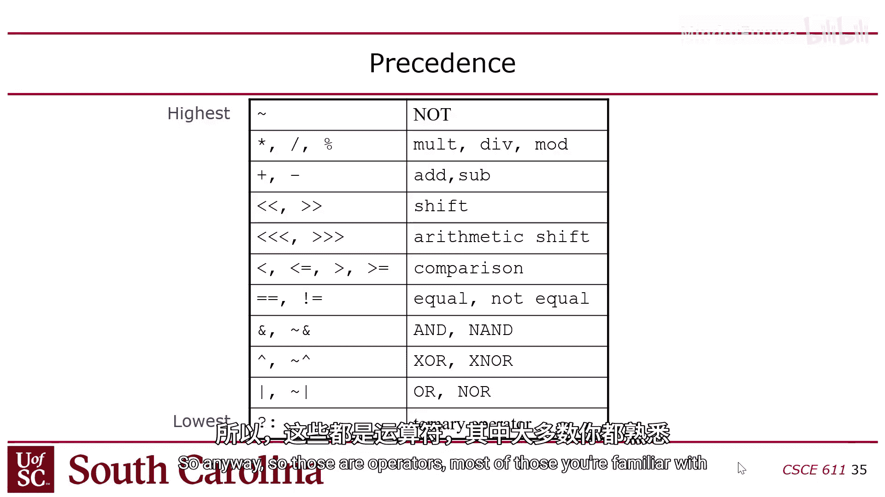

## 行为建模：`always` 语句

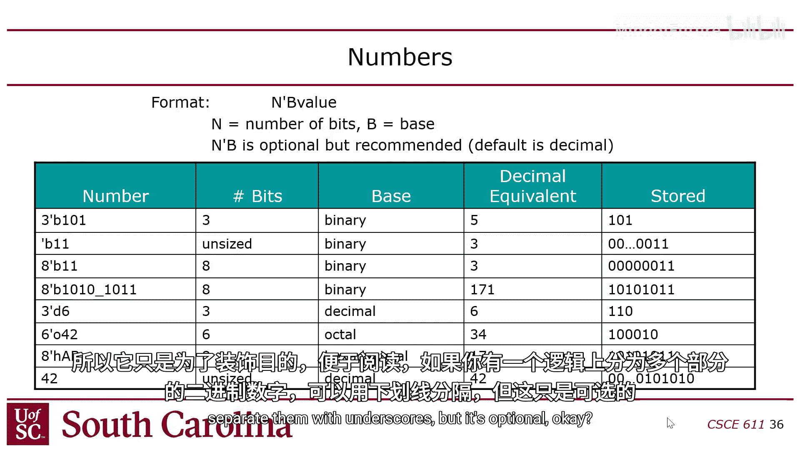

`assign` 语句适合描述组合逻辑，但它是单行的。对于复杂的组合逻辑或需要记忆功能的时序逻辑，我们使用 `always` 语句块。

SystemVerilog 引入了三种主要的 `always` 变体，以帮助避免常见错误：
1.  **`always_comb`**：用于描述组合逻辑。编译器会检查是否在所有条件下都对输出进行了赋值，防止意外推断出锁存器。
2.  **`always_ff`**：用于描述时序逻辑（触发器）。明确指出设计意图是创建边沿触发的寄存器。
3.  **`always`**：通用版本，但使用它需要更小心，以免推断出非预期的硬件。

### 使用 `always_comb` 描述组合逻辑

在 `always_comb` 块内，可以使用 `if-else` 和 `case` 等过程语句，它们会被综合成对应的组合电路。

**代码示例：使用 always_comb 实现多路选择器**
```systemverilog
logic out;
always_comb begin
    if (sel == 1‘b1) begin
        out = in1;
    end else begin
        out = in0;
    end
end
```
此代码与 `assign out = (sel) ? in1 : in0;` 综合出的硬件是相同的。

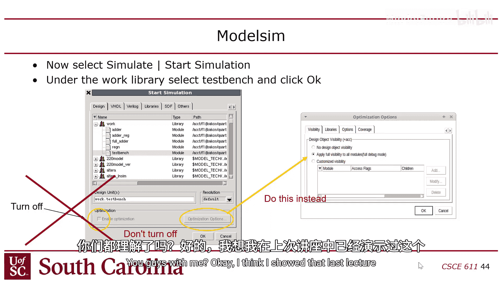

**代码示例：使用 case 语句实现译码器（如七段数码管）**
```systemverilog
logic [6:0] segments;
always_comb begin
    case (data)
        4‘d0: segments = 7‘b0111111;
        4‘d1: segments = 7‘b0000110;
        // ... 其他 cases
        default: segments = 7‘b0000000;
    endcase
end
```

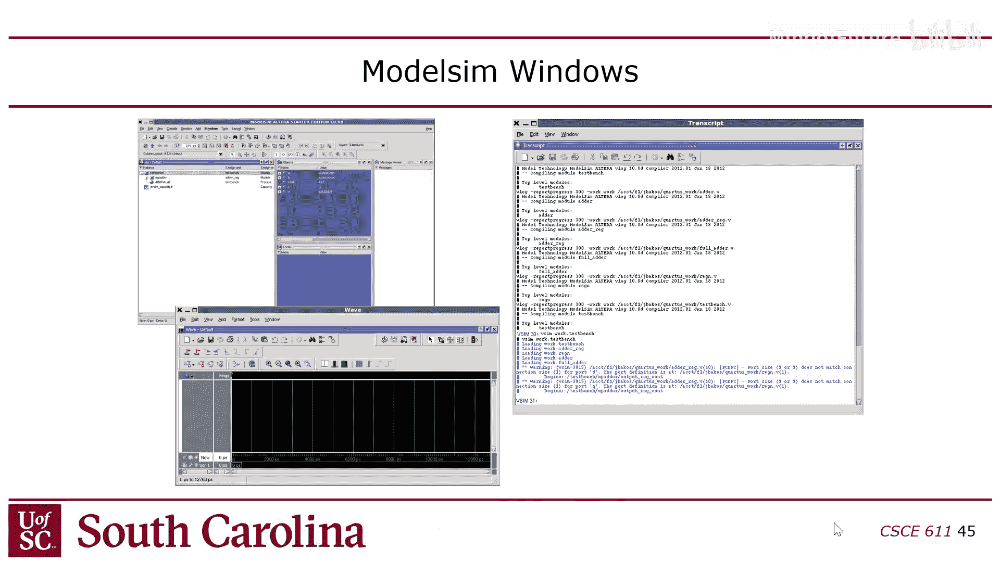

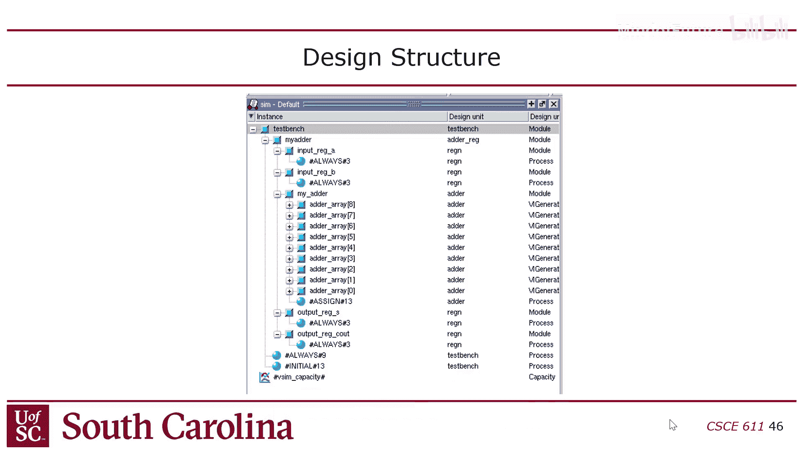

### 使用 `always_ff` 描述时序逻辑

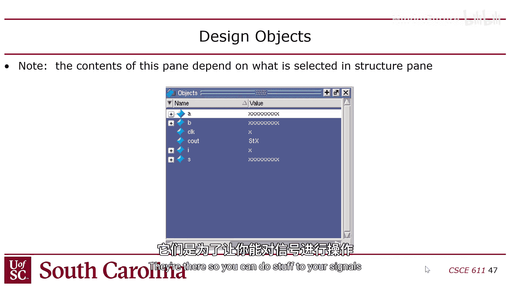

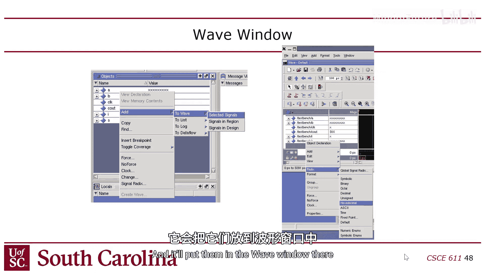

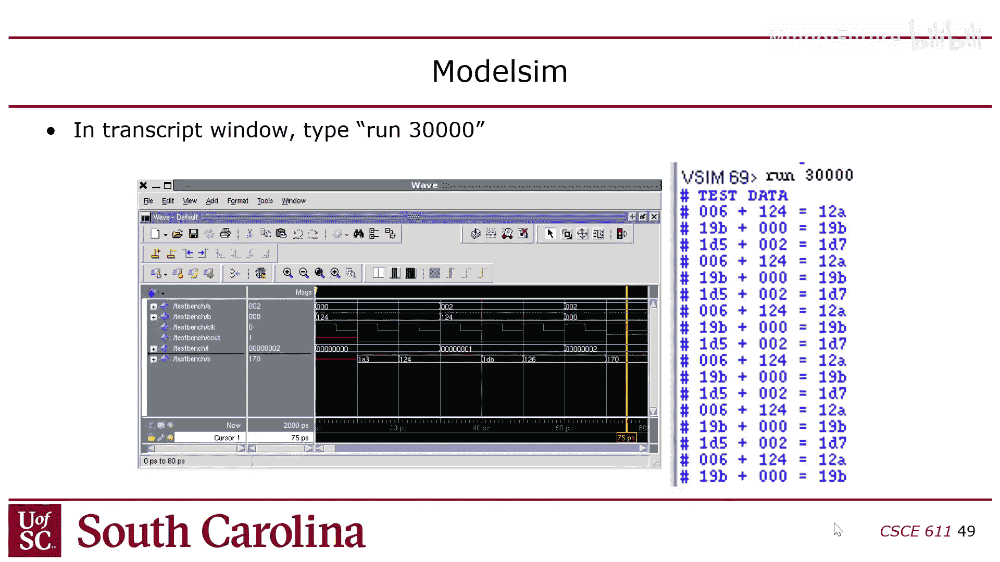

时序逻辑依赖于时钟信号来更新状态。这是构建寄存器、计数器和状态机的核心。

**代码示例：一个简单的 D 触发器**
```systemverilog
logic q;
always_ff @(posedge clk) begin
    q <= d; // 在时钟上升沿，将输入d的值捕获到输出q
end
```
注意，在描述时序逻辑时，通常使用**非阻塞赋值符 `<=`**，这更符合寄存器并行更新的硬件行为。而在 `always_comb` 中，则使用阻塞赋值符 `=`。

---

掌握了描述硬件行为的语言后，我们需要工具来验证其功能是否正确，并将其转化为实际的电路。接下来我们将介绍两个核心工具。

## 仿真工具：ModelSim/QuestaSim

ModelSim（现称为 Questa Sim）是业界标准的 HDL 仿真器。我们用它来验证代码的行为是否符合预期，**主要进行功能验证，而非性能（时序）验证**。

仿真流程概述：
1.  **编译**：使用 `vlog` 命令编译你的 `.sv` 文件。例如：`vlog *.sv`。编译后的设计会存入 `work` 库。
2.  **启动仿真**：使用 `vsim` 命令加载顶层模块。例如：`vsim top_module`。
3.  **调试与查看**：
    *   **结构窗口**：以树状图显示设计的层次结构。
    *   **对象窗口**：显示当前层次的所有信号（变量）。
    *   **波形窗口**：将信号拖入此处，运行仿真后可以查看信号随时间变化的波形图。
4.  **运行控制**：可以使用 `run <时间>` 命令（如 `run 100ns`）控制仿真时间，或在测试台中用代码自动产生激励。

**重要提示**：为了在波形中看到所有内部信号，需要在仿真开始时（Simulate -> Start Simulation...）在“Optimization Options”中启用“Full debug mode”或取消优化选项。

## 综合与实现工具：Quartus

Quartus 是 Intel（Altera）的 FPGA 开发软件。它负责将 SystemVerilog 代码：
1.  **综合**：将行为描述转换为由基本逻辑单元（如LUT、寄存器）组成的网表。
2.  **布局布线**：将网表中的逻辑单元映射到 FPGA 芯片的物理位置，并用芯片内部的连线资源连接它们。
3.  **时序分析**：确保设计能在指定的时钟频率（本课程为 50 MHz）下稳定工作。
4.  **生成编程文件**：产生可以下载到 FPGA 板上的配置文件。

在本课程中，我们提供了自动化脚本（`csce611.sh`）来简化 Quartus 的编译和编程流程，你通常不需要直接操作 Quartus GUI。但了解其作用至关重要。

---

## 总结与实验指引 🚀

本节课中我们一起学习了：
1.  SystemVerilog 中**多比特向量**的声明和操作，包括位拼接和复制运算符。
2.  关键的**运算符**，如条件运算符（对应MUX）、移位运算符和缩减运算符。
3.  **`always_comb` 和 `always_ff` 语句块**，分别用于描述组合逻辑和时序逻辑，并了解了使用它们的最佳实践。
4.  硬件设计流程中的两个核心工具：用于功能仿真的 **ModelSim** 和用于综合实现到 FPGA 的 **Quartus**。

**关于实验二**：你将开始使用 SystemVerilog 进行设计。实验材料包中提供了项目框架、引脚约束文件和自动化脚本。你的任务之一是完成一个十六进制到七段数码管的译码器。请参考讲义中的示例代码，并注意开发板上数码管是**共阳极**（低电平点亮）且段序可能不同，你需要相应调整代码。

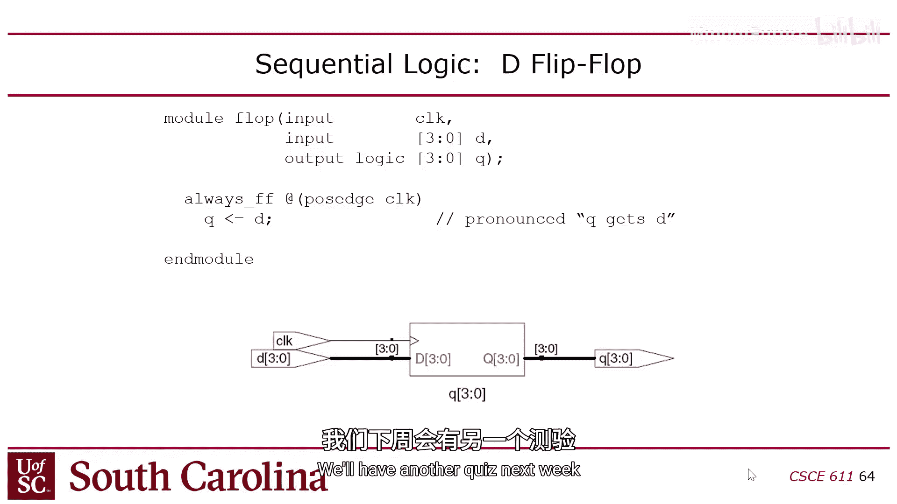

请记住，仿真是确保逻辑正确的关键步骤，务必在将设计下载到板卡之前进行充分的仿真测试。