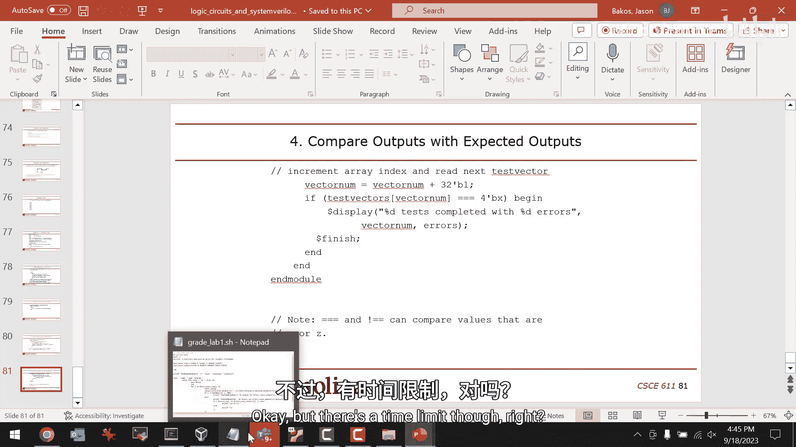
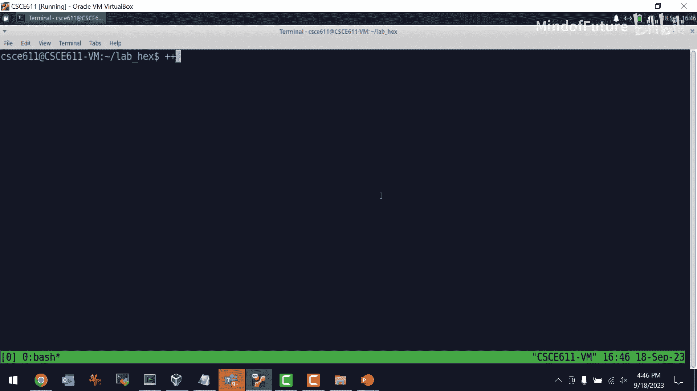
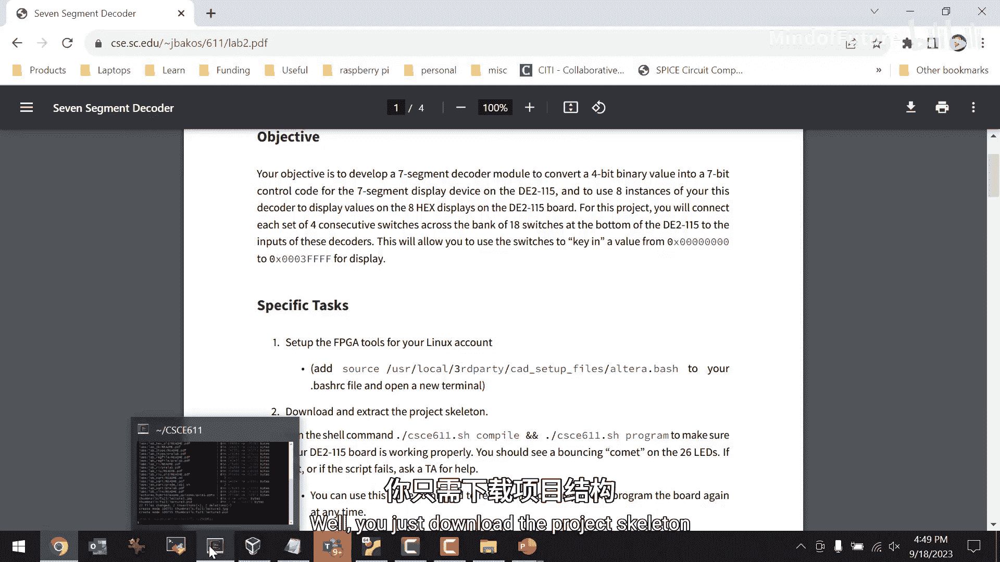
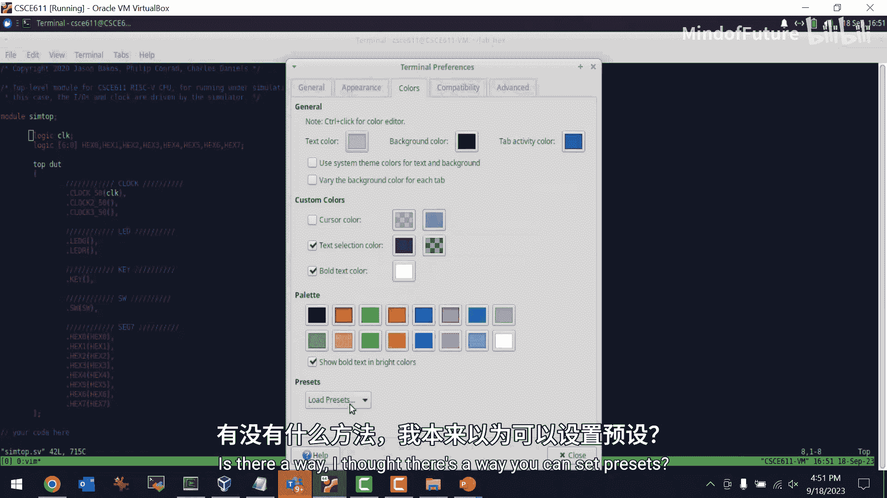
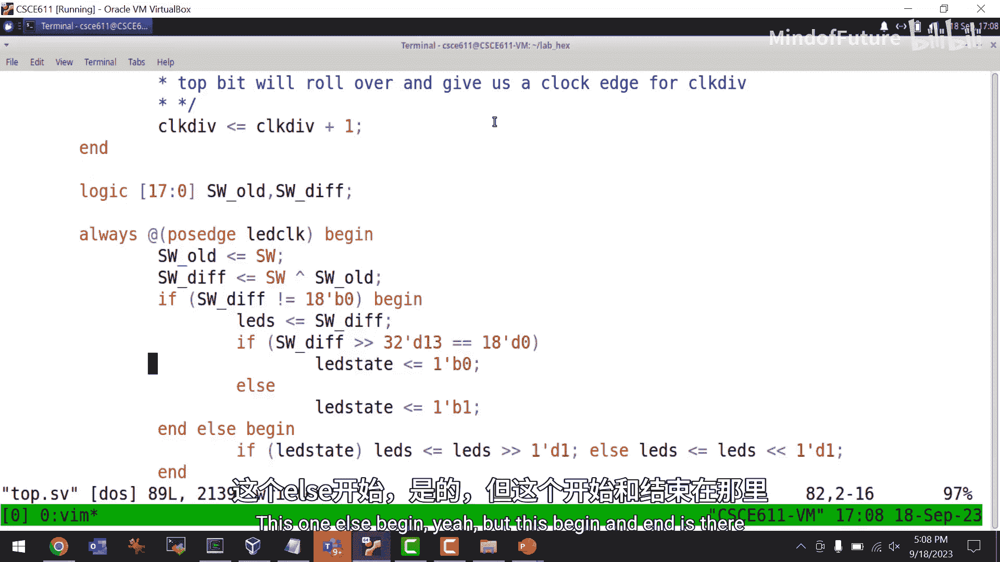
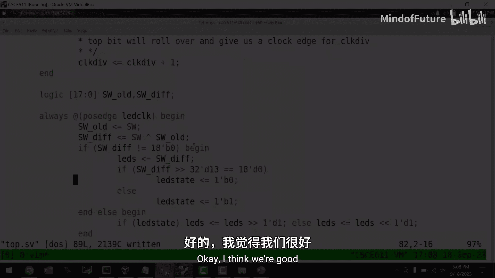
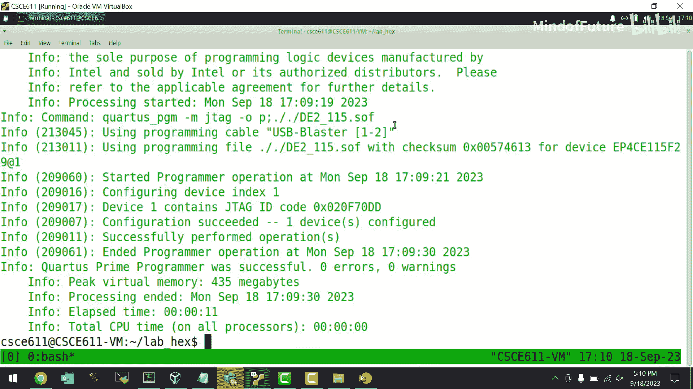

# 005：第5讲 - 测试平台与FPGA部署 🚀

在本节课中，我们将回顾上周的测验，并继续学习SystemVerilog，重点讲解`always`语句、测试平台的编写以及如何将设计部署到FPGA上。课程最后会有一个关于Lab 2的演示。

## 测验回顾 📝

上一节我们介绍了SystemVerilog和RISC-V汇编的基础知识。本节中，我们来看看上周测验中的一些关键题目。

### 循环控制指令
考虑以下C代码及其对应的RISC-V汇编翻译。问题在于缺少了控制循环的指令。

```assembly
# 初始化循环变量 i 为 8（因为数组索引以4字节为单位）
# x10 存储循环上限 40（对应10次迭代，10*4）
loop_start:
    # 缺少的指令：检查是否应退出循环
    # 应比较 x2 (i) 和 x10 (上限)
    bge x2, x10, exit  # 如果 i >= 40，则跳转到 exit
    # ... 循环体代码 ...
    addi x2, x2, 4     # i = i + 4
    j loop_start
exit:
```

缺少的指令是比较`x2`（循环变量`i`）和`x10`（循环上限`40`）的`bge`（分支大于或等于）指令，用于判断是否应退出循环。

### 位操作：交换半字
以下代码执行什么操作？

```verilog
assign result = (input_val << 16) | (input_val >> 16);
```

这段代码将输入值`input_val`的高16位和低16位进行交换。左移操作将低16位移至高16位，右移操作将高16位移至低16位，然后通过`OR`操作合并结果。

### 信号冲突问题
以下SystemVerilog模块存在什么问题？

```verilog
module problematic (input a, b, output z);
    assign z = a & b;
    assign z = a | b; // 错误：对信号 z 进行了多次驱动
endmodule
```

主要问题有两个：
1.  信号`z`被两个`assign`语句驱动，导致冲突。
2.  如果存在类似`assign z = z & a;`的语句，会形成组合逻辑反馈环，可能导致仿真器陷入无限循环或产生未知状态`x`。

### 模块实例与信号作用域
考虑以下模块实例化，`my_thing`模块内部的`a`和`y`值是多少？

```verilog
module top;
    logic y = 1'b1;
    my_thing u1 (.a(y), .y(y)); // 将 top.y 连接到 my_thing.a，将 my_thing.y 连接到 top.y
endmodule

module my_thing (input a, output y);
    assign y = ~a; // y 是 a 的反相
endmodule
```

在`my_thing`模块内部：
*   输入端口`a`的值为`1`（来自`top.y`）。
*   输出端口`y`被赋值为`~a`，因此其值为`0`。
需要注意的是，`top`模块中的`y`和`my_thing`模块中的`y`是两个不同的信号，虽然名称相同。`top.y`与`my_thing.a`是同一个网络。

### 运算符优先级与表达式求值
以下代码中，信号`a`的值是多少？

```verilog
logic [2:0] a;
assign a = (2'b10 << 1) == 4 ? 1 : 0;
```

运算顺序如下：
1.  `2'b10 << 1` 结果为 `3'b100`（十进制4）。
2.  `3'b100 == 4` 判断为真（`1‘b1`）。
3.  三元运算符返回真值子句 `1`。
因此，`a`的最终值为 `1`。

### 结构性与行为性代码冲突
以下代码中，信号`a`的值是多少？

```verilog
module top;
    logic a;
    assign a = 1'b1;          // 行为性驱动，将 a 设为 1
    my_thing u1 (.a(1'b0), .y(a)); // 结构性驱动，my_thing.y 输出 0 到 a
endmodule

module my_thing (input a, output y);
    assign y = ~a; // 简单的反相器
endmodule
```

信号`a`同时被行为性代码（`assign a = 1‘b1;`）和结构性代码（连接到`my_thing`的输出端口`y`，其值为`0`）驱动。这是一个驱动冲突，在仿真中`a`的值将是未知态`x`。

---

## SystemVerilog 核心概念深入 ⚙️

上一节我们回顾了测验题目，本节中我们来看看SystemVerilog中两个强大的概念：`always`语句和测试平台。

### `always` 语句

`assign`语句适用于简单的组合逻辑赋值。但当需要更复杂的逻辑，如多输出赋值、条件分支(`if`/`case`)、循环或需要创建存储器（触发器、RAM）时，就需要使用`always`语句。

`always`语句可以看作一个更强大的、过程式的`assign`语句块。

#### 组合逻辑 `always` 块
用于描述组合逻辑（输出仅取决于当前输入）。

```verilog
// 使用旧式 Verilog 敏感列表
always @* begin // @* 表示对块内所有输入信号敏感
    y = a & b;
    z = c | d;
end

// 使用 SystemVerilog 关键字，更安全，能避免意外锁存器
always_comb begin
    y = a & b;
    z = c | d;
end
```

**关键点**：在组合逻辑`always`块中，使用**阻塞赋值** (`=`)。必须为所有可能的输入条件指定输出值，否则会推断出锁存器，这在FPGA设计中通常是要避免的。

```verilog
// 错误示例：会生成锁存器
always_comb begin
    if (sel) begin
        out = in1;
    end
    // 当 sel 为 0 时，out 未赋值，保持原值 -> 锁存器！
end

// 正确示例：使用默认赋值
always_comb begin
    out = in2; // 默认值
    if (sel) begin
        out = in1;
    end
end
```

#### 时序逻辑 `always` 块
用于描述时序逻辑（输出取决于当前输入和过去状态），如触发器。

```verilog
// 带同步复位的 D 触发器
always_ff @(posedge clk) begin
    if (reset) begin
        q <= 1'b0;
    end else begin
        q <= d;
    end
end

// 使用 SystemVerilog 关键字
always_ff @(posedge clk) begin
    if (reset) q <= 1'b0;
    else       q <= d;
end
```

**关键点**：在时序逻辑`always`块中，使用**非阻塞赋值** (`<=`)。这确保了在时钟沿触发的同一时刻，所有寄存器更新都基于“旧”的值，这对于描述正确的寄存器行为至关重要。

```verilog
// 非阻塞赋值示例：创建一个2级移位寄存器
always_ff @(posedge clk) begin
    n1 <= d;   // n1 获取上一时钟周期的 d
    q  <= n1;  // q 获取上一时钟周期的 n1 (即前两个周期的 d)
end
// 结果：q 滞后 d 两个时钟周期。

// 如果错误地使用阻塞赋值 (=)：
always_ff @(posedge clk) begin
    n1 = d;    // n1 立即更新为当前 d
    q  = n1;   // q 立即更新为当前 n1 (即当前 d)
end
// 结果：q 和 n1 在同一周期都等于 d，只实现了一个触发器。
```

**简单规则**：在`always_comb`块中用`=`，在`always_ff`块中用`<=`。

---

### 测试平台 (Testbench)





手动在仿真器中设置输入和检查输出非常繁琐。测试平台是一个封装被测设计的SystemVerilog模块，用于自动施加测试激励并检查响应。

测试平台的特点：
*   通常没有输入输出端口。
*   使用`initial`块设置初始条件和激励序列。
*   使用延时操作符 `#` 来控制仿真时间。
*   可以包含自检查逻辑，使用 `$display` 打印信息。
*   不可综合（仅用于仿真）。

#### 简单测试平台示例



```verilog
`timescale 1ns / 1ps

module testbench_simple();
    logic a, b, c, y;
    silly_function dut (.a(a), .b(b), .c(c), .y(y)); // 实例化被测设计

    initial begin
        // 测试用例 1
        a = 0; b = 0; c = 0; #10;
        if (y !== 1'b1) $display("Error at t=%0t: a=%b,b=%b,c=%b, y=%b, expected 1", $time, a,b,c,y);

        // 测试用例 2
        a = 0; b = 0; c = 1; #10;
        if (y !== 1'b0) $display("Error at t=%0t: a=%b,b=%b,c=%b, y=%b, expected 0", $time, a,b,c,y);
        // ... 更多测试用例 ...

        $display("Testbench finished.");
        $finish;
    end
endmodule
```



#### 使用测试向量的高级测试平台
对于大量测试用例，可以将输入和预期输出存储在外部文件或内部数组中。

```verilog
module testbench_vectors();
    logic a, b, c, y;
    logic y_expected;
    logic [3:0] test_vectors [0:9999]; // 注意：Verilog数组声明是 [宽度] 名称 [深度]
    // 这表示 10000 行，每行 4 比特。与C语言的行列顺序相反。
    integer i, errors=0;

    silly_function dut (.a(a), .b(b), .c(c), .y(y));

    initial begin
        $readmemb("test_vectors.txt", test_vectors); // 从文件读取二进制数据到数组
        for (i=0; i<10000; i=i+1) begin
            {a, b, c, y_expected} = test_vectors[i]; // 拆分向量
            #10;
            if (y !== y_expected) begin
                $display("Error at vector %0d: inputs=%b%b%b, got y=%b, expected %b", i, a,b,c, y, y_expected);
                errors = errors + 1;
            end
        end
        $display("Test completed with %0d errors.", errors);
        $finish;
    end
endmodule
```

---

## Lab 2 介绍与演示 🛠️

上一节我们深入学习了`always`语句和测试平台。本节中，我们来看看本次实验的具体内容，并做一个简单的FPGA交互演示。

### Lab 2 目标：七段数码管译码器
实验目标是创建一个将4位二进制数转换为七段数码管显示码的译码器，并将其部署到FPGA开发板上。

**任务概述：**
1.  编写 `hex_driver` 模块，实现4位输入到7位输出的译码逻辑（输出低电平有效）。
2.  在顶层模块 `top.sv` 中，将18个拨码开关分成4组（最后一组只有2位），分别连接到4个（或5个）`hex_driver` 实例。
3.  将译码器的输出连接到开发板上的`HEX0`至`HEX7`显示管。
4.  通过仿真和上板测试验证功能。

### FPGA 交互演示
以下是一个修改后的顶层模块示例，它使得拨动开关能控制LED的移动方向。

```verilog
// 部分代码示例：在 always_ff 块中检测开关变化并控制LED
logic [17:0] sw_old, sw_diff;
logic [25:0] leds;
logic led_state; // 0=左移，1=右移

always_ff @(posedge slow_clock) begin
    sw_old <= sw; // 保存开关上一状态
    sw_diff <= sw ^ sw_old; // 检测变化的开关位

    if (sw_diff != 0) begin
        // 有开关变化
        leds <= {26{1'b0}}; // 先清空LED
        // 将变化的开关位置1（简单示例，实际可映射到LED）
        // 这里简化处理，仅用变化检测位控制方向
        if ((sw_diff >> 13) == 0) begin
            // 变化发生在低13位（右侧），设置左移
            led_state <= 1'b0;
            leds[13] <= 1'b1; // 在中间附近点亮一个LED
        end else begin
            // 变化发生在高5位（左侧），设置右移
            led_state <= 1'b1;
            leds[13] <= 1'b1;
        end
    end else begin
        // 无开关变化，执行移动
        if (led_state == 0) begin
            leds <= leds << 1; // 左移
        end else begin
            leds <= leds >> 1; // 右移
        end
    end
end

// 将 leds 连接到实际的LED引脚
assign led_r = leds[25:8];
assign led_g = leds[7:0];
```

这个演示展示了如何：
1.  使用时序逻辑 (`always_ff`)。
2.  检测输入信号的变化边沿。
3.  根据输入条件改变状态和行为。
4.  将内部信号映射到FPGA的外部引脚。

---

## 总结 🎯





本节课中我们一起学习了以下内容：
1.  **测验回顾**：分析了RISC-V循环控制、位操作、SystemVerilog信号冲突、模块作用域和运算符优先级等关键题目。
2.  **`always`语句**：区分了用于组合逻辑的`always_comb`（使用阻塞赋值`=`）和用于时序逻辑的`always_ff`（使用非阻塞赋值`<=`），并强调了避免意外锁存器的重要性。
3.  **测试平台**：学习了如何编写自动化的测试平台来验证设计，包括简单的激励施加和从文件读取测试向量的高级方法。
4.  **Lab 2 与 FPGA 部署**：了解了本次实验的目标，并通过一个交互式演示，查看了如何将SystemVerilog代码与FPGA外设（开关、LED）结合，实现具体功能。



请记住，SystemVerilog的语法可能需要经常查阅参考，重点是理解其并发硬件描述的本质。实验时请充分利用提供的框架代码和工具脚本。