# 010：时序逻辑 🕰️

在本节课中，我们将要学习时序逻辑的核心概念。时序逻辑是包含记忆功能的数字逻辑，其输出不仅取决于当前输入，还取决于输入的历史序列。我们将探讨其与组合逻辑的区别、在Verilog中的实现方式，以及如何避免常见的设计陷阱。最后，我们将通过有限状态机和AXI总线协议等实例，了解时序逻辑在实际硬件设计中的应用。

## 时序逻辑基础

上一节我们介绍了数字逻辑的基本分类。本节中我们来看看时序逻辑的具体定义。

时序逻辑是包含记忆功能的数字逻辑。组合逻辑的输出仅取决于当前输入，而时序逻辑的输出则取决于当前输入和输入的历史序列。因此，时序逻辑电路中包含某种形式的记忆元件。

有几个术语容易混淆：
*   从技术上讲，时序逻辑是指输出取决于当前输入值以及过去输入序列的逻辑，这暗示了记忆功能的存在。
*   同步时序逻辑特指使用时序逻辑并包含时钟信号的情况。

理论上可以存在没有时钟的时序逻辑，即异步时序逻辑。但遗憾的是，异步时序逻辑在实际中难以稳定工作。如果能设计出实用的无时钟时序逻辑，将是一个价值数十亿美元的想法，因为它能显著降低芯片功耗。然而，更简单、更可靠的方法是使用时钟。时钟同步所有时序逻辑元件，确保它们在同一时刻更新。

我们还会频繁使用“状态”这个术语。**状态**是指电路中解释未来行为所必需的所有信息，本质上是电路内部必须寄存的记忆内容。这些记忆本身由锁存器或触发器构建。

## Verilog中的记忆实现

上一节我们了解了时序逻辑的概念。本节中我们来看看在Verilog中如何描述具有记忆功能的逻辑电路。

在Verilog中，有两种主要方式可以描述具有记忆功能的逻辑电路，这两种方式都使用 `always` 语句。

第一种方式：
```verilog
always @(posedge clock) begin
    A <= B;
end
```
这个电路具有记忆功能，因为 `B` 是一个输入，但它不在敏感列表中。如果 `B` 在时钟上升沿之外发生变化，电路必须记住时钟沿到来时 `B` 的旧值。

第二种方式：
```verilog
always @(*) begin
    if (A) begin
        B = C;
    end
end
```
这看起来像一个组合逻辑的 `always` 块（`*` 表示对块内所有输入信号敏感）。然而，问题在于其中的 `if` 语句：如果条件为假，则输出 `B` 不会被赋值。这意味着 `always` 块可能被激活，但不会对其输出 `B` 进行赋值，因此 `B` 必须保持其上一次被赋值的旧值，从而产生了记忆功能。

总结来说，产生记忆功能有两种情况：
1.  敏感列表未包含所有输入信号。
2.  `always` 块内的控制流导致并非每次激活时都对所有可能的输出进行赋值。

第一种方式（在时钟边沿触发）通常会创建一个触发器。第二种方式（使用信号控制输出赋值）则会创建一个锁存器。

## 锁存器与触发器

上一节我们看到了Verilog中产生记忆的两种方式。本节中我们通过时序图来具体看看锁存器和触发器的工作差异。

考虑以下时序图，包含时钟 `clock`、输入 `D` 和输出 `Q`。

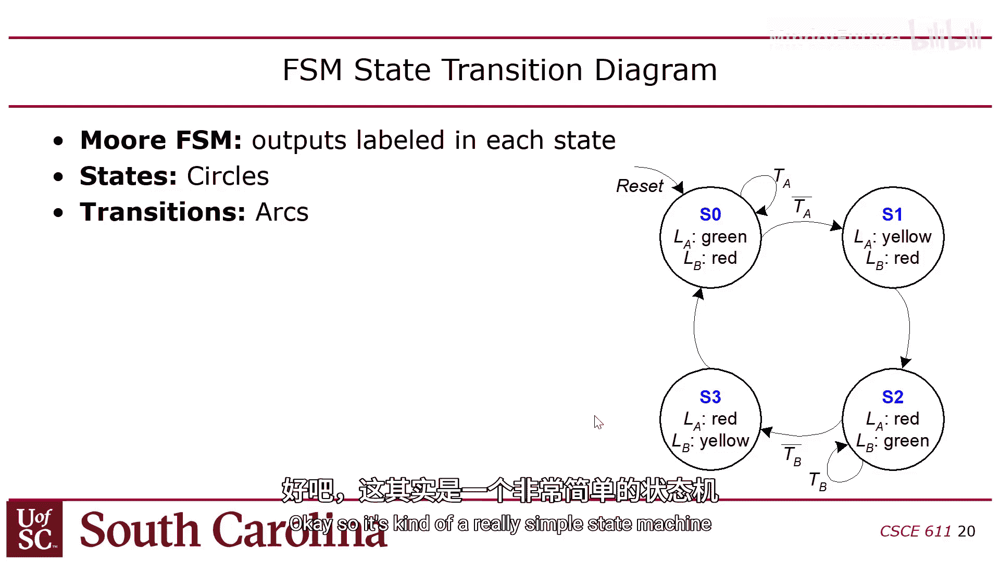

对于锁存器：
```verilog
always @(*) begin
    if (clock == 1‘b1) begin
        Q = D;
    end
end
```
在锁存器情况下，只要时钟为高电平，`D` 输入就会直接传递到 `Q` 输出。换句话说，当时钟为高时，`Q` 总是等于 `D`。当时钟为低电平时，即使 `D` 发生变化，`Q` 也不会改变。

对于触发器：
```verilog
always @(posedge clock) begin
    if (clock == 1‘b1) begin
        Q <= D;
    end
end
```
在触发器情况下，只有在时钟的上升沿，才会对 `D` 进行“快照”采样。`Q` 只会在时钟上升沿根据采样到的 `D` 值发生变化。在其他时间，`D` 的变化不会影响 `Q`。

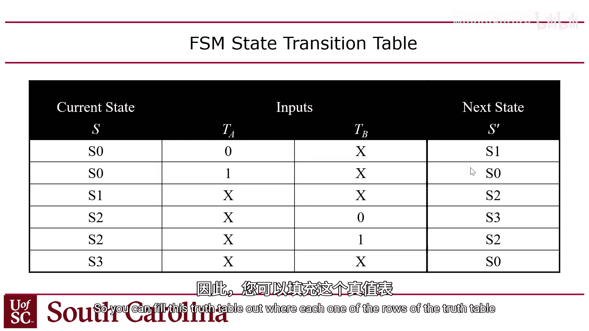

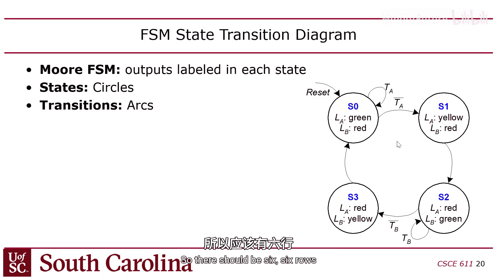


锁存器的问题在于它会使得时序分析复杂化。虽然FPGA可以支持锁存器行为，但为了最大化时钟频率，应该使用触发器。因此，在代码中应避免无意中产生锁存器行为，除非确实需要。在本课程中，应避免使用锁存器。

使用 `always_comb`（SystemVerilog）是好的做法，因为如果代码中意外产生了锁存器，编译器会报错。如果使用 `always @(*)` 并意外产生了锁存器，可能只会收到警告。

要避免产生锁存器，只需确保在所有控制路径下都对输出进行赋值。例如，为 `if` 语句添加 `else` 分支，或者在 `if` 语句之前为输出赋予一个默认值。

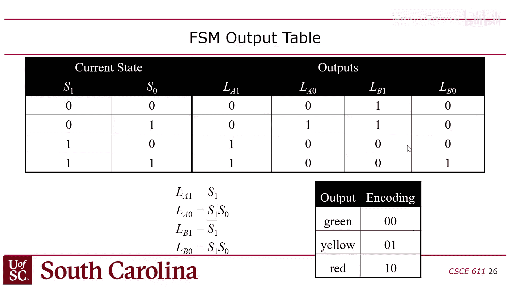

## 寄存器与状态机

上一节我们区分了锁存器和触发器。本节中我们来看看由多个触发器构成的寄存器，并引入有限状态机的概念。

多个并行的触发器共同构成一个多位触发器，通常被称为**寄存器**。但需要注意，这里存在术语混淆：
*   电路中的寄存器：指一个多位触发器，具有多位输入 `D` 和输出 `Q`。
*   汇编语言或寄存器文件中的寄存器：实际上是RAM（随机存取存储器）的一部分，用于存储数据。

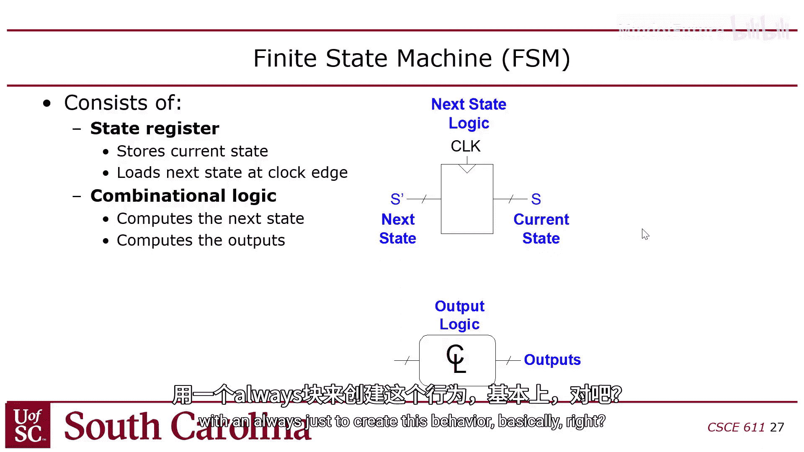

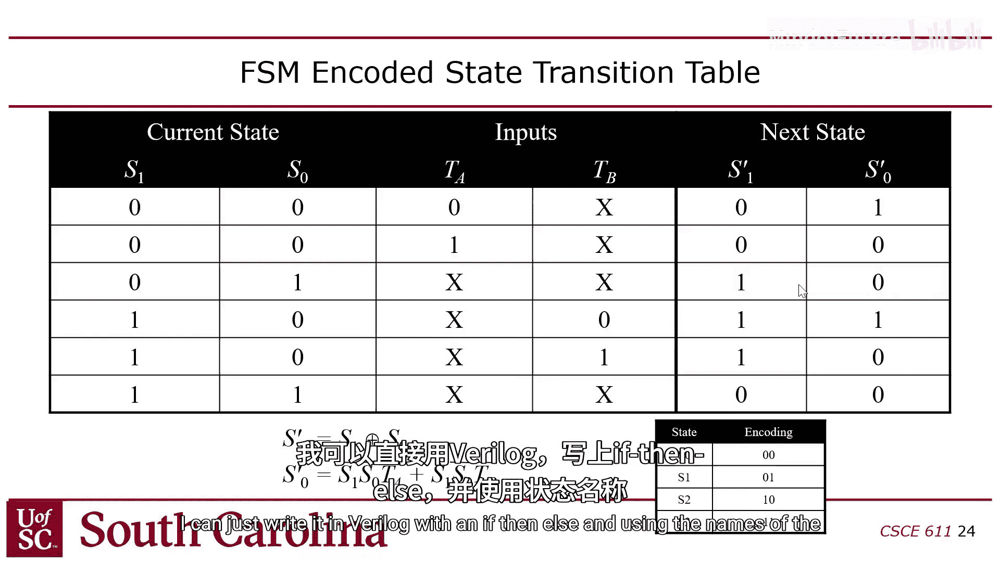

在微架构设计中提到寄存器时，通常指的是一个多位触发器。

在Verilog中创建触发器非常简单：
```verilog
always_ff @(posedge clock) begin
    Q <= D;
end
```
`always_ff` 是可选的，用于向综合器提示设计意图。可以将其放在独立的模块中，也可以内联在其他模块中。

还可以创建带使能端的触发器，只有当使能信号为高时，才会在时钟边沿更新输出；否则，输出将保持原值。复位功能也很重要，例如程序计数器需要在复位时清零。复位可以是同步的（在时钟边沿检查复位信号）或异步的（复位信号独立于时钟立即生效）。在本课程中，通常使用异步复位。

除了简单的数据存储，时序逻辑还可用于构建计数器或**有限状态机**。

有限状态机是一种引入顺序性的电路。当某个硬件操作需要分解为多个顺序执行的步骤时，就必须使用状态机。在Verilog中，所有代码都是并发执行的，但状态机可以描述这种分阶段的行为。

有限状态机由输入、输出和一组状态（代表其可以处于的操作模式）定义。状态之间的转移由当前状态和输入决定。输出可以仅取决于当前状态（摩尔机），也可以同时取决于当前状态和输入（米利机）。

## 有限状态机实例：交通灯控制器

上一节我们引入了有限状态机的概念。本节中我们通过一个交通灯控制器的具体例子来理解其设计过程。

假设一个两条道路（学术大道和勇敢大道）的交叉路口。控制器有以下输入：
*   `TA`, `TB`: 两条道路上的车辆检测传感器（二进制）。
控制器有以下输出：
*   `LA`, `LB`: 两条道路上的交通灯状态（三进制：红、黄、绿）。

我们定义四个状态：
1.  `S0`: 学术大道绿灯，勇敢大道红灯（复位状态）。
2.  `S1`: 学术大道黄灯，勇敢大道红灯。
3.  `S2`: 学术大道红灯，勇敢大道绿灯。
4.  `S3`: 学术大道红灯，勇敢大道黄灯。

状态转移规则如下：
*   在 `S0`（学术大道绿灯）：只要 `TA` 为真（有车），就保持在 `S0`；当 `TA` 为假时，转移到 `S1`。
*   在 `S1`（学术大道黄灯）：无条件在下一个时钟周期转移到 `S2`。
*   在 `S2`（勇敢大道绿灯）：只要 `TB` 为真，就保持在 `S2`；当 `TB` 为假时，转移到 `S3`。
*   在 `S3`（勇敢大道黄灯）：无条件在下一个时钟周期转移回 `S0`。

在硬件实现中，需要创建状态转移表（真值表），将当前状态和输入映射到下一个状态。然后为每个状态分配一个二进制编码（例如，`S0=00`, `S1=01`, `S2=10`, `S3=11`）。接着，可以为每个状态位（`S1`, `S0`）推导出布尔代数表达式，实现下一状态逻辑。输出逻辑也需要一个真值表，将当前状态（或当前状态加输入）映射到输出信号。

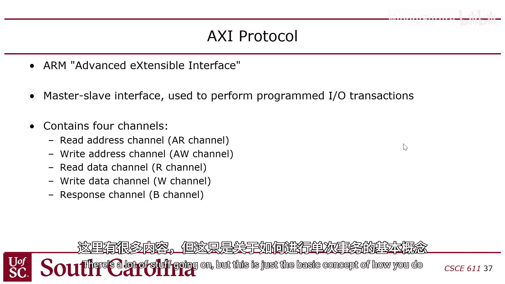

在SystemVerilog中，可以使用枚举类型来定义状态，使代码更易读和调试。状态机代码通常分为三个部分：
1.  时序逻辑部分：在时钟边沿更新当前状态。
2.  下一状态逻辑部分：组合逻辑，根据当前状态和输入计算下一个状态。
3.  输出逻辑部分：组合逻辑，根据当前状态（摩尔机）或当前状态和输入（米利机）产生输出。

## 高级实例：AXI总线接口状态机

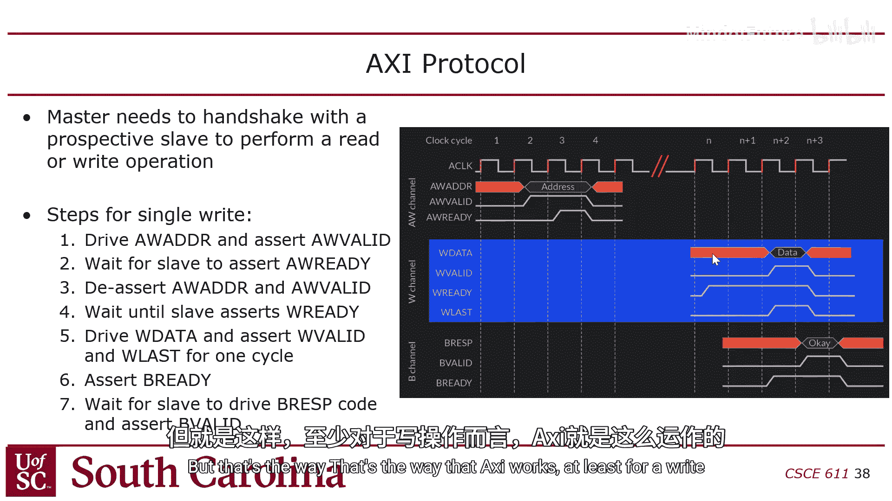

上一节我们看了一个简单的状态机例子。本节中我们来看一个更复杂、更贴近实际应用的例子：AXI总线接口控制器。

AXI（高级可扩展接口）是ARM公司提出的一种高性能片上总线协议，广泛应用于现代嵌入式系统和SoC中，用于连接处理器、内存和外设。它支持多 outstanding 请求、全双工通信和突发传输。

AXI协议包含五个独立的通道：
*   `AR`: 读地址通道
*   `AW`: 写地址通道
*   `R`: 读数据通道
*   `W`: 写数据通道
*   `B`: 写响应通道

以写事务为例，其握手过程分为多个阶段：
1.  主设备在 `AW` 通道上发出地址和 `AWVALID` 信号，并等待从设备的 `AWREADY` 响应。
2.  收到 `AWREADY` 后，主设备在 `W` 通道上发出写数据、`WVALID` 信号，并等待从设备的 `WREADY` 响应。对于单次写，同时置高 `WLAST`。
3.  主设备置高 `BREADY`，表示准备好接收响应，并等待从设备返回 `BVALID` 和响应码（如 `OKAY` 或 `ERROR`）。

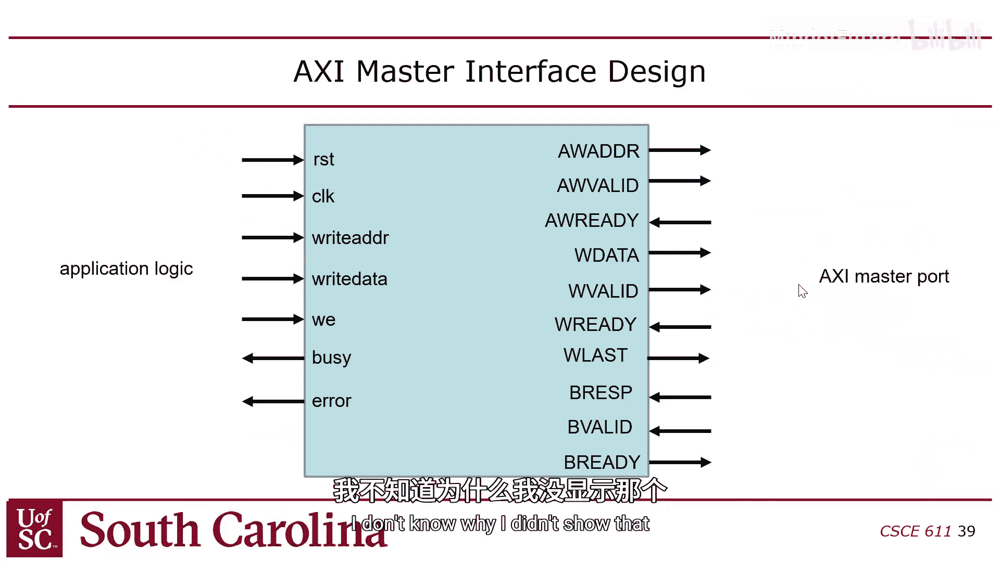

由于这些握手必须在单个时钟周期粒度内完成，速度太快无法用软件（位操作）实现，因此必须使用硬件状态机。

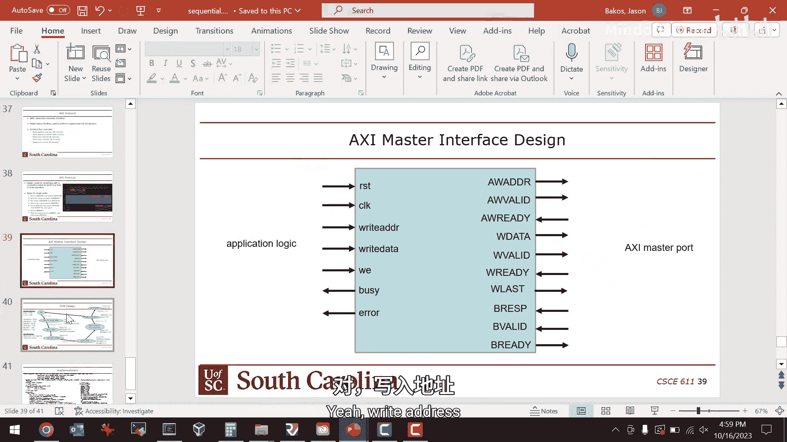

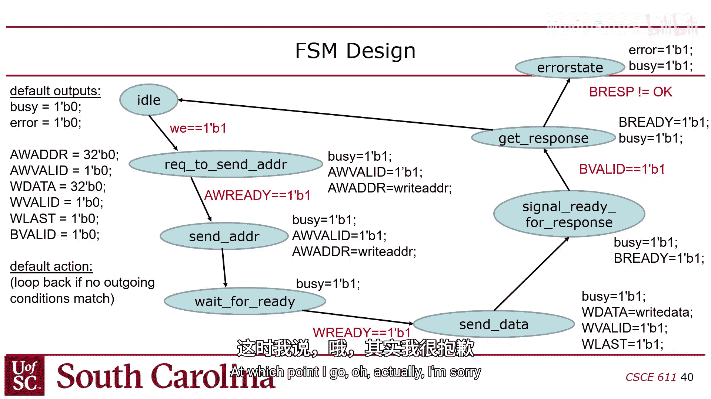

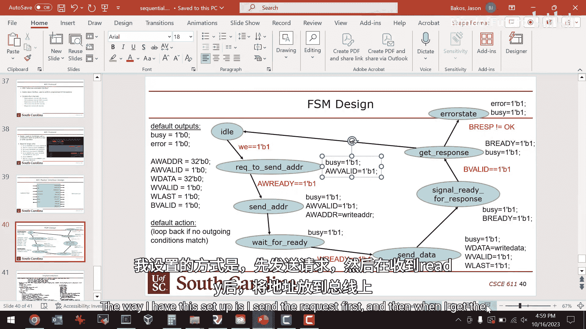

设计一个简化的AXI写接口模块，其用户侧接口非常简单：`写使能`、`写地址`、`写数据`，以及`忙`和`错误`状态信号。模块内部则需要一个状态机来管理复杂的AXI握手协议。

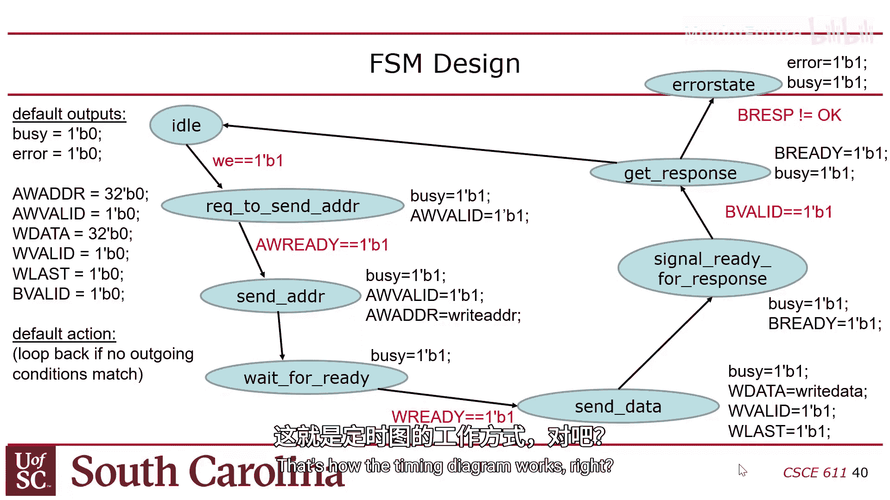

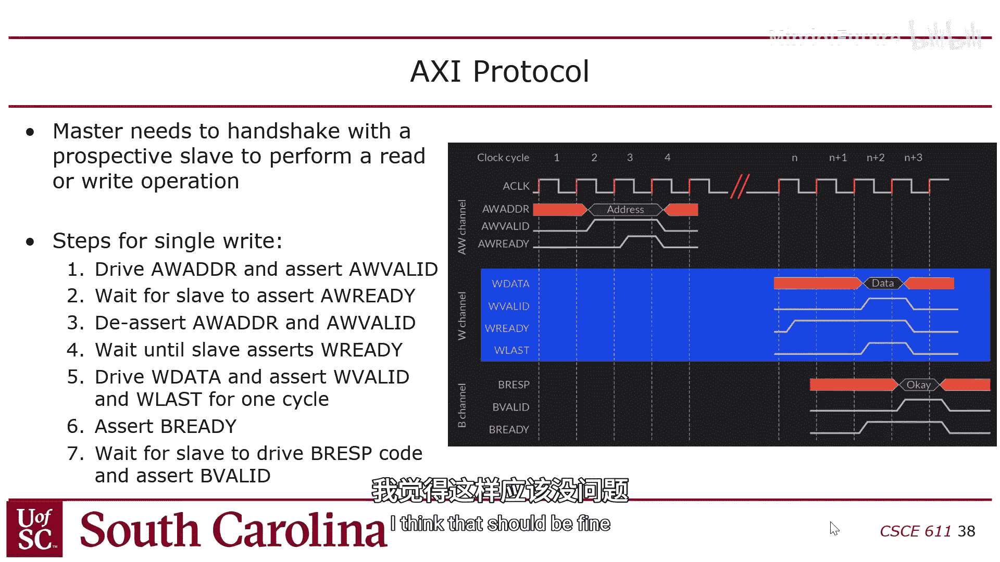

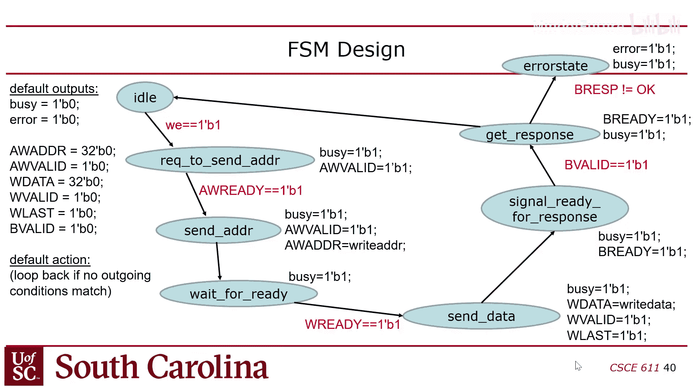

状态机可能包含以下状态：
*   `IDLE`: 空闲状态，等待用户请求。
*   `SEND_AW`: 等待并发送写地址。
*   `WAIT_WREADY`: 等待写数据通道就绪。
*   `SEND_W`: 发送写数据。
*   `WAIT_BRESP`: 等待写响应。
*   `ERROR`: 错误处理状态。

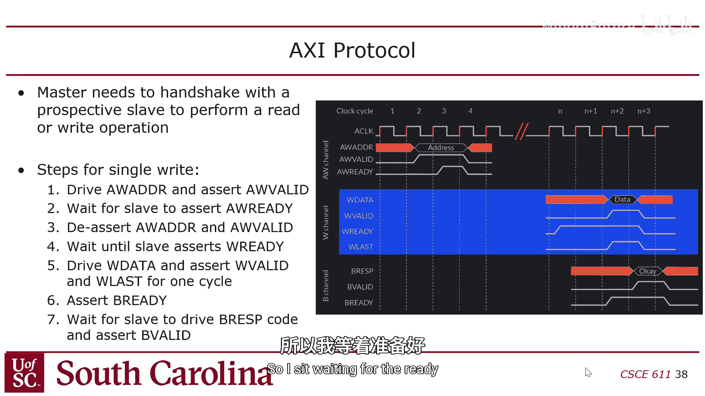

状态机根据当前状态和来自AXI总线的握手信号（如 `AWREADY`, `WREADY`, `BVALID`）决定状态转移，并在每个状态产生相应的输出信号（如 `AWVALID`, `WVALID`, `BREADY` 等）。

在SystemVerilog实现中，同样使用枚举类型定义状态，并分为时序逻辑、下一状态逻辑和输出逻辑三个部分。下一状态逻辑通常使用 `case` 语句根据当前状态和输入条件跳转，输出逻辑则根据当前状态驱动总线信号和用户状态信号。

这个例子展示了状态机如何将复杂的、多阶段的通信协议转换为可靠的硬件控制逻辑。

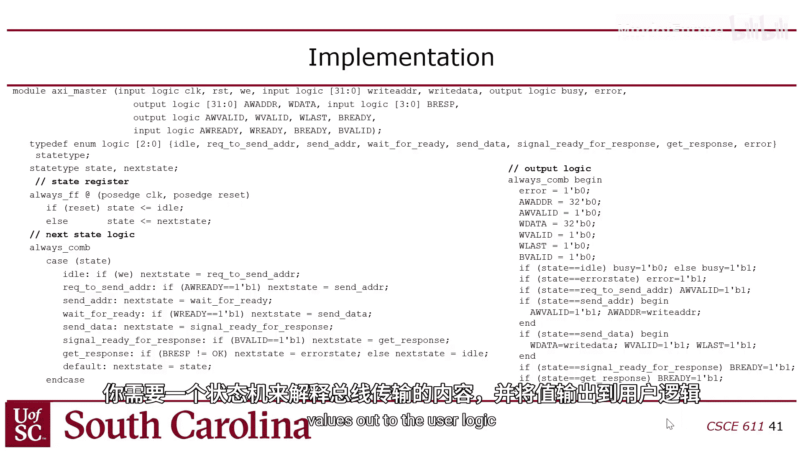

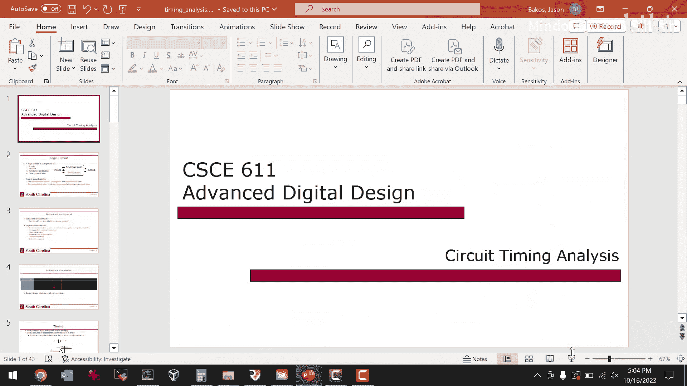

## 时序分析简介

在本课程的最后，我们简要介绍时序分析的概念，这是数字电路设计从功能正确走向性能达标的关键一步。

到目前为止，在ModelSim中的仿真只关注功能正确性，没有考虑逻辑门的实际延迟。仿真中的 `δ` 延迟是无限小的。但在现实中，逻辑门存在输入变化到输出变化之间的传播延迟。

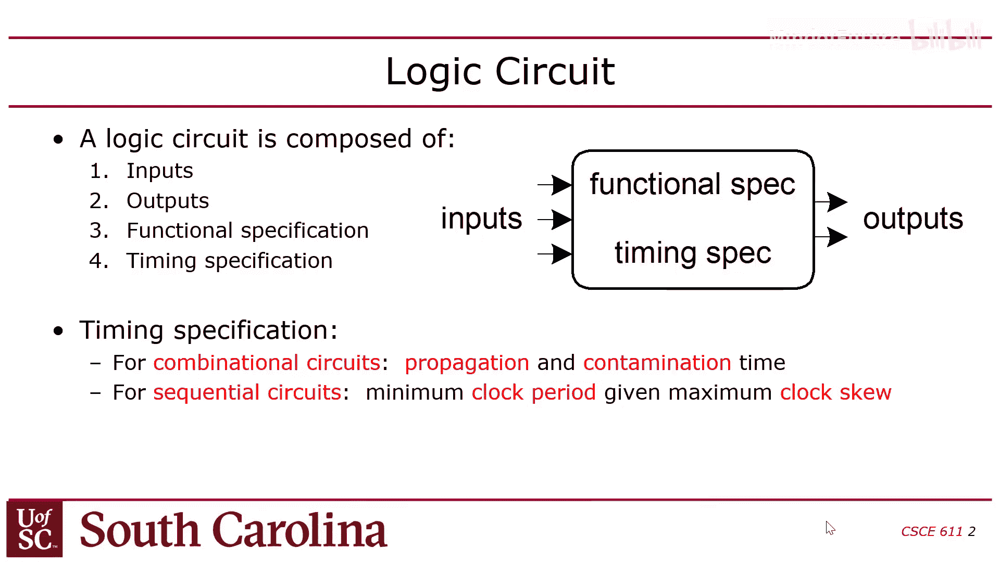

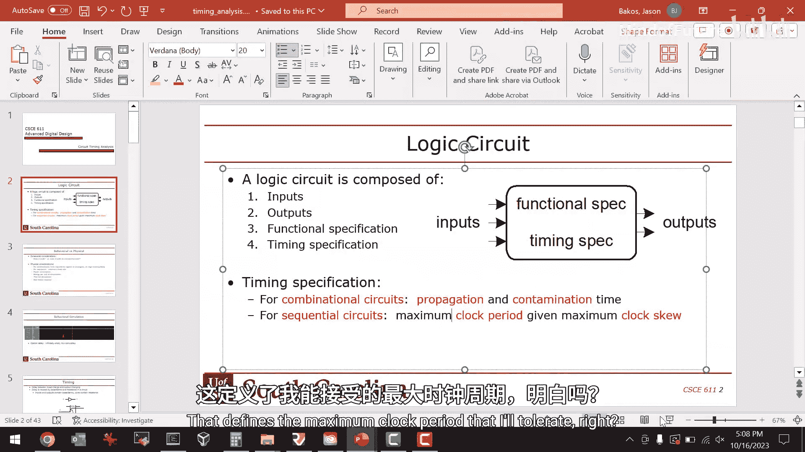

延迟的根本原因在于电阻电容（RC）电路。数字逻辑门使用电容来开关晶体管，导线本身也存在对地的寄生电容。延迟时间大致等于电阻乘以电容（RC时间常数）。导线越长，电容越大，延迟也越大。

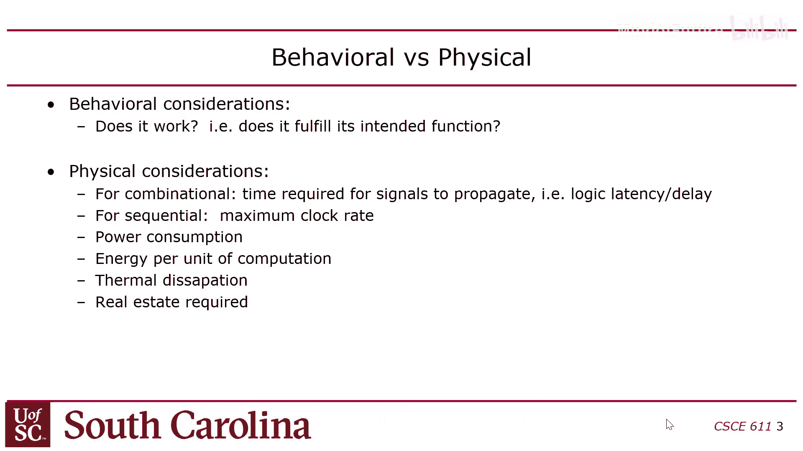

有两种关键的延迟时间：
*   **传播延迟 `t_pd`**：从输入变化到输出可能变化的最长时间。
*   **污染延迟 `t_cd`**：从输入变化到输出可能变化的最短时间。

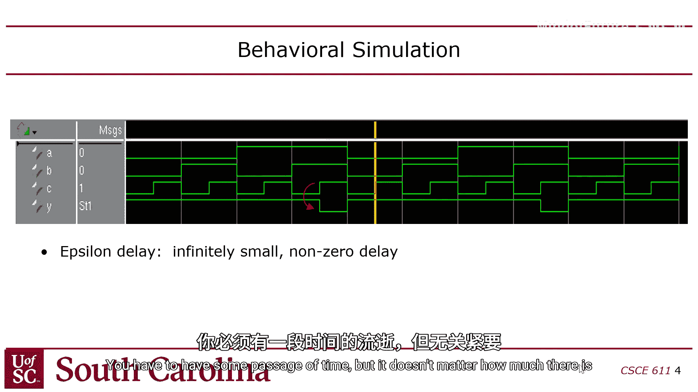

输出在 `[t_cd, t_pd]` 这个时间窗口内是不稳定的，可能发生改变。延迟受路径长度、负载（扇出）、温度等因素影响。

对于时序电路，最关键的是数据路径的延迟。数据路径是指从一个触发器的输出，经过组合逻辑，到达另一个触发器输入的路径。整个电路所能运行的最小时钟周期（最大时钟频率）受到最长的数据路径延迟的限制。这个延迟必须小于时钟周期减去触发器的建立时间等余量。

在FPGA设计中，综合和实现工具（如Quartus）会根据提供的时序约束文件（如SDC文件），尝试进行布局布线，在满足时钟频率要求的前提下，优化逻辑和走线。如果数据路径延迟过长，无法满足约束，设计就会失败或性能下降。这就是为什么需要将复杂操作（如单周期CPU）流水线化，将长路径拆分为多个时钟周期来完成的原因。

---

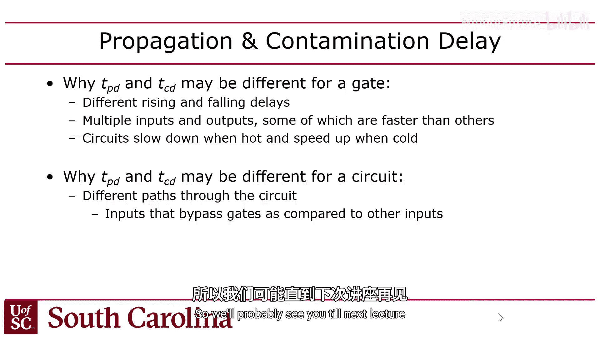

本节课中我们一起学习了时序逻辑的核心知识。我们明确了时序逻辑具有记忆功能，其输出取决于输入历史。我们深入探讨了在Verilog中实现记忆的两种方式及其对应的锁存器和触发器，并强调了避免意外锁存器的重要性。我们介绍了寄存器作为多位触发器的概念，并引入了强大的有限状态机设计方法，用于描述顺序性硬件行为。通过交通灯控制器和实际的AXI总线接口控制器例子，我们看到了状态机如何将复杂协议转换为可靠的硬件逻辑。最后，我们简要接触了时序分析的概念，理解了实际电路中延迟的来源以及时钟频率与路径延迟之间的关系，为后续深入学习性能优化打下了基础。