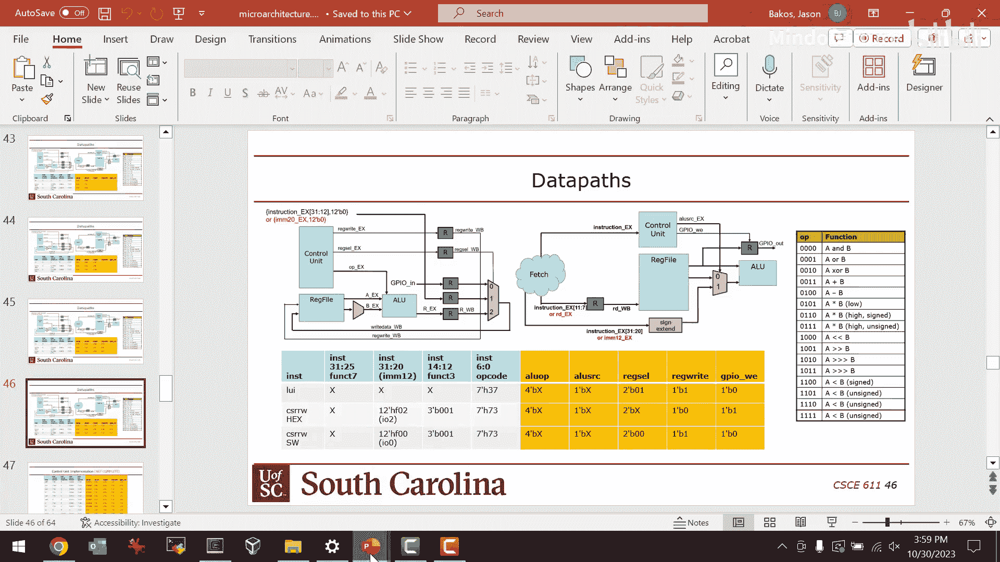
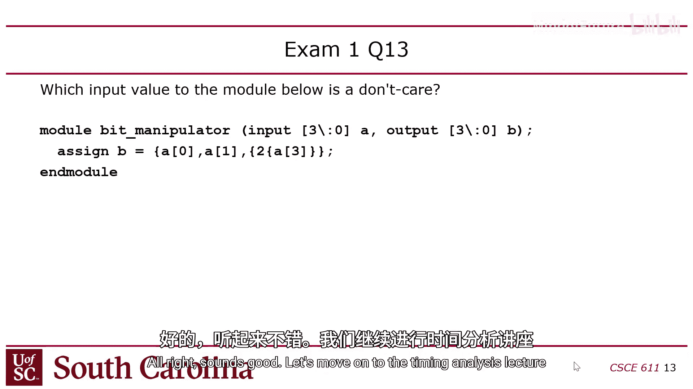
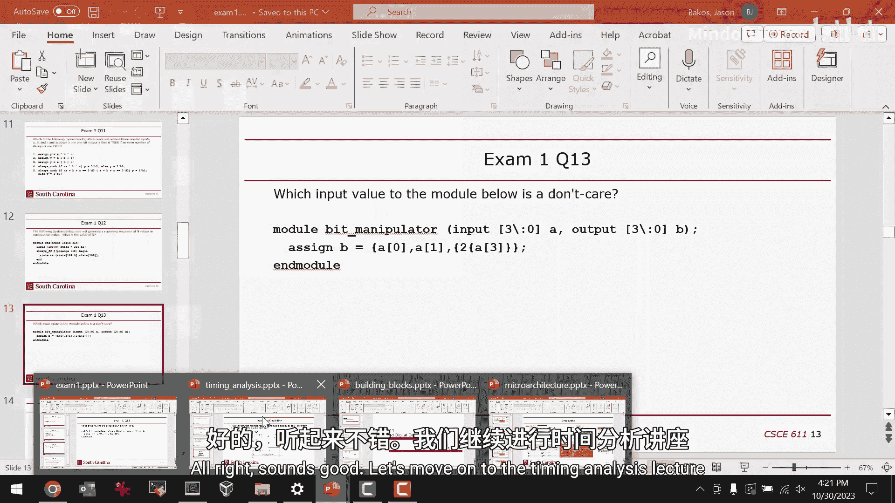
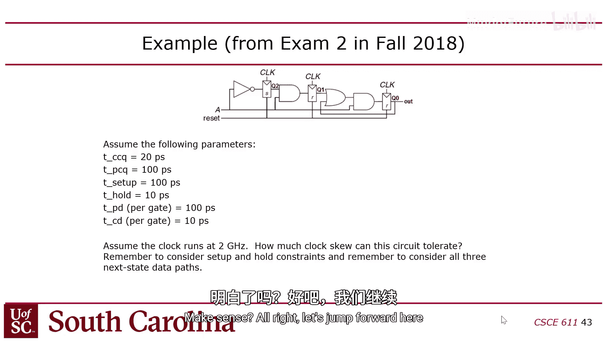
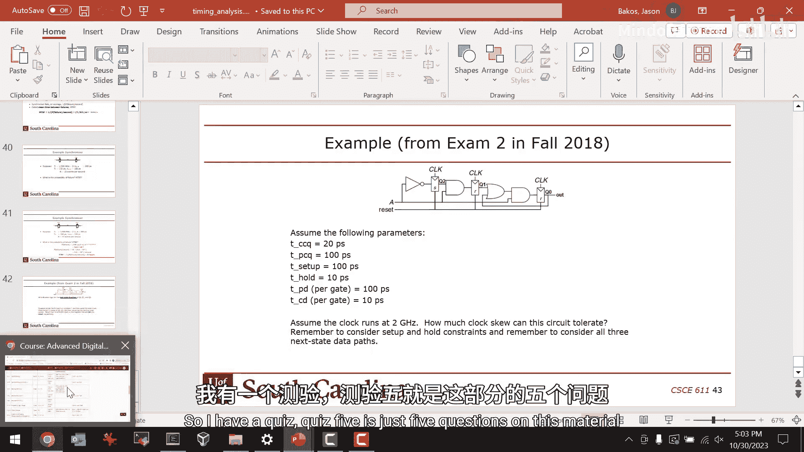
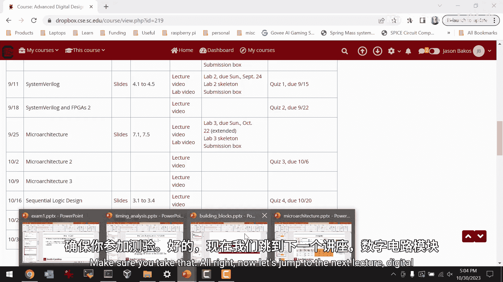
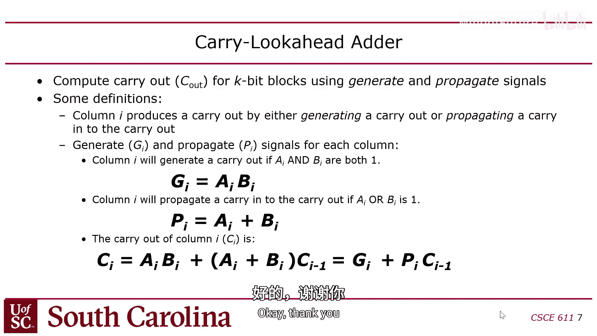

# 012：时序分析（第二部分）与数字构建模块



在本节课中，我们将继续学习时序分析，并开始探讨数字系统中的基本构建模块，特别是加法器。我们将了解如何确保电路满足时序约束，以及如何设计更高效的加法器。

## 时序分析回顾

上一节我们介绍了逻辑门延迟、建立时间和保持时间的概念。本节中，我们来看看如何将这些概念应用于包含寄存器的实际数据路径。

在CPU设计中，逻辑路径通常始于一个寄存器（或内存单元），并终于另一个寄存器。寄存器具有**建立时间**和**保持时间**的要求。这意味着，在时钟边沿到来之前和之后的一小段时间内，寄存器的输入必须保持稳定。这个时间段被称为**孔径时间**。

如果数据在孔径时间内发生变化，寄存器可能会进入**亚稳态**，其输出会在0和1之间振荡一段时间，然后才稳定到正确的值。为了避免亚稳态，我们必须遵守**动态约束**。

## 时序约束公式

为了满足动态约束，电路必须满足两个关键的不等式。

**建立时间约束**确保数据在下一个时钟边沿到来之前，有足够的时间通过逻辑传播并稳定下来。其公式为：
```
T_c >= t_pcq + t_pd + t_setup
```
其中：
*   `T_c` 是时钟周期。
*   `t_pcq` 是寄存器从时钟到输出的传播延迟。
*   `t_pd` 是组合逻辑的传播延迟（最长路径）。
*   `t_setup` 是寄存器的建立时间要求。





这个公式可以重新排列，以确定逻辑路径允许的最大延迟：
```
t_pd <= T_c - t_setup - t_pcq
```

**保持时间约束**确保数据在时钟边沿之后不会变化得太快，从而不会干扰当前锁存的值。其公式为：
```
t_ccq + t_cd >= t_hold
```
其中：
*   `t_ccq` 是寄存器从时钟到输出的污染延迟。
*   `t_cd` 是组合逻辑的污染延迟（最短路径）。
*   `t_hold` 是寄存器的保持时间要求。

这个公式可以重新排列，以确定逻辑路径所需的最小延迟：
```
t_cd >= t_hold - t_ccq
```

如果逻辑路径的延迟太短，违反了保持时间约束，通常可以通过插入缓冲器来增加延迟。

## 时钟偏移的影响

在实际芯片中，时钟信号到达不同寄存器的时间可能存在差异，这称为**时钟偏移**。时钟偏移会影响时序分析。

*   **对于建立时间约束**：最坏情况是源寄存器时钟较晚，而目的寄存器时钟较早。这减少了数据可用于传播的有效时间。因此，建立时间约束需加入最大正偏移 `t_skew`：
    ```
    T_c >= t_pcq + t_pd + t_setup + t_skew
    ```
*   **对于保持时间约束**：最坏情况是源寄存器时钟较早，而目的寄存器时钟较晚。这可能导致数据过快到达目的寄存器。因此，保持时间约束需加入最大正偏移 `t_skew`：
    ```
    t_ccq + t_cd >= t_hold + t_skew
    ```

## 输入同步与亚稳态

对于来自外部（如按钮、网络数据）的异步输入，我们无法控制其变化时间，因此它们可能在寄存器的孔径时间内发生变化，导致亚稳态。

为了降低亚稳态传播到系统内部的风险，我们使用**同步器**。一个典型的同步器由两个级联的寄存器构成。第一个寄存器（同步级）可能进入亚稳态，但只要它在第二个寄存器的建立时间之前稳定下来，第二个寄存器的输出就是稳定的。

同步器失效的平均时间可以通过概率模型估算。公式涉及输入变化频率、时钟周期以及器件的技术参数（如时间常数 τ）。

## 数字构建模块：加法器

现在，让我们转向数字系统的基本构建模块。首先从加法器开始。

最基本的加法器是**行波进位加法器**。它由多个1位全加器串联而成，每个全加器的进位输出连接到下一个全加器的进位输入。

行波进位加法器的主要问题是速度慢。其关键路径从最低位的进位输入开始，穿过所有全加器，到达最高位的进位输出。对于n位加法器，总延迟大致为：
```
总延迟 ≈ n × 单个全加器的进位延迟
```

为了构建更快的加法器，我们使用**超前进位加法器**。其核心思想是提前计算出每一位的进位，而不是等待进位逐位传递。

这引入了两个信号：
*   **生成**：`G_i = A_i · B_i`。如果本位的两个输入都为1，则无论进位输入如何，都会**生成**一个进位输出。
*   **传播**：`P_i = A_i + B_i`。如果本位的两个输入至少有一个为1，则进位输入会被**传播**到进位输出。



利用这两个信号，第i位的进位输出 `C_i` 可以表示为：
```
C_i = G_i + P_i · C_{i-1}
```
通过递归展开这个公式，可以直接用原始的输入位 `A`、`B` 和初始进位 `C_in` 来表达每一位的进位，从而极大地提高了加法速度。





## 总结

本节课中我们一起学习了：
1.  **时序约束**：深入理解了建立时间和保持时间约束的公式及其物理意义，这是保证数字系统可靠运行的基础。
2.  **时钟偏移**：了解了时钟信号到达时间不一致对时序分析的影响，并学会了如何在约束公式中考虑时钟偏移。
3.  **亚稳态与同步器**：认识了异步输入带来的亚稳态风险，以及如何使用同步器来降低该风险。
4.  **加法器设计**：回顾了行波进位加法器的工作原理及其速度瓶颈，并引入了超前进位加法器的基本概念，通过生成和传播信号来并行计算进位，从而实现更快的加法运算。



这些知识是设计高性能、高可靠性数字系统的关键。在接下来的课程中，我们将继续探讨其他重要的数字构建模块和优化技术。