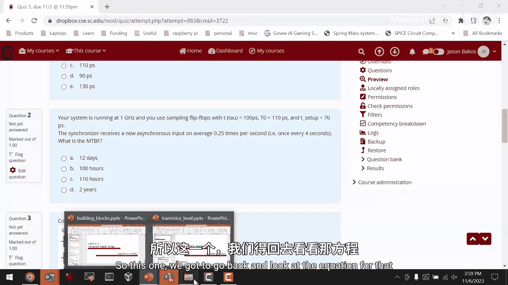
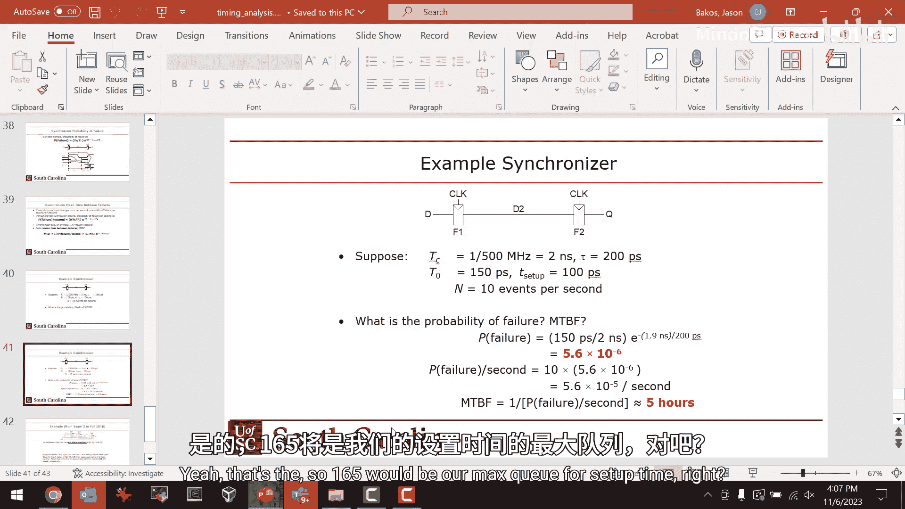
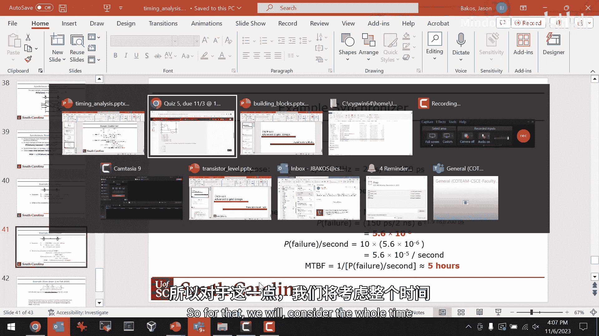
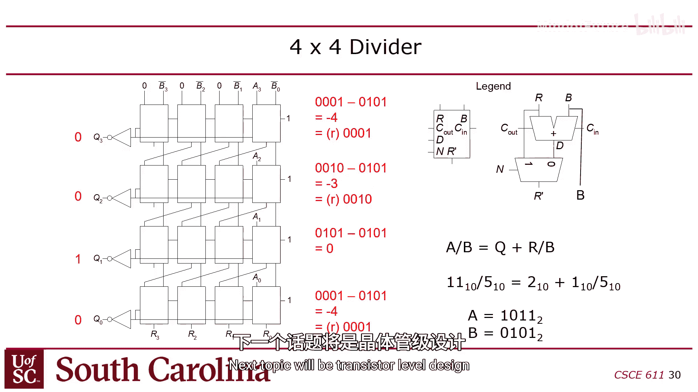

# 013：数字构建模块

在本节课中，我们将学习数字系统中的几种核心构建模块，包括加法器、减法器、比较器、移位器、乘法器和除法器。我们将重点分析它们的结构、工作原理和性能特点，特别是时序分析在其中的应用。

上一节我们介绍了时序分析的基本概念，本节中我们来看看如何将这些概念应用到具体的数字模块设计中。

## 时序分析测验回顾

本次测验包含五个关于时序分析的问题。

以下是第一个问题。

**问题一：关键路径与时延计算**

考虑以下电路和传播时延表，问题是计算电路的关键路径传播时延。

计算传播时延时，需要关注最坏情况下的路径。该电路基本没有扇出，所有门输出仅连接到一个输入，除了一个输出连接到同一门的两个输入。这使得分析相对简单，因为每个输入到输出基本只有一条路径。

由于所有门的时延不同，可能需要计算多条路径的时延。然而，输入D和E显然不在关键路径上，因为D跳过了A、B、C经过的一个门，E跳过了F、G经过的一个门。因此，实际上只需要计算从A/B/C到Y的路径和从F/G到Y的路径。

*   **A/B/C 到 Y 的路径**：经过一个三输入与非门（30 ps）、一个两输入与非门（20 ps）、一个两输入或非门（30 ps）和一个两输入与非门（20 ps）。总时延为 30 + 20 + 30 + 20 = 100 ps。
*   **F/G 到 Y 的路径**：经过一个两输入与门（30 ps）、一个两输入或非门（30 ps）、另一个两输入或非门（30 ps）和一个两输入与非门（20 ps）。总时延为 30 + 30 + 30 + 20 = 110 ps。

取两者中的最大值，电路的关键路径传播时延 **T0 = 110 ps**。

**问题二：平均故障间隔时间计算**

系统时钟频率为1 GHz，使用采样建立时间 τ = 100 ps 的触发器。T0 = 110 ps，T_setup = 70 ps。同步器平均每4秒（即0.25次/秒）接收一次新的异步输入。求平均故障间隔时间。

平均故障间隔时间的计算公式为：

**MTBF = Tc / (N * T0 * e^(-(Tc - T_setup)/τ))**

其中：
*   Tc 是时钟周期（1 GHz对应 1 ns 或 1000 ps）。
*   N 是每秒切换次数（0.25）。
*   T0 是关键路径时延（110 ps）。
*   T_setup 是建立时间（70 ps）。
*   τ 是技术参数（100 ps）。

代入计算后，得到平均故障间隔时间约为 **110小时**。

**问题三：时钟偏移容限计算**

考虑给定电路和时序参数，假设时钟频率为4 GHz，计算电路能容忍的时钟偏移。

时钟偏移会影响建立时间和保持时间约束。

*   **建立时间约束**：最大路径时延（T_PCQ + 逻辑时延 + T_setup + 时钟偏移）必须小于等于时钟周期 Tc。
    *   Tc = 1 / 4 GHz = 250 ps。
    *   T_PCQ = 30 ps。
    *   逻辑时延（经过3个门）：3 * 15 ps = 45 ps。
    *   T_setup = 10 ps。
    *   设时钟偏移为 S。
    *   不等式：30 + 45 + 10 + S ≤ 250 => S ≤ 165 ps。

*   **保持时间约束**：最小路径时延（T_CCQ + 逻辑污染时延 - 时钟偏移）必须大于等于保持时间 T_hold。
    *   T_CCQ = 20 ps。
    *   逻辑污染时延（最短路径经过1个门）：10 ps。
    *   T_hold = 30 ps。
    *   不等式：20 + 10 - S ≥ 30 => S ≤ 0 ps。

对于保持时间，电路无法容忍任何正时钟偏移。因此，电路能容忍的时钟偏移为 **0 ps**（由保持时间约束决定）。

**问题四：多比特加法器时序分析**

设计一个由两个全加器构成的2位加法器，输入输出均有寄存器，在一个时钟周期内完成加法。计算最大时钟频率时，需同时考虑建立时间和保持时间约束，方法同问题三。

**问题五：保持时间约束验证**

考虑给定电路和时序参数，时钟频率1 GHz。验证电路是否满足保持时间约束。

保持时间约束与时钟周期无关。需要检查最小路径时延（T_CCQ + 逻辑污染时延 - 时钟偏移）是否大于等于 T_hold。
*   T_CCQ = 5 ps。
*   逻辑污染时延（经过一个与门和一个或门）：25 ps + 30 ps = 55 ps。
*   给定时钟偏移 S = 10 ps。
*   T_hold = 50 ps。
*   计算：5 + 55 - 10 = 50 ps。该值等于（而非大于）T_hold。

由于约束要求 **严格大于**（>），而计算结果等于50 ps，因此该电路 **不满足** 保持时间约束。

## 加法器设计

上一节我们回顾了时序分析，本节中我们来看看几种重要的加法器设计。

### 行波进位加法器

行波进位加法器将多个全加器串联，每个全加器负责一个比特位的加法，其进位输出连接到下一个全加器的进位输入。

主要问题是速度慢，总传播时延与位数成正比：
**T_ripple ≈ N * T_FA**
其中 T_FA 是一个全加器的时延。

### 超前进位加法器

为了打破进位传递的长链，超前进位加法器为每个全加器生成“传播”和“生成”信号：
*   **P_i = A_i XOR B_i** （如果A_i, B_i能传播进位）
*   **G_i = A_i AND B_i** （如果A_i, B_i能生成进位）

则进位 C_i 可以表示为：
**C_i = G_{i-1} OR (P_{i-1} AND C_{i-1})**
通过递归展开，可以用低位的所有 P 和 G 信号直接计算高位的进位，而无需等待进位逐级传递。

但直接为所有位实现完全的超前进位逻辑会导致门电路输入过多，不具可扩展性。因此，通常采用分层结构：先计算小组（如4位一组）内的超前进位，再在组间使用类似的逻辑传递进位。

其时延公式大致为：
**T_CLA ≈ T_PG + (N/K - 1) * T_AND-OR + T_FA_ripple**
其中 K 是小组大小。时延随位数 N 线性增长，但系数比行波进位小。

### 前缀加法器

前缀加法器是速度最快的加法器结构之一。它也使用传播和生成信号，但以不同的方式组织计算。

核心思想是：通过合并相邻的、更小的位组（P,G）信号，来计算更大位组的（P,G）信号。计算过程组织成树状结构（前缀树），每合并一次增加约2级门时延。

总时延与位数的对数成正比：
**T_prefix ≈ T_PG + log₂(N) * T_merge + T_XOR**
对于大规模加法器，前缀加法器性能最优。

以下是三种32位加法器的性能对比示例（假设条件）：
*   行波进位加法器：9.6 ns
*   超前进位加法器（4位块）：3.4 ns
*   前缀加法器：1.2 ns

## 其他数字构建模块

上一节我们深入探讨了各种加法器，本节中我们来看看减法器、比较器、移位器、乘法器和除法器。

### 减法器

减法器可以通过加法器实现。对减数 B 取二进制补码（按位取反后加1），然后与 A 相加即可。
**A - B = A + (~B + 1)**
巧妙之处在于，可以将“加1”操作通过加法器的进位输入 Cin 设置为1来实现，无需额外电路。

### 比较器

*   **相等比较**：对两个数的每一位进行异或操作，然后将所有结果进行与操作。若所有位都相等，则输出为1。
    *   **Equality = (A[0] XNOR B[0]) AND (A[1] XNOR B[1]) AND ...**
*   **小于比较**：可以通过减法实现。计算 A - B，如果结果为负（符号位为1），则 A < B。需要注意有符号数的情况。

### 移位器

*   **桶形移位器**：可以单周期内移动任意位数。其核心是一个多路选择器阵列，每个输出位可以从任何一个输入位中选择。一个 N 位桶形移位器需要 N 个 N:1 多路选择器，硬件开销较大。
*   **移位寄存器**：由一系列触发器串联而成，每个时钟周期将数据移动一位。可以实现串行到并行的转换。若加入并行加载功能，则可初始化为任意值后再进行移位。

移位操作也可用于乘除法：
*   左移1位等价于乘以2。
*   右移1位等价于除以2（向下取整）。
但这仅限于2的幂次。

### 乘法器

二进制乘法比十进制简单。基于“移位相加”原理：
将被乘数根据乘数的每一位进行移位（如果该位为1），然后将所有移位后的结果相加。

以下是实现方式之一：
使用与门阵列生成部分积（被乘数与乘数每一位相与），然后用加法器阵列（如Wallace树）将所有部分积相加。乘法器硬件规模较大，但它是组合逻辑，不涉及条件判断。

### 除法器

除法是最复杂的运算之一，通常基于“恢复余数法”：
1.  将除数与当前部分被除数（初始为被除数的高位）对齐。
2.  尝试相减。
3.  如果结果为负，说明减多了，**恢复**原来的部分被除数，并在商中对应位置0。
4.  如果结果非负，保留相减后的结果作为新的余数，并在商中对应位置1。
5.  从被除数中移入下一位，重复步骤2-4。

由于需要尝试相减并根据结果决定是否恢复，除法器包含反馈和决策逻辑，硬件实现复杂且速度慢。因此，许多早期处理器没有硬件除法单元。

## 总结

本节课中我们一起学习了数字系统的核心构建模块。我们从时序分析测验入手，复习了关键路径、MTBF、时钟偏移容限和保持时间验证。然后，我们深入探讨了行波进位、超前进位和前缀三种加法器，分析了它们的结构、工作原理和性能优劣。最后，我们介绍了减法器、比较器、移位器、乘法器和除法器的基本实现原理，了解了乘法器通过“移位相加”实现，而除法器则基于复杂的“恢复余数”过程，这解释了为什么除法在硬件中更为昂贵和少见。掌握这些模块的设计与特性对于构建高效、可靠的数字系统至关重要。