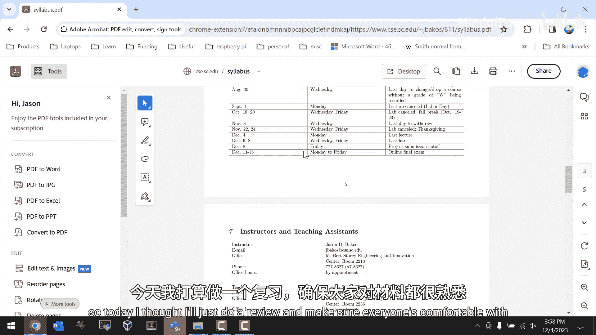
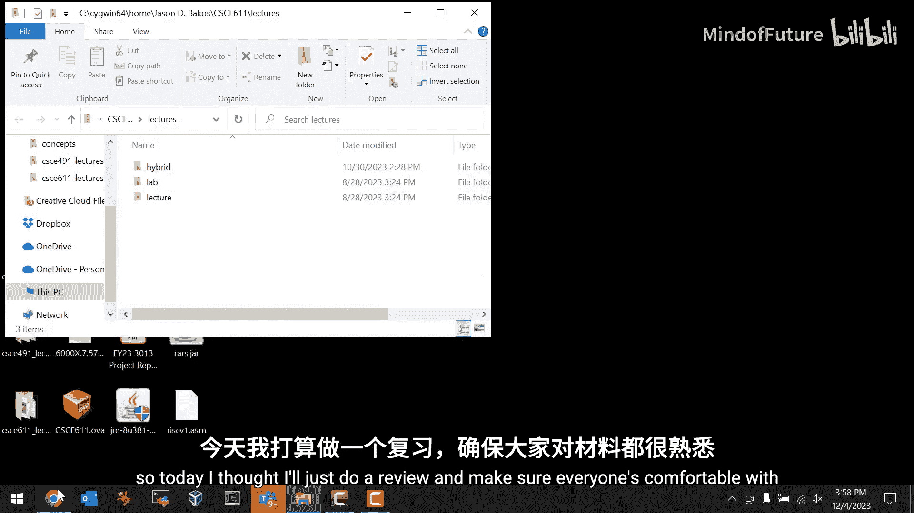
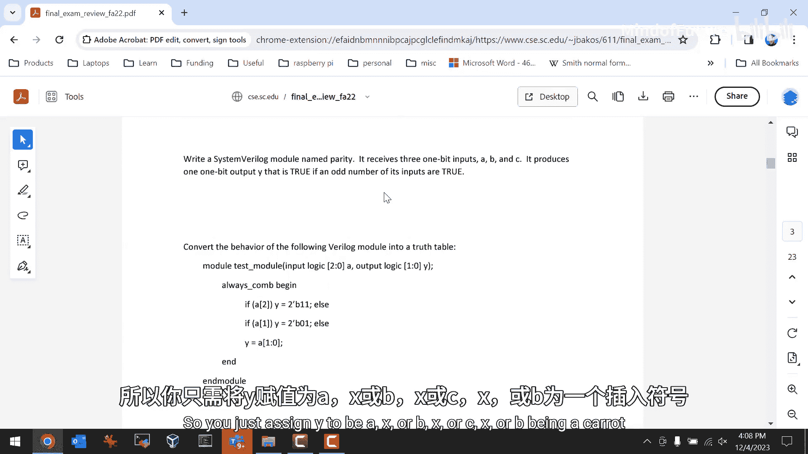
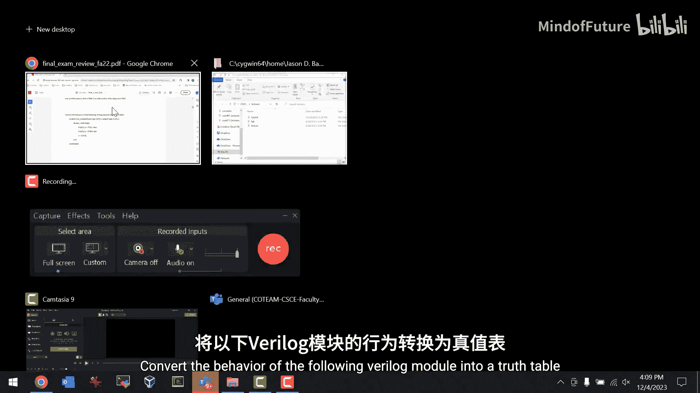
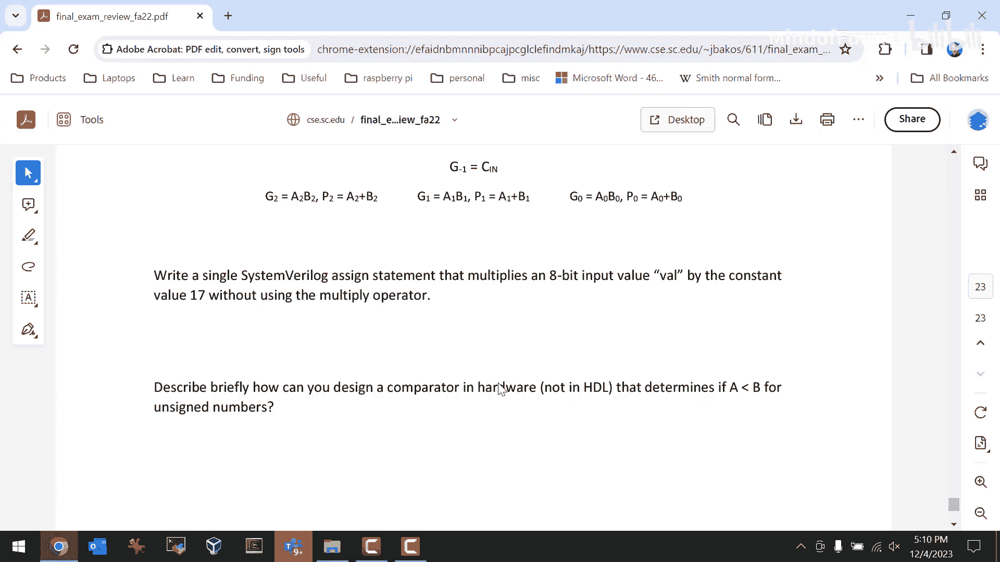

# 017：期末考试复习





在本节课中，我们将对课程的核心内容进行一次全面的复习，涵盖RISC-V ISA、SystemVerilog、流水线微架构、时序分析、数字逻辑构建模块等主题。我们将通过分析示例问题来巩固理解，确保大家为期末考试做好准备。

## RISC-V ISA与汇编

上一节我们介绍了课程的整体结构，本节中我们来看看RISC-V指令集架构相关的复习要点。

考虑以下指令序列及其对应的内存地址（假设代码在字节寻址的指令内存中运行，地址以4递增）。





```
地址（十六进制）       指令
400000                li x1, 5
400004  label1:       addi x1, x1, -1
400008                bge x1, x0, label1
40000C                nop
400010                j label2
400014  label2:       jr x0
```

以下是关于伪指令和程序执行的分析：

1.  **地址400000处的指令是伪指令吗？** 是的。`li`（立即数加载）是伪指令。它会被翻译为 `addi x1, x0, 5`，因为寄存器x0的值恒为0。
2.  **地址400010处的指令是伪指令吗？** 是的。`j`（跳转）是伪指令。在RISC-V中，它被翻译为 `jal x0, label2`，即将链接寄存器设置为x0（不保存返回地址）的跳转并链接指令。
3.  **地址400014处的指令是伪指令吗？** 不是。`jr`（跳转至寄存器）是真实指令 `jalr x0, x0, 0` 的别名。
4.  **地址400008处的分支指令会被执行多少次？** 6次。循环体（`addi`）执行5次（x1从5递减到1）。第6次执行`bge`时，x1为0，条件`x1 >= x0`成立，分支再次被采取。第7次时x1变为-1，条件不成立，分支不被采取，循环结束。
5.  **假设分支/跳转导致一个周期的停顿，这段代码的取指序列是什么？** 序列为：0, 4, 8, C, 4, 8, C, 4, 8, C, 4, 8, C, 4, 8, C, 10, 14, 18。每次分支被采取后，下一条指令（地址C）被取出但作为停顿无效化。最后一次分支不采取，顺序执行到`j`指令，`j`之后同样有一个停顿周期。

## SystemVerilog 硬件描述语言

上一节我们回顾了指令集，本节中我们来看看如何用SystemVerilog描述硬件。

**问题：找出以下模块中的问题。**
```systemverilog
module example(input logic [2:0] a, b, output logic [3:0] c);
    always_comb begin
        assign c = a + b; // 错误：不能在always块内使用assign
    end
endmodule
```
**解答：**
1.  `assign` 语句不应在 `always_comb` 过程块内使用。
2.  位宽不匹配：`a`和`b`是3位，相加结果最多4位，与4位的`c`匹配。但若此`assign`在块外，则正确。原代码主要错误是`assign`在`always_comb`内。

**问题：当输入 `a = 4‘b1011` 时，以下代码将信号`b`设置为何值？**
```systemverilog
module scramble(input logic [3:0] a, output logic [3:0] b);
    assign b = {a[0], a[1], a[2], a[3]};
endmodule
```
**解答：** `b` 的值为 `4‘b1100`。代码将`a`的位顺序反序。

**问题：编写一个名为 `parity` 的模块，接收三个1位输入 `a, b, c`，产生一个1位输出 `y`，当奇数个输入为真时 `y` 为真。**
```systemverilog
module parity(input logic a, b, c, output logic y);
    assign y = a ^ b ^ c; // 异或操作
endmodule
```

**问题：将以下Verilog模块的行为转换为真值表。**
```systemverilog
module mystery(input logic [2:0] a, output logic [1:0] y);
    if (a[2])
        y = 2‘b11;
    else if (a[1])
        y = 2‘b10;
    else
        y = 2‘b00;
endmodule
```
**解答：** 这是一个优先级编码逻辑。

| a[2:0] | y[1:0] | 说明 |
| :--- | :--- | :--- |
| 000 | 00 | `a[2]`和`a[1]`均为0，执行`else` |
| 001 | 00 | `a[2]`为0，`a[1]`为0，执行`else` |
| 010 | 10 | `a[2]`为0，`a[1]`为1，执行`else if` |
| 011 | 10 | `a[2]`为0，`a[1]`为1，执行`else if` |
| 100 | 11 | `a[2]`为1，执行`if` |
| 101 | 11 | `a[2]`为1，执行`if` |
| 110 | 11 | `a[2]`为1，执行`if` |
| 111 | 11 | `a[2]`为1，执行`if` |

**问题：阻塞赋值与非阻塞赋值的区别是什么？**
*   **阻塞赋值 (`=`)**：在`always`块中按顺序立即执行，赋值语句完成后才执行下一条语句。常用于组合逻辑建模。
*   **非阻塞赋值 (`<=`)**：在`always`块中所有语句同时计算，在时间步结束时才统一更新赋值。用于时序逻辑建模，特别是寄存器。

**问题：以下代码在输入`in`和输出`D`之间引入了多少个时钟周期的延迟？**
```systemverilog
always_ff @(posedge clk) begin
    A = in;     // 阻塞赋值
    B <= A;     // 非阻塞赋值
    C <= B;     // 非阻塞赋值
    D = C;      // 阻塞赋值
end
```
**解答：** 2个周期延迟。`A = in`立即更新，`B <= A`在周期结束时捕获当前的`A`（即`in`）。下一个周期，`C <= B`捕获上一个周期的`B`（即`in`），`D = C`立即捕获当前的`C`（即上一周期的`in`）。因此，`in`的变化在两个周期后出现在`D`。

## 流水线微架构

上一节我们讨论了SystemVerilog编码，本节中我们聚焦于CPU流水线的具体实现。

**问题：为三阶段流水线编写SystemVerilog代码片段以实现符号扩展块。**
```systemverilog
// 假设 inst_EX 是来自指令解码的32位指令，imm_src 控制扩展类型
// 输出 sign_extended_imm
logic [31:0] sign_extended_imm;
always_comb begin
    case (imm_src)
        `I_TYPE: sign_extended_imm = {{20{inst_EX[31]}}, inst_EX[31:20]};
        `S_TYPE: sign_extended_imm = {{20{inst_EX[31]}}, inst_EX[31:25], inst_EX[11:7]};
        `B_TYPE: sign_extended_imm = {{20{inst_EX[31]}}, inst_EX[7], inst_EX[30:25], inst_EX[11:8], 1‘b0};
        `U_TYPE: sign_extended_imm = {inst_EX[31:12], 12‘b0};
        `J_TYPE: sign_extended_imm = {{12{inst_EX[31]}}, inst_EX[19:12], inst_EX[20], inst_EX[30:21], 1‘b0};
        default: sign_extended_imm = 32‘b0;
    endcase
end
```

**问题：在什么条件下会产生流水线停顿（Stall）信号？为什么需要停顿？**
*   **条件**：在检测到**分支（Branch）**或**跳转（Jump）**指令时，且其目标地址在指令解码（ID）阶段才能确定。
*   **原因**：当CPU取回一条分支/跳转指令时，它已经按顺序取回了下一条指令（PC+4）。一旦在ID阶段确定分支被采取或必须跳转，那条已取出的指令（PC+4）就是无效的。停顿信号的作用就是阻止这条无效指令进入执行阶段，并清空其产生的效果，同时将正确的目标地址加载到程序计数器（PC）中。

**问题：编写两条能触发寄存器文件旁路（Bypass）的RISC-V指令序列。**
```assembly
addi x2, x1, 10   # 指令1：将结果写入 x2
add  x3, x2, x4   # 指令2：需要读取 x2 的值
```
当指令1处于回写（WB）阶段，指令2处于执行（EX）阶段时，指令2需要指令1刚刚计算出来但尚未写回寄存器文件的结果。此时，数据旁路逻辑将指令1在EX阶段的结果直接转发给指令2的EX阶段作为输入，避免因等待写回而产生的数据冒险。

## 时序分析

上一节我们探讨了流水线冒险，本节中我们进行关键的时序分析。

**问题：考虑以下电路和延迟参数，该电路能在2GHz（时钟周期=500ps）下工作吗？**
*   `T_{pcq} = 50ps` (触发器传播延迟)
*   `T_{setup} = 100ps` (触发器建立时间)
*   `T_{hold} = 20ps` (触发器保持时间)
*   `T_{skew} = 10ps` (时钟偏移)
*   与门延迟: `T_{and} = 80ps`
*   或门延迟: `T_{or} = 30ps`

**关键路径（决定最小时钟周期）**：
`T_{clk} >= T_{pcq} + T_{or} + T_{and} + T_{setup} + T_{skew}`
`T_{clk} >= 50 + 30 + 80 + 100 + 10 = 270ps`
270ps < 500ps，**满足建立时间要求**。

**最短路径（决定是否违反保持时间）**：
`T_{ccq} + T_{and} >= T_{hold} + T_{skew}` (假设`T_{ccq}`为触发器污染延迟，约5-10ps)
取 `T_{ccq}=5ps`, `T_{and}=25ps` (污染延迟): `5 + 25 = 30ps`
`T_{hold} + T_{skew} = 20 + 10 = 30ps`
30ps >= 30ps，**刚好满足保持时间要求**。因此，该电路可以在2GHz下工作，但保持时间裕度非常小。

## 数字逻辑构建模块

上一节我们完成了时序分析，本节我们复习一些重要的数字逻辑模块。

**问题：给出一个32位比较器的设计，当A > B时输出1，否则输出0。**
最直接的方法是使用减法器并检查结果的符号位和零标志。`(A > B)` 等价于 `(A - B)` 为正且非零。对于有符号数，需要同时考虑符号位`SF`和零标志`ZF`：`A > B` = `~(SF ^ OF) & ~ZF`，其中`OF`是溢出标志。一个简单的实现是：
```systemverilog
logic [31:0] diff;
logic gt;
assign diff = A - B;
assign gt = ~diff[31] & (|diff); // 最高位为0（正）且差值不为零
```

**问题：对于32位输入A，执行算术右移4位需要多少级门延迟？**
如果移位量是**常数**（如固定右移4位），这只是一个连线的重新排列，**不需要任何逻辑门**，延迟为0。硬件上只是将位`A[31:4]`输出到结果的`[27:0]`，并将`A[31]`复制到结果的高4位`[31:28]`（符号扩展）。
如果移位量是**变量**，则需要一个桶形移位器，其延迟与数据位宽和选择信号有关。

## 总结



本节课中我们一起学习了期末考试的核心复习内容。我们回顾了RISC-V伪指令与程序分析、SystemVerilog语法与常见错误、流水线微架构的数据通路与控制信号、时序分析中建立时间和保持时间的计算，以及加法器、比较器、移位器等数字构建模块。请务必同时复习课堂上关于CMOS晶体管级逻辑的内容。祝大家在期末考试中取得好成绩！