# 【南卡罗来纳大学】高级数字系统设计-CSCE611-（Advanced-Digital-Design，Fall-2023）-p01-P01-Introduction-and-RISC-V-ISA--BV19nf6YoEZ9_p1-

Okay， let's get started， this is CSCE 611。My name is Jason Bacos， welcome back。

If let's quickly run through the syllabus here and then we'll get started on the first lecture so section1 is the catalog description。

 section2 is the meeting times half of you are in section1 and half of you are in section2 both sections meet here on Monday for lecture and then if you're in section1 you'll have lab。

On Wednesday， same time， and if you're Section two， you'll have lab on Friday。If。

We have a little space if you want to switch， like go to the other day's lab。

 I think there's maybe five slots kind of wiggle room we have。So if you want to do that。

 that shouldn't be an issue。我操。And the lab is Singin 3D22。

 it's the Linux lab on the third floor and there's a combination lock on one of the doors。

 and I believe the combination is still 45213 if the door is closed。

Section three is listed on the electronic resources for the class。

 so I use the Dropbox/ Moodle the departmental Moodle。 or sorry dropropbox。cs。s。

edu sometimes I call it dropropbox other times I call it Moodle Moodle is the name of the software that runs that site。

 I don't use Blackboard。So I'll be using Dropbox for。ToTo。For all the downloads， the materials。

 you can download like lecture slides and supplementary materials。

 you'll submit your labs through Dropbox and then your grades will be shown on Dropbox as well。Okay。

 anyone not know what I'm talking about？You guys all use Moodle hopefully but this one Okay。

 so my I record all my lectures and put them on my YouTube channel so if you miss lecture or you want to hear what I had to say again。

 you're welcome to go there。We are going to be using software that's installed in the departmental Linux labbss。

 we're using CAD software， that same software is available also in the downstairs lab 1D43。

 but the hardware that we use in the class will only be on the third floor lab。

There are other courses that are taught in the third floor lab and as soon as I find out the times I'll be posting those on Dropbox so you'll know when to avoid going in there outside of class。

And make sure that you。Check or forward your university email， your email。su。

Because it's common for me to post announcements on there。

And this is a design class will be in teams of two。

 so you'll need to find a partner to work with on the projects and each team will need to find a way to collaborate。

So I think most of you guys are familiar with GitHub or Dropbox。Okay。

 and if you have any issues with Moodle slash Dropbox， you know， any problems logging in。

 for instance， or any problems with your departmental Linux account， then contact Ryan Austin。

 he's our IT guy and his email addresses is on there Okay if we go to section4 I've got the textbook listed。

This is the textbook。It's a great resource for this class， you could get by without it。

 but I recommend that you have a copy。Section5 is the learning outcomes for the course。

 so in this class you're going to learn another language。

 a type of language called a hardware description language。

 it's called system Barlog and we are going to be doing digital design on FPGA boards which I'll talk about shortly。

Section six are all of the important dates。So hopefully those of you in section  two receives my email about the lab on Friday being canceled。

Everyone get that， hopefully no one showed up to lab on Friday。U。

And then all the other important dates， all the other cancellations that I know of are listed there in section 6。

Okay section 7 are the instructors and teaching assistants， so I'm your instructor。

 I've got my office is in the story building on the corner of assemblysembly and blossom。

 it's room 2213， and I'll have two teaching assistants， Soyyash Sh who's up here， I stand up Soysh。

 everyone can see。And Me Yaguti， and he is a postdoc who's going to be helping Soya and I out with the course。

They'll be in the lab answering questions while you work in the lab。

Section8 is the grading structure， so we've got four projects， lab projects。And we have some quizzes。

 weekly quizzes that I give out I give those on Moodle on Dropbox。

 and then there's a midterm and a final exam also given on Dropbox。

And if you add up all of the weights。The weights add up to 117。5%， which is done。

 So you have the ability to。Not take the final。Or you could opt out of the fourth project。

That's the idea。So it gives you some flexibility。So sometimes。

People in the class might get stuck with a partner who doesn't contribute anything or they get behind in the projects because of other courses。

 on the other hand， some of the students maybe do really well in the labs and they don't do as well in the exams。

 the conceptual material， so this gives you kind of some flexibility to tailor the class。

 however whatever fits you best。Okay， now there is an additional lab that I have to give out if you're receiving graduate credit or honors credit for this class。

 so let me know if that's the case you have to do to get graduate credit。

 you have to do extra work beyond what the undergrads do and that would be the fifth lab and so the weights are adjusted。

In that case， so that's the second column， the weights in the second column would apply to you if you're a grad student。

Or if you're getting grad credit， like if you're in the accelerated master's program。

y section 9 is the approximate schedule， this course is relatively stable。

So the schedule should be accurate barring any。Unexpected cancellations。

So I tried to show in the left column。What we'll be talking about in the lecture for that week and the right column is what you'll be doing in the lab for that week。

 makes sense。Okay， section 10 describes what you need to do if you have a disability that you need assistance for。

Section 11 says that we may have to update the syllabus if needed， for example， if。As I mentioned。

 if there's some cancellations and we need to adjust due dates or even what projects we're doing。

But I'll let you know。Ahead of time， Section 12 is the grading scales， the standard grading scale。

 I think everyone's used to。 Section 13 is the academic honesty policy。

 This is a little different for this class， because。

We're going to be using industrial Cad tools in this class。 And for most of you。

 it's probably your first experience with， with these types of tools。 They're pretty hard to use。

They're。They're kind of written almost as if like a high school intern wrote them。

 even though they're industrial CAD tools they're used in industry。It's the same tools that。

 for example， Mercedes Benz would be using to program any of the 60 FPGAs that run Mercedes Benz。

 right？嗯。The problem， though， is that the people that write those tools are engineers。

 they're not software people。And so sometimes you use those tools， and you're like。I don't know。

 Like was the guy retarded that wrote this like what's going on， Like that's how bad they are。

 There's error messages that are。Difficult to interpret the tools crash sometimes they take a really long time and they hang and so I encourage all of you。

 I always encourage the students to work with each other to resolve issues with the tools or to find workarounds the problems however you know obviously you can't copy each other's designs okay so sometimes there's a fine line there but you know of course each partner and the groups will be submitting the same projects but between groups you shouldn't share any intellectual material right but it's common to see students getting help from other groups to figure out why the tool is crashing okay。

Okay。See， that's okay， that's the academicmic honesty Section 14 lecturec and lab attendance。

Obviously can can if you need a miss lecture， you can because I record my lectures。

 although in some cases I lose the recording for like if my voice recorder fills up or whatever but even if that's the case you can always go back to a previous semester because the course is relatively the same know from year to year the labs are the lab times are reserved for you to work in the lab and be able to have questions answered by the TAs and the instructor however it is always the case that the amount of time you're gonna to have to spend on each project is going to exceed that of the allocated lab time for that project so you're going to have to come into the lab outside of class generally speaking。

 and it is possible to work on these at home remotely but kind of difficult whenever you need to use the FPG the little boards that we use the project board so generally speaking you have to come to the lab to work so try to plan times to come to the lab outside of the scheduled lab times。

And as I mentioned， there will be other classes taught in 3D22。

 but I'll post that schedule as soon as I can。嗯。Okay， section 15 is group work policy。

I can't remember。About half of the grade is group work。Right， I don't have the total on there。Yeah。

 actually a little bit a little bit less than 50% of your total course grade is a grade that you'll share between the two partners in the group So both members of the group will receive the same grade。

 only one member has to submit it， has to submit the projects but less than half of the total grade is group work。

 the other half is the individual scores you're going to get from the quizzes and exams again I designed it that way because it's never the case that both members of the team contribute equally。

 you know， you're always going to have unequal contributions。 So you know。

 if you feel like you're doing all the work in the group。

That's probably okay because your grade will still be reflective of what you take away from the class it makes sense。

 although that being said you should try to choose your lab partner wisely。

 if you want to work by yourself by the way you can do that we have you know we have only we have 20 workstations in the lab so obviously it's limited on how many singleton groups we can have but if you want to work alone you're welcome to but you'll be expected to do the same projects as the groups okay so you'll be doing the same work that teams of two are doing right。

But I don't mind single person groups if you really would prefer that。嗯。

Section 16 talks about project submissions。So we are designing a CPU in this class and where you're running code。

 you know， you're basically designing a CPU from scratch as if you were inventing the first CPU。

 basically。The problem with that type of project， though， is if there's one bit that's wrong。

 the whole thing doesn't work。 It's a paperweight。 So it's really hard to。Assign partial credit。

It's tough and we have explored many different ways to grade these labs over the years。 we've done。

 you know we've done like project reports where you kind of just describe your design。

 we've had cases where you submit it and a TA spends all night running everyone's submission on their FPGA board in our lab。

 we've had auto graders that we've tried to run against the code， which that was a lot of work。

 but it was a total disaster because you know if one cycle off and it would assign a zero。

 even though everything else works， that sort of thing the way we've been doing it。

Now is primarily through demos。 So when you finish your your project。

 you'll submit it through Moodle and you have to submit it by the due date in order to not lose in order to not have a late penalty。

 Okay， but then at some point after you submit it， you'll demo in class， you can demo it after。

after you submit it and after the due date because the late penalty will be applied to when you upload the code and then at some point after that you'll demo it and we can't assign you a grade until after you demo it obviously so you know it makes sense to try to demo it as close as possible to when you upload it。

 but sometimes you can't because we're answering questions and we run out of time and lab and so forth。

 Okay so like I said， one member of the group uploads it to Dropbox。

 you're expected to not change it from the point you upload it and then you'll work with the Ts to schedule a demo and you'll demonstrate your code and we will be using that demo to have you explain how your code works and if it doesn't work。

 why it didn't work and you can kind of take us through what the problems are and how you try to solve the problems and that kind of stuff。

 and then we have a rubric that's on every lab sheet that we use to actually assign partial credit。

Okay， does that make sense？So your submission， you know when you submit。

 you upload it we're going to run we run the submissions through moss to make sure none of the submissions you know share a significant portion of the code and we use that to signify when you know when you're done right now we also have a late penalty that is 5% per school day after the due date and it's capped at 30% so that's a pretty。

Pretty nice lay penalty if you we encourage you to wait until you have the project running。

Even if it's a little bit late， we don't want to penalize you too much。

 but that also means that you could wait till the end of the semester to submit your projects and you only lose 30% on all of them。

 and some people actually will end up doing that this semester， It always happens。

 I don't recommend it。You should try to keep pace with the schedule。

Each group can only submit one version of each project。

 you can't do any resubmissions and there is a cutoff date of December 8th， 1159。

 which is the last day of the semester before finals week to submit your projects。And demo them。

Unless there's if there's kind of a。嗯。If there's a conflict。

 we might be able to accommodate a demo after that day， but make sure you submit by December 8th。

 all your projects， okay， any questions？Okay， good， all right， so let's jump into the first lecture。

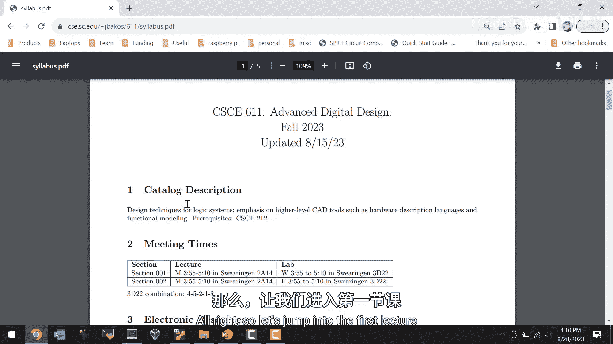

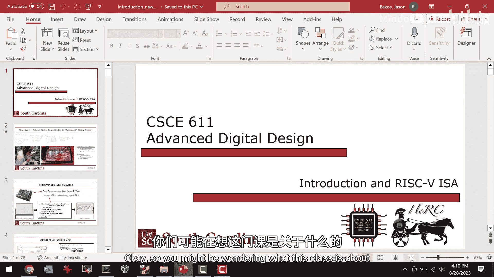

Okay， so you might be wondering what this class is about。I might have heard some things about it。

 This class extends the material that you learned in。211 and 212， y'all remember 211 and 212。

It's two years ago， I think。One year ago， okay。So in 211， hopefully。All of you had the opportunity。

To design digital logic circuits。By writing digital behaviors out using Boolean algebra。

And then translating that boolean algebra into a schematic into a gateit level schematic of logic gates and wires。

 right， hopefully you guys got to do that in the class。And then you might have also minimized。

The Boolean logic using Boolean algebra minimization or a caraw map to。Take the circuit。

Or the expression and transform it into an equivalent expression that's simpler。

So you learned basically in that sense， you learn that。

There's more than one way to implement the behavior。Of a digital of digital logic behavior， right。

 You have an expression that's written out mathematically， and you can get equivalent。

Behaviorors with different by transforming the logic and then thus know deploying it with gates in different ways。

 right？

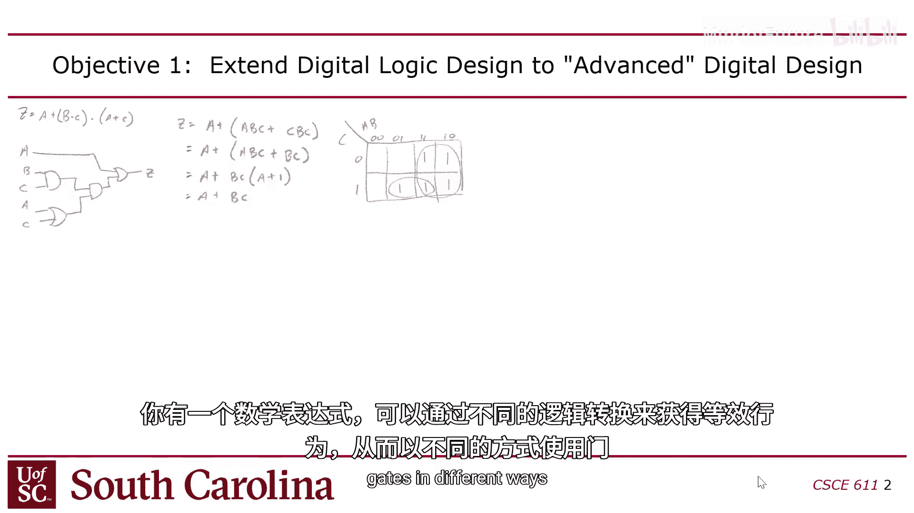

And then once you did that， hopefully you had the opportunity to take each of these gates and your schematic。

Which are kind of， you know， logical gates and associate them with physical gates on a T T L logic chip and then wire them up on a breadboard。

 Hopefully， you got to do that。 Now， okay， well， they used to do that。 They've been。

Things have changed a little bit， right。So。I'm sure you guys realized， though， you know。

 if you were drawing the digital logic circuits out on paper， you know。

 I'm sure you realize that that's not that's probably not how you know real engineers design digital logic。

 a modern CPU and this number is actually at of date。

I tried to figure out like how what would it take to design a modern CPU using the methodology that you used in 211？

And I estimated it would take 8 million breadboards that would be。

It would end up being if if they were stacked end to end would be over 1 thousand0 miles long to build up the equivalent level of integration。

 the equivalent number of gates in a modern CPU right and the problem with that is even if you could do that。

 which of course would be impractical， but even if you could do that you wouldn't able it would be like a big rats nest you know you wouldn't be able to reuse logic。

 you wouldn't be able to reuse like parts of that in order to come out with the next version of the CPU right there'd be no reusability and it would be hard to debug and test right So that's notracical。

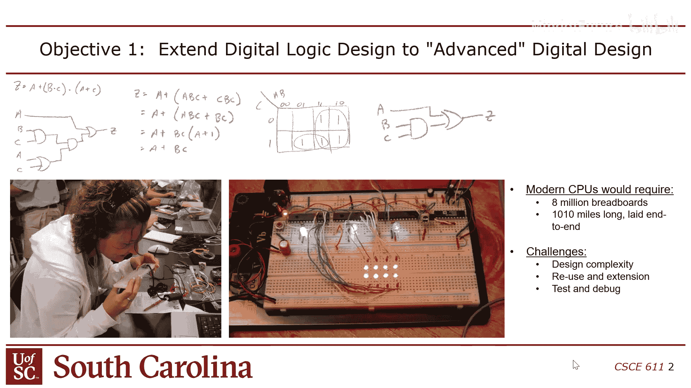

So in this class， we're going to use a more practical。Approach and this is the。

 as I mentioned earlier， this is the industrial method right that's actually used。

 We are going to use two， two things。1 or field programmable Gator arrays。

 which are chips that are electronically programmable in a way that you can take a digital logic circuit and put them onto the FPGA and have the FPGA suddenly behave as that circuit。

 It gives you a way to deploy hardware。You know， the FPGA， when you powered on。

 is basically just a paperweight。 It does nothing。 It's useless。 But then when you。

 you send in a bidstream。Which allows you to program the FPGA to behave as though you had actually fabricated a chip。

 an actual hardware chip。The advantage of that is that you don't have to actually fabricate the chip。

 you're basically creating an electronically programmed version of a digital logic circuit right if you fabricate an integrated circuit。

 you have to design it for manufacturing first of all so you have to design it at a lower level than what we're going to use but then you have to send it out and have you have to have it taped out sent out to a company that'll make it and it usually takes several weeks to get back and then you have to test it right whereas an alternative approach is use an FPG which allows you to test hardware designs on an existing chip essentially does that make sense。

Okay， so like it's like a blank slate that can suddenly。Birth into existence。

 a digital logic circuit and a big one。 Now， you might say， wait a minute， if that's the case。

 why would anyone ever fabricate an integrated circuit。

 Why would anyone tape out a chip if you could just use an FPGA。 The reason is。

 is that the FPGA is going to have about a 10 times slower clock。Then if you。

Fabricated a custom chip and the number of gates you can fit on an FPG is about 10 times less than that of an Asic。

 So you pay an overhead of about a 10 times slower and 10 times smaller in order to use an FPG。

 as opposed to fabricating a custom integrated circuit called an Asic application specific integrated circuit。

 as it makes sense， but both aside from that difference their equivalent right In fact。

 companies like Intel， actually whenever they're coming out with a new processor they will test it on an FPG like they'll take or maybe not the whole processor。

 but pieces of the new Intel processor will be tested by deploying it on an FPG that allows them to test it really fast because they actually have it in real hardware as opposed to simulating it。

 which would be oftentimes too slow for really large designs okay。Okay so that's the one thing。

 the other thing we're going to talk about is hardware description language。

 This is a high levell language that you use to create large-scale digital logic design。

 so the idea here is that Boolean logic is too low level to use that to design a large scale chip but this hardware description language allows you to write language in sort of a Java slash matlab slash Python sort of highleve language syntax that implies the underlying digital logic。

 you go through this process called synthesis which is essentially the same as compiling。

 we don't call it compiling called synthesis， logic synthesis which converts the HDL design into a digital logic design so it gives you one level higher level of abstraction。

 but it's also reusable and it's easier to debug and read in that。

Kind of stuff the problem is is that it's different from a regular high levell language in that it has concurrent semantics so a normal high levelvel language you know when you write Java for instance。

 you assume that the lines of code are executed in an order right they're executed essentially from top to bottom in order whereas hardware description language every line of code is concurrent so you can take all the lines of code in an HDL program and scrambled them and it wouldn't make any difference because each line of code represents a digital logic circuit。

And they're all operating concurrently at the same time as circuit to do there's no sense of sequentiality to the code。

 So instead of sequential semantics like what Java and Python use。

 this uses concurrent semantics So it's a much different type of language。

 but it's still a high levell language in the sense that you're writing you know kind of text right and you've got familiar types of constructs in there okay。

HDL though， is kind of a mixture between schematic language where you're kind of defining a schematic in text and when I say schematic。

 I mean you instance things and wire them together right that's a schematic part of it a lot of HDL programming is just that you're just defining a schematic your intancing modules and connecting them with wires right that's called structural HDL。

 and then there's behavioral HDL， which is the lowest level where you actually get in there and you define something that can be translated to a truth table a boolean truth table ultimately or or a memory element or a combination of the two know combinational and sequential logic if you remember that from 211 so it makes sense So there's kind of two different styles and you can mix them up know in the same file so there's an example So on the left you can see a blank the FPG that we're using the classes on the top by the way it's right here。

 I brought one with me they look like this we have them in the lab there's a lot of chips on here。

 but the FPG is a big one and kind of in the middle to the right。

A little bit so when when you power up the board， the FPGA is well actually when you power up this board。

 it gets configured automatically by a flash chip on the board。

 but if you didn't have that flashship youd powered up and it would just be a total blank slate and in our case you powered up and it does start doing stuff because it comes up with the default configuration that comes from a nonvolable memory on the board but then of course you can reprogram it but anyway so we're going to be taking it's going to start as a blank slate and then you write the HDL code and it gets synthesized and ultimately it ends up as a digital logic circuit that gets programmed under the FPGA and now you've made your hardware right。

Okay， so that's one objective is to learn HDL and FPGs the second is to give you an opportunity to build a CPU from scratch。

 so we want to design a large scale digital logic circuit when I say large scale I mean。呃。Well。

 the FPG has 115000 gate capacity， although your design in this class will probably only use。

 you know 10% of that or so。 So your designs will be 10000 gates or so。

 it's not really super large scale， but it's certainly large scale compared to what you did in 211 right So you're gonna be designing a CPU with maybe 10000 gates and deploying it on the FPG and then using it。

 and you're also going to program the CPU。 So you're going be writing a little bit of software。

 I try to limit it。 I try to minimize this。 but you're write a little bit of software。

 and you're going to build the hardware。 So you're going to write the software。

 You're going to write the hardware and you're going put them together and have it actually operate okay so。

Some of my colleagues， some of my colleagues that are more of the computer science persuasion。

 have argued you know， when we discuss curricular matters， you know why study hardware design。

 this course is hardware design。 It's kind of the quintessential computer engineering course because you get to engineer a computer from scratch And so someone may you know argue well。

 what's the point of that， exactly what is that going to do for you， What benefit is there。

 and there's two arguments I often hear， the first one is CPUus or what's called Tring complete。

 which means you can solve， you know any problem that can be solved with a computer can be solved with software right So there's no computation that is fundamentally requires hardware design because any computation that a computer can solved can be done with software on an existing CPU that you pull off the shelf。

 right That's one。2。Software performance。Is， at least was driven by something called Moore's law。

 which meant that if you write your software and you're not happy with how fast it runs。

 all you got to do is wait two years and run it on the next CPU， and it'll be twice as fast， right。

 So there's no need to design custom hardware。To solve a problem when not only can you solve any problem with software。

 but it also software gets fast all by itself， gets faster。

 and it gets faster at an exponential rate。 right， So those are the two。Those are the two arguments。

 And this is why， by the way， you guys aren't using breadboards in 211。

That's why you're not building circuits in 211 because of this argument， the 211 instructor said。

 yes， you're never going to。Not necessary， right？

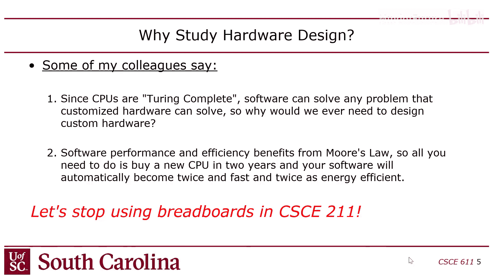

Well， my counter argument to this is there's a couple things。 Okay， number one。

It is true that CPUs are T complete， which means that if you have software。

 you can run the same software on an 8 bit Arduino processor， the app Mega 328。

 some of you may have used that， in fact， you might have used that in 211。

They replace the breadboards with the gates with the Arrduino， right。

 So that's a little8 bit processor。 It runs very slow。16 megahertz。

Any software that will run on that will run on a desktop processor and any software that runs on a desktop run a supercomputer and conversely any supercomputer software that runs on the biggest computer in the world will also run on the eight bit at MEprocessor because fundamentally any of three of these classes of computers can execute the same programs can solve the same problems they're all Tring complete。

 right。The problem， one of the issues though with this is that even though they can all solve the same thing。

 there is a difference between these guys。嗯。There's a practical difference。 The summit supercomputer。

 which was the biggest computer in the world for a while， has 2。4 million processors。

 It's 200 petaflops。It's 200 quadrillion operations per second。It takes 10 megawatts to run it。

 it's over in Oak Ridge， Tennessee。And if you take the amount of flops。

 flops or floating point operations， it's basically a unit of workload， a unit of computation。

 a workload， right？If you take the the performance it gets and you divide it by the power。

 the 1gaWs is huge， obviously， But if you take the ratio between the performance and the power。

 it's doing about 20 gigps per wt。 And that equates to that those units break down in the joules per op。

 So basically， the amount of energy you spend per。Arithmetic arithmetic computation it does right On the other hand。

 if you go to the Arduino processor， it is about 20 millwatts to operate。

 which is great because these are so lightweight you can this is actually what powers the electronic greeting cards in the drugstore you open the greeting card and they sing to you。

 that's what's running that is one of these processors。So 20 milliwatts。

 so you might think wow that's really power efficient， wow， that's amazing。

 20 millwatts to run a CPU， but if you take its peak performance。

 which is 200 kiloflps per second and you divide it by its power consumption。

 it's about 2000 times less efficient than the supercomputer。

And the reason for that is that whenever you have a low power computer。

 it automatically makes it harder to achieve higher power efficiency。Energy efficiency。

 And you might say， why is a supercomputer more efficient， It's because of the economies of scale。

 It's huge。It it's more efficient because it's huge and bigger and there's so many GPUs and CPUs in there。

 It's very difficult to design energy efficient， low power systems。

 and this is one of the objectives that computer engineers are trying to constantly improve on is how do you get low power。

 but also efficient。 It's very hard。 They're actually competing objectives。

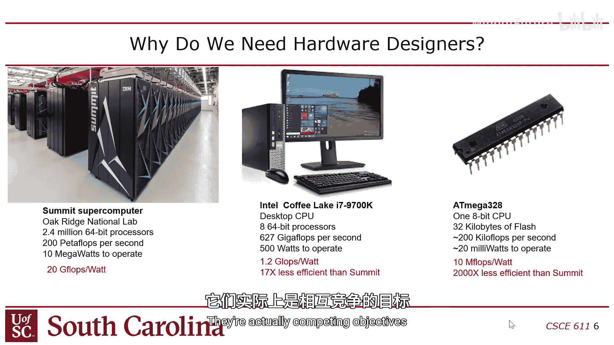

Another， another thing is， is that computer CPUs， general purpose CPUs used to get faster。

If you buy bought the next generation， they'd be faster。 In fact。

 I remember a time in the 90s when every computer， I mean。

 every desktop computer had a button on the front that was labeled Trbo。 You guys are。

 I'm sure too young。to remember that， there used to be a turbo button。And the turbo button。When。

 when I first saw that， I was like， the I don't that mean it goes into turbo mode when you press it。

 No， actually， what the turbo button did was funny when the turbo button was on。

 it allowed the computer to run at its native natural speed。😊，When you turn the Trbo button off。

 it crippled the CPU。 It down clocked it。Now， why would you ever want to town clock this CPU。

 you want it to run as fast as you can， turns out that software in the 90s would often break if it ran too fast。

For example， my favorite video game， Chuck Yeager's advanced flight trainer。

 which is a flight simulator， was too fast to play if you ran it on a 3D6 processor。

ItIt would just the frame rate would be too high and time the way the time advanced in the game would be too fast。

A lot of programs are like that。 you would have to turn the Trbo button off or it would break software。

 That's how much faster these machines got。But as you I'm sure as you guys know。

 that's no longer the case if I always update this slide every time I teach this class。

 if you look at the last 10 years，Of Intel desktop。CPUs。So we're going now from the Ivy Bridge。

 which is the core3， that's the third generation core that came out in 2013。

 all the way to the Rapttor Lake， which is the latest one， that's the 13th gen core。

So there's a 10 year gap there。And if you look at all of the factors。

 all of the indicators of peak performance， when I say peak performance。

 these are the fundamental upper， upper limit， upper bound。

 the factors that determine the upper bound for these processors about how fast they can be。

 So for example， technology is one， that's how small the transistors are。Now， technology。

 whenever you hear about technology in terms of nanometers， that's the length of the transistors。

 that's the length of the transistors。 There's also a width and the width is generally5 to 10 times the length。

 but they both scale down at the same rate， right So when you scale down that number。

The area that people are really concerned with is not the length， but the area。

 the area is actually scaling as a square of that number， right。

 because it's the length times the width and they're both dependent on one another。

So that's one thing。 So obviously as the technology scales down， you can fit more transistors。

 you could fit more cores， you could fit more cache， you could fit more stuff。

 you could fit more floating point units， GPUs， memory channels。

 anything you want to put you can fit more of that as you scale that number down and then of course you've got the clock speed the clock speed is constantly going up。

 you want that to run faster you got things like integer IPC。

 that's the number of integer instructions that can be executed per cycle per core right so basically it's the instruction with。

 how many instructions can we feed the pipeline in one cycle right in this case I list the integer number of cores more cores mean you can do more stuff at one time DRA bandwidth that's basically the memory wall。

 how much how fast we can pull data at a main memory and feed the processor single precision floating point is just number crunching for floating floating point like scientific code machine learning code。

 stuff like that level。3 cash is the amount of on chip memory you have in the last level cash。

 So these are all kind of the indicators you're not gonna ever get 100% utilization。

 you're never going to hit the maximum upper limit of your performance。

 but these are the things that limit that that are capping the process or performance Now you can see that if you look over the past 10 years you can basically see the performance per year。

Which is the newest number。RightD by the oldest number， right， And you take the 10th route， right。

 That'll give you over the 10 year period。 And of course。

 you can do this over a five year period or a 20 year period。 I just chose 10 years。

 So for a 10 year period， you can find the amount of the amount of improvement that you get per year。

 And then you can come up with the doubling time。 if if you know how fast you're improving per year。

 you can calculate how long it would take you to double。 Now you might say。

 why do you care about double。 That's what Moore's law is about doubling It's double every 18 months。

 It's doubled every two years， right， That's what everyone said about Moore's law。

 So how long does it take to double something based on a yearly improvement that you calculate over the past 10 years。

 Well， you can see that。If you look at the technology， the number of transistors。Yeah。

 it's 25% per year still to this day， which means that it's going to double not every two years。

 but every three right now， right， That's pretty damn good。 still。

 because remember Moores lost that every two years are going to double the number of transistors double the performance。

 right？ Well， the transistors。 Yeah， looks like it's still going。 That's good。

 But then you look at the clock rate。 It's only improving at 3%。

 So that would take 21 years to double。The integer IPC per core is doubling every 24 years or so。

 These numbers are rounded， obviously， so that's why there's 21 versus 24。 The percentage is rounded。

 Cos is doubling every 10 years。D Ram bandwidth， doubling every 5。5 years。 So that's good。 F point 6。

8， level 3 cash，6。3。 So the question is， why is it。

That the number of transistors seems to be doubling every three years。

 But every other performance indicator is not keeping at the same pace。That's kind of weird， right。

 This is another plot。 This is from the Henessan Patterson textbook。 This is。

 this is tracked over a long， longer period of time。

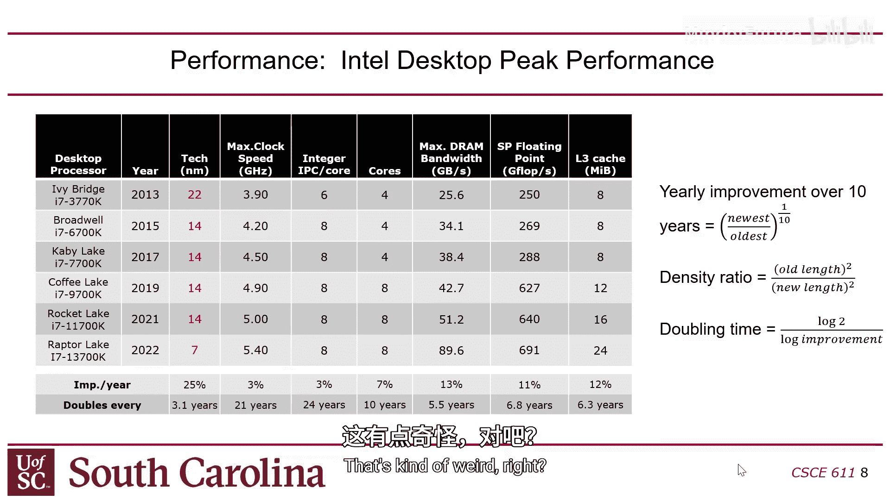

And this one is not based on the key performance indicators that I mentioned。

 This is based on benchmark performance。 This is actually running a program and timing it on all these machines。

 So this is actual performance。 And so they took it all the way back to the 1978。

 And you can see that in order to double8 every 18 months， which is the original Moore's law。

 you would have to have a 58% improvement every year。 And in fact。

 they got almost that from 1986 to 2003。You know， you were doubling the benchmark actual benchmark execution time was being halved about every 18 months or so because it was a 52。

 Then it slowed from 2003 to 2011 it slowed to 23 and then from 2011 to 201512 and of course now as you might imagine it's basically flat Now again。

 this is even more pessimistic than my numbers because my numbers are based on you know。

 essentially the amount of actual hardware available right。

 which is limited by wiring and how to place them on the chip。 This is actual runtime of benchmarks。

 So this is as you can see that according to this CPUs haven't gone any faster really since 2015 so you might be wondering then so you say that CPUs haven't gone any faster。

 What about all these new capabilities like we didn't have self-driving cars before 2014。

 we didn't have 4K video on a phone until 2015， we didn't have face Id till 2017。

 we't have anojis till 272017 didn't no computation。Pography till 201。

 What about all these new capabilities that we have， If CPUs aren't getting faster。

 why can we do more with them than we used to be able to do。

Well， the answer to that is， is the answer also to the question of why is it that Moore's law is keep giving us more transistors。

 but yet we're not seeing the CPU indicators go up。

 It turns out that those transistors are being used for co-processors specialized logic， In fact。

 if you look at the apple chips from 2012 to 2016， I need to update this slide。

 but apples making it increasingly difficult to get these die images。 These are die photographs。

 right。If you look at the area of this die。That I highlighted in white， that's the CPUUs。

So generally speaking， a mobile processor has about。12%。

Of the actual transistors refer just to general purpose CPUus。

 The rest of it is all special circuits for specific things like the things I showed in the previous slide。

 All the face tracking， computational photography， video，3D graphics， machine learning， security。

 encryption， all that stuff， all done with specialized hardware， not done in software。😊。

Not done in software。Because if youre do in software， then you're back to basically。

1997 capabilities。So basically if you want new capabilities like the kind that you were getting with these phones and computers。

 you got to start designing circuits， not writing software， it's the only way。

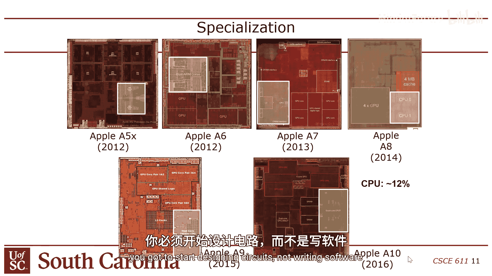

And that's the secret of and you look at CPUs， like， for example， if you look at the Westmere。

 this goes back a little longer， so this is from 2010。

 the latest CPU from Intel was called the Westmere。

And one nice thing about Intel is they do release die photographs。 Apple won't do that。

 but Intel is very proud of their pictures of their processors and they they not only not only does Intel give the pictures out。

 but they label them for you， they show you well these are the cores， there's the cache。

 that's the uncore， the uncore is the part of that's applied to all the cores。

 exists outside the cores right So you can see there that in this case 72% of the die area was CPU and cache but then once we got to IV Bridge。

 which is 2013 you can see that the CPU cores shrank to about 47%。

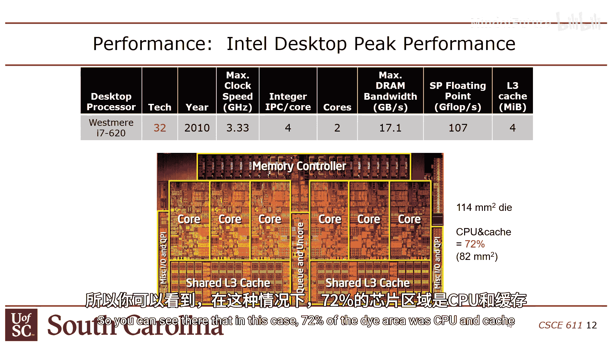

what took up the extra room？The GPU， half the sit， half the chip now。

 the GPU is not a general purpose processor。 it only does graphics and video。喂。Then we get to。

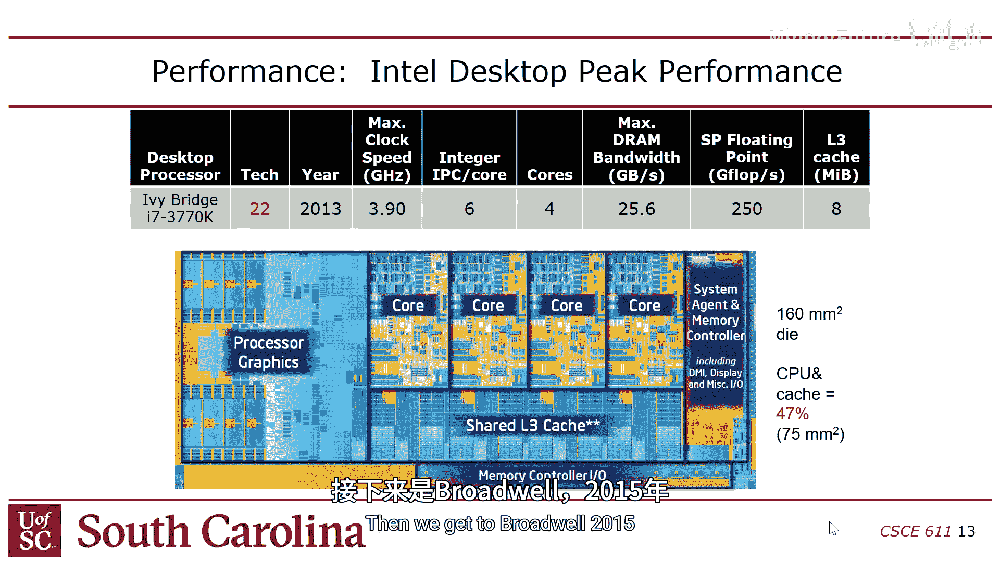

Broadwell， 2015。Now the CPUs are only 20% of the chip。Lots of other stuff on that chip。

 lots of other circuits， you know， system agent， display engine， memory controller， E D G controller。

Memory controller， IO， processor graphics， lots of extra circuits on there， not just a CPU。

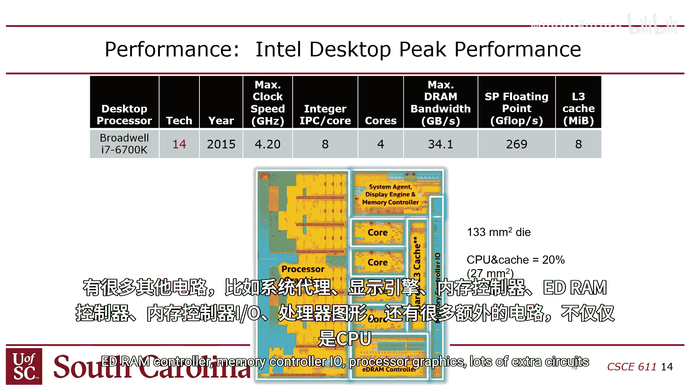

U。And， in fact， modern。Modern embedded systems have lots of different sort of special purpose circuits for doing things like。

Machine learning and GPU， motion coprosor I'm sure you guys have probably heard of that。

 deep learning accelerator， programmable vision accelerator， all kinds of stuff。

 every chip has a proprietary mixture of these special purpose circuits， the CPUs and afterthought。

It just does the。It just runs the operating system， does high level management。

 All the heavy lifting， all the compute is done with special circuits。 Sam thing in the data center。

 Now， you might ask， well， wait a minute。 Okay， that's fine。 But why is it that CPUs。Can't do that。

 heavyav lifting。 What's special about these special purpose hardware。

 Like what's special about a circuit that you designed specifically to do animojis。

 Like why I can do anojis。 A CPU can't。 Well， the reason is there's two reasons there's a memory wall and the power wall。

 the memory wall。Is that performance is often limited by memory speed。

 But if you have a special purpose processor， you can create a specialized memory on chip specifically for that application that's very efficient。

 right， So if you're doing machine learning， obviously。

 you're putting a two dimensional tile of a matrix on there and then you're using an array multiplier。

😊，To do a matrix vector multiply in one clock cycle。 right， That's the idea。

 And then there's the power wall。 and the power wall says that。And in a chip。

 you can only dissipate 1 to 2 w per square millimeter any more than that。 and it just fries。Now。

 CPU can emit more than one to2 w per square millimeter。

 but if they get to that point where they start to doing that， they have to turn themselves off。

 They have to throttle themselves。 right， So that's called the powerwall basically means that you can't use your CPU at full capacity。

 ordo melt。No matter what sort of heat sink or liquid cooling you have on there， right。

 so that's called the power wall。But DSAs which are domain specific architectures。

 they get around this by basically devoting all of their hardware to that application right so they have none of the inefficiencies of a CPU that require all of this fetch tocode logic to support general purpose execution。

Okay， so anyway， yeah， so but the real reason to study hardware design is that it's a special。😊。

You make about 60% more than a software person because hardware design is much more difficult than writing software and it's much more specialized。

 So if you get a job doing this， which is's harder to find a job because of course there's less hardware jobs in there are software but if you get one you're gonna make a lot more money because it's a much more specialized area Okay so in this class So hopefully I was able to answer those questions。

 in this class we're going to design a CPU from scratch。

 we're chosen we've chosen now the risk 5 CPU architecture。 you guys learned about MIps in 212。

 it's very similar to MIps。 I'm we switch to risk 5 because it's the new exciting thing。

 MIps is proprietary but risk 5 is an open architecture。

 So we're going to just use that we're going to deploy it on an FPG and the class is is kind of split in the two phases in weeks 1 to 10。

 we're gonna be covering sort of skills。😊，You know， how to design circuits on an FPGA。

 So you might look at that and say， yeah， it's kind of。Skills training， and it is。

It's kind of vocation vocationally stuff， but the last five weeks will get in more conceptual topics。

 but I have to front load the course with the stuff you need in order to do the labs obviously。

 so you know you may get the sense in the first 10 weeks that we're just learning a new language' you know it's not where's the concepts at where's the theory we'll get into that in the last third of the semester Okay。

 so again， first first two thirds is engineering last third is more conceptual。Okay。

 so now let's talk about。Assembly language for a minute。 Now， you guys。When you took 212 and again。

 I think I might get the same answer I got for 2，11， but when you took 212。

 half of that class should have been about learning assembly language。Okay， good。

 Im glad they haven't messed that up yet。So there has been an internal discussion in the department going on for the last 20 years where some of my colleagues。

 again， the more computer science types， say， why are we still teaching assembly language to our students because they'll never use that ever？

There have been compilers for 50 years。That have made assembly language programming obsolete。Okay。

 so why are we teaching that， that's dumb。U。Well， the problem is。Problem with that argument。

 they want to stop covering assembly in 212。The problem is， as you guys know。

 I'm sure you learned in 212 that you know the way that this works is you start with a high level language like C and it gets converted into assembly language by the compiler。

 The assembly language is the native language of the processor or hardware of the hardware right and then the assembly language is converted to machine language which is just the binary form of the assembly instructions and that's what's executed by the CPU right Now it is true that none of you are going to write assembly language code in your careers。

More than likely。However， if you don't learn how to write an assembly language。

 there's no way that you can do hardware design because basically when you design a CPU。

 what you're designing is a circuit that executes assembly language。

And so obviously you have to know the assembly language in order to design a circuit that runs assembly language right So that's why we teach it。

 right It's not because we expect you to be writing long programs in assembly language。

 although you may， if you know some of these specialized processors。

 Like if you're using the Google TPU， for instance。

 which is what Google uses to implement all the machine learning， it's assembly language。

 that's how they program it。 But then again， it only has five instructions。

 So it's not too hard to program， but but but you may have to write a compiler that emits assembly language for a new architecture who knows。

 people are going crazy these days with。Hardware designs， to introduce these new capabilities。

 But that's the reason we teach it。 So basically， if you don't know assembly。

 you can't build the underlying hardware。So there's some terminology here。

 there's instruction set architecture which is the assembly language that's basically the software that's the software perspective right and then there's the microarchitect。

 which is the circuit that runs the assembly language that's the bottom side so basically on the top side you have these instructions which represent the smallest amount of work that the CPU executes that's like an atomic unit of workload right but then underneath that microarchitect that's executing those instructions in clock cycles the work that's done the data path that are established in the hardware represent the atomic unit of work that's done when the hardware executes the program and assembly and machine language so in an instructions set architecture is a repertoire of primitive operations that can be executed by the CPU hopefully you remember from 212 there's compute instructions。

 data movement like load and store branch and then you've got some miscellaneous ones like interrupt and exception handling。

Inions and that kind of stuff。 and it includes everything you need to be able to program。 Typically。

 CPU instructions set architectures are open and freely available to everyone because they want people to know that so they can write software or write compilers that generate the software。

 The micro architectureect， on the other hand， is a jealously guarded trade secret of all companies that make CPUs。

 So you'll never get a peek at the hardware that make that powers in Intel or you know the Apple M1。

 you'll never see that that's super， super。Secret。I've been working with Texas instrumentnstrus。

 they've been funding my research for 10 years and even they don't they won't tell me anything about how their digital signal processors work。

 super secret stuff right so on one hand， you've got the assembly language that they try to disseminate that as much as possible。

 but then the underlying hardware is always proprietary。

And I'm sure you guys know there's different processors。

 there's Intel 86 has their own instruction set and then you've got arm risk。

 MIPS and that kind of stuff。Yeah， so for example， like just to kind of drive the point home。

 one line of C or C plus plus code that you write is generally going to be translated into one of 10 instructions。

 assembly language instructions， one line of Java code is going to be executed at runtime by 10 to 100 instructions and one line of Python code is going to be about 100 to 1000 instructions right so generally speaking the speed at which your program runs or that your programming language runs depends on how many instructions have to be executed for each line of code that you write right that's why Python is much slower than C right because it's a higher level language。

U。So instructions are identified like you know with pnemonics and so I'm just going to quickly- I want to go the first thing I want to cover in the course is I want to go through some risk five and just kind of review assembly language programming because generally what I find in this class is that students either didn't have assembly in 212 because they had an instructor that didn't believe in it。

Right， or。They forgot it because it was two years ago and they hadn't used it they hadn't used it in two years。

 right so I'm going to just go through this。 And as I mentioned too， we're using risk5。

 which is also a slightly different assembly language and MIPS very similar， though。

 if you remember MIPS， you won't have any problem with risk 5。 Okay so MIPS and risk 5 are similar。

 they're both risk architectures。 And if you're wondering what that's all about risk stands for reduced instruction set computer。

And that's as opposed to cis， which is complex instruction to computer。

 And basically what that the distinction there is in a risk computer。

 the instructions are very primitive。 They do。 They don't do much。

 The amount of work that's done is small， which means that the number of instructions is huge。

 which means if you have to write code in risk assembly language it's awful。🤢。

Because you have to write， write lots and lots and lots of instructions， even to do a simple program。

 right， whereas Cisco， on the other hand， does more in each instruction。Okay。

 that's the difference now。You know we used to debate risk versus Ci and then risk kind of one。

 right， but now it's kind of tipping towards the other way now because now you have things like the aforementioned Google TPU Tensor processorsor unit。

 it's actually a ci machine。It actually does a lot of work with one instruction。

 It is a whole matrix vector multiply in one instruction。Right so that's a lot of work。

 whereasas a risk processor would just do one scalar operation per instance one multiply or one ad or one load or one th or one branch。

 That's all they can do in one instruction， whereas Google's TU is doing is doing thousands of multiplies with just one instruction of code that's cis right The problem is is that you know Ssc is harder to translate with a compiler。

 So that's why I mentioned that if you're programming for the Google Tpu。

 you're probably going to be right in asse language because you need to do that often with S architectures So there's this tradeoff。

 So execution time， if you remember from 212。Is the number of instructions executed time multiplied by the time per instruction so the objective with risk is to make the instructions very fast individually。

 but the trade off there is it requires more instructions。

 execute a program whereas with Ci you have less instructions per program but the time required per instruction is much higher right so obviously a Google TU you execute that matrix vector multiply instructions it's going to take longer than a single multiply on a risk architecture right but there's a tradeoff they're inversely related if you're trying to minimize the execution time does it make sense and that's generally what you're trying to do is minimize execution time with these things。

So a TPU instruction will take longer than a risk instruction。

There's such a dramatic reduction in instructions， right？

RightBecause if you're multiplying a matrix with risk。

 you have to have one multiply in one ad for every element of your matrix that has to be executed。

 whereas the Google T just does one， one instruction for the whole thing right So that's why the Google TU is faster。

 at least for things that do matrix vector multiply than any CPU is and that's why Google uses it。

So there's that tradeoff there okay so you probably remember that MIPS and risk and arm and all the other risk architectures。

 they generally have these things called registers。

 there's usually 32 of them and these are like little memory locations where you store intermediate results from calculations right so in their program are defined you know they program defined。

So the program has to explicitly address the registers， right？

And so there's 32 registers and if you remember from the MIPS。

 the registers in the program were denoted by a dollar sign like dollar 012。

 whereas in risk they use X X1， x2 x3 Y I don't know I just decided to change that right you might also remember that some of the registers had special names like S0 to S 11 which are registers that were supposed to be by convention preserved across subroutine calls。

 of course again that depends on the code suggest just a convention not enforced by the hardware then you had temporary registers t0 through 6 and those mapped to specific register numbers that's still all in place with。

With risk5 as well。 And so when you launch， we're going to use a simulator called Rrs。

I know there was another one called Mars。 that was for MIps。 We're going to use Rrs， very similar。

 I think Punyan， when he teaches 212， he used a spim XPm or something like that。

 But the point is is that it's a simulator and in the simulation window。

 it'll actually give you a table of all the registers and their special little symbolic representation you can use either one when you write your code。

 Now you might say wait a second， how much assembly code are we writing in this class。

 Not much but you just have to you have you have to understand it well enough to implement in hardware。

 So in the first lab， we're going write the first lab will be to write a risk5 program and there's two reasons for that。

 The first is is that you're going to use that program to test your hardware when you build your CPU。

It's going to be a test program， a test bench， or a benchmark， think of it。

And the other reason we're doing it first is because I'm not going to have enough time to。

I'm not going to have enough time to cover enough very log to have you do very log to do the hardware design in the first lab。

 right， So it's a timing thing， right， So in the first lab， you're going to just write a。

A small program that will calculate the square root of a number right and then we're going to use that to build essentially a calculator on the FPGA board right and the other actually there's a third reason too。

 we assign it first is because one of the common mistakes that students make in this class is in the past before we restructured it was that they would design they write the software and they designed the hardware at the same time and that was always a very bad decision because when things didn't work then you didn't know if it was the software being bugged or the hardware being bugged right But if you write the software first and you test it thoroughly in the simulator right then you're guaranteed。

 you know the software is bulletproof。 So if you then run that on your hardware and something happens。

 you know it's a hardware problem right so that's the other reason we've set it up this way。Okay。

 so let's see risk5 has a register zero that's the constant zero same with MIPS and this is useful you know people ask why they do that。

 it's because it allows you to do things like for example you can move the contents of one register to another by adding it to the zero register right so this is a common common things stuff like that you can use it as a baseline。

To build upon okay so in this class we're going to focus on six different types of instructions and these are not really formalized types or' just how we've kind of broken them down there's arithmetic logical shift comparison instructions and these are what they use these are these instructions used three registers。

 there's a destination and two source registers Dest is first not always first， though， by the way。

 it's first in risk5 in MIPS， it's not first in Intel。

And it's not first in like the Texas Instruments， DSP。It all depends on the instruction set。

 but in risk five， the destination is always listed first。嗯。

Then there are versions of those instructions that instead of having two source registers。

 they have one source register in an immediate， like a constant。

 a constant that's actually encoded in the instruction。

 you guys remember that that's like adding one to a loop counter sort of thing right So we got some of those。

 then there's branch instructions that generally test the contents of registers for equality or non-equality or if one's less than another and then if that condition evaluates to true。

 they'll change the control of your code， they'll jump to another part of your code right and so that's used for if statements and loops。

And then they have jump instructions， which are just unconditional changes of control。And by the way。

 branch usually take two registers， test some relationship between them。

 and then have a label that tells it where to go if the condition is true。

 Ju usually just has a label that goes to， and then you've got load and store which pull data out of memory。

And put it into a register， a load in a store is where you take a value and register and stick it into the memory。

Right so generally speaking， the way that the code works is you have to load stuff from memory。

 you do some number crunching on it and then you save the result back to memory。

 so it's load number crunch store， right。That's generally the structure of these programs makes sense because risk five is what's called a load store machine。

 you have to load and store explicitly and then compute separately。Make sense。Okay。

 so and then you've got some miscellaneous， we'll have this co processor instruction， CSRRW。

 we're going to use that to do IO。So we're going to use that to be able to send results to the little hex displays on the FPGA board and also read the key values。

 right Now， one thing we're not actually going to put on the FPGA our load and store instruction。

 So we used to have a memory。A。An actual data memory。

But that was one of the things we kind of dropped because it was getting hard。

To reach the end of the semester and have everyone finish so we're just going to use we're not gonna to have those so we're just going to have basically the IO instruction that will read the state of the switches and buttons on the FPG board it'll do some number crunching and then it will output the outputs to the hex displays the seven segment displays and it'll do all that without a memory so it'll do all that calculation just in the register file。

 So obviously as you might imagine， we're doing a very simple program that can be done entirely just with the 32 registers okay so nice and easy。

Because we don't want to turn this into a lot of assembling which programming because as I mentioned。

 you know， doing that programming in a risk construction set is pretty tough。

 painful because it was designed for compilers in mind。Okay， so just to quickly review， you guys。

 hopefully I think you seems like everyone seems kind of comfortable with this stuff。 right。

 This is all just meant to be a review。So a typical assembly instruction would be like add。

And then you give it three registers， in this case。

 I just say A B and C as a substitute for the registers， and that's like saying a gets B plus C。

Right now， by the way， this is a difference， like as I mentioned。A general purpose CPU。

Is going to do one ad at a time， right， But these new custom CPU that are for machine learning。

 The whole point of them is that you're not doing one。 You don't want to do one ad。

You're supposed to be exposing data level parallelism。

 you want to do thousands of ads in one instruction， right？

You want to basically do what these tensor operations in hardware right as opposed to scale this is scalar one ad at a time right some CPUs like the arm and the Intel。

 they'll allow you to do vector operations right like for example， you can do 16 ads。

In one instruction， but still pretty small， right， whereas GPUs allow you to do， you know。

 much larger scale data level parallelism。 And that's why they're faster。 right So this is。

 I'm just kind of。Connecting this back to my original point。

 which is that CPUs are slow and not getting any faster。

 and this is one of the reasons they do one ad， for example， per instruction。Okay， so for example。

 if you have if you have a high level code like this that has a compound arithmetic expression where I do basically two as in a subtract。

 obviously that has to be broken down into three instructions In this case。

 there's one instruction for each arithmetic operations。

 So if there's if you have one line of code and has three arithmetic operations。

 that's three instructions that correspond to that。

 and then usually going have to load the values of those variables with load instructions and then store the result。

 So actually I'm going to need four load instructions to load G H I and J as variables Those are variables。

 I want to load those， that's four instructions， three instructions to do the arithmetic。

 So I'm up to7。 and then one to store the result F back to memory。

 that's 8 So that one line of code is eight instructions。

 but it's very easy to see how it becomes eight instructions right you got to pull the inputs。

 you got to do the computing and you store the output right it's pretty straightforward right but that's one line of C code。

 very small line of C code， but eight instructions。To do that。

 And if you're writing an assembly language and not compiling。

 you have to write all eight instructions out， right。Okay。

 so and then you've got these immediate instructions I mentioned this earlier。

 this is where you have one register in an immediate。

 the immediate is actually encoded in the software。

 It's not changeable right That's a constant right that's imm mutable。 So when you add four。

 that's always going to add four right because that's been put in the code。And then。

One of the caveats here that there's no there's no subtract immediate。 There's an add。 Oh， by the。

 the immediates usually have an a little I after the after the mneummonic， right。

 So this is adding 4 to a value that's subtracting one from a value。O。Okay。

 I mentioned that you can only do operations on values and registers。

 You can operate on memory locations。 So here's an example of a small program in assembly。 Now。

 one of the things is that。One of the things that's a little bit of a challenge in this class is that when you write an assembly。

Some of the instructions you write are pseudo instructions。

 they get actually they're not one machine instruction， they may be one assembly instruction。

 but they get expanded in the multiple machine instructions。

 right that's a problem in this class because when you write code in Rrs。

 Rrs has an asseemler that converts it the machine language and then you're going to save that machine language。

As a text file， and you're going to load it onto the FPGA and run it on your processor。

The problem is you may get fooled because your processor may see a different set of instructions than the one that you wrote if you use any pseudo instructions。

 right？So that can be a problem。 I've had， I've had cases in this class where。

Students had a pseudo instruction that actually overwrote Reg one。

In the expansion of the pseudo instruction。And then what ended up happening was is they were using Reg1 prior to that。

 and it got blown away by the expansion。 and then their code didn't work anymore。

 So that's something you have to be aware of。 But I'll show you in Rars。

 how you can verify that in Rrs when you assemble your code， there's two columns。

 there's a column of assembly code in a column of machine code。

 and sometimes you'll have one assembly over here in this column and it expands out to like three instructions。

 So here's an example of that。 So in this case， I'm loading I'm loading var。

 which is a variable which I define in the data section。

 I'm loading var into register X2 right The problem is is that you can't say var in machine code。

 it's a symbol it's a symbol that's stored in the symbol table and it corresponds to an address。

 That address is specified in the code as a base register plus an offset。

 So what ends up happening there is that gets expanded into three instructions。And this is weird。

 I don't know why Ras does it this way。 I think this is strange。

 but it uses this thing called a A U IP PCC instruction。

Which actually takes the program counter and adds a 20 bit immediate to it。

So that's how it comes up with a base register address。

 and then it adds another 12 bit to that value， which gives it the essentially it fills in all 32 bits。

And then it does the load with that register too is the base register。Right， so in other words。

 it has to convert the symbol to a base offset style address calculation。 right Now， like I said。

 we're not doing load instructions in our CPU。 So that that' specific problem you won't have to deal with。

 But that's just an example of how the asmber can tricky Sometimes the asmbler is a little bit higher level of abstraction than machine code。

Okay， there's also the stack， I'm going to skip that。

 we're probably not going to do stack stuff Okay， so let's see how much time do I have left a few minutes。

Yeah， I'll just give you a couple of these。So I just wanted to point out。I put together a list。

Of what I consider to be the biggest challenges for writing assembly language。The first one is。

 and I mentioned this earlier， you have to load all of your variables in a registers before you can use them in store when you get back。

 so in other words， you can't use like you can't add。

 you can't add G and H and put the result into F and assuming fo is your you what you call your temporary value that represents the sub expressionpress G plus H。

 you can't do that， you can do that on Intel assembly。Because it's a cis architecture。

But actually it's not what happens just a side note， I don't know if you might not care。

In assembly language on an Intel processor， you can do that。

But it actually gets transformed into this at runtime。

Intel uses these things called micro instructionsions where they basically trick you into thinking that that's running on the hardware when。

 in fact， they have this thing that actually converts it in real time into this as you execute on the Intel processor。

 So they call these the micro code。 and that's the code right on an Intel。

 So Intel actually has a risk architecture。 but they still。Present to the user a cis interface。

 right， But it's all， it's all affront， right？ But anyway。

 if you're actually using risk and you don't have that ability。

 you actually have to write it out this way。 You have to load， add and store。 Okay。

 so that kind of stinks because and you might say， well， okay， I get it。 It's a load store。

 It's not that complicated。 What's the problem。 The problem is remembering what register has what variable。

 That's the problem。 I never remember that。I can't keep track。 I have to put comments， you know。

 after each instruction to try to figure out which register at which at which line of code has。

 because you have to recycle the registers， too， they have to get repurposed right when you're done with them。

 So every every register is associated with a different symbolic variable at every line of code。

 you have to keep track of that in your head。 That sucks。 I don't like that， right。

 But unfortunately， now。Nvidia has a really cool solution to that。 Nvis。

NviIdia GPUs have an assembly language called PTX。PTX is kind of like Intel where。In PTx。

 you don't actually give the register numbers。 You just give symbolic registers。

 And then when you assemble it down to the machine language for a GPU。

 that's when it maps the variables to registers。 It does it during the asmbler。 That's cool。

 I wish the risk had something like that。 So then you wouldn't have to then you could write something like this。

 and you could let the asmbler take care of figuring out what registers to allocate for each variable right and managing them。

 But unfortunately， we can't do that。 We have to do it manually here。 Does it make sense。 Okay。

 sorry for the two side notes。 I don't know if anyone cares about details。 okay so。

One final thing I'll mention， then I'll wrap it up because I've dumped a bunch of information on you today。

One of the other big things I hate about assembly language is when you write an if statement in a high level language。

The if part comes first and the else part comes next， right in your code。

If the if statement condition is true， it does the block of code at the top。

 if the if statement condition is false， it does the block of code at the bottom。

 right that's an if then L statement， right？problemblem is is that when you write an assembly code。

 it's usually reversed。If assuming， of course， you're trying to minimize the number of instructions you want to use。

 right， So generally speaking， you'll take the condition A less than B。

RightAnd you have to complement it， logically complement it。

 So you want to say if a is not less than B， if a is greater than or equal to B。

 So you say if a is greater than or equal to B。Then you skip down to the else part。Right。

 and then if you fall through that condition， it means that a was less than B， And you have the。

The true part， right？Now， so you still have the true part above the not true part。

 but the thing that you test is the has to be complemented。 It's not a less than B。

 it's a greater than or equal to B， which is the opposite of a less than B， right。Now you might say。

 well come on test you could still test if A S and B and then combine that with the jump instruction and yeah。

 you could。 I mean， you could fnagle this， but this is the most efficient way to write the if statement。

 which is where you have to logically compliment that condition that kind of sucks too。

 I don't like doing that。I don't like having to reverse all my logic from the high level code to the assembly code。

 but that's just a consequence of the assembly language Does that makes sense？All right。

 well I'll let y' all go。I will。We'll have lab this week。

Probably we'll just use the lab to kind of finish up this lecture to get you started on the first project。

 okay？Thank you， oh check think about who you want to have as your partner and if you already know。

 email me the names。And also， check out Dropbox。 Make sure you can get in the course on Dropbox。 Yes。

 too， Thank you。

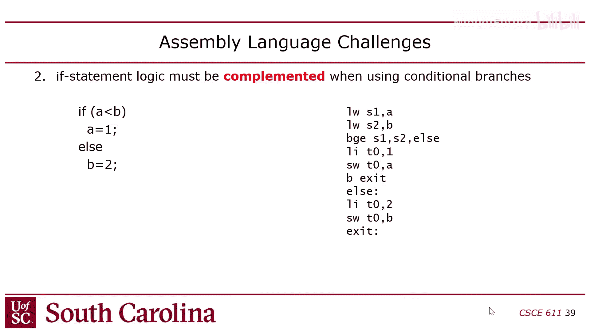