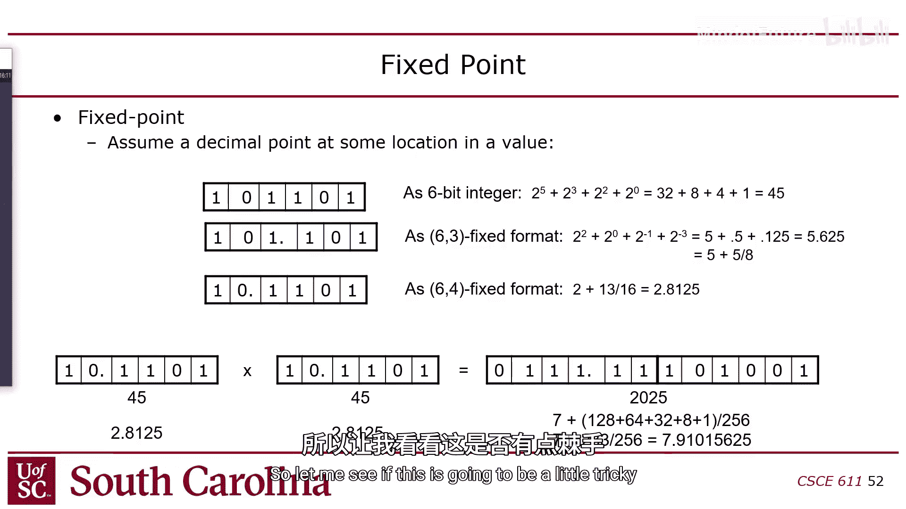
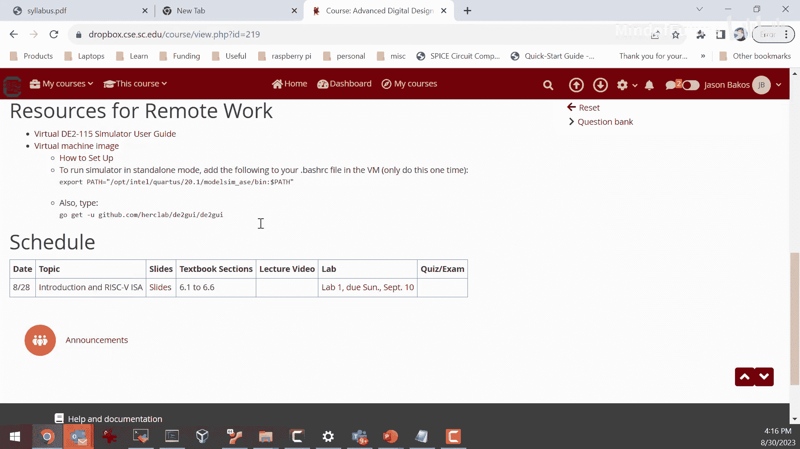
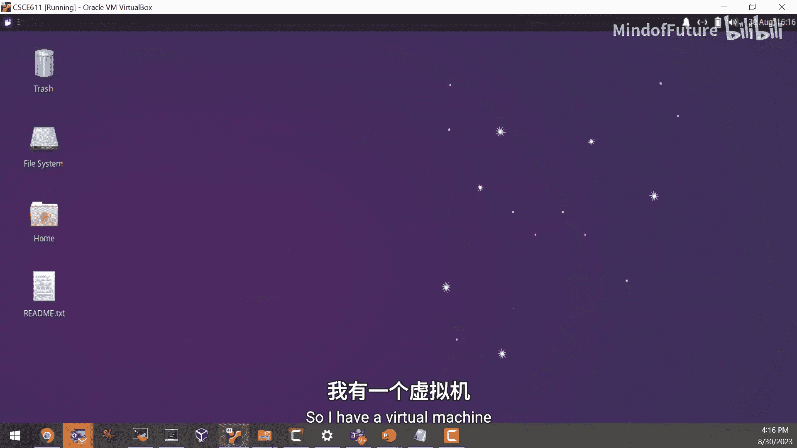
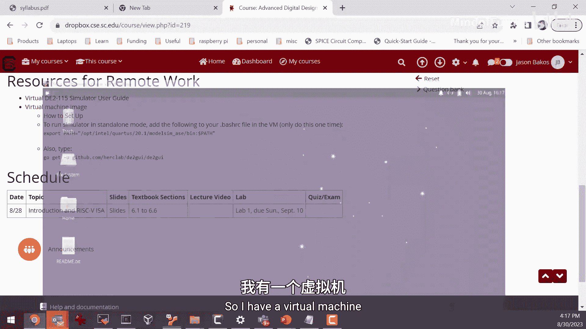
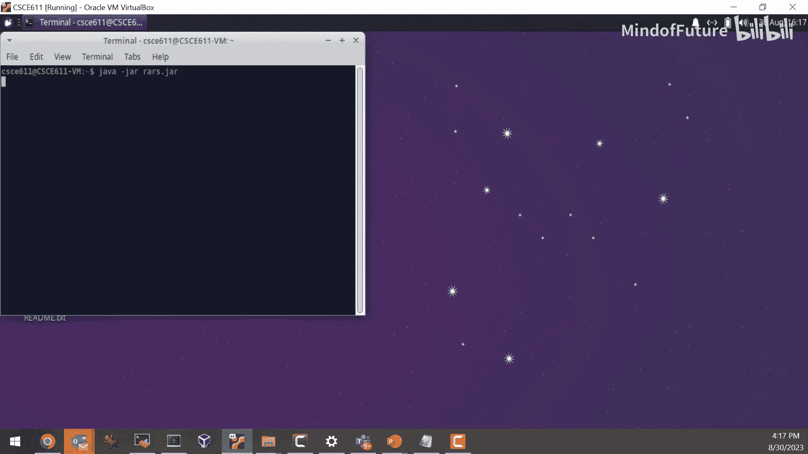
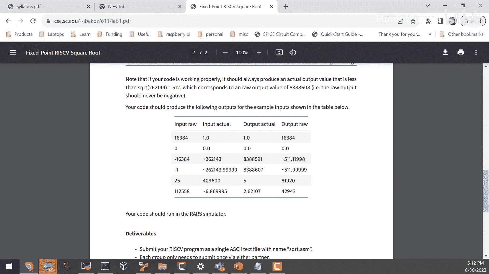

# 【南卡罗来纳大学】高级数字系统设计-CSCE611-（Advanced-Digital-Design，Fall-2023）-p02-P02-RISC-V-ISA--BV19nf6YoEZ9_p2-

Okay， so my objective today is to try to get everyone to the point where they can start the first lab。

So we could start working on that， basically the first lab is about writing a program in riskk five。

 assembly language and then simulating it using Rrs。Any of you guys use Mars in 212。

 Okay so if you know Mars， you know Rs。 if you used X spm。

Then Ras will look a little different for you。So I talked about。Risk5 and how it was similar to MIPS。

And I was just started to go through some。Some example codes here。

So I mentioned that when you have an if statement in assembly， the way I do this。

 at least is I take the condition， the if condition and I complement it and that way if the complement of the condition is false then the branch will fall through。

 meaning the branch is in if the branch condition is false than than nothing happens。

 the branch is effectively treated like a no op， so what ends up happening is in this case I want to see if a is less than B。

 so I load a and S1， load B and S2， and then I check to see if S1 is greater than or equal to S2。

 which is the opposite of being less than。you know less than right and that way。

 if the complement of this condition is false， that means that the original condition was true and then I can fall through the branch into a section of code that would comprise the true portion of the if statement and then at the end of that you have a branch。

To exit。 So you just skip the else part。 And then in the branch， if the branch is taken。

 it would mean that if the complement of the if is true， that means that this if condition was false。

 And so I would branch to the else part。 right， So I would skip the true part and then just proceed through it。

 Does that make sense。 So the advantage of this is I can keep the true part。

 the true block on the top and the false the block on the bottom。 And I only need one。

 I only have to define one label， which is for the else part of the if statement， right。

 Now there are other ways to structure that。 But generally speaking。

 it's going to require additional instructions to do that。ok。

Any questions and you may have to you know move the E card up to the top Okay so the。

Another thing that you may not be used to is that。In risk five and in MIPS。There's no way to index。

 there's no index register field。And what I mean by that is you have to have when you walk through an array。

Which you commonly have to do。You have to basically compute the starting point of the array。

 the starting address the array， and then you have to in order to walk through the array in order to index the array。

 you actually have to。Add the offset directly to that original base address of the array。

 in other words， you calculate the base adjusted array and then you have to destroy it by adding to it in order to walk through array。

 there's no way to basically say I want to load from this base address。

 but I want you to add this the contents of this register to serve as an index into that array。

So it makes sense， so for example， if I have a for int i equals0 I less than 100 i plus plus。

 and I want to walk through this array of vows and accumulate the values in there。

There's no way to say。There's no way to say vowels in the assembly code with an index。Can't do it。

You'll get an error if you try to do that。 It won't even translate that into a pseudo instruction or anything。

 It'll just say， no， no index registers。 Some instruction sets do have index registers。

But but risk5 doesn't。 And this is awful。 hateate this。

 So the only way to get around this is to use a load address instruction。

 which is a pseudo instruction and it'll in fact I showed you that last lecture。

 it ends up it ends up expanding in a multiple instructions in order to initialize in this case。

 x2 with the base address of vows so vows is defined as an array inside the program and it's in the symbol table。

 but that vows is the beginning of the array。 the base address of the array。

 So once I have that base address in L2 x2 I can load from x2。

 but when I want to go to the next element， I have to add x2， I have to wipe it out。

 you have to basically increment the base address。 there is an offset。

 you can specify but that offset is is a constant It's not a variable right so you can add an offset here。

 but you can't use a register for an offset you have to use an immediate value is an offset Does that makes sense。

 So basically walking。Through an array it requires that you set up a base address。

 and then you add to that base address。 And then if you want to go back to the beginning of the array again。

 you have to， you know， restore it again， right with a load immediate load address。 makes sense。

 Okay， so I'll actually go through a demo where I do that。 And by the way， just for the record。

 we are not going to implement。I mentioned we're not going to implement load words in our processor。

 but I still want to make sure everyone's comfortable with Ri five assembly。啊。Another thing is。

The other problem is。If you have a loop。Okay you're generally going to increment that loop by one。

Right and in C， that's fine because the C compiler knows the size of each element of these arrays。

 and so when it does address calculations for loading and storing those arrays。

It will make the proper adjustments to multiply effectively multiply the index by the element size。

 So if these arrays say are 32 bit elements， there are arrays of 32 bit elements， right。

 then whenever you increment the pointer for those arrays in the assembly code。

 you're going to be incrementcing by4 each time。It makes sense， right But in the C code。

 you don't have to worry about that because there's these types。

 there's data types and the compiler keeps track of the data types and it knows how big know what the size of the data types are。

 But in your code， you have a choice。 you can either change the code to where I is no longer incrementing by one but it's incrementing by say four。

 assuming that's the size of the elements right And then you correspondingly have to adjust your iteration limit by multiplying that by4。

 That's one option right And that case， you're going to basically use I as your。As your index right。

 another option is to independently control your loop counter and your index you're addressing。

 So in this case， the way I did it is I have I set up。In t 0。

 So I've decided t 0 is going to be my I。 So I initialize that to 0。

 And then at the very bottom of the loop， the last thing I do。Before I loop back to the top again。

 as I increment t 0 by  one。 So that's my I plus plus， right。 however， notice over here。

I take t0 and I shift it to left by two bits， which multiplies that by4 and puts the result of that into T3。

 So T3 is now going to keep track of how far from the beginning of that array I am。

 and then I'm going to add T3 to T1 and put the result into T4。 So in this case。

 I actually maintain the original base address of the array in T1。 I add T3， which is my offset。

 and then I have another register T4， which represents the effective address inside that array。

Make sense。 And I have to do that for both source and destination。

 So that's why I have T 4 and T 5 are both calculated here。

 which calculates the address of basically， it's the address of destination of I and the address of source of I。

You guys with me， so that's a lot of extra dressing that you have to put in here that you never had to worry about in the C code。

Everyone clear on that。Okay。Once you get used to doing， it's not a big deal。

 but when you first start writing the code， it can be tricky。嗯。Yeah。

 another thing is I mentioned this last time but。You have to allocate registers manually。啊。

It it's too bad that this isn't done for you。 I think in theory it would be possible for you to write assembly code and just use symbolic register names and then have the assemblymbler actually map those to physical registers for you。

 like NviDdia PTx does but in risk5 and in MIPS you have to manually do this register assignment which means that you have to decide for each variable that's alive at each point in your code。

 which register it lives in and typically it becomes alive when you load it from memory and it dies when you store it back to memory and in between those two times that register is alive So between that load and that store T1 is going to be a T0 is going be associated with B and then of course after this block of code I can recycle t0 problem is you know it's very easy to lose track of what register is holding each variable So the easiest way to track that I think is through comments but you have to be careful that you have to keep in mind that even then the comments only。

Represent the mapping at that particular point in the program， because those registers， of course。

 will， you know will change and represent other things at other parts of the code。

 So I usually just use comments。 comments in risk Five are are denoted with a。A hash mark， right？

Number sign。UmSometimes in assembly， you'll see it's semicolon， you know， depending on。

Which assembly language you're using？Any questions？ok。Okay， and then。

Another annoyance of mine is that whenever you do a comparison。

It's very common that you want to compare against the constant。You know。

But you can't compare against the constant， you can only compare two registers。

You can't say branch of less than if x 0 is， you know， x1 is less than 0， right now， luckily。Luckily。

 register0 always has zero。 so you could have just put x0 here and it would have been equivalent。

 but if you wanted a branch of less than 10， for instance， so this was a bad example。

 I should have put 10 there right but you can't say is x less than 10 if it is branched exit。

 you would have to initialize another register with 10 and then。You know。

 do the comparison with that。That new register。 And so in that case。

 it's really kind of annoying because。This this x2 only has a lifetime of essentially two instructions。

 right you initialize it and use it in the branch and then you're done with it， right。

 but you have to do that in order to compare against the constant。

You would think that the assembler would do that for you， you know， that would treat you know。

 expand that as a pseudo instruction， but it doesn't， at least not the one that we use。Okay， so。Okay。

 so this slide， this is probably too early to show you。

 but just to give you kind of an idea of where we're going。嗯。In this class。

 we are going to implement a subset of the risk five instructions in lab3。

 we're going to add all the arithmetic shift comparison。

Load up immediate in this CSS CSRRW instruction and then lab four we're going to add the branch and jumps Okay。

 but again， like like I mentioned earlier， we still want you to be comfortable with。

 you know risk five in general， not just the ones that we're implementing Okay。

 so then I have some slides here with kind of a list of all the instructions。

That are good to know and then。Then that brings us to the lab。

 So let me let me go ahead and run through a demo just in case some of you might have not seen Rrs or Mars and or if you've forgotten about it。

So， let me see if。This is gonna be a little tricky。 Yeah， the slides are online。

 The lectures are online。 I haven't posted the first lecture yet。 I haven't。

 I still need to process it and render it。 I'll have that done tonight。 They're on Dropbox。

In fact， let me， it's a good segue。想。

我都来衬。Okay， so this is what Dropbox looks like。Click on 611， you should all be。

You should all be in section zero。Section zero is whether you registered for section1 or two。

 Ryan consolidates everybody in section 1 and2 into section 0， so you should see section zero here。

 it's like a virtual section。And then if you go in there。I've got。I've got the syllabus。

There's a link to the lecture recordings， I need to update that link to the the usually that points to a playlist of all the lectures。

The syllabus and then I've got two versions of the risk ISA。

 one of them we made and it includes just the instructions that we are using in the class and then this one is the official version that's a complete instructions at architecture that's much more detailed and thorough。

 generally speaking students refer to our version when they're designing their CPU and also when they're writing doing lab one。

There's also a riskfi reference card that's like a single page reference card。

 I don't use that personally。 you might find it helpful。 I've got some example risk programs on here。

 I used to do really long drawnout demos I did a demo where I wrote a program that calculates the sign of an input using a Taylor expansion and then so I have the C version of it and then I convert each line of the C version into an assembly version where I basically I put the every code hey。

 how's it going every line of C code is in a comment and then the corresponding assembly instructions are in there and then I also have a merge sort that I wrote in C and then I converted that to assembly Unfortunately I have them in the slides to but it takes way too long to go through those long examples in class So if you're interested。

 you can check those out and test them out。There's also a。

A spreadsheet on here which I'll talk about later that will help you tobu lab1 it's I made this Excel spreadsheet that performs the algorithm。

 the binary search algorithm for lab 1， then there's the D2115 user guide that's useful for when you start putting designs on the board。

 it shows you how the seven segment displays are mapped to the pins and。

Excuse me stuff like that then I have some example exam one example questions and exam study guides on here and these are from previous semesters but I just left them on there since they'll be useful and then there's a link to download Rrs now you can download Rrs from GitHub。

 but I recommend you use our version because we have modified this version of Rrs to have it work with the CSRRW instructions that we have specifically for this class。

So in order to do IO on the DE2 boards， you need the ability to write data out to the seven segment displays and read data from the buttons and switches on the board。

 the base version of RAs won't do that。Because it doesn't know what the hellA D2 board is。

 so we modified Rars and we added IO registers specifically for the components on the board that we're using in class。

 So the advantage of this is that you'll be able to actually test exactly the code you run on the FPGA in Rrs if you don't use ours you're going to have to replace temporarily replace the input and output instructions with like load immediates and stores。

And then there's a virtual D E2 115 Gui that we designed for COVId that no one uses and no one likes。

 but I left it up there because Charles spent like two months writing it it's supposed to be a virtual version of the of the board and then there's also。

A user guide for that and we also have a virtual image here so my student Charles built a virtual machine for this class specifically for this class as was a courts on it and you can if you want to do some work at home you can build an image in fact that's the one I'm using I'm about to show it to you。

Anything else there， slides yes， yeah actually the question you asked Yeah slides are linked right here。

 I put the relevant textbook sections that we're covering So if you look in your textbook sections 1。

1 to 6。6 cover instruction set it's MIPS instead of risk5 but they're very。

 very similar it covers you know instruction set encoding and it covers a lot of the stuff I talked about with how to convert C and highlevel language constructs into assembly language it's in those sections the labs are linked here I'll also have a thing in this table that show then'll have a submission link for the labs where you can submit it and also get your grade and feedback for the lab and then we'll generally have one quiz a week I haven't posted one yet but very soon I'll have a quiz on there and you'll have a week to take it and then I'll link the lecture video makes sense。

Okay。啊。

Alrighty， so let's go through a demo。 So， so I have a。

I have。Yeah， I have a virtual machine， this is actually the virtual machine that's linked on Mars。

I don't know，'s minimizing。Okay， so let's open up a。

A shell Now normally you would just type Java dash jar， Ras。Dot jar。

And that works fine in the virtual machine， however， in this lab， and I will post this on。

I'll post this on。On the drop box， there is an alternative Java you have to use。To run Ras。

 I don't understand why I'm not a Java guy。啊。So the command would be。

I'm going to put it on the screen。嗯。You would do。嗯。Has。Okay， it's not working。

Not getting a clipboard。Hold on one second。Okay， so in this lab， I'll put this on Dropbox。

 but you have to use slash user slashlibbs slash JVM slash Java 11 open JDK AM D 64 slash bin slash Java。

 So if you don't want to type all that out， you can just type alias， you can go in in your bash。

You familiar with the bash RRC， you guys learned about that in 215。

 So the bash RRC is a file that thatll run every time you open up a new bash。 and in that file。

 you can just type alias。Java and then put that command。Right after it。Like。

That and then from that point on， every time you log in， you can just use Java does it make sense。

 so it'll just alias the Java to that command。Any questions？I'll post this， like I said。

 I'll post this up on Dropbox to case you。In case you need it。Okay， so let's go back to。Rars， okay。

 so Rrs has got an editor over here and it's got a simulator over here。 it's there's these two tabs。

 So if you want to edit， you can just hit the file new button and so I'm just going to walk through a really simple sorting example。

 so I'm going to define a data section。With dot data， and then I'm going to say vowels。

And then I'm going to say word and one。 let's see， let's put。Something like that，5，4，3，2，1。

 So this is actually going to create a actually sorry， vows colon rather。

 So this is going to create a an entry in the symbol table。That is for vow。

 so if I reference vows in the code， it'll translate that reference into a pseudo instruction that'll lower the base address of vows as a constant。

OkayAnd then that 5，4，3，2，1 is just putting 5，4，321 in there as words in this case it 32 bit words。

 So it's an array of five elements。 and then you can create a text section。

 which is where your code's gonna to be and then it used to be you'd have to define a main label and that would be the entry point of your code but in Rrs it actually doesn't work。

 It just ignores the main actually it it'll start executing at the beginning of your text segment It kind's kind of annoying because that means that you can't put like subroutines above you know above your code。

 which it's probably a way around that。 I just haven't figured it out yet So you don't really need a main label。

So let's say we want to do a basically a nested for loop。 So we want to， we want to go through the。

We want to go through those values in a nested way。 Also。

 is there a way I can say and define that as EQ。Yeah。

 so you can use this dot EqV as a way to create a define。 So I'm going to put5 in there right Okay。

 so just define the array length or I could put now zero now I'll just use that Okay so then now I want to I want to do I'll just do a bubble sort so I can say I'll say I'll set up some variables so I want to load immediate Now the question here is do I want to start using x variables or do I want to use these symbolic names。

 If you look over here to the right hand side， these are the register numbers and these are their equivalent names over here。

 by the way， since we're over here if you go over to control and status， if you look down here。

 you see Io0 through Io3。 those are the special IO registers that we added specifically for this class。

 Those aren't those aren't normally're not going to see those in Rs and then you've got floating point registers over here we're not gonna to be using those this registers tab or all just your general purpose registers。

 you can see that they have initialize the stack pointer for you though if you want to use the stack and that's register too。

 you can overwrite that。If if you don't want to use the if you're not using the stack。

 everything else is initialized to zero and you have the program counter here at the but at the end and if you look at the program counter you'll see that the value in there is I think 400。

000 in hex and that's the entry point of the text section so whenever you put this dot text it's going to start allocating those instructions starting from that entry point。

Okay， so let's go ahead and set up some registers。 I'm just going to use the x values。

 and so I'm going to say x2 put zero and。I'm going to put a comment that says x2 equals I。

 and then I'm going to initialize another one x3 to0， and I'll say x3。Equals I okay。

 so I'll set those up and then I'm actually going to start the utterer loop here， so I'll say o loop。

Okay， so after initializing the eye， I'm going to start the body of the outer loop。

 And the first thing you want to check here is whether you should stop looping because the for loop is a pretest loop。

 So I want to check to see if I want to see a branch now what am I checking。 I want to see if。X2 is。

Greater than or equal to some value， so I want to say I want to see if x2 is greater than equal to n at which point I want to exit。

Now， the problem is， as I mentioned that at that n is going to get replaced with 5。

 but you can't compare。 I can't compare。 I can't do that， which is， which is， you know， unfortunate。

 So I'm gonna have to set up a register。 I'll set up register 10 as N， and I will。

So I'm going to say load immediate， which is going to put5 or whatever whatever I set up n as into the x10。

 and I'll say x10 equals n。 And so now I can compare to see if x2 is greater than x 10。

 and since this is a bubble sort， you actually don't have to go to n。

 you just have to go to n minus-1 So I'm going to do a add I on x10 and I'm going to subtract I'm going to add negative1。

 there is no subi instruction， I don't know why so if you want to subtract one。

 you have to use an add I with a negative value and now I'm going to reformat these comments。

 So we're in columns here。 Now if you want to get really crazy with the formatting。

 you can actually put every register into its own column Charles used to do that My former student I don't like it。

Okay， so then what do we want to do next so we want to check to see if we want to exit the loop if not we're going to proceed at which point we want to start the inner loop。

 so I'm actually going to move， let's see we're going to move we're going to make x3 is going to be ourJ loop and I'm going to move that up and so I'm going to check to C。

 I'm going have an I loop here and then we going see BGE X3 X 10。Exits。

 and I need a different exit for this。 I'm going to say。嗯。Let's see if I want to exit the inner loop。

 I should just go to the beginning of the outer loop。

 right so I can just go o loop right And then then I just have to do two load instructions at this point。

 So I'm going to say load， let's say x4。 I'm going to get word oh， I need a base address for word。

 So up in here in the initialization section， I'm going to say load address。嗯。

Let's say let's do x11 will be word。And so I'll say x11 equals address。Of word。

And then I need to do a load instruction。And so I'm going to load basically from X 11。

 But see now the problem is， is that I'm loading， I'm always loading from the base address。

 so I need to be able to add an index to that。 So what's what's the index going to be Well。

 I basically I'm going to use。I'm going to use x3 as my index， so I'm going to have to， first of all。

 shift left logical x3， x3 by 2， and I'm going to put this actually into x say12， x 12 okay。

 and then so I'm going to then load from x12 right so I'm going to take oh sorry I'm going to。

Do that。 And then I have to。Add。X 12， x12， X10， right So that so I'm going to take my J counter。

 which is counting it by one each trip through the inner loop。

 I'm going multiply it by 4 by shifting it to the left by  two bits。

 And then I'm going to add that offset to the base address of the of the array， which is x 10。

 I'm going to put that in x 12 and then load from X12。

 And then I'm going to load the next element from x12， which is going to be。

Offset of four so I can apply a constant offset there of four to load the next one。

 and then I want to check to see if they should be swapped。 and so I'm not going to swap them if。

If x4 is less than x5， that means're already properly sorted。

 in which case I'm going to go to skip and， if I don't skip。

 then I'm basically just going to store these guys back in opposite order and。嗯。Basically。

 you're going to swap these indexes and indices and convert these to store word instructions。

All right， and then I have my skip here。At which point I will add one to my inner loop counter。

 which is x3， x3 x1， and then branch to i loop。Makes sense and then my exit is down here。

So I think that's it。So I'm going to save it as risk。 You have to save it before you can assemble it。

 So I'm going save it as risk1 dot asm and then try to assemble the assemble button is up here。

 and I have an error。 So line 3 column 4， I've got too few operas。 So I think it's。I can't remember。

中国。I can't remember how to do this equivalent。 So if you click， you go to help。Oh， it's after， okay。

It's a directive， right。 So E， Q V substitute first opera end is symbol。 Second opera is expression。

 So basically， instead of putting it before。Yeah， so you pretty much。Go EQV， and then I say， oops。

And then I say n5， I guess， n comma 5， something like that。I think that's it。 Yeah。

 that seems to be good。 Two operaand is of incorrect。 Oh， yes， Oh。

 this is a difference between risk and MIps。 So in MIPS， this would have been fine。But in risk。

 whenever you use a shift instruction， it's assumed that the shift amount is in a register。

 which in MIPS you would have had to use a shift leftological variable instruction， SLLV。

 but in risk 5， you have to put an I there if you use a constant shift amount。

 which is hard to get used to you've been doing MIPS for a long time and then this should not be word this should have been vowels。

 sorry。Not word。 It which should have been vows。 That word is the directive， not the symbol name。

 All right， anything else。 there we go。 So we got it。 Okay， so you can see now once I assembled it。

 the right hand column is the assembly code。 the the the column to its left is also assembly code。

 but it's the machine assembly code。 So you can see， for example。

 this load the load address got translated into two instructions。 and a A U I PC and an add eye。

 by the way， if you go to help， I think it you can look up all the， yeah。

 it has all the instructions here。So if I want to look up that instruction， A UIC。

Add upper immediate to PC set T1 to PC plus an upper 20 bit immediate right。

 so you can figure that out。 We're not implementing that instructions。

 So you don't have to worry about it。 We are going to implement the load upper immediate instruction though。

 which is kind of similar。Okay， so back to。Back to here so you think this will work so you can step through it。

Watch it go。So what are we looking for here， we're looking for now one thing we can look at is the data。

 so there's the array right there， right you can see the5，4，3，21。

 and we should see that getting sorted。Oh， we've got an error here。

 so in this case we got notice that it switched my register window to control and status。And。

It changed this register called U T Val。 And this register is。

 and I know it changed it because it's highlighted in green。

 which means it was updated as a result of the last instruction executed。

 And that's the value associated with the cause。 So what's happened now is that it's generated a the cause is referring to an exception that's occurred。

 So this is a memory exception。 So evidently。I loaded from an invalid memory address so to diagnose that problem。

 I can go back to my register's window and I can look at register X 12。

 which is the address that I'd be loading from here because you know the base address is 12。

 the offset was 0。 So if I go to 12， I can see that for some reason， 12 is 4。

12 shouldn't have been 4 because I should have added it at the 10 and 10 was supposed to be the base address of my array。

 but it wasn't 10。 it was in 11。 that's why。So I had see， see how I confused that。

 So I thought my base address was in register 10。 But in reality， Reg 10。

 I was using that for n or actually n-1， right， I was using register 11 for the base address。

 So now I have to go and adjust， adjust that。 So when I calculated the effective address here。

 I should have used 11 down here， right。So this should have been 11。 I should have。

 I should have shifted my counter by two， added the counter to the the multiplied version of the counter to register 11。

 put that into 12。 and then 12 was my base address。 So that should fix the memory exception。

 I have to read。Reassemble that， and I'll start stepping through again and see what happens。 Okay。

 so check it out。 I've already got some activity here。 So four and  five have just been swapped。😊。

And look at that，3 and 5 has been swapped， so I can see some。Some bubbles percolating up here。

And 2 and 5 are swapped and  one and 5。 So 5 was the first element in my array。

 but it was also the highest value， and it's already propagated all the way down to the last position。

 So I've already sorted 5，1 element。 Unfortunately， I got to get this one up to the top position。

 And that's going to require me to get through my outer loop to make that happen。

 But as time goes on， that one is going to work its way up。Two's already worked its way up。

 one's got one more position up。Let's see now， let's see。

There we go one just worked our way up again， we're almost there。And。Come on by。

 there it is it's sorted， one， two， three， four，5。Let's see if it exits gracefully。嗯。You can exit。

 buddy。No， I think I screwed up the exit condition， yeah， I didn't stop。Yep， I screwed up the exit。

 You know what I forgot。 I forgot to increment I。 I bet。 Yeah， that's exactly what I did。

 So I am incrementing。 you see， I'm incrementing J， which is x 3， but I never incremented x 2。

 which is the outer loop counter。 So that's supposed to get done。

 basically when you finish the inner loop。😊，The problem is， is that when I finish the inner loop。

 I go straight to the beginning of the outer loop again， so I need to adjust this。 this has to be。

 I'm going to rename this instead of going there， I'm going to go to O exit。And then down here。

 I'm going to have O exit at which point I will add。My x 2， x2，1。 and then I will branch 2。

I will branch to O loop。There we go。 I should fix it， hopefully。Cool。

 now notice that I have B instead a J if you're used to MIps that would have been a J instruction jump for some reason。

 Ri 5 guys decided to change J to B， which is kind of strange because branches are supposed to be conditional and jumps are unconditional。

 So why in the world would you have an instruction。

 That's an unconditional change of control structure。 Why would you make it B for branch。

 that makes no sense。 I don't know why they did that dumb。 But but anyway。

 you have to get used to that。 you may end up like I said， if you put J there。

 it'll give you an error。 anything else， Let's see that I mess that up though。

 branched I this would go to O exit increment then okay， So now I'm going to assemble this。

 I'm just gonna run it， see if it exits。 There it goes。 see it says program is finished running。

 And I look at my array and I see it's been sorted 1，2，3，4，5。 So it looks good。 Any questions， Yes。

 there's no more jump little branch Yes yeah，' but it's B instead of so it used to be J L jump and link。

 Now it's just B L branch and link。Yeah， I believe， let me double check that， make sure I'm not。

Giving you bad information here。Branch。Jy。Oh， no， there is a J L。 I'm sorry。 It is J。 L。 I'm sorry。

 I'm thinking of arm。 I'm sorry。 I just wrote a book on arm。 Ar is B， L， branch and Li。Yeah。

 I I get sometimes I get risk5 an arm and mips mixed up。 Yeah， JL。 It is J L。 Yeah。

 I don't know why it's。I think maybe the reason they use B is because the that get translated into like branch of equal x0。

 x0 or something。Let's see what that looks like。 Let's check it out。 No。

 it actually gets translated to a jump in link with X0。

So they do a weird pseudo instruction translation here。Okay， any questions？

You guys all okay with that？Okay， like I said， I've got a bunch of different examples in the slides and on Dropbox if you need some extra practice。

 and if you have any questions， let me know and again。

 just to clarify there's no jumps on our processor， but I use jumps I mean， loads in our processor。

 but I use loads here just because it's a simple program to implement Oh one other thing I forgot to mention our system calls。

 So if you want to read from the console。It's， it's really easy if you go over to。

If you go to the help section again and you go to。Siss calls。They have a list of system calls here。

 and they tell you how to use them。 So if you want to read from the console， for instance。

 or if you want to print an injuger， you just load a register with the system call number a 7 is the system call number right？

 And then you call。嗯。You call E call， right？ So this would put loads  one into 7。

 That's the system call。 And then a 0 is the number you in this case。

 you want to print because you're printing a value right， And then you call E call。 You guys with me。

 So， for instance， if I want to do that。If I wanted to print， let's say at the end of my program。

 I wanted to print something like I wanted to print。I'll do a load immediate v0 and。Sorry。

 where does that help？You go back here。If I want to print。

 so as our a7 is is loaded with one and I want to a a0 is the value I want to call， so I will say。

So a7 is I'll put a one that system called one， and then I'm going to move， can I write move M V？

I'll move into a0， say x2 x2 was my I that should be the final i value。

 and so because I was going to what was going to4， that should be four should print a four there。嗯。

And then E call will print it。So you save that， assemble it， and then。If I run that。

It should print four， there it is right there at the bottom， you see that。It prints for。

 And then there's another system called it reads， reads an integer。 So if you want to read integer。

 it's。It's。Print in， print， float， print double read integer。 It's number 5。

 And it puts the result in a 0。 So I could do that， too。 That's really easy。 if you just put。嗯。

Load immediate A7， was it5？Okay， and then E call。So if I run this。

It's expecting me to type something in so if I put 10 and hit enter。

It should put the result there into a0。Yep， and there it is。 You see it says  It says a in hex。

 which is 10。 In fact， you can even go to settings and you can say values displayed in hexadecimal。

 You turn that off， and you can actually see it says 10 over there。

 You don't have to look at these in hexadeadecimal。Can change the decimal。Any questions？All right。

 cool， everyone seems。Everyone seems on board with me。 Okay， so the next part is。嗯。

Well's talk about fixed point representation。 So in this lab。

We want to have we want to have you design something that's kind of tangible and useful。After lab4。

You're going to have the FPGA running with your CPU and your software and you're going to put a number in with the switches。

 a binary number and then your code is going calculate the square root so you're going to put an integer in on the switches and then it's going to calculate the square root and most likely that square root is going to be a fractional value not an integer value so you're going to calculate the square root of an integer。

 you're going to probably get some fractional number and then we want to print that fractional number on the seven segment displays So there's87 segment displays and we want to print the square root in base 10 and we want to have out out of the eight7 segment displays。

 the first three will be whole numbers and the last five will be fractional numbers So if for example you put in2 right if you flip the bit one up on your switches that will give an input of two and it will calculate the square root of two which is 1。

4 or something and it should actually show 1。4 on the switches so you're kind of building essentially a calculator that calculates square roots。

So the hardest part of that from a software perspective is actually the square root calculation and so the objective of lab1 is to have you become familiar with risk but also risk5。

 but also write a program that you can use to test your CPU and to have something that you can actually demonstrate on your CPU right now reason we have you do this first is one to get everyone comfortable with risk5。

 but also I found in the past that，Whenever I had whenever we'd assign a lab， we'd say， okay。

 you have to write the software for the square root and you have to finish your CPU design now you're doing software and hardware at the same time。

 And when something doesn't work， you don't know which is broken。

 I it software is broken or the hardware is broken this way we're gonna to have you write the program and lab1 and test it So it's bulletproof。

 So then when you move on to the hardware part if there's any issues。

 you know the issue must be in the hardware because you've written and tested the software thoroughly in the simulator so that's the objective Now the question is how do we do fractional numbers without floating point。

 Most people associate fractional numbers with floating point。

 So like if you're in C plus plus or Java， you would be declaring your variables as float or double our CPU is not gonna to have any floating point hardware in it。

 something we could do but I think it would take us little longer than one semester to get that done So we want to fake it。

 we want to be able to do fractional math without floating point。

And so most of you might have thought， well， that's not even possible。

 but it is you use something called a fixed point， so fixed point allows you to represent numbers。

 fractional numbers as integers and all you have to do is you have to pretend as though the decimal point is somewhere other than。

On the right hand side of the number。 So basically。

 you change the significance of each one of these bits。Normally， if you have a number like this。

 that's a six bit number， the rightmost bit would have a significance of two to the zero with power。

 And then the next bits to left would be two to the first power and so forth。

 But if you have a fixed point number， you just assume that， for example。

 if I have a six bit number with three fractional bits。

 the least significant three bits would be fractional bits。 And therefore， bits。

the right most bit wouldn't be two to the zeroth power， It would be two to the negative third power。

 right， which is one8th， and the next bit would be two to the negative second power。

 which is one fourthth。 And the next bit to the left would be two to the negative first power。

 which is one half。 So this bit adds one half， this bit adds if it's on。

 adds one quarter and this bit if it's at if it's on adds one8， right？

 So now if you look at those three fractional bits as a whole。

 And you just look at them just those as a field and say， well， that's 5。 That's actually five8s。

 because five8s is five over2 to the third power， because there are three fractional bits。 right？

 So you just say， look， the fractional bits is5。 And because there's three fractional bits that represents a value of 5 over 8。

5 over2 to the third power。 Does that makes sense。 Now the problem is， is that。

There is no hardware support for this。And there's no software support for this。 So you have to。

 this fixed point representation only exists sort of in the mind of the programmer， right。

 it's purely conceptual， right， now there are fixed point libraries out there like for C or C plus plus and they give you some and sometimes you have hardware support for fixed point。

 that will， for example， saturate， like if you if you overflow this number。

 itll it'll saturate right， and there's some other things that'll there's rounding modes。

 but generally speaking， in this case， we're just going to do。

 we're just going to do integer computations and conceptualize this as as as you know。

 as a fixed point number and we're going to put the decimal point wherever we need to put it to achieve the range that we need。

 So this is essentially based on the decimal point， you're going to get a different range。

 What is the range of this number。 Well， it depends if it's assigned signed or an unsigned number。

 But the thing is is that it only has three non fractional bits here， right。3 fractional bits。

 three non fractional bits。 so basically you get the range of a three bit number。

 essentially right the range is determined by the non fractional bits and the fractional bits will give you the accuracy。

Makes sense。 Now you might say， wait a minute， Is't that the precision。 No， actually。

 it's not the precision， the precision。Actually depends on how many leading zeros you have in here。

 right because because it's fixed point， not floating point。

 any leading zeroes in this number will actually cause you to lose effective precision。

 significant digits， significant bits will be lost if you have any leading zeroes here。

 So it's actually kind of tough to calculate the precision but the accuracy is determined by the fractional bits in the range is determined by the non-fal bits。

 that makes sense。 So generally speaking you're gonna to set as many fractional bits as you can get to achieve whatever range you need to you need to have。

 So digital audio， for instance， like you have in an N3 file is stored in a 16 B format where 14 bits or fractional because the idea is。

 is that an audio file only has to have a range of negative two to positive2 and they want to have 14 bits of accuracy So because audio can have a have a constrict restricted range all right so。

All right， so let's see okay， so the one thing you have to worry about though with fixed point is whatever you add or subtract two fixed point values。

 you have to make sure that the decimal point is lined up you only want to add values that have the same decimal point position right which is not a big usually not a big deal right if they're not if that's not the case。

 you're going to have to shift one of them in order to line them up right。However。

 when you multiply two fixed point numbers， that creates a little bit more serious of a problem。

Because if you remember from grade school， if you have two numbers。And they have fractional digits。

 and you multiply them。The number of fractional digits in the product will be the sum of the fractional digits in the two operaans。

Okay， so if I say five points， say I say， you know。2。5。Times 2。5。Right。

 it's like you have to do 25 times 25。 and then you have to set the decimal point in the result to have two digits because each of the opera had one digit each。

 guys with me。Okay， the same thing happens here if you multiply two fixed point values。

 the number of fractional bits will change in the product and it will be the sum of the fractional bits in the two opera。

 so usually whenever you multiply two fixed point numbers you have to shift the product to the right。

The number of bit positions that were in the opera end so if I have two values。

 let's say one has five fractional bits and one has four fractional bits。

 the product will have nine fractional bits and generally I will have to take that product and shift it to the right to readjust the decimal point how many fractional bits the product has。

So for example， in this lab。We're going to set。The number of bits。To the left of the decimal point。

 based on the maximum value that you can put in as an input。Right。

 so the D E2 board has 18 switches at the bottom of the board。

 If we treat those 18 switches like an integer value that we're going to input into your program。

 that means that we have to have 18 integral bits。 Now， since it's a 32 B processor。

 we can leave the remaining 14 bits that are left over as fractional bits。

You guys with me right so that way we can have now what is the accuracy we get with 14 fractional bits。

2 to the negative 14th power so we can calculate our square root then within two to the negative 14th power accuracy right now then we have to convert it to base 10 and put it on the D2 board in which case we need an accuracy of 10 to the negative fifth power on there。

 which is actually a smaller number than two to the negative 14， but that's okay。

 that means that the board will display a value that's up to610000th off10 to the6 times 10 to the negative fifth。

 So you'll lose you may not get exactly you might not get exactly the square root you're expecting。

 but you might be off in the least significant digit。 But anyway。

 the point is is that we're going to use a 32 bit format with 14 fractional bits。

 And so when you read the input in from the switches with the CSRRW instruction you just have to simply shift that value to the left by 14 bits to insert dot。

000，0，0，000， right 14 zeros， right？The problem is is that the square root algorithm we're going to use。

Is going to require you to have a solution， a proposed solution， a guess。

That you're going to have to square。In order to see how close you are to the real solution right so when you take a value with 14 fractional bits and you square it。

 you're going to get 28 fractional bits right And the problem is is that that only leaves four bits left over。

To actually have as non fractional bits。And we need more than 1 we need more than4 bits。

 we need 1 sorry， we need 18 bits， rather， right， we need 18 bits。

In order to compare with the input value， we need 18 whole bits， right？But luckily， Ri 5。

 just like all architectures， assume that if you multiply an integer register。

 you should have access to twice as many bits in the product as you had in the operas。

 So I don't know if you guys remember， But in MIps。

 the way they implemented this was whenever you did to multiply。

 they had a special register called high and a special register called low。

 which would give you a 64 B product。 But then you had to move。

Those those special registers into a general purpose register risk did away with that。

 The risk guys were like， oh， that's absurd， we're not doing that anymore， no high and low register。

 Instead there's two， there's actually three multily instructions。

There's a regular multiply instruction mall， which gives you the lower 32 bits of the product。

 and then there's a mall H instruction that gives you the upper 32 bits of the product。

 So in order to generate a 64 bit product， you have to call two multiply instructions。 right。

 there's two separate instructions。 However， if you want to do an unsigned multiply。

Then you have to use the mall H。Which gives you the upper 32 Bs， assuming the operaans were unsigned。

 as it turns out， it doesn't matter whether you do a signed or unsigned multiply。

 the low half of the product will always be the same。

 but the upper half bits will be different depending on if it was assigned or unsigned。

 in this project， we're obviously doing an unsigned multiply。

 So you guys are going to be using a mall instruction combined with a mall H instruction in order to generate the 64 B result。

 right， But then the problem is now we got two registers。

 and they have to be formatted back into one register。So what ends up happening is is that you take。

You have two registers that are 32 bits each that are split between an 18 bit hole part and a 14 bit fractional part When you multiply those together。

 you're going to get a 64 bit product， but in that 64 bit product。

 it will be split between two registers that has four whole bits and 28 fractional bits along with another register that has 32 whole bits in it。

Non fractional bits， right？ So now the question is。

 how do we take these two registers and convert them back into the original format。

 which is 132 B value with 14 fractional bits。 How do you do that。

 We have to do a little bit of bit twitling here， right， which means basically。

 you take the low half of the product， And you just simply shift that 14 bits to the right。

 What that'll give you。Is 14 zeros that were shifted in on the left side and 18 fractional bits。

On the right hand side。 Well， I'm sorry，14 fractional bits plus 4 non fractional bits that will be adjusted to the right hand side。

 Then you take the upper 32 bits， which are all whole bits， and you shift that 18 bits to the left。

 I might say where did 18 come from。 Well， that 18 is the 32-14。 It's like the complement of 14。

 right？ So you shift that 32 Bs，18 Bs to the left， which will give you 14。Whole bits。And zeros。

That you shifted in the right hand side， and then you simply ore those together and you end up with 14 hole and 18 fractional right So basically the idea is is that you have two multiply instructions。

Then you have two shift instructions and then you have one or instruction right so in five instructions you can complete this process by which you can multiply two of these fixed point numbers against each other and renormalize the output correctly。

 you guys with me。One minor point， maybe the。Dark blue could be a little little slitting because there are four whole beat at the wide register with the fortune with the a beat again。

Right， had you started。Well， there's the 32 bits。 You shifted 18 bit to the left。

 That's going to give you 14 remaining bits。 Yeah， and you're combining it with right。

 So you're combining it with four full bits that were that were shifted to the right in the other register。

 Yeah， so you， so what ends is what ends up happening is。Yeah， so you get。

 you end up basically what you're trying to do is you're trying to retrieve four whole bits from the original。

This guy from the original low half of the product and you're trying to recover 14 bits。

 whole bits from the upper half of the product that you get with the mall H instruction， right？So。

That makes sense， you guys with me？So basically， just five instructions to perform this this operation。

 Okay， now the problem is， is that。When you're debugging this。

You're looking basically what you're seeing in your register file are just big numbers because Rars is not going to interpret these fixed point values as fractional numbers。

 they're always going to be interpreted as a as an integer right So you have to think of it as you you have raw values and you have actual values right。

 the raw values are what you're going to see in your registers。

 The actual values are what what it's supposed to be interpreted as in its fixed point format。

 you guys with me。 So you have to make that you have to make that that distinction。Okay。

 so how do you actually do square root then， Well， most people would do square root， I think。

They would use a。ANewton's method。Newton figured this out。Hundreds of years ago。

That's the most efficient way to do it。 But the problem is Newton's method requires a divide and we don't have a divide instruction so。

The work around here is we're going to use a binary search。 The idea behind binary search is that。

You basically just guess at the solution， you make a guess and then。You square that guess。

And if the squared version of your guess is not equal to the value of which you're computing the square root。

 then you can adjust your guess based on whether the squared version of your guess is too high or too low and then you repeat that process over and over again and you'll eventually converge onto the right answer。

 or at least you'll get us close to the right answer as you have accuracy， machine accuracy。

 in this case， the machine accuracy is2 to the negative 14th power so you'll get within two to the negative 14th power。

Of the right answer， because that's the closest you can， you can get。 Make sense。 Okay。

 so for example， if I guess 0。So basically we're solving this problem， you know。

 we're x squared minus S。S being the input value， x squared is the solution。

 We're trying to find the root of x squared minus S right we're trying to find the value of x that when we square and subtract the original input it should be0 right so you can guess 0。

Just assume the answer is zero。And so then you can square zero。And square of0 is 0。

And probably unless the user put zero in is the input。

 that's probably going to be too low of a guess。Right， so now， now that， you know。

 it's too low because you can use the branch instructions to determine that。

 you know that you better add to your guess。 The question is， how much do you add to your guess。

 what you add。Is。You add a step。 Now， the step， the first step you take when you make your first adjustment should be half of the entire range of the possible solutions。

 right， So if， for example， I know the answer is between0 and。4。

If I know my answer is between zero and 4， I can set my guest at my step to two initially。Okay。

 so now that I know that 0 was too low of a guess。 I'm going to add 2， and now I'm going to guess2。

 right， Now， let's assume my input is。2， I want to find the square root of 2， right。

 So my input is 2， I guess 0，0 squared to 0。 Obviously， that's less than 2。 So I have to add my step。

 which is also 2。 And if I square 2， I get 4。 Well， that's too high。 I'm now now I'm way too high。

 but I'm going to have my step now。So now I'm at， my guess is2。 I'm too high。 I got to come down。

 I'm going to come down by one this time。 So now now'm going to be one。1 squared is1， which is again。

 too low。 I overshot。So I got to add how much I'm going to add this time I'm add 05。

 So now I'm at 05。 I square 05， and I get 2。25。 That's a little too high。Gotta come down。

 So I'm going to subtract my step of 025。 Now I'm at 1。25。 I'm going to square that。 I get 1。5625。

 Now I'm way too low。Re， that was a really bad one。 So now I got to add， but this time I'm adding 0。

125。That gets me to 1。375 square that I get 1。8， still too low。So I got add again。

 which is half my step 6。0625 Now I'm at 1。4375。 I square that。 now I'm too high。

 I overshot now I'm 2。06。 I subtract my step。 Now I get to 1。40625。 I square that and I get 1。9775。

 So you can see that I'm progressively getting closer and closer to the answer to the input value of 2。

 I will either hit the answer。I'll either get to two at some point at which point you have to bail out。

 So if s squared equals S， you got to quit， you don't want to keep going or you' you you'll lose the right answer right。

 or you'll never get the right answer， which will happen if you don't have enough。

Machine machineine accuracy， which in our case， again。

 we can only get within two to the negative 14th power， right， So you may have to keep going。 Now。

 when do you stop in that case， When you stop when the step is so small that it becomes 0。

 eventually。If you keep dividing the step by two。It'll become zero， right？

You'll end up because these are integers。 So every time you divide by  two， you're rounding down。

 it'll eventually go to 0。 Okay， they might say， wait， whoa， whoa。

 I thought you said there's no divide instruction。No， there's well， no， there's not。

 there's nova instruction， so you can't divide by two， what's that？

You have to shift by two right or shift by one， shift by one bit to the right that's divided by two。

 right？Yeah， so basically the step will become。Will be half the possible know what's half the range？

Well。If you put all the switches on the board up， that's going to be2 to the 18th power minus1。

 which is roughly 256 k。Two to the 14th power。No，16 k， rather， sorry，18。 Oh，25。 I was the first time。

18， Yeah，2， the 18th power，256 k。Which is like 262，000 something， right？

If you take the square root of that value， it's 511。

99999999 right so the basically the answer you get from squaring an 18 bit integer is going to be between 0 and just under 512。

Right one tick below 512， right， which means that your step should be half of 512， it should be 256。

 so your initial guess will be0， your initial step will be 256。

 and then you just follow that algorithm and you can converge on the square root。Makes sense。

Any questions about that yes？No， we're not so I'm showing in base 10 this algorithm is all in binary When we put this on the board。

 you will actually have to write another piece of code to do a binary to base 10 conversion for the board。

 but that's easier that's an easier program than this。

 but that will still use fixed point because in order to do binary at a base 10。

 you have to be able to divide by 10 and also do a modo by 10。

And we're going to hack around that by instead of dividing by 10， we're going to multiply by 0。1。

And instead of modloing， we're going to multiply by 0。1。

 take the fraction of the of the fraction of the product and multiply that back by 10 to get the modular。

So we're going to hack around the divide in the conversion。

 but you don't have to worry about that till lab4。Or sorry， lab3， lab3。

 we're going to do that in lab3。This is all in binary。 Okay， the problem though。

 is Mars Mars doesn't have any fixed point support， so we have to work around that。

So if you go to the lab sheet。And this is a little wonky， I apologize for this。嗯。So。In RAs。

 we want to pretend like we're running on the FPGA board。So the number that comes into Rs。

 we are going to assume that that is a。That's already set up as a 32，14 number，32 total bits。

14 fractional bits。 So the number you type into Rrs， you'll use system call。

Whatever I just did system called9 or five or whatever I just showed。5， yes。

 you'll use system call5 user will type in a number。 That number is。

 we will assume that that number has already been prescaled by two to the 14th power。

 So basically you take the number you want you take the number that you want Rrs to take the square root of。

 That's your actual input。 and you just multiply it by two to the 14th power and you type that into into into Rrs right and then Rrs will do this algorithm and it' will spit back an output that will also be scaled by two to the 14th power So you will then have to manually divide the result by two to the 14th to get the actual result right you just have to do that manually it makes sense Okay so the lab sheet。

 I tried to。I try oh， I just realized there's a bug， okay， so in the lab sheet。

It says if the value entered by the user， if we name that input raw， raw， right。

 then the actual input value， which I call input actual。

 will be computed as input raw is input actual multiplied by two to the 14th power。

 Now that that slash is， I thought I had to escape。 I thought I wrote this in markdown。

 And I thought I had to escape the asterisk。 So I put a backslash ignore the backslash。

 Take that out right， So you basically take the actual input。You have an input in your mind。

And you multiply it by two to the 14th and use that as the input raw， right， makes sense。

The problem is。Is that raw Mars， sorry， Rs does not have a system call for reading an unsigned integer。

 It only has a signed integer， right？ So the problem is。

 is that if you want to put a really big number in。Basically， any number that's greater than。嗯。

2 to the 17th power。128 k。If you want to go 128 k up to 256 k。So any number。That's greater than。

Or equal to。Two to the 17th power。Remember， there's， there's 18， there's 18 non fractional bits。

 And so the 17th bits， bit 17 will be the most significant bit。

 So this is equivalent on the D E2 board。So you got these switches if I put the first switch up。

The the leftmost switch is the most significant bit。

 When this value then gets converted from an 18 B integer to a， you know。

 a 32 B with 14 fractional bits。 This first switch is the most is bit 17 effectively， right。

 It represents2 to the 17th power。😊，If you put that into Rs。It will interpret that as a sign bit。

In fact， what it'll say is what Mars will say is it's out of range， if you put a number in。

 if you take two to the 17th power， multiply it by two to the 18th power， right？

You put that or sorry，2 to the 14th rather， sorry2 the82 to the 17th times 2 to the 14th， right。

 right， which is going to be2 to the 31st， right？ You put that in， which is。You know，2。

1 billion or so。 you put that number into Rs。 It's going to say out of range。 that's not。

 that's out of range for an uns for a sine 32 B number。 Okay， so that's the problem。

 So we have to make an additional adjustment。 if you want to test a big number。You have to trick Rs。

 you have to actually put a negative number in。To represent the range of numbers from 2 to the 17th to2 to the 18th power。

Right， you have to trick it。 So in other words， what I'm saying is is that you have to put a negative number in。

 even though we're only calculating square roots of positive numbers， we don't want to have。

 we're not gonna have imaginary values coming out， right， We want to put a positive number in。

 But if we want to put a really big positive number in， we have to represent it as a negative number。

 right？ So the way you do that is if the number。If the input actual is greater than or equal to 131。

072。Right。But is less than 262144。 It's in that range of numbers where the sign bit would be one。

 So all you have to do there。 And there might be a better way to do this calculation。 This works。

But it's a little clunky。 You have to take two to the 30 second power。

 You have to take the input actual and multiply it by two to the 14th and then subtract that from2 to the。

30 second power and then negate the result。And then round down， and that's the number of youule。

Actually， type in。 Okay， so it's a little， little confusing。

 but you just have to plug numbers in there， right， Okay， so then。嗯。Just about at a time here。

 but there's a corresponding thing to interpret the output。 And then I also give you。

 I'm also going to give you some test vectors here。 So these are tests that you can put in。

 So if you type in 16384 into Rs， that's actually an actual value of one。

And the square root of one is one， so it'll return to you 16384。 If you type in0， you ought to get0。

 If you type in negative 16384， thats actual that's an input actual of 262143。

 in which case though square root of that is 511。11998， which is an actual value of 800 or 8388591。

You guys with me， so you can use this table to test。To test your code。

 this is actually the test that I used last last year when I tested。When I tested the code。

 I actually wrote a script that just fed these inputs and checked for the resulting outputs， right？

And you might say， well， this is a lot of work， but just to do square root， but like I said。

 it'll pay off once we get the CPU done and you can actually build。This calculator from scratch。ok。

Makes sense。Okay， yeah。 so there's also pseudo code for your。 I put pseudo code in the slides， too。

 for the lab。 I didn't。 I didn't get a chance to cover that。 If you have any questions， let us know。

 and you'll have。It's due you'll have the next week lab to work on this okay and this is one you can work you can work on this from home too。

 you don't need to be in this lab to do this。 You can download Rars run on any computer。

 even Mac Linux Windows it all runs because it's in Java you just need a Java virtual machine。

 but we're still gonna treat this as a group project right so you know only one member of the group needs to submit it and make sure you email me your partners。

Okay。😊。

