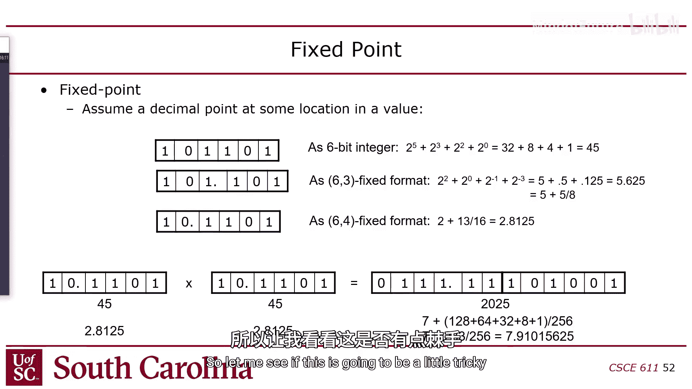
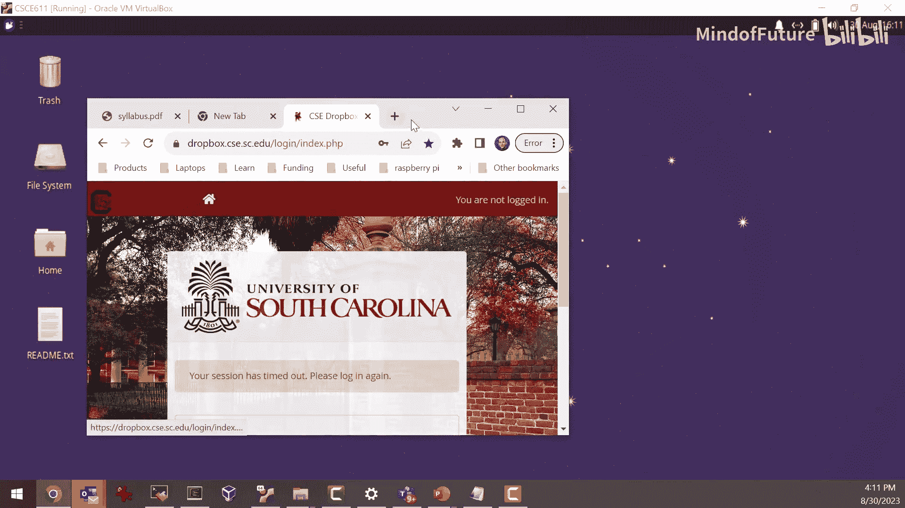
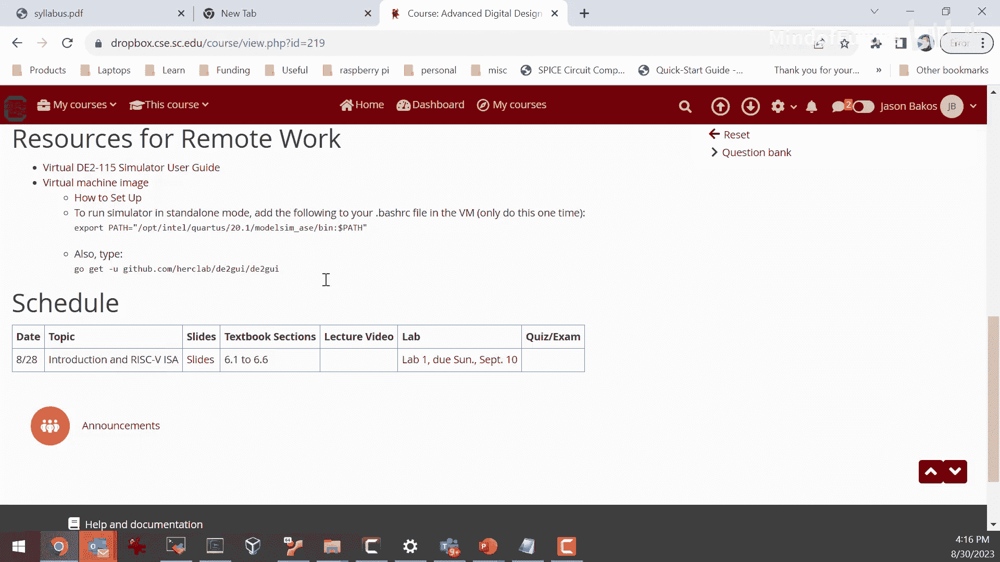
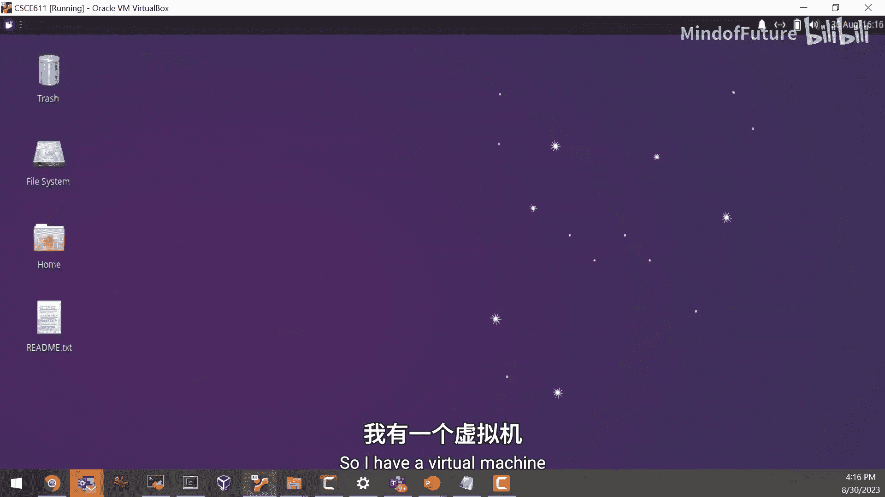
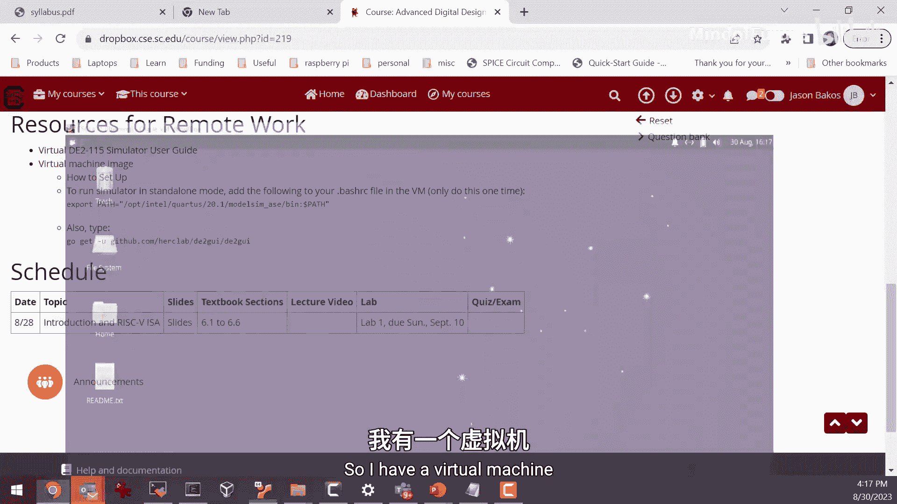
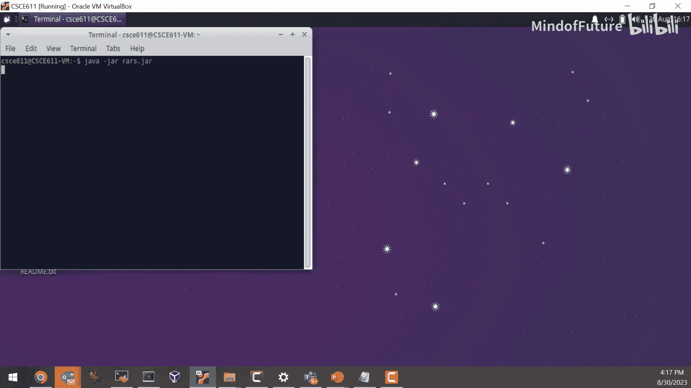
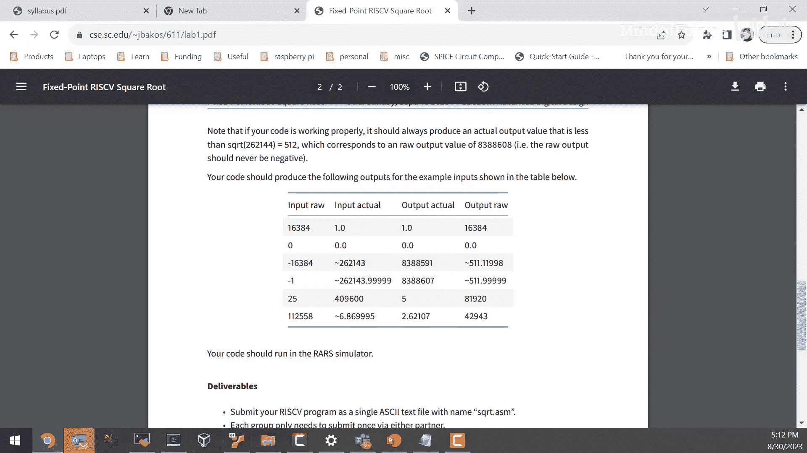

# 高级数字系统设计：CSCE611：RISC-V ISA与Lab1入门 🚀

在本节课中，我们将学习RISC-V汇编语言的基础知识，并开始为第一个实验做准备。我们将了解如何将高级语言结构（如条件语句和循环）转换为RISC-V汇编，熟悉RISC-V模拟器RARS的使用，并初步探讨如何在实验中实现定点数运算和平方根算法。

---

## 条件语句的实现 🔄

上一节我们介绍了RISC-V与MIPS的相似性。本节中我们来看看如何在汇编中实现`if`条件语句。

在汇编中实现`if`语句的一种常见方法是：取原条件语句的条件，将其取反。这样，如果取反后的条件为假，则程序会顺序执行（即不跳转），进入`if`语句的“真”部分代码块。

以下是实现`if (a < b)`的汇编逻辑：
```assembly
# 假设 a 在寄存器 s1 中，b 在寄存器 s2 中
bge s1, s2, else_label  # 如果 s1 >= s2 (即 a >= b)，则跳转到 else 部分
# if 条件为真时执行的代码块
j exit_label             # 执行完真部分后，跳过 else 部分
else_label:
# else 部分执行的代码块
exit_label:
```
这种结构的优势在于，可以将“真”代码块放在顶部，“假”代码块放在底部，并且只需要为`else`部分定义一个标签。

---

## 数组遍历与索引 🧮

在RISC-V和MIPS中，没有专门的索引寄存器字段。这意味着遍历数组时，需要手动计算每个元素的地址。

不能像某些指令集那样，直接使用“基地址 + 寄存器索引”的方式加载数据。例如，`lw t0, array(t1)`这样的指令在RISC-V中是非法的。





以下是遍历数组的正确方法：
```assembly
la t1, array        # 伪指令，将数组基地址加载到 t1
li t0, 0            # 循环计数器 i = 0
loop:
slli t2, t0, 2      # t2 = i * 4 (每个字4字节)
add t3, t1, t2      # t3 = 数组基地址 + 偏移量 (有效地址)
lw t4, 0(t3)        # 从计算出的地址加载数据
# ... 处理数据 ...
addi t0, t0, 1      # i++
# ... 循环条件判断 ...
```
你需要维护一个基地址寄存器，并通过加法计算每个元素的地址。当需要回到数组开头时，必须重新加载基地址。

---

## 循环与地址计算 🔁

在C语言中，编译器知道数据类型的大小，因此`i++`在地址计算时会自动考虑元素大小（例如，`int`类型会加4）。在汇编中，你必须显式处理这一点。

有两种常见策略：
1.  让循环计数器`i`直接按元素大小（如4）递增，并相应调整循环上限。
2.  独立维护循环计数器（每次加1）和地址偏移量（通过移位计算）。







以下是第二种策略的示例，它更清晰地分离了逻辑：
```assembly
li t0, 0            # t0 = i (计数器，每次加1)
la t1, array        # t1 = 数组基地址
loop:
slli t2, t0, 2      # t2 = i * 4
add t3, t1, t2      # t3 = &array[i] (源地址)
add t4, t1, t2      # t4 = &array[i] (目标地址，示例中相同)
# ... 使用 t3 和 t4 进行加载/存储 ...
addi t0, t0, 1      # i++
# ... 循环条件判断 ...
```
这比C代码需要更多的显式地址计算。



---

## 寄存器分配与使用 📝

在RISC-V汇编中，你必须手动进行寄存器分配。你需要决定每个变量在程序的每个阶段存放在哪个寄存器中。

一个变量通常在从内存加载时“存活”，在存储回内存时“死亡”。在这期间，对应的寄存器被占用。

跟踪寄存器用途最简单的方法是通过注释。但要注意，注释只代表程序在特定点的映射关系，因为寄存器会在不同代码段中重用。

RISC-V汇编中的注释以井号`#`开始。

---

## 与常量比较的限制 ⚠️

RISC-V的`branch`指令只能比较两个寄存器的值，不能直接与立即数（常量）比较。

例如，你不能写`blt x1, 10, label`。你必须先将常量10加载到一个寄存器中，然后再进行比较。
```assembly
li t0, 10           # 将常量10加载到临时寄存器 t0
blt x1, t0, label   # 现在可以比较了
```
虽然寄存器`x0`始终为0，可用于与0比较，但对于其他常量，就需要额外的指令来加载。

---

## 本课程实现的指令子集 🎯

在本课程的实验中，我们将实现RISC-V指令集的一个子集：
*   **实验三**：实现算术、移位、比较、立即数加载和`CSRRW`指令。
*   **实验四**：增加分支和跳转指令。

尽管我们只实现子集，但你需要熟悉完整的RISC-V指令集，以便编写和测试程序。

---

## RARS模拟器演示与使用 💻

现在，我们通过一个简单的冒泡排序示例来演示RARS模拟器的使用。这将帮助你熟悉编辑、汇编、运行和调试RISC-V程序的过程。

首先，我们定义数据段和数组：
```assembly
.data
vowels: .word 5, 4, 3, 2, 1
n: .eqv 5
```
然后，在文本段编写排序代码。代码结构包括外层循环、内层循环、元素比较与交换。

在RARS中，你需要先保存文件（例如`risc1.asm`），然后点击“Assemble”进行汇编。汇编成功后，可以单步执行或运行程序，并在寄存器窗口和数据窗口观察值的变化。

使用系统调用可以方便地进行输入输出。例如：
```assembly
# 打印整数
li a7, 1            # 系统调用号1：打印整数
mv a0, t2           # 将要打印的值（例如t2中的i）移动到a0
ecall

# 读取整数
li a7, 5            # 系统调用号5：读取整数
ecall               # 读取的值会返回到a0寄存器
```
本课程使用的RARS版本经过了修改，包含了用于DE2-115开发板IO操作的特殊寄存器，这对于后续实验非常重要。

---

## 定点数表示法 🔢

我们的CPU没有浮点运算单元，为了进行小数运算，我们将使用**定点数表示法**。

定点数的核心思想是：约定小数点的位置。例如，在一个32位数中，我们可以约定高18位为整数部分，低14位为小数部分。

*   **整数部分**：决定数值的范围。
*   **小数部分**：决定数值的精度（这里是2^{-14}）。

在定点数运算中：
*   **加减法**：需要确保两个操作数的小数点位置对齐。
*   **乘法**：结果的小数位数是两个操作数小数位数之和。因此，通常需要对结果进行移位来重新调整小数点的位置。

在本次实验中，我们将使用 **32位，其中14位小数** 的格式。

---

## 定点数乘法实现 ⚙️

当两个定点数（各14位小数）相乘时，会得到一个有28位小数的64位乘积。

RISC-V没有像MIPS那样的HI/LO寄存器。为了得到64位乘积，需要使用两条指令：
*   `mul`：获得乘积的低32位。
*   `mulhu`：获得乘积的高32位（无符号乘法）。

为了将64位乘积转换回我们的32位14小数的格式，需要以下操作：
1.  将低32位乘积逻辑右移14位，提取出其整数部分（4位）和部分小数。
2.  将高32位乘积逻辑左移18位（32-14），提取出其整数部分。
3.  将上述两部分结果进行**或**操作，合并成最终的32位14小数格式的数。

这个过程大约需要5条指令。

---

## 平方根算法：二分查找 🔍

由于我们的CPU没有除法指令，无法使用牛顿迭代法。我们将使用**二分查找算法**来求平方根。

算法思路如下：
1.  设置初始猜测值 `guess = 0`。
2.  设置初始步长 `step` 为可能解范围的一半（例如，对于最大输入约262,000，其平方根最大约512，因此初始 `step = 256`）。
3.  循环：
    *   计算 `guess` 的平方（使用上述定点数乘法）。
    *   将平方值与输入值 `S` 比较。
    *   如果 `guess^2 == S`，找到精确解，退出。
    *   如果 `guess^2 < S`，猜测值过低，执行 `guess = guess + step`。
    *   如果 `guess^2 > S`，猜测值过高，执行 `guess = guess - step`。
    *   将步长减半：`step = step / 2`（通过右移1位实现）。
    *   当 `step` 减小为0时，达到机器精度（2^{-14}），退出循环。

这个算法将收敛到真实平方根的近似值，精度由小数位数决定。

---

## Lab1 实验细节与测试 🧪

Lab1的目标是编写一个RISC-V程序，使用二分查找算法计算输入值的平方根。

**在RARS中模拟的注意事项：**
*   为了模拟FPGA上的定点数输入，你需要将“实际输入值”乘以 2^{14} 后，作为“原始输入”通过系统调用读入程序。
*   由于RARS的系统调用读取的是**有符号**32位整数，当你想测试大的正数（其高17位为1）时，直接输入可能会被解释为负数或溢出。此时，你需要按照实验手册中的公式，将大的正数转换为一个负数输入给RARS。
*   程序的输出也是缩放后的值，你需要手动将其除以 2^{14} 来得到实际结果。

实验手册提供了测试向量，例如：
*   输入 `16384`（即 1 * 2^{14}），程序应返回 `16384`（即 1 * 2^{14}）。
*   输入 `0`，应返回 `0`。
*   输入 `-16384`（对应一个很大的正数），程序应返回一个特定的值。

你可以利用这些测试用例来验证程序的正确性。

---

## 总结 📚

本节课中我们一起学习了：
1.  RISC-V条件语句和循环的汇编实现方法。
2.  数组遍历时手动计算地址的必要性。
3.  寄存器分配的策略。
4.  使用RARS模拟器编写、运行和调试汇编程序。
5.  **定点数表示法**的原理，以及如何用整数运算来模拟小数。
6.  定点数乘法的具体实现步骤（`mul`/`mulhu`与移位组合）。
7.  使用**二分查找算法**在无除法指令的CPU上计算平方根。
8.  Lab1的具体要求、在RARS中的测试方法以及处理大数输入的技巧。



掌握这些内容是完成第一个实验的基础。接下来，你可以开始动手编写和测试你的平方根计算程序了。