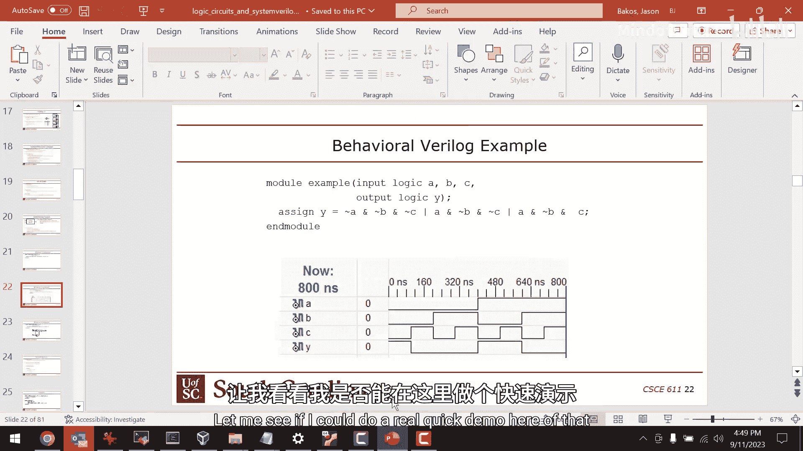
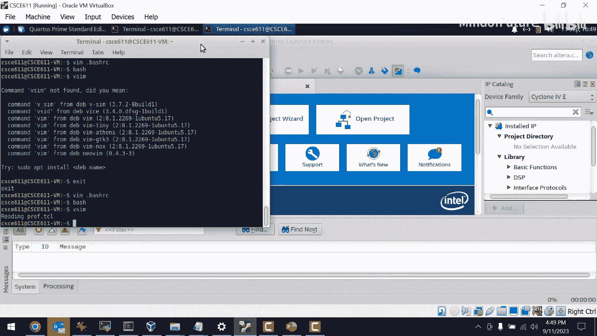
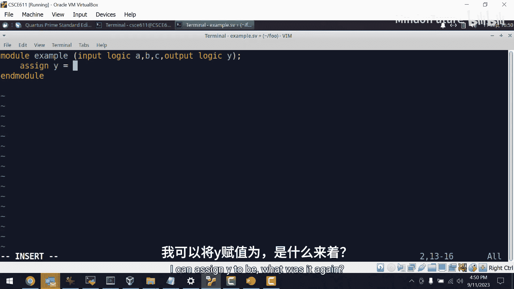
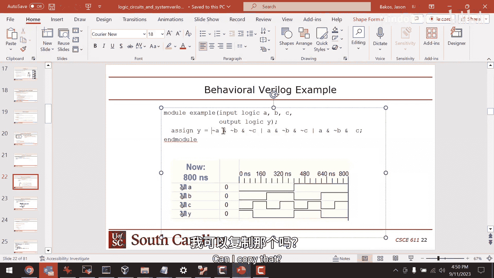
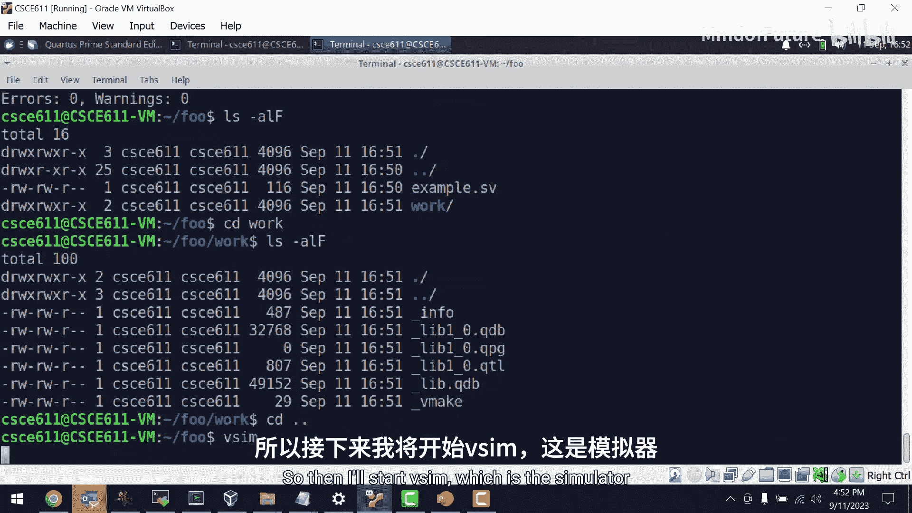
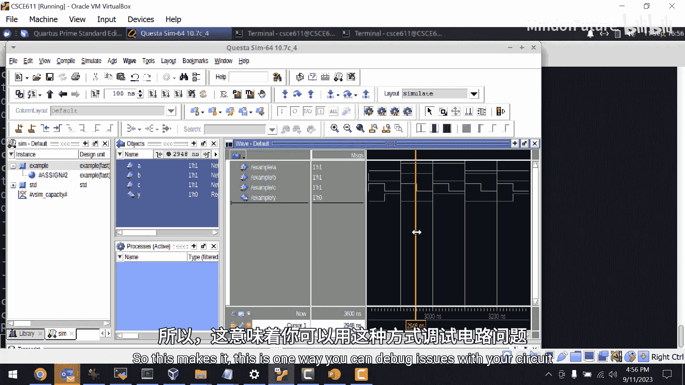
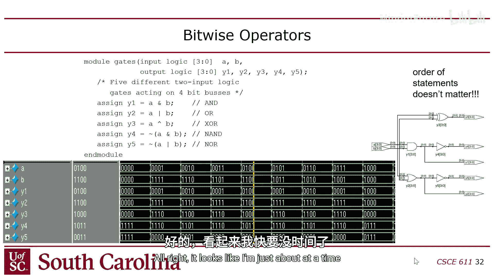

# 【南卡罗来纳大学】高级数字系统设计-CSCE611-（Advanced-Digital-Design，Fall-2023）-p03-P03-Logic-Circuits-and-SystemVerilog--BV19nf6YoEZ9_p3-

Okay everyone， let's get started Good afternoon were there any problems in the lab last week everyone get lab one finished and submitted okay。

I talked to the TAs， they said went pretty smoothly， a couple small hiccups。

I sent an email last week about the lab sheet， had a few bugs in it that I fixed。

 So when I calculated the values in the lab sheet like the test values。

 I calculated them by hand within MatTlab and I didn't realize that the rounding was a little different。

 So a few of you got were off by one or two。 and then and then I also sent out an Excel spreadsheet that basically implemented the algorithm in a spreadsheet and I the Syash mentioned that there was a few questions about。

The the results from the program being off by one from the from the。

The spreadsheet that still confuses me because that shouldn't be the case unless there's a bug in the spreadsheet。

 the the spreadsheet algorithm， as far as I know， should match。

The algorithm that you implement in in Rrs， so I'm still， if there's something going on there。

 I'm still trying to track that down。Okay。嗯。But as far as I know other than that。

 I think we're in good shape。 So we have lab2 ready and we'll start that in lab this week。 Okay also。

 there's a quiz that's on Dropbox。 It's due on Friday。

 make sure you don't forget to take that that will cover the risk5 material and material I'll cover today。

Okay， so today we're going to talk about logic circuits and system ver。So in 212。sorryrry。

 211 rather。Hopefully you guys did some work with bullyan algebra。

And when you the reason you learn Boolean algebra is because。That。

Can be used to define the behavior of a digital logic circuitgate。

So Booleingan algebra is kind of a mathematical concept。

 but it just so happens that it can be used to describe the functionality of a circuit of a digital logic circuit。

And that so that's that's usually called the behavioral representation of the circuit if you write it out in Boolean logic。

 it's one way to represent behavior and that's the way you used it to do it in 211 So basically what I'm trying to say is that Boolean algebra is the way essentially that you represented a program that was implemented in hardware in 211 right and then you also should have done some work with a structural design which is where you build a block sorry。

 a schematic。Or a block diagram。A schematic that consists of these shapes and lines where the shapes represent gates。

 Line represent wires。 And the idea is that you can take this behavioral。Description。

 and you can implement it with a schematic， a boolean logic schematic。

And so the boolean logic is typically or sorry， the schematic is called the structural representation。

 and what's meant by that is。It's it's still a logical representation， it's not physical。

 but it represents。Things that do exist in the physical world， these logic gates， right？

Except the problem is， is that it's still kind of abstract because you just have these logic gates connected by wires。

 You haven't really defined how you're going to build logic gates or where they are。

 right And then there's the physical implementation。

 which is where you take the structural and for each one of these gates。

Or for each one of these shapes， you have to actually allocate some physical entity。

 whether it be a chip or a slot on a chip， as hopefully you would have done in 211。

 use these chips with four slots for gates now you should have at some point or I guess they don't do this anymore。

 but you can take this and you can deploy it on a breadboard by buying these gates。From。

I guess Amazon now be almost said radio shack。 So you buy these things， you put them on the board。

 you wire them up。 And what you're doing here is associating each one of these logical shapes with a physical device on a breadboard。

 right？ That's the physical representation。 So in this class， we're going be doing the same thing。

 We're just going to be using a more practical way to do this。

 So the behavioral representation is no longer boolean logic。

 It's now going to be a high levell programming language called system verlog。

 And there's several of these high levelvel programming languages， hardware description languages。

HDLs， sometimes they're called R TLs register transfer language。 It all refers to the same thing。

 Now， what's really happening here， though。Is it's not as if you're writing loops in this language and somehow circuits are going to run a loop。

 right， It's not exactly what's going on。 You're writing code that is。

You run it through a program called a synthesizer， a logic synthesizer。

Whi is kind of like a compiler， basically， and it's going to convert that into Boolean logic。

 essentially， it just， you don't want to have to design the Boolean logic by hand。

 This is really just automating the process of building that Boolean logic right and it's also going to handle the minimization。

 You guys remember hopefully in 212， you guys talked about minimization where use caraw maps。

To kind of minimize， minimize the cicus， simplify it， but still get the same behavior。

 That's all done in that cad tool that's synthesized。 That's done for you。

 That's all into the hood Now， you don't have to worry about that。 You write some this。

 You write in this bizarre language。 and it will essentially convert it and minimize it down into Boolean logic for you。

 Okay， and then the output of that is stored as a as a。Structural design。

 which is sometimes called a net list， but it's really just a graph。

 It's it's just modules that are connected with wires。

 just like in graph is a you have nodes and and edges。

 right So So you go you synthesize the tools synthesize that into the structural design。 Now。

 generally speaking， the structural design is too complicated ever。 you'll never look at it。

 It's there。 in fact， you can actually open it in Cors， which is the synthesizer we use。

 but you'll never look at it because it's just massively complex because the types of the types of schematics you get from HDLs are just huge。

 right。So sometimes you look at it， in fact， some groups in this class on their own came up with this idea where they get some of the debugging done by looking at these schematics。

 I don't know how they do it， you know they figure out some bugs sometimes by digging through the schematics。

 that's not generally what the way I do it， I just use simulation right。And then what do we do then。

 Well， do you put these into on a breadboard， No， again， its they're too big to put on a breadboard。

 Breadboards would be enormous。 So instead we use a an FPGA field preumbble gate array。

 which is basically equivalent to a breadboard except the difference is instead of having to。

Alloccate gates inside those little chips and then put the chips on the breadboard and then wire them by hand。

 It's done electronically on a large grid of gates。

And they're all connected with a programmable interconnect。

 so basically they use transmission gates which is just a P and an n transistor in parallel。

 which allows you to basically connect two sides of wire or disconnect two sides of wire and that's essentially the principle and then that connection that configuration is just is put in a flipfl so you have a flip flop that stores a bit that bit goes into the transmission gate。

 which either disconnects or connects a gate to these wire tracks that are allocated in the fabric so basically you use another compiler which is called a place and route tool that takes each one of these logical blocks and places them onto a physical block which is actually a little slot on the FPGA and then that's the placement process and then routing is where it allocates the wire tracks generally there's vertical and horizontal routing tracks and you have to make one connection to a vertical one connection to horizontal and that will complete one。

Between two endpoints， two gates right so that's basically the process it's the same thing you did in two or hopefully that you should have done in 211 with the breadboards。

 it's just on a much larger scale now that's the only difference。

 So you have these three representations。嗯。😊，O。Oh， by the way， the FPGA we use in class is this one。

We're now using these things in three classes because we're really getting our money's worth out of these things。

 but this has an FPGA with 115，000 gates on it so you can imagine that you know that gives you a you can build a pretty big design with 115。

000 gates and this is actually a small one the biggest FPG is or about 10 million gates it's the big biggest one。

嗯m。😊，But these ones are pretty impressive for being embedded at FPGA。Okay。

 so embedded meaning it's like， you know， not not on a big board Okay so this is I showed this slide already I'm gonna to skip over this one Okay so what's the deal with these HDLs then HDL meaning hardware description language that's the language we're learning in class how is this different from Java or C+ plus well basically the idea with these is that there's three concepts that're that they're built around abstraction hierarchy and regularity abstraction is where the idea is is that。

You want to be able to take a design and if you look at。Any one file， any one module， right。

 the relative， they look relatively simple。 And you might say， well， you know， that looks。

 you might look at a system very file say， well， that's not that long。 It's only like 50 lines long。

 But there's a lot of complexity hidden in that because of abstraction， you know。

 typically when you look at。A file it instantiates other modules in there and then those modules instantiate other modules and so on right and so the idea is you're trying to hide as much complexity as you can by decomposing your design into into modules into and it's the same idea that use with an object oriented programming language too you're trying to hide complexity and then hierarchy is the same sort of idea。

 in fact， abstraction hierarchy are basically the same thing hierarchy is just the idea that you have you start out with a top levelvel design which is the root。

 your design root and inside that root you've got things instantiateated。

 you've got modules instantiated in there and then those modules are the more abstract ones and then you drill down into those modules and you have slightly less ones and then you go into those and slightly less abstract and so on until you get to the leaves of the tree which are logic gates and fliplos because fundamentally when you boil everything down。

That's basically all you have with digital logic design is logic gates。And in flip flops。

 which are and then there's also Rams and I O pins， I O buffers and that kind of stuff。

 which are little amplifiers to send signals off chip， but。

It all at the leaf nodes of the tree its' most fundamental at its least abstract。

 you have these the same basic things you talk about in 211 right and then regularity is where。

You try to design。That minimizes the number of unique modules。

So you can leverage the reuse on modules。 So you design modules to be reused as much as possible because then you don't have to write that many modules。

 many different ones， right now this is。This is something that is really up to you though as a designer。

 so a lot of students will ask like okay， I'm designing the CPU。

 should I put the control unit in a module or should I just inline it。

 put the code for the control unit just in the CPU design or should I take that code and package it into a module。

 in other words should I outline it。You ever heard the word inline and outline。

 So in programming languages， inlining a function is when you replace the call to a function with the code that function would execute。

 That's called it an inline， right， An outline is when you take code。

And you move it into a function and replace it with a call to that function right so it's the same kind of idea is that you have to decide what you want to put into modules。

In ver log。 and you want to do that in a way that maximizes the reuse of those modules。

 So you want to try to boil everything down。 So you in a way where you have the minimum number of unique designs that you have to deal with。

 Okay， so here's an here's an example that kind of shows this。 So your CPU might be the top level。

 In fact， that's what it'll be in this。 Well， actually， that's not true。 We'll have a。

We'll have the FPGA design will be the top level， and then you'll have a CPU。In there。

 And then the CPU， a typical CPU might be comprised of multiple processor cores。

 So you'll instance each core。 in each one of those cores will be identical。 They're just copies。

 There' are basically four copies of the core， right。

 But then if you drill down into one of those processor cores， you may have， say。

 a floating point functional unit， for example， as well as register file and other things that make up a processor core right。

 now we're not doing we're not doing floating point in this class。

 but this is just know like like a real processor。 If you drill down into a floating point function a functional unit。

 you may have in there an adder。Right if it can do add and then and you may also have a multiplier。

 so the adder and the multiplier are both inside that functional unit， if you drill into the adder。

 you'll have a comparator for comparing exponents。A shifter for deormalizing one of the significance。

 right？And an adder for actually adding the significance in the floating point format， right。

 And then inside the comparator that compares the exponentence。

 that's actually built around a subtractor， integer subtractor。 So you'll have a subtractor in there。

 And the subtractor， if you drill into that， that just has an adder。

 because in order to build a subtractor， you just add a number to。😊。

The negative form of the second opera end， right， So the subtractor has an adder in it and the adder。

 if you drill in there， you'll get some full adders， which are single bit adders， right。

 And if you drill down the full adders， you'll get gates， X or gate， essentially， So this way。

 you can see that after going through 1，2，3，4，5，6，7，8，9 levels of hierarchy。

 you go all the way from a CPU all the way down to X or gates。

 But all that complexity is built into this this hierarchy， right。😊，makes sense。

 but the hierarchy is purely for the convenience of human beings because when you well when you synthesize this。

 I think there's still hierarchy in the net list， but eventually when you convert this into a form that you deploy on the FGA。

 it gets flattened， this hierarchy gets flattened， it just gets converted into one big mess。

 because in reality， what this really boils down to is a mass of gates and wires。

 a big rat's nest of thousands or millions of logic gates connected with wires。

 this hierarchy is just just the way that it's represented as a design。

 it doesn't actually matter for the real hardware， the real hardware is just like I said。

 everything there's no notion of hierarchy in the hardware。

 at some point when you bring it down to the physics， the physical system， it gets flattened。

 which is why you can see like when you do the。When you do like a breadboard based design。

 you know it always inevitably turns into a mass of you know chips and wires。

 you can't really make heads or tails at looking at that。

 which is why you know can't once you get it into the physical layer。

 you can't really debug it anymore， it's just a big mess。

It especially like if you ever looked at a layout of a modern ship。

People like to take pictures of the。The layout， right， the way the physical chip looks。

Like when you go to a conference， like the design automation conference。

 all these big posters with pictures of chips and you look at it and it's just a bunch of massive wires and shapes。

 no one can make any sense of that， but you're not supposed to。

Because this making sense of it requires you to look at the HDL form of it right。Let's oh yeah。

 and by the way， the regularity part is notice that I tried to show like for example， in an adder。

 you have multiple copies of a full adder and in the the processor you have multiple copies of the functional unit right so you'll see a lot of repetition。

 a lot of copying。And that's the regularity， right， So that's how chips could get so big。

 Like I used to always wonder， you know， when I was in school， like people say， you know。

 like the latest Intel chip has 10 million transistors on it。 I'm like， who the heck wire those up。

 That's no no human being can do that。😊，And it's true。 no one could， because first of all， there。

 there's automation there。 You know， the tools are automating the， the layout of those transistors。

 But even the functional description of what those transistors does。

 there's a lot of copying in there。 There's a lot of。You know， there's a lot of this regularity。

 There's a lot of， you know， I'm going take multiple copies of this design。

 and I'm going to stamp them out。 GUs are famous for this because if you look at a GPU， you know。

 it's very easy to scale up a GP design， because GPs are very regular designs。

 They take a core and they just stamp out a whole bunch of them。 And GPUus have many cores。

 It's a very homogeneous style structured regular design。

 That's why there's so many different GPs out there。

 because it's very easy to take a GPU and just add more cores to it， right， whereas CPUs。

 on the other hand， are much more the harder design because they're more irregular。

 They're more head there's more diversity inside the design of a CPU。 Okay， anyway。

 so now let's quickly review a few things。When I talk about logic gates。Or logic circuits。

A logic gate is a type of logic circuit you guys remember that you've got things like an inverter or a buffer and you can represent these in the functional form in Boolean logic so for example。

 an inverter has a symbol that looks like that and it has a boolean algebra functionality where you say the output y is the logical complement of a the logical complement as a bar they never standardize this by the way。

 sometimes when you see boolean algebra， they use a bar， sometimes they use a tick。

 there's different ways to show complement but anyway and then you can also show that as a truth table right now generally when it comes to schematics。

 only the gates have these symbols once you start coming up in the hierarchy。

 these gates go away and you just end up with blocks。

So the idea is is that if you drill down to the hierarchy to the bottom。

 you'll eventually see these gate symbols， but usually you don't see that because you're not always looking at the bottom level of the hierarchy。

 you're looking at someplace in between the top and the bottom， in which case you have just blocks。

 which is why they call those block diagrams， right？Okay okay， then we have an an gate。

 which is you know two inputs， one output the output is true only when both inputs are true an orgate you know An gate and orgate have those symbols and the Boolean logic is shown there you guys remember this stuff Okay so just just want to make sure we're on the same page then we've got different types of gates X or and N nor X nor gate。

And then you can have things like multiple input logic gates。 Now in an FPGA。

 you don't have fixed logic gates。What you have are Lu lookup tables。

 those lookup tables on this FPGA have。5ive inputs。Six， I don't remember。

I don't remember what the cyclone has。 It might be。6ix input gates。But anyway。

 when I say 115000 gates on an FPG， what I'm talking about are reprogrammable gates。

 which are in the form of lookup tables。 So what you do is you have five inputs and one output and that gate is actually lookup table which is a Ram it's a memory and so basically what you do is you take the truth table for whatever gate you want to put there that you want to assign in that slot and you load that truth table in as if it were a memory where the inputs are the address and the output is the actual contents that you're storing in that memory So that way you can create an arbitrary five input gate or six input。

 whatever the case may be different fPGs have different numbers of inputs on their lut depending on what fPG technology you have but basically you take these lookup tables and you assign them arbitrary boolean functions but you're limited in the number of inputs you're limited to five Now if you don't have five。

 you don't have to fill the whole lot up you can have less than the less you can use less。

than the maximum number of inputs， but obviously you can't use more if you need more。

 you're going to have to build out into multiple gates， right， build a circuit out， right。Okay， so。

 so， so a logic circuit， when I， whenever I say logic circuit， a logic circuit is。

A digital logic circuit where it's defined as having inputs， outputs。

 a functional specification and a timing specification。 Now， you may wonder what's， why is this。

Why is this conceptual stuff necessary Because a logic circuit is actually maps into a module in system ver log and a module is almost kind of like a class in Java right so you've got you could you have these inputs when you define a module in system ver log you define your inputs and your outputs first that's right at the top right and then inside the module is where you can have internal signals that are not visible outside the module right so for example this n1 signal as an internal signal you can think of that like a private variable if this were a Java class right and then normally these modules are basically just contain instantiations of other modules so these E1 E2 E3 are instances of other modules like like objects that are inside that module and so most modules in system ver log that you'll see in the wild are structural。

Modus， in other words， they're basically just a module that has the inputs and outputs and then inside is just essentially a schematic but the schematic is written in text as opposed to graphics like this this is a graphical representation a block diagram but everything you do in system very is in a text file like a Java source code file now you might say wait a second hold on why in the world would anyone design a schematic in text when it really should be naturally displayed in this graphical schematic format right engineers always use schematics right yeah there are actually tools that will allow you to enter a schematic。

And it'll just convert it to a textual format， and I'll show you how that works here in a minute。

 The problem， in fact， we used to use one in this class years ago。

 but we quit using it because no serious， serious engineers， you know， digital logic guys。

 they don't use that， they just use the text right the other problem too is that if you get an error。

 the error message will reference a line in the text file， but if you have a schematic。

That gets automatically converted to text file， you don't know where the here is because it's pointing to line 27 and you don't know where line 27 is in this picture right so we made the decision like 10 years ago to just use the textual entry method right。

Okay， so another thing I wanted to review here is I don't know if you talked about this in 211。

 hopefully but there's two types of logic circuits， there's combinational logic。

And sequential logic combinational is where the outputs are function only of the inputs。

 So this would be equivalent to just having logic gates with no memory， no memory cells。

 no flip flops or no latches or no Rams， right， that's combinational logic。

 And so whenever any of the inputs change。The outputs。Are updated to reflect the change in the input。

 right， now， this is where things get weird。Because。

A digital logic circuit is going to have a bunch of these elements。

 a bunch of these combinational logic， you could think of them as like you circuits that evaluate an not combinational logic circuits。

 right？And they're all operating concurrently， they're circuits like basically anytime an input changes。

 the corresponding output will change very soon thereafter。

 regardless of where that logic circuit is in your source code right So what we end up with is a system error log file which looks like looks like the language looks like Matlab or like a cross between MatTlab and Java and Python basically。

 but it uses concurrent semantics， every line of that file is representing one of these combinational or sequential logic circuits。

 and so you can scramble the order of the lines and it makes no difference because what you're doing is describing a circuit right and then of course。

 sequential logic is where you have memory So that's where you involve a memory element like a flipflop。

Or Ram。 And in that case， the output is is a function of the inputs and， you know。

 whatever the history of the inputs were， right Okay， so。Okay， so。Yeah。

 so if combinational circuits are comprised just of logic gates and the only thing you have to be careful with these is you don't have any cycles the other way to create sequential logic is if you have a cycle from the output feeding back into the input and you have to you know in the case of you don't typically design sequential logic。

 at least not in verlog in that way， usually just use the elements。

 the building block elements like fliplops or Rams it create sequential logic circuits。Okay。

 so when you're reading these schematics。These block diagrams or schematics， there's a few。

 you have to get used to reading them， obviously， when you first look at them， they can be confusing。

嗯。And one of the strange things about them is the wires。 So schematics are kind of hard to show。

 actually， because when you have a group of， you have a group of nodes that are connected by wires。

You can lay those out any way you want， right and there's there's some ways that you can lay them out that sort of reduce the amount of crossings。

 wire crossings。Right。And then there's some ways you can lay out a schematic that sort of shows the inputs coming in from the left and sort of flowing to the right。

 But they don't have to be laid out like that。 right， So that's that's another reason why。

 by the way， if you compile your your code in coresison and you look at the schematic it generates。

 it's really hard to read because it's just machine generated， right， there's no。

Human artistry there to try to。To try to lay those out， okay。

 but when you're reading one of these things， one of the things that's a little confusing。

Is the notation So whenever you have two wires that connected at T junction like this。

 it's implied that they're connected right？But if you have two wires that cross like this。

 they're not connected。Because what ends up happening is that。

You're going to end up with a lot of crossing wire Well generally。

 if you have enough modules in there， enough nodes in your design。

 you're you're going to end up with these crossing wires， right， And so it' it's hard to avoid that。

 You want to try to minimize it。 But if two wires do cross。

 you assume that they're not connected unless there's a bubble there， right。

 But if you have this T junction， then， of course， they must be connected， right。

 Because why else would you have that， if if not to show that these were connected， right。

 the only other option would be what this， this wire is just a stub， not connected anything， right。

 So if you see a T junction， they're connected， if you see a bubble they're connected。

 But if there's just a cross， they're not connected， Okay now。

 the reason I'm bringing this up is that。In this class。The objective is to design a CPU and so。

I'm going to be describing to you how the CPU works and I'm going to be showing you the design of the CPU through schematics and so your job basically is to take those schematics and convert them to system Vlog and then then it's just a matter of compiling them and the compiler does all the work of the synthesis right。

 the synthesis converting the code to gates and then taking those gates and putting them on the FPG and connecting them all that's all done automatically。

 you don't have to worry about that All you essentially have to do in this class is take my schematics and convert them to system V。

So if that's really what we're trying to cover in this class， at least the first the first half。

 Okay， Okay， so one of the things also that comes up often with these things is。

Whenever you have a wire， so let me back up here a minute。

 so in Vlog when you have a variable in verlog。It's a wire。So you've got inputs and outputs。

 which are。Variables， essentially， symbols。 And then you've got internally declared symbols。

 variables。 those are wires， too。Right， so basically。

 what you do is whenever you have a named variable。It represents a wire。The problem is， is that。

Any logic circuit that sets a value on that wire or that's responsible for setting the wire。

 like we call it driving any circuit that drives the wire。Is the owner of that wire。

Because if you have another circuit that drives the same wire。There's the potential of a contention。

Which is where you have if you have a logic gate that's driving a wire and it tries to pull it up to VDD to1。

 the logic 1， and another circuit is trying to pull it down to logic zero but down to ground。

What you end up with is a short circuit。Which will。As my former grad student used to say， it'll。

Release the magic smoke， meaning that the chip is fried。Because。Transistors。Have a， you know。

 they have a。A very low on resistance right So when you're pulling up when you're trying to connect an output to VDD and connect another output to ground。

 it creates a low resistance path right So you end up syncing a bunch of current through that path。

 So it puts the signal into contention， which means it goes basically a voltage between logic 1 and logic 0。

 which is the forbidden zone。 It's not defined in Boolean， right。

And because of that large amount of current it flows。It can cause a lot of heat。

 It'll heat up and burn out the chip， right， so you can only have。One driver for each variable。

 right however。You can have a lot of circuits that read that wire。

 So that' that's basically called fan out。 fan out is when you have one circuit that sets a value。

 but then it kind of branches off and goes to a bunch of inputs on other logic circuits。 That's fine。

 as long as only there's only one driver Now the problem is。

 is that how do you know if you're accidentally double driving a wire。Well。

 if you try to synthesize a circuit that does that。You'll get an air。

Synthesizer will give you an error。But。One of the things I didn't mention is when you synthesize。

 it takes a long time， it's not like compiling software。

Synthesis and place and route take a long time。Because。All three of those steps are NP complete。

 they're all combinatorial problems， they're all exponential problems。You guys。

 so you guys remember from。211 when you did the carall maps。

There was often more than one solution to the Carnal map right and if you and you guys just did small ones right when you do a big caral map。

 there can be a lot of solutions right， In fact， there's an exponential number of solutions。And then。

When you're choosing which of the logical gates from your schematic to put on the physical slots on the FPGA。

Well， there's an exponential number of ways you can do that too。 Likewise。

 when you're allocating the wires when you're deciding how to route the wires right through the little grid of wires that you can attach to horizontal and vertical wires you can attach the driver and the receivers to。

 there's an exponential number of ways to do that。 But also in order to get your clock speed as high as possible in order to minimize the worst case timing delay。

 the worst case path， the critical path delay， it's actually an optimization problem where you're trying to cluster together。

Not nodes that are connected right because you want to shorten the paths between them right。

 you want to minimize the path lengths。 And so all of this takes a while in this class on these FPGs and with the designs you guys have。

 it's not too bad。 it's about 5 to 10 minutes per compile。

 But the problem is is even then that's too slow for you to iterate on your design。

 it's too slow for you to go through a cycle where you modify your code and test， debug。

 modify your code test and debug， it takes too long。

 So instead you're going to be using a simulator right And in the simulator。

 if you double drive a signal。It becomes an x value， so normally。

The variables in system very log or boolean they're zero or one， right？

But then there's a third value of x， X means don't know， contention， right？

And then there's also a fourth value called Z， which means that there's no driver。

 No one's driving this。 Z means high impedance。 It means that there's no circuit that's pulling that wire either to power or to ground to0 to1。

 And so it's just kind of floating there， rights it's not energized right that's called high impedance。

 So system error log uses what they call a four state logic。 There's z， which means high impedence x。

 which means conflict or don't know or don't care we'll get to that x means can mean different things in different contexts。

 and then， of course， you have0 and1。 Now， system error log also has varying drive strengths for 0 and1。

 They have a strong one and a weak1 and a strong0 and week 0， but that's don't worry about that。

 that's outside the scope of this class。 We're not going to deal with that。

 We're only going to deal with the four states，0，1， don't know and in high impedance Z， right。

Hes with me like there's also high and low for each of those Yeah， there's different drive strengths。

 Yeah， the only reason I bring it up is you might notice in the simulator。

 sometimes it'll say like if you， if you set something in the simulator。

 it'll say St1 like what's ST1 ST1， It means strong one。 It just means it'll overpower a weaker one。

 but that's we're not going to deal with that that just complicates things even more in real life。

 though。You know， there's just0 or1 right they're binary signals right， but in the simulator。

 you have these other options that are designed to help you debug your circuits and find problems Okay。

 right， and there's Z， okay， I just talked about that right Okay and by the way。

 the reason why you have Z is if you do want to have multiple circuits that drive the same wire。

 you can make it so they don't drive it at the same time you can time multiplex it and you can use Z for that。

So that way you can have one module setting the value of a wire and you can have the other ones disengage with a Tri state buffer and drive Z。

 but we're not going to I just bring this up because it's basic ver。

 we're not going to actually use that in the designs in this class。Okay， everyone with me so far。

Any questions？Okay。So I know I'm going fast， but I'm going to circle back on most of this stuff when I start showing examples。

 Okay， so hardware description language is it's been around for since the early 80s。

And believe it or not， there's really only two that are in widespread use。

Which might seem unbelievable， right because think about how many programming languages are there tons。

 how can there be only two hardware description languages， Well there is more than two。

There's one out of Berkeley that's gaining some traction called chisel。

There was one out of MIT that kind of fizzled out， it's called blue speck。

But VHDL and Verrlog are still the two， they still have both nearly have about 50% market share。

Vrlo is generally more used in industry and VHDL is generally more used in academia。

 We used to teach VHDL， but we switch to Vrlo because that's what the companies are all using。

 And most of you guys are going to go to companies work at companies right so we switch to Vrlo。

 but they're very similar if you learn one you can very quickly pick up the other because they both have equivalent constructs。

 So just to give you a little bit of history here， it's kind of fascinating how these started out。

 So VHDL was first。And VHDL is it's based on Pascal。Many of you have seen Pascal。

 Pascal is unique in that it is case insensitive。And it's verbose。 So like when you declare an array。

 you actually have to type out array。 When you declare a function， you have to type out function。

 right It's designed to be selfdocumenting。 So when you read it。

s it's more readable right because it's verbose， but it's a pain in the but to write to type all that stuff out。

 no one wants to type out function。 no one wants to type out you know。

 all this extra extraneous text right So that's why I don't like VHDL ver log， on the other hand。

 is closer to what you guys are used to K sensitive language and it's kind of like C and C plus plus and even Python。

 It's very sparse right kind of hard to read。Though right， is a downside。 Okay。

 so VHDL was first and this is cool。 I like this story so。😊，It came out of the Defense Department。

 so the US military buys a lot of custom chips， or at least they did。Back in the 70s。So。

 you know they didn't have a lot of things where you could just buy an off the shelflf Intel processor to put it in an Abrams tank to control the turret。

 you just you couldn't do that， you had to buy a custom processor for the turret on the Abrams tank。

So they would go out to these vendors and they would say， well。

 we need a processor that controls the turret， and they would have to describe what it does in English prose。

Like just talk， write a paragraph on what the chip should do， but it's that's not very concise。

 That's not very， there's a lot of room for interpretation if you're trying to describe the behavior of a chip。

That you're sending to a vendor to design， but you're describing an English language that that's。

 I mean， think about how would you do that， right， How would you catch all the corner cases and the different behaviors of the chip。

 So the DOD developed V HDDL as just a way to concisely describe functionality of a chip。

It's a recursive acronym that stands for Visic HD HDL iss harder description language。

 ViysIic stands for very high speed integrated circuit。And so it started out where， you know。

 instead of writing an English paragraph， describing how this processor works that controls the turret。

 you would just describe it in in this language which is like a programming language。

 And that would much more accurately describe what the chip does right。

 And then eventually they came up with。Tools that could simulate the the VHDL or even compare like like devices that would take the chip from the vendor。

 You plug it into a socket， and then you run。The next to it。

 you run the VHDL simulation and you compare， you compare the output of the chip to the output of the simulation。

 and then you can guarantee that it works as designed or as intended， right。

 that way you can keep these defense contractors honest， right， That was the whole idea。

 But then later on people said， wait a minute。Why not just write a compiler that'll take the VHDL and actually generate the whole chip design？

Right then you just。Basically， have a computer design the chip。

 You don't need the defense contractor， guys。Drawing it out manually， right？M as well。

 And that's what they did。 So they first came out with the simulators。

 and they came out with the synthesizers， right。And so it was adopted as an ITEE standard in 1987 and it's been updated throughout the years。

 Meanwhile， there's another language called Verrlo and that one came out， V HDDL was 1981。

 originally 1981， Verrlog was three years later and that one came out of industry。

So you can kind of see why I mentioned， you know theirlog is more even to this day。

 Vrlog tends to be more industrial whereas VHDL is used by academics and universities。

 it kind of traces back to their beginnings， it was developed by a company that was eventually gobbled up by a synopsis。

 one of the Big CAD companies as they usually do， and it became an IEE standard in 995。

So it was actually lagged behind DHDL by about eight years， but Verlo is a better language， I mean。

 there's no doubt it's much， much， much nicer language to use。

Now now it's called system Vlo because system V log is one of the updates they've been constantly updating it because they keep building in a lot of testing functionality。

 chips are hard to test and so you have a language where a tiny piece of the language is where you design the actual hardware with a subset。

And then there's a superet of the language that's used just for testing and simulation。

 but it's not synthesizable。So there's a lot of things you can do in Ver log and VHL that cannot be converted to hardware。

 compiled down to hardware， synthesized down to hardware right you can only simulate them right So if you're designing。

 if you're using this language for the purpose of designing hardware。

 you're kind of constrained on what feature of the language you can use。

 but if you want to do some fancy testing stuff to take a design that is intended to be hardware and then run it through this simulation framework。

 there's other things you can do in there， like for example。

 reading files you can't you can read files in verlo， but how would that work if it was in hardware。

 the hardware， the digital logic circuits can't read a file。

 they don't know what a file is So you can like read files for getting test vectors。

 test cases and then use that to send the data into the design under test to test it and we're going to be doing that we are going to be doing that in this class。

 any questions about that so I mentioned there's simulation their synthesis or just。

Aware of the difference there。Okay， so Ver log is built around modules which is think of it like classes in Java and each module is a the module is a unit that's used to leverage abstraction。

 regularity and hierarchy right the whole reason we have modules is based to try to maximize the ability to generate massively huge digital logic circuits without a lot of typing。

By leveraging the hierarchy and the stuff I talked about earlier。

 and so how you organize your modules is important。Okay， so modules， by the way， inside a module。

 I mentioned modules start out with their input and output spec right。

 and then they have their internal implementation， and by the way in VHD they're called entities instead of modules。

 that's the same thing。Um。Inside the module， you can have behavioral or structural code。

Structural code is a schematic。Behavioral code is。Bulan logic， basically。Right。

Or like a state machine that can be mapped directly into a。Sequential logic circuit。You guys with me？

As I mentioned， most times it's。Most times as you're up in the hierarchy， it's going to be。

It's going to be structural code。Okay， so here are some examples。 So this module is called example。

 typicallyy modules are in their own file and the file names。Match the module name。

You might be thinking wait a second that that's three lines long like you're going to put a three line long module in its own file。

 yeah。Yeah， that's how it works， that's weird。诶。😊，So module， my example。

And then you have your inputs and outputs and then a semicolon。Which is strange。

 There's no notice there's no curly braces。There should be a curly brace there， right。

 but there's not no curly braces。There are curly braces， but they're used for bit concatenation。

 they're not used for。Defining the beginning and end of a boch。Okay。

 so the syntax takes a little getting used to。So let's take a look closer look， so you have input。

 logic， A comma， B， comma C。So first of all， you'll notice that。

The data type of these things is called logic。Logic is just logic。

 it's binary There are other data types。But they're mainly used in non synthesizable code。

 So if you're synthesizing the code。You're going to be most likely using logic right there are a couple exceptions to that。

 but generally speaking use logic， right？嗯。And then notice that you've got A comma B， comma C。

 So what's happening there， you've got A and then B and C are inheriting the same type of A。

You can't do that in C++ or job。Right，Normally you would have to say input logic A， comma。

 input logic B， comma input logic， if you're using like the C plus plus style， right， but in ver log。

That's optional if B and C have the same type as A， then you just list them。In sense。

 but then if you want to change the type， like I want to now want to do output logic Y。

 then I have to say output logic Y。You guys with me now notice I put a， a new line。

 a line break after C， it's optional。In fact， most people will put a line break after each input to make it even more readable。

Now you might say， wait a second， that just looks like a function that looks like a method prototype right。

 Yeah it does except。Modules in Ver log very often will have tons and tons of IOs。

 That's the problem， lots of them， much more than your methods will。In Java。

 so that's why a lot of people are kind of they like to organize they like to format these things in a special way because there can be a lot of these things。

 a lot of IOs， this one is a small one。Okay， and then you've got at the bottom。

 you've got end module with no semicolon after it。 So why do you have a semicolon after the module line and no semicolon after the end module line。

 it's unclear。 I don't know。 don't know why they do that。But if you put a semicolon after end module。

 you'll get a syntax here。 And if you forget it after the module， you'll get a syntax here。

 and then inside there。We have just one line of code and it's an assign。

 So that one line of code is going to create a logic circuit。 that's combinational， no memory。

 and it's going to assign Y is the output。 So it's going to own why you don't want to have anything else drive Y。

And it's going to use A and B， it's going to reference A B and C multiple times。

 but this is just a Boolean logic statement。So this just creates a boolean logic。

Or bullan bullolean algebra expression， right， a function of A， B and C。Make sense。Okay。

 so then how do you test this？Well， this is where it gets even crazier。

 So they're tested in a this would be tested in a simulator， a discrete event simulator。

And the reason I emphasize that is that the way the simulator works is this code uses concurrent semantics so I mentioned that the order of the lines。

 there's only one line， so it's a bad example， but there's only one line of code here。

 but if there were multiple lines of code the order of those lines in the file would make no difference because each one is a circuit and so any time any of the inputs change by inputs。

 I mean anything that's on the right hand side of the assignment statement right anytime those change。

 why we'll be updated in this case immediately right now in reality there's a delay real real circuits have a delay right but but't we're not defining any delays here because this is we're just defining the functionality。

 we're not incorporating the technology here that would cause there to be a capacitance and a resistance that would cause the logic to have a delay so any time any of the inputs change。

 the output changes immediately。So you can't really run this through a like run it at a shell prompt like you can。

 like a Java program。 you have to simulate it in a simulator in the simulator。

Represents the state of each signal in a timing diagram generally。

A timing diagram is a plot that looks like an oscilloscope where the horizontal axis represents time and the vertical axis represents0 or1 right for each of these signals and then the signals are arranged vertically right So what's happening here is that A。

 B and C are inputs and they're being driven by an unseen force， something outside this module。

By some kind of test apparatus that sending in。Values of A B and C。

 they're sending an input stimulus， meaning that they're exercising this circuit by sending in values of A B and C。

 and those values are accounting sequence。 You'll see that it starts out 0，0，0 and then it becomes 0。

0，1 because C goes to 1 from 0 to 1。 And then it goes 0，10。

 which is you know2 because because B has a rising edge and C has a corresponding falling edge at the same time right And then then you've got a rising edge here on C at this point in time。

 right So basically if you took a vertical line and drew it through this。

 that would be the state of wherever that line intersects the signals would be the state of those signals at that moment in time。

 right So you have to think of this like cut it through here and you have the signal。

 So if I cut it through here， I end up with a true in false value for A B and C and a corresponding value for y。

 So essentially this is a truth table。It's just shown as a timing diagram。

But what it's doing is it's going through all the combinations of A， B， and C， right。

 It's going through 0，1，2，3，4，5，6， and 7。 Eventually7 is where all three are high， right。

So I'm going through all the possible inputs， and then I'm looking at the corresponding output for y。

 and this is a way that I could test the circuit。Because I could then compare this， why。

To a truth table that I。Drew out ahead of time， right？

That makes sense now no one tests circuits like this， obviously， because the more inputs you have。

 the number of input combination skills。You know， is  two to the power N where n is the number of bits。

 right， So this is not going to scale up。 But for this small circuit。

 I can do a brute forced exhaustive test。 And where essentially， I drive A， B And C。

 I let that module take care of setting Y。And then I compare y to what I expect Y to be。

 and hopefully it matches。Makes sense。So that's the way you run it。Let me see。

If I could do a real quick demo here of that， all right， so I am in Linux。

Yes， I'm now in Linux。Via the magic of a virtual machine。 And so if I create a directory called F。

Then I can create an example dot Sv。Way hold on。 You guys can't read that。There we go。 That better。

 Yeah， vim example dot S V。Okay， so module example。Input， logic。ABC。Output， logic， why。

 why semicolon and module。 And then I can assign the。Set tab space4，4。Yeah， I can assign why to be。

 what was it again？

This。Can I copy that？

卡啡。Paste， there we go， Okay， so there we go。And I'm going to exit， okay。

 now when you want to run this， you're going to type we're going to use a simulator。

're going we're using a really powerful simulator in this class。 Seriously， we're using Questa Sim。

 Questa Sim is actually the industry standard。Logic simulator for this。 This is what Intel AM D uses。

 There's no logic simulator more powerful than Questaim。They give us a。

 obviously they give us an academic license for it。

 they give it to us cheap why because they want us to train you how to use it so they can remain the leader。

 right？So to run， so the first thing I need to do is I have to take the V log file。

And I have to compile it into a binary format that's read by the simulator。 So for that， I use V log。

 So I just type V log example dot S V。 Okay， and when you do that。

 it's going to create a library here called work。 Okay， an inside work。诶。There's some。

 some crap in there that I can't read because it's all proprietary。 right， So then I'll start V Sim。

 which is the simulator。

Okay， so once that opens up， it says， now this is what I was talking about， by the way。

About the tools， even though this is the most powerful tool for doing this available。

It's still very user unfriendly。 So basically to use it。

 you want to you want to say start simulation。And you'll see there's all these libraries here。

 but the one at the top is work， that's the one I actually use all these other ones are the builtin libraries right that have simulation models of various types。

 so I'm going to just select work okay and I'm going to go to optimization off I'm going to say full visibility。

So I can see internal signal， Of course， there are no internal signals。

 So I guess that doesn't matter。 Okay， so I hit okay on there。 And soon as I do that。

 it's going to reconfigure this simulator。 And you see it has all these。Kind of pains in here。

So on the left side is my design hierarchy， but the design hierarchy is flat。 I just have example。

 I don't have anything instantsated in there， so I don't have anything really to look at over there here I've got my wires。

 and then this is for processes， this is for if you have always blocks which we'll talk about a little later so I can take these signals here。

 ABC and Y and I can say add to wave。And you can see。There's a waveform right， and you can do。

 I know it's kind of hard to see there。But that's A B and C and y。

 And if I can hit this little button here I can turn off the little prefixes。

 The reason the prefixes are there is sometimes you add signals from different levels of the hierarchy so you have to have prefixes that let you know where it is right and then。

And then， you， basically you can just run it， right， so you run it。And there we go。

 so nothing's going on here because。A， B， and C or Z， high impedance。

 because I never didn't set them anything。 their inputs。

 And there's nothing inside of this designed to。To set them， actually， if you did set them。

 it would give you an error you say you can't drive an input right， So and of course， y。

 because y is a boolean logic function with z as inputs， it's going to put out an X， right， So oh。

 also notice that there's an H there。 Actually， there's a one apostrophe。

 I don't know if you can read that。 But it says one apostrophe H。 The H stands for he。

And the one apostrophe means it's a one bit， right。

 This is actually the same format that verlog uses。 Okay， so how do I exercise these guys， well。

 I'm going to go over here and say， clock， I'm going to set up a as a clock。

 and I'm going to give it a period of。嗯。actually， yeah， one2， 400。With a duty cycle of 200。

 duty cycle is how long it's high versus period is the repetition period。嗯。Oh。

 I guess 50% duty cycles， 50%。I forget how this works only 400。 Yeah， okay。Okay， to that work。

 let me test it out。Run， run， run。 Oh， there we go。 Oh， it works。 Look at that。 Look at a。

 look at it。 go。 Okay， so then B， I can set that guy up clock。

 I'm going to set him up with a period of 200。Dty cycle 50。

 I'm going to set C up with a period of now notice I'm saying clock， but they're not clocks。

 obviously， they're they're signals I'm just。Using the clock functionality。

 and then I can run this guy。Okay， and there you go。 So now I've got。

 because I've got three valid inputs， now I have an output value， right。

 And this should match with the slide hat on it， okay。Any questions also by the way。

 I can zoom in here。And I can pan and I can set cursor like if I move the cursor value around wherever this cursor intersects。

 it'll show me the state at that time， right， So this makes it。

 this is one way you can debug issues with your circuit。 Okay， so。

嗯。Yeah， so anyway， when you're satisfied that it's working。

 you pass it to the synthesizer and the synthesizer is going to spit that out。And you might say。

 wait， oh， wait a second， I see a problem。I see a problem with this because I've got， look。

 I should have an end gate。 I should have a three input end gate here， right。

And a three input end gate here and a three input end gate here and a three input orgate to combine all of those things together。

 right remember your order of operations， right？The reason that's not like that is because remember。

 the synthesizer also minimizes the logic， right， So what ended up happening was。

 is I got this simplified circuit。 Is this the only simplified circuit that I could get from this no。

 But it's the one that the book， This is from the book。 I think they got it from either Cors or。

I think they got it from simplify Simplified Pro， but a lot of synthesizers will give you。

A graphical structure for the code。 right， It's kind of cool。 But like I said。

 once you start getting multiple lines up here in the very log， this becomes unreadable very quickly。

 Okay， but in this simple example， it's kind of neat to look at it。You guys follow that。

 so this shows how you go from the behavior， the function to the structure。And unfortunately。

 I can't show you the physical。I mean， actually， I think I could， because in Corus。

 I think you can have it。Do a floor planner where it shows you the FPGA， and it color codes it。

 but it's just a bunch of bolobs'bs colors。 It's not really useful。

Unless you're trying to manually place things。Which I've done that， But it's weird。

 I actually ended up with better performance by allowing it to do it， you know， unconstrained。

 you know， than trying to get involved with the place and route process。 Okay。

 so now we're going to circle back here a little bit because。I blew through that stuff pretty fast。

 so let's talk a little bit in general about system very log。As I mentioned， it's case sensitive。

 you can't have names that start with numbers。Names being signal names or module names。Why is that？

Unclear， I don't know。But the reason I bring it up is because。

You might want to have that because you might want to have a two input Mux called two mux。

 but that would be an invalid name， so you'd have to call it MuX2。

White space is ignored so you can go crazy with your formatting my student Charles was went crazy he would have like input。

Tab， tab， tab， tab， logic， tab， tab， tab， tab， name， comma， next line break。

 and everything would be line。 In fact， you guys will see it because we're gonna give you a top level design for the FPGA rapper。

 And he actually wrote that。 So you'll eventually see his you， you'll probably notice。 like， oh， God。

 who wrote this。 guyss crazy。 but whitespace ignored。

 And then it has the same comments that you haven't C。 Okay， so let's come up with。😊。

Let's come up with a multi levell design now， right， So we still have。

 we have this thing called and3， which is very similar to the example module。

 But now we're going to write another module called my design， which instantiates and 3。

 So this is a two level hierarchy， essentially， right， So I've got and3， which creates an and gate。

 and and then inside that， I。I basically just instantiate the an gate and connect it to internal signals。

 but then that's basically it。 So my design has no inputs and outputs。

 so there's nothing nothing will really happen here right So the thing I wanted to show here though is in this case。

I've got these logic， these internal signals inside of my design called ABC and N1。

 And so when I instantiateated the an gate， I just said an3 module name first。

 then instance name an gate， this an gate。😊，Is only used for simulation。

 if this is thrown away when you synthesize it。Because the hardware doesn't care what you name the module。

 It's creating a copy of that circuit， right， but in the simulator。

 you'll see this as part of the hierarchy， right。And then I can drill down into it and see what's inside that。

 right， in which case I'd see this stuff right， Okay。

 and then here's this is the one part that is kind of weird。But if you guys use Python。

 you'd probably be fine with this， but if you're not a Python programmer。

 you might have not seen this before。When I connect wires to the inputs and outputs of the module that I'm instantiating。

 I do it by saying dot。The port name。Which is why， right？And then parentheses。

 the actual internal signal I want to connect to it， right。

 This is how I hook my own signal n1 into why now you might say， wait a second。

 why are you doing why first， Why is supposed to be last， It doesn't matter。

 The order doesn't matter。In fact， and it's important that the order doesn't matter because a lot of these modules have like 100 IO ports。

 so you'll never keep them in order， trust me。So。So right。

 so basically the port name and then the actual signal name。

 Now you can leave the actual signal name blank in which case you leave it unconnected。

And if it's an output， that's no problem， but if it's an input。

 you might get an error for that on connected input here。Right。You guys with me。 So basically。

 I'm associating the ports with the internal signals。 That's what I'm doing there。

 But the syntax is what's important。 Make sure you。You know， you understand that syntax。

 the dot is the port name on the thing that you're instantiating and inside the parentheses is the actual wire。

 right， Okay， Okay， so that creates a little bit of a weird thing， though， because。

Let's say I instantiate and I instantiate a design， which I'm going to call Nand3。And in that design。

 I instantiate the and gate， which is a module and I instantiate an inverter， right。

 So now I have three modules， right， I've got the and3 at the top， which I already shows you。

 then I've got the inverter， which I added， which is basically just inverts the input。😊。

But then I have the top level module。You're going to hear that word a lot top level because whenever you create a design and this is what kind of sucks about Vero。

 by the way， if I give you a very log design say there's 20 files in there， 20 modules。

If I don't tell you。Where the top is， then you don't even know where to begin looking at that。

 You don't even know where to begin the hierarchy。 you know， I mean。

 you generally you start with the top and then you kind of feel out the hierarchy， right。

 So you you always have to say what the top level design is at least。

 So if I give you a directory with these three files。

 you'd have to go through the files to try to figure out where the where the how the hierarchy is constructed。

 So Nand3 is the top of the hierarchy and then it references those two internally。Okay。

 and then basically you want to connect the inputs to the and gate to the top level inputs to the N gate。

Then the output of the an gate gets connected with an internal signal。

That feeds into the input of the inverter， and then the output of the inverter feeds into the top level input Y。

 which creates these。Connections， so what ends up happening here is I have got inputs on the Nand gate and an output on the Nand gate。

 the inputs are getting hooked into the inputs， the top level inputs so。A is connected to A。

 B is connected to B and C is connected to C。 Now， you might say， well， that's obvious， isn't it。

 Well， yeah， but this A， sorry， that A is that A， but that a is that a right， So a is different。

 I've got a at the top level。 and then I've got a inside the and gate， right。

 now that where it gets weird is here because I have a y on the and gate。Boom right here， right。

 Y is connected to my N1 signal。And then I'm going to subsequently take that N1 signal and hook it into the A input。

Of the inverter， right So the way that I hook these two things up。

 the way I feed the output of the end gate into the input of the inverter is through the name N1 by having n1 here and having n1 here。

 I've effectively wired them together right same way isn't if you ever use spice like in your electrical engineering class。

 Sp works the same way in spice you know， the node names are。

 you know you have nodes and spice here you have these variables that are essentially nodes。

 Sp nodes or you can think of them as I like to think of them as wires， right。Okay。

 and then the inverter Y is the top level Y。 Now， what ends up happening。

 as I mentioned to you guys that when you synthesize this， it gets flattened。So these names go away。

right。But the problem is， is there's multiple names， because if you're inside the Nand gate。

 Y is the same as n1 is inside the Nand gate， It's the same wire， right， except two different names。

 depending on what perspective you're looking at it in。 If I'm in the Nand gate。

 I've got something called n1， but that n1 is the same actual wire as the y wire inside the N is inside the N gate。

 right， they're shorted。Same wire with two different names， depending on where you're looking。

 actually， three different names， because it's also the same as a inside the inverter， right。

 So this wire has three names。 It has， It's called why。In the an gate。

 it's called N1 in the Nand gate， and it's called A in the inverter， split same wire。

And they will always have the same state because it's the same wire。

 and when you drop it into the FPGA， it will physically be one wire。Right， that's the problem。

 but it has different names because you gave it different names。That part gets really weird。

 especially when you want to debug the hardware。There's a tool called SignTap that allows you to use the JTAag protocol to go in and actually monitor。

Wiirers on the FPGA。But sometimes it's hard to find the wires because you don't even know what name they're going by because after it gets lower down。

 it gets flattened。Okay， make sense。Okay， and then so I don't know what the terminology is a little。

嗯。Weird in VHDL， the connections you make these connections。 It's called a port map。

 And I know it's called a port map because remember I said VHDL is very verbose。

 you actually have to type out port map in the code in order to create these connections。

 Notice there's no English text here。 It's just parentheses right。

 That's the difference between very log of VHDL。 but in very log， what is it called。

 I just call it a port map。 I don't know what it's called。 I don't know what this is called right。

 it's basically pass by name， maybe or port map。 I don't know right。

 It's connecting wires to ports right。And then yeah。

 and then ports I call ports is that the IOs for a module。Okay。Okay， so any questions about that？

Okay， so as you might imagine， you're not always going to be using single bits。

 you can also use multiple bit。Names， variables， logic， wires。You can have multiple bit wires。

Which are not one wire。 They're parallel wires， right， So if you declare something as logic。

Three colon zero。That creates a four bit value。 So I have A And B are four bit inputs。

 and I've got five4 bit inputs。Right so you might say why3 down to 0。

 why I just bracket4 Also why is the3 down to0 before A and B and not after A and B as it would be in Java or C++ in an array declaration。

I don't know。I don't know I think one reason for that is because notice that I can make A and B both arrays by putting the array into Cs before。

A， right， I think that's one reason， but I don't know the whole history of that。

So what I'm trying to say to you is that unlike every other language on earth where you have an array and the array bounds are after the variable name。

 you have to put them before in verylog right， also you have to put the limits。So instead of four。

 you say three colon zero， right？You might say， what happens if you put zero， cool in three， nothing。

 same thing。It has no effect whatsoever， but everyone always puts the most significant bit first and the least significant bit last。

 but you can reverse them and it makes no difference， might' say maybe it reverses the bits， No。

 it doesn't。Has no effect， but everyone uses that notation， three colon zero for four。

 so number of bits minus one colon zero， right？Okay， all right。

 it looks like I'm just about out a time。

