# 【南卡罗来纳大学】高级数字系统设计-CSCE611-（Advanced-Digital-Design，Fall-2023）-p04-P04-SystemVerilog-2--BV19nf6YoEZ9_p4-

Okay， everyone， let's get started。 So today I'm going。

Deliver lecture hopefully it won't take the whole class。

 but it might I want to get want to finish this very log lecture or at least get to the point where you can start lab two lab two you'll start using ver log and thePGs okay so last time。

I， I introduced system Verlo and I talked about how。嗯。

There's three different ways to represent hardware designs with behavioral。

 which is kind of like the。啊。Mathematic description。Of what the hardware is doing。

Then there's a structural， which is generally like a schematic or a block diagram。

And then the physical is where you're actually allocating nodes in the structural design to physical hardware。

So。Going from behavioral to structural and the structural down to physical is the job of the CAD tools we're using you don't actually have to worry about that。

 you just have to understand what's going on like when you hit the run button in Cors it's taking your ver log code。

 it's going to synthesize it into a net list which looks like that。

 and then it's going to take that net list， net list is just a schematic text version textual representation of a graph which represents a schematic。

And then it's going to place each one of these logical components on the physical slots on the FPGA。

 and then it's going to connect them through the wiring， the fabric。

 the interconnect right and that takes a while。 You're going to spend a lot of time waiting for it to do that。

 but you don't have to worry about how that works。Luckily， that process is all automated。

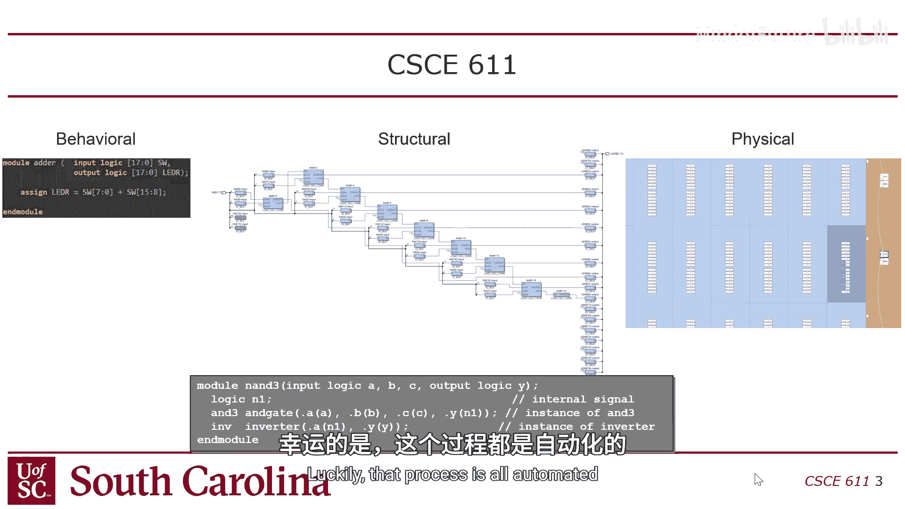

Okay，嗯。So we're going to be using verlo and or system Vlo actually。

 and Vero is designed around the concept of a module and modules are there in order to allow you to express hierarchy so you can have a design that instantiates modules that also instantiates modules within them and so on and so forth so this is a way that you can describe a very complex design。

 but if you look at any one file， any one design it looks rather simple right and then modules also allow you to express regularity so you can design a module that you can kind of stamp out multiple times you can instance it multiple times so you want to try to build modules that are as reusable as possible right。

And。Okay， and then we talked a little bit about logic circuits in general and that logic circuits have inputs。

 outputs， a functional specification and a timing specification and so when you design in system very log。

 the module is essentially a logic circuit right so on the first line of the module you define your inputs and outputs and then inside the module body is where you have the functional specification and then the timing specification is something that you would give to the CAD tools so when it does the place and route process it achieves the timing spec that you give it。

 which is usually in the form of a clock speed。Clock cycle speed。

 And so it has the job of the caD tools is to place and route it in a way where the critical path delay or the worst case delay in the circuit is fits within the clock cycle that you specify。

 So if you tell the place and route tool。 If you give it a tighter timing specification， you know。

 you tell it you wanted to achieve a higher clock rate， it's going to take longer for it to compile。

 And in some cases， it won't be able to compile it at all。 In this class， we're using a very。

Easy to achieve timing spec， which is 50 MHz。 So you're going to do some designs。

 We're going to tell the tool you got to， you got to place and route this in a way that makes it you got to guarantee me that it'll work in。

 that'll work at 50 MHz， regardless of the temperature。

You know what temperature the room is I'm running the FPGA in because that affects the performance。

 the delay of the logic and regardless of any kind of design。

 you know manufacturing variations on the chips。You got to achieve 50 meHtz and that usually ends up being for this class in that FPGA technology。

 not too bad。 So you know it's usually not too difficult。

 you're probably never going to see a case where the tools fail to achieve that timing spec now if you want to get crazy and say。

 hey， I' think I ought to be able to run my CPU at 200 megaHtz well then you can tell you can tell Cortis to achieve 200 Mhertz in which case it's going to take much longer to compile and it may not be able to do it。

 you may have to go in and deepen your pipeline。 you may have to go into your code。

And design your code so you have a shorter logic path in each cycle from register to register you know but we'll talk more about that at the end of the semester so for this project 50 mehertz you generally don't have to worry about it Okay so we talked about that you know this combinational and sequential logic you should have hopefully covered that in 211 combinational logic is where the outputs are just a function of the inputs where a sequential logic has memory and so the outputs are a function of the inputs in the input history right。

And so I' going to I bring that up because I'm going to refer back to a combinational sequential logic later。

 we talked about timing diagrams。Right we got to this point right I'm sorry not Tommy diagram schematics。

 so basically the projects in this class， at least a lab three and four where you design the CPU will just essentially involve you translating schematics that I give to you for the risk5 CPU and you're going to just translate them to system very basically so it's important that you'd be able to read schematics so schematics have if you have a very low level schematic you might have a schematic having logic gates in it like the kind that you saw in 211。

 but as you get higher in the design hierarchy， the schematics are going to be represented as block diagrams where everything the schematic is just a block because there aren't symbols defined for components except at the very lowest level the basic logic components but the basic digital logic building blocks like the gates。

 Muxes decoders， flip flops。Those have standard IAEE symbols associated with them。

 but as you go higher in the design hierarchy and you start putting a register file down or a floating point functional unit or a control unit。

 there's no symbols for that so mostly it's just blocks and generally speaking those blocks will have inputs on the left and outputs on the right and then you you're going to connect those blocks together with wires and again in very log you don't actually draw you don't make any drawings you're defining all these connections in text using structural vlo but when you represent it in a design it's often done graphically so again you have to be comfortable with looking at a block diagram and then being able to write it in system vlog。

 structural verlog right。Okay， so when you look at these diagrams。

 you're gonna to have a lot of wires。 it's very difficult to organize the blocks to where you don't have crossings of wires。

 So when you do have a cross of wire， if there's no dot there。

 they're generally assumed not to be connected， if there's a dot they are connected。

 but then if you have a T junction like this， the assumption is that they are connected because why else would that exist unless you intended to connect those。

 if you do have a T junction， by the way， this is going to be a fan out。

So remember that when you have connections like this。

 there's basically three points on this connection。诶。You can only have one driver for that net。

 that wire right so only one logic logic circuit， which could be a module that you instanced or it could be some behavior that you put in like an assigned statement but only one thing can drive can actually put a logic value on this wire so because there's three points on this thing。

 probably drive one thing is driving it and then there are two things that are going to inputs on other parts of your diagram does it make sense so just keep that in mind if if you double drive a wire。

 you're going to see x contention in in the simulator and if you try to synthesize it。

 I think you'll get an error right but then if somehow you do get a design where you're double drive yourit doubled a wire that will physically generally will physically damage the device because you're gonna to have a short circuit potentially if you've got one circuit trying to set a logic one to that wire or another one trying to set logic zero。

Okay， and so we talked about contention。 So by the way， a system very has。

Is is called four state logic so when you declare a value as logic。

 it can be a single bit or multiple bits right we I got I just had barely gotten to the multi bit logic last lecture。

 but each one of those bits。Is actually not a bit。 It's a logic value。 And in very log。

 that logic value can be 0 or1， but also can be x， which means。

Unclear what it is X is used for don't care if you set a value and your code is x。

 it means don't care。They should have used the different， something different for that in VHDL。

 they do use something different。 VHL， it's a hyphen as they don't care。 But for some reason。

 we don't have the hyphen value， we just have an x。 So if you， if you set a value as x。

 that means don't care。 But if you see a value set as x because you didn't set it that way。

That means it's either undefined because it's an uninitialized memory or most most often is the case in this class。

 it's contention， which means that you've accidentally doubledd a signal right， so that's X。

 and then there's Z which stands for high impedance。

 which is where this is intended for use with a try state buffer。

 where you can electronically disconnect。A signal for the purpose of creating a shared bus right And so we won't we're not going to ever use this in the class。

 but but the other thing is if you have an input， I think I showed this last class。

 Z also shows up if you have an input into a module and you simulate that module but you don't set the input with a stimulus of some kind like you don't set a test input on there。

 you'll see Z for that too， right So Z can be you know set by you in your design。

 or it could just be in there as a consequence of you forgetting to set an input right it makes sense。

 So that's why that those are four states。 Now there's actually ver log is four state。

 I think system ver log introduced a few other values。

 you have a strong one and a weak1 but we're not we're not going to use those in this class。

 but just in case you happen to see in a simulator。

 you might see a strong one S1 just consider that you know logic one okay Another thing too that I want to mention is。

We use it， like I mentioned， we're using Model SimM or actually Questasim。

 which is an industrial strength simulator， it's made by a company called what was originally made by a company called Rinooft。

 but then that rhinooft was purchased by Men and then Men was purchased by Siemens。

 so it's actually come from a company called Siemens。

 but it is considered kind of the industry standard simulator， but it's not free。

It's actually quite expensive， we get a good deal on it here because we're a university and they want us to teach it to you guys。

 but if you have a company and you buy it， it's expensive because it's also kind of you know it's obviously it's designed for specific sectors that make hardware。

There are some free ones， but there are limitations。 There's， there's two in Linux。

 one's called Ius verrlo， which only supports verrlo and not system verrlo。

 And there's another one called verilator。And both of those things。

 instead of being a simulation engine， like Model Sim is。

Those ones actually convert ver log to an executable file that you can just run in Linux。

 So basically， it takes the behavior that you specify in the ver log and it kind of merges in a simulation engine with it into a single executable。

 There are limitations though， because in system verrlo。There's no， there's only two state logic。

 So you don't get the contention and you don't get the high impedance。In verilator， right。

 which is why we don't use it in this class because verilator is not a great way to do debugging and test because you don't get those two extra logic values。

 right， And I think they do that to make it faster。

 And I think Icarus verrlo may also have the same limitation as well。

 but we we never got to even try it because it doesn't even support system verrlo。

 And we support system verro in this class because it fixes a lot of the really annoying things about verrlo。

 and it's kind of the new industry standard。 and the textbook switched to system verlo。

 So that's the reason we switch。 Okay， everyone with me。 So there's not a lot of good free options。

 basically， we're not using modelsim because we're snobby。

 it's's there's really no better kind of open source solution to that that I know of anyway。

All right， so I talked briefly about the history of HDLs。

 the two most common ones are VHDL on Verrlo， we use Verrlo， it's more commonly used in industry。

And then I also talked about， I showed some examples。

 in this case we have a very log module and this is purely behavioral very log code because it uses what's called the continuous assignment statement。

And VHDL， it's called the concurrent assignment statement， but basically it's the same thing。

 it's essentially a way to assign a signal which is basically creating a logic circuit that's driving this signal Y because it's Y is on the lefthand side and thus that's the output and that's the driver is connected to that。

 So it's creating a circuit that's wiring this wire Y directly to a transistor network that would potentially pull it up to VDD or pull it down to ground right and then then we just have some Boolean logic here and you should recognize it's the same syntax essentially that you use in C and Java notice though that we use single。

Single ampers stand， which is a bit wise and operation as opposed to a logical and。

 and the tilda is a bit wise compliment， and the single bar is a bit wise or。

 So we create this Boolean logic and then。We can simulate it using model SimM or some other discrete event simulator。

 the results here are presented as a waveform， and in this case A B and C。

 this circuit is only driving Y。So who's driving A B and C？Presumably。A test bench。

That wraps around this， or you can set these values directly from the simulator using a language called tickle。

In this class， we're going to focus on test benches。

 which is where you use a very log module in order to set the inputs for another very log module that's inside of it。

 And then the outermost very log module， the test bench can also verify the outputs of the one inside So the one inside is called the design under test。

 So this would be like a design under test if we were testing it and we can wrap it into a test bench。

 which the test bench would then be responsible for setting these A B and C inputs and also verifying why now you might say。

 well wait a minute， why not just check it。 Why not just read it。 Well， you can't always do that。

 This is simple so we can fully we can exhaustively test this in which case we get a waveform that is essentially the horizontal form of a truth table。

 essentially because A B and C gets count from0 to7 and we look at the corresponding values of y when I say zero to 7。

 I'm talking about the you know the numerical。Representation of these three bits。

 if I assume these three bits formed up a number， right， a binary number。Right， in which case。

 in this case， C would be the least significant bit because it goes high first right， so there's 0，0。

1，1，0，1，0，1，1，10，0， et cetera。 Okay， all right， Okay， then when you synthesize that。

 the synthesr minimizes the circuit。 So even though it appears that I ought to have a three input or gate and three。

3 input and gates。I don't have those for some reason because it minimized it。

 it simplified the circuit into an equivalent form。Okay， system ver logs， case sensitive， comments。

 match C and C plus plus and Java white space is ignored。 And then we talked about structural。

 So this is an example of a structural。A design where I have a top level design and I'll say that that term I use a lot because whenever you simulate or synthesize。

 you always start with the top level design， which is the root of the design hierarchy it is the most abstract you know module and then inside that module we have other modules。

 So the top level design is called Nand to3 inside N and3 I instance in and gate and an inverter and then the thing that's really confusing is that I have one wire inside the Nand called n1 it's declared locally。

 however， because that n1 is what connects the y output of this guy in the A input of this guy。

 I now have three different names for the same wire。RightIt's called Y， it's called N1。

 It's called A。 It depends on where you're looking at it。

 what the scope is that you're looking at it in。 Okay， so keep that in mind。 now models S。

Will actually show whenever you simulate model Sim。

 it will show you the design hierarchy on the left hand side so you can drill down by using a little tree。

Like a little Windows registry sort of thing。 You guys know what that is。 You know。

 you hit the plus sign and it expands out， you can drill down， right。

 But if I did that and I put y and n1， both in my waveform， they would be locked。

 They would always be the same。 I could change N1， which would change this Y。

 or I could change this Y， and it would change N1。 It's the same Y or they just have different names because of the way they're connected through the hierarchy。

 Okay， Okay， so。

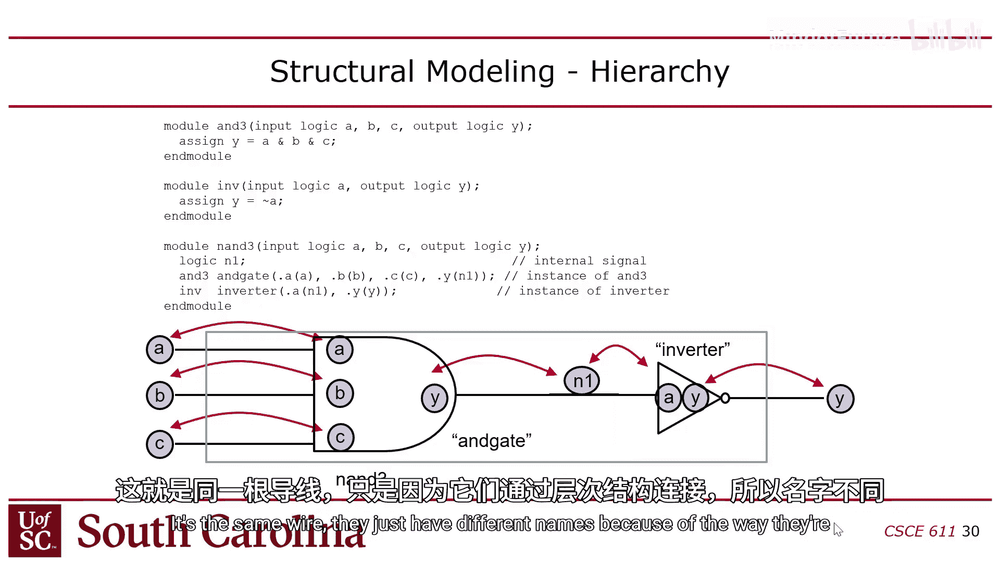

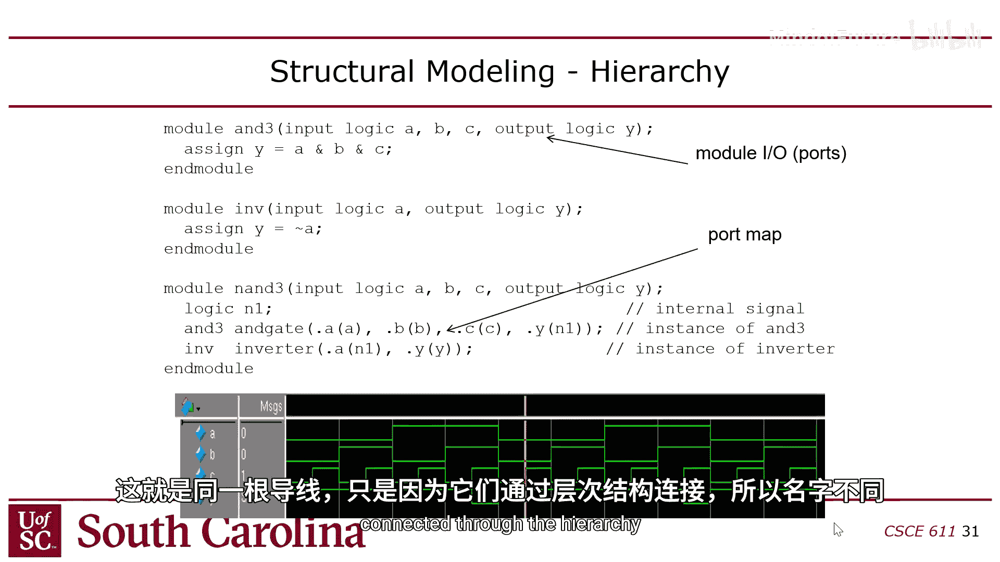

Then I think the last thing I got to on Monday was these multi bits。

 this is a weird syntax thing with ver log， it's really annoying for two reasons one。

 the array indices are put before the variable name。

 which is like no other language that's ever been written。

There's no other programming language that does that that puts that I've ever seen anyway。

 where the array size is placed before the name。Right， usually it's after the name。

 But the nice thing about that is， is that because it is before the name。

 I now have A and B that are both。Input logic4 bits， right？That makes sense。 So basically。

 the array size is kind of combined with the type name as opposed to the way C and C plus plus and Java do it。

 where they put it after after the name， in which case， it would be harder to do this kind of trick。

 right The other thing is we put three colon0 instead of just4。That makes no sense to me。

 That's totally bizarre。 Don't know why they do that。

 I also mentioned that if you were to put zero colon in three， it would make no difference。

I don't know why they do it that way， but basically if you have an n bit signal。

 you have to write n minus1 colon zero。系。It's supposed to represent the two extreme ends of the index range right now if this were VHDL。

 by the way， it works the same way except you would have to type out array and you would have to type the word range and then you would have to put three dot dot zero which is ridiculously verbose。

 but that's how VHDL is it's all spelled out but it's equivalent to doing that Oh instead of logic in VHDL it's called standard underscore logic underscore vector so everything is super long and drawn out in VHDL。

 but it's equivalent to what's in very log。

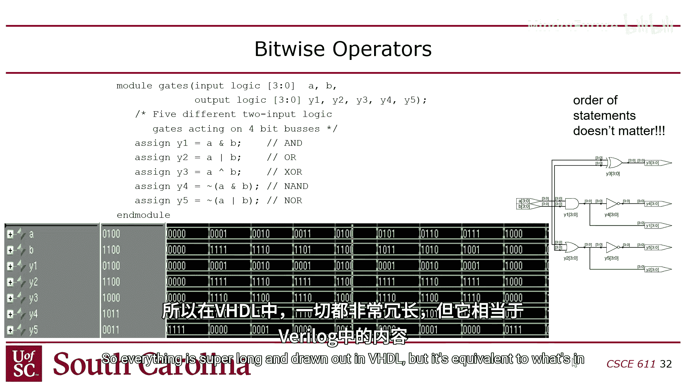

Okay， and then another very common operator that's used in Verrlog is the Ternary operator。

And this operator is actually available in Java and C。

 but you might have not ever used it because it's less commonly used in programming languages。

 but it's very commonly used in HDL because it creates a multiplexer。

 so basically what happens here is that the ternary operator has three parts in it。

 the first part is a condition that's tested the second part is what happens if what the expression evaluates to if the condition is true and the last part is what the expression evaluates if the condition is false。

 so that very naturally maps into a multipleer where the condition is the select。

On the multiplexer and then the first， the middle input here is the one。

The one input on the multiplexer。 And then the second one is the zero input on the multipleer。

 So in your CPU design， you're going to have a lot of multiplexors because multiplexers are fundamentally how you steer data around to create data path。

 right？ It's also how you multiplex input。 So， for example。

The register file has an input called data in。 that's the data that you write to the register。

 but that data could come from the ALU or it could come from the memory right or it could come from maybe a co-processor if you want to transfer a coprocessor register into a register there's various places you can get data to put in the register file。

 but there's only one port， there's only one right port on the register file So the way you deal with that is with a multiplexor which allows you to select who goes in which which source is routed into data input on the register file and hopefully you guys saw some examples of that in 212 right so a multiplexors show up a lot。

In your design， and they're nice because you can just write essentially one expression which the synthesizer will then interpret as being a multiplexer。

 So even if you have a structural design where you have a register file and a control unit an ALU and all these big abstract blocks。

 you still will mix in these little multiplexers will get you know kind of mixed into the structural code just to take care of。

Fanins where you have because remember， you can only drive each signal can only be driven by one driver。

 So if you need to be able to get multiple sources into a place。

 you got to use a multiplexer for that。 That's how fanins are are are done is with multiplexs， right。

The other thing you commonly will put in with little snippets of code are register flip flops slash registers。

 so multiplexors and registers are the most common little bits of behavioral code。

 you kind of mix in with structural code right if that makes remember structural code is just inscing a module and connecting it to something else。

Okay。So in this case， what is this， by the way， this is a two to one multiplexer where the inputs and the outputs are four bits each right because they're declared as three colon1。

 and so when I simulate this in the simulation， I've got D0 and D1 of the two inputs which are changing and I've got S which is changing。

And so in order to figure out why I have to look at S。 So because S is1。

 that means I'm selecting input1。 input1 is d1。 so d1 is basically getting copied to the output of the multiplexer here right but if I go one cycle before that。

 you can see that the multiplexer is outputting 001 because the select is0 and input 0 is 001 right so like I said。

 this turnernary operator and you can nest these two， which is nice if you want to。嗯。

Create a more than two to one multiplex where you can create nested。

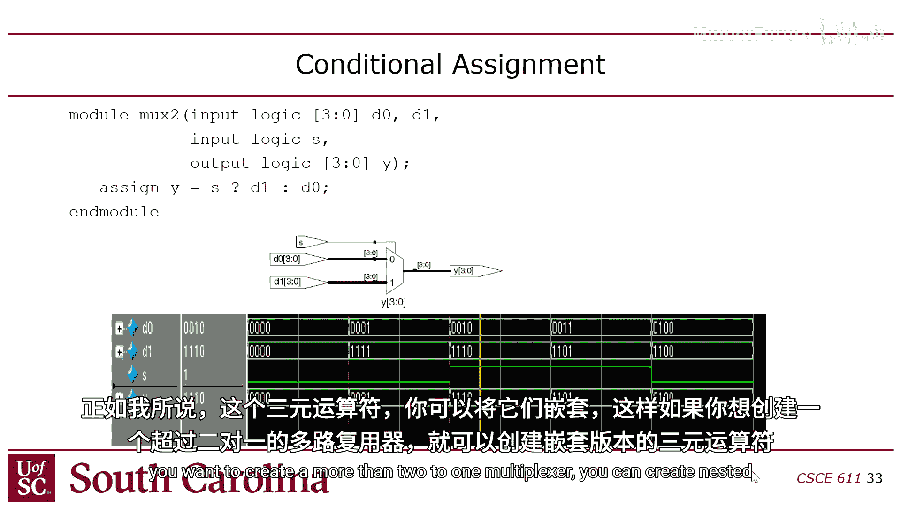

Versions of the Ternary operator。Okay， so then。

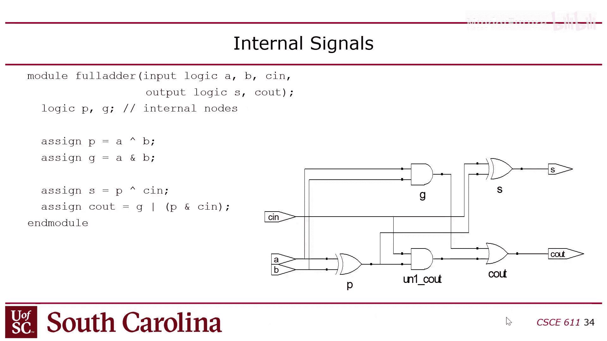

We have， oh， one other thing I want to mention too。 you might say， wait a second。 Hol up， Hol up。

 Why not use an if statement for this。 This is just an if condition， right， Like if the select is 0。

 then the output should be input 0。Right， why not use an if statement。 Well。

 you actually in system ver log， you can only use an if statement if it's inside the context of another construct called an always statement。

Wwhichch I'll talk about soon， so you can't just put an if statement inside inside here right you can put an if statement in。

 but only if it's inside of another block code and always block。

 and I'll talk about that in just a moment。

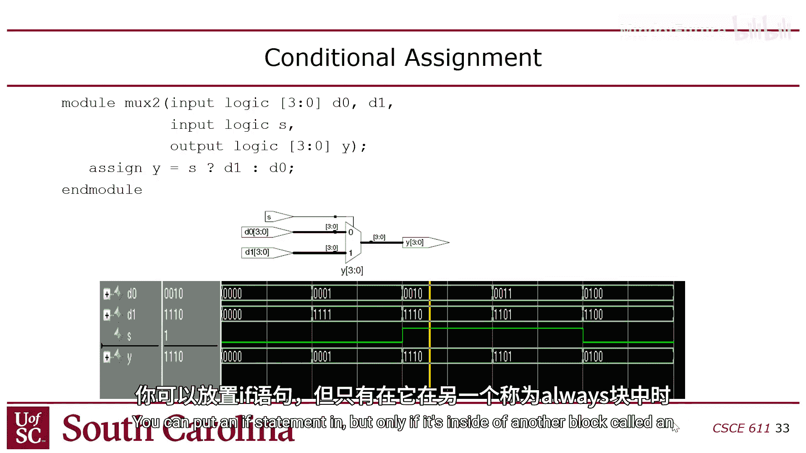

Okay， so I think we， I think I covered this。 These are internal signals， just another example。

 this table。Is something I refer to often， this is the basically the list of the operators。

In Verrlog and their precedence。And so this is highest precedence， the lowest precedence。

 notice the ternary operate has the lowest precedence of anything。So you don't have to worry。

About putting things in the turnernary operator and parentheses， because it's the lowest。

 is lowest precedence。 So we have the not， which is this is the the。

This is the this is the the the bit wise complement， not operation。

 Then we have multi malt div and mod。 So these ones you generally are not can ever use in。

Va log code that you intend to synthesize because whenever you're building code that has a multiplier。

 you're usually going to define that multiplier at a lower abstraction。

 you don't want to give the synthesizer the ability to generate its own multiplier architecture because there's this huge design space for multipliers。

 usually multipliers will either be oftentimes you'll have like an IP block module that you use for multiplier but but then again。

 I mean， remember that ver log can also be used for in a way that doesn't intend to convert to hardware like if you're building a test bench a testing infrastructure。

 then we have add and subtract and then there's two versions of shift There's a shift a regular shift and then there's a type of shift that's not available in C plus plus and C and Java and that's less than less than less than and greater than greater than greater than form of the shift。

 and this is for doing arithmetic shifts。Right you guys remember logical versus arithmetic so when you do。

When you do a logical shift。To the right。You always shift zeros in， right。

 But if you do an arithmetic shift to the right， you shift in。The sign bed。Remember that？

Let remember that。These are not available in。C and Java， why？Well， in C in Java。

 the decision of whether you're doing a logical or a。

Arithmetic shift is determined by the data type the variable declaration of the thing you're shifting right so if you declare a variable as unsigned and you shift it in Java it's going to do an unsigned logical shift right。

 but if you declare a variable as a signed like an integer and you shift it'll be a s shift right。

But in Verrlog， we don't have signed that unsigned。

 there's logic right so as a result we need to be able to differentiate those by these different operators。

Now there is actually a way you can type CA。A variable as signed， but by default。

 the logics are unsigned。And you might say， well， wait a minute， what's the point then of doing？

Why have a。Left arithmetic shift， that makes no sense。It does if you shift by a negative amount。

 in which case the left shift becomes a right shift， but anyway， then we have comparison。

Less than less than equal。 And then there's also。You know， equal and not equal。 Now。

 there is a variant of this is not an exhaustive list， by the way， But there is a variant of the。

 I thought I had it in here。 I guess if I forgot There is a variant of the。Equal operator。

 equal equal。 There's equal equal， and there's equal equal equal， right， There's three equals。

 And likewise， there's not equal and not equal equal。 The difference is。

 it has to do with the four state logic。Remember that in Ver log you know， there's four states。

 but in reality， there's only two states， one and zero， right？So。In if you use a equal equal。嗯。

Then it's assuming that you're just concerned about real binary values， zero and one， right？

But if you're writing a test bench and you want to compare to say a don't care an X， right。

 then you want to use the equal equal equal， right？Makes sense。

But if if you compare like inside of if you use x equal equal x。

 that will be false and you might know x is equal to x well no， but yeah。

 but x doesn't really exist in real life， it's just a concept， so equal equal is for hardware。

 you know synthesizable code code you want to put in hardware and then you can use the equal equal equal when you write a test bench because then it allows you to compare it to non-existent values like X and Z。

Okay。Okay， then we have and also check this out， there's a NN operator， this is not in Java or C++。

Tillday， Ampers stand。That's a very log exclusive thing。

 likewise you have XNor Tilde carrot operator。So yeah， anyway， so those are the are operators。

 Most of those you're familiar with。 Okay， and then the other thing too。

 is that another consequence of the logic type not being standard data types like you have you know in Java and see you've got int and short and Shar right which have these predefined widths。

 number of bits with logic there's really no you know， default bit with right。

 there actually is in very log， the default is 32。 but when you're doing very log design。

 you don't very commonly used 32 bit values you might have a one bit or 2 bit or 3 bit or 5 bit or 9 bit value right So the problem is is that if you have a scalealar constant like three。

 for instance， the compiler。

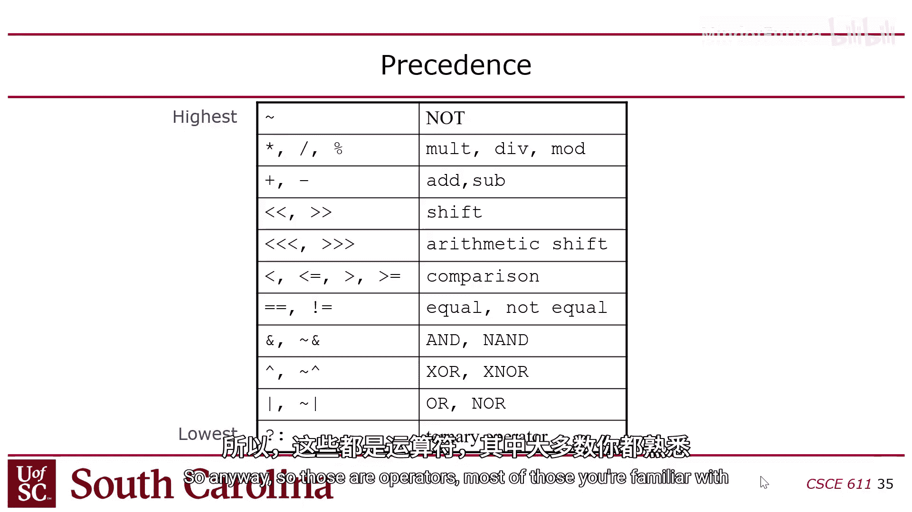

You know， it doesn't really know how to interpret that， right， How many bits。

 how many bits are you talking， say three， but how many bits is that3 so。And also。

 you know what about the base， you know， obviously in C and Java。

 you can say0 x to represent headecimal and I think0 B is binary right。

 but vero gets a little bit different。 So generally whenever you have a constant。

 you specify the bit with right and then you put an apostrophe and then you put B O or D。Or H， B。

 binary， O octal Hx。D decimal。There's D and V。Deimal binary， D and B， right， So for example。

 if you put8 apostrophe B1，1， that's actually。1，1 and binary， which is3 in decimal。

 And you're putting it in 8 bits， which means that there's going to be six leading zeros and  one1。

 right， So it's good practice to always specify whenever you have a like something like this， which。

😊，You may have like if for're a multiplexer like you know you're gonna to say if the select is zero。

 if the select is one， if the select is two and you should have the bit width and the base there for those a lot of students in this class forget to do that and then there's a warning message that gets kind of sometimes you don't see it because it gets scrolls by with a lot of messages that are printed when you synthesize and simulate but it's good practice to use this format and also notice we have an underscore here。

In this number， this is actually a nice feature because the underscore allows you to take a constant。

And actually， split it into。Fields that you can read。

 but that underscore actually has no impact on the value right so it's just for decoration purposes。

 it's just for readability， but it's very common if you have a binary number that' split that logically split into two multiple parts。

 you can separate them with underscores。But it's optional。

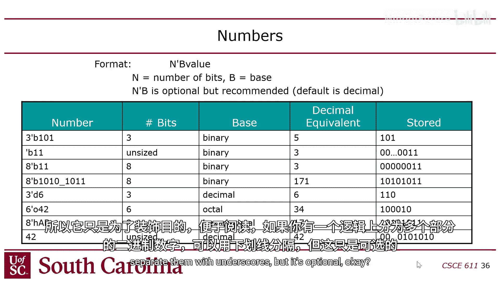

Okay。Okay， all right。 And then another thing that's different is this how you do a bit manipulations。

 So it's very common that you want to take a multiple values and concatenate them。

RightSo when you do that it's very easy use the curly brace Now remember that in their log。

 the curly braces are not used to define the beginning and end of a block like they are in C and Java right we don't have those the curly braces are specifically for these bit manipulation thing so in this case'm creating I'm assigning a value Y。

And I want to form the value of y by concatenating together。Several things。

 so in this case I'm taking the value a and I'm indexing it two down to one。

 which is taking bits2 and1 it's kind of we used to call this bit slicing where you take you know bits out of a vector of a logic vector。

 logic vectors， VHDL of an array of bits， you know multi bit logic value。

So this is going to take two bits out of A。And then it's going to concatenate。

 Now this is a little weird。 This is a duplication operator。

 So this is where you take bit0 of the B value。 And I want to put three copies of it。

 So in order to do that， you have to have both the inner and the outer curruly braces here。

 So the innercurly braces is going around the thing you want to duplicate。

Which itself could be a concatenation of multiple things。

 but then the outer braces have to go around the thing you're duplicating and the duplication factor。

Right so this just creates， again， copies now you might say when in the world would ever use that。

 Well， sign extension， for example， so whenever you sign extend a value， like， for example。

 risk5 uses a 12 bit immediate value in its i type instruction。You might say， wait a minute。

 I thought it was a 16 bit immediate。 Well， in MIPS is 16 bit。

Risk 5 dropped the immediate field to 12 bits。For some reason。

 I don't know why they did that See odd to me， but theres a 12 bit immediate。

 So if you say add I in risk 5， you only got 12 bits。To put the immediate， of course。

 you can combine it with another instruction if you want more bits， but in one instruction。

 you can only have a 12 bit immediate。That 12 bit immediate。

 if it's used in the context of a signed operation like add。

 the 12 bits is going to have to be sign extended to 32 bits。

 And the way you do that sign extent is you duplicate。The sign bit。20 times20。Yeah， 20 times， yeah。

 20 sign bits and 12。Immediate bits， you guys with me？

So that's a common use of that duplication thing。 And then I mixed in。This binary value，6 bits。

 binary 1，0，0，0，1，0， right， So I took I'm taking all these things。

 and I'm going to combine them together and put that into why。 Now。

 the cool thing about this concatenation is you can actually use this concatenation on the left hand side of the assignment statement。

 too。😊，So in this case， I actually taking y and I'm going to reformat it into these two fields。

 so I'm going to take three bits of y and put them into a bits2 down to1 and the least significant bit of y is going to go into B0。

 this is pretty cool， right？I think it's kind of neat you can do that。

Of course you could also do that with just two assigned statements。

 you could split this into two assigned statements in which case you could assign this part in one statement。

 assign that part another statement， and then of course you'd have to slice into why on the right hand side。

 but that's that's just more a way to do it in one statement。Okay。

 so here's actually an example of a sign extension so this is actually a 16 bit sign extension。

 so this is not the same code you're going to use this is from the MIPS days。

 but B is a 16 bit value and I'm going to take B bit 15。

 which is the sign bit of a 16 bit value and I'm going to copy it 16 times and use that to fill in the other 16 bits by converting this 16 bit value into a 32 bit value。

 right？Okay， okay。It's an example of using two mues together to create wider mus。

 and then there's this reduction operator。 This is another cool feature that you might have seen。

So you can take a， if a is a vector， in this case，8，8 bits。

 say I want to take the8 bits that comprise a， and I want to feed them into an eight input。And gate。

 I just want to and together all the bits of a to go from 8 Bs to one。

 It's called a reduction because I'm going from 8 Bs to 1 B because I'm going to feed all the bits of a into a。

Basically a big and gate， you can use this format， this syntax rather。

 which is Ampers stand before a， that'll do a reduction。

So that'll take the a value and just feed all the bits into an am gate and give you one。1 output。

 So the only reductions that are available in ver log are and or and N or nor X， or X， nor。

 there might be some more insist very log。 Now， I think this is。

I think these were the ones in Verlog。But that may also apply to system very。Okay， okay。

 any questions， Everyone Okay so far。 Okay， so I showed an example of simulation。嗯。

And I'm going to come back， I might do another demo here。 I just want to review that real quick。

 We have a simulator called， I'm calling it model Sim。

It used to be called Model SM now the new name is Questa Sim， I mentioned Quetaim。

 Questa S and model Sim the same thing， I don't know why they changed it。

 but when you initially open it，You just run you can just run the VSM command。

 you don't have to do anything to set it up， it should just come up。

 you just have to open a terminal and run VSM and you'll get this screen initially or something that looks like it you'll notice that there's a library tab and there's a bunch of stuff in the library。

This library is actually， these are simulation models。Of。Primitives， FPGA primitives。

 So an FPGA is this kind of reconfigurable fabric， but it's physically comprised of primitive circuits。

 And I mentioned to you， Luts are the kind of the most common one。

 A lot is a reprogrammable logic gate。 But there's also things like multipliers and。

B Rams and IO buffers and there's a bunch and there's a phase lock loop。

You know the clock thing it changes the clock frequency and phase of a reference clock。

There's a bunch of stuff on the FPGA and this what you're seeing here are models and the reason why there's so many is that every FPGA technology。

 every FPGA generation has a different set of models that allow models SM to instead of just running system V you can instance a primitive。

 in other words， I want to create a lot。And just model and have model some you know act you know behave。

 know how that Lt behaves。 we're not actually going to use any of those。 So don't worry about it。

 just ignore that。 The one that will be added here for you will be at the very top it's going to be called work and that's the library where all your designs are going to get put into whenever you compile system error log code with the V log command now you can compile in here too So there's a GuoI you'll notice that there is a compile menu here。

So you can compile designs through the GuUI， or you can compile them through this。

This little command line interface， or you can compile them in a shell。

 I usually just compile them in a shell。 I type V log space start Ot S V。

that just compiles all my system error files in the director。And it puts them in the work directory。

 the work directory will then pop up as a work library。

 assuming of course that you launch Model Sim from the same directory that you compiled the files in right if you didn't it's no problem you can just use the CD command on here to go to that directory in which case the work will show up the work library will show up okay and then yeah so this is the compile dial so this is compiling through through the GuUI。

And then when you want to start the simulation， you can actually just type VSim inside the command line window with the top level module is the argument。

 so VSim space CPU right or VSim space test bench or you can do it through the GuUI。

 this is the way the GuI set up， you just go to simulation start simulation now one of the things that they added。

In model S in the last few years is this thing that's kind of annoying。 They turn on。

 They started using this optimization。By default， because remember that this  queststa Sim is intended for industrial designs like this is intended for like Intel to be using right And so the idea with model Sim is that they're always trying to make it faster for simulating large scale designs。

 But the problem is in this class， all our designs are small。

 But one of the things they did to speed it up is by default。

 they turned off visibility for internal signals。 So like you'll simulate your top level design and then you drill into it and you want to plot your signals and you don't see them。

 they're gone。Because they turn it off by default， but you can fix that。

 there's just an option when you click optimization options。

 you could tell it to apply full visibility to all modules， which they call full debug mode。

 and this will not impact the performance because our designs in this class are so small。

 it has no problem with you know logging all now logging all the signals right or having all the signals available for logging purposes。

 right。When I say logging， I mean plotting printing， you know？系。You guys with me？

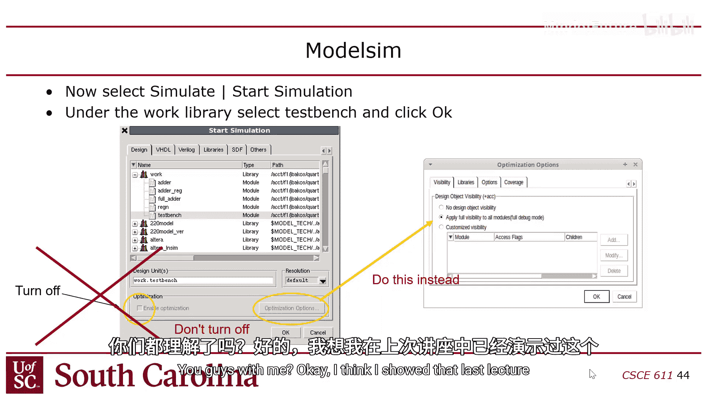

Okay， I think I showed that last lecture and then you know。

 you can bring up a wave window and then now just to be clear， in model Sim。

 you basically get two version versions of that GuI。

 depending on if you're in simulation mode or not， if you started up。

Without typing the top level module， like if you don't if you just type Vs。

 it goes into a mode where it's like dead， right， It's not simulating anything。

 it won't actually go into this mode where you can look at the waveform and stuff until you tell it to start simulating right On the other hand。

 you can start simulating right away。 if you type Vs space top or whatever your top level design top level module。

 And then it'll come up in s mode right， But sometimes you might start it。

 And you're like why is it not doing anything， It's not let me do anything， I can't open waves。

 I don't see like I don't see this， you know， design hierarchy。 It's because it's not in simulation。

 It's not actively simulating right。Okay。

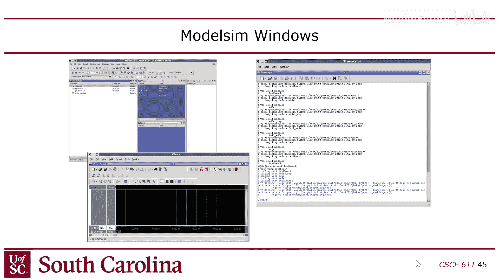

And then this is the design structure。 This is what I was talking about with the design hierarchy。

 So this is pretty good。 and cool In this case， test bench is my top level module and inside test bench I have something called my adder。

 which is obviously the design under test that I'm testing。 but then inside of my adder。

 I have three registers， I have input register A input register B and output register S。

 which is the sum， So I have registers holding the two inputs and a register holding the output and then I have my adder and inside my adder I generated in this case nine。

Bit adders。 So I created a 9 bit adder by inside that adder。 I created9 single bit full adders。

 right， So that's what's going on here。 And then if you click on any of these。

 you'll see the signals inside that level of the hierarchy。At in the the signal list。

 there's a signal list， which I think I show。 yes， right there。 So this is the， they call it objects。

 but。

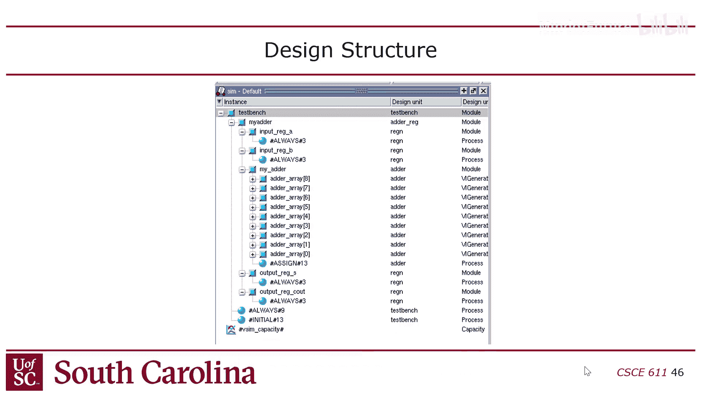

It's objects instead of signals because sometimes there's Rams in here， you might have a Ram。

 so they're not all signals， but in this case they're all signals， I have a， a 9 bit A，9 bit B。

 of course you see their' x's， which means it doesn't know what they are， it doesn't know the value。

 there's a clock。Carry out。Yeah， it actually has。I don't actually even understand this。

It has x's here， right？So that's one of the states， right， But then they have strong X。 Yeah。

 I don't know why strong X。 I can't explain that。 I don't know where it gets these strong X from。

I get the strong one， that's like if you force a signal inside of the simulation environment because that strong one can't be overridden if you set it with a tickle command force。

 tickle is the command line language you use and model SM， but strong X， I can't explain that okay。

So by the way， you might be wondering what do we do with these well you can drag these into your wave window。

 you can right click these and force them to a value。

 that's what they're here for there so you can do stuff to your signals。

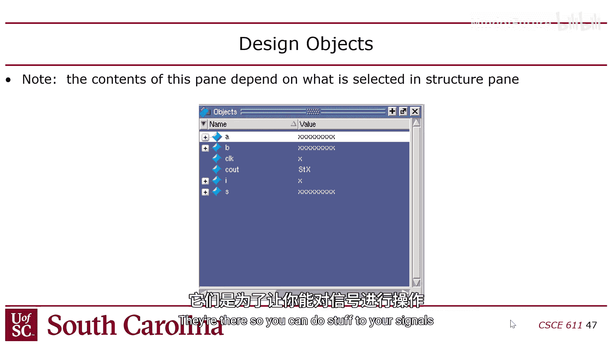

Okay， and then there's the wave window where you can write。

 I think I did show this last time right on Monday。

 I think I went through this example where you can right click and say， add to window and。

It'll put them in the window， the wave window there。

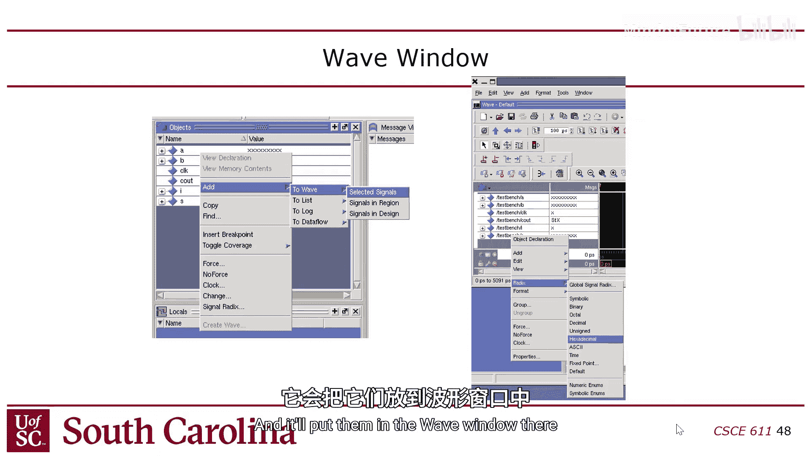

Okay。

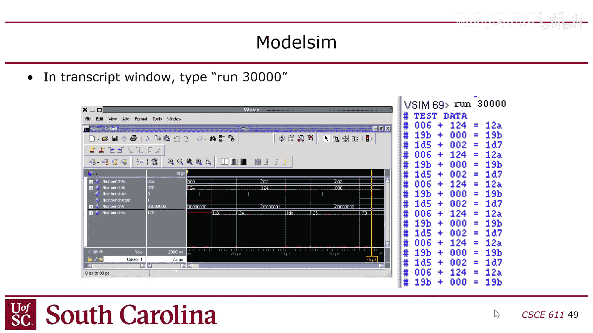

Alrighty， and then the wave window looks like that Okay。

 and then there's a few commands you can use in model Sim。So。If you use a test bench。

And I'm going to talk more about that just in a minute。

 test benchch is a way to write a module to test another module and it's more automated。

So you usually don't have to do much with a test bench。

 all you do is you open up models and say go that's it。 And then if there's any errors。

 it'll probably print an error message because you can do that right However。

 sometimes you don't have time to write a test bench or you're like me you're too lazy to write a test bench because you want to do a unit test of just one little thing and you don't want to take the time to write a whole module just to test that right So there is some shortcuts and models S where you can force individual signals like in other words。

 inputs obviously what are you forcecing， You're forcing the inputs and then you're looking at the corresponding outputs。

 that's the whole idea。 So when you want to set an input。

 you can just use the force command force is a tickle command。

 tickle sensor tool command language and it's basically a way to just set a value and you can do this through the GuI to。

 you don't have to type it in， you can just right click the signal and just say force in the GuI So there's more than one ways to do that。

 and then you can force inputs and then when you want to advance the。

Simulation you can just type run space in a time and that time。

 the units of that time are going to be whatever units the simulation was set up to be when you started。

 it's usually picoseconds by default。 so this will run for 100 picoseconds and they might say holy cow that's a fast circuit if it's running in 100 picoseconds。

 Yeah， but it's irrelevant the units are irrelevant because we are not modeling circuit delay're not because circuit delay comes from capacitance and resistance in the circuit capacitance comes from just the fact that you have metal that sits on top of a dielectric right。

On the chip that creates capacitance so the longer and the fatter and the wider the more area your wire has。

 the more capacitance and the longer the wire is the more resistance it has and so and of course transistors and active devices have capacitance and resistance and all that contributes to delay but because we don't know anything about that in modelsome Modelim doesn't know any the technology parameters it just knows about the behavior the logic behavior so thus there is no delay in this so when you simulate in model Sim it's infinitely fast。

Right now， so what that means is is that if you set an input。

The output will change after you set that input， but with an infinitely small amount of time after you set that input。

 so there's an epsilon delay basically right， so there's all the logic delays or epsilon now you can actually model Sim is capable of modeling logic delay。

You can actually and I've done this before but it's really tedious。

 you can actually place and route your design on the FPGA and then you can pull data off of that compiler and backfeed in the model Sim and Model Syim will then start behaving like the FPG does in terms of delays。

 It's kind of cool， but it's not practical no one ever does that why because the FPGA compiler has a timing spec remember I told you about the timing spec。

 It'll tell you whether it's going to meet the minimum timing requirements。

 So there's no reason to ever simulate with delays in model Sim if the synthesizer is going to guarantee you that it's going to meet your timing spec right so I don't know why they have that timing capability and model SimM is useless。

Because the CAD tools have time enclo built in， the only thing you're using model S for is the behavior to test the functionality。

 not to test the performance in terms of the logic delay。Okay， so so the clock being 50 in this case。

 I'm setting up a clock to be a period of 100 with a duty cycle of 50 picose， you might say， oh。

 that's a fast clock， but that's just the place we don't really care Pico nano seconds doesn't matter right。

 so we usually just use Pco secondscons。Okay， so and then you can create a script。

 but I'll come back to this， I don't think anyone's going to use that， okay， so then we've got Cors。

So model Sim is where we simulate。 Cors is the tool that will synthesize and interacts with the physical hardware。

 So once you're satisfied that。Your behavior is correct。

 then it's time to bring it into Cortis which will do two things it'll guarantee you'll meet your timing spec and it'll synthesize your their onto the FPG。

 it deploys it and it'll make it appear， it'll basically take your logic circuit and cause it to materialize into reality。

Like it it'll become something tangible， a real tangible circuit。

 So like when you build your FPG and you synthesize it and download on the FPG。

 you have physically made a tangible CPU。 you have a circuit that you've made that you can then interact with and after lab4。

 you'll interact with it by flipping the switches， it'll calculate the square root using your code from lab1 and it's going to give you the result on the seven segment displays。

 Now you might say， yeah yeah， but I mean， come on we don't get the solder。Pluug wires in。 Yeah。

 you don't want to do that。 Trust me， that's awful。

If you ever did breadboard stuff or even did a chip layout， by the way， which is also terrible。

 That's when you actually design， you draw polygons that you send to a chip fabrication place to actually fabricate in asic。

 Yeah， it's awful。 I used to spend when I was in grad school， I used to spend months。

Just routing the pad frame for a chip， just drawing the polygons to create the I O pads and making sure that all the design rules are met by filling in all the the empty spaces with metal stacks and all that stuff。

 It's， it's putting in all the decoupling capacitors on the power supply。 It's awful， right。

 This is much better。 The fact that you can make hardware this way is awesome， right。

 even though it may seem kind of untangible， it is actually creating legit hardware。 Okay， so anyway。

 Cors is a tool。 Now， the thing is， is that in this class。😊，This is not true if you take 313。

 some of you took through 13， No， okay， so we teach three classes now with these FPGA boards。

This is the only class where we've automated this Corus part for you。

 because I had a student at a really good grad student that wrote scripts。

 So instead of going through Cors， all you have to do is type CSEE6，11 dot S H。Compile。

And it will actually compile your design through Corus， but using the command line。

 so you'll never see the GuI right， Likewise， when you want to program the FPGA。

 you just type CSCE611 do S H。CompProgram， right， And I'll show you a demo of that。 However。

 you might be curious how Cors works， right， And if you are。

 it'ss it's nice because we also give you the Corus project file。

 We just made it for you Now you might say， well， why not just create it from scratch。

 Why did you give it to us because when you create the Corus project file。

 you have to choose the FPGA part and there's like 11 million FPGA parts。

 I don't know why there's so many FPGs。There's there's every variation because there's all these different technologies。

 generations， and then each one has a different size， and then each one has a different speed grade。

 and then each one is in a different package。 So you get this multiple you get a combinatorial effect with all these FPG。

 So just picking finding the right FPGA is kind of a pain。 and then you have to bring in the pin map。

 The pin map is that maps the physical pins， which is a grid， which is like an Excel spreadsheet。 So。

There's a ball grid array on the back of the FPGA。 It's a two dimensional grid of inium solder bumps that is pressed onto the board。

 placed onto the board， and then heated and melts the inium。And it's a grid。

 So the rows of that grid are numbers and the columns are letters。 So， for example。

 you might have a pin on there that's like B 37， which is one of the pins on the backside of the FPG。

 And that one was routed to one of the LEDs on the board right But you don't want have to remember those names and number。

 those numbers。 you just want to say LED 5 right， And so the pin mappings are what makes that that sets up that correspondence。

 So that's something else you have to set up。 And inevitably， if you guys do this manually。

 you'll forget to do that pin mapping。 And so if you don't have a pin mapping and you synthesize your design。

 it will randomly connect pins from your top level design to pins on the board。

 So it'll glitch and freak out the board。Do this weird， glitchy， flashy thing。 if you， you know， so。

 so you don't want that。 So we just kind of set it up for you。 But anyway。

 if you do want to launch Corus， you just type Corus， it brings up this splash screen。

 you can turn that off and then you'll see something that looks like that。

 And you can actually open up。You can say file open project and open the project file that we give you if you want to see it。

 and you can compile from here， and there's some other things you can do from here that we don't support in the script。

 one of which is signal tap， which allows you to probe signals on the FPGA with a virtual logic analyzer。

 meaning that you can actually see。What's going on the FPGA now you might say， wait a minute。

 why would I ever do that if I can simulate it？Because sometimes when you simulate your design。

 it works。Then you put it on the FPGA， and it doesn't work anymore。 And it's like， well。

 then what do I do now， Well， there's nothing you can do。

There's's no the only thing you can do at that point is be able to use。

This logic analyzer to see or you could check log files。 sometimes the log files will say， oh。

 I optimize your design out。Sometimes your design gets optimized out like this compiler might think that your design is irrelevant because you didn't connect it to pins。

That happens sometimes right Like if you don't connect your design depends pin on the FPGA。

 the compiler will say， well what's the point， I mean， I can put this circuit on the FPGA。

 but there's no way to access it from the outside world so I'll just delete it and that's exactly what it does so you'll compile it and it'll say zero Lus and you're like what do you means zero lus I put a whole CPU on there Yeah well it optimize it out right so sometimes that happens but other times what happens is you'll have a latch in your design。

You'll write you'll write code that implies a latch as opposed to a flipflop。

 Latches a level sensitive memory element。 Hopefully you guys talked about that in 211。 and latches。

 sometimes you can't put latches on an FPG because there's no primitives for latches。

 There's only primitives for flip flops， edge edge levels。 So sometimes stuff like that happens。

 right you'll have some behavior in your code that is not implementable using the primitive circuits that are on the FPG。

 and therefore it won't work。 And sometimes you'll get an error。

 but you might miss the error or maybe it'll be a warning， So that's an in that case。

 you may want to go in and use signal tap。Alrighty， that's the pin mappings。 Okay。

 so let's move on to one final topic in terms of ver log syntax and then I'm going to talk about the lab and you guys should be good to go。

Okay， so the final thing， Okay， so I mentioned two kinds of behavior。 sorry， two kinds of ver log。

 There's structural ver log， which is just instance this， connect this， right。

 instance these things and why are them this way， right， That's basically just creating a schematic。

Then you've got behavioral， which is logic behavior。 It's like the you know。

 the Boolean logic stuff right， And all I showed you for that was the always， sorry。

 the assign statement， the continuous assign statement。 It just assigns of value。

' there's a couple problems with the assigned statement。 number one。

 there's no way to have an assign statement that has memory。 In other words。

 if you use an assign statement， it can only be combinational logic， meaning that there's no memory。

 right， there's no way to store something in an assign statement to grab it and to hold it to store it in a memory。

 right， for that， you have to use this always。Construct， right。

 the other problem with an assign is it's basically one line of code。 I mean， you can hit， you know。

 you can put line breaks in there so you can create this really big。

 long nested turnernary statement， But essentially an assigned statement is one statement。

 There's just one semicolon at the end， right， So everything you put in assigned statement has to be essentially in one line of code。

 right， from the standpoint of， you know， the semicolon， one semicolon， one line of code。Um。

 so if you want to do some complex， like if you want to put a big truth table in there。

You don't want to necessarily do it with an assigned statement。

 You probably want to use something with semantics that are a little bit more familiar like if statements and case statements right And so for that you can use an always。

 but here's here's where things get a little confusing though So an always statement is basically a block of code that you can then use if statements。

 loops， case statements， and you can put memory into so you can create sequential logic or combinational logic with an always statement。

 The problem is is sometimes it's easy to mess up。Because， for example。

 if you're making a combinational logic in in all ways， you have to be sure。

That you assign all of the possible outputs of that always statement and every possible control path through it。

 Otherwise， you'll end up implying memory when you didn't mean to， right， In other words。

 I'll talk more about that in a minute。 But basically， sometimes you want to do combinational logic。

 and you might accidentally make sequential logic， right。

 it's a little bit you can get yourself in trouble。 other。

 but the another nice thing about always is you can assign multiple outputs and and the other thing。

 too， is one final thing， the assign is creating a logic circuit。

So remember how I mentioned that you can only drive an output with one logic circuit。

 you can only drive one signal。Anything you drive， any output you set in and always is owned by that always statement。

 so that's the logic circuit that drives it， right。

And so essentially what an always statement is is you could think of it as an assigned statement。

 but just more complex that has multiple lines of code in it， does it makes sense。Okay。

 so like for example， you'll use an always statement to create the control unit for your CPU because the control unit is a big giant nested if than Al statement right and so it's more appropriate to use and assign an always for that okay okay。

 so now one thing that we have in system ver log that helps a little bit is system very log introduced variations of the always。

 so we have always comm。And we have always underscore FF flipflop。

 and there's also a couple other ones。If you put always calm。

 you just say always calm and then you have begin an end or you know if you have multiple statements。

 begin an end is how you make a block as opposed to the curly braces。

 that will basically cause an error if you accidentally imply sequential logic right Likewise always FF will give you an error if you accidentally imply a latch as opposed to a flip flop right however。

There's always just the always， which always does anything。

 but you can get yourself into trouble if you use always， because by adding these little suffixes。

 it gives you some protection。 you basically it allows you to tell the compiler exactly what you're trying to do in that always。

 Okay so I know that's little vague。 So let me show some， let me show some examples here。

 So for example， I can have an assigned statement like this that creates a mus。

And the mus basically just says， I want to assign out one to be F if select is equal to1。

 and I want it to be bar， if select is equal to0 right so I use a trinary statement。 however。

 I can do the same thing with an always comm， but because I'm using an always comm。

 I can use an if statement in there instead， so I can say always comm begin， and then I have an n。

 and I can say if select， then out one equals P else out1 equals bar。

 so now I can use the familiar if then L statement in here right the problem is you have to be careful that regardless of what happens in this if I always assign out one。

 no matter what the outcome is because if you don't if you have a pathway through here that doesn't assign out one。

 then obviously out one is going to have to have memory， it's going to have to say， well。

 you the always execute it， but you didn't assign out one。

 So I'm assuming I'm have to hold on in the old version。

 the old value of out one which which is okay， but then I need memory and then that sequential logic。

So you have to be careful with that， but luckily， if you made that mistake and if as long as you was always calm。

 then the compiler would have caught that。Okay， now the question is， what do you mean by run， Okay。

 Because now you've got an if statement。You have an if statement。

 and you said in the last lecture that verrlog has concurrent semantics。

 meaning that every line of code in verrlo runs concurrently。

 And so you can mix the order up of the code， and it makes no difference。 Well， obviously。

 that can't be true if you're talking an if statement， because if statements do have a。You know。

 an ordering associated with them， right， Well， that's because。

What's happening here is that the always calm is getting synthesized into a logic circuit and。

It will activate whenever any signal that's treated like an input changes state。

 it will activate it like an always statement， but when it activates。

 it executes the body of the always as an atomic operation as a circuit， right So even though。

 you know you could think it of an if statement as having sequential semantics。

 it walks through one line at a time。It'ss the overall end to end behavior is kind of combined into a digital logic circuit and it's activated whenever the inputs change。

 Now， in this case， what are the inputs， Well， select select is treated as input So it's an input and fo and bar inputs here right So I basically have three inputs。

 if any of these three inputs changes state that will cause an event to trigger。

 which will update out one immediately。 I mean， it just after the logic delay and the way that out one is updated is basically behaves as though Id run this sequentially。

 but it's still not sequential it's just the sequentiality inside the always is defines the behavior。

You guys， I know that's kind of esoteric，Its basically it's just a way to make a complex assigned statement。

 essentially。So this and this code and this code are identical。

 these will generate identical hardware。嗯。So here's another way you could write it you can say。

This gets even more confusing， so I can assign a default output of out one。 I can set its a bar。

But then if select equals and notice I forgot to put one apostrophe B1， I screwed that up。

 remember I said you're supposed to put the width on here and I didn't do it。I said this is bad。

 I need to fix。 Actually， this wasn't my code。 I think I got this from the textbook。

 So be fair to me。 I think the textbook screwed this up。 It should say I mean， this will still work。

 The compiler will figure it out。 but this should say if select equals one apostrophe B1 right。

 meaning1 bit in binary1。 But anyway， if select equals1。

 I want to I want to overwrite out one and select it to fo。 Now you might say， wait a minute。

 you just double drove out one。 No， because out one was assign twice， but within the same always。

 it's okay。 However， you're not going to see the hardware change its mind here。

 It's not going to set out one to bar and then change it to fo。

 It's only going to apply the last assignment， right。

 So basically this is equivalent to an if then else。

And the reason I wrote it this way is so I was guaranteed that I would always assign the output to something every time this thing activated。

 right。Say select change states， it activates this and I'm guaranteed that it'll be overwritten。

 but you're never going to see the hardware switch from bar to foo。

 It'll just go to foo because whatever you assign last is the thing that it'll commit to when it activates that always。

 right。So this is where the sequential versus the concurrent semantics gets really kind of confusing because it's like normally with a programming language。

 if you did this， you would see out one get bar， and then you would see then it get fo if select was one。

 but that's not what happens in very long， it just gets set to fo if select is one。

 otherwise it gets set to bar。Okay。Okay。All right， so the last thing I want to mention is this because is a this is something you may want to use for lab one。

 so there's a there is a in and always or there's actually two more things。

 the always you can have actually no this isn't sorry scratch that this is just setting multiple outputs in always comm that's not exciting。

This is what I'm gonna to show the case statement So there is a case statement， which is。

 in other words， a switch statement right in Java and see it's called a switch statement in very log it's called a case statement。

 but basically it allows you to put an fNl So this is a seven segment decoder where I basically the syntax here is essentially case is the input these are the different cases use colons there's a default and notice here I actually do have the proper syntax 4 apostrophe D4 So what I'm saying here is if data is4 that I'm going to set segments to this seven bit value right So this is similar to what you guys are going to do in lab2 notice that there's a couple important differences。

 The first difference is this seven segment decoder only goes from0 to9 and in lab2 you have to go from0 to f you want to do a hexadeimmal7 segment decoder that's one2 if you look at the manual for the fPG which I linked on Dropbox the seven segment。

on here are ordered from least significant to most significant。

 whereas these bits are actually reversed， right。So in other words。

 the a input on the seven segment decoder is the top segment right and it's the most significant bit here。

 whereas on these FPGs it's the least significant so you have to kind of reverse the order and finally the seven segment displays on this border active low。

 which means you set the segments to zero to turn them on and one to turn them off and this assumes active high but you know making those you can make those changes and so you can use this as a starting point。

 but you're gonna have to make a few changes on these boards Okay and I'm assuming you guys are cool with seven segment displays you guys you guys talk about those in 211 Yeah so basically just you know you're forming numbers and letters from seven segments。

Okay， and then。So I'm going to kind of fast because most of this is pretty basic stuff。

 There's also a K Z variant where you can put don't cares in the input， but I'm sure you guys。

You guys can figure that out， okay， and the last thing is sequential logic。So。

So I'm not going I was going to do a demo of this today， I just ran at of time。嗯。

If you use the always FF。Okay， you can make a sequential logic that's clocked。

The idea is that you have to specify a sensitivity list。

 which is something you don't need for always calm。

You can say always underscore FF at and then in the parentheses。

 you could tell it under what conditions should this trigger okay in this case。

 I'm going to use pause edge clock， which means the rising edge of the clock。

 There's also a neck edge clock and you can add other things in here separating them with commas but in this case。

This says always FF so instead of this thing triggering when any of the inputs change。

 it only triggers when things in the sensitivity list change state or happen so in this case this creates a D flipflop where the output Q is going to get D on the positive edge of the clock This is very common you'll have a lot of these in your CPU design because this is how that you're going to make your pipeline registers。

 This is how you carry data from one cycle into the next cycle in time。So for example。

 when you do lab four， we're going to have a branch instruction。The branch instruction has to。

 if you take the branch。It has to automatically stall the next instruction。

So you execute the branch if it's taken。You have to flush out。The next instruction。

The next instruction that'll be executing in the next clock cycle。 Well， how do you do that。

 Well you just use this， You say you have a stall。Signal that's generated combinationally in the control unit called stall fetchch。

And you assign that to stall， execute in this statement。 So， So if you set stall fetch。Now。

 then that signal will propagate to the next cycle and then in the one cycle into the future。

 it will be called stall execute， at which point the control unit will have communicated a signal forward in time。

 it'll send a message to the future， essentially one cycle into the future saying when you get the next。

 you know like note to self when you get the next instruction， kill it。Because this is a branch。

 I took the branch， but it's too late。 I already， if I'm executing the branch。

 I'm already fetching the next instruction。 So it's too late to do anything about it now。

 So in the future， kill that instruction when it comes into the execute stage。

 So this is the way that you would create that。 If you don't do that。

 then you end up with a combinatorial loop where。The control unit says stall。

 And so you stall it immediately。 and the branch turns into a stall。 And you're like， oh。

 I don't need to stall。 Don't stall。 And then it turns back into a branch。 And he say， oh。

 it's a branch。 I need to stall。 St， turns back into a stall。 And you get into this combinator loop。

 which， if that happens， models him。Mudelson freezes。ModelIt doesn't crash， it literally freezes。

It goes into a combinatorial loop， and it generates an infinite series of events that happen in the ver log code。

 And there's no way to get out of it。 and even worse。

 There's no way to find out where the combinatorial loop is in your design。 If that happens。

 you literally have to start。Deleting parts of your design randomly and rerunning to find out if you randomly selected the part with a combinator loop because Modelyn will not tell you where those loops are。

 all it knows is it gets into it just freezes up but having these flip flops in here allows you to delay signals into one cycle into the future。

Make sense。 Okay， so just about at a time， I think， right， Yeah， so lab2 is posted。

There's a lab sheet and there's a project skeleton。 You download the project skeleton。

 We didn't give you one for the last lab。 You just did it in Rrs and submitted the Rrs code。

 Now there's a project skeleton。 so that skeleton includes the project file in the scripts that you're going to use and the pin mappings So you just download the skeleton and there's also a starting point in there we give you a little wrapper where you can start your design。

 And so check that out， it's described in the lab sheet。

 and if you have any questions that you know we'll be here to help you in lab。On next next week。Okay。

Okay， any questions？Yes， on Monday you were talking about how the on Friday was on finishing Yes。

 yeah， and I got far enough， yeahquiz。Yes， yeah， make sure you take the quiz， thank you， yeah。

 make sure you take the quiz， the quiz covers Ri five assembly and ver log。

 and I think there's 10 questions they're pretty simple。

 yeah and I covered everything I need to cover for that。Okay and we'll have another quiz next week。

 it'll also cover very log， it'll be a little bit more， a little harder。

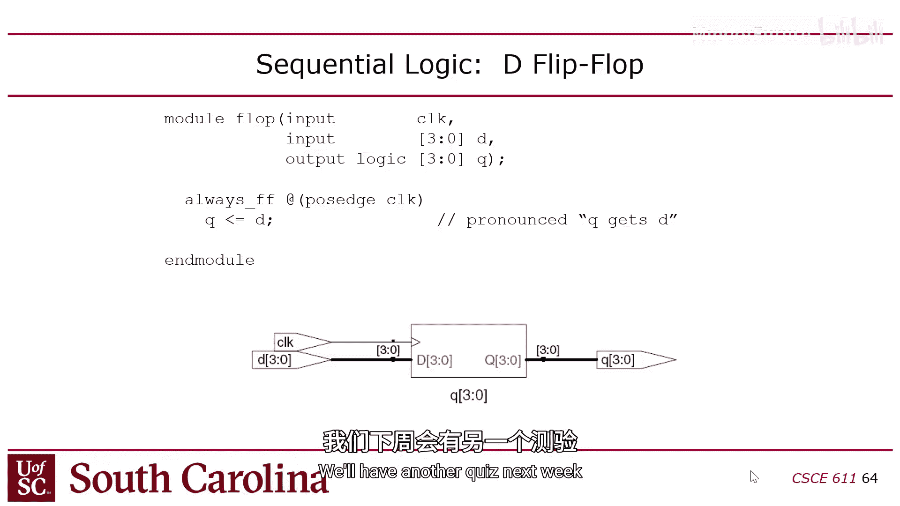

Okay， thank you。