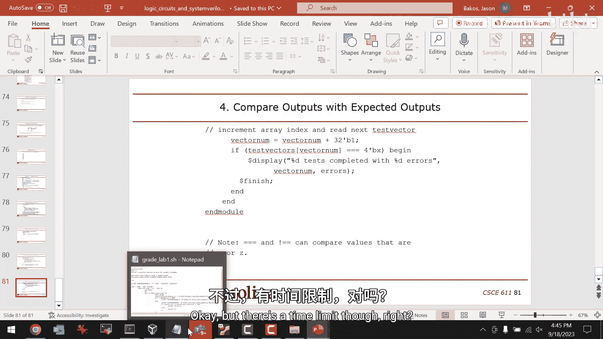
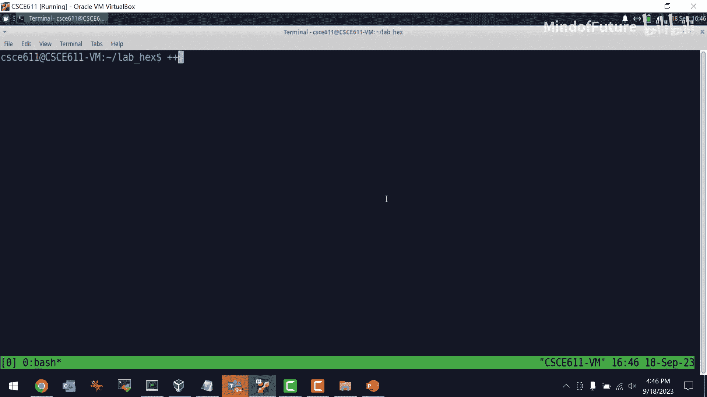
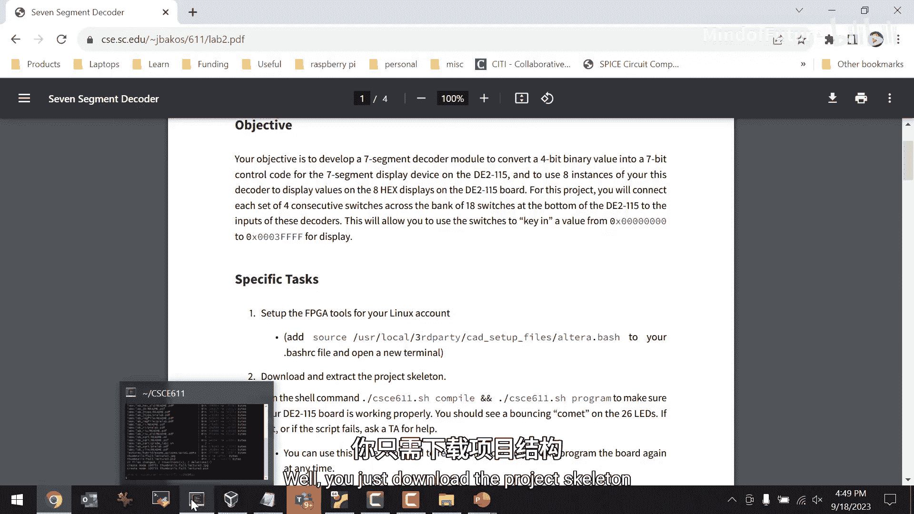
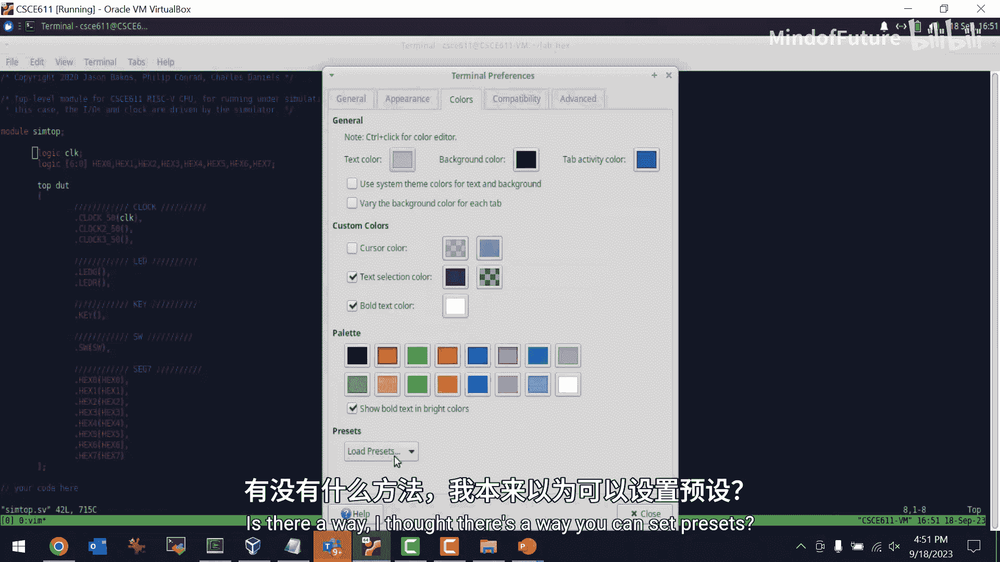
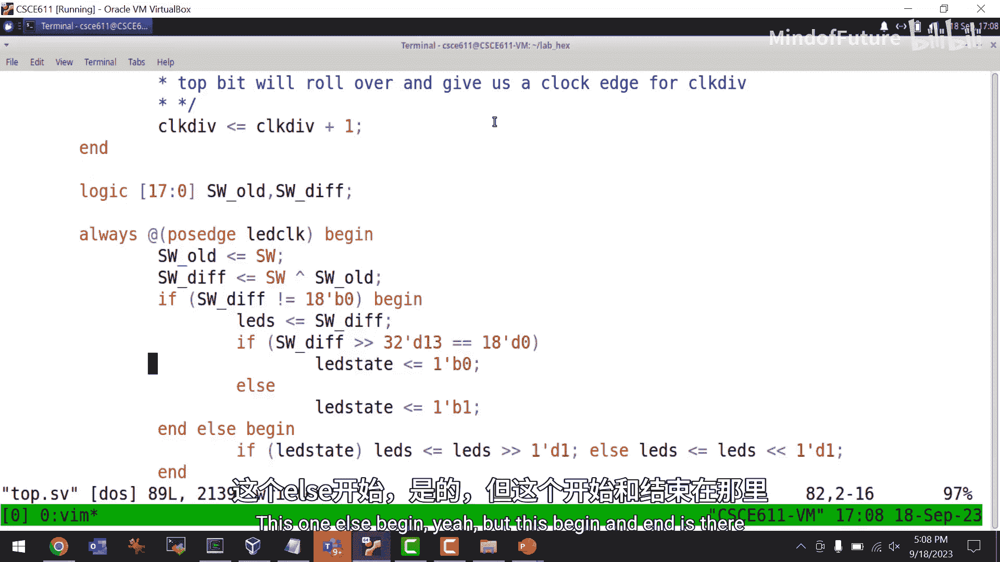
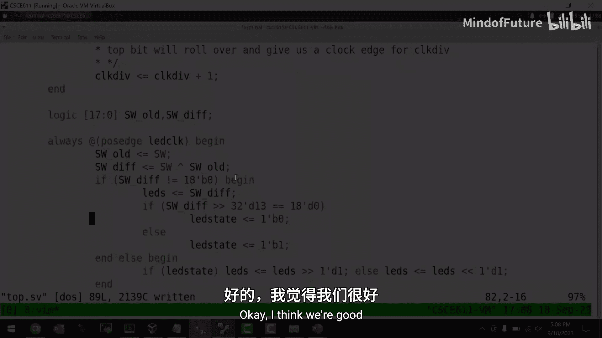
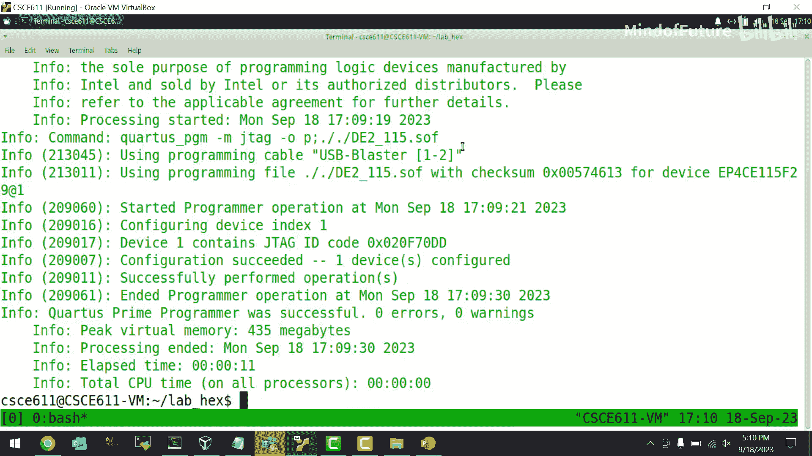

# 【南卡罗来纳大学】高级数字系统设计-CSCE611-（Advanced-Digital-Design，Fall-2023）-p05-P05-Testbenches-and-FPGA-Deployment--BV19nf6YoEZ9_p5-

Today， I'm going to quickly review quiz one that was due last Friday。

And we have another quiz due this Friday。 and then I'm going to。

Try to finish up the lecture on system V and then I'm going to do a little I talking about lab two。

 and then I'll do a little demo for you。Okay， soz quiz one was last week。

 I think there was 11 questions about system very， I was going also risk five assembly。

So the first question was。Consider the following C code。And its translation to risk5 assembly。

 what instruction is missing， so it's a four loop that initializes eye to2。Now， in this case。

I is actually initialized not to two。But we're initializing it to eight。

And the reason for that is because we're going to use I。To walk through。The array。

Because we're indexing。嗯。This a array with I so were we're going to be incrementing I in multiples of four。

 and so we'll start it out as eight， and then we'll also use that to control the loop as well。Okay。

 so you can see that we load the address of a and x1 and we load 40 into x 10。

 so 40 is meant to represent the loop limit here， which is 10 right， 10 times 4。And then。

We start out with the loop。And what's the first thing you do when you start a new？

Iteration of a for loop。You check to see if you。Should continue looping right。

 So you're checking to see if I is less than 10。 so we should be using a comparison instruction。

And in this case。Probably the condition when to check is the condition for exiting the loop。

 which is which is the complement of the condition for staying in the loop。

 So instead of checking to see if I is less than 10。

 we want to check to see if I is greater than equal to 10 and instead of 10。

 it will actually be 40 and 40 is stored in next 10 right so we're comparing。X2。

 so we're doing branch greater than or equal to x2， x 10， and then exit， right？All right。

 I forgot I had little annotations on here。Okay， so there it is branch greater than or equal to x2 x10 exit right so basically we're checking to see if we need to exit the loop。

Using I， which is x2。And the limit， which is x10， the iteration limit， any question， of course。

 both multiplied by four。And then if you look further， we have。

We have instructions here for accessing A， for instance， so in this case。These。

These two instructions， these two ads are used to。Set up the address pointer for A。

So we start out with taking x2， which is the index。

 we decrement four because we want to subtract one from this guy right so we subtract four because it's1 times 4 and then we add x1 which is the base array base address of a and we add x3。

 which is that index value and you know again this is annoying but this is the only way to do indexing in risk5 you have to。

Basically use some add instructions to set up the effective address after you applied the index。

 you can't just do this with an index register inside the load instruction。

And so and then we just load。The address of x4， which is this effective address into x5。Makes sense。

 Now， we could have probably just used negative four as the。Offset here， right。

 that would have worked too。 that would have been a little better。

I would eliminated one of those instructions。Okay， any questions about that？

So hopefully that's hopefully you guys are。Pretty comfortable with that。Because you should have。

Covered something similar to that in in 212， if you still remember。Okay。

 this one says what does the following code perform， so we have a shift left logical immediate。

 a shift right logical immediate， and then an orR。So we're taking the value in。X3。

 so x3 is our input， we're shifting it。Left 16 bits。

 we're taking the same value in x3 and shifting it。Write 16 bits。

And then we're taking the results of both of those and merging them together。So basically。嗯。

We're going to put the upper half。Of x3 in the lower half and the lower half in the upper half and merge them together。

 So what that's going to do is it's going to take the two halves of the contents of Reg 3 and just swap。

 right， swap them。哎。So， yeah， so X。X315 down to0 is in 31 down to 16， and x3。

31 down to 16 is in 50 down to 0 and then you。Combine them together。So again。

 you just swap the two halves。What are two operations that you can perform on system very lot code。

 if that was just a multiple choice， simulation and synthesis。

What's the problem with this system V log module below？You guys know。Anyone。Z is in conflict。

 so Z is you can you don't want to drive you don't want to have two statements that both set Z in this case two assigned statements and。

There's actually another issue with this too， there's another problem。

 the other problem is that this assign is actually using Z as an input and an output。

And so you end up with a like a feedback connection， it's a cross coupled connection。

So that could lead to having a statement like that。

Could cause Model Sim to freeze up because you end up with this combinatorial loop。Right。嗯。

The the simulator keeps trying to update Z， but every time it updates Z it has to update it again because because Z appears on the right and the left hand side of that assignment right so the left hand side of the assignment is updating Z and the right hand side of the assignment is acting as a trigger。

 you know it's causing that statement to trigger。 So every time Z is updated。

 it retriggers and changes Z potentially so No， actually it's not， believe it or not。You know。

 it used to be， I don't know what the option was， I think there might be an option。

 but it used to be when we used VHDL， if this happened。

 you would get an error message that said iteration limit reach。

 so there was a fixed iteration limit， they would limit the number of triggers per time step。

So youd advance a simulator and if there was more than say 10，000 triggers， it would just bail out。

 but when we switched this class to ver log for whatever reason it quit doing that and it just went into an infinite loop。

 there's probably a hidden option in there somewhere that you can use to set the iteration limit。

 but for whatever reason。By default for Vlog， there's no iteration limit。

But even if you get the iteration limit， it doesn't tell you where the loop is in your code。Okay。

 the system very log supports structural or behavioral HDL it's both。

How many possible logic values can be assigned to type logic This one's a little weird。

 there's I talked about four in class， but I mentioned that there's actually in system ver。

 there's actually some other ones that we don't use。

 but there's only four you need to worry about that Z X1 and0。

Consider the system very log modules what's the value of a and y within my thing So we have something called top top instances。

 something called my thing top has both behavioral code in it with these with this assign and structural code in it with this instantiation of。

Of this bottom module。And so inside top。We're going to put。Y inside of the we' going to the sorry。

 we're going to connect the y， which is hard coded to one。Is going to be sent into the a input。

 so a is1 in there。And then why is assigned to be the complement of。Of a， so y should be 0， right？

And complement one。Yeah。So。0， right， so y should be zero， right， I get that right， Yeah。

 why should be zero。Inside of。Inside of my thing。But why is actually one inside of top？Right。

 so there's two different why's， right， There's a why。

There's a Y inside a top and there's a y inside of this my thing， which is a bottom module right。

 but those y's are not the same signal， however the Y signal in top is the same as the A signal in bottom。

So those are shorted， those are the same signal， but they have different names。Makes sense。Okay。

 assume the system very log code snippet， What is the value of a Okay， now in this case。

 it looks like we're double driving， but we actually aren't because one of those is assigning a to high impedance。

 So that's actually okay。 So a would be zero in that case。How many bits comprise the signal A for？

And to what value is a set in the system very log snippet below， okay， this one is。A little complex。

 right， So a is first starts out as the value2 encoded in two bits of 10 right in binary。

 it's 10 right And then we shift it 1 B to the left。 So it's going to be 100。

 which is 4 in decimal or 10，0。And then we check to see if that is equal to4。Which it is。

Using the ternary， and since this is true， then the whole expression is going to evaluate to the true clause on the turnernary。

 which is one。Right。And so I listed the。The order of operations they're the precedent。

 So the shift happens first， the turnernary happens second。Or sorry， the shift happens first。

 the equals second， and the turnernin area is third。 So that's the order of precedence。 Of course。

 you can use， you know， parentheses in there if you want to。Make that more clear。So one， right。

 any questions about that？Okay。😊，And last question。

 and the system very could blood what to what value is signal A set。 So we've got in this case。

 we've got。嗯。A is set to1 here。嗯。And then。Well， actually。So my thing。Is。Driving A。Because see。

 we've got a connected to my thing， but it's connected to this y port， which is an output。

You I see that？So my thing is going to be driving a because a is connected to one of its well。

 it's only output， right？Which is the why port。 The problem is， is that we're also setting a here。

 too。 So a is double driven， but in this case， it's double driven because we're setting it with behavioral code。

And with structural codes， so we're setting it with an assigned statement。

And we're setting it with this by virtue of having it connected to an output port of my thing。Right。

 so what is it's set to one here。 But what's my thing trying to set it to。 Well。

 my thing is just an inverter。 So y is 0。 So if we， if we take y in to the input on my thing。

 the output is going to be 0。 So this guy， this line of code setting it to1。

 this line of code setting it to 0。 So it'll end up being x。In the simulator， it's a conflict。Okay。

 so this is something， this is a good question in my opinion。

 because this is a common thing that comes up in the projects in this class is you may have something like this where it may not be entirely clear that there's a doubled signal because the problem one of the issues with system very is that。

It's kind of cool how you can see the port names here when I instance it。

RightI can see that Y is connected to the a port and a is connected to the Y port。

 but there is no indication of which is these as an input and which is an output。 That's the problem。

 You have no idea by looking at this code， there's it's not clear what's an input and output unless。

 of course， you name the things。Like if you give these guys names that are a little bit more informative。

Right。Okay， so。Yeah， so you might say， well， how do you know， well。

 then you have to drill into my thing and cross reference those guys to figure out that why is an output？

Right。Okay， that's it， yep， ask， any questions？All right， good， so don't forget to take quiz too。

 it's similar to this one。Does it open today it's open now and it's available till Friday。Okay， so。

Let's。Back up to。你三。It's still showing that like no question at it。 Oh， oh， okay， sorry。

 that's my fault。 Then I'， I'll fix that。 Yeah， and also I have them in the question bank。

 but I didn't actually move them over the quiz。 So that's my bad。 Thank you。 I'll。

 on the website side。 Is it supposed to show everything like twice。No。

 someone showed me that last week and I don't see it that way。 I need to。See， this is what I see。

 I'm not seeing everything twice。 I think what happened there was。We have two sections in this class。

 and Ryan merged both sections into one。 So we have section 1 and 2。

 And then what you're seeing on Dropbox is section 0， which is like a virtual section。

 I think there might something happened there when he did that。 that should not be happening。

 I need to contact Ryan。 Someone showed me that last week。 And I just forgot to write to him。

 but I'll do that。 there's nothing I can do about it myself because I I don't have any。

Any kind of special access rights？Yeah， and I'll fix the quiz too right after class。Okay。Okay。

 so last time we talked about Verrlog and we pretty much got through up and through。

I talked about behavioral and structural error， and we looked at some examples there。嗯。

We talked about how to represent numbers。We talked about bit manipulations。

Bit manipulations is you know， concatenating bits and replicating bits and slicing bits out of a bus。

 a bus meaning a multi bit signal。We talked about reduction operators and then I showed。

 I think I did a demo with Model SimM， right where I showed a demo of that。And。So generally speaking。

You want to simulate your designs and then when you're satisfied they work in simulation。

 then you put them on the FPGA and you hope that if they worked in simulation that they work on the FPGA。

 it's not always the case。But usually。U。And I'll do a demo today of running these on the FPGA。

Then I talked about Cors。 I think I talked about Cors。 Okay， and then I got to the always statement。

 So this was the last， I think the last topic for system very。 So， so an always statement is a。

Is a way to make a complex assign statement。 And by complex， I mean that。

And always statement allows you to assign more than one output and always only allows you to assign one output。

 Now that's not technically true because you can use the curly braces。

You could use the curly brace as the concatenation operator to assign more than one output signal with an assign。

Right you guys with me？So。Like， you can say。Asign。And then you could do this trick where you say assign a comma B。

So technically， yeah， you can assign like in this case， you're assigning A and B。

But that's not super readable， right？With an always statement， you can have。

Two lines of code inside the always statement that assigns A And B separately， right。

 That's the difference。 So like you would say， always。And then begin。And then end。

And then you can say A equals， B equals。Right so you can do something like this right so in this case。

 the always statement， you think of it like an assigned statement because it's now the driver for any signal that's assigned inside of an always is now the kind of owned by the always block right now you can assign it more than one time in here。

 but you can assign it anywhere outside the always block because the always block now is the driver for A and B because you've assigned them in there is it makes sense okay so you can do that the other thing you can do with always is you can use constructs like an if statement a for loop。

And a case statement。And you can call functions。There's various types of functions you can call。

So it looks kind of like a more traditional programming language。 And most importantly。

 always statements allow you to have memory so you can have。You can actually have flip flops。

You can make a flip flop。Because we're talking about flip flops and 311。

 so basically a flip flop is a way to capture a bit and hold it over time。

Usually you know it's synchronized to a clock and then Rams Ram is a Ram is a memory structure where it's got memory。

 but it also has an address。 So you've got multiple addresses inside that Ram that are individually addressable。

 Flip flops don't have an address。 Flip flops are memory elements without an address。

 Rams are memory elements with an address。And you can implement both with an always statement。 Now。

 this is where things get a little weird， though， because。Always statements have something called。

A sensitivity list。That goes after the always。So if you have an always statement。

 you have to put a begin and end on there if there's multiple lines of code。

 there's not multiple lines of code， you don't need the begin and end， right？

Kind of like any statement in Java， right？But there's there's this sensitivity list because with an assigned statement。

 the sensitivity list is implied by any signal， so if I say C Ampersstand D here。

 C and D are the sensitivity list if C and D change it's going to activate that assigned right so anything on the right hand side of an assign is the sensitivity list but within always because always statements can imply memory。

 you don't necessarily want to put all your inputs in the sensitivity list right now if it's meant to be combinational logic just like a complex always block then you do in which case you would put always at。

St。😡，So always at star is going to have the always activated on any signal that's treated like an input in there。

 which means anything' that's used in an expression， right？Yous with me？So that's always at star。

But that's the old way of writing it。 That's the old very log way。

 The new system very log way of doing this is not to say always at star， but always。Underscore calm。

Combinational， that's the system very log way。 But that's up to you。 You can use either either way。

 right， You can say always it star where you could say。Always calm。

 or if you really want to get old school。You could say always， not underscore， sorry， always at。

And then in parentheses， you can say you can explicitly lay out your inputs。

 like if this is C and this is D， you could say C comma D。Right。Make sense， the risk though。

 of doing that is what happens then if you say D and F。Well， now you've got F。

Which is treated like an input， but is not in the sensitivity list。 So now this is memory。

 you're going to have memory。In here， because basically what's going to happen is whenever C or D change。

 that's going to act like a clock signal for reading F and this turns into a latch。Not a flip fl。

 but a latch， it's going to end to be un level sensitive。Right unless of course， you say。Pause edge。

In front of sea。 and pause's edge。In front of D， in which case now it's a flip flop。

 it's edge active， it'll activate on the edges of C and D， rising edge。Rising edge of CMD。

 then now I've made a flipflop， right， but if I take the pause edge out， this is a latch。

Because C and D will act as the clock gate signal for F。Because otherwise。

 F can change and it won't activate this guy。 So what does that mean。

That F is something that's only being read when C or D。Are set to some value， right？You guys。

 that makes sense？So if you're making combinational logic。

You want to make sure that you always use always at star or always underscore comm if you want to use the new Fangled system V syntax。

 right， always comm。 Always comm is safer because if you accidentally do always， well。

 actually always comm doesn't have a sensitivity list。 So there's no way to。There's no way to。

Make a latch that way by forgetting an input signal。

 But there is still another way that you can make a latch， because I could do something like this。

 I could still put always comm， which is supposed to make combinational logic。 By the way。

 you guys comfortable with that term combinational logic。

 combinational logic means anytime into the inputs change boom。

 the outputs update right because the output is only a function of the inputs whereas sequential logic is when you have some kind of memory going on in there where the outputs are a function of the inputs。

 but also the historical old values， you know the old values the inputs from the past right。

 somehow affect the present， right， that's a sequential logic right Okay。

 so let's say I put always calm， But then I do this， I say if a equals equals B。

 then C equals one apostrophe B0。 What happens if I do that。 Well， now I've got a latch again。

Because I only assign C if a equals B， but if I activate this always， if A or B change。

If A or B change， they're implied to be in the sensitivity list they'll activate the always。

 but then if they're not equal once I get in there。

 I don't actually assign C to anything right so what is C going to be equal it's going to be equal to the old C right that's going to be the historical the remembered version of C and again this will create a latch right？

So you don't want to use latches。You never want to have latches in an FPGA design。

And the reason is not because FPGAs can't make latches because they can。

 you can implement latches on an FPGA， but it makes the timing closure very difficult for the tools。

Time enclo is basically， I have a lecture on this at the end of the semester。But basically。

 time en closure is about calculating the critical path， logic delay in your whole design。

And then ensuring that the clock period is long enough to accommodate that worst case critical path delay。

 right The problem is is that when you have an edge triggered system。

 the critical path delay is measured from edged edge So you have from the rising clock edge。

 the rising clock edge， you get a whole clock period whereas with a latch。

 you don't get a whole period of the clock right you just get basically the time the clock is low right basically half the period So your timing analysis from the tools is kind of screwed up and you'll end up with a much slower clock if you end up using latches right So you should avoid using latches。

 So if you have code like this， this is valid code tech， well， actually it's not valid。

 you'll get an error because。Because you explicitly said always calm， so the compiler would say， hey。

 I think you screwed up because you said always calm but you got a latch in there right however。

 if you did this，If you said always add star。Well then it won't generate an error message。

 but it'll still create a latch and this is essentially an unwanted behavior， this is a bug。

 so how do you fix this easy， you just put a default value for C。Right above that if statement。

 and then C may get changed twice， may be set twice。

 but only the last one will take effect will matter， right？So that's that's。Yeah。

 that's basically always statements for combinational logic， and then you can also make memory。

That's when you intentionally create memory。 So in that case， you can say always at。Pause edge。Clock。

Begin。And and this when we activate on the rising edge of the clock， there's also neck edge clock。

Which is equivalent。Or you could say pause edge clock， comma， neck edge clock， comma。

 pause edge clock。In which case it's a DDR type system。

 double data rate activate on the rising and falling into the clock， you can do that too。Makes sense。

Okay， so。And if you put always underscore FF there。

That's the new Fangled system very syntax that tells the compiler， yeah。

 I'm trying to make a flip flop。If it's not a flip flop according to your understanding of this behavior。

 then give me an error message because I messed up right， so that's always underscore FF optional。

 it's optional。Okay， now one thing that you'll notice here。

Is when I assign something in an always FF。I use a less than。Equal sign。Less than equal sign。

To assign signals。As opposed to an equal sign， so what's the difference？Okay， so notice， okay。

 so here's an example over here， so this is a mux。I have an assigned version of it。

 I have an always version of it， and notice I use an equal sign here， right， just equals。

Equals here equals there， right， simple。But then。Then， I get to。I have a resetble D flip flop here。

So this thing says always FF pause edge clock。If on the rising edge of the clock。

 reset happens to be asserted， then clear the flipfl， otherwise sample the D and stick it on Q。

So this is a synchronous reset because this reset only works on the rising edge of the clock。Okay。

 but notice that I use the less than equal here to assign y。嗯。Well。

 this is the most confusing part of system very。So there's two kinds of assignment statements in an always block。

 always statement， there's a less than equal version and equal version。

 the less than equal version is called the non blocking。And the equal version is the blocking。

The difference is wildly convoluted。 The only thing you guys have to remember is if you're making sequential logic with memory。

 use the less than equal。So if it's clocked， if you got a clock。

There's a clock signal involved used less than equal。

If there's no clock involved then you're trying to make just a fancy assigned statement。

 essentially a more complex assign again， by which I mean。Like， for example。

This assigned statement is just making combinational logic， however， it uses a case statement。

 so I'm trying to make some， you know， I'm trying to make this look。

It's complicated combinational logic， it's I want to use the case statement。

 I can't use the case statement unless I'm in it always， I can't use that in a sign。

 a sign is just a ternary， it's the best I can do， right？So if you want to use a case statement。

 you got to use an assign， which is fine， I'm sorry， and always block rather， which is fine。

 except notice I use the single equals because it's combinational logic， right， no memory， no clock。

 it's not clocked。Okay， all right， so that's all you have to remember。

 but give I'll give you the real explanation。The real explanation is that。

With a non blocking assignment。When you have a signal that's treated as an input。

Inside a non blocking statement。The value the always block sees for that input is whatever was previously assigned to that input。

Okay， now this can apply to other things assigning that input inside the same always or in a different always。

You guys with me？Which means that if I， for example。If I say D， N1 gets D and Q gets n1 n1。

On that second line of code， the N1 that it sees is not the version that was set in the line above it。

 It was set whatever was in the the last time it was set on the clock edge。

 So what ends up happening is that this ends up creating a two cycle delay because it's going to take。

 I have to activate this guy once to get D into N1。

And I have activate it a second time on the next clock to get N1 into Q， right。

 so it creates two flip flops in series， essentially it creates a shift register。

And the reason for that is because this second line of code。

 even though it appears after the first line of code that sets n1。

 it doesn't see the updated version of N1， it sees the old version of N1， right？Makes sense， why。

 yes， like every time you're running it then is just going to see whatever。

Right on the previous edge， yeah， on the previous time it activated， right。

 not on the current activation on the previous activation。 Yeah， yes。

 so every time that happens Q gets updated the previous N now is updated to the D Yes， exactly yeah。

 so so N1 will lag D by one cycle。 So N1 will be whatever D was in the last cycle and Q will be whatever D was two cycles ago or whatever N1 was one cycle ago right So it's it's just it's like you know it's a very common thing to do in signal processing if you ever take like digital signal processing where you have samples coming in and they sort of get shifted and you can see the last several samples right in order。

 right that's what you're creating there right however。

 if you use the blocking assignment statement then the second line of code will actually will see。

The updated version of N1。But the problem here is that。

This basically will take this N1 and substitute it into the second line of code right so basically this is equivalent to just saying D goes into Q or Q gets D so this actually creates one flip floop whereas this creates two flip flops right this code is totally redundant。

But it can still be useful if you have like a really complex expression that you want to kind of break into subexpressions。

 then you would use this you know blocking format。 But on the other hand。

 if you just want to create a bunch of registers use the non-blocking right but in general。

 like I said， the convention is is that you should always use this for clocked and that for unclocked if you forget it's usually not catastrophic but I've had some bugs that were really hard to track down because I accidentally used blocking and clock logic and it wasn't even this is the thing that's crazy。

 the bug wasn't because of this happening where I had n1 assigned in the here and then used in the same always。

 it turns out that this will bite you even if you assign n1 and another always。

Possibly in another file， even， right？Right because it gets really complicated because you may have。

If I have two always on this activated on the same edge。

 even if they're in different hallways in different files。

They could interfere with each other through this blocking mechanism。

 so it gets really complicated and you can end up with a bug that's hard to track down so that you should try to stick to the convention。

 okay。Okay， so' that just describes that， okay， last topic I want to cover our test benches。U。So。嗯。

We so I mentioned to you when you simulate your code and model Sim。

 you can force your inputs to be certain values right you can just type force a。

 you know to be something and then run force， run， force， run， force run。

 So if you type force followed by run， force will set an input you know so you can set an input for the design your're testing and then run will advance the simulator so you can see what the effect of that input is right and then you just check and make sure things match up to what you expect。

 So's a horrible way of testing obviously it's not really practical to do that。

So the way you're supposed to do it especially from more complex designs is to create a test bench。

 test benchch is just a system very log wrapper that goes around something you're going to test and the wrappper does two things。

 one it sets the inputs and so you don't have to type you know you don't have the write tickle commands and model them。

 you can just have over the wrapper set the input stimulus for you。

 the test inputs and also it can be self-checking the test bench could check automatically the output from your design you're testing and it can print an error message if there's a problem as opposed to you trying to look at the waveforms which is tedious right。

So of course， you don't have to have the test bench do that。

 you can just have the test bench drive the inputs， it doesn't have to check the outputs， right？Um。

The other thing is when it comes to the inputs and the outputs。

You can either put them directly in the test benchch code as constants that you type into the design or you can put them in a separate file called a test vectors file。

 which is just a way for the test bench to read the inputs and the expected outputs from a file that way you can separate the task of writing the test bench and writing the test you guys with me so that's a called a test vectors right so here's an example so I have this module called silly function it has three inputs one output it just a some Boolean logic and I can create a test bench now one of the things you'll notice by the way is that。

Generally speaking， all your modules are going to have inputs and outputs， they better。

Because if not， they。They can't communicate with the outside world right however。

 a test bench is the exception， a test bench because it's wrapping around the design you're testing and it's generating its own inputs。

The test bench won't have any inputs or outputs， but keep this in mind， though。

 the test bench is not synthesizable。So only this is synthesizable meaning anything you design that you want to put in hardware is going to have inputs and outputs The test bench doesn't have inputs and outputs。

 but it's not something that's going to go into hardware it's only for simulation purposes right so here's a test bench notice that there's no inputs or outputs there just says module test bench it's kind of self-contained and then you simulate this as the top level design in the simulator and this thing will basically use an initial statement。

The initial statement is used for initial conditions。

And it looks kind of like in always except there's no sensitivity list。

 you just say initial begin and end right and then you can put in a equalsh blah blah blah，lah。

 whatever your inputs are and then so that's kind of like writing force and model Sim。

 but then how do you advance the simulation。You use this weird delay operator hash 10。

 It'll delay for 10 time units， whatever the time units。Happened to be set up to be， which。

 as I mentioned earlier， it doesn't really matter what they are because we're not simulating any kind of。

Resistive capacitive delay here， so。Time is not really important here with the behavioral simulation。

 okay？So basically you set A， B and C， and then I just give it enough time to do its thing。

 so hash10 semicolon， by the way， this is what automatically disqualifies this from being synthesized。

 by the way， you cannot synthesize any module if it has this hashtag thing in it because you can't do that。

 you can't design hardware it and have a delay for 10 time units。

At least not without like having an internal like a clock and then you know counting cycles on a clock and external some kind of external time reference of some kind right so doing this doing this delay thing makes this non synynthesizable but it'll work in the simulator and when you're happy with it then you take the thing that you're actually testing and you're gonna to put that in the hardware and then presumably you're wiring A B and C to。

Some wires coming from the outside world or from the external from the module， right？Okay。

 you guys with me？Okay， so this thing all this one does is drive the inputs in delay。

 So the expectation here is I'm going to load this in a simulator and run it。

 I'm just going look at the waves right， but that's still that's not real practical。

 So instead I can add some if statements in here to check to see if the output matches what it should be。

Right， so now I've got this notion of the actual output why， and I've got an expected output。

 which I've just hard coded right， So that way， I basically set my inputs delay， and then I check。

The the value to see if it's expected from whatever the previous inputs I put in there were right And that way I can print little error messages now I've got this little function I'm calling called Do display。

 Now， dollar display， I think you can synthesize code with that in it。

 but that would just get ignored。And the synthesized code because dollar display is designed to print a message to the simulator console。

 there's no simulator console if you put this in hardware。

 obviously it is only for simulation okay so you could print a little air message so the idea here is that you essentially just load this in the simulator and run it if it doesn't print anything。

 then it's working。If it prints an error， then you have to bring up the wave window and start drilling。

Trying to do some forensics， find the bug。But if it doesn't print anything。

 assuming of course you ran it long enough， how long do you have to run this for， by the way？1，2，3，4。

5，6，7，8。 It looks like eight test cases makes sense。

 there's three bits input and two to the third powers8 right so like  eight times 10。

 so you'd have to run this for 800 time units。Because it does a fully exhaustive set of input values。

Okay， now the problem with this， of course， is that you have to hardwire this stuff in here。

You have to hard wire， the inputs and the expected outputs， which that's not practical。

 So what's better is to write a。Test bench with test vectors。 now the problem with this is。

The problem with this is。You have to figure out when you write a test bench。

 how you're going to synchronize when you set the inputs even on a combinational logic circuit。

Now I mentioned to you guys， let me clarify something just to make sure everyone's。

 I didn't confuse you with this。 when you simulate behaviors with like combinational logic。

 it's essentially it's infinitely fast， right， the circuit is infinitely fast。

But it still requires a non-zero time so the reason why we have these times in here。

 this hash 10 is to give it some amount of time， but it doesn't matter how much time from the for the outputs to update after you change the inputs right So remember I mentioned that in model Sim。

 there's this notion of a sensitivity list where you activate things。

 you activate circuits to update their outputs， you have to give it some non-zero amount of time for that to happen it doesn't matter how much right so that's why these little hash 10 things。

 pound 10 things are here。Another way to do it is you could use a clock signal， so for example。

 you could assign the inputs on the rising edge of the clock and you can compare the outputs on the falling edge of the clock。

 That's just another way that you can coordinate the inputs and outputs right or you can still put in little。

Hard coded delays， you can still do that， but this is just another way to do it。And so。

So then you can write a test vector file， which is this text file。With just。Bits。

So these are the bits， these are the input bits and that's the expected output bit。

 the underscore is ignored， but it's useful for me so I can see the difference between the inputs and the outputs。

And then you can combine this with。嗯。You can combine this with a load for that。Let me show you。

 so we've got this test bench and I've got this silly function instantiated in there， and I call itD。

 which stands for design under test。And then I wire up ABC and Y， which I've declared above。

 I also have a clock， a reset， and then I have a vector number an errors。

 which is just a counter of 32 big counters， and then I have this is new， this syntax， test vectors。

This is a。An array of vectors。 an array of。Multi bit logic signals。

RightBut this syntax is really obnoxious because remember how I mentioned earlier that when you make an array。

 a multi bit signal， you have to put the numbers before the name。

 which is unlike any other programming language array syntax right usually if you have an array like in C or Python or Java。

 you put the size of the array after the name of the array。

 where here you have to put it before but this is where it even get stranger。

 if you make a two-dimensional array in ver log， then you put the other dimension after the name。

This is also the syntax for declaring a RA array。Okay。

 but here's what's confusing about you might say， what's the big deal。

 It's just where you put the indexes。 No， the crazy thing is that in C。And in。Java and C+ plus。

Python。I should say nu pie specifically。And in linear algebra。The row goes first。

 the column goes second。When you have a two dimensional array， right， row column。

 meaning that the depth comes first， the width comes second， always， right？Makes sense。

 that's how it works usually， right？Which is kind of weird because like in a Cartesian coordinate system。

 it's actually switched you've got x and y where x is the width and y is the depth， right。

 but in linear algebra， it swapped， you've got the vertical component， then the horizontal component。

 right。Okay， now in Ver log。They swap it。 They have the。With。Goes first。And the depth goes second。

 so what this means is the test vectors are four bit wide each。Each test vector is four bits。

 but I've got。10，000 in one of them in。The depth， the array。 So I've got 10000 test vectors。

 each of which are  four bits wide。 But again， keep in mind。

 this is the opposite arrangement that you havet see and see its row column。

 So you can think of this as the column。 There's a four columns，4 bits on the columns。

 but 10000 rows 10000。 That's the depth of this memory array。 Okay。

 so this is the opposite of what you're used to。Make sense。Okay， so what are we using that for？Well。

 basically it's a lot of explanation for something that's actually pretty simple。

 you just use this function in the initial block， initial initial just is at the beginning of the simulation。

 you say dollar readMM B， you give the file name and that what you want to read and this read Me B stands for read binary data this will just take the data in your file and it will put in that test vectors array that's it。

And then you initialize the counter， the vector numb counter， and you tell it a reset。

 you give it a reset pulse， you set reset to one， give it a little delay。

 and then set it to zero permanently and then end and so then。You can have in always ways。

That activates on the positive edge of the clock。That。Takes the vectors and puts them on A，B。

C and Y expected。 So this is the format I was telling you about where you can use the curly brace to actually assign multiple values in one line。

 a little confusing， but。This is the syntax the book used， I probably would have。

Done it in multiple lines， but that's one way to do it then。

On the negative edge of the clock is where you actually。

Look at why and why expected right why expected comes from the test vector and y comes from the do as long as they match。

 you know we don't have any problem if they don't match then we've got an issue so on the rising edge we blast out the inputs。

 the falling edge we check the outputs right and so for that we have two always statements the first always sets the inputs。

 the second always checks the outputs， the first ones on the rising edge of the clock。

 the second ones on the falling edge of the clock。Makes sense。And then we have another always。Oh。

 actually。No， I'm sorry， this is all part of the same one in the same always statement。

 we check why expected， if not we increment the air counter and then display a message。And then。

This part here。Checks the see。If the vector that comes out of the vector's array is an x。

Which will happen once we after we reach， after we read past the last vector stored in there。

 So this is just a stopping condition。 And then finally， if that， if that's the case。

 then we have a finish， which。Which stops the simulation。Makes sense。

So this is the first time I think I've showed you multiple。

 multiple always now that are working together， at least test bench。

I'll show you another example here。 And that when I demo the code from La2， and that's it。 That's。

 that's all the。嗯。System verylog stuff， any questions about that？好。Okay， so。By the way， this is。

 I don't expect you to。Memorize the syntax， even I often have to go back and refer because the syntax is so bizarre。

Anytime I do a lot of system dialogue programming， I always have to go back and check。

Check a reference， yes yes， oh yeah， yeah， it's all open book， yeah yeah。Yeah。Yep， open book。

 open internet。Okay， but there's a time limit though， right， Okay， so it's。

All right， so next thing I want to do is talk about lab2。

I don't know if you guys have had a chance to look at that yet labb two is already on the put on the website last week Okay so the objective here is we want you to just create a seven segment decoder which is can be done。

It basically can be done with a single assigned statement with a nested ternary operator or you could do it with a case statement or an ifN else in an always。

 but you could basically do this lab with just one always or one assigned so it's pretty simple it's meant to be a tutorial but it also requires you to actually get the FPGA work and so there's some other details aside from the system very in terms of getting the tools working and stuff but the idea is is that there are87 segment displays on the board and there are 18 switches。

And so we just want you to wire。Each group of four switches。So 18 divided by4，4 and a half Yeah。

 there's 16。s left there's a two leftovers。 So it's like you get basically four and a half digits。

 Hex digits worth of switches。 and you just want to wire are those to a decoder that will go to each hex digit on the board。

 So the hex digit is a seven segment display that can display values from 0 to f in hex right So if you put all four switches up。

 it should be F if they're all down， it should be 0， if you have 1010， which is 10。

 there should be an a on there right so you have to figure out how to form each one of those characters。

 Yes so if we wanted to use the7 you just have to make it like threes。

You could do that yeah that would be one option but we just we assume that when this gets done the first two digits will be probably zero I assume or blank zero yeah and the third one from the left will just go from zero to three because there's only two bits worth on that and so each one of these decoders will be a module that you create and then you can copy and paste it or you can use a generate loop which I haven't talked about that but you can look it up there's a way you can just write a four loop to generate eight of these things。

And。four bits in seven bits out， so four bits come in， seven bits come out。

 but the seven bits are wired to each one of these little segments and you have to look at the there's a manual online that tells you how to look at the DE2 manual the segments are active low meaning that you know zero turns them on one turns them off and they are ordered from least significant。

 the most significant in which the order is starts at the top segment and goes around clockwise and then ends with the middle segment unfortunately for us。

Seven sigma displays usually have a decimal point， and these ones have a decimal point。

 but it's not wired to the FPGA。So we can't use it。

 which sucks because we actually do need it in lab4， we need a decimal point， but。It's not wired。

 just like the LCD display on here has a backlight， but they didn't wire the backlight bit。

 so we can't turn on the back light。So some of the， some of the things aren't wired up on here。

 but that's okay。 Okay， so how， how does this all work， Well， you just download。

You download the。The project skeleton up。I ran this one， yeah， okay。

 so you download the project skeleton。And it doesn't have doesn't have as many files as I'm showing here。

 the reason I've got all these files is because these are these were generated when I built it when you do a build。

 these are all intermediate files， the actual project skeleton has like maybe。Maybe。

 you I don't know， eight files or something， right？So I want to call out a few of these。

So you've got a file called Top。t Sv and you got a file called SimTop。 Sv。

And there's also one called Hexdriver。sv。Those are。There to help you get started。

 there's some code that we provide。SMtop， you probably won't use Simtop because。Oh。

 actually mate I have to go back and look at， I forget if we ask you to do a test bench or not， okay。

 yeah， sorry， you will use Stopop， sorry， so Stop is the test bench。Simtop。

Is a test bench that wraps around what would be the top level design for the FPGA， right。

 So Simtop is acting like it's the board in your eyeballs when you're using it， right。

 so you're going to write test vectors for that。Top is the top level design for the board for the FPGA right so when you put this on the FPGA you're going to start with you're going to synthesize top when you run it model SIM。

 you're going to synthesize SIMT makes sense。Right。

 that's the difference now hex driverver is a that's basically blank。

 that's just for you to put your seven segment to code or code into。

And you don't even have to call it Hex driver。 I don't think You can call it whatever you want。

 We just gave that to you a starting point。 Okay， now one thing you'll notice， though。

 is if you open。 So if you open Simtop， I don't think there's much in there。 Yeah。

 it's pretty much empty。 It's just Sim top。No input， oh on can I？Hold on one second。

 I want to see if I can shut tunnel view。Preferences。Appearance， colors。UmPearents。Background。

I there a way I thought there's a way you can。That press。

Bla on white。 Oh there we go。 There we go， that's easier to see okay。你是。Okay， so。

I'm going to make this a little bigger。 Okay， so no inputs or outputs， right。

 but I have intermediate values for the hex， and then I have a du。A design under test。

And this is just。Placeholder， right， Okay， so then if I， if I open top dot Sv。嗯。Top dot Sv。

This guy has some more stuff in it， and I just want to explain what's going on here。This module。

 see it says it was generated by Ter6 system  builders。

 so there's actually a tool in that comes from the company that makes these boards that generate these like the top level design for you。

And the inputs and outputs have special names that correspond to the pin mappings that actually map to the pins right and you can see it those pin mappings if you look at the project file right so basically all the top level signals have to have names that match up to the actual pin names for the FPGA。

Now you'll notice my my I think， I guess it generated this。

 I thought Charles might have wrote this because he's got all the crazy tabs on here that line。

 you know， that the formatting is set up to kind of line things up in columns。嗯。

So there's a clock 50。Clock 250， clock 350， I have no idea why there's three of them。

But we just use clocklock 50 later on。嗯。For the hex display it doesn't matter because we're just making combinational logic right but clock 50 is the 50 meHtz clock that comes in from the board。

 I assume clock 2 and3 are also 50 megahertz they have 50 in them but I we've never used them Okay then you've got LED G and LED R So there's 18 red LEDs and。

E green LEDs。And then there's three keys， keys are the buttons。They're active low， by the way。

 so when you push them there's zero， you release them there're one and then18 switches or these switches and then you have the seven segment displays that come out right there's just named Hex0 through Hex7 so there's 56 total wires that come out that connect to those hex displays。

嗯。😊，And then we have some stuff in here， so this is kind of an example design that we've got。So。

And this is this is in here so you can make sure your hardware is working。

 it's like a sanity check right it's kind of like a demo code so we have。This thing called clockd。

And it's a 24 bit signal。And the way this works is that there is a an always in here。That。

Incrementments， oh， this is my okay， I'll hold on a second， sorry。

Thought I had updated this is my changed version I want to get the original version。

 let me grab the original version here。Let me remove lab Hes。And then。Lab Hex do yeah， here we go。

 sorry， labb Hex。Top do sorry I had a modified version， okay， this is the original version。

There's several alwayss in here， but the first one you see is this one that just adds one to clock div。

Okay， so clockD is a 24 bit signal。Right and we're adding one to it every clock cycle。

 which runs it 50 million times per second， 50 million cycles per second。

 right so what that means is that。The 24 bit counter will roll over to zero after two to the 24 bits。

 two to the 24 clock cycles， right？Right which is。It's about 16 million。Two of the 24th power。Right。

So that's going to roll over。At a rate of。嗯。50 million divided by 16 million hertz。Right？

And then we take the most significant bit of that counter and we use that。Two， where's it at。

 where it at， where at， where's it at？嗯。Right here， we take the most significant bit of that counter。

 bit 23。And we assign that to LED clock。 So what that does is it creates a divided form of the clock。

 It takes a 50 MHtz clock， and it divides it down into a。Two hertz， three Htz， three Htz clock。

RightW would we do that， Well， because we want the board。To do something that we can see。

Because anything the board does at 50 million times per second is not going to be visible right。

 So basically， we have this slow down version。 and then we have some code。Oh， by the way， also。

This code is going to take， we have a thing called LEDs， which is 26 bits， and we use that。

To assign the upper。18 Bs to LED R and the lower8 B to LED G because those two banks of LED are next to each other。

 right， So we have this one LEDs array， which maps to all the LEDs， even though some of them are red。

 some of them are green， right。And then we have this thing called LED state。So what that does is。

Well， okay it says in the comments， but basically what that does is that we're going to take the LEDs and light them up in sequence。

 we're going to have one LED on at a time and just have it walk to the left and then walk to the right right so LED state controls which direction it's moving right okay and so。

And the code down here basically just does that right。

 So this isn't always it's activated on the LED clock。 That's the slow clock。

 And so there's an if and else that controls， you know。

 when we change from left to right mode and also it uses a shift operation to actually move the LED。

 Now， when Charles wrote this， he did not use the you know。With designator for these things。

Which is not good， but it still works。Okay and that's it so if you want to use this。

 if you want to test it out， all you have to do is run our script CSEE 611 compile。

And this will synthesize the code using the tickle interface， the command line interface。 of course。

 you can also do this in corts。All you have to do is open Corus and open the project file and you're good to go。

 You hit go and you're ready。 but this is just。A little easier。

 you can just do it at the command line。 You can see there's a bunch of messages kind of flying by。

And sometimes it makes it easy to miss legitimate warnings。哦哇。Okay， so it finished。

 that's not too bad， that's actually pretty fast， so compile oh sorry， CSCE 611。

 I can do now program。And let me check it says it' not detected。 LS USB。

 Oh yeah because I'm not plugged in， sorry。All on to plug in。 Oh， by the way， these boards have。

Three USB connectors on them， you want to use the one labeled USB blaster that's the leftmost one that's the programming cable and the debug cable basically the other ones are if you actually want to implement a USB device on the FPGA like you can build your own you know USB device。

 one of these would be a master， one of them's a slave。Okay， so got the cable and。Plug it in。

And once that happens， I type I could type LSUSB， I can see it's connected there。

 and so now I should be able to program。And so when it starts programming。

 you'll notice that the board goes kind of dim。 These guys go into tri state， which is why they go。

 they go dim。 and then you can see。You can see the LED now walking across。You see that。

 you guys can see that it's going now。Kind of just going back and forth。Right so this way。

 if if you suspect there's a problem with your FPG board or your cable or whatever。

 you can just run this demo and this is a Sandy check， it's like a self check selftest sort of Okay。

 so what if we want to change this now so let's try to do something interesting with this So if I open up top dot Sv。

Okay， so what if I wanted to do something， you know。

 like this is not interactive at all like so what if I wanted to basically use the switches here right。

 which you know， you guys will have to do that for the lab。

 So let's say I wanted to do something where when I flip a switch。

It doesn't matter if I flip it up or flip it down。The design will then light up the corresponding LED。

And then if that switch corresponds to an LED on the left side of the board。

 it'll walk it to the right， and if it's on the right side of the board， it'll walk it to the left。

Right now it's a little weird because I only have 18 switches and there's 26 LEDs here。

 So it's a little， little bit of a mismatch。 But how would I do something like that。

 So I am going to。I'm actually going to wipe out this code。

That actually controls that walking back and forth and。

I'm going to create another always here called say， always at。Pause edge。

 I'm going to use the LED clock for this。Begin and okay and then I need to check to see I want to detect edges。

Edges of the switch， In other words， changes。 How do I do that， Well， in order to do that。

 I need to create something called LED old。 I need a value that will keep track of what the not LED。

 Sorry， switch old。Switchel， I want to keep track of the old value of the switches。You guys with me。

 so like if I flip a switch， I want to be able to compare the current value of the switches to what they used to be right so I'm just going to say switch old equals switch。

Right， so that'll create a one cycle delayed version of switch like in in a register， flip fl， right。

 And then I can have something called。😊，Switch diff。Which is going to be switch， X or， Sw old。

 and I have a typo in there should be switch old。Switch now， by the way。

 why am I using SW SW just happens to be the name of the actual。That's the name of the actual。

Switch input，181818 switches， right， so I've got switch old。And switch diff。Makes sense okay。

 and then I can say。Now， by the way， notice I use blocking assignments。

 So it's going to take two cycles。 It's going to take a cycle to go from switch to switch old。

 and then another cycle delay you know， to calculate switch di， which is fine because it's。😊。

You know， I'm not going to notice that。Okay， then I can say if。Switch。Diff。Doesn't equal 18 zeros。

Then， begin and end。And I can set。LEDs to be。嗯。Whatever。Switchches。Sorry， switch diff。

Whichever one changed。Okay， so when you do an X or。

 that's basically going to put a one bit wherever there's a difference right and all the other bits will be0。

 that's what an X or does It's a different operation Whenever you have a0 and a1， you get a one。

 if you have a0，0 or1 and1 and you get zero， right。Okay， so then I can do that。Else。Okay。

 now this is where things get a little weird with the begins。Okay， so。Sorry， this needs to be begin。

 And so this this this takes a little get used to， right， So you've got。

If this syntax looks like C right， but then I have to put a begin right， then Ive got to put an end。

 but then the else comes after the n right and then another begin and end right so that kind of looks cumbersome compared to C or Java。

Now I didn't actually need to put begin， I could have actually gone without this begin。And this end。

Because it's only one statement there right but down here I'm going to say I'm going to replace Charles' code now that says。

 oh， by the way， a couple no I sorry， take that back。

 I do want to begin on here because I have to take care of the direction so I want to do that but I also want to set the direction so LED state。

Is going to be equal to what？Well I'm going to say。If switch， switch di。

And then I'm going to shift this， How many do I have？18， yeah， but I'm going to treat it like。

I'm going to treat it like a 26 bit array， actually， So I want to do like。13。

 so I'm going to shift it。嗯。I'm going to shift it 13 bits to the right。

 so that'll tell me if I'm in the left side of the switches， right？But I'm going to treat。

 you know what？Yeah， it's a little weird because there's only 18 switches and there's 26。

 but I'm going to do 26。 I'm going to shift to by 13 bits。So I'm going to just shift it like this。

 13 bits。嗯。So I'm going to do that and I'm going to say if I shift it 13 bits to the right and it's zero。

嗯。So how many bits is the switch 18， So if that's zero。Then， that means that。

Whatever switch I I swapped or whatever switch I flipped was on the right hand side。

 So I want to shift the thing to the left right， so I need to set LED state to be left。

 which is which one is left。嗯。Zero is left。 Yeah， I want to set that to zero， right， so one be0。

 and then I'll say else。LED state1 B1。Cool， all right， that's it。 And then in the else block here。

 I'm just going to say if LED。State equals equal of LED state， then I'm going to say LEDs。

Is LEDs zero is。Sorry， which one is zero again？Zero is left， yeah， so I want to shift to the left。

 so shift one bit to left。Else， LEDs。Is assigned LEDs。Shifted one bit to the right。Cool。

 and that's it。 I think I got it。 right， now， the only thing is I forgot to declare。

 I got to declare。Switch old and switch diff， which I will both declare as 18 bit signals。

 so 17 colon zero。And anything else， no， I think that's good。So where's the but。

 I know there's probably an error in here somewhere， I'm sure of it。

Always begin and that if is begin。And is there if this doesn't have a begin end and a。

This one else begin and yeah， but this begin and is there， that beginning is there。

 there's no begin in there and the begin has a begin there。

And。Okay， I think we're good。Does look good。All right， let's see if it works。

 I'm sure there'll be something。Something I have to fix， but let's try it。啊。

I mightight just just have enough time if I didn't screw this up。Oh， looks good so far。Oh wow， okay。

Now， by the way， this one， once it gets shifts， once the light shifts off， its is gone。 So it just。

 it shifts and then it moves and it disappears because I didn't have the reversal。

 I don't reverse the direction once it hits the end。All right， come on。 There we go。

 almost there we got。 Go it cool。 All right， program it。And。Come on， baby。这子。Okay， well。

 lights's moving。Okay， it's gone now if I hit this one。Oh it works， see。

 I hit the one to the left or I hit the one to the right and it shifted left。What about this one？Oh。

 that not work， oh yeah there it goes。Yep。Sweet now I hit the now notice I hit the leftmost switch。

 the light didn't start on the left because like I said， there's more LEDs and there are switches。

 So when I hit the leftmost switch， that's actually 18。 So it's going to activate。

 it doesn't matter if I switch it up or down， but it's going to activate LED 18。

 LED 18 is still more than halfway across。 So it's going to move move it to the right。

 But if I do LED 0。Then it moves it to the right， you see that。So yeah， cool。

I didn't think that would work。Okay， any questions？

Okay， so we'll be working on the lab in lab， let us know if you have any questions。

 don't forget about the quiz。