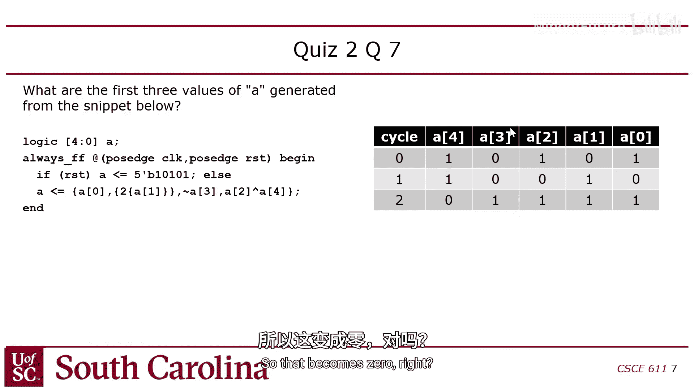
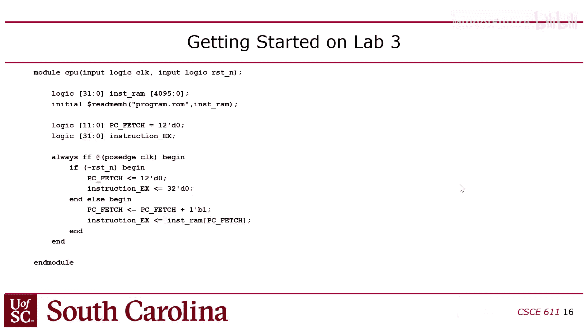

# 【南卡罗来纳大学】高级数字系统设计-CSCE611-（Advanced-Digital-Design，Fall-2023）-p06-P06-Microarchitecture-1--BV19nf6YoEZ9_p6-

So we've got Lab two was due over the weekend was there any issues with that any questions any problems seemed like it went pretty smoothly we also had a quiz that was due I'll go over that today。

 I don't have a new quiz for this week I'll have them for next week but I do have lab three which I'll assign today and。

You can start working on it whenever。So the link to Lab3's description is on Dropbox there。

And there's the skeleton， again， there's a tarR GZ file that you can download to start from。

 and then there's the submission box。Okay， so quiz  two。Sure Friday yeah， that's I always。

 sometimes I have Friday and sometimes Ill put Sunday。

 but either way it doesn't matter because you don't， there's no late penalty for the weekend so。Yeah。

 13th， you're right。mYeah， Friday， but if you right， yeah， yeah， if you submit it though by。

If you submit it by Sunday night at work。Okay， so thequiz first quiz question was a little confusing。

嗯。This was something I came up with last year， I think， and I forgot to。Fix it。

The question is it gives a system bear log module and asks what's not a problem。

 and it turns out there's multiple answers that work for this。So C is double driven。

 that actually is a legit problem because you've got an assign statement assigning C。

 and then this always assigning C。So that is a problem。No sensitivity list for the always statement。

Well， it doesn't have a sensitivity list because it's an always calm。

 you can't actually specify a sensitivity list for the always calm， so that's not a problem。

That's okay。 cannot use if statement and system ver。 Well， this one's a little confusing。

 normally you can't use it unless it's in and always， but in this case it isn' in and always。

 so it's fine。So that's not a problem use of a blocking assignment in an always statement。

 that is a blocking statement that's a blocking assignment statement and that's fine。

 in fact that's correctly used because that's a combinational always in combinational logic you should use a blocking assignment so that's just a regular just equal sign that's not a problem cannot combine always common assign statements in one module。

 that's fine too。It's no problem。And the always block has no default assignment for C。

 That is a problem because this will actually this code will fail to compile because you declared that always as a combinational logic。

 but there's no way that it can。Behave is combinational logic because if B is。If B is false。

So if B is like， for example， if B is a single bit and it's a。Zero。

Or I assume if it's like an X or a Z。Not sure how that works if it's x or Z。But basically。

 if this statement， if the condition on if statement is evaluated a false。Then C will not。

 there'll be no execution path through this always that'll assign C。

TheNormally that would become a latch if it were just an always statement。

 it would become a latch because C would have to retain its previous state， its previous value。

And because it would be a latch as opposed to a flip fl because there's no clock edge defined find B B would essentially become the clock。

 right， but it would be a level sensitive clock like a latch。But in this case。

 you'll get an error because the compiler will。Assume that you made a mistake by not having。

An assignment for C。Through every execution path， through the always， does that make sense， you guys。

 is that clear？So one way to do that is just have a default assignment for C。

 but if you did that you'd have to have a begin and end on that always too。

 right because then you'd have two statements in there。Okay， so if you had answered B， C， D， or E。

 that you should have got that one correct。Second question is consider the very log module shown below how many input signals are specified。

 that's pretty easy， it looks like clock reset load。And seed。

Clock reset and load are all single bits and seed is eight bits。So that's four， right？Question three。

 consider another V log module， assume the module is reset with a reset pulse at the start of execution。

 what is the value of state and the first three cycles after the reset pulse？Okay。

 this one's a little trickier。So when we reset。Well， first of all。

 you've got an always FF that will respond to a positive edge on clock or reset。

 that means reset is asynchronous， you can reset this thing without a clock edge。

And when you do reset， the state will become 100 if reset is low and you get a clock edge。

Then you will change the state。So you'll start at 100 and then on the next clock。

 state2 will become zero。State 1 will become whatever was in state2。

 so basically state2's value will shift down into state one。RightSo in the first cycle。That。

That that state two， which is going to be a one， right， because you read these numbers from。

Left to right is most significant to least significant。

So state two starts out as one and after the first clock， that one will migrate down to bit one。

Right。And then in every cycle after that until you have another reset state。

Two and one will both be zero。Does it make sense？Because you're hard coding state 2 will always get a zero and state 1 will get the old version of state 2 and then state  zero is state1 or state zero。

So。See， I think， yeah。 so cycle 0， you have a 10，0， cycle one， you got a。Like I said。

 state two becomes zero， state one becomes the old state two so that it gets a one and then state zero。

You want to be able to look at。When you're evaluating state zero。

 look at the previous value of state1 and0 which would have been a00 so every time you're coming up with the next state when you're filling in cycle1。

 for instance， you've got to look back at cycle 0 for your inputs。

 you' want to look at the previous values for the inputs。So the value of the state and cycle1 is 010。

And there it is0，10。Okay， then in cycle 2。State 2 is going to be zero。

 state 1 is going to be the old state two， which was zero in the previous cycle， state one。

 you're going to look at one or zero， so you're going to get a1， so001。

So that's the evolution of this， you start out with 100。010 and 001。Does that make sense？

I'm not sure if I explain it for who well， but the point is is that when you're calculating the next state。

 look at the previous state right so in these always statements that are sensitive to the positive clock。

You're always looking， it's using the previous。Value。Sorry。

 the previous cycle's value to calculate the next cycle， right？Okay， question four。

Give the value of signal A and the first three clock cycles after reset， this is a similar one。

 so we start out as 101 on a reset。And then。You。You're going to take A and shift it one bit to the left。

And then you are going to do an exclusive or with 111， which will flip all the bits， Okay。

 but notice here that the first assignment statement is a blocking。

And the second one is non blocking， so because of that， the second line of code。

 you can take this sub expressionpress。And substituted in for A， because that blocking assignment。

Will affect the any subsequent lines of code in the always statement that that use the outputs of the blocking assignment right so basically what this is doing is it's。

Shifting a by one bit and then flipping all the bits。Okay， so。If you start out with 101。

You shift1 bits to the left， which will give you 010 and then you flip the bits which gets you back to 101。

 so basically this will always be 101 it'll just keep setting itself to 101 every cycle， right。Yeah。

 does that make sense？What if the first one was not block？啊一。If that were the case。

Then only the second one would matter， so that would invalidate the first line of code。

 that's a good question。嗯。Yeah， yeah， so if it was if the first assignment was。Non blocking。

Then it wouldn't have had any effect on this at all， like it would have just been over over over。

 I mean， overruled， overwritten。By the second statement。Because you can again， just to clarify。

 you can assign。A value multiple times and in always。

 but the only one that counts is the one that happens。Last， right？Okay。

 so what's the following with what's the problem with the following code。

 This one is a combinational logic， but it's got a。It's got a cycle in it。

Because a is an input and an output in the same。In the same always， so you end up with a。

A feedback connection and that's not valid combinational logic。

 so the compiler will flag this as an error。嗯。So the options were always statements should be combinational but as a cycle。

 so that's the answer， missing sensitivity list， that's not a problem。

 cannot use addition an always calm statement， no， that's true， that's not， you can。

So that's not the answer and use of blocking statement is not the issue， it's a。Okay。

 consider the following test bench。 What function does some module perform。 So from this。

 you have to。You have to infer what's going on in the design center test from the way it's being tested。

 so the way it's being tested is that you're putting inputs and you have an expected output。

 so basically the test bench has a truth table in it。

 you're setting the inputs and you have the expected output。Makes sense。 So there's two inputs。

 I think just A and B and one output C。 And it looks like that is going to be an。

 I guess an end gate， right because if A is one and B is one， the expected output is one， but。

If there's any。Zeros。In the inputs， then the output is zero， right， so that's an end gate。

Now one thing that may not be obvious here is notice how。I set A and B at the top， but I only set A。

Here， that's because it's going to retain。The old value of B， right， So this is test case 1，1。

 This one's going to be。Zero，1， right where a is zero because B is still going to be one， right？

And this will be0， zero， and then this will be10， right？

So it looks like that's supposed to be an hand gate。Yeah， and gate， right？Okay。

 what are the first three values of a generated from the snippet below？So this one is just another。

Sial logic question。So we reset with 10，101。And then the next state of A is going to be a combination of bits that were in the previous state of A。

And so the only way to really do this is， well， the only way I know of is just build a table like this。

 So when you get to cycle one。You're going to fill in you know each bit you can reach from left to right。

 so the first bit is the old。A 0。 So what that means is that that bit。

 the old a 0 is going to migrate down to here， right， So the old。

A0 is going to migrate down to the new A4， right？And then you got two copies of a1。

 so a1 is zero so that you're going to put two copies of that right there。Right and then。

The complement of A3。Which is was zero， now will become1， so that goes from zero to 1。And。Bit2。

 x or a bit4， bit2， x or a bit4， that's one x or1 that's zero。So that becomes zero， right？

Make sense。佢。

All right， that's it， any questions？All right。So our next topic is we're going to start getting into the risk five micro architectureit。

 so we talked about architecture， that's the assembly language。How you program it？

That's the public part of a processor。 And now we're going to talk about the secret part of a processor。

 the micro architectureitecture。 This is the part that。

No company will ever tell you how the microarchit works。 This is the trade secret part。

 This is the under the hood part。Okay， so before we talk about that。

 let's talk a little bit more about Rams。 So we' we've covered flip flops。

 So let me clarify a few things here。 So when I say register， sometimes I'll say register。

Sometimes they'll say flip flop when you have like an always underscore FF。

 so a register is like a multi bit flip flop or that's one type of register right and then there's the architectural register that you have in the register file。

Why are they both called register， I don't know it's confusing。Right。What's the difference？

In the register file， you have a set of registers。And you can access one of those registers。Per port。

 And each port has an address。 So basically， it's addressed。 It's an array。

 It's like an array where you can access。typically with I don't know if you guys remember from 212 but。

MPS and risk5 are three address architectures meaning that instructions can have up to three registers in them right so the register file has three ports。

 which meaning that you can read two registers and write one register in the same clock cycle right so basically you can access three registers per cycle in a register file but there's 32 registers in there right so what that means is you can't access them all there's no there's no reset by the way。

 you can't reset a register file but you can you can write one at a time。

 so you could reset it if you're willing to walk through it you know。

 32 cycles and write each one to zero right over the course of 32 cycles but the point is is that you can only access one register at a time are actually three because there's three ports one per port right。

So what's my point， my point is is that the register follows are actually a RA。

 a RA is a memory array that has an address。Where you can access an element out of that array per cycle per port right So for instance。

 here's an example of a Ram array。 It's 1024 words by 32 bits。 So the first number is the depth。

 There's 1024 addresses， entries。Elements。Locationations。1024 entries。Enreries in the Ram。

 there's 1024 addressable locations in the Ram。 that's the depth and then 32 bit is the width right so in total。

 the number of bits is you have to multiply there's 32 kilobits in there。Right。

Notice that the depth comes first， the width comes second。M makes sense。

 right and it seems like that's the same order that C uses， right？Row column， right。

 linear algebra is row column， row is first column second depth is first。With his second， right？

And this has one port， and the way it's set up is there's an address input。Well， actually。

 I don't know how this is set up。 I guess the addresses is an input。

 although but there's no arrow there， so this figure came from the book I think， a little unclear。

So the address is an input。And then the data is shown as an input or an output。

 so it looks like we have the ability to write or read。An entry in that array array。

Now in order for that to happen， we need some control lines here， like a read and write control line。

 which aren't being shown there。Okay， so yeah， I just got done saying that， so a memory array。

 a RA is two dimensions。Um。There's bit cells inside the array physically， but when you use it。

 you think of it as having a depth and a width。So the width is the number of bits that you access at a time。

 the depth is the number of entries in there， and you can access one entry per port， right？U。

So here's another example if you have。This one is a。Four by three bit array， which has 12 bits in it。

So that you can access one of four entries， there's three bits per entry。

 if we go back to this first example， this one， because there's 1 thousand24。

Locations in order to figure out how many address lines you need you have to take the log base2 of the number of locations。

 so if there's 1024 locations， the log base two of that is 10 so there's a 10 address bits so there's 10 address bits and 32 data bits because 32 is the width right。

停。😊，Okay， so how do you build a RAM in Verlog， is there a special way to do it？Kind of， so in Ver。

 if you want to make a RamM。You have to describe the behavior of a RAM using the system Vlog。

Semantics language。So and there's different ways you can do it。So here's an example。

 so first I'm going to declare my RAM array。Using this really strange way of doing it where it's still a type logic。

And you still put the width first， as you would， if you didn't have a raory。

 if you just had a like a regular signal， multi bit signal。 So this is declaring a 32 bit wide。

Ram array array， right， but then you add an additional set of indexes here at the end that define the depth。

 in this case， 8191 Co and zero means that there's 8k entries， 8，192 entries。

 and each entry is 32 bits。The reason I'm emphasizing this is that you'll notice that the order of these indices is now reversed。

Because now we have the width first and the depth second that's different from linear algebra that's different from C and Python and Java。

 it's even different from the way people talk about Rams when they say 8k by 32 Ram。

 like if you actually if you open up your computer and just look at the Ram chips。

 they'll say they'll have that nomenclature where they have the depth and the width。Right。

 they'll say。I don't know，8 mega by 32， which means 8 million deep， 32 y。

 so the actual chips inside your computer will say depth with， but system V for whatever reason。

 does with depth。When you declare it。Only when you declare it， though， that's the way you declare。

 So just try not to get confused by that。 It's even more confusing because in the risk。Register file。

That has a 32 entry deep， 32 bits wide， so they're both 32， so that's called a 32 by 32 Ram。

 the one that's in the CPU。 So you know you look at that and it's you know because is a square kind of shape to it。

Okay， so。How many address bits do I need for N 8192 deep， the log base2 of 8192 is 13。

So I need a 13 bit address， so I'm going to declare an address。

And I'm going to have a read data and write data that be  that not also。

 but it will be 32 bits because that's the width of the RAM。Now from this， you can kind of tell。

How many ports do I have here？Well， I only have one port because there's only one address。

 but I do have data going each way in and out right so it looks like from this I'm going to have one port。

 but that port allows me to。Read or write， or maybe read and write at the same time。

's we have to read on to see how it works， so then I have this single bit right enabled in clock。

Then you can put an initial statement， this is optional， but you can list an initial。

And in the initial， there's no beginning in here because there's just one statement in this initial block。

Read MaM H mem do TxT mem， so this will initialize the memory based on the contents of that text file now you might say wait hold on hold on obviously that's nonynthesizable code right because if you're converting this to hardware。

 how's the circuit in hardware going to read a file。Well。

 it turns out that actually that is synthesizable， you wouldn't think it is。

 the reason is because the synthesizer， when it generates the RA，For the FPGA。

It will generate the code the design on the FPGA in a way that that RAM will be initialized。

With the contents of that file， but that only works on an FPGA， not on an AsI。

The reason it works on FPGA is when you configure an FPGA。

 when you shift all the bits in to configure all the little programmable gates and the logic and all that stuff。

 part of that configuration is the RA contents， so when you use the JTag protocol which is a a big shift register bit for bit shift serial one bit at a time where you shift bits in。

You're shifting in the configuration and you can set up the initialization of the Rams if you were designing this for an AsI and by the way。

 you do use system Verlock for AsIs too， right like if you want to tape out you want to fab a custom chip。

 but in that case you wouldn't be able to initialize the RAM。

Because it would come up with random configuration when you power the chip on in a real Ram circuit。

You guys with me？What's a real RA， by the way， it's actually every RA bit are two inverters pointed to each other。

 they're cross coupled inverters。That hold a value。But when you power that up， it comes up randomly。

Whereas on an FPGA， you have the option of coming up with initial configuration in order to reset the RA to that though you have to reprogram the FPGA right so in other words。

Once you， once you overrite the contents in there， then they're gone unless you you know。

 basically reprogram the whole thing。 Okay， then now we have an assign and an always。

 So here's an example we're combining in assign and always。

 the assign just says read data is mam at address。And the always。

Checks to see it's active on the positive edge of the clock。

 and it checks if right En is assert certain if so， it puts right data into Me address。

So what is what's happening here， well， it is actually reading and writing potentially， well。

 it's always reading。It always reads， so whatever the address is。

 it's going to spit out the data at that address so you don't have an option whether you want to read or not。

The writing is controlled by this right enable control signal， and the writing is synchronous。

 the writing requires a clock， the reading however doesn't， the reading is asynchronous。

So I can read something out of this Ram。I put in without a clock。

 I just put the address and then the address will percolate through the Ram and I'll get the contents of the RamM。

So I have an asynchronous read port， or asynchronous read operation。And I optionally can write。

And if I write， the right is synchronous， all rights are I've never seen an asynchronous right。

 I don't think that's possible。 You need a clock to write。

The clock is what causes the right to happen， whereas the read can potentially be。Asynchronous。Right。

 what does that mean exactly， What means that I can read inside of one clock cycle， in fact。

 if I wanted to。I could read 10 different entries of that RamM inside a one clock cycle。

 but if on a right， I can only do one right per clock cycle based on the description here。

So it makes sense。Okay， so what'll happen when you synthesize this？Well， the problem is is that。嗯。

This is how the register file works on the MIPS。Processor and the risk I processor。However。

 that Ram that makes that register file is actually。嗯。

Constructed differently than a traditional Ramm， most Rams， if you actually build a Ram。

 it requires you to have a synchronous read and asynchronous， right？

But if you have a small RA for a register file， you can get away with an asynchronous。嗯。

Read you goes with me。Okay。Okay， so if I wanted to have a synchronous read。

 all I would have to do is move the read logic inside of this always。So that way。

 the read data is now only going to update on the rising edge of the clock right so this way I can do one read。

per cycle， I could do one right per cycle， but only to the same address。Makes sense。ok。Okay。

 so let's see， so why don't we。Maybe I should actually instead of just showing this this thing。

 let me do a quick demo here， so let me let me create this Ram。So I'll create a Ram here。

And I'll say module， RA， and I'm just going to put this all in like its own self contained test bench。

So let's create a logic。When would you want a first second agreement？

The only time you're going to use an asynchronous read is a register file or a test bench。Generally。

 it's not practical in hardware to do asynchronous read and so what actually happens is I mentioned earlier that if you build a RA array it's it's so generally Rams。

 S Ram， static Rams。There are two inverters pointing at each other and then there's two additional transistors that are used to activate the cell in there so generally there's six each inverter is two transistors and there's two additional ones so there's six transistors per bit in an SM array right。

But usually when you have that sort of arrangement， it requires a synchronous read synchronous right。

 right If you want an asynchronous right， generally。

 they actually the way they do that is they'll actually use flip flops in an array。

 and then they'll put a big mus on the output。 So the mus will be combinational and the mus will just control which one of those flip flops well multi bit flip flops。

 One of those you know multi bit flip flops。 Which one of the multi bit flip flops is routed through the mus right The problem with that is that there's a big fan in that mux has a big fan in there's 32 inputs into that mux。

 and that's just for 32 deep。 That's not scalable。 So you can't make a very big memory array that way because there's much there's too much wire congestion that would be coming into that mus so if you have a register file that's small。

 you can get away with that Or if it's nonsynthesizable like a test bench but if it's a real ra that's deeper than 32 entries。

 you pretty much have to use an actual ra， which is a synchronous read synchronous right。

So what would happen though if you tried to make a huge ra？

That had an asynchronous read on put on an FPGA， I've never tried it。

 but I imagine your clock speed would be horrible， like it would only run at like 10 megahertz right I think that's I expect that's what would happen。

Okay， so here's a Ram， maybe we should try that， actually， it might be a good thing to try。

W wondert how long it would take。To do that。Well， let's let's come up with a Ram here。

 so let's make it let's make it 7 bits wide just for instance and。I'll call it mem。

 call it whatever you want， and I'll make it。81，91 down to zero。And then。Assign。Out。Equals mem。

 not ramp， mem of address。And then always at。Paawuse edge clock。I'll set， I'll say begin。

And if write enable， then ma'm of address。Is assigned to。Data in。And I'll make this data out。

And then end， okay， a couple things to note。Notice I just use always I didn't use always underscore FF that that's an option。

 so always is just if you just say always that's just the old school way。

 I probably I probably should say always underscore FF though because it's。

Kind of protects me a little bit。Compilr knows what I'm trying to do。嗯。

Notice also I use the non blocking assignment。What would happen if he was blocking there， I don't。

 I think it would be fine， but I wouldn't want to risk it。

 I'm use non blocking because it'schous synchronous logic。嗯。And I need to declare all my stuff。

And one thing that's kind of strange about system Vlog。

 I mentioned that system Vlog has concurrent semantics。

 which means that in general you can kind of scramble the lines of code。

 it won't make any difference， but you still have to declare the signals before you use them。

So there's some weird。Ordering when it comes to declaring signals， even though。

The lines of code are not supposed to Matt， I mean I mean really。

 you should be able to declare them after you use them since they order doesn't matter， right？

It doesn't let you do that， so I'm going to say logic。W e。Logic， what's the address？诶诶。13，13 bits。

 yeah， 12 down to zero。Address logic。7 down to zero data out data in， right？And clock。可以。Okay。

 makes sense。All right， so now I will。Say V log。Mm Ram dosv。Compiled， then I'll say Vsim。Ram。

And that should bring up model SIim， there it is。Okay， now I go into。Design is being optimized。

 that can't be good， okay， yeah。Notice I have no objects here， I got no signals。So。

I'm going to have to go into simulate， start simulation。Work gram， I'm already simulating it。

 but unfortunately I have to do apply full visibility to all modules， hit okay。

So I have to restart the simulation and tell it to give me my signals。

 which it did they're right here， so then I'm just going to drag those guys in。

And now I have to be my own test bench。So actually， you know what， screw that。

 I'm going put my stuff in here。 I don't want to do the forces。

 I'm going to say I'm going to mix in some test bench code here。 Okay。

 now normally the test bench would be separate from your design under test。

 but I'm going to be lazy here and I'm just going to put everything into one module。

 So I'm going to say always begin and and this will be my clock。

 So I'm going to say clock equals1 B0。Pause for five units， clock equals 1 B1。

 pause for five units that gives me my clock。And then。I'm going to set my address to be。嗯。Address。

 right， so I'm going to say。Initial address equals。13。Bniary。Bineary zero， and I'm going to say。

Always at。Pause edge clock。Address equals address plus1。Okay， so that'll increment the address。

The data in。嗯。I'll just set data in to be a constant for now assign。Data。In to be。8。Hes。Ef。

There we go。 And data out is an output。 Okay， good makes sense。 All right。

 so now I'll come back down to here and I'm just going to say V log， I'm going to re V log my Ram。

And I want to come back over to。Model Sim。 And now that I've or sorry， Questa， excuse me。

 I'm going to。Restar， so you got to do restart after you compile。

 restart will reload the new design in。Okay， cool， so I should just be run。Yeah， there we go。

 oh right in Abel， forgot about that one。Let's assign right enable。2，1。ok。Okay， look。

 got to compile it。And now by the way， you can also compile in Questa。

You can also type V log Ram here， Ram。t Sv。Or you can go to compile it。

 or you can go to library over here and go into your work。And right click on Ram and say recompile。

Or you can go up here to the compile menu and say compile over here and say Ram and say compile。

 there's several ways to do it。So I'm going to restart and so instead of typing restart this time。

 I'm going to hit this button up here， if you guys can see that as a restart button。

And then I'm going to hit the run button， I can hit the run button here， or I can just type run。

And run， okay， so you'll notice that the clock is going and data out。Is dead。Okay。

 so what's going on there if I take the memory。You guys see the memory arrays actually in my objects window。

 you can drag that in， but oh， it's actually filled in cool okay， so you can see the memory here， oh。

 I should not have made it that deep that was a mistake Okay so yeah。

So you can see that what's happening， I should have not made it that big。

 but you can see what's happening is because my address is incrementing from zero and my write enable is one and my data in is EF。

 you can see that the memory array is slowly filling up with EFs you see that the reason why it's staggered is because every cycle it adds one more EF and it's increments in the address。

 so it's kind of initializing that array by writing all the entries。嗯m。The problem is， is that。

By the time I write EF。Yeah， oh， sorry。 That was a。Hold on， me let me change that。

Let me go back and change that let's make the。Let's make it。Let's just make it。8 entries right。

 so this is an8 by 8 64 bit Ram， and so the address is now only three bits。

 which is two down to zero， right okay。Okay， so let me read。Recompile and then go back into Questa。

And restart。And rerun， Okay， so now you can see。That me zoom in a bit here。Zoom， zoom， zoom or， zoom。

 There we go。 So you can see that。After eight cycles， I pretty much fill in the whole RAM， right？

The data out is initially a flat line。 right， The reason is because。

Remember that the right is synchronous。 So it takes a cycle to write。 So by the time it write。

 because the address is fixed or the address is。The address is going to be the right address and the read address。

 But by the time it writes， I've already moved on to the next read address， right。

 So what for that reason， the the address is， is just our flat line until。

The odometer goes back to zero and the address flips back to zero。

 right at which point I start reading EF。Does it make sense？Okay， so。And also。

 if I zoom in here a little bit more， you can see that the。

The writing is corresponding to the rising edge of the clock， so you see where the cursor is。

 so this EF， so the address is four。Now。It's technically changing to five， right？

But it's going to use the old address。It's going to see the old address right So the address is changing from4 to5。

 but at that moment of time， it sees4。 And so you'll see that address 4， which is here。

 is going to get written on that rising edge。 You got to see that。Makes sense。So in this case。

 it doesn't actually matter。That。The read is asynchronous because the right is synchronous， right？

So it doesn't， I don't think it would change。Well， let's see what happens if we make it A？

So you'll notice that the read。Yeah， this is one difference。 We'll see。 you see that the address。

 when the address rolls back to zero， the EF immediately pops out of the data out right。

 if this were a。Synchronous read that I would need one whole cycle of that。

Of that0 before I'd see the E F。 So what'll happen is if this was a。

 the only difference I'd see if this was a synchronous read is that this EF would actually pushed one cycle to the right。

 So address 0 wouldn't pop out until the address becomes 1。 I'll read address 0。

At the moment that the dress updates the what makes sense。Okay。All right。Okay。

 so I show an example of that here I think。This is a 32 bit wide， so you'll notice here。

There's this asynchronous on the top， synchronous on the bottom。

 and you'll notice that the read data。You see how the read data is for。5，6。

 But when I make it synchronous， the four gets shifted over to the right by one cycle， right。

 So by making the read。Synchronous， it basically delays it by one cycle， shifts it to the right。

Shifts it forward in time by one cycle。Okay， so in your CPU。

 we're going to just give you the code for the register file。And this is it。

Register file is going to look like this。 It's going to have。Two ports that can just read。

And one port that can just write。And this is intended to match up to the assembly language。

 The assembly language has two。Oans right two register inputs。

 two register inputs and one register output， two opera ends in one destination right and so the register file hardware is designed around that that's why we have three ports。

The read addresses， the read ports are asynchronous， the right port is synchronous。

And there's no reset signal， you can't reset this thing， you can initialize it on the FPGA。

 but you can't like clear the whole thing with one signal like you can a flipflop right there's no clear。

All you can do is， you know。Go through every address overr each address。嗯。So this is just a pinout。

 the membrane is declared there， it's 32 by 32。 I use assign statements for the read address。

 the read， data 1 read data2， and there's always FF for the right Now there is a couple caveats here。

 there's a couple details。The first is is that。The address zero， register zero。Is always zero。

And you guys remember that from 212， that was the same in MIPS too， right， MIps， MIPS risk five。

Arm arm， I think arm has it in the 64 bit arm does that， this 32 bit arm didn't do that。 In fact。

 I think in the 32 bit arm， the program counter was register zero。嗯。Anyway。

 register zero is a constant zero。So how do you implement that in Verlog。

 there's a few ways you can do it。I think the version of this that we give you and the skeleton is actually does it a different way。

 the way I do it is I handle that in the readport， so I basically I use a tri statement and I say if readdress is zero。

 then just spit out zero。And that's done on both ports。

Notice that these ports are kind of copy and pasted because both read ports do the same thing。

 the only difference is is you have to change the one。

 you know there's read data 1 and read address  one。

 read datata 2 read address right so these are kind of the same thing。

But they both access the same mem， right， so they're both two ports。

 but they're accessing the same memory array。So。If the read address is0。

 then I'm just going to say zero， right Now there's another problem， though， is that。

Remember that when I showed you that example。嗯。Here。嗯。Actually。

 this is a bad example because I'm always。Well， actually，s actually， I think we can work with this。

 So notice how the address is7。The address is seven。And I'm working on writing in seven。

The address is seven， the right enable is high。And the data is fixed at EF， right？But notice that。

Even though in this cycle。This cycle， I'm writing seven。The data coming out is still。Is still red。

 is still dead right so basically what that means in terms of the register file is if I'm writing a register and I try to read it at the same time。

I'm not going to read the new value。Because by the time the new value gets written in the register array。

I've already given up trying to read it， right？Like basically。

 if I try to write Reg 7 and read Reg 7 at the same time。

 I'm going to be seeing the old value of Reg7。The new value of Reg 7 isn't going to get there until the end of the cycle。

 right， at which point it's too late。You guys with me on that？

The way to work around that is to create a bypass。So this register file in the slide has a little trick。

There's a little trick here。So this is using a nested ternary statement。

 so the first part of the ternary says if the read address is0， otherwise if it is0， spit out0。

 otherwise if the read address1 equals the right address and the right enable is high。

 so in other words。I'm trying to I got the read address and the write address match， and I'm writing。

 that means I have a I want to want say a conflict。

 but I'm reading and writing the same thing at the same time。

I am going to instead of reading the memory I'm going to bypass the me I'm just going to say look I'm just going to take the right data and spit that back out at you So if you try to write to the same register that you're reading。

 I'm going take the data you're writing and just turn it right back around at you right that way if you read and write at the same time you'll get the updated value。

That you're reading。Right。You might say， why is that important？Because。If I write a risk program。

And I have an instruction。That has the same register for their destination and the source。

Then I expect the old value of the register， right？I expect to get the old value。

Because I'm not going to write the new value and so that that instruction is done。

 right You guys follow me on this right So if I say。If I have like add。X1。X2。Next three。

 I would say I and then I say。Let， let's see let me me。Actually。

I want to do this in two instructions。Yeah。And that' say add。X1， x1， x2， right？

So this x1 will get sent down to that instruction， right？This is not going to be reflected here。

 right？Right。RightI expect the old value of x1 right when I do that， right Well， the problem is。

 is that。We're building a pipeline MIPS processor and in the pipeline。This instruction。

Is going to be writing the register。While this instruction。Is going to be。

Reading the or it's going to be in the execute stage。Right， the earlier instruction is going to be。

At the part of the pipeline we you're actually writing the register and the later instruction is going to be the earlier part reading the register they might say。

 wait a minute I thought you read the register on the Decode yes。

 but we're only making a three stage pipeline and I'll talk more about that in a minute。

The problem is is because we're making a pipeline processor。We now have this problem where。

When you read and write the same register at the same time， it's not from the same instruction。

 it's from two different instructions that are on two different locations in your code。

 does it make sense， so you want to actually have this bypass for that reason you guys following that。

Okay， so that's all built into the code and we。We're just going to give that to you the code for the Reg file is in the project skeleton。

 My TA wrote it though， I think he did it， I mean it's the same it does this。

 it works the same way I think he wrote it slightly differently。

 but it has the same functionality So the bypass basically says that。What part of code is it。Well oh。

 it's a primary statement。s so I have it as part of the read logic。

 right I think that's actually the only way to do it。

 That's the only way to do the bypass is the read logic。

I think the way Charles did the zero register was he put the zero register in the right logic。

 he basically initialized register is zero zero， and then he put something in here that said。

 you're not allowed to write to register zero and if you try， I won't do it。

So so but but the way I do it as I say if you read from registers， I'm going give you zero。

 but the bypass， I think you have to put that in the read logic and that just says if the read address and the write address match and you're actively writing that means that you've got this you have to activate the bypass and the way you do it is you have this evaluate to write data so write data then gets put into read data one right but if this condition is fails is false。

 if this condition is false， and this condition is false。

 then the fallback is this like else part which says read the RA array。

 whatever is in theam array address put that out that's the default， you know the fallback。Okay。Okay。

 everyone okay on that， so that's the register file， the ALU， we're also going to give you the ALU。

So your job is going to be essentially to。Build the control unit and then connect everything together。

 right so it works。So the ALU is a combinational logic circuit that takes two， 32 bit inputs。

As well as a four bit op code， operation code。And spits out a 32 bit result in a zero flag。

 a single bit zero flag。So 164 bits gives you a 16 different operations。

 how many operations do we actually have， there's only actually 13 operations because some of the op codes do the same thing like these two。

 actually all three of these。All three of these guys were the same thing， right？

So the operations are。A and or X or there's three。There's three bitwise logical operations。

Then we've got add and Subtract。And then we have。3 multiply instructions。

 One of them will give you the lower 32 Bs of the product， one of them。

 And then the other two give the upper 32 Bs of the product。 but that depends on whether。

It was a signed or an unsigned multiply。So we have assigned basically mall H and Ma H， right？

Just like in risk， you know， obviously matches up to the risk instruction， then we've got shift。

 left， shift right， arithmetic shift right， this one。

 both of these do this both of these codes do arithmetic shift right。

You guys remember arithmetic shifts， shift in sign bits。And then we have。

These guys that test to see if A is less than B。And the output of that is just a one or zero。

In 32 bits。Which is wasteful because。You're just putting a one or zero out。

 but you're patting it with 310 bits， right？ok。Any questions about that？So why do we have these。

 well， there are a set less than instruction。Set on less than， set SLT， set less than。

 there's a set less than instruction that does this。

 but also we're going to use these to resolve branches。You know， the branch of Le。You might say。

 what about branch of equal， Well， if it's a branch of equal。You would subtract。The two inputs。

 and if the result is0， they're equal and that's why you have this zero flag。

 So there's a zero flag that comes out that will be high if the result is0。

So that's basically an equal indicator， assuming， of course you told it to subtract。

He told the AU to subscribe。You might say， well then what about greater than？嗯。

Greater than I think in greater than you just have to switch A and B and do less than， right？

You might say what way about greater than or equal to then Well。

 greater than equal to is the complement of less than。

 so pretty much you just do a less than and you invert the output， right？Makes sense。

So you can do all your comparisons with just eat less than。Less than and subtract， right？Now notice。

 oh， there's a sign then an unsigned less than two。Because that matters， right？

Because if you know like at the first the most significant bit is set on an unsign。

 that's a big number， right， but if it's a sign number， that's a small number right。

 so there's a sign then an unsigned comparison。Okay， so this is the a， this is the， this is actually。

 I think， the same AU design that's in the skeleton。 This one is implemented with a big。

A big nested trinary， ternary， Turnernary， sorry， Ternary， I say trinary ternary。

Turerninary statement， nested terninary， which makes like a big if then else。

And so it's a science statement。So there's a few things here， obviously those are two columns。

 so this should be fairly obvious that the。The one thing that's weird is notice that I had to use this typecast。

Because in Verlo， apparently。If you declare a signal as logic and use a less than operation on it。

 it's treated as unsigned， so if you want to do a signed comparison。

 you need to use this weird typecast in verlog right the same thing goes for the multiply。

But we handled that over here。So over here， we assigned mallL HS and Ma HLS。To be。

The signed A times B， so we use the multiply operator and the type CA to do assign multiply。

 and then we assigned that to a 64 bit value that was the concatenation of these 2 32 bit values。

 mall HS and Ma LS。Right。Makes sense。This is probably a bad way to do it because。

I think the whole reason why risk has。The whole reason risk has a mall H and a mall instruction is because in the hardware。

 they don't actually want to do a whole 64 bit multiply。it's meant to save hardware。

 but yet in our hardware we actually do a full 64 bit multiply and then we just store the output。

 the upper and lower parts separately， right？So this is kind of inefficient。

 there's probably a better way to do it， but I mean our intent is just to match the instruction set。

 so it's not a big deal。But there's， I'm sure there's a more efficient way we can。You know。

 use less gates for this， less resource。 On the other hand， I think it just use a DSP on the FPGA。

 so but I don't know how big the DSP are。DP is a hardware multiplier transistorized multiple。Okay。

 anything else to note here？The shaftmp is B4 bit4 down to zero。So the shift amount。

The shift amount is B if you do a sh。嗯。If you do a。诶。Yeah， the shift amount comes in as B。

 So the shift amount is specified as shift amount here， and it comes from。

It comes from B bits 5 down is zero， obviously the shift amount only needs five bits because。

If you shift more than 31 bits， you just shift the value away。Any questions about that？

So know you just have to kind of have an understanding how that works。

 but we'll have that in your project skeleton。Okay， so in lab3 then。

Our objective is to design a pipeline processor that can execute。

Enough risk five instructions to get by in that case， it's。I forget how many， one，2， three， four，4，6。

9，101，4，34。23， 23 instructions。It turns out that this are a pretty good set of instructions。

 there's only 23。But if you cross compile a program from C into the risk five。

It's pretty much going to just be these instruction I mean。

 there's a chance you'll get another instruction， but I don't think I've ever seen that happen。

At least not in the MIPS case， we used to do this in MIPS。

 I would have a student that didn't want to write any MIPS assembly。So he just would use a compiler。

 he'd write his code in C and he'd compile it or he compile it to assembly language and he just used the assembly language and we had enough instructions。

That GCC wasn't generating instructions that we didn't support right so this is decent nice core set of instructions obviously there's more than this。

 but these are the main one。Okay， so there's a couple here that you might be wondering about， though。

 LUI， you guys know what LUI does？That stands for load upper immediate。

So that allows you to take an immediate value and put it in the upper part of a register。

And immediate is just a number that you put inside the instruction。This one。Is the weirdest one。

 CSRRW。This is a real risk five instruction and it stands for control Staus， register， ReadWrite。

This is what we're going to use to access these switches and the hex displays on the board。

 this is our IO instruction。Guys with me？ok。Okay， so risk five this is probably going to be new to you guys because you guys are familiar with MIPS in the way that MIPS instructions are encoded into binary machine code right when I presented risk five to you in the first part of the semester everyone was fine with that because it was almost the same as MIPS however the encoding formats are quite a bit different so when it comes to the machine code part。

This is where things get a little strange if you're coming from this from MIPS。So there is an R type。

 I type， and a U type。For now， there's more types， there's six main types， six main integer types。

 remember MIps only had three， right？Our type is just like the。

It's just like the R type in MIPS except it's formatted differently。 You guys remember MIPS。

 remember you had the op code first。And the function code was last， right now。

The function code is first and the op code is last， and remember with MIPS， there are both six bits。

Now there's seven bits， both of them。Make sense。I don't know why they change that， right also。

There's another function code in the middle of the instruction called funt3。So。In total。

 you've got seven function bits here， three function bits here and op code here。

 What's the difference between the op code and the function bits？ I mean。

 really all of them are just saying all of those things are used for the same thing。

 They're a code to tell the CPU what instruction it is right。

 essentially right they all do the same thing， but they're called some of them called function bits。

 some are called op code。 I don't know I don't know why。

They're all function bits or they're all op code bits， right？So unfortunately。

 this encoding format is confusing and I used to have the MIPS one memorized。

 but I never memorized the risk life， it's just too many weird。Feels in there。Also。

The registers are five bits each。But。They're in weird locations right destinations 119 to7 Rs2。 well。

 first of all， it's called RS1 and RS2。 you guys remember MIPS had RT。RRS and RT now there's no RT。

 it's just RS1 Reg source1， Register source 2 Reg destination it makes much more sense that way right。

 but they're in random positions in the encoding。Makes sense。

 so you just have to look that up because unless you can remember that in coding。Also what's missing。

 Isn't there a missing field here， You guys remember there was another field in MIps R type。

I don't know if you remember that one。The R type field in MIPS had a shift amount field。

 remember that one had a five bit shift amount， there's no shift amount in this。

 so does how's it do in shift instructions。嗯。It uses the immediate， yeah。So remember。

 I mentioned that there was a shift。And shift immediate。Actually I didn't。

 maybe I might have mention that， maybe not。Are they in there？Yeah， notice that there's shift。

Shift leftological immediate。And there's shift left logical。In MIPS， if you did a shift life logical。

 the shift amount was immediate， it was put in the register， the instruction。

If you wanted to take the shift amount from a register。

 you had to use the shift left logical variable instruction in MIPS。

 you probably never used that though， but it was there。In Ri 5。

 they switched it around so the regular shift instruction pulls the shift amount from a register。

 and the shift immediate takes it from their instruction。

 but now it's not the R type instruction anymore it's the I type instruction。

 so it comes from the eye field， the immediate field。Which when you think about it。

 that makes more sense than the way that MIPS did it， I think。ok。So that let's talk about the I type。

 so the i type is here。Notice that the RS1 is lined up with the RS1 on the other R type。

 so that makes sense the function 3 is lined up， the op code is lined up， the RD is lined up。

But instead of the funct7 and the RS2， those are both replaced by a 12 bit immediate field remember in MIPS it was a 16 bit immediate field。

 now we just have 12 bits。Which。Makes limits the range of immediate that you can put into an instruction like an aI。

 for instance。However， we also have the U type。Which has a 20 bit of mediator。

Right so that's the load upper immediate uses the U type so when you use load upper intermediate you bring in 20 bits and then you follow that up with another regular load immediate that brings in the other 12 and 20 plus 12 is 32 that's how you can put an arbitrary 32 bit value into a register。

Okay， all right。嗯。Yeah， so also I don't know if you。

 these are all the instructions that are in that format。

 these are all the instructions that are in that format。

 these are the instructions that are in that format。

The CSRRW instruction is a weird one and it actually is in the eye type。

 and I'll talk about that more in a minute here。Okay， actually， I'll talk about it now。

 So the CSR W instruction。As I mentioned， it's a control and status， register， read and write。And。

The problem is with it is that。It in sit that the instruction。Reads and writes。

A control instead register at the same time， always。 So it takes。The immediate。

And it uses the immediate field， the 12 bit immediate。To look up a control register。

 which is an external register in IO。And read that value。

And it puts the result of that into register RD。So it's going to read a special register that exists outside the CPU core。

Which in our case is the switches。You know the switches on the board， that's what we're reading。

 whatever the user has put the switches into。But the problem is is that at the same time。

It takes whatevers in RS1。In the general purpose register file， and it writes that into the CSRs。

 well we can't write a value into the switches。Likewise。

 we want to be able to write a value into the hex displays。But we can't read the hexus explains。

 there's no way to read。I don't think we can， can you no？No。

 because those pins are outputs only right the hex， you guys did the hex decokoder， right。

 so those are outputs， you can't read those。So what are we going to do like this instruction says you have to be able to read and write all those control registers Well。

 we're just going to hack it and say that。If you want to read。The hexes， I mean。

 if you want to write the hexes， you write the hexes， there's no read that happens。

 And if you read the switches， then there's no right that happens。 You guys with me on that。

 It just depends on what you put in is the immediate。 What address you put。

 We're going give you special。Fields for that registers。Okay， oh， by the way， do I have？Do I have。

Do I have Rs here？嗯。Yes， I do Java， dash， jar， Ras。

So we have the special version of Rs that's available on。On Dropbox。If you go to control and status。

Up there。对。My TA Charles modified the code of Ras， and he added。IO0 IO1， IO2 IO3。

 these are the IO registers we're going to use in class and so if you run the special Rs。

 not the one that's on GiHub， this is R Rrs， you can actually use these to define the switches on the board。

And the hex displays。 And you might say， well wait a minute， why is there four then。

 I don't know why we have four， but only two of them do anything。

 I think IO0 is the switches and IO2 is the hexes or something。 It's in the lab sheet。

I'm not sure why we have four， but those four were added。 These guys， by the way， are other。

Other CSRs that you can。Access in RArs， of course， you won't have the support for these in your CPU。

But all of these things under control and status are accessed normally through the CSRRW instruction or CSRRW。

Okay。Okay， so the CPU is。We're going to have an instruction memory。And by the way。

 let me just one thing， one of the issues with this lab， by the way is。

There's a huge jump in difficulty from La two to lab three。Lab 1 and lab two were pretty simple。

 Lab 3 has you designing。The whole CPU， we have tried to build it up more incrementally。

 It never quite worked。 We used to have a lab where you just built the fetch stage。

 And that was super confusing because like you're fetching instructions and they're not going anywhere。

 You know， it's like， then you had to test it with a test bench and。

We tried to have we had a lab where where you would just design the ALU。

 and then we had a lab where you just design a test bench for the ALU。

 but that was crazy tedious because yet we used to hide bugs in the ALU and force you guys to find them with a test bench。

 but it required，Dozens of test vector。It was very tedious work， no one liked it。

Then we used to have a register file lab， how you design that and test that for the read you know the read and write。

 simultaneous read and writes， that was boring and no one liked it we used to have a lab where there was only our instructions。

But that was really weird because the R instructions don't give you the ability to initialize a register in the code。

 So we had to initialize the register file with a special init file。

 and then you had to write code using only the R type instructions， which is really。

Hard and frustrating， so we never really found a good way to step up to this lab。So unfortunately。

 yeah， that's why we give you three weeks for this lab。

Because you're going to have to put a lot into this design as compared to the last two just to let you know。

 but we do give you the ALU and the register file right so just keep that in mind the idea is that the CPU。

Is going to get the instructions from a Ram that's ach synchronous read。Ram。

 it's actually a wrongm because he can't write to it。And it's going to sit next to the CPU。

And the hex decoders that you built in lab2 will also be in there because when you do the CSSRW instruction。

 that's going to push out a 32 bit value outside the CPU。

But then we're expecting that that 302 bit value is going to be routed through your hextcoderers before it goes off the chip。

Off the FPGA。 So that way， when your CPU does a CSR or W instruction。

 it'll update all eight hex displays at once and they'll be decod。 So your CPU。We'll put out。

 for example， hex value。You know， A on four bits and that will go through the hex decoders and it'll actually show up as a on the FPG board right。

 so we are going to use your code from La2。Okay。Makes sense。ok。

Now you don't have to modularize them like this though， by the way。

 you don't have to create a this is not to imply that you have to create a separate， I mean。

 you already have modules for the decoders， but like you don't have to have a separate module for the instruction memory。

 you can mix all this into one design I'm just this is the logical organization In other words。

 the instructions are stored on chip。You're not going to go off tip for your instructions。

 which is what？Real computers do right they go out out to DRA off chip Ram we're going to store the instructions in on chip Ram and it's actually going to be a ro。

Because you're going to initialize the instruction memory using in init file。

And that's going to get burned into the RAM when you program the FPGA and then when your CPU starts fetching the instructions。

 it's going to have the instructions in there， make sense。Okay。All right， so here is。

The beginning of the CPU。So because it's always hard to figure out where to get started on this lab。

 so you get started with a module cloud CPU。So we're。

 we're basically doing kind of a top down design， right， Start with the CPU。

 work your way down to the details。 So in the CPU。Going to declare。

Your instruction Ram which I have is a 4096 deep32 bit wide that gives you up to 4096 instructions you can actually make it bigger than that if you want。

 but your your code is going to be like less than 100 instructions so there's really no reason to right so that would give you。

Four times four 16 kilobits of instruction memory， right？And then the initial。

Statement there is going to allow you to initialize that RA。With a program。 roM。

 which is actually just the code that you can export from Rs， so you write your code in Rs。

 you export it and it becomes a hex file， a hexadecimal file， text file。

 and that hexadeadecimal text file is already in the right format for system verylo to consume。

And put it just a bunch of。32 bit hex values on one line each。It's just the hex dump from。诶。From。

From Rs right okay， and then you need a program counter to keep track of where you're executing。

 you need a signal to hold the instruction， and then this thing is going to control your program counter so the program counter is going to increment and you're going to pull out the corresponding instruction from RAM。

Right。So this is basically your fetch， your instruction fetch and your program counter。

 and of course if there's a reset， then you're going to reset the program counter to zero and set the instruction to zero。

 the reason you notice that the reset is active low， we've got that till day there。

And the reason is because we're going to get the reset from a button on the board and the buttons on the board are active low。

 When you push the button， it sets it to logic0。 So that's why we have that little。Tilde there right。

 so reset is normally high when it's low that resets。Okay， sounds good。

 let me know if you have any questions and we'll get started in the lab on Wednesday and Thursday or Wednesday and Friday。

