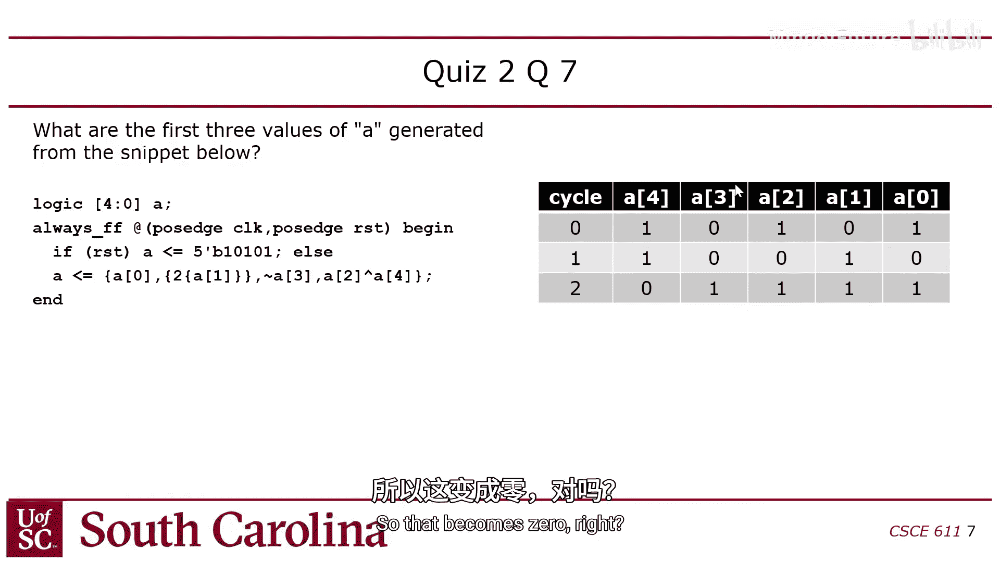
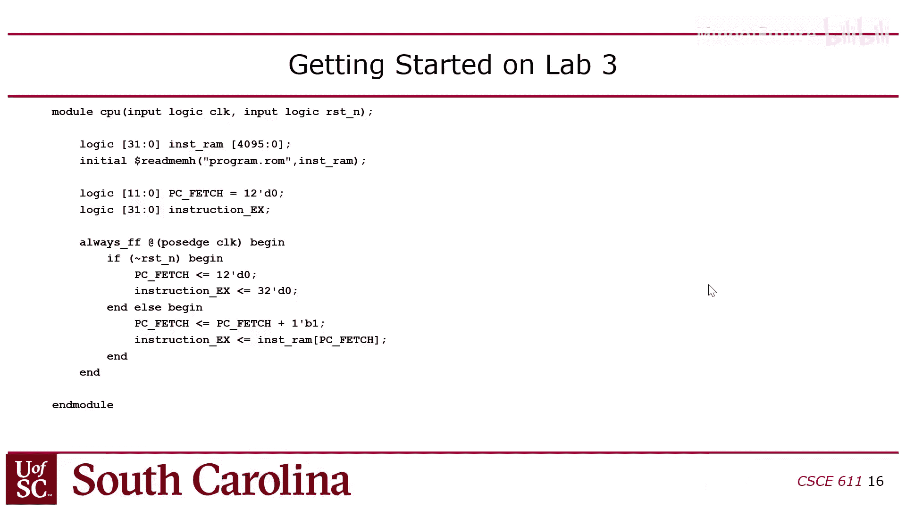

# 高级数字系统设计：CSCE611：P06：微架构设计入门

## 概述
在本节课中，我们将开始学习RISC-V处理器的微架构设计。微架构是处理器的内部实现细节，是公司的核心技术秘密。我们将从复习RAM和寄存器文件开始，逐步构建一个能够执行核心RISC-V指令集的流水线处理器。

---

## 复习：RAM与寄存器文件

上一节我们讨论了处理器架构，本节我们来看看其内部实现的基础组件：RAM和寄存器文件。

### RAM基础
RAM是一个可以随机访问的存储器阵列。它有两个关键参数：深度和宽度。
*   **深度**：存储器中可寻址的位置数量。
*   **宽度**：每个位置存储的比特数。




一个RAM的规格通常表示为 **深度 x 宽度**。例如，一个1024 x 32的RAM有1024个地址，每个地址存储32位数据。地址线的数量由深度决定，公式为：**地址线数量 = log₂(深度)**。

### 在SystemVerilog中实现RAM
在SystemVerilog中，我们可以用行为描述来定义一个RAM。以下是声明一个RAM数组的语法：
```systemverilog
logic [31:0] mem [8191:0]; // 宽度32位，深度8192
```
**注意**：在SystemVerilog声明中，顺序是 **宽度在前，深度在后**，这与通常的“深度 x 宽度”表述习惯相反。

以下是实现一个具有异步读、同步写功能的单端口RAM的示例代码：
```systemverilog
module ram (
    input logic clk,
    input logic we, // 写使能
    input logic [12:0] addr, // 13位地址 (log2(8192)=13)
    input logic [31:0] din,
    output logic [31:0] dout
);
    logic [31:0] mem [8191:0];

    // 异步读：地址变化，输出立即跟随
    assign dout = mem[addr];

    // 同步写：仅在时钟上升沿且写使能有效时写入
    always_ff @(posedge clk) begin
        if (we) begin
            mem[addr] <= din;
        end
    end
endmodule
```
**关键点**：
*   **异步读**：读取操作不需要时钟，地址变化后数据立即出现在输出端。这在小型存储器（如寄存器文件）中可行，但在大型RAM中会导致时序问题。
*   **同步写**：写入操作需要一个时钟边沿来锁存数据，这是所有RAM的典型行为。

### 寄存器文件的特殊之处
寄存器文件是CPU内部的小型、多端口RAM。在RISC-V中，典型的寄存器文件是32 x 32（32个寄存器，每个32位），具有三个端口：两个读端口和一个写端口。

寄存器文件有两个特殊设计：
1.  **零寄存器**：RISC-V架构规定寄存器x0的值恒为0。这可以在读逻辑中实现：当读地址为0时，直接输出0。
2.  **写后读旁路**：当在同一周期内对同一寄存器进行写和读操作时（例如，流水线中前一条指令写回，后一条指令读取），需要将正在写入的数据直接“旁路”给读端口，以确保读到的是新值。否则，读操作会得到旧值。

以下是实现这些特性的寄存器文件读逻辑片段：
```systemverilog
// 读端口1的逻辑示例
assign rd1 = (raddr1 == 5'b0) ? 32'b0 : // 零寄存器
             ((raddr1 == waddr) && we) ? wdata : // 写后读旁路
             mem[raddr1]; // 正常读取
```

---

## 算术逻辑单元

接下来，我们看看处理器的计算核心：算术逻辑单元。

ALU是一个组合逻辑电路，它接收两个32位操作数和一个操作码，然后输出一个32位结果和一个标志位。在我们的设计中，ALU支持以下核心操作：
*   **算术运算**：加法 (`ADD`)、减法 (`SUB`)
*   **逻辑运算**：按位与 (`AND`)、或 (`OR`)、异或 (`XOR`)
*   **移位运算**：逻辑左移 (`SLL`)、逻辑右移 (`SRL`)、算术右移 (`SRA`)
*   **比较运算**：有符号小于 (`SLT`)、无符号小于 (`SLTU`)
*   **乘法运算**：获取乘积的低32位 (`MULL`)、获取有符号/无符号乘积的高32位 (`MULH`, `MULHU`)

**零标志**：当ALU执行减法操作且结果为0时，零标志置位，这用于实现相等分支判断。

在实现时，需要注意SystemVerilog中**有符号数**和**无符号数**操作的区别，通常需要使用类型转换，例如 `$signed()`。

---

## RISC-V指令编码格式

要设计控制单元，必须理解指令是如何编码成二进制机器码的。RISC-V有几种主要的整数指令格式，与MIPS有所不同。

以下是核心的指令格式：
*   **R-type (寄存器-寄存器)**：用于算术和逻辑运算。
    *   字段：`funct7 | rs2 | rs1 | funct3 | rd | opcode`
*   **I-type (立即数)**：用于加载、立即数运算、跳转和链接(`JALR`)等。
    *   字段：`imm[11:0] | rs1 | funct3 | rd | opcode`
*   **U-type (上立即数)**：用于加载大立即数到寄存器的高位(`LUI`, `AUIPC`)。
    *   字段：`imm[31:12] | rd | opcode`

**关键变化**：
1.  **字段位置**：RISC-V的`opcode`在最后，而MIPS在最前。功能码(`funct`)被拆分到多个字段。
2.  **寄存器命名**：使用`rs1`(源寄存器1)、`rs2`(源寄存器2)、`rd`(目的寄存器)，比MIPS的`rs`, `rt`, `rd`更清晰。
3.  **立即数字段**：I-type只有12位立即数，要加载32位常数需要结合`LUI`(加载高20位)和`ADDI`(加载低12位)。
4.  **移位指令**：在RISC-V中，普通移位指令(`SLL`, `SRL`, `SRA`)的移位量来自寄存器(`rs2`)，而立即数移位(`SLLI`, `SRLI`, `SRAI`)是I-type格式，移位量来自指令中的立即数字段。

---

## 处理器核心设计框架

现在，我们将各个部分组合起来，勾勒出处理器核心的设计框架。

### 顶层模块：CPU
我们从顶层的CPU模块开始。它包含指令存储器、程序计数器和基本的取指逻辑。

```systemverilog
module cpu (
    input logic clk,
    input logic reset_n // 低电平有效的复位，通常连接板载按钮
);
    // 指令存储器：4096深度 x 32宽度
    logic [31:0] instr_mem [4095:0];
    initial begin
        $readmemh("program.hex", instr_mem); // 从文件初始化指令
    end

    // 程序计数器
    logic [31:0] pc;

    // 当前指令
    logic [31:0] instr;

    // 取指逻辑
    always_ff @(posedge clk, negedge reset_n) begin
        if (~reset_n) begin
            pc <= 32'b0;
            instr <= 32'b0;
        end else begin
            instr <= instr_mem[pc[31:2]]; // 按字寻址 (pc[1:0]恒为0)
            pc <= pc + 4; // 默认顺序执行，下一条指令地址
        end
    end

    // 后续将在这里添加译码、执行、访存、写回等阶段
    // ...
endmodule
```

### 核心组件与数据通路
一个简化的CPU数据通路包含以下组件，它们将在后续的译码和执行阶段被连接起来：
1.  **寄存器文件**：提供源操作数，接收写回结果。
2.  **ALU**：执行计算、比较等操作。
3.  **控制单元**：根据`instr`中的`opcode`和`funct`字段，生成所有控制信号（如`ALUOp`, `RegWrite`, `MemWrite`等），以控制数据通路的多路选择器、使能信号等。
4.  **立即数生成单元**：根据指令格式（I, S, B, U, J），从`instr`中提取并符号扩展出正确的32位立即数。

### 关于CSRRW指令
`CSRRW` (控制状态寄存器读写) 指令是RISC-V用于访问系统级寄存器的指令，在我们的实验中，它将用于访问FPGA板上的**开关**和**七段数码管**。
*   该指令是I-type格式。
*   它读取一个由12位立即数指定的CSR的值，并将其写入通用寄存器(`rd`)。
*   同时，它将通用寄存器(`rs1`)的值写入该CSR。
*   在我们的实现中，这是一个“hack”：读开关时只执行读操作，写数码管时只执行写操作。

---

## 总结

本节课我们一起学习了处理器微架构设计的基础。
1.  我们回顾了**RAM**的工作原理及其在SystemVerilog中的实现方式，区分了同步和异步读写的差异。
2.  我们深入了解了**寄存器文件**的特殊设计，包括零寄存器和写后读旁路机制。
3.  我们介绍了**ALU**的功能和它支持的核心操作。
4.  我们分析了**RISC-V指令的编码格式**，理解了R-type、I-type、U-type等格式的字段组成，这是设计控制单元的关键。
5.  最后，我们勾勒出了**处理器核心的设计框架**，从取指逻辑开始，并概述了数据通路的主要组件。



在接下来的实验中，你们的任务就是连接这些组件（寄存器文件、ALU等），并设计控制单元，最终构建出一个能够执行一组核心RISC-V指令的流水线处理器。虽然这是一个挑战，但提供了ALU和寄存器文件的代码，将帮助大家专注于控制逻辑和数据通路的集成。