# 【南卡罗来纳大学】高级数字系统设计-CSCE611-（Advanced-Digital-Design，Fall-2023）-p07-P07-Microarchitecture-2--BV19nf6YoEZ9_p7-

Okay， can everyone's attention for a few minutes， I didn't get done lecturing on Monday to introduce Lab。

Three， right we're on lab three right now， is there any issues through lab two？Any problems？

So I haven't seems like Lab  two went pretty well as long as you submitted it by the due date。

 you don't you you know you can you can demo it when it was convenient。

 So I signed lab2 or lab3 on Tuesday on Monday rather。 and I started talking about it。

 but I didn't finish。 I'm just going to give a partial lecture just to finish finish that finish that lecture。

 So last time I talked about how the objective of lab 3 is to implement。诶。5， six， seven， eight911。

21 instructions risk five instructions so this basic instructions set there's a mixture of R type and i type instructions there is one U type instruction most of these are pretty straightforward except for this one the CSRRW instruction that's the IO instruction that's what we're going to use on the board in lab3 we're going to use that instruction to read the switch values and the output to the hex displays。

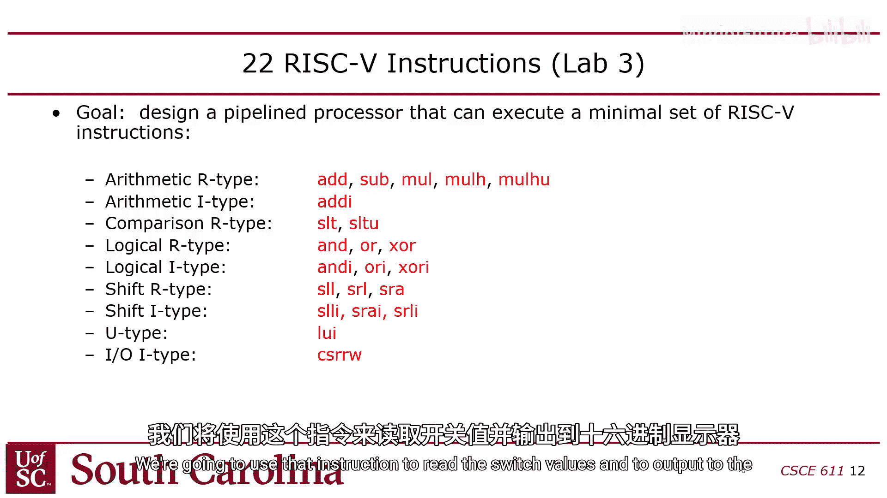

And then I talked about the encoding formats。 I mentioned that this is something you're probably going to have to refer to because it's not the same as MIPS。

And it's kind of a。A strange encoding format in the R type， the shift amount field is gone。

 They added a three bit function code here in the middle of the instruction。

 there's a  seven bit function code at the end， and then there's an op code at the other end then the i type instruction has a 12 bit immediate field。

 if you remember from MIPS， there was a 16 bit immediate field but now we just have 12 because there's a corresponding u type format that's supposed to work with this So you get the other 20 bits as an immediate field in here and the U type guys with me right So if you want to load a 32 bit value in from a scalar or a constant。

You can get 12 bits from an I type instruction and the other 20 bits from a U type instructions。

 the idea。 Okay， the one nice thing though about this is if you remember from MIps the。

There was an RRT field you guys remember the RRT field which could be a source or a destination and as a result you had to put a muux on the register file to choose between writing to the RD field address or writing to the Rt I'm sorry writing to the RD field address or the RT field address right Well now the destination notice how the destination field is in bits 10 down to7 in all three in all three types so you can wire this these bits directly into the register file without having a muux in there in a control signal for that mux So that simplifies the design there。

诶。Let's see。 now when it comes to identifying an instruction。How do you identify what instruction？

Like if you're given a binary instruction， how do you know what instruction it is。

 how do you start with decoding the instruction？Well， you have to start with the。

TheO code right because the op code is the only bit of control information that's common in all three types right so you have to start with the op code and depending on what the op code is。

 you may also have to look at the funk 7 and the funt 3。Right。But it depends on if the op code is。

Corresponds to what format the op code corresponds to， right， you guys with me？Okay。

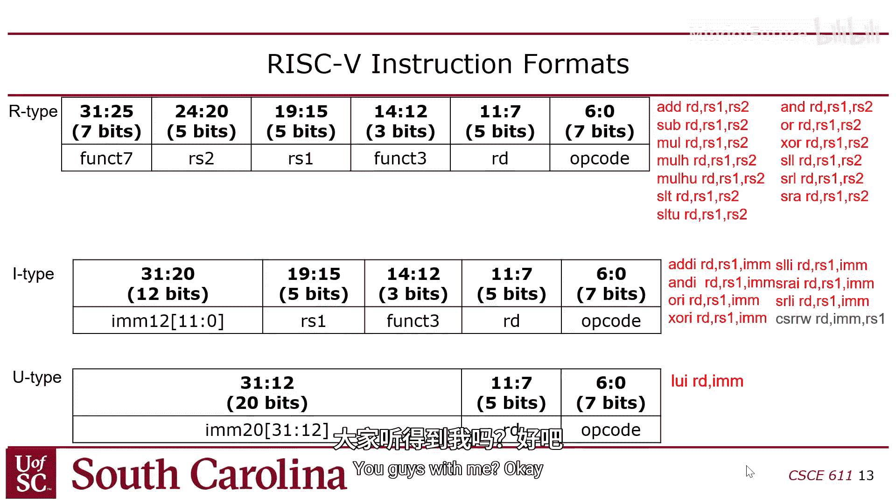

嗯。Okay， then we talked about the CSRRW instruction， so just to review that。

 the CSRRW instruction has a destination register。And then it has a source register。

And in the middle， it has a CSR register。 That stands for a control and status registerister。 In Rrs。

 there's a tab。On the right hand side of Rrs that lists the control and status registers。

Four of those will show up。At the end， IOs 0 through three will show up if you're using our version of Rs and those correspond to the DE2 specific you know CSR registers which are basically just the keys and the hex displays。

 you guys with me okay。The way this instruction is supposed to work is。

What it's really doing is a swap。It's taking the data in the control register。

And it's going to put that in the destination register here。And in parallel to that。

 it's going to take what was in the control register and and it's going to take what's in the source register and put that in the control register。

 So it's going to take what's in the source register and put that in the CSR and whatever was in the CSR gets put in the RD register。

 right， So it's literally swapping。Vues between the general purpose registers and the control status registers right。

 but in this lab we can't actually do that swap because the keys are read only and the hex displays are right only。

Okay， so depending on what。The CSR register is in this instruction。

 your control unit will have to behave differently depending on this CSR field， you guys with me。

 so effectively the CSR field is a function field essentially。

 as opposed to just a register field you're going to use the CSR field and what is the CSR field。

 by the way， what am I talking about。

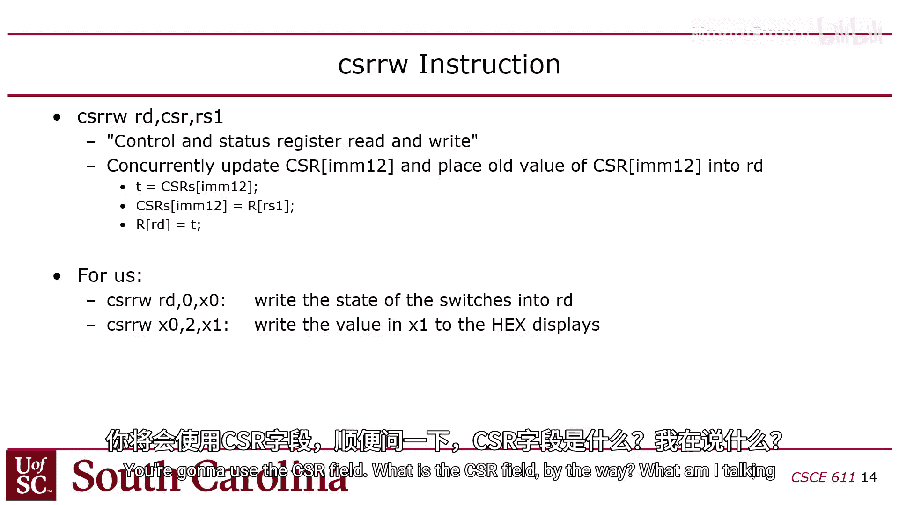

Well， the CSR， the CSRRW is an i type instruction， and so the CSR register is actually going to be encoded in this 12 beta media。

Which means the CSR register is actually a register value， an address that's between 0 and 4095。

 whereas the regular registers are 0 and 31 right regular registers are5 bits。

 the CSR register is technically a 12 bit register address for CSR， even though if you look at Rrs。

 there's actually less CSRs than there are general purpose registers。

So I don't know why they they're putting the CSR address in this big field。

 it kind of doesn't make sense， but maybe in a real risk five processor you may have a lot more CSRs。

 this allows you to have up to 4096 CSRs okay guys with me。Okay， so。Okay。

 so we gave you a starting point here。Because。You know it's generally kind of tough to know where to get started in this lab because you're basically told that you have to build a fully functional risk five processor with 22 instructions。

 you can use the ALU， you can use the register file。But then what， where do you go from there。

 What's the next step。So this is where you can start， so this module is called CPU。

 so this is the top level module for your CPU and。This thing has' an always in it that is acting as the fetch stage。

 So we've in line。 Now you might say wait a second。 Hol on。 if you have a module called CPU。

 you should have another module in there called fetch stage and another module in there called the execute stage right or another like it should just be you're kind of violating your hierarchy here by putting you know。

 lowlel details in this level of the hierarchy。 Yes， yeah， it's it's not a great way to， yeah。

 it's probably not the ideal way to do it。 But it's a starting point。

 And you can always outline this fetch stage if you want to。 when I say outline。

 you can put this in a module and then instantiate that module right， But right now。

 we've just kind of put everything in this CPU module。 So inside here。

 the instruction Ram is in here。RightAnd again， you might say， wait a minute。

 the instruction Rams not in the CPU， that should be outside the CPU right the CPU doesn't have RA。

 right you should be the CPU and then an attached instruction right again。

 the way you organize this is up to you in this case we have the instruction Ram actually declared inside the CPU module and then there's this initial statement here that will actually load the program。

So you're going to generate a program with Rrs and that's going to generate a program RAOM。

 and that program RAOM will be included in the configuration when you configure the FPGA。

 your program will come in the FPGA along with the hardware。

 so the software and hardware will kind of get bundled together basically is what's happening here。

And then we have a program counter， which I call program counter fetchch。

 and I'll explain why I use that name in a minute。That gets initialized as zero when you program the FPGA。

 then there's the instruction EX， this is where your instruction will be held。

 and then this always basically just implements the instruction Ram so it takes care of incrementing the PC。

And going inside the instruction Ram and spitting out the instruction at whatever address is indicated by the PC。

 Okay now remember the example I gave you guys for the non- blocklocking assignment statements。

 we're assigning the PC with a non blocklocking assign and we're assigning the instruction EX with a non- blocklocking assign。

 So even though I change the program counter， and then I immediately use the program counter。

There's not actually this program counter is not this program counter is going to be seeing the old version of the program counter。

 right， which means that。This is a two cycle sequence now inside this always， in other words。

What's happening is that I'm going to change the program counter in one cycle。

So it's going to take a cycle to change the program counter and another cycle then to use that program counter and have it go into the instruction rim and spit out the instruction at that program counter address right so there's a two cycle delay now between updating the PC and reading the instruction right now they're happening at the same time。

 So what's happening here is that the program counter is being incremented。

 the instruction Ram is being read but you're reading the instruction Ram with the old program counter right in other words。

 the instruction that's coming out， if you look at the program counter value and the instruction coming out。

 the instruction coming out is the contents of the program counter as it was in the previous cycle right which mean the program counter address is leading the instruction right So if I see program counter is five。

 then the instruction EX at that same moment in time is going to be the contents at address4。

You guys see how that works because it takes a whole cycle to read the instruction Ram so even though I'm incrementing the program counter in parallel to reading the instruction Ram。

 whatever address is on there is going to correspond to the next address after whatever instruction is coming out does that make sense so because you know again。

 even though you looks like there's a data dependency here where I'm setting PC fetch I'm using PC fetch。

 this PC fetch is the old one right。Does makes sense？

So it acts kind of like a shift register and this is actually creating a well， anyway。

 so just keep that in mind Okay， so then。I mentioned this to you guys with regard to lab two。

 it's the same story here， your CPU will sit inside of this thing called top do Sv top dot Sv is a file that already exists in the skeleton The expectation is that the CPU's top level interface will be clock reset N。

And IO0 in right， and then the CPU will have an IO2 out IO0 and IO2 refer to the CSR addresses zero and 2 with regards to the software。

 the instruction when you use CSR or W， right？CS yeah， CSRRW。

The IO2 out will then go into your eight seven segment decoders that you developed in lab2。

 and the outputs of those will come straight out， right？So in other words。

 the CPU top levelve CPU will have three inputs， single bit clock。

 single bit reset and a 32 bit IO0 in and we'll have a single output called IO2 out right then inside your top do SV。

 that's going to be a wrapper that's going to reconcile the FPG pins with this pin out。

 So the clock underscore 50 on the FPG pin will then be connected to the lower clay clock of the CPU key0。

 which is the rightmost button on your on your board， is going to be connected to reset n。

 So we're changing the name of clock clock 50 becomes clock。

K zero becomes reset switch goes into IO0 in right now you might say wait a second。IO0 in 32 Bs。

 there's only 18 switches。 Hows that work， Well， you may have to zero pad。Those those guys， right。

 I think there is a width difference here， right， But anyway， the key。

 the switches go into IO0 and then IO2 out will come out as 32 Bs and will be divided in its four bit segments that will go into each of eight。

You know， seven segment decoders。And then the output of your top will be Hex0 Hex1 and hex 7 because those are the FPG pins。

 the actual FPG port names right So then if you put the top on the FPG。

 it'll be connected to the things on the FPG board right the switches in the crystal oscillator and the button and the switches and the hex displays。

 But if you want to simulate it， then you put the top do Sv inside Simtop do Sv which has no inputs and outputs because it's a self-contain test bench right And then you would just simulate top do Sv Simtop and Simtop will create the reset signal in the clock signal using you know just initial and always right So that's the generally how。

How you'd set that up，Now， remember that if you guys remember from 212。

 hopefully you talked about the five stages of execution。There's a fetch， decode。

 execute and write memory and write back， right， you guys， did you guys cover that？

RightSo so those refer to data path operations so inside it you know from the software perspective。

 every instruction is atomic right， the CPU executes one instruction at a time and。

That's the smallest amount of workload the CPU can execute as one instruction right but inside the CPU in the microarchitecture。

 you actually divide the execution of instructions down into smaller steps。

 data paths and each one of those steps occur within occur in one cycle right So Heness and Patterson textbook has defined those steps as fetchdecode。

 execute memory and write back， there's five steps。

 not every instruction needs to go through all five steps though， So for example。

 at our type instruction that does computation doesn't have to go through the memory steps because it's not a load or store instruction whereas a load instruction has to go through all five steps。

 but a store instruction only has to go through fetch de in memory。Right。

 and a branch instruction only has to go through fetch decode and execute。 right。

 So if you create a multicycle CPU， a multicycl CPU can use a a state machine to basically just go through whatever steps are necessary for each individual instruction。

 whereas a pipeline CPU has to go through all five steps for every instruction。

 even though that instruction may not do anything in one of the steps， right。

 because you have to have the the depth of the pipeline has to be the same for every instruction。

 right， you guys remember， So hopefully you guys remember that。 Now in this。Yeah。

 so and then a single cycle CPU of course would would do all all the steps in one cycle right so for example。

 in cycle like if I have an instruction that's gray。

 the instructions are in this order so the gray instruction would be you know could be executed entirely say in cycle  zero if it were a single cycle CPU the turquoise instruction would be in cycle1 and the purple instruction would be in cycle2 right so in this class we want to create a pipeline CPU right and。

So。So but we don't want to do a five stage pipeline。Five stage pipelines are。

Complicated and probably overkill for what we need in this class。

 So weve decided instead said just to do a three cyclee pipeline that way we can allocate a whole cycle for fetch that way our instruction memory can have a synchronous read。

 If you have a Ram with a synchronous read。 It's gonna to take one whole cycle to read to read the instruction from the instruction memory。

 So that's a whole cycle for fetch。 But then we can combine the decode。

 execute and memory into one into one clock cycle because we can design a fast register file and control unit for decode a fast AU for execute and if we do any memory。

 we can we'll do that in one cycle。 and then we'll have a separate cycle there for write back。

 guys with me。 So there's just three cycles。 we usually just refer to this as fetch I'm sorry。

 fetchch execute and write back。 right Now we don't actually have any load or store instructions in your instruction set。

 So we actually don't even have a memory stage so。Basically， it's just fetch in one cycle。

 decode and execute in a cycle， so in the second cycle you do the decode which reads the registers and it will take the instruction word and decompose it into control signals。

That will control muxes and register enables inside your CPU And then a third cycle。

 we'll write back the result right So what that means is is that if you have an instruction that's executing then the previous instruction will be an execute I'm sorry we'll be in right back right will be one cycle ahead and this is the reason why we had to put that register bypass because you might be reading Reg2 here and writing Reg2 here。

 and if that's the case you have a true data dependency So you have to make sure that because this guy is going to be writing Reg2 while this guy is reading it simultaneously you have to be able to do that bypass trick right。

Okay， so and then the idea is that you have。YouIn this case， because there's three stages。

 you can have up to three separate instructions in one stage at a time right so whenever you look at what's going on inside your CPU。

 you'll have three instructions in progress or in flight or three outstanding instructions at three different stages along their execution right now in the case of fetch though fetch doesn't really there's not much going on in fetch except for the program counter accessing the instruction memory right that's the only thing happening in fetch right so there's not a lot to look at really the only signal associated with fetch is the PC fetch signal right now in decode or in execute rather the middle stage。

 second stage you have all of the AU signals and all the register file signals and all the control unit signals are all in that second stage。

 the execute stage so most of most of your wires are going to be referring the things going on in that second that second stage。

 the execute stage。The right back is pretty much just the right port on the register file so right address right data that's it right so if you look at all the signals in your CPU。

 almost all of them are going to be the middle stage except for you know there'll be PC fetch which deals with the fetch fetching instruction and the Regg right Reg right register address。

 register data right？Make sense， Okay， so so I recommend。

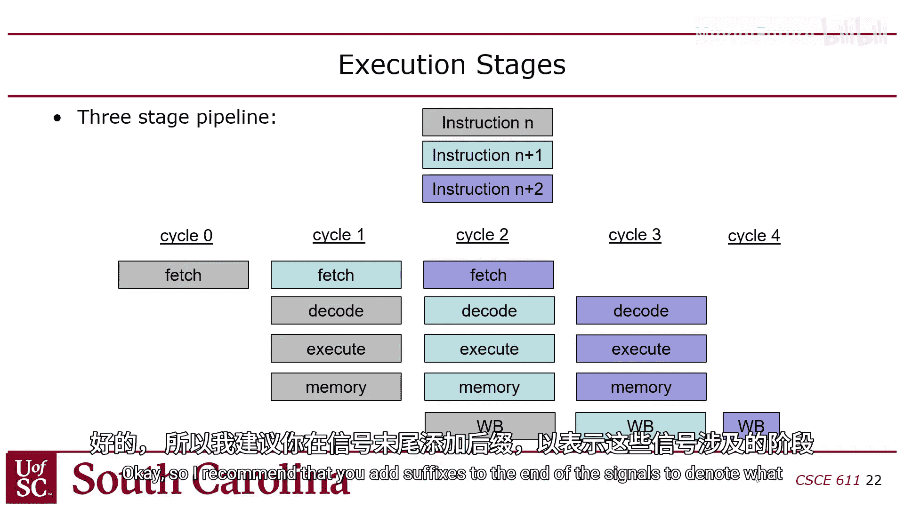

That you add suffixes。To the end of the signals， to denote what stage that those signals， which。

 which， which stage those signals are dealing with。 So PC fetch， you see。

 it's PC underscore fetch refers to that is the address。

Of the instruction that's in the fetch stage or being fetched right now right so you just add an underscore fetch there right likewise。

 the register destination into the going into the right address on the register file that has to do with the right backt so you can add an underscore right back there right。

And then the instruction that's in the execute stage we'll call that instruction underscore EX and use the underscore EX to denote that right so the three stages are fetch EX and write back right fetch EX and WB right and so you should keep those suffix is going so it makes it easier to debug and to understand what the state of the CPU as at any one moment right okay so。

The fetch stage we've already given it to you。 So this blocked diagram is a graphical depiction of what's going on in the fetch stage。

 We gave you the very log code for that in the previous。 we didn't give you a file in the skeleton。

 but you can copy and paste the code from the slide So that's basically just a register that's always being having one added to it because we don't have any branch or jump instructions yet。

 So the program counter just mindlessly just marches forward one at a time。 and by the way。

 we're using a word address memory here。 So we're adding only one at a time to the program counter instead of four right because the instructions are four bytes。

 but we we'll just use a word addressed memory here。

 So you add one to the program counter and the program counter just blindly always fetches goes into the address field of the instruction memory and that's going to spit out the instruction E So this part is this part is done for you already。

 Now this part is actually really easy because all you have to do is instance the register file that we gave you。

And then you have to basically just connect bits from the instruction EX directly into the appropriate ports on the register file So if you take instruction bits 19 down to 15。

 that's the first。Opper and register address Rs1 so you just kind of just shove that into the read address one port right just connect it and then bits 24 down to 20 you shove those into read address too and you don't have to worry about muing this or anything these are just static you know pass that goes straight from the instruction directly into the register file right so this is just a matter of doing a port connection there or a port map。

Now the register address field on the register file。

 remember there was two read ports in one right port on the register file for the right port。

 the right port is in the right back。Stage so because the address is in the execute stage and the right address port on the register file is something that's happening in the right backt。

 you have to put a delay register in there， you have to put one register in there that will take bits 11 down to7 which is the RD field on the instruction right that's the destination register and you have to send it into the future。

By one cycle。 So this is like a time machine， you put this in a register and whatever you put in this register will be reflected on that register value。

 one cycle in the future because it'll delay it by one cycle So that way this instruction EX bits 11 down to7。

Get delayed by one cycle and in the next cycle will then become a new name called Regdge deskk underscore right right back and you can plug that directly in right so this this is a pipeline register that will basically create this pipelining effect right it's going to take part of the register and move it into the next stage。

Part of the instruction， rather， moving the next stage。Okay， so then。U。啊。

So let me back up here a second。 So the other thing you want to do in the E X stage is you want to add a control unit。

 Okay， the control unit。You can either inline this。

 meaning you can just make it an always statement or an assign statement。

 Just stick it right in the code right or you can make this a separate module。

 right I recommend that you make it a separate module because the control unit is going to get kind of long right The control unit is a giant lookup table。

 It's going to take the control bits from the instruction and translate those into the appropriate control signals that come out into the CPU Okay now the question is what are the control bits in the instruction。

 Well， as I mentioned， the main one is op code。There's a seven bit op code。

 and that op code is really the key。To figuring out what kind of instruction is where you start anyway。

 because the op code field is the one common field and all the instruction types in risk5 so you can start with op code。

 but then some op codes correspond to multiple instructions and from those cases。

 you then have to look at the funt3 and the func 7 fields right to get additional information to figure out how to discriminate or determine what that instruction is and then sometimes you also need the CSR in the case of the CSR or W instruction。

 you need that field as well because like I mentioned。

 because of the unique situation of of how we have it set up in this class you're going to do something radically different depending on if you're using you're doing a CSR or W instruction on Io0 or I01 because one of those is a switches and one of those the hex displays and you got to treat them differently you can't you cant you have to have different behaviors for those two situations so you're just going to feed those in the control unit。

Youuy with me， now here's the problem with this。These fields。

 the instruction encoding on risk five is a mess。's you'll never remember these fields。

This's awful like do you， how would you remember that func 3 is bits 14 down to 12？

No one can remember that。And the problem is is that if you're looking at your code and you' just referring to fund3 as instruction EX 14 out of 12。

 you might forget even what the heck that is right so one of the things you can do to help out。

Is you can create another module that does nothing other than rename the signals right so this actually doesn't add any logic to your design。

 but you can use assign statements and additional declarations to create an alias name for each of these。

 So in other words， you can have a module that takes instruction EX bits 11 down to whatever and just simply uses an assign statement to rename it as funt 3 EX right that will make it easier for debugging。

Because then you can just look at model Sim or you can look at your design and you can see there's a signal called func3 and you can see what's in that signal at every time you don't have to worry about looking at instruction EX and trying to pick out which bits correspond to funk 3 right So we call this a decoder。

You know， my former TA came up with this idea where you have this separate decoder that just does this renaming that's optional you can do that if you want to。

 it's just something to make your your lives easier you know as you debug and test your design。Okay。

 so let's talk a minute about the instruction memory。 So in Rs。You write your code in Ras。

And then you assemble it and if there's no errors and you can go to file and dump memory and when you do that you get a little dialogue and it says what memory you want to dump。

 you can dump you know the stack， you can dump the data section which has the global variables or you can dump the text section that's where your instructions are and I think that's the default and then the dump format。

 you want to select hexadecimal format， When you hit dump to file on that then it will take the hexadecimal representation of your program as a text file and write it to a file because that file is an ASI file with hex number separated by new lines you can directly read that in with the veryo initial function which means that you don't have to change anything you write the code in Rrs。

 you dump it out and it goes straight into your system very log code because it's going to be marked it's going to be pointed to by the initial statement and your CPU design right so this way you can write your code and assembly hit the assemble。

And it will automatically get absorbed into your hardware design this is really cool because it just was a weird coincidence that Rars just happens to output the code in a format that is the same format the system verylo uses in its initial statement to initialize this RA that's just a lucky a lucky coincidence for us we didn't have to do any kind of postproces to make those two things talk to one another so in other words Rars will feed it'll output code directly into the ver log。

😊，So you can call it hexcode。txT or you can call it program。rom。

 it doesn't matter what name or what extension as long as you use the readMMH and point it to this file name being the same file name you export from Rrs and there's actually a。

You can do all that at the command line too in Rars。

 you don't even have to go through the GuUI if you don't want to。Okay， yeah。

 and that's the instruction， that's the fetch again。

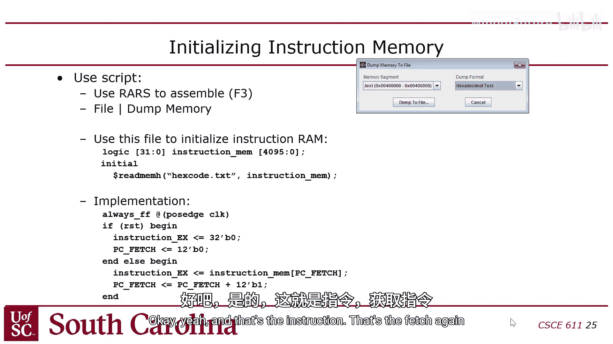

Okay， so then moving on from there， so the control unit。

 I mentioned that there's control signals coming out of that， what control signals do I mean？Well。

 there's。There's one control signal called Reg W Reg Wite is a single bit signal that denotes whether that instruction should be writing a register or not。

 most of your instructions write registers。Do any not？Which instruction doesn't write a register。诶。M。

I think all these do。All these do CSRW doesn't if you're reading from the switches。

 I know I'm sorry if you're writing to the hex displays rather right so if you're doing an output operation on this。

 that doesn't。Yeah， all of them， all of them， but CSRW。

Right so so I think there's only one case in this lab Now once we get the branches and jumps。

 it's different story because the branches and jumps don't write a register。

 don't write a general purpose register right， they just write the program counter。

 but all of the instructions in this lab write a register。

 which means that they'll all set the red write signal to one with the only exception being the CSRW instruction and even then only if you use the IO register here that corresponds to the。

Hex displays， the output hex displays， right， Okay， so that's what red Wright is。

 But you still have to delay。

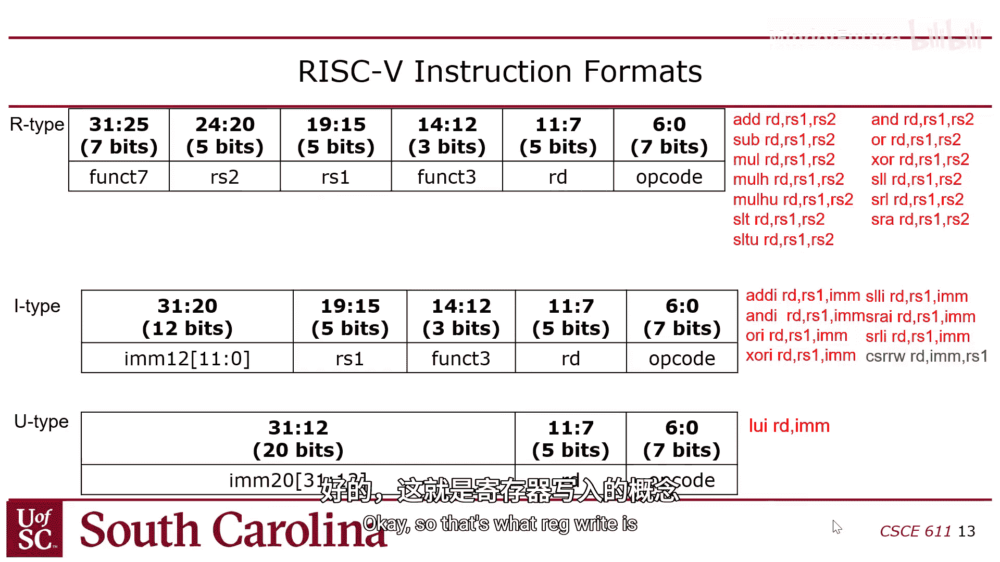

You still have to delay that red Wright signal。

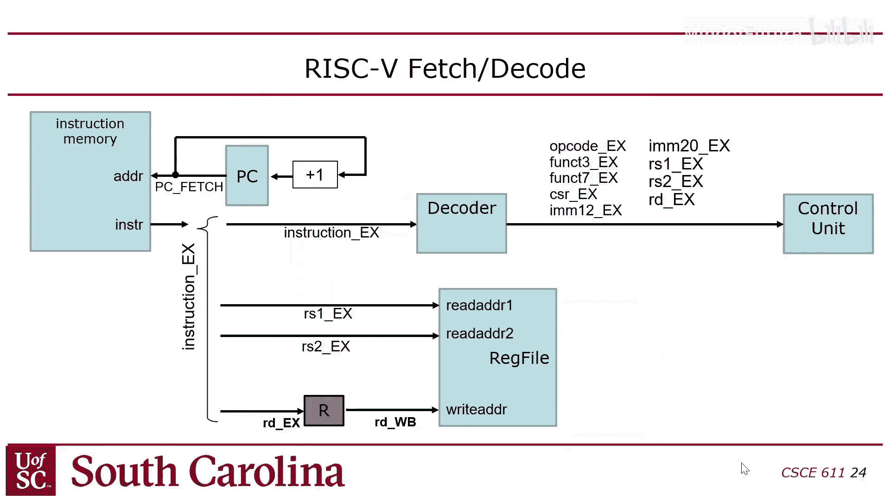

That red right signal still has to be delayed with a register by one cycle， so， for example。

 if you have a CSRRW instruction and execute。The the instruction that's writing the register is going to be the previous instruction that's in write back right so you have to delay the redrightite signal by one cycle using this delay And by the way。

 what is the delay register， It just says always FF pause edge clock Regrightite WB equals Regrightite E X。

 that's it one line of code will'll create that register Cl lot。Okay。

Now there is something called Regg selectlect because the problem is is that even though the register destination is always going to be the RD field from the instruction format because they fix that in risk5 MIps it wasn't the case MIPS you had to figure out which wheres the register right address。

 It could be the Rt field， it could be the RD field here it's always the RD field， however。

 the value that you're writing to the register file is different depending on what you're doing so normally for many instructions。

 the value you want to write to the register is the output of the ALU you do a calculation you do an a subtract multiply shift bitwise。

 that's basically going to be an AU output that you're going to delay and send into the register file right but if you're doing a CSRW where you're reading the switch values that's going to take the GIO in。

Actually， that's mislabeled because。

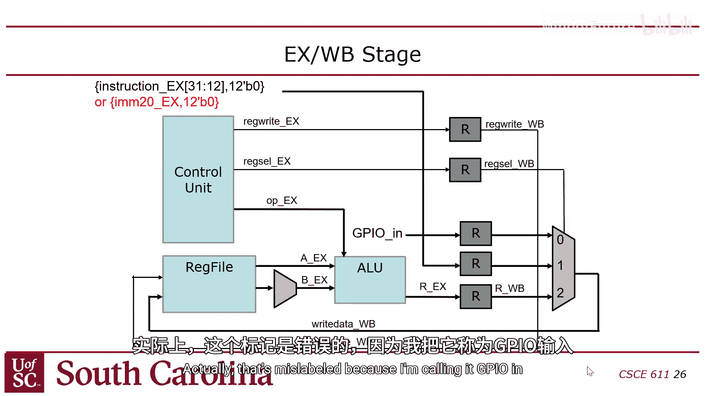

I'm calling it GPIO in there， but if we go back to the previous slide。I called it IO0 in here。

 the same thing though， it's the input bits from the switches， right？

So this IO0 n is not is supposed to be the same as。

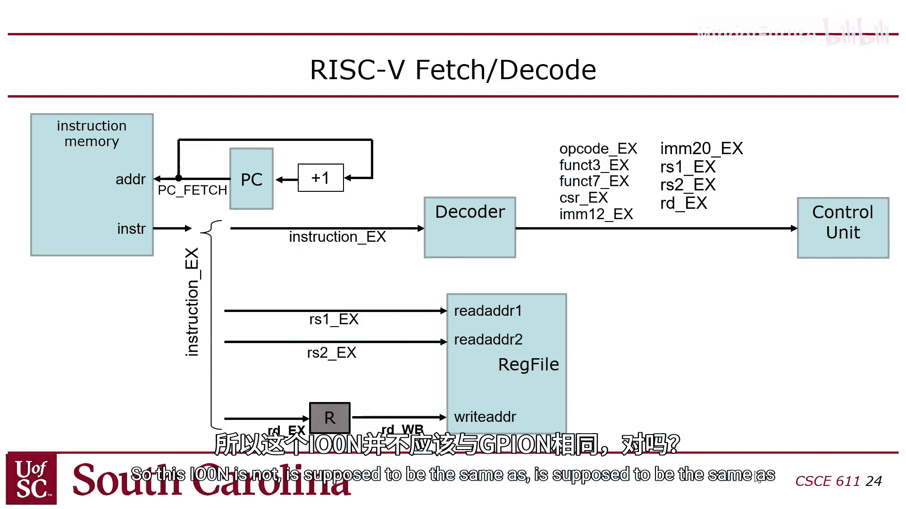

It's supposed to be the same as GPION。Right， but then also。

If you do a load upper immediate instruction。You're taking the immediate value。

Which in the is a u type instruction， so a 20 bit immediate。

 and I want to stuff that into the register file， so I need to have a data path that goes from instruction EX。

Bits 31 down to 12， which is 20 bits。 I got to have the ability to take that along with some 12 zeros that I pack on the right hand side of that thing to make 32 bits。

 And I got to have a path to go。There as well。 So that's going to make that's going to require me to have a mux that allows me to select between the GPIO N or I O N。

 right， That's the switches。And the immediate field。

Of a you type instruction or the output of the register file all into。In max。

That mu will then be controlled by a register Select signal。You guys with me？Makes sense。

 so notice that I delayed all three of those values by one cycle to get them in the right backt right so that mux is in the right backt。

And so its select also needs to be pushed into the right backstage with the register。Right。

makes sense。嗯。Okay， and then I'll put it that mu just goes straight into the right data into the register file。

Any questions about that？

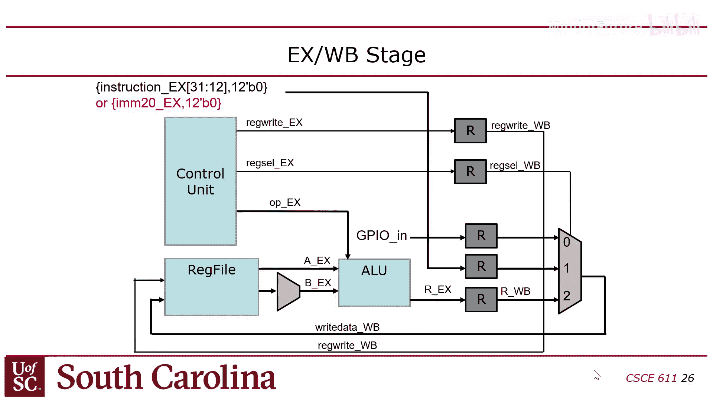

Okay， and then finally we have。One more mus。So the ALU。

The AU is calculating a function of two inputs。One of those inputs will always be the first output of the register file。

 right， read data。What I call read data 1， whatever it's called the first， the first， the first。

 the first report of the register file， right， that will always go into the AU。

 The second input on the AU， however， is either going to be the second operaran from the register file。

 which comes out here。 read data 2， or it could also be the sign extended。12 bit immediate field。

So if you're doing an eye type instruction， you got to get instruction bits 31 down to 20。

 or you know you might rename them immediate 12 right if you have a little decoder trick that I showed。

 but either way， that's going to have to go into a sign extension。You know。

 basically extending the sign and then put into the mucks there。

That Mux allows you to choose that gives you a flexible second operaand in the ALU you can put in the second register or you can put in the immediate field。

 and that's going to depend on this thing called AOU source。Okay， so basically to summarize。

 the control unit is going to look at the instruction that comes out of the fetch stage and from its op code and possibly the function 7 and the function 3 and the immediate field from those information。

 you can construct an if then L statement。Right， or a big。A sign statement。

And use those to configure。What data you want to send into the ALU and what data you want to send into the Reg file？

Right。And that will determine。So again， the control unit is going to be like it's a lookup table physically。

 but you can design it as an if then else inside an always calm block。Right。Any questions about that？

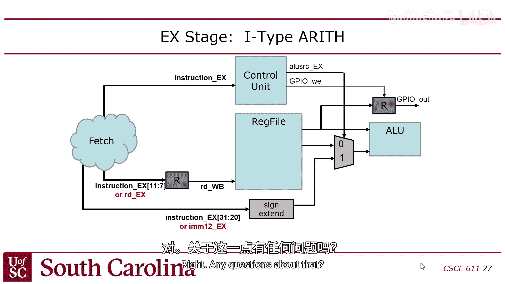

And I think that's the entire。Yeah， that's the whole so this slide。

 I just put everything together into one giant block diagram。Hopefully I didn't forget anything here。

 I think I've got everything in there。This is the whole CPU， at least those 22 instructions。

 So this is an entire risk CPU。But just the， you know， the 22 instructions。

 but those 22 instructions are。Pretty much all your arithmetic instructions and。

And some basic IO instructions to get data in and out。

The only thing you're locking here is branches and jumps。Um。

You have to deal with that until the next lab。In terms of your software will have to deal with that。

 your software will have to work without those instructions。Okay。

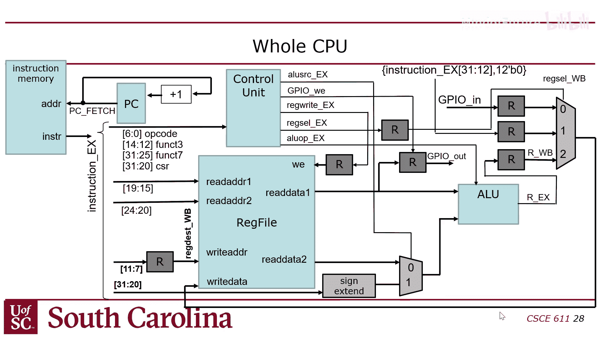

Okay， so let's run through a couple examples here。 I'll make this fast。

 I'll finish this up in the next lecture。 I just want to give you enough to get started here。

 So okay， let's assume then。So this is what I'm showing here are two different slides。

Right that I showed before between the two of these。

 you get the whole CPU right I've just got them split to make it easier to read right So this is this represents your CPU design。

 Okay， so now。Your job is to write a table。A control unit table。 So this table is a table。

 The inputs are blue and the outputs are yellow， right。

 So what inputs do I want to look at function 7， I 12， function 3 and opt code， right。

 Those are just parts of the instruction that come in， right， So if I'm doing an ad instruction。

Then I have well you have to look this up because I don't memorize all the encodings， right。

 but it just so happens that an ad instruction has an op code of 33 and hex。Now， keep in mind too。

 this is a seven bit。You might say 2 hex digits。 That's 8 bits。 Well， no， it's， it's， it's， yeah。

 it's 7 Bs because the first digit is。Maximum value of the first digit is going to be 7 there， right。

 because it's not， it's not a full， it's not full2 hex digits， but we're showing them in Hex。 So 3。

3 is the op code。 But as it turns out。Because that's an R instruction。

That op code is used for multiple instruction， not just addd。

 that that op code is not unique to addd。 So as a result of that。

 you have to also check the funk 3 and the funk 7。 And for the ad instruction， the fun 3 is 0。

And the funk 7 is0， right Now， because it's an ad， we don't care about the immediate field because it's an our type instruction and there is no immediate field。

 So I just mark that as a don't care， right。mightight say how the heck do you make a don't care in an if statement Well。

 if you're making a if statement and you have a don't care。

 you just don't include that as part of the condition of the if right you just ignore it right you don't you don't check it in the if and then it's a don't care right you just check these for equality right Okay so if that's an ad then what do I do if it's an ad instruction in terms of the control of signals Well。

 I got to set my AU up。Remember， I I forgot to mention that earlier。 The A U as an A U op， right。

 We gave you the AU code， but you're gonna have to know how to use it。 Well。

 the way you use it is you just figure out what you wanted it to do and use the right the A U op。

 So if it's an ad， I got to look up the ad in here。 and ad is A U op 0，0，1，1。

 So I'm gonna have to stick 0，0，1，1 in here， right。That's the output from the control unit。

AL U source。 Well， that， that is A U source is going to determine what am I putting in the A U。

 The register or the immediate。 Well， this is not the immediate version of the ad。 This is not add I。

 It's just add。 So I'm going to have to put in the register。

 which means that the A U source should be。Zero， which is the input on that muux that corresponds to the register。

 the second， you know， the second register coming of the register file。

 so that should be zero Reg select， what does that do？

That selects what I write back to the register file。 I've got three choices。 GIO。

 immediate or output from A U。 What should I use， Well， it's an A U instruction， right。

 So it should be AU。 So that should be 3。 I'm sorry，2。2。It's a three input mark so。0。

1 and  two are my options。 So that should be a two。 So Reg cell should be a two。

 Reg write that single bit。 how do I determine that？ Well， if it's a register。

 if it's an instruction that writes a register， it should be one。And a does write a register。

 that's the whole point of it， you know you add and put the result in the register pile so that should be one and GPIO write enable。

 that's the little register here that has an enable and that is what's going to be feeding your hex displays。

So basically， if you set that enable to one， that's going to update your hex displays As long as that enable is0。

 your hex displays will stay constant right So basically that means that you should only enable that whenever you're doing a CSRRW instruction on Io register 2。

 which is your hex displays。 So in this case， I'm not doing that。 It's an ad instruction。

 It's not even a CSRW So that should be a0 right So you just fill those in。

And you do the same thing for the other ones now if you look at add and subtract。

 those are basically the same instruction， the only difference is the ALU op is a subtract instead of an ad。

 right？Multiply is also pretty much the same thing。

 the only difference between those rows is the AOU op。And set less than same thing。

 So all of these rows are identical in terms of their output。

 The only thing I'm changing between these instructions is the AU op。

 All the other control signals are the same because they're all basically the same instruction just with different AOU codes。

 AOU op codes。 However， let's say I do something like an and I。

An A I instruction would use the and operation on the ALU。

 but the main difference with and I would be the ALU source。

Would be different for an and I because that uses an immediate， right。

 The and I takes and register and an immediate and adds them together， right。

 So AO U source would be a。Would have to be a one for that。Now you might say， wait a second。

 hold on here， you have a sign extend block。Right。But and。Does an and operation have a sign bit？

I thought bits were just for arithmetic s bit is meaningless in the context of an and operation。

 right？Because there's no sight if you're ending， you're just doing logical， right？Well。

 as it turns out， this is something that risk fixed and MIPS in MIPS。

 if you did an and I instruction， you would have had to zero extend the immediate because the reasoning there in MIPS was that you shouldn't sign。

 extend an immediate if you're not doing an addd or subtract or multiply instruction because。

There's no sign bit if you're just looking at bit bit twitling， right。

 Sine bits are only for arithmetic。 So then you had to have another control signal in MIPS to control whether you zero extended or sign extended。

 But in risk5， they changed and they said， we don't care anymore。

We're going to sign extended medias even for logical instructions。Why。

 because it simplifies the hardware。And if you don't like it。

 then fix it in software because we're not the hardware it doesn't care。

 The hardware is always going to assign extent。So that's a subtle difference between risk five and MIps。

 Okay， but anyway， yeah， I filled those in。 I'll let you。

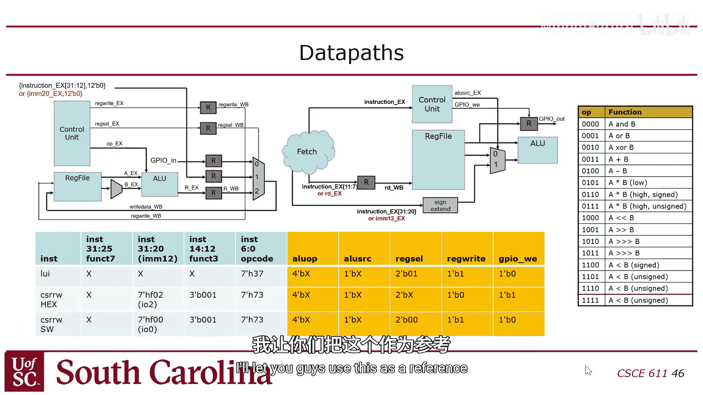

I'll let you guys use this as a reference， this is the control this is the table of all the examples I give it's not complete though you're going to have to have a your table will be much longer than this because this is not inclusive of all the instructions that you have to implement。

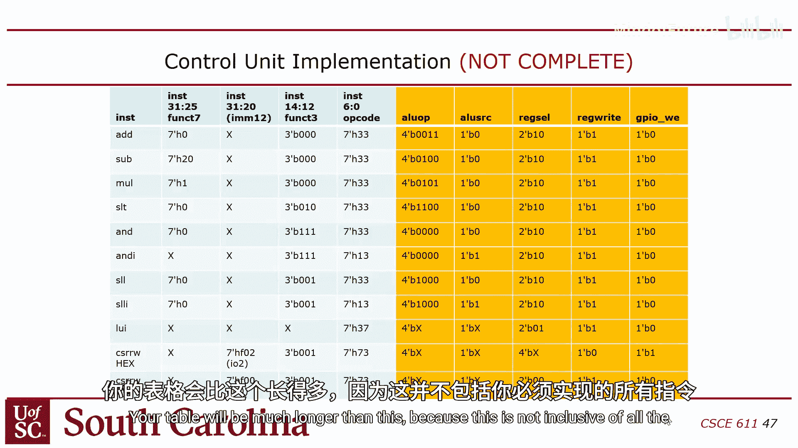

Okay， now to test this thing。So to test it。We're going to give you。Two ways to test this thing。

The first way is the boring way。The boring way is you give it all one copy of every instruction in testimal。

So you give it a program that tests all the instructions。

 even though this program doesn't do any meaningful work， doesn't do any meaningful calculation。

 it's total gibberish， but it's useful for setting up some initial values here and having at least one instruction process run and then for each of those instructions you have to you you can check the register value to see if it calculated the right value that's the boring program but it's a test program。

 the other approach is to do something more interesting which is to have the program do real work。

Real meaningful， useful work。 And so for that， we came up with this binary to decimal conversion where you put a value in on the switches and it will convert it from binary to base 10 and put the value on the hex displays as as a decimal number。

 So if you put in， for example， binary value 10，10， that's a 10 right in lab 2， if you had done that。

It would show up as an A on the hex suspect because it's hex， right。

 but if you have a binary to base 10 converter， it wouldn't show up as a anymore。

 it would show up as 10，10 and decimal， right？So we want to be able to convert to decimal。

 how do you do a binary to base 10 converter。I'm sure there's many ways to do it。

But the most straightforward way to do it is to use divide and modulo。

So if you take a number and you divide it by 10。Youre basically you're essentially deleting the right most decimal digit from it。

 right？So if I have like for example， 51 and I divide by 10 and ri down， it just becomes five。

 the one that one goes away， right？Is with me。 But what if I want to recover that one。

 What if I don't want it to go away， I want to extract that one Well then use modulo by 10 right So if I have 51 and a modulular by 10。

 I get one， but then if I divide it by 10， I just get 5。 So if I modullo at first。

 I extract the rightmost digit in base 10。 And if I divide by 10， I will delete the last digit。

 And then all I have to do is do that eight times and I get each of the digits out of it。

 And then I just take each of those digits and I cancatenate them into 1，32 bit number。

Putting each number of four bits。 So I create a binary coded decimal where I allocate  four bits out of a 32 bit number。

 each of the groups of four bits and put a decimal number in there。

 And I just do a CSR W instruction， and it'll spit that off to the hex displays。 So that way。

I can set up my switches and it'll put out the base 10 value， right now you might say， wait， hold on。

 Yeah， but you said there was no branch instruction， right， So it's only going to do it once。

Your program' is going to run to completion and then you're done game over。Well， no。

 no what will happen is is the program counter。Is going to roll back over to zero。

So the program counter starts at0， it's going to count up to 4095 if it's a 12 bit program counter。

 and then like an odometer， it's going to roll back to 0 and itll run the program again。

 so the program will be running at a rate of 50 million megaHz divided by 4096 instructions。

Which is pretty fast still。It's like 50 million divided by 5000。Right。It's like 10。

000 times per second， the program will run。Right， as long as the program fits inside of 4096 instructions。

 which you will， your program will probably be like。80 instructions， right？

So it'll update the hex displays 10，000 times per second。

And it'll give the illusion of any timextime you change the switch， boom。

 it'll update the hex displays instantly within one within 1000th of a second。

 it'll update the switches。Okay， so you don't need a branch instruction。We might say， wait a minute。

 hold on though， but you said there's eight digits， don't you need a loop that counts eight times。

 you need a loop for that。No， you can， well you do， but you can unroll the loop。

 you can just copy and paste the code eight times that handles each digit， right？

So you don't need any branch or jumps for this to work。Okay， so then you might say， wait a second。

 I thought you said we don't have a divide instruction。Or a modular instruction for that matter。

Right， well， you can implement divided modulo in software。You guys should have did that in 212。

 by the way， can create you can write a code that just uses shift and subtract instructions to divide。

Right it's called a restoring divide algorithm。 We'll talk about that at the end of this semester in case you guys didn't。

Didn't cover that in 212， but you don't even have to do that。

Because you're always modulating and dividing by a constant 10， right， So you don't need a divider。

 If you're dividing by a constant， you can just convert that into a multiply by the inverse of the thing you're dividing by。

 So instead of dividing by 10， you just multiply by 0。1， right。Makes sense。And then you say， okay。

 but that doesn't work for you can't do that you can't use that trick for modo。Well， you can。

 because after you multiply it by 0。1。You can then take the fractional part of the result。

Right so if I have 51 and I multiply it by 0。1， I get 5。1， right， then I take the 01 out。

And I multipied that again by 10。And that'll make the 01， make it a1， right。

 So if you divide by point， I'm sorry， if you multiply by 01。

You extract the fractional part of the product， and then you multiply that by 10。

 you will then recover the modode value。Now you might say that's not going to work because of rounding error。

 true， there is could be rounding error。But as long as we have enough precision。

 we shouldn't have that problem。Okay， so how does this work？

Well basically use fixed point right we already did this once already and so you can take a。

Just use F point。So the point one。You can make that entirely。Fraactctionional digits。Okay。

 so if you take 2 to the 3 second power， which is 4。2 billion and you divide that by 10。

 that gives you 428 million something right that will then be a fixed point representation of 0。1。

 if all the bits are fractional because that way you're storing a 32 bit value and you're putting a value in there that's  one1th of the dynamic range of that value right so if you put whatever2 to the 32nd power is if you divide that by 10。

 that becomes your fractional number， the fractional effectively a fractional part and it uses all the bits of precision。

So you get get a precision you get a full 32 bit precision there， okay？Actually。

 it's not 32 because I think there's a leading zero。I think there's a leading0。 Yeah。

 there's actually a couple leading zero。 There's three leading0。 So actually， technically， you get。

29 bits of precision technically， but you use， use all your bits to represent that point。

That point1 value。 Okay， so then when you multiply your integer， which is the switch value by 0。

1 in 32 Bs， that will give you a 64 B product where the upper 32 bits are all integral bits and the lower 32 bits are all fractional bits。

 So when you're worrying about taking your fractional part out。

 it becomes trivial because you just do the mule instruction and you get the fractional and you do the mo h instruction and you get the decimal part。

 the integral part， right。Okay， so。So that makes it easy， so basically， like I said。

 I think I already covered that。嗯。Right， okay， yeah。 so that's basically it。

 So the second program will be。A binary to decimal converter that's something you can demo on the boards。

 so that serves two purposes。 It serves as a way to test your program， your CPU。

 not a great test though because you're not going to use all the instructions that program will not require all of your instructions It's only going to require a few instructions but we gave you another test program that test all the instructions now you might say。

 yeah， but you only test each instruction once， I mean。

 what kind of corner case testing is that it's not good。 I mean， but it's a minimal test。

 you at least check every instructions once。So you have the test program one。

 you run that in model SIim， you verify it by looking at your register file Test program2。

 that will be something a tangible thing that you can actually work on on the boards。

 you can try it out and it'll be kind of cool because it does the same thing lab 2 does except instead of a hex output。

 you get a decimal output。 So again， like I said， if you put 1010 instead of getting an a you'll get a 10 and none of the hex digits will ever show a a to F because you know it'll be in base 10 right。

So if those two test programs pass。Then we'll be convinced your CPU is working。Okay， any questions？

Okay， so the lab sheet describes all that， the lab skeleton is online。

 we'll give you three weeks to do it should be enough time if you have any questions let us know。

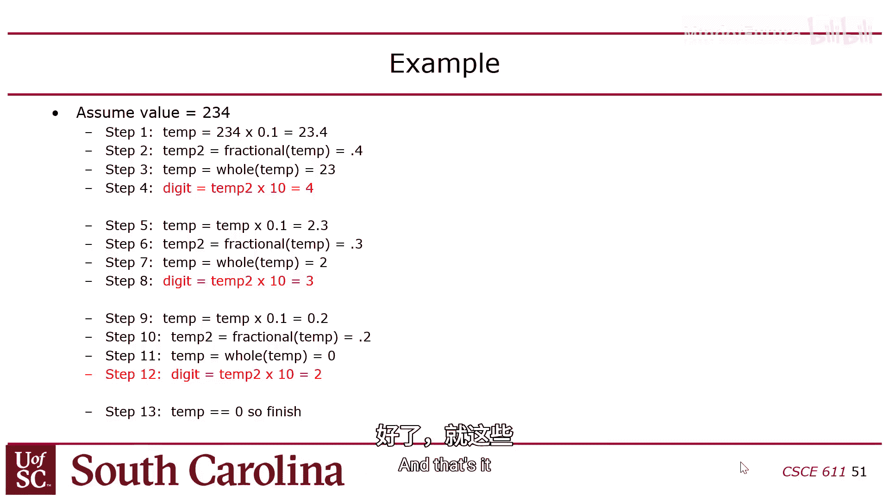

Yeah， and that's it， so I'll let you get started。