# 高级数字系统设计：P07：微架构设计（第二部分） 🧠

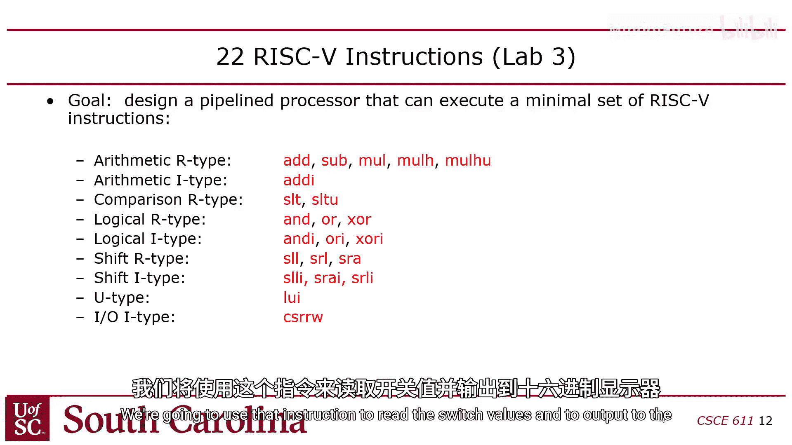

在本节课中，我们将继续学习RISC-V处理器的微架构设计，重点关注如何实现一个包含22条指令的流水线CPU。我们将从指令编码格式开始，逐步构建数据通路和控制单元，并最终完成一个可以运行在FPGA开发板上的处理器。

---

## 指令编码格式回顾

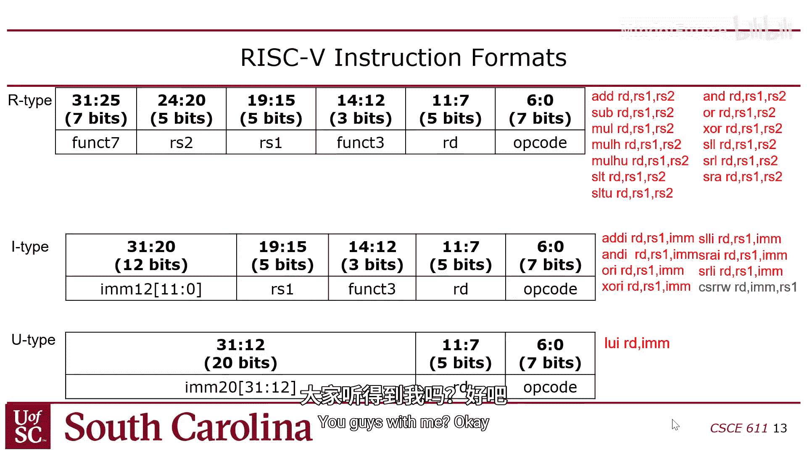

上一节我们介绍了Lab 3的目标是实现22条RISC-V指令。本节中，我们来看看这些指令的具体编码格式，这是设计控制单元的基础。

RISC-V的指令编码与MIPS不同，主要分为三种类型：R型、I型和U型。

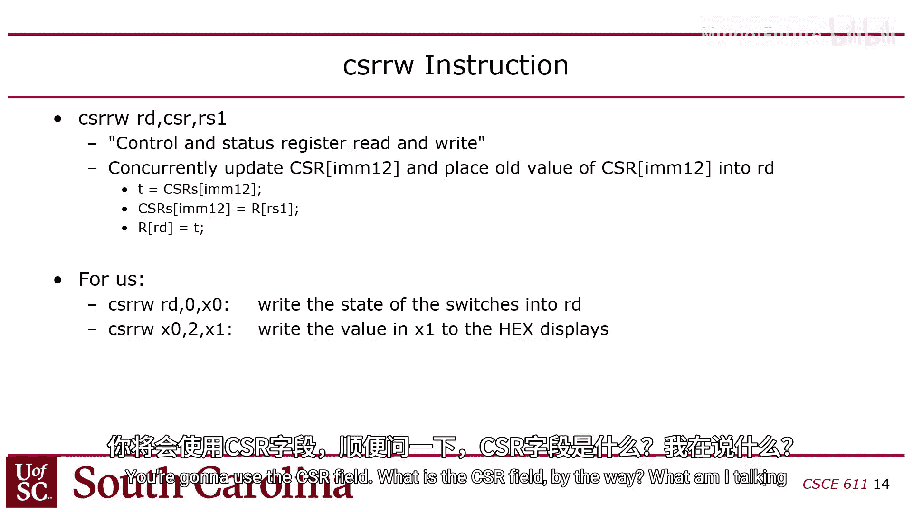

*   **R型指令**：用于寄存器-寄存器操作。与MIPS不同，它没有独立的移位量字段，但在指令中间增加了3位的`funct3`字段，末尾有7位的`funct7`字段。
    *   公式表示：`指令[31:25] = funct7`, `指令[24:20] = rs2`, `指令[19:15] = rs1`, `指令[14:12] = funct3`, `指令[11:7] = rd`, `指令[6:0] = opcode`
*   **I型指令**：用于立即数操作或加载。它包含一个12位的立即数字段。
    *   公式表示：`指令[31:20] = imm[11:0]`, `指令[19:15] = rs1`, `指令[14:12] = funct3`, `指令[11:7] = rd`, `指令[6:0] = opcode`
*   **U型指令**：用于加载大立即数（如`LUI`）。它包含一个20位的立即数字段。
    *   公式表示：`指令[31:12] = imm[31:12]`, `指令[11:7] = rd`, `指令[6:0] = opcode`

一个重要的设计简化是，在所有三种格式中，目标寄存器`rd`的地址都固定在指令的第11到第7位。这意味着我们可以直接将这几位连线到寄存器文件的写地址端口，而无需像MIPS那样需要一个多路选择器来选择是写入`rd`还是`rt`字段。

对于需要32位常量的情况，可以组合使用U型指令（提供高20位）和I型指令（提供低12位）。

---

## 特殊指令：CSRRW

在22条指令中，`CSRRW`指令较为特殊，它用于输入/输出操作。我们需要理解它的工作原理。

`CSRRW`指令执行一次“交换”操作。它将控制状态寄存器中的值读入目标通用寄存器`rd`，同时将源通用寄存器`rs1`中的值写入控制状态寄存器。

在我们的实验环境中，CSR寄存器`IO0`对应开发板上的开关（只读），`IO2`对应七段数码管（只写）。因此，实际实现时：
*   当对`IO0`执行`CSRRW`时，我们只执行“读”操作，将开关值读入`rd`。
*   当对`IO2`执行`CSRRW`时，我们只执行“写”操作，将`rs1`的值输出到数码管。

`CSRRW`是I型指令，其CSR寄存器地址编码在12位的立即数字段中，理论上可以寻址4096个CSR。

---

## 三阶段流水线设计概述

在计算机体系结构中，指令执行通常被划分为多个阶段。我们采用一个简化的三阶段流水线设计，以平衡复杂度和性能。

以下是三个阶段的划分：
1.  **取指阶段**：从指令存储器中读取指令。由于我们使用同步读取的RAM，此操作需要一个完整的时钟周期。
2.  **执行阶段**：此阶段合并了译码、执行和（本实验不涉及的）内存访问操作。它包含寄存器文件读取、控制单元、ALU运算等所有核心数据通路。
3.  **写回阶段**：将结果写回寄存器文件。

这种设计意味着在任何时刻，CPU内部最多有三条指令处于不同的执行阶段。为了清晰地区分不同阶段的信号，建议为信号名添加后缀，例如：
*   `PC_fetch`：取指阶段的程序计数器。
*   `instruction_EX`：执行阶段正在处理的指令。
*   `RegWrite_WB`：写回阶段的寄存器写使能信号。

---

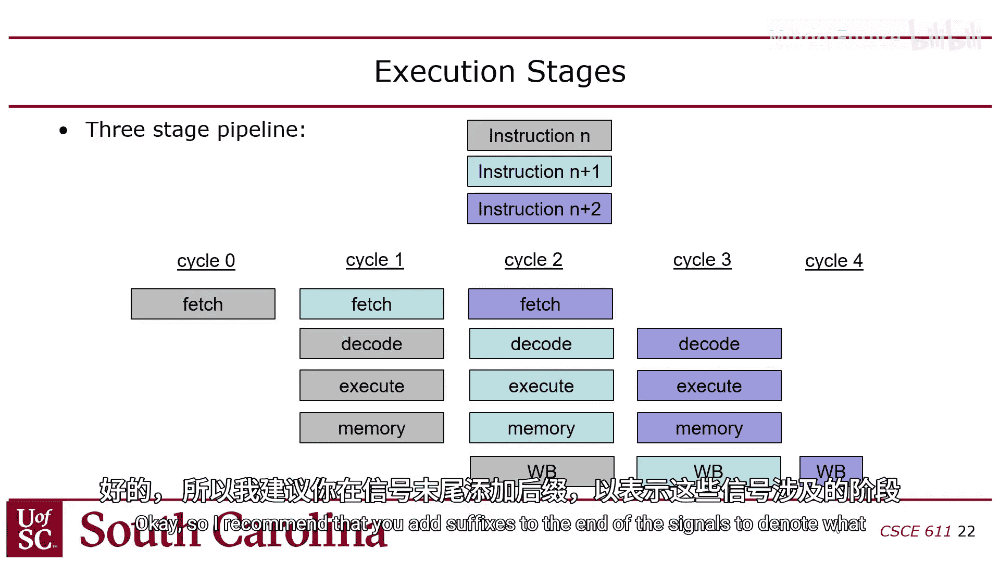

## CPU顶层模块与启动代码

为了帮助大家开始，我们提供了一个CPU设计的起点。以下是对启动代码中关键部分的分析。

CPU的顶层模块（`CPU.sv`）已经包含了取指阶段的基本逻辑。指令存储器被实例化在CPU模块内部，并通过`initial`语句从文件加载程序。

```systemverilog
always_ff @(posedge clock) begin
    PC_fetch <= PC_fetch + 1; // 每个周期PC加1
    instruction_EX <= instruction_ram[PC_fetch]; // 读取指令
end
```

**重要提示**：上述代码中使用了非阻塞赋值`<=`。这意味着`PC_fetch`的更新和`instruction_ram`的读取是同时发生的。因此，在某个时钟周期，`instruction_EX`输出的是**上一个周期**的`PC_fetch`所指向的指令。这实际上在取指和执行之间引入了一个周期的流水线寄存器。

CPU通过一个顶层包装模块（`top.sv`）与FPGA板载资源连接：
*   `clock_50` 连接 CPU的 `clock`。
*   按键`KEY0` 连接 CPU的 `reset_n`。
*   开关`SW` 连接 CPU的 `IO0_in`（需要补零至32位）。
*   CPU的 `IO2_out` 输出连接到八个七段数码管解码器。

对于仿真，我们使用`sim_top.sv`，它内部实例化`top`并生成时钟和复位信号。

---

## 执行阶段数据通路构建

执行阶段是设计的核心。我们需要连接寄存器文件、ALU，并构建必要的数据路径和多路选择器。

以下是构建执行阶段的关键步骤：

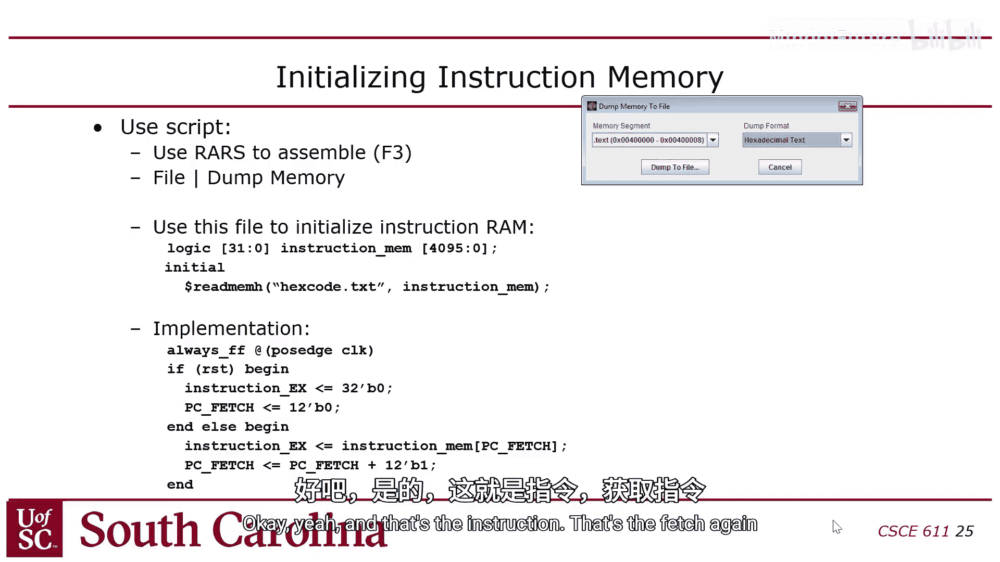

1.  **连接寄存器文件**：
    *   将`instruction_EX[19:15]`直接连接到寄存器文件的`read_addr1`端口（对应`rs1`）。
    *   将`instruction_EX[24:20]`直接连接到`read_addr2`端口（对应`rs2`）。
    *   目标寄存器地址`instruction_EX[11:7]`（`rd`字段）需要被延迟一个周期，以匹配写回阶段。我们用一个寄存器来实现这个流水线延迟，产生`RegDest_WB`信号。

2.  **构建ALU输入多路选择器**：
    *   ALU的第一个操作数总是来自寄存器文件的`read_data1`。
    *   第二个操作数可以是寄存器文件的`read_data2`（用于R型指令），也可以是来自I型指令的**符号扩展后的12位立即数**。这需要一个由`ALU_src`信号控制的多路选择器。
    *   **注意**：RISC-V规定，即使是用于逻辑操作的立即数（如`ANDI`），也进行符号扩展，这与MIPS不同，简化了硬件设计。

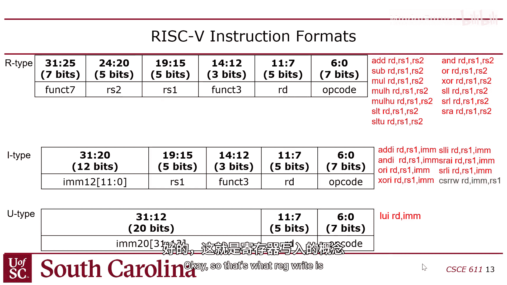

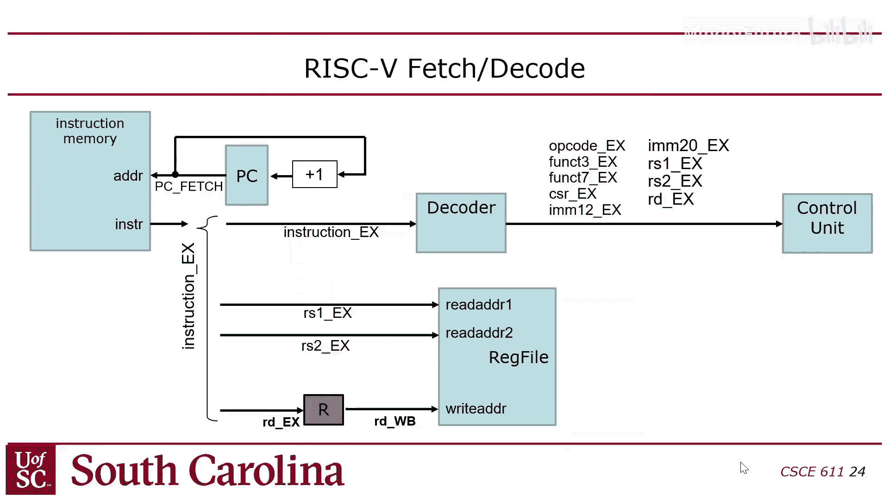

3.  **构建写回数据多路选择器**：
    *   需要写回寄存器文件的数据可能有三个来源：ALU的结果、来自开关的`IO0_in`数据、或U型指令的立即数（经过移位和补零）。
    *   这需要一个由`Reg_select`信号控制的三选一多路选择器，该选择器位于写回阶段。

4.  **控制信号流水线寄存器**：
    *   由控制单元在执行阶段产生的控制信号，如`RegWrite`（寄存器写使能）和`Reg_select`，也需要被延迟一个周期，才能用于写回阶段。这通过额外的寄存器实现。

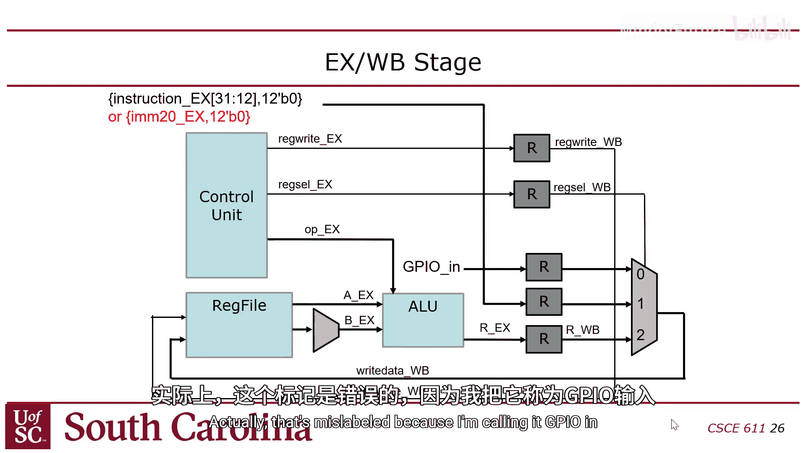

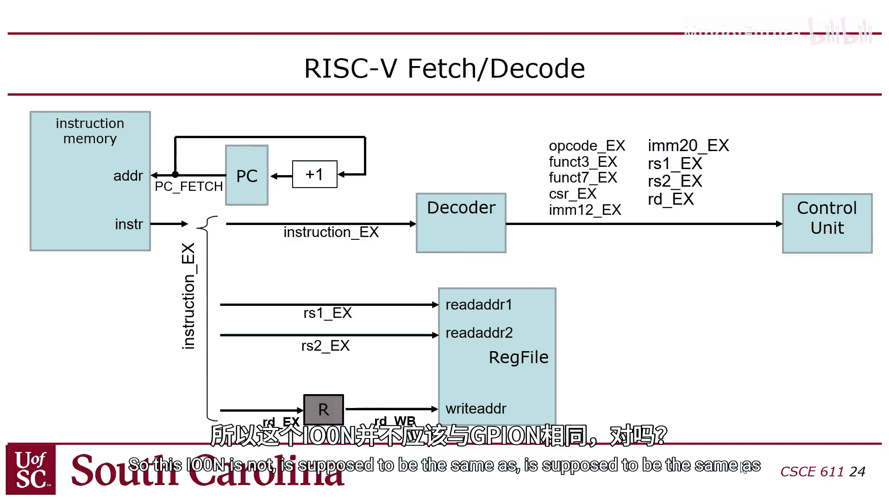

---

## 控制单元设计

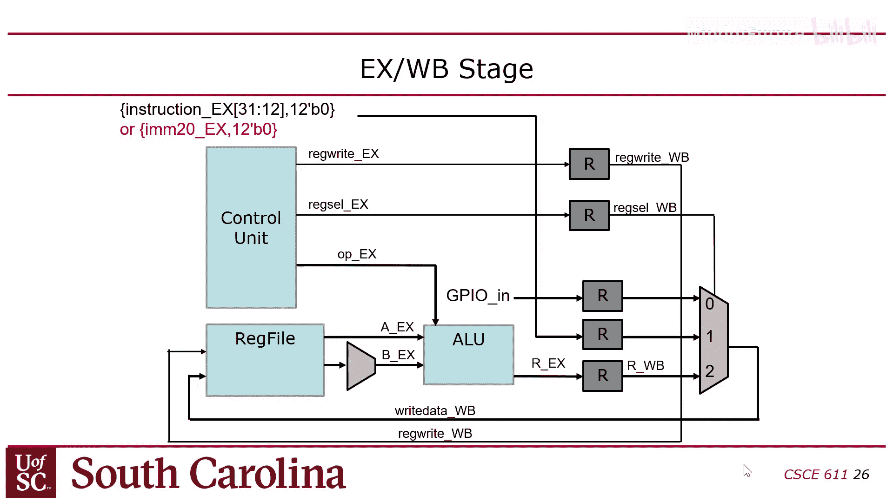

控制单元是一个组合逻辑模块，其作用是将指令字解码为控制数据通路的各个信号。

控制单元的输入是指令的特定字段，输出是控制信号。设计时可以采用查找表或`if-else`语句的形式。

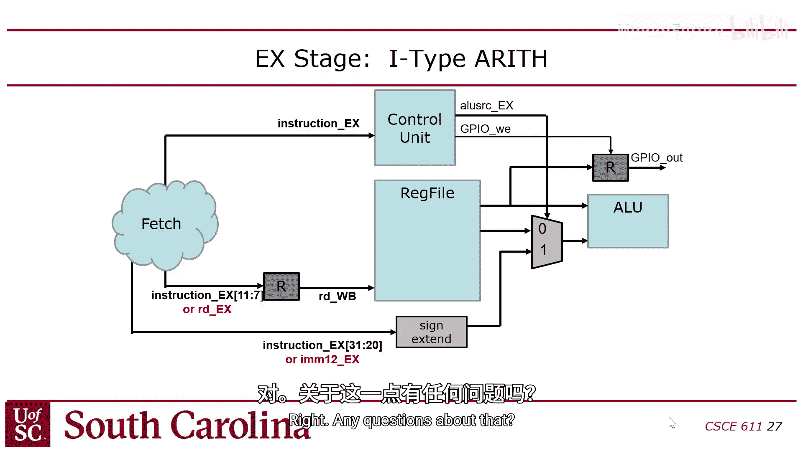

以下是控制单元设计的关键点：

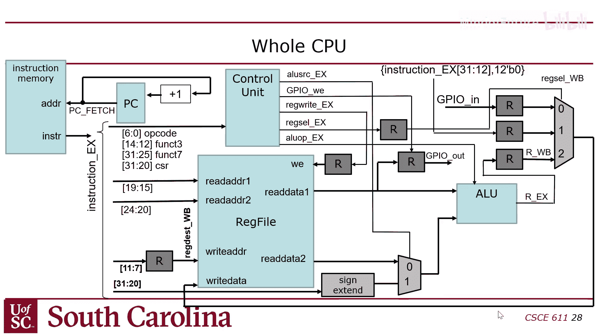

*   **主要输入**：`opcode`是首要解码字段。对于某些`opcode`，还需要结合`funct3`、`funct7`甚至CSR地址（对于`CSRRW`）来唯一确定指令。
*   **核心输出信号**：
    *   `ALU_op`：指示ALU执行何种操作（加、减、与、或等）。
    *   `ALU_src`：选择ALU的第二个操作数来源（寄存器 or 立即数）。
    *   `Reg_select`：选择写回寄存器文件的数据来源（ALU结果、IO输入、立即数）。
    *   `RegWrite`：寄存器文件写使能信号。
    *   `GPIO_write_enable`：仅当执行向`IO2`（数码管）的`CSRRW`写操作时置位。

为了代码清晰和易于调试，可以创建一个单独的“解码器”模块，它仅用`assign`语句为指令的各个字段（如`funct3`, `imm12`）创建易于理解的别名信号（如`funct3_EX`, `imm12_EX`），而不添加任何额外逻辑。

---

## 控制信号表示例

为了具体说明，我们来看几条指令的控制信号设置。控制单元本质上是一个大的真值表。

以下是部分指令的控制信号示例：

| 指令 | opcode (hex) | funct3 | funct7 | ALU_op | ALU_src | Reg_select | RegWrite | GPIO_we |
| :--- | :--- | :--- | :--- | :--- | :--- | :--- | :--- | :--- |
| `ADD` | 0x33 | 0x0 | 0x00 | `0011` (加) | 0 (Reg) | 2 (ALU) | 1 | 0 |
| `SUB` | 0x33 | 0x0 | 0x20 | `0110` (减) | 0 (Reg) | 2 (ALU) | 1 | 0 |
| `AND` | 0x33 | 0x7 | 0x00 | `0000` (与) | 0 (Reg) | 2 (ALU) | 1 | 0 |
| `ANDI` | 0x13 | 0x7 | – | `0000` (与) | 1 (Imm) | 2 (ALU) | 1 | 0 |
| `LUI` | 0x37 | – | – | – (不经过ALU) | X | 1 (Imm) | 1 | 0 |
| `CSRRW` (读IO0) | 0x73 | 0x1 | – | – | X | 0 (GPIO) | 1 | 0 |
| `CSRRW` (写IO2) | 0x73 | 0x1 | – | – | X | X | 0 | 1 |

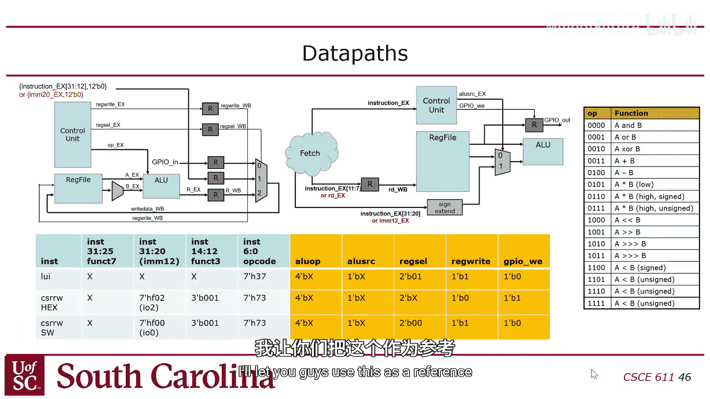

**说明**：
*   `–` 表示该字段在此指令中无效或为任意值。
*   `X` 表示具体值取决于实现，或在该指令中不关心。
*   `ALU_op` 的值对应我们提供的ALU模块的功能编码。
*   `Reg_select` 中，0代表GPIO输入，1代表U型立即数，2代表ALU结果。

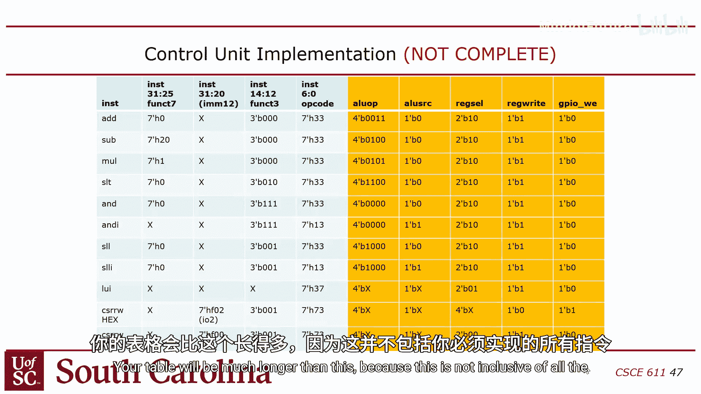

你需要为所有22条指令创建完整的控制信号表。

---

## 测试与验证方法

设计完成后，我们需要验证CPU功能的正确性。我们提供两种测试程序。

以下是两种测试方法：

1.  **指令测试程序**：这是一个包含所有22条指令的简单程序。它不执行有意义的计算，但能确保每条指令的基本功能正确。你可以在ModelSim中运行仿真，通过观察寄存器值的变化来验证。
2.  **二进制转十进制演示程序**：这是一个有实际功能的程序，也将在FPGA板上演示。其功能是将开关输入的二进制数转换为十进制，并显示在数码管上。
    *   **算法思路**：通过反复“除以10取余”来分离出每一位十进制数字。由于没有硬件除法指令，且除数是常数10，我们可以通过乘以10的倒数（0.1）的定点数表示来实现“除法”，再通过一些运算恢复余数。
    *   **循环问题**：由于当前指令集不支持分支，我们需要将处理8个数码管的代码“展开”，重复写8次，而不是使用循环。
    *   **连续运行**：程序计数器会在地址空间内循环（例如，从0到4095再回到0），因此程序会以很高的频率（约每秒上万次）重复执行，使得数码管显示看起来是实时更新的。

当这两个测试程序都能正确运行时，我们就可以确信CPU的核心功能已经实现。

---

## 总结与实验安排

本节课中，我们一起学习了RISC-V处理器微架构设计的关键部分。我们从指令编码入手，详细讲解了一个三阶段流水线CPU的数据通路设计，包括取指、执行和写回阶段的组件连接与控制信号传递。我们还深入分析了特殊的`CSRRW`指令以及控制单元的设计方法。

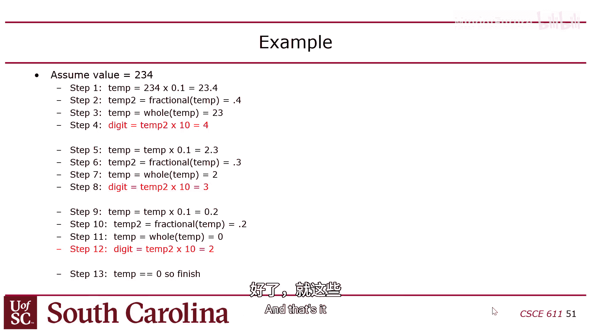

Lab 3要求你根据这些原理，实现一个支持22条指令的RISC-V CPU。实验材料包中提供了启动代码、寄存器文件和ALU模块。你有三周的时间来完成这个实验。请务必理解数据通路中每一处连接和多路选择器的意义，并仔细构建控制单元。如果在实现过程中遇到问题，请及时寻求帮助。