# 【南卡罗来纳大学】高级数字系统设计-CSCE611-（Advanced-Digital-Design，Fall-2023）-p08-P08-RISC-V-HDL-Design--BV19nf6YoEZ9_p8-

So we don't have a full class today but I was just planning on reviewing the microarchitecture stuff that I covered in the lab I kind of hastily。

 on Wednesday I gave a hasty lecture in the lab to introduce the next project and then if you had Friday we had the TAs give the same kind of presentation on a Friday。

I think they just。I think they the Ts gave a shorter lecture than I did。

 so I'll just go over that again make sure everyone's comfortable with that material okay。

 so we talked about risk microarchitecture and we talked about RA arrays。

And RAM arrays are used are going to be used for our register file so a RAM array is where you have you have an address that you provide it and then you can read or write and they are organized as a twodial array of bits where you have a depth which is the number of entries in the array and the width which is how many bits you can access at a time in one cycle and then you can have multiple ports on a RAM array each port allows you to do one access at a time and those ports can sometimes those ports can be restricted just being able to read or sometimes they can read or write or read and write it all depends on how you code it up and then once you code it up in very log and you synthesize it。

 you hope that there's something on the FPG that will be able to some primitive circuitry on the FPG that will be able to implement that behavior Now in the case of the register file I talked about how that has to have three ports on it two read ports and one write port which matches the instruction。

The instructions， right， the art type instruction essentially， the problem is is that。

When you synthesize that on the FPGA， it actually ends up making a two dimensional array of registers。

With a muux for the output and a decoder for the reading， for the writing part， guys with me。

 which is very inefficient because the FPGA has a relatively few number of。Registers。

I think there's like 100，000 registers on the FPGA， but there's a lot more bits if use a RAM。

YouThere's a lot more storage bits available on a Ram， but it won't actually target the RA。Because。

The Ram has a synchronous read， and it's limited to two ports。 you guys with me。 So in other words。

 what I'm trying to say is is that you can implement a Ram behavior in ver log。Right。

 but that doesn't necessarily mean it's going to target a specific Ram on the FPG。

 sometimes you have to restrict yourself in the behavior of the Ram， right， Okay。

 so if that's confusing， hopefully I can clear that up a little bit。

 We talked about synchronous versus asynchronous reading。 so with a。

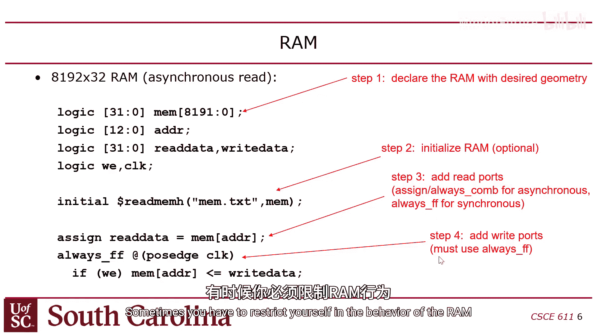

With an asynchronous read。Whenever。The address changes。

 the corresponding data that sort of that address is spit out immediately， right。

 It doesn't wait for a clock edge。 That's an asynchronous read。

The register file has an asynchronous read because want don we don't want a wait whole cycle to read。

The register， right at least not in our design。I think you can't afford to do that if it's a if you have a whole stage pipeline stage for reading the registers like you do with our five stage pipeline。

 but we just have a we have a three stage pipeline。

 so we need to be able to read the register values and send them into the ALU all in the same cycle So we're going to use an asynchronous read。

 Does that make sense。Okay， and then rights are always synchronous。

 rights always have to wait until the clock edge before the right happens。Okay。

 so what is the difference then I have a timing diagram on the top that is an asynchronous read and the one on the bottom is a synchronous read and the only difference that you'll notice here is the read data。

The red datata is on the bottom plot is shifted one cycle to the left。 so you're getting the data。Oh。

 sorry。 Actually， it's shifted one side on the top， right， So the top。

 you're getting that data out earlier than you do on the bottom because it's。

It takes you have to wait until the rising edge to get to perform the read operation way。

 so over here because the address is changing with the rise at the same time as the rising edge of the clock。

When you have a rising edge of the clock and you change the address at the same time。

 the rising edge is reading the previous version， the previous value of the address。

 not not the value of the address that comes up with the change right so that's the part that's a little kind of confusing here So you can see the clock。

 We have a rising edge of the clock here。So in this case。If he is asynchronous。

 then we're going to be reading。Address 5。Right。Because the clock goes up and the address changes the5。

 that happens at the same time。 But it doesn't matter because the point is that the address 5 comes up and it's going to spit out the value 5。

 which is that address 5。 whereas down here， you have a。Rising gear of the clock。

The address changes the five， but what's happening there is you're actually reading the address at4。

 right， so the Ram is going to see the previous version of the address there。

The previous value of the address， right， So that's why we have four here。

 So this five reading5 happens in the next cycle。 So five gives us5 on the next cycle， right。

 address 5 gives us data 5。I initialized this。The data is the same as the address， you know。

 so I could you know illustrate that。

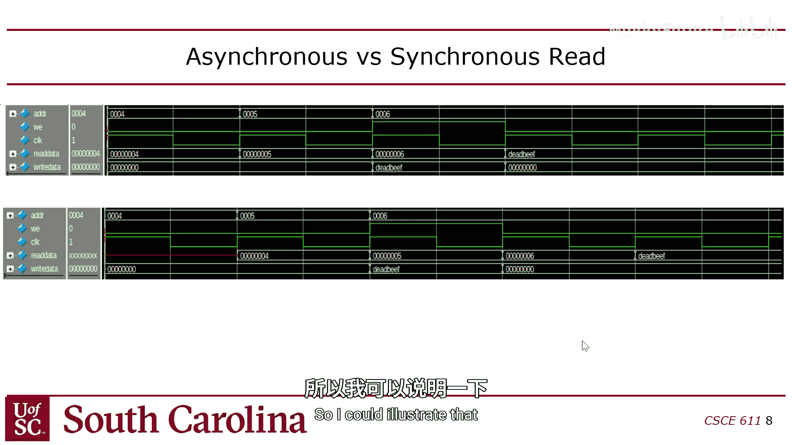

Okay， okay。Alrighty， so I showed the register file design。So this register file has a RAM array here。

 remember that when you declare the RAM array， it's opposite。It's opposite of like everything。

You put the width first and the depth second。don't do that in see。Or Python or Java。

There's two assigns here for reading that implement the readports actually I think the one that we give you in the project skeleton might actually do this with always an always statement。

 but it doesn't matter the logic is basically the same。

 the read port can be implemented with combinational logic because they're asynchronous and then the right is done with an always FF down here。

Okay so you can just use that register file in your design register zero always hold zero and if you read and write the same register at the same time you're supposed to get up the new value that that you're writing right that's the register bypass you guys does that make sense。

Okay。Then we're going to give you this arithmetic logic unit that。Is capable， I think。

 of like 13 operations， but there's 16 op codes。 So some of these op codes are redundant， like。

 for example。1，1，0，1，1，1，1，0， and 1，1，1，1， all do the same thing。 A less B unsigned， right。

 They're all the same same thing here，1，0，1，0，1，0，1，1 or all a right arithmetic shift。Okay。

 so basically there's。In the risk of instruction set and MIPS， there's one R type instruction。

For each of these operations and then some instructions。Use these like indirectly， like， for example。

 of branch instruction。We'll use the。The comparison， even though you're not doing a set last than。

 you're doing a branch， but the comparison op code is used to resolve the branch。Makes sense。Okay。

 so but mostly these ALU functioners are used for。R type and I type arithmetic logical shift in comparison。

 my number crunching instructions， okay。And that's the code for the ALU。

 the ALU itself is mostly in this just this one assigned statement with Ternary operations。

 and then there's some additional code over here， the shifter。Yeah， I forgot about this， right？

The arithmetic right shift。Remember the right shift， you shift right， you shift in the same bit。

 right there's supposed to be a very log operation for that greater than greater than greater then。

 But for some reason， I don't actually remember what the story was with that。

 but it didn't work for us for whatever。 we couldn't use that。

 So instead we put this always block in that looks at each bit of the shift amount and shifts uses blocking assignment statements here to to say that if bit 0 is set。

 we're going to shift by one B。 If bit1 is set we're going to shift by two bits possibly in addition to shifting by the one bit right So that way。

 if it's one1。 it's3， then you will have shifted by one bit by one and then by two to get three right。

So， and then so on and so forth all the way up to so you can shift by 1，2，4，8 or 16。

 depending on which of the bits。Are set in the shift amount or any combination thereof， right， yes。

Be always begin and always on。Oh right， so always a combinational is whenever you have your intent as a designer is not to have memory。

 not to have sequential logic， so that's just used as。

Is a way to tell the compiler that right so if you accidentally put a latch in there。

 it would generate an error right that's all that means it's the same as saying always at star right except it has that additional check And then the beginning and end is is there just whenever you have multiple multiple lines。

If you only had one line of code in there， you won't need to begin N， right？

And that also applies to if statements too。Okay。嗯。So I don't know if any of you can figure this out。

 like why we couldn't just use the very log。Operation。

I I'd love to know Also the the sign multiply was a little weird too， the way we did that。

 we said a sign， we had to type。 so logic， apparently I didn't know this till we did this。

 but in very log logic is treated as unsigned。 So if you do a multiply operation。

Or even the less than， I guess， right， yeah。Less than。You see that less than。

It's treated as unsigned。 So if you want to treat it as s， you have to type cast it as signed。

 So we had to do that for the sign to multiply high， as well as the signed。

Less than comparison operation。It's weird， but。看了し。I mean， I guess it kind of makes sense。

But I guess there's probably a way to declare a logic as signed initially。

 but I don't know how to do that。Okay， so we're going to do， we're going to implement 22。

Instructions in lab3。And there's three different types that we're going to use in lab 3 in lab 4。

 there's another， there's another encoding format， I believe， in the next lab。 But for this lab。

 there's only three， there's R type， I type and U type R type is。

All the instructions are under the R type are listed here。

 so obviously most of the R type has the most instructions in it basically is just whenever you have a three address instruction meaning three registers。

 a destination and two sources。And then the eye type is when you have an instruction with one source register。

 one destination register and an immediate right， the immediate is only 12 bits though。

Wwhich is different from MIPS， but then there's a u type that has a 20 bit immediate and that's only used for one instruction。

 the load upper intermediate， or one instruction that we're implementing anyway。

Makes sense now you might say why， why？Why 12 and 20 Well。

 the idea is that if you want to load a 32 bit value into a register like a constant。

 then you use a combination， use a load up per to get 20 bits in and then you follow it up with an i type to get the other 12 bits in and between the two。

 you get 32 bits。Any questions about that？Okay， also I mentioned this time。

 I mentioned last time but。There's these function fields， function seven， function three。

I type has the function three。嗯。Kin kind of a confusing format。So， like。

You have to figure out what an instruction is， you have to check the op code first because that's the only field that's common to all the encoding formats。

 And depending on the op code， then sometimes you have to also look at function 3 and then sometimes you have to additionally look at function 7 to figure out what the instruction is it depends on the instruction and I'll show you an example of that that you can use a coding a way that you can code that in just a minute here Okay。

 and then we talked about the CSRR W instruction So we have two registers here， IO registers IO。Zero。

IO0。Is the keys and IO2 is the hex display。 So if you read from IO register0。

 we want your CPU to read the key values not sorry not the key sorry switches switch values the switch on the board right so we're going to read the switches for IO0 and we're going write the hex displays on IO2 So either way you're going to use the CSRRW instruction the CSR register。

 which will be0 or two is always the second opera in there in the assembly code and then RD。

Would only be used if you're。Reading the。Switchches， right？And R S would be don't care in that case。

 right， because if you're reading the switch values。

You're going to put the switch values into a destination register。

 so that source register is a don't Care。But if you want to go if you want to send a ID the hex displays。

 then the source register would be the register whose contents you want to put out to the hex displays and the RD would be a don't care。

So it makes sense now in reality， that's not true in risk five， those are both actually used always。

 because in risk five， it does like a swap。It takes the control register， it puts it in RD。

 and then takes the RS register and puts that into the control register， right。

 but we're not doing that we've hacked to this a little bit。Just so we can。You know。

 make it work with the boards， right？And in the case of the boards。

 we're going to the switches can only be read and the hexes can only be written， right？This is our。

 we used to have a， by the way， the way we used to do this。Before risk five。In MIPS。

 we used to say we used to use Reg 30 for that。IfIf you had any instruction。

 didn't matter what the instruction was， but if it wrote to Reg 30 as the destination。

 it would update the hex displays。And if you read from Reg 30， you would get the keys。

 but that was more hacky。We were like mapping Reg 30 as a special register。

And we had to implement that in the register file。WellThat was kind of that was a little too hacky。

 I think this is a better solution because it takes advantage of a real instruction in risk five。

Okay。Okay， so then I talked about the top level design， so I started putting together。

Because this lab is always it's always a little hard to get started on this lab because you know it's like where do you start so I started coding this up just to show you guys how to know kind of how to start so I started with so I downloaded the lab RIW skeleton RIW refers to you the RI and U type sorry RIU RI and U type instructions。

And I started with a module line for CPU。And there's three inputs， there's clock。Reset N。

 which I'm using an active low reset because we want to connect it to the keys and the keys are active low。

 You don't have to do this。 You can have an active high reset。 I I don't really care。

 I think it's easier to have。They're just the active low coming in。 So what the reset does is。

If you get a reset。The only thing it does is it resets。Inside the fetch logic。

 it's going to reset the instruction to zeros， all zeros。

And it resets the program counter fetched to zero。Right。Now actually， I just thought of this。

 and I forgot about this， we had an issue with this。So。

What is this supposed to be all zeros for the instruction？That's supposed to be a now op， right。

 it's supposed to be an instruction that doesn't do anything。In MIPS， that is a OO。Why。

 because in MIPS， 32 zeros actually maps to a shift left logical instruction。

With a shift amount of 0 and a destination register of 0。 So it does nothing。

 You can't write the register 0。 and even if you could。

You wouldn't actually change anything because it would take the contents of Reg zero and shift it by zero and put it back into Reg zero。

 you guys with me？But Ri five does not use all zeros for the No opP。

Risk five uses like an ad instruction。But the problem is the a instruction has a function 3 code that is like 011。

Right。I just thought we might want to actually， well。

 it doesn't matter for you guys because you can just put a line in your control unit and just treat this as a no op。

 so it's not a big deal， right but。might want to revisit that sorry。

 I just thought of that now that that's one oddity that's come up in the past。

 but that's meant to be a no op。 And then， of course， the fetch， you want to start fetching at 0。

 So when you hit the reset button， that's basically the reboot button。 And just like any computer。

 when you reboot it， when you reset a computer， it starts at PC0。

 which is going to be your power on self testest and。We'll eventually boot up the machine。

 you guys with me？Okay， so that's all the reset does， it doesn't touch any logic except for that。

Okay， and then we have a input for Io0 in。 Can you guys read that， Okay， let me make that bigger。

That's too much， that's too much Okay， there we go， Okay， is that more readable okay so？

IO0 in and IO0 out。As I0 in is going to be hardwired to your your switches。

 but there's only 18 switches。 so how are we going we got to I guess you're going have to zero pad that right put put like zeros。

Right，14 zeros and then 18 switch values， right， but we have a 32 bit coming in and 32 bit going out。

 We do need all 32 Bs going out， though， because。Those are going to go into eight seven segment decoders right so you guys have your seven segment decoders so each of the group of four bits and IO2 out are going to go into one of the seven segment decoders and the outputs of those are going to go to hex displays okay。

Okay， then we have。The instruction memory， which I declare here。

You can make it deeper than this if you want， I usually use 4096 instructions deep。

 we have more memory than that。Your programs will be like 100 instructions or so。

But if you have 4096 bits， then your program counter is got to be。The log base two of that。

 which is 12 bit。 So 11 down to 0， right， And then you can read。

You can initialize the instruction memory with hex code or program。

rom or whatever you want to call the text file that you're going to dump your RAs to。Your RArs code。

 right， Rs， the code， the software， right？And then then we have。Instruction E， X。

 I don't know why I highlighted PC fetch in red。 strangerange， but instruction E X is here。

 So this signal corresponds to the address of the whatever is being fetched。

 And this corresponds to whatever instruction has already been fetched and is now in the execute stage。

 the second stage。 That's why I'm being careful to use these suffixes。And then。Below that。

This is something I mentioned last lecture。 you guys don't have to do this。

 I think it's helpful though for debugging， but。You can come up with。Alternative。Signal name。

 So instruction E X is whatever the， that's the machine code instruction。

But then you can rename the fields of it。Appropriately， so you can see what's going on。

 like what the fields are， right， So， and you can， so like， for example， R D。 So there's。

RD destination and。Op code are the two fields that are common to all three instruction formats so and then their register source one and function 3 are common to the R type and I type right so you can declare those so you can declare those fields with the appropriate size and then you can just use an assign statement to strip out certain bits from the instruction and assign them there。

 So this this line of code is not going to use any hardware。There's no logic herere。

You're assigning an alternative name to a part of instruction EX。 So this doesn't cost any。

Gs or wires on the FPG。 So this is free。 It's something that's just there for， you know。

 the benefit of you as you debug the code and as you write the code as you as you design it。

 So I think it's pretty nice。 you can also put this， you don't have to inline this。

 you can put this in its own module if you want。 The problem is that if you do that。

 every one of these guys like function 3 E X is going to have to be an output。😊，From that module。

 So the input will be instruction E X， and then you'll have like。One， two， three， four。Five， six。

 seven， eight outputs。So there's eight different fields。Would have to be spit out of that module。

 which is kind of a pain because then you have to wire all that stuff up。 But on the other hand。

 it's better it's probably better than just having all this in here because it starts to get a little unwieldy with all this code in here。

 You guys with me。 Okay， so that's up to you。 You don't even need to。You don't even need to do this。

 by the way， you could just， you know， instead of an immediate 20。

 you can just use instruction EX31 down to 12。Okay， so then。

There's something else I like to do to simplify。The the debugging a little bit， you can declare。

 and I haven't showed you the syntax yet， but you can declare a type， a very log type。

This only works in system Vo by the way I don't think Vlo doesn't have this。

 this is a system verlog exclusive feature， but you could create a type called instruction name which is an enumerated type and you can put the enneonics in there of all the instructions and so that way the control unit can assign a signal to be one of these types and then when you're in looking at the waveform you can actually see what instruction is in the execute stage。

Does it make sense， and again， it's free because that won't affect the hardware。

 that's just something that would be for simulation purposes， okay？Okay， so then。

Then I started the control unit。So the control unit is I did it as an always calm。

And so I have a default output， instruction in EX。I'm going to set it as unknown initially。

Because that way， if you fetch an instruction and your control unit doesn't know what it is。

 you'll know it immediately because in model Soom， you'll see unknown there for the instruction。

But then if the op code is 3，3 and the function EX is 0 and the function 3 EX is 0，0，0。Then。

The instruction EX is a， so I'm sorry， I said that wrong before。 the a instruction is the No op。

But it's not the function 3 that has the non zeros。 It's the op code。 But anyway， that's。

 so that that'll give us our ad instruction。 Obviously， I haven't filled that in。

 I've only assigned that one meaningless signal， right， Eventually。

 I have to go and assign all the other control signals。

 which in this case is going to be the ones that are in my。T。The table down here。

So these are the other outputs that you want to have。In your control unit。It makes sense。Okay。Right。

Okay， any questions about that？Does it makes sense？Okay， so let's go ahead with， oh。

 and then there was that test program， we talked about that， I think last time。

 so we have a test program for you。Somewhere。Yeah， right here。

 so we have a test program that just tests every instruction once。So how do you know if it works？

How do you know if the test program works， Well， normally you'd have a self checking test bench that would somehow check that。

 right。But how would that work because the test bench would be testing the CPU and from the if you have a design that has the CPU in it。

How would that design know if the CPU is working？Well， you really。

 there's really not much you can do aside from using that CS SR R W instruction and having an output something。

Visible to the outside world that would let the test bench know that it's working。

 the other way to do it is to run it and model Sim and just look at the contents of the register file。

And so you can look in the register file and check to see if it matches up to these comments or the answer key。

 essentially， these are the values that should be in the register file after each one of those instructions。

Is executed。ok。And then the other test program I mentioned was the binary to decimal conversion。

 so the idea with this is you're going to put switch values in and then it should print the decimal version on the hex display any questions about this。

How this works。So we're going to use fixed point again to multi to。

To approximate the divide by 10 and modulo by 10。Okay， okay。

 so let's take a look at how you get this program in here。

 So if I take the test program and I copy that。And then I run it in Rrs。java。Jar。Rars。Okay。

 so we got RAs and I'll say file new， and I'll paste that。Okay， so looks good。

 save this as risk five asm， hit assemble， go to file， say dump memory， text。And。Hex， I think。

 hexade decimal text。I think that's it， and then we'll call it， what did I call it？Terminal。

What I call it， I call it Hexco dot T X T。All right， so I sorry back to here。

 back to Rrs and say hex code。Not TXT。And just put in the root directory。Okay， so I'll go back to。

Here and。And we should be good to go now。 Okay， so I'm going to go ahead and run it and see what we get。

So we do VSIM， oh first I'm going to type V log CPU dot sv。And we're good and we type V log CPU。

sorry， V V Sim CPU rather。嗯。Okay， so this is V Sim or Questa Sim。And。

So you can see the top level signals here。But you don't see anything inside the CPU。

 so we got to go to。We got to go to。Simulate， start simulation。Optimization。Apply all visibility。

I used to know how to do this at the canal line。 I don't remember how to turn that on now。Okay。

 anyway， so now we're good。 now we have。The CPU。 and I've got all the internal signals there。

 So I'm just going to。Bring all those guys over here。And I should just be able to run it。

 except I don't have a test bench。 So I'm going to have to manually。Set up a clock。

So I'm going to right click that clock and say clock。And hit O。 and then the reset， I'm going to set。

 I'm going to just going to do that down here force reset， underscore n to0， run。Force。

Reset underscore N， sorry， RST underscore N to1。Brun。Okay。Is it working？Yeah， looks like it。

So you can see that。Where's the zoom， zoom？诶。Oh here it is。 Oh here it is。 Yeah， got it。

 Thank you Okay， so。😊，So Io0 in is a blue line， high impedance because I didn't assign it。

 I didn't drive it， it's not driven by anything。And IO2 out is a don't care red line because that nothing。

 it's not connected anything。So because this is an input。It's blue。It an input not set it blue。

 and a signal will not connect to anything is red if it's not driven。Then I've got the。

Instruction memory here， which if you get the plus sign there。

 it'll actually show you the contents of the instruction memory， but it's you know。

 it's 4000 entries deep。 And then you can see the program counter。

 So generally when you first start up， there's a couple things you want to look for。 number one。

 look for a heartbeat。 The heartbeat is your clock。 So make sure you got a clock。

 If the clock's not run in nothings nothing everything's just dead right So we got a heartbeat。

 And the next thing you want to look for is the program counter。 So the program counter fetch is 0，1。

2，3，4， you can see it counting up。 you can also see that it was 0 for two cycles because I had a reset cycle right So the program counter was 0 for the reset。

 and then it was also 0 for the first cycle of operation。 And then after that it counted up。

 And then you're gonna get an instruction stream coming out。So the instruction EX， check it out。

 you can see  one，2，3， four instructions have popped out so far。

 So those are the first four instructions of the program。 if I look at Rrs。If I go back to Rs。

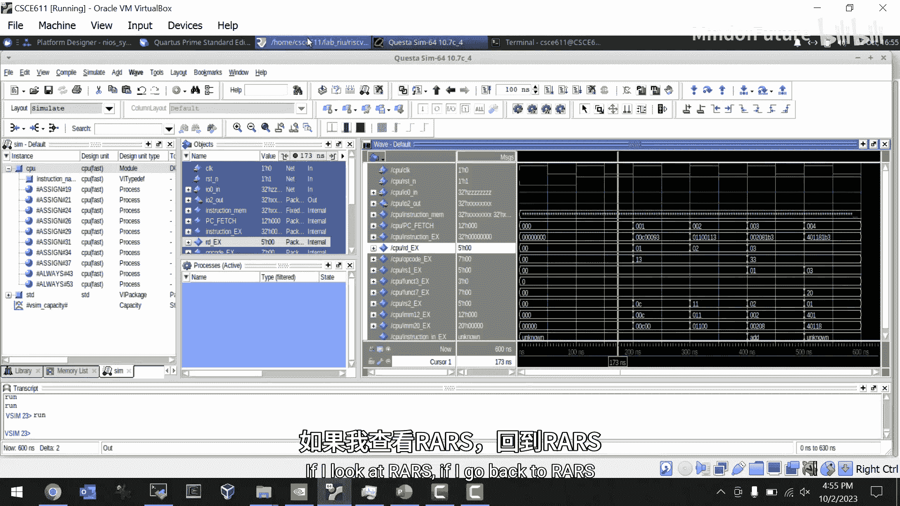

Rars， do I not， I don't have it， I don't Oh is Yeah。

 so the instruction is the first instruction is 0，0 c0，0，09，3， right， do I have that。

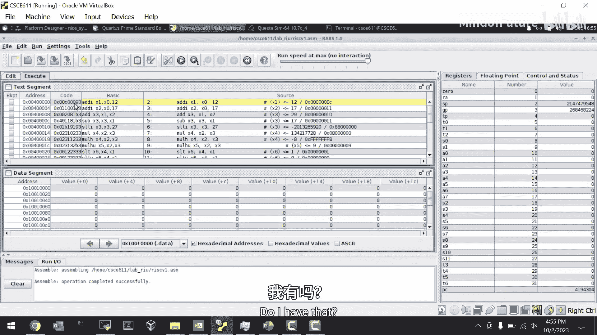

Yep， there it is，0，0， c00，093， and then I 011，00113。

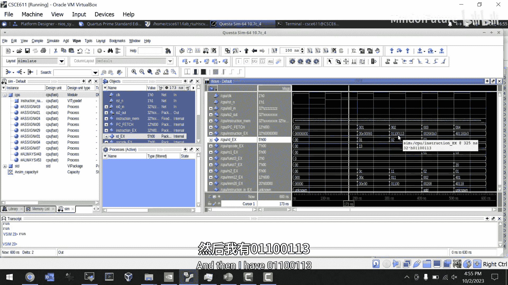

0，1，1，0，0，1，3。 so you can see that there's a correspondence between that instruction column and the instruction stream that's coming out of the fetch stage into the CPU。

So you can you can， you know， you can follow along in model SM。

 you can follow along with Rs if you want， if you want to you know check all the the what's happening in the register file and speaking of the register file。

 if we want to see what's I don't have that in here， so I can't show you that。

 I didn't add the register file yet， but you can you can once you put the register file in。

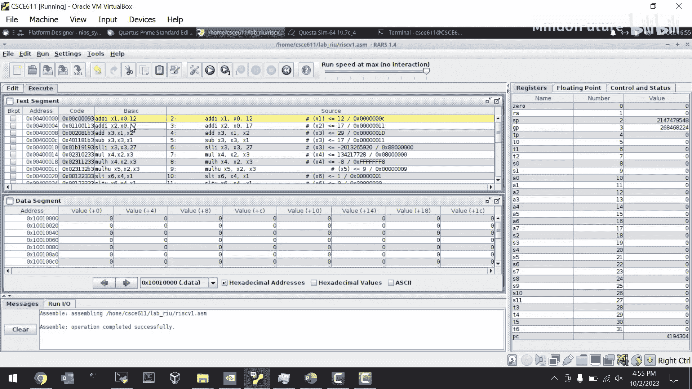

嗯。😊，You can look at the contents。You can drill down into the register file and you can add the memory。

 is it memory？Ma'am， it's called mam or something。 the。

 the signal that's declared that holds the the2 D array of bits。 Just put that in model S。

 and you can see all the。All the values they're updating。And there's only 32 of them。

 so it's you can fit 32 registers on your screen here with the instruction memory，' it's too big。啊。

Of course， you can check that if like for example， if you're not getting anything out of instruction MeM。

 there's a chance that Model SIM couldn't find your initialization file。

 so you might want to check in that case， you could look at the instruction Mem here。

And scroll down and just confirm that your instructions are in there。

And you can see I've got them in there， how many do I have？I've got 25 instructions in there。

And addresses 0 to 24。ok。Okay。And then what about that little instruction in EX。

 Oh there it is check it out instruction in EX down here。

 this is that thing I declare that's the enumerated type。

 it says unknown because apparently well the only thing I have support for right now is the ad instruction and so where does the ad instruction show up in the code。

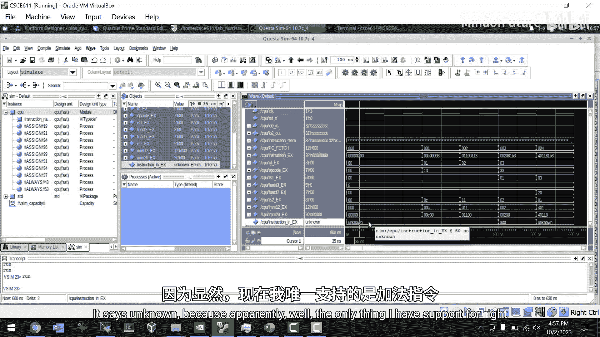

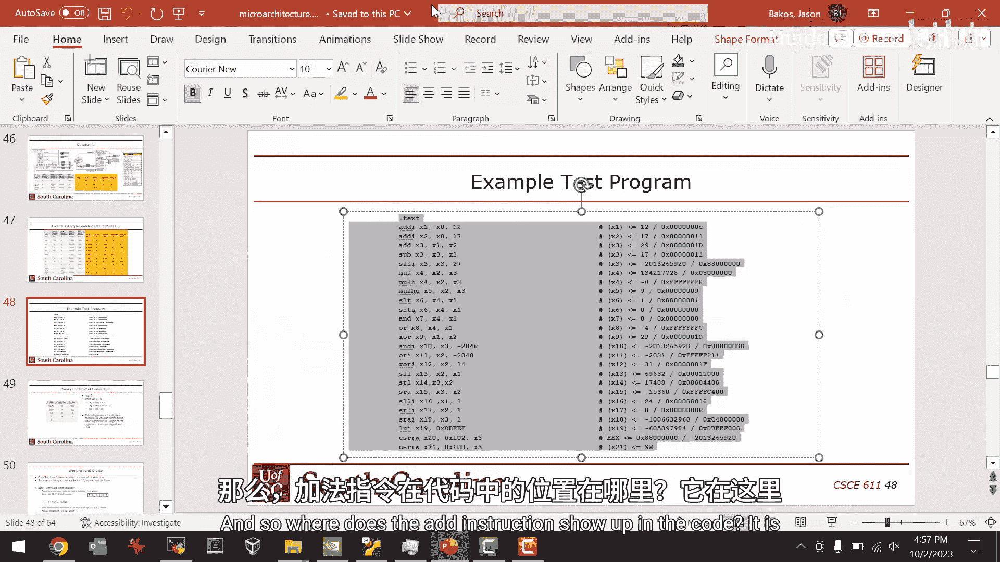

It is。Oh， it's like， oh oh， it's the third instruction。

 well that should have popped up then shouldn't it？Am I not seeing， oh， there it is。 Yeah， it is。

 It is there。 You see that。 So I got unknown， So I got unknown up until。The third instruction。

 and then there's an ad there and then another unknown， right。

 So the control unit is working in the sense that it's recognizing the ad instruction。Which。

 is not trivial because I had to check three different fields to figure out if it was an ad instruction。

Any questions about that？

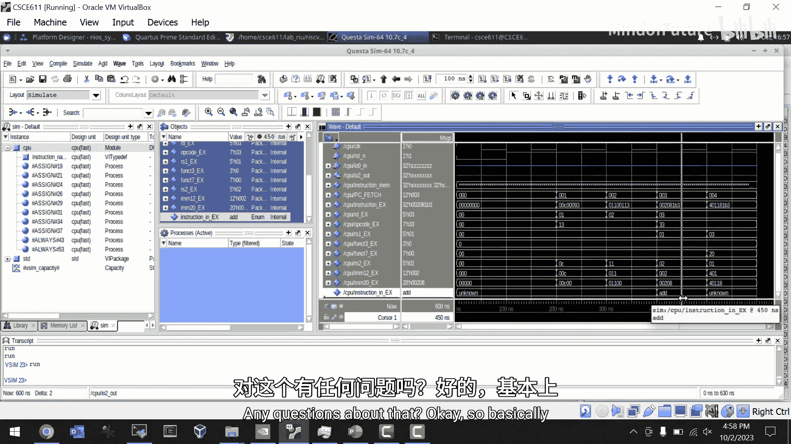

Okay， so basically then to finish this CPU， really all you have to do is we have to put the ALU in and the met register Va and then you have to finish the control unit。

Essentially。So that involves。Fillling in。What's going to be a giant if and L statement in here。

 right， So you're going to have。So if I want to add another instruction。

 like let's say I want to add the add I instruction。I can oh。So。

I can say now I'm going to put it again here in an end， and then I'm going to say else。If。

Now for the add eye instruction， that's an eye type， so for how do I recognize an eye type。

 well basically I have to look at the op code and the function7， but not the function3， right？

Do I have that right？What did I just do there。咖啡。And paste。What the hell's are doing？

I not wasn't in certain mode， I guess， let me try that one more time。嗯。😊，Paste。No。

 know what's going on there。Usually it doesn't。 I don't have an issue with that。 that's okay。

 I'll just go op code。EX equals， okay， so what is the op code for how do we figure out the op code for add I？

Well， if you go to Dropbox， there is some stuff here you can use， there's risks。

 Rik5 ISA official version。

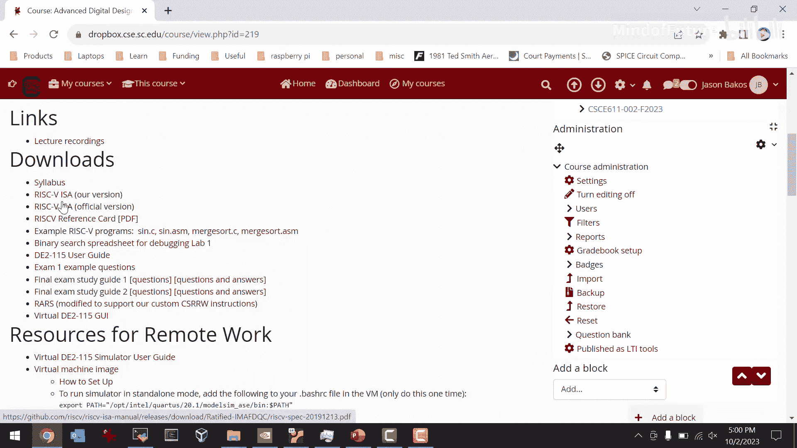

That's going to be a train wreck。 I think， yeah， that's going to be too many details。 Let's go。

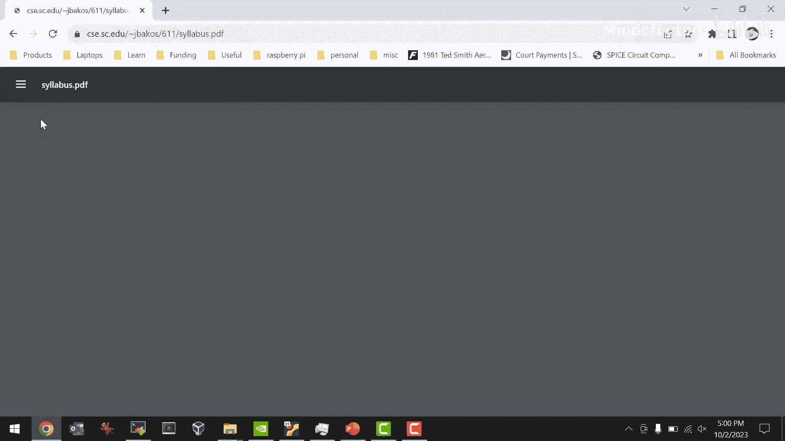

Not that。诶。Sorry， let's go to our version of the risk5 bias。 Yeah， So here we go。 So we'll go add I。

Add I come on add I there it is。 Okay， so it has a function three of0 and it has a an op code of1，3。

 it looks like one，3， right。So one，3， and zero。

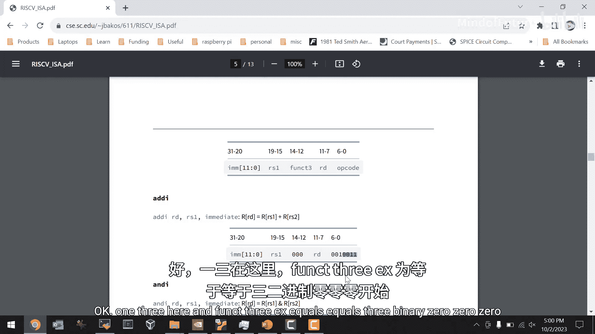

1，3 here and funt3 E equals equals 3 binary 0，0，0。Begin， and just to test this。

 I'm going to say instruction in。EX equals at I。And end。Okay， begin N， begin N。 and I need another。

 Oh cool。 Okay， so that works。 And then I have to add the add I to my enumerated type list， right。

 because I just have。Yeah， I don't have addI in there， I'm going to say add eye here。Okay。

 and then go down to here。And the log。CPu。 sv。And I'll go back to Questa， I hit restart。

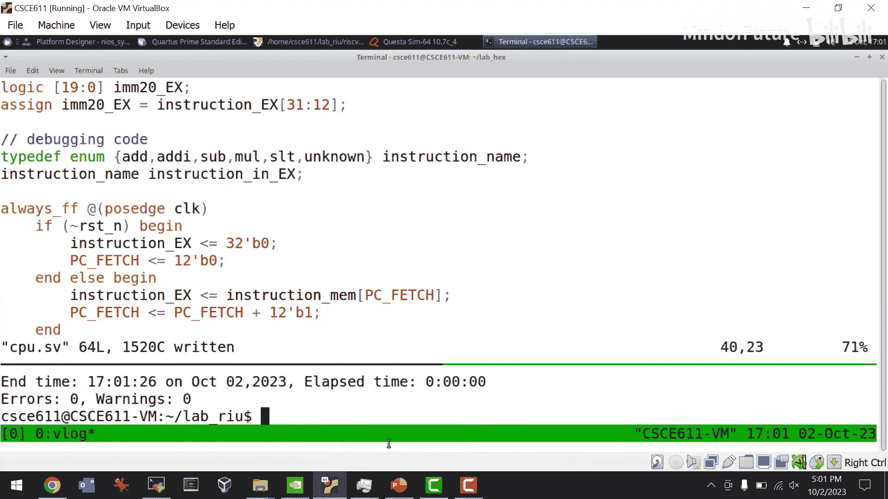

And。I got to set of the clock against。 I'm going up arrow to the clock command。

 I'm going to up arrow to the。Reset and I'm going to hit run I'arrow to reset again。

 this is why it's nice to have a test bench because you don't have to do this。And run for a 400。Okay。

 so yeah， so now you can see。The instruction E X has now been updated here。

 I've got add I in the first two instructions and add in the third instruction。

 So the control unit recognized that that add eye instruction。 So now if you go in the control unit。

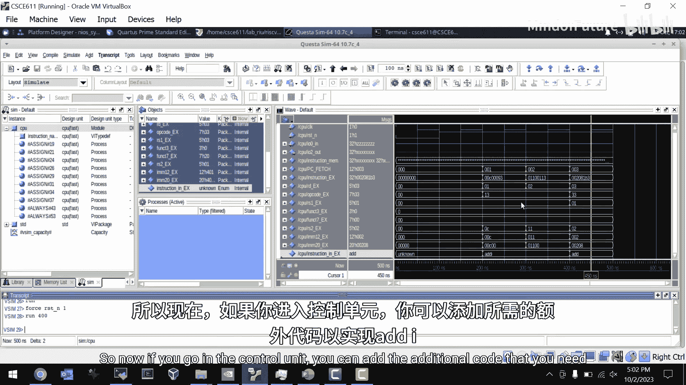

You can add the additional code that you need to implement the AddI。So if you go up in there。

 you can say。You can add。ALU source。E X， and I didn't declare that yet。

 but A U source is going to be。What is the muck setting on that ALU for the second input？Which is。诶。

Which is。Which。I don't have that here。 Do I A U， Oh yeah， right here over here。

 A U source E X is supposed to be 0 for the register and one for the immediate。 So in this case。

 it's going to be 0。But in the Add eyes case， it's going to be a one。Does everyone see that。

 why that is， So this is one of the differences between actually it's the only difference， I think。

Well。嗯。Yeah， it's the only difference between add and add I is just the AluU source。

 everything else is the same。Now， of course， you have to set like。The AU up is going to be the add。

 I want to tell it to add， well， how do I do that？We have to figure out what the AOU opt for a is。

 what is it 0011。So I can set the AU up。To be。0011， and I want to do the same thing for the add。

A U op E X equals。0，0，1，1。 So those will be the same。 And then the other thing is。Reg， right。

Right back。 sorry E X。 No， yes， E X rather， it'll become right back in the next cycle。

 That's gonna be one because both of these guys write a register。 So Reg， write， E X equals1。Now。

 remember that the register file' right signal is going to be read， right， right back。

Because there'll be one there'll be a register or flip flop rather in between Regrite EX and Regwrite right back right so I'm going to set Regrite EX in this stage。

 and that means in the next cycle I want you to write write the register， but don't do it now。

 do it when the ad gets to the right back stage。🤧嗯。What else do I have in here， AUO。

 AU source Regg select？Reg Select is going to be。Where's the Reg Select this guy， this mugs here。

 Reg Select is what I'm writing back， so in both cases I want the AU output， right？

And I see that so the AU。Is going to provide the sum。And I'm going to take that。

 I'm going to delay it one cycle， and then I'm going to pass it through here。

 So Regg select E X is going to be。right， I'm going to select the ALU output。So。Reg cell E equals。2。

2 in binary，1，0， and。Reg select EX equals。Two and binary。And that's it。 I think that's all oh， yeah。

 And the one one last thing is the。There's another signal in there for that's reserved specifically for the CSRRW and not just any CSRW。

 but the one wherever you use register to IO2。I think。Yeah。

 that's the output IO2 right so if I have a CSRW and。The IO register address。

 which is the immediate field。Which is the 12 bit I type immediate。 If that's 2， then I'm gonna。

 I'm going enable this thing， which I called。GPIO write enable。Why is that not have a suffix， though。

 That should have a suffix， sorry。So I'm going to give it a suffix， I'm going to say GPIO。

Rightite enable。Rightite enable， I'm going to call it I'm going to put a suffix on there。

And that should be zero in both cases。Because neither one of those is a updating。

 neither one of those instructions updates the hex display。Okay， any questions？That makes sense。So。

 that's。And again， that that control unit could be in its own module。 You don't have to endline it。

 like I did。If you inline it， you're going to have your CPU ISV is going to be really long。

 but you could put that all into its own module， it makes the code a little cleaner。

 but you have to create another file for that。好。Makes sense。Fur it out when I start crying on it。あさ系。

Proablymination Okay， so we have a there's a quiz quiz three is up on dropbox it basically covers this like it just asks you what the control signal should be for different instructions I think that's。

I think do this Friday， so make sure you take quiz three it's up on Dropbox。Okay。

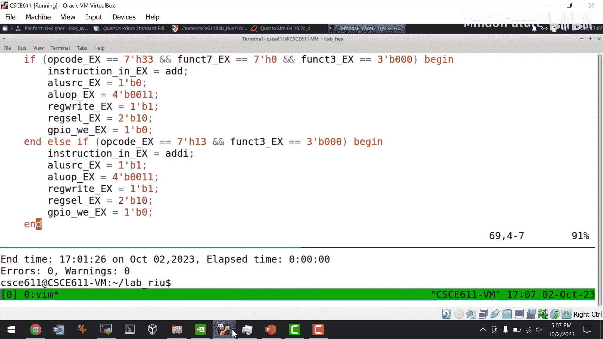

All right， we'll see you in lab then。 Thank you。