# 高级数字系统设计：CSCE611：P08 - RISC-V HDL 设计 🧠

在本节课中，我们将回顾RISC-V微架构的关键概念，特别是寄存器文件、ALU设计以及控制单元的实现。我们将详细解释如何在硬件描述语言中实现这些组件，并构建一个简单的RISC-V CPU核心。

## 概述：RISC-V微架构回顾

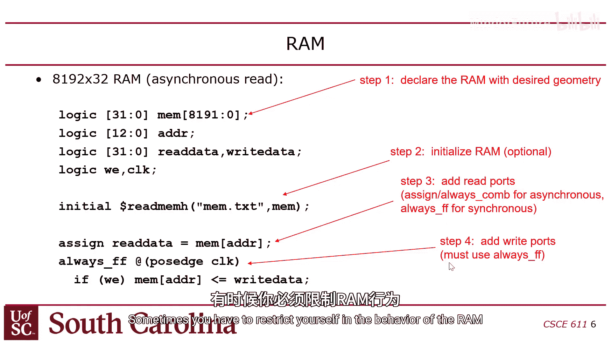

上一节我们介绍了项目背景，本节中我们来看看RISC-V微架构的具体实现细节。我们将从存储阵列开始，逐步构建CPU的数据通路和控制逻辑。

## RAM阵列与寄存器文件

RAM阵列用于实现我们的寄存器文件。一个RAM阵列包含一个地址输入，并支持读写操作。它被组织为一个二维比特阵列，其**深度**表示条目数量，**宽度**表示每个周期可访问的比特数。

一个RAM阵列可以有多个端口，每个端口允许在每个周期进行一次访问。这些端口有时可能仅限于读取，有时可以读写，具体取决于编码方式。

在Verilog中编码并综合后，我们希望FPGA上有基本的电路单元能够实现该行为。

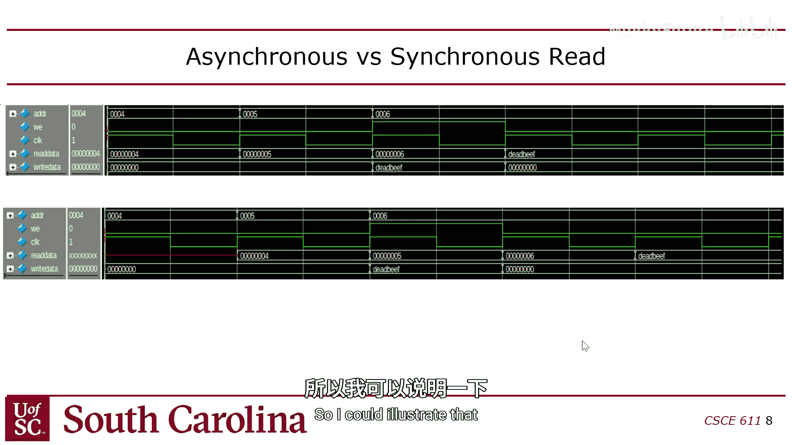

对于寄存器文件，它需要三个端口：两个读端口和一个写端口，这与R型指令格式相匹配。

问题在于，当在FPGA上综合时，它实际上会生成一个由寄存器组成的二维阵列，并带有用于输出的多路选择器和用于写入部分的解码器。这种方式效率很低，因为FPGA的寄存器数量相对有限（例如约10万个），而使用RAM则有更多的存储比特可用。

但综合工具可能不会将我们的代码映射到FPGA上特定的RAM硬核，因为硬核RAM通常具有同步读取，并且端口数量有限（例如两个端口）。换句话说，你可以在Verilog中实现RAM行为，但这并不保证它会使用FPGA上特定的RAM硬核。有时你必须限制RAM的行为编码方式。

## 同步与异步读取

我们讨论了同步读取与异步读取的区别。

*   **异步读取**：当地址改变时，对应地址的数据会立即输出，无需等待时钟边沿。
*   **寄存器文件需要异步读取**，因为我们不希望等待整个周期来读取寄存器值，至少在我们的设计中不需要。在我们的三级流水线中，我们需要在同一周期内读取寄存器值并将其送入ALU。
*   **写入操作总是同步的**：写入必须等待时钟边沿才能发生。

下图展示了异步读取（上）和同步读取（下）的时序差异。主要区别在于读取到的数据：在异步读取中，数据输出更早；在同步读取中，必须等待上升沿才能执行读取操作，因此数据输出会延迟一个周期。

具体来说，在时钟上升沿同时改变地址时：
*   **异步读取**：读取的是新地址（例如地址5）对应的数据（数据5）。
*   **同步读取**：RAM看到的是地址改变前的旧值（例如地址4），因此输出的是旧地址的数据（数据4）。新地址（地址5）的数据（数据5）会在下一个周期输出。

## 寄存器文件设计实现

以下是寄存器文件的设计。它内部包含一个RAM阵列。

在声明RAM阵列时，参数的顺序是**宽度在前，深度在后**，这与C、Python或Java等语言的习惯相反。

两个读取操作通过`assign`语句实现异步读端口（在项目框架中可能使用`always`语句，但逻辑基本相同）。写操作通过一个`always_ff`块在下半部分实现。

你可以在设计中使用这个寄存器文件。寄存器0（`x0`）的值始终为0。如果你同时读取和写入同一个寄存器，应该得到正在写入的新值，这就是寄存器旁路。

## 算术逻辑单元设计

我们将使用一个能够执行约13种操作的ALU，但总共有16个操作码，因此有些操作码是冗余的。例如，`1101`、`1110`和`1111`都执行相同的操作：无符号数的小于比较（`A < B unsigned`）。`1010`、`1011`等都是算术右移。

在RISC-V和MIPS指令集中，每个操作对应一条R型指令，有些指令会间接使用这些操作。例如，分支指令会使用比较操作码来判断条件，尽管它本身不是`set less than`指令。

这些ALU功能主要用于R型和I型的算术、逻辑、移位和比较指令，即数值计算指令。

以下是ALU的代码。ALU本身主要包含在一个使用三元运算符的`assign`语句中，此外还有一些额外的代码来处理移位器。

关于算术右移：右移时，移入的比特是符号位（最高位）。Verilog中本应有操作符`>>>`来实现，但由于某些原因，它对我们不适用。因此，我们使用一个`always`块来手动实现：它检查移位量的每个比特，并使用阻塞赋值语句。如果第0位为1，则移位1位；如果第1位为1，则可能再移位2位。这样，如果移位量是`3`（二进制`11`），你将先移1位，再移2位，总共移3位。以此类推，可以根据移位量中设置的比特，移位1、2、4、8或16位，或它们的任意组合。

`always_comb`块用于告诉编译器设计意图是组合逻辑，不应包含存储器或时序逻辑。如果意外在其中引入了锁存器，将会产生错误。这与`always @*`类似，但多了额外的检查。`begin`和`end`用于包裹多行代码，如果只有一行代码，则不需要。

关于有符号乘法和有符号小于比较：在Verilog中，`logic`类型默认被视为无符号数。因此，如果需要进行有符号乘法或有符号小于比较，必须将其类型转换为`signed`。可能有一开始就将`logic`声明为`signed`的方法，但这里我们使用了类型转换。

## 指令格式与解码

在Lab 3中，我们将实现22条指令，涉及三种编码格式（Lab 4会有另一种格式）：
1.  **R型**：所有操作涉及三个寄存器（目标寄存器和两个源寄存器）。大多数指令属于此类型。
2.  **I型**：指令包含一个源寄存器、一个目标寄存器和一个12位立即数。
3.  **U型**：包含一个20位立即数，目前仅用于一条指令：加载高位立即数（`lui`）。

你可能想问为什么是12位和20位？原因是，如果你想将一个32位常量加载到寄存器中，可以结合使用`lui`（加载高20位）和一条I型指令（加载低12位），两者结合即可得到32位数据。

指令解码时，必须首先检查**操作码**，因为这是所有编码格式共有的字段。根据操作码，有时还需要查看**funct3**字段，有时甚至需要额外查看**funct7**字段，才能确定具体是哪条指令。这取决于指令本身。稍后我们将展示如何在代码中实现这种解码。

## CSRRW 指令与 I/O 映射

我们讨论了`CSRRW`指令。我们有两个I/O寄存器：
*   **`IO0`**：对应板载开关。从`IO0`读取时，CPU读取开关值。
*   **`IO2`**：对应七段数码管显示。向`IO2`写入时，CPU将数据输出到数码管。

使用`CSRRW`指令时，CSR寄存器编号（0或2）总是汇编代码中的第二个操作数。
*   **读取开关**：目标寄存器`rd`用于存放读到的开关值，源寄存器`rs`无关。
*   **写入显示**：源寄存器`rs`的内容将被送到数码管显示，目标寄存器`rd`无关。

实际上，在标准的RISC-V中，`CSRRW`执行交换操作：将CSR寄存器的值读入`rd`，同时将`rs`的值写入CSR。但为了与开发板配合，我们进行了一些修改，因为开关只能读，数码管只能写。这比我们之前在MIPS中使用的将特定寄存器（如`$30`）映射为特殊I/O寄存器的方法更规范。

## 顶层设计与控制单元

开始设计CPU时，可以从定义顶层模块开始。模块包含以下输入：
*   `clock`
*   `reset_n`（低电平有效复位，便于连接按键）
*   `io0_in`（连接开关，需将18位开关值零扩展到32位）
*   `io2_out`（32位输出，每4位驱动一个七段数码管解码器）

复位信号的作用是：当复位有效时，将取指逻辑中的指令重置为零，并将程序计数器`PC_fetch`重置为零。指令零应设计为无操作指令。在RISC-V中，`add x0, x0, x0`常被用作无操作指令。

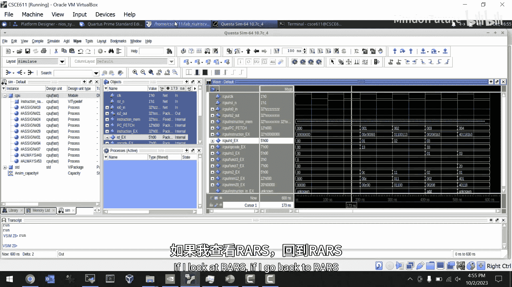

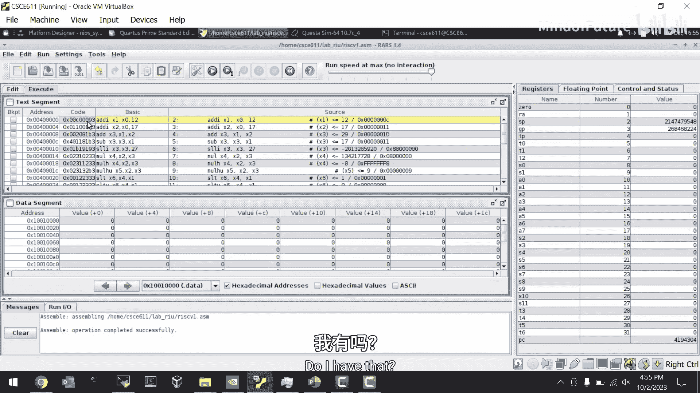

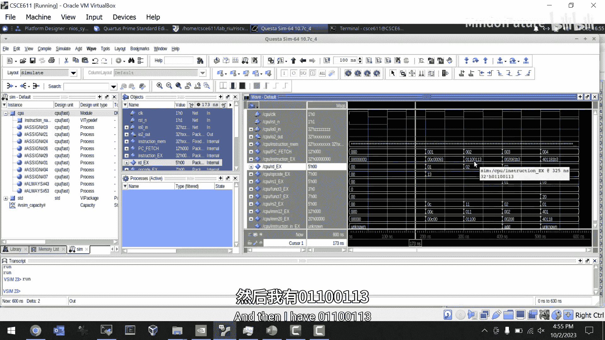

指令存储器可以声明为一定深度（如4096），并用包含机器码的文本文件初始化。

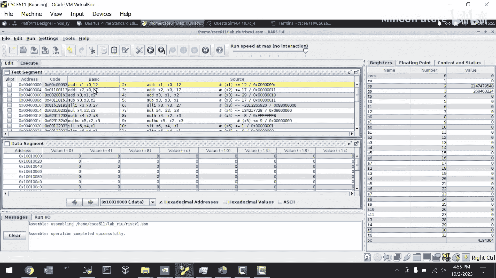

为了便于调试，可以为指令的各个字段定义有意义的信号名。例如：
```systemverilog
logic [4:0] rd_EX;
assign rd_EX = instruction_EX[11:7];
```
这不会产生任何硬件开销，只是为指令的一部分起了别名。你也可以将其放入单独的模块，但需要定义许多输出端口。

另一个调试技巧是使用SystemVerilog的枚举类型来定义指令名称，这样在波形图中可以直接看到执行阶段的是哪条指令。

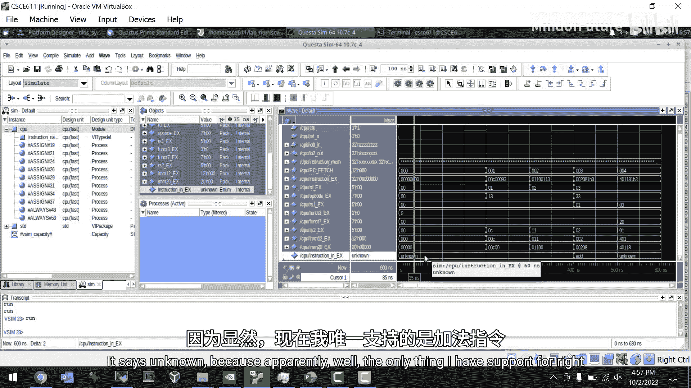

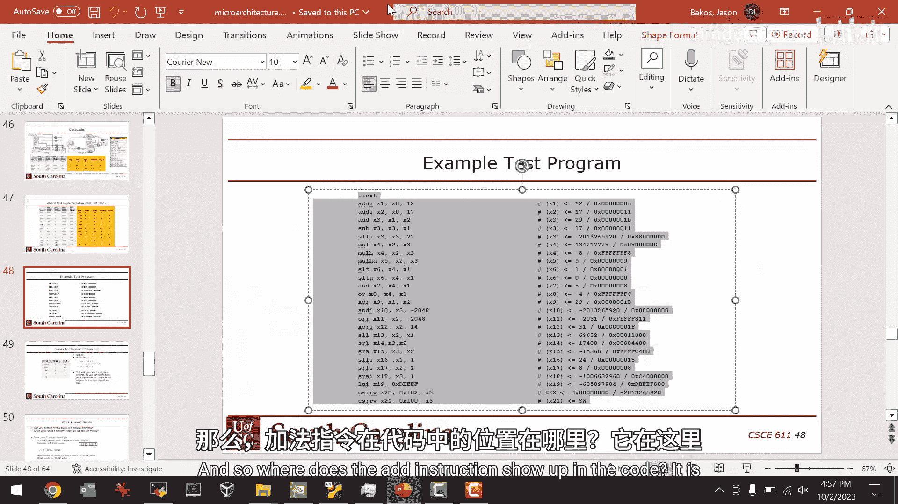

控制单元可以作为一个`always_comb`块实现。首先设置默认输出（例如`instruction_in_EX`为`unknown`）。然后，通过检查`opcode_EX`、`funct3_EX`和`funct7_EX`等字段，使用`if-else`或`case`语句来识别具体指令，并为该指令设置所有相应的控制信号。

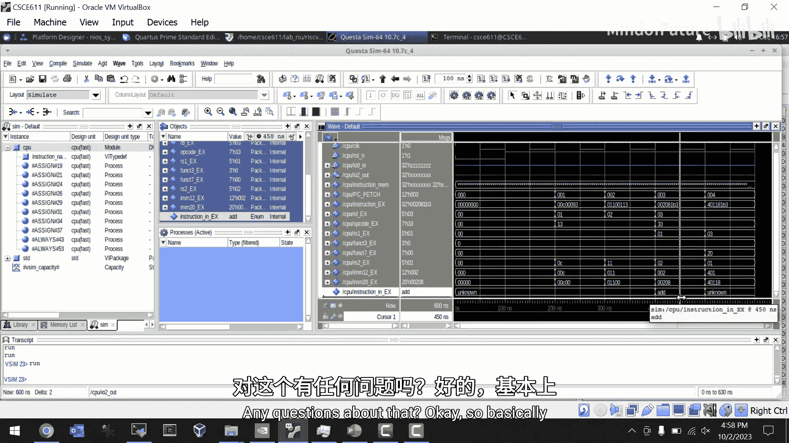

这些控制信号包括：
*   `ALU_source_EX`：选择ALU第二个操作数来自寄存器（0）还是立即数（1）。
*   `ALU_op_EX`：指定ALU执行的操作（如加法`0011`）。
*   `reg_write_EX`：指示是否写回寄存器。
*   `reg_select_EX`：选择写回数据的来源（如ALU输出）。
*   `gpio_write_enable_EX`：专门用于`CSRRW`指令向`IO2`写入时使能。

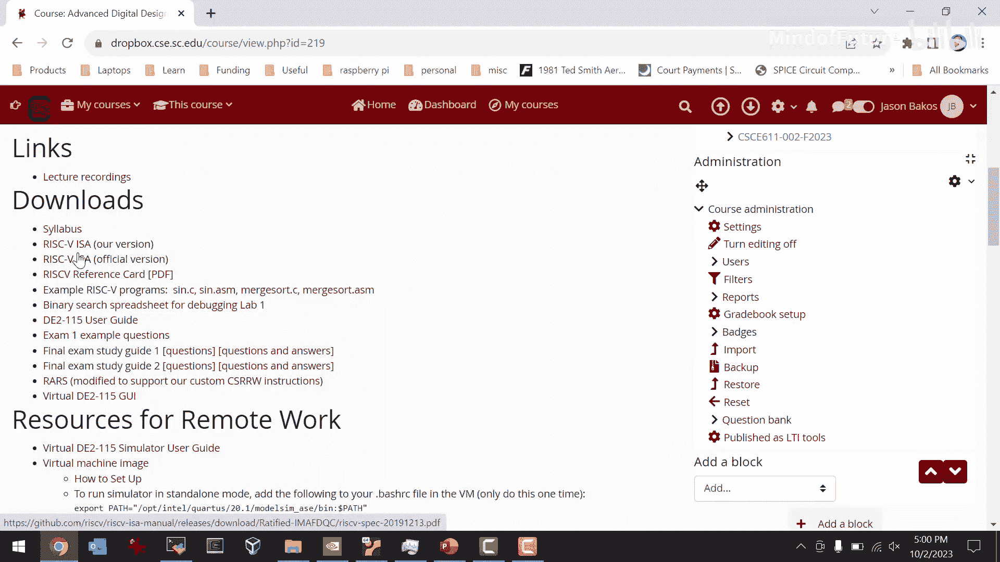

控制单元也可以放在独立的模块中，使顶层代码更清晰。

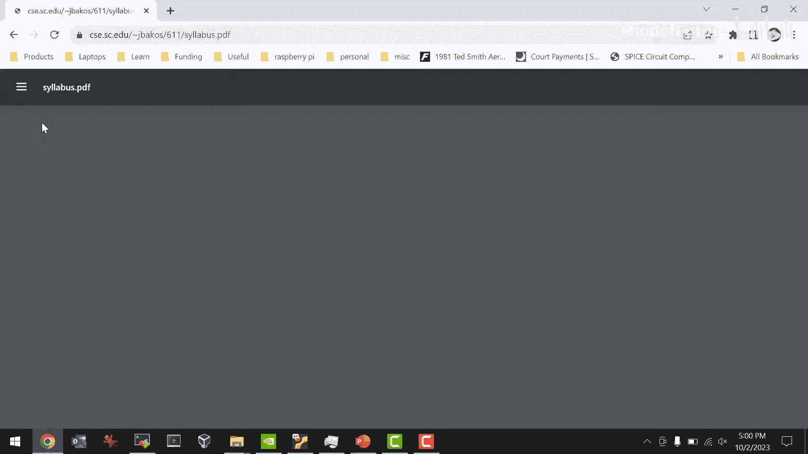

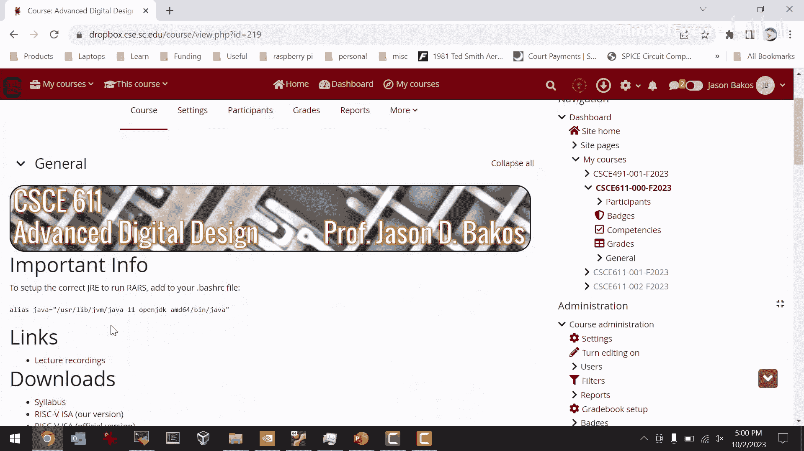

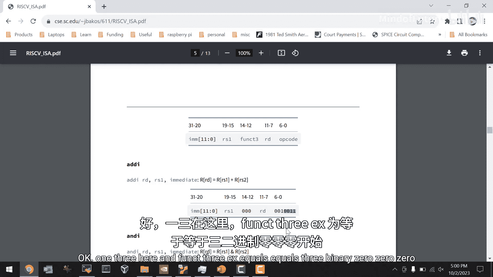

## 测试程序与仿真

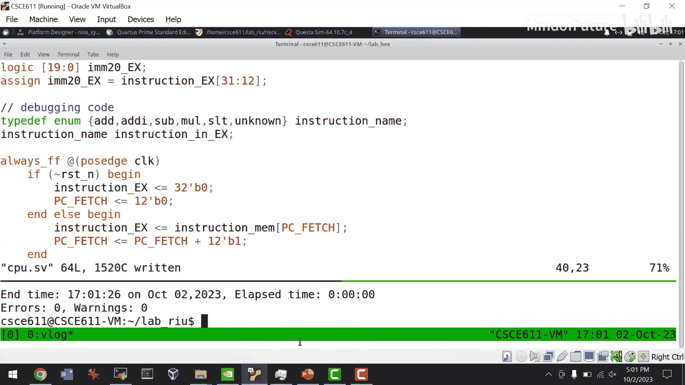

我们提供了一个测试程序，它依次测试每一条指令。为了验证CPU是否工作，可以：
1.  在仿真中观察寄存器文件的内容，与程序注释中的预期值进行比对。
2.  使用`CSRRW`指令，通过观察外部可见的输出（如模拟的数码管输出）来判断。

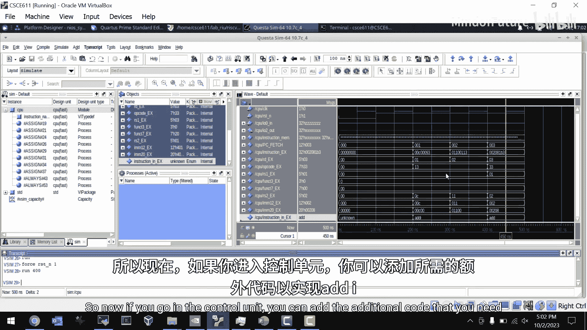

另一个测试程序是二进制到十进制的转换程序。它将开关输入的二进制数转换为十进制并显示在数码管上，其中会使用定点数运算来近似除以10和取模10的操作。

在ModelSim等仿真工具中进行测试时，需要：
1.  确保有时钟信号（“心跳”）。
2.  观察程序计数器`PC_fetch`是否按预期递增。
3.  观察`instruction_EX`流是否与预期指令匹配。
4.  将寄存器文件的存储阵列信号添加到波形中，观察寄存器值的变化。
5.  检查指令存储器是否被正确初始化。

## 总结与后续步骤

本节课中我们一起回顾并深入探讨了RISC-V微架构的HDL实现。我们涵盖了：
*   RAM阵列与寄存器文件的实现及其在FPGA上的映射考量。
*   同步与异步读取的时序差异。
*   算术逻辑单元的设计细节，包括有符号操作的处理和移位器的实现。
*   RISC-V的指令格式（R/I/U型）和解码逻辑。
*   通过`CSRRW`指令实现I/O映射。
*   CPU顶层模块的构建、控制单元的设计以及调试技巧。
*   测试程序的编写与仿真验证方法。

要完成这个CPU，接下来需要：
1.  将ALU和寄存器文件实例化并连接到数据通路。
2.  在控制单元中完善所有22条指令的识别逻辑，并为每条指令生成正确的控制信号组合。
3.  进行充分的仿真测试，确保每条指令功能正确。
4.  最终在FPGA开发板上进行验证。

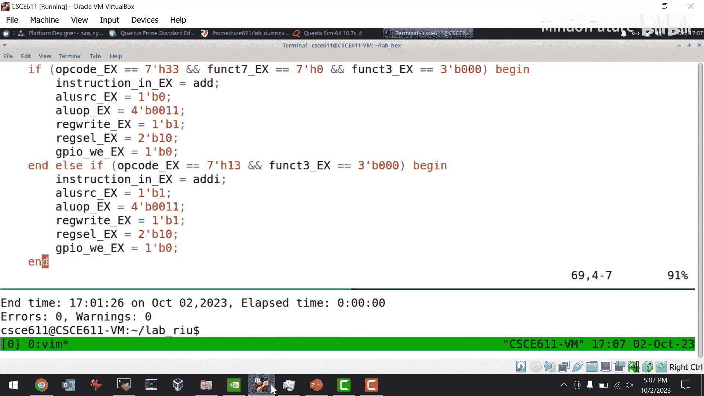

通过本教程的学习，你应该对如何用HDL从头开始构建一个简单的RISC-V CPU核心有了清晰的认识。