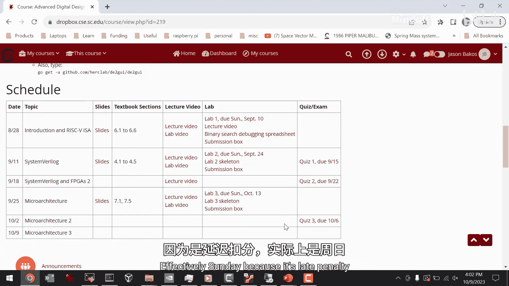
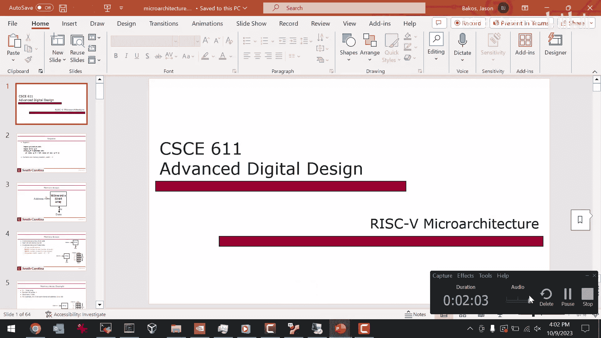
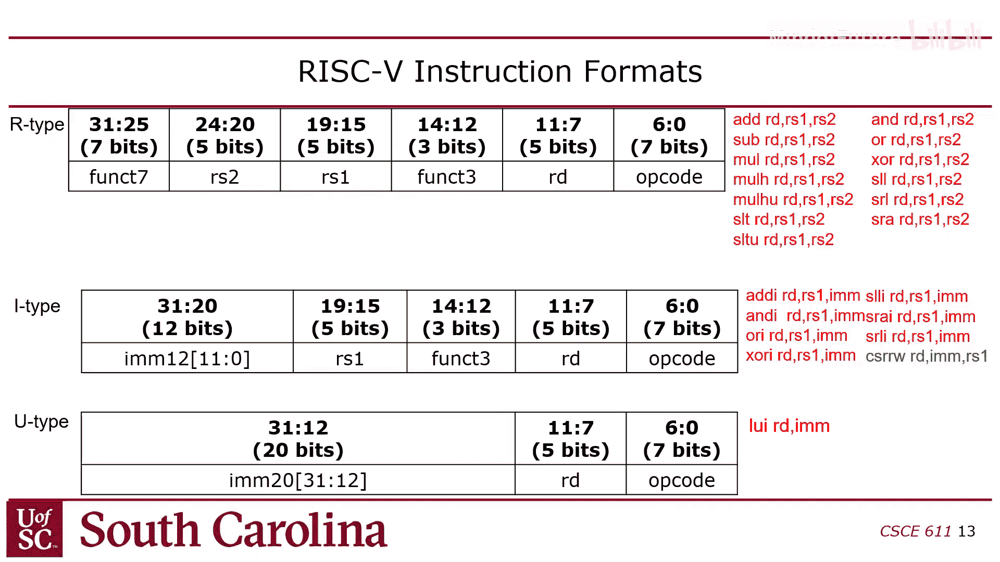
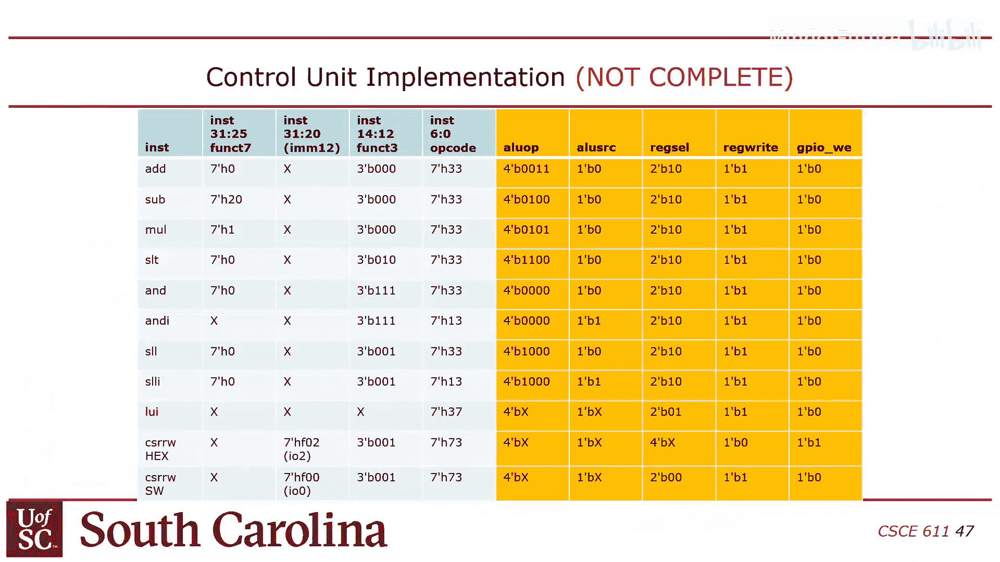
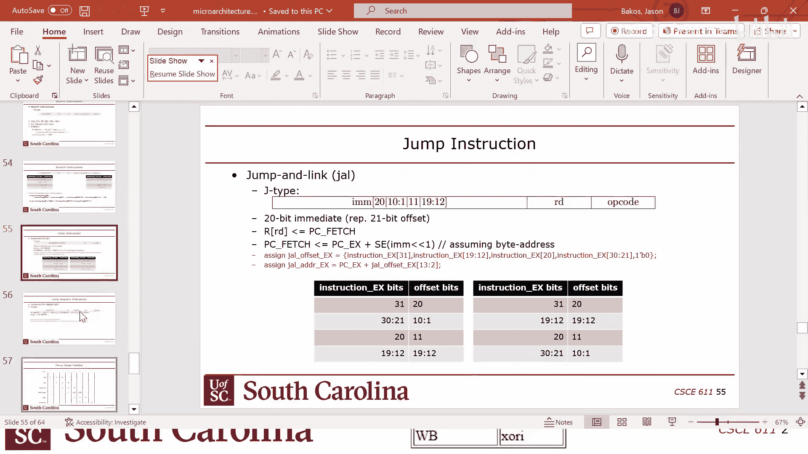
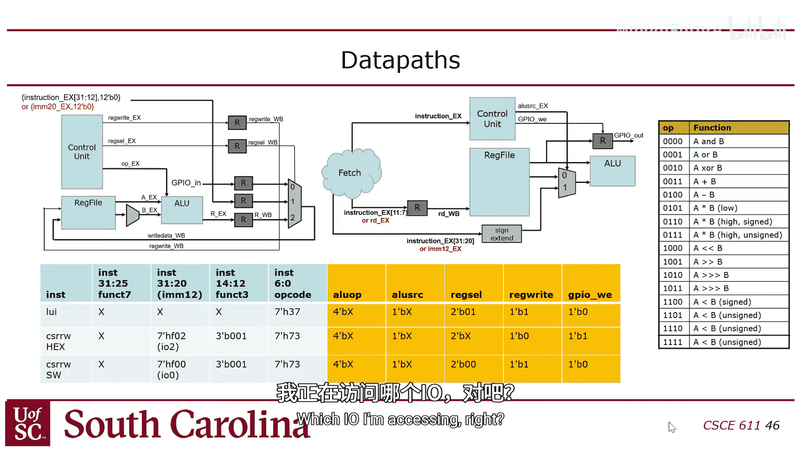
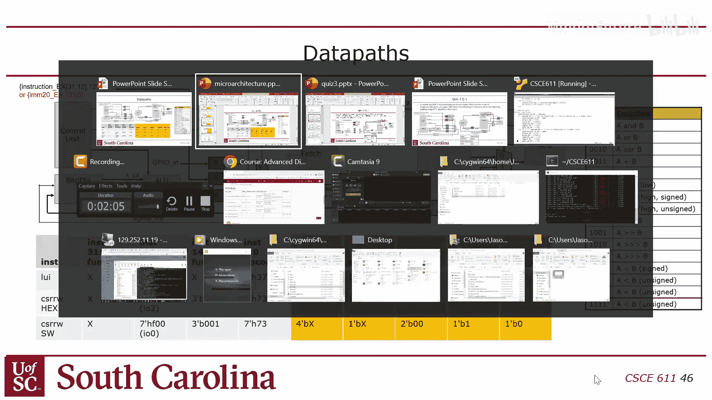
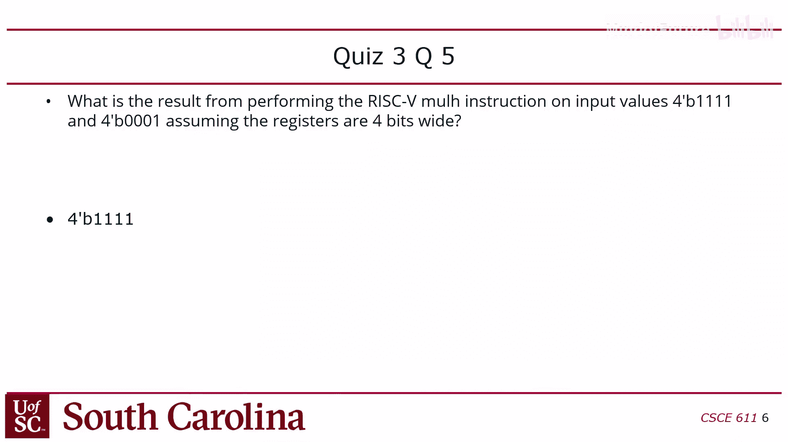

# 【南卡罗来纳大学】高级数字系统设计-CSCE611-（Advanced-Digital-Design，Fall-2023）-p09-P09-RISC-V-Branch-and-Jump-Instructions--BV19nf6YoEZ9_p9-

Okay， so we have our first， we'll have our first exam the week of October 23rd to 27。

 so it's not next week， but the week after I'll give it on Dropbox。

 you can log in anytime during that week and take it once you start it you'll have 75 minutes to take it。

 there's 15 questions， multiple choice， open bulk open internet。Okay， it'll cover。System error log。

 riskk five In set architecture and risk five micro architectureitecture。Under system Vlo。

 it's basically behavioral and structural HDL syntax。For risk five instruction set architecture。

 it'll be just writing small snippets of code or analyzing small s snippets of code。

 instruction andcoding， and then for the microarchitecture， it'll cover the three stage pipeline。

Okay， any questions about that I've got example exams on Dropbox you can check out。 Yes。

 so does that mean like at the latest it be do with the no weekend penalty on like the 29 No actually。

 this one is it'll it'll open up on midnight on Monday， it'll close midnight on Friday。

 So it just you'll have to it doesn't have the same late penalty rules Okay so it's just Monday Monday through Friday。

Okay， so we assigned lab， let's see where we're at here， we assigned lab three。

That's due October 13th to the end of this week。Um， and then we'll be assigning lab four next week。

 Friday Sunday Sunday， Sunday， yeah， it says， yeah， it says Sunday， but it should be Friday。

Effectively Sunday because it's。Late penalty， yeah。

Okay， so。Is luck for the one that's kind of like， depending on how we did on that's rightep。

Theuc I think crimes。That's right。Yeah个。😊，The class is great。Okay， so lab three。

Any questions about La3， is that going pretty well？So the objective here is to。Design the risk。

The risk five processor that。Can execute the instructions listed here。

 These are basically just arithmetic logical comparison。And the one IO instruction。

 so there's no branch and jumps and there's no loads and stores here。

This minimal set of instructions， 22 instructions should be enough for you to。

Write a practical program that will allow you to enter a number on the switches on the DE2 board and have it do a binary to base 10 conversion。

And then output the base 10， the decimal number on the hex display。

 so you'll be using your seven segment decoders for this。

So we talked about the risk five instruction formats're using。

 we're only using three of them for this lab， so the 22 instructions that we're targeting span these three encoding formats。

 and actually it's really just two encoding formats because the U type is only used by the one instruction。

 the LUI instruction。Yes， like understand that we have to kind of assign and define like the R can you do that all in the same file or does that have to be done in multiple you can do it all in the same file Yeah。

 that's up to you how you want to organize the very log。

 how you want to break it down into like sub modules kind assign the the same assign the the same way you do the。

So I have a， I think I have a figure about that here。Yeah， yeah。

 that was about what I was about to explain。So the instruction memory is a RA and it'll spit out the instruction and then。

You can take the instruction into a block called a decoder。

 that can be a module that's in a separate file if you want or you can just inline it。

 you can just make that decoder a snippet of code inside the CPU module。

 and the decoder can basically just rename pieces of the instruction。So some of so the。

So for example， you can bring out the op code， the function3 field， the function 7 code， the CSR。CSR。

Yeah， CSR field and immediate 12 field， right， the CSR field in the immediate 12 are actually the same bits。

It's the upper 12 bits of the instruction， but there's two signals here to declare just so's。

More clear。What's going on？Right， well， yeah， yeah。 that's a good。 That's a good point。

 So there's no funk 7 in the。I type， right？That's why I was wondering because can I change like the output of a module in the whole lot。

 What we're listing there I can do is you can output a whole bunch of changes that。 Yeah， exactly。

 Yeah， exactly。 So the I much set up now。 I just didn't think that would work。 also That's right。

 So the I type has an immediate 12 field， which will be。Actually。

 the immediate 12 field will be equivalent to the Fk 7 and RS2， like concatenated it together。

But you can have two you can have three signals in the CPU， one is immediate 121，k 71s RS2。

 but you'll only use the fields that are relevant for that instruction， like he said， yeah。

 so you can ignore some of these where we don't cares。Just do one thing long string on signs。

 just sign all of the different best things and if you don't need it， just don't use it。Right， yeah。

 so the control unit will be a big you can design it like as a big if then else and if you don't consider something in the if then else。

 then it's ignored so don't care was just a little more confusing on the eyes type but that's cleared out。

Okay， yes， that's right，That's right。I think I。

I don't remember if I included that。喺个啲分钟。So。呢条系咩。你个。我们听。Where did I put that？I wishman。

I thought I had a。Lab hes， RU， there it is。嗯。Yes。CPu。啊。true。Yeah， so this is actually the code。

 the decoder code right here， so I just used the signs in here to break these signals out So for example。

 funk 3 is instruction EX 149 to 12 right and then in the control unit。

Controlling is just an if then else。In this case， I'm looking at。

The add instruction and the add I instruction， right， so the ad instruction has the funt 7。

Right whereas the add eye instruction doesn't have Fk 7。

 so you can see that here I'm looking at Fk 7， I'm testing to see if Fk 7 is seven zeros。

Whereas if this condition is false， then it will check this condition which actually only looks at op code and function 3 you see。

 so basically I'm ignoring function  seven in this case if it in second in this second if condition。

Makes sense。So if it is an atI， then you're right， function 7 does exist。

 but I'm not testing it either， so it's a don't care。Yeah。

 the control unit actually end up being like 2022 instructor so  Yeah。

 that will change in the next lab for the branches because the branches will not only check to see if it's a branch instruction。

 but we generally handle branch resolution， the control unit too。

 so they'll be like two two to if tests for the branch。

 one for the you know whether it's taken and one if it's not taken right but in this lab， yeah。

 I think there's one of these lines for each instruction。Actually。

 no CSRRW that's an exception CSRW is one instruction。

 but you'll need to have two lines in here for that。

 one for the output to the hexes and one from the input from the switches。

 and that will depend on the control status register， whether it's zero or two。Make sense。

 so there should be， I think， 23。 Well， then you want to have an else that's like an unknown that's like a default that would be like an invalid instruction case。

Where the conrian it doesn't know what the instruction is。嗯。Okay， any other questions about the lab？

我塞。Okay， so is the CSROW instruction clear？So it makes sense。 So this is this is our IO instruction。

 So this is an eye type instruction and the immediate 12 field is used for this。

What do they call it the CSR address？So you get 12 bits in there to specify an address in this lab that address will only be zero or two coming from Rrs。

Unless your code in RRS something's wrong with it， as long as your code in RRS is good。

 whenever you have a CSRW instruction in the immediate field will either be 0 or two if it's zero that means you want to read from the switches and if it's two。

 you want to output to the hex displays。So。So this is the code， this pseudocode is from the。

 I got that from the Rik Fives official spec。And what it's supposed to do is exchange the CSR register with a general purpose register。

 it's supposed to do a swap， supposed to take the CSR contents of the CSR register。

 put it in the general purposese register and the general purpose register contents going to the CSR that's not how our code。

 our processor will work in our case we're going to hack it a little bit so when you access register zero。

 it only reads the switches and if you access register2 it only writes the hexes。Because。

 it doesn't make any sense to put a value into the switches because that's strictly an input device。

 right？So that be that behavior will be encoded into that control unit if state you know。

 that big if then else。🤧Okay。Okay， and then I mentioned that your seven segment decoders are going to come in handy here。

 you'll have the CPU。sv that will be instance， the output of that will be a 32 bit output。

 which will be sent to your seven segment decoders。

And then that will all be in your top dot sv and then your SIM top will encompass the top right so SIM top is going to is your test bench。

And in this lab， the test bench doesn't really do a lot。It just drives the clock signal and it。

Puls the reset。And you might say， well， I thought you said that the testament is supposed to check。

To see if the design is working。The only way to know if it's working is to look in the register file。

So you simulate it and you look at the register contents and you just check what values are going in the registers。

There's probably a better way to do that， but we haven't。We haven't discovered it yet。I mean。

 one way to do it would be to。Test with small segments of code that use the CSR W instruction to push values out。

 and then the test bench could check that。 So， for example， you could add one plus 2。

And then you could then take the sum and bring it out to the hex displays right， then the test bench。

 the Sim top would be able to see those because it could read the hex displays and it would know if you added if the ad instruction worked the problem with that is that if it fails that test you don't know if it was the ad instruction that failed or the CSR W instruction that failed right so it's easier in this in this case just to look at your registered content。

Okay。嗯。We talked about this， the pipeline。So there's a three stage pipeline。

 so there's once the pipeline gets filled， there's always three instructions in in flight in progress at one time。

 you'll have an instruction in fetch an instruction in。

What we just call execute the middle stage and then an instruction right back。Does it make sense？

So the instruction in fetch， you don't really see it because it hasn't been fetch yet。

 there's nothing to look at in the fetch stage。 The only thing you can look at is the program counter。

I think that's it， right yeah？There's just the program counter of the address of the instruction being fetched。

 that's all you've got， that's the whole fetch stage。In the execute stage， you have。

The inputs and outputs of the register file， the inputs and the outputs of the AU。

And the inputs and the outputs of the control unit all in the execute stage。

And then in the right backtage， you've got nothing other than just the right port on the register file。

Gys with me on that makes sense so in other words， most of the signals are in the execute stage。

 but you have these two other stages that know you don't have as much going on in those two stages。

🤧嗯。Okay， so then we looked at some， I think， last time， so I think this is the whole design。

I'm pretty sure I've got everything in here now。嗯。Little tough to read this because there's so much going on here。

 I usually show this CPU as like two halves， like I usually show this this design and this one。Right。

 like on the test， I usually show， that's usually how I show it on the test。 I show it like this。

 where you've got。Kind of this part of the CPU and that part instead of mashing everything together。

But in this slide， I try to combine everything just to give you an idea of all the pieces that are in there and how they're connected。

So you've got the instruction memory program counter。

 program counter is just the counter in this case， it just counts up by one every cycle and also has a reset。

 a synchronous reset。Control unit is just a big if thenL， so you can make that a module if you want。

Probably should。Because otherwise this file gets pretty long。But that's up to you。

 the register file we give you， that is a separate file and the ALU we give you and that's a separate file。

And then these dark gray。Squarees are just flip flops slash multi bit registers。

A multi bit flip flops， which I refer to as registers， right， usually they just delay。

A value from one cycle to the next。And then there's the sign extend and that's a combinational logic and there's two multiplexers。

 those are a combinational logic， those could be made with just like an assign sign。

Like one sign a statement， right？Makes sense。So you guys remember the sign extend。

 the reason the sign extend is there is because if you're executing an eye type instruction。

You have to take the immediate and sign extend it。 So you take bit 11 of the immediate。

 and you replicate it。2020 times， right？So you have to copy the sign bit 20 times because when you take those 20 copies and you combine it with the 12 bit immediate。

 you get a 32 bit value because that ALU is a 32 bit AluU。

So it converts a 12 bit value to a 32 bit value。The multiplexer is the element by which you establish data paths through the CPU。

 so the multiplexer allows you to like steer data around。

 so this multiplexer is used to control what value is getting sent back to the register file and this multiplexer is controlling。

 what value is getting sent to the ALUB input。So this is actually a lot simpler than the MIPS CPU because then in the MIPS CPU。

 you had a multipleer here too。Because in MIPS， there was two possible destination register addresses。

 you could use the Rt or the RD field depending on if it was an R type or I type instruction。

 So that's gone。 There was also the sign extend might zero extend。On a MIPS CPU， but in risk 5。

 we don't do that anymore。 It's just everything sign extend。 So they simplified that。 And this。

 in this mugs here。Is only as complicated as it is because of the CSRRW we had to add these。

This IO0 in。And the LUI。And of course， the AOU out right AOU out。

 So this multipleer controls what goes back to the register file and there's three options。

 There's the the in IO was it IO0 in， that's the switches。 That's the main input。That's one option。

 Use that for the CSR R W instruction when you have Io address0 in there。

 then there's the load up immediate， which is that weird instruction that just loads a 20 bit immediate into a register。

 That's the only you type instruction we have。 And then there's the。Normal case。

 which is where the ALU output goes back in the register file that's for computational instructions。

Logical， arithmetic comparison shift。Makes sense。So basically。

 this guy is always going to be set to two。Except if it's a CSRRW。

 in which case you set it to zero and or if it's LUI， you set it to one。

But it's almost always going to be too。Okay， oh， also， here's， here's another example of that。 The。

 the right enable。The right enable input on the register file that tells the register file to write。

That's going to be one in almost for every instruction。 The only。

 I think the only exception to that would be。For the CSRR W instruction when you're。

Writing the heckx。The hex displays， you don't write a register in that case。

 and if you read an instruction you don't know what it is。An unknown instruction。

 Then you should set that to 0 in that case。 But in every other case in this lab。

 that reddge right signal coming out of here will be set to one。

 And then this register just delays that by one cycle。 So it pushes that into the。Right backstage。

Does it make sense？Okay， so what that means is that these guys。

 these little dark blocks are just always at pause edge clock output equals input， that's it。

 The Muxus is an a sign with a turnernary expression in it。

 and the sign extended as an a sign with a bit duplication operator in it， right。

And then all these wires are made just by by through the names， the names of the signals。

 all these connections are being。Done， you know， established through。Using the same name as like。

 say an input and output。On different pieces of the code。ok。Any questions？Okay。

So then I have a few slides that show some examples of the control unit code and the quiz also had some questions on this。

 and I'm going to go back and review the quiz too after this， but in this case。

 we were looking at the a subtract multiply and SLT， these instructions are all identical。

Except I think the only difference is the AU op that's used。 you know what you tell the AU to do。

 A from that， they're all the same。 So the AU source for all four of these instructions is0。

And remember， the AU source is the one that's controlling this mux。

 so the ALU source is zero because all of these are our type instructions， there's no immediate。

So this AOU controls whether we're sending a register or the immediate in the AOU。

 so that that mu should be0 for all four。 Reg Select should be two for all four because the value being written back is coming from the AOU。

Redge rightite is one for all four because all four of these instructions write a register and the GIO write enable should be zero because that's only set for the CSRRW when you update that the hex displays right so out of the five control signals。

 four of them are the same for all four， the only one that's different is the A you opt which for that。

 you have to look in this table to figure out what you have to set the A you opt for for。

For whatever you want the AU to do and the ALU in this case is just doing whatever the instruction mneummonics says to do so you know。

 as subtract multiplier set less than。Does that make sense？Okay， so on the next slide。

 I have some eye type instructions mixed in。 So there's two eye type instructions。

 There's an and I and a set less than I。 And so these guys are going to be different from the other two。

The other two instructions that are R type。 I think they're only going to differ in the A U source。

 right， So the I type instructions will have an A O U source of one。

 and the R type instructions have an A U source of 0 because。

Our type you want to send in the register as the second input on the ALU。

 and for I type you're going to send in the sign extended immediate。

And then the REg select is the same for all of them， and the reg right is the same for all of them。

 the GPIO right enables the same for all of them， and then AUO is just going to depend on。

You know what you're doing， so the and and the and I both have the same AU up。

 it's 0000 because that's how you tell the AU to do a bit wise and。

The set less than and the set less than immediate both have the same AU op。Right，10，0，0。

 because that is the。The set the shift left， right， shift left operation。Okay。

 and then I think I've got one final， yeah。Now we've got some kind of miscellaneous instructions。

 we've got LUI， and there's two versions of the CSRW。Like I mentioned。

 this is why you're going to have two if conditions for the CSRRW so you notice I have two rows at this table for that。

So。The LUI。Actually， all three of these don't use the ALU at all。

None of these three instructions use the ALU， none of them require an ALU operation。

 so I've got the ALU offset to X， don't care。Or you could just set it to zero， so it doesn't matter。

ALU source likewise is also don't。Care A， I'm sorry， AU Op is I don't care。

 AU sources that don't care because if I'm not using the AU。

 I don't care what AU op is or the AU source because。

The AU opt defines what you want the LU to do and the AU source tells it what input should go in the AU both in both cases。

 those are all don't cares。The Reg selectlect。Is the relevant control signal here because the L UI。

 you're going to want to set the re select to be。One。And this is a little hard to follow here。

What's happening here is if you go to that Regg select Mus， that's this guy。Now you might say， wait。

 why did you put the Reg select marks all the way to the right when it's controlling what's going in the register file and that's all the way to the left hand side。

Because it's like data flow， data flow kind of flows from left to right in these diagrams。

So notice that this mus。Where is my mouse screw， this mus。

 the output of this muckx kind of feeds back all the way to the other side of the diagram。

Which is confusing， but it's meant to represent that。

This is the final place data goes is on the right hand side。But because the register file。

Provides the inputs and also accepts the outputs。You don't want to you have to choose where you put the register files so the register files on the left。

 the mus that controls the inputs of the register files on the right and that's why you've got this feedback going back you guys see that that makes sense。

So thiss， if you tell this mus to select input one。

 it comes from another crazy wire that originates all the way to the left and it's instruction EX 31 down to 12。

Concateninated with 12 zeros。So what is that， that's the immediate 20 field from the U type instruction。

It's the upper 20 bits。Immediate field， immediate 20。And with zeros attached to it。

 right concateated。Or if。You rename that signal using the decoder。

 you might just call it immediate 20。Right。One or the other。

 if you're lazy like me and you didn't do the decoder， then you would just refer to it as the upper。

20 bits of the instruction EX。If you put in that decoder。

 then you would have renamed it immediate 20 EX， right you'd have a little special name for that。

So for the LUI the。Reg Select should be one。And then for the CSROW。

 where you're reading the switches， you're going to want to take input zero because that's the GPIO in。

Which is badly named because in an earlier diagram， I refer to it as something else。With it。

 I call it before。 I called it。Okay， in an earlier diagram， I call it IO0 in。

And I have an IO zero out， right？I forgot to change this。Does that make sense。

 So I O 0 in is just attached to the switches on the FPGA board， I O 0。

IO2 out is connected to your seven sm coders right If you go back to the other diagram。

 I use a different naming naming for that。 So here I'm calling a GIO out。

 that should be called IO2 out。 I mean it doesn't matter what I don't care what you call it right。

 It's up to you， but I just I'm trying to clear up。

I should have made that consistent so GPIO out is the going out to the decoders and GPIO in is coming in from the switches。

 so you're going to use one or the other depending on what the immediate field is in the CSRRW instruction。

 so if the immediate field，Which I called。Right here， there's a column for the immediate。Oh， wait。

 there's the wrong slide， wait， holdman。Here we go。

 so the immediate field for these CSRW instructions is either two or zero。If it's zero。

 then I need to。Select the appropriate。ALU source， which is input。Zero， so where's that at？Input0。

 that's the re select。Right and I set Regg right to one， but if I have CSR or W with the hex display。

 that's an output， then the Regg right is actually zero and the reg Select don't care because the Regg Select。

 if you're not writing a register， no one cares what register or what you're putting into the right port on the register file because it's going to get ignored。

You guys with me？Becauseuse if， if you don't write the register file， then it will ignore。

The data being sent into it， right， So the Regg select is a don't care。 Regg write is0。

 but there's this GIO right enable able signal。And all that does is it controls the enable on this register。

This will cause the hex displays to reconfigure to change if that's enabled。Make sense。

Where does the input of that come from， by the way， right from the register file？

From the the first output of the register file， which is read data1。Does that make sense？Now。

 why do we need that register there？If you don't have that register。

 there's nothing to lock in like to hold the values of the hex displays， the hex displays will never。

Will constantly be changing right if you don't have that register Yeah。

 exactly every instruction would update the hex like basically if you didn't have that register。

 the hex displays would always be showing the output of read data one you know basically whatever's coming on the register file right the first the contents of the Rs1 register right so they would it would just be changing so fast。

 you wouldn't be able to read it that register is is designed to basically lock in the value of the register only when you're doing that instruction that's supposed to update the hex displays makes sense。

Okay， and that's I think there's there's the whole。Table with all the examples。

 these are not all the instructions， obviously there's only one2，3， four，5，6， seven，89， 10。

11 out of the 22， so this is about half the instructions that you'll have。Okay。

 and then we have a test program that you can use to test your CPU。

 it executes each instruction at least once， some of them multiple times。

So we start out with two add eye instructions。We add immediate to register zero。

So that's what Reg zero is useful for， right， it allows us to initialize。Consts， right。

 and based on that 12 and 17 value that we stick in。We can then execute all these other instructions。

 they all kind of feed off of that。Are these dependent， Yeah。

 A lot of these instructions are dependent。 Like this guy multiplies into register x 5 and then。

I actually， no one uses x5。Will they have a pe that multiply at the X4 Yeah， that's right。

 X4 gets changed， and then it gets written here and used here。 Do we test any bypass paths here。

 though。Oh yeah， right here this guy set less than I'm sorry shift shift left logical immediate this guy writes the register3 and then the next instruction immediately uses register 3。

 so that's going to test that because when。When that SLLI instruction is in right back。

 this multiplly going to be an execute and so you're going to be reading and writing Reg 3 at the same time in that case right yeah exactly so you just use this to test except what I was saying earlier is the test bench can't actually check that it's working。

 You have to do it manually yep you just drill down your register file and you check to see if the registers are being updated as shown here so I have the decimal version and the hex version for each one of these you can view the values and models Sim in Hex or decimal it's up to you but I've got them both there for you。

you write like a testament like you did last time No， well， you do。

 but just it's just the clock and the reset。So you set up the clock in SIim top that just toggle have the clock going and then have the reset pulse。

 which is remember that reset's active low。Unless you design it to be active high。

We usually have it active low， so the reset should go low for one cycle and then high and then stay high。

It's it's just how the switches work。WhenWhen you use CAD tools like the xylelinks and CAD tools and use the IP block。

 sometimes it' resets active high， sometimes it's active low。

 you know because if it's active low it as an underscore n after it or just sometimes not an underscore。

 it just an n。It meansans negative logic。嗯。But in this case。

 it's just because of the buttons how because the way the buttons work on the board。Okay。

 and then finally the last program you want to write is the binary to decimal conversion。

 is everyone comfortable with this， how this works？So basically， you know。

 you just module low by 10 to extract the。The low order。Digit。

Modular modular is remainder after dividing by 10 right or a modular is the remainder operation。

 right？And then you have to divide by 10 to delete that last digit from the value right。

 and you just repeat that eight times。Whatever time you。

Take the last one and multiply it by the power of two。Based on。Oh no， you don't even have to do that。

 you just say you take the value， you modo by 10， so if you start out with 76 or 5678。

 you modo it you'll get8 right， and then you divide it by 10 it'll strip the eight。

RightSo so you take in the value from the switches with the so your program will begin with the CSRRW instruction that'll take the switch value into a register。

 and then that value will just get whittled down digit by digit。

And then every time you extract the digit， you have to insert it into another register that you'll use with another CSSR at the end to update the hex displays right so every time you extract one of these digits。

 you have to get it into another register at the appropriate spot。

And you just start by displaying what we significant on the first。 and then you'd work your way up。

 but it would display them over。 Yeah， yeah， well the way I do it is like when you take this8 off。

 I put that in the upper。The upper four bits。Right。

And then I shift the whole thing down by four bits。

 and then I put the next digit in the upper four bits and then shift the whole thing down by four bits。

 So what'll happen is is after eight trips to that after eight times that first digit will have started on the left hand side。

 but it'll work its way down to the right hand side at the end， right。

So that's one you don't have to do it that way。 there's other ways you can do it。

 but that's the best way to do it if you want to take the code for each digit and copy and paste it eight times because we don't have a loop。

 And so when you peel it off it automatically puts it into No you'll have to peel it off after you do the modo。

 it'll be that eight will be by itself in a register。

 So then you could take that value and shift it 24 bits to the left that'll put it up on the lefthand side。

 and then you do a bit wise or with the kind of the output value。Well。

 not enough to flip it just merge it in to the output value。

ll it'll insert it into the output value right but before you do that。

 you have to take the output value and shift it four bits to the right right So you have this output value。

 and it'll start out as zero， you shift it four bits to the right， which does nothing。

 but then you put the first digit in， you shift it four bits to the right。

 you put the second digit in， you shift it four bits to the right。

 you put the third digit in every time you put a digit in。

 you're putting it into the upper four bits right so like basically what I'm saying is you consider like you have a register。

 say x2 is your output register。And。You're conceptualizing this as。As eight slots， eight，4 bit slots。

 so this is 31 down to 29， right？RightAnd then this is three down to zero。

 this is seven down to four。This is 11 down to 8。15 down to 12。嗯。Yeah， 19 down to 16。

And this is going to be。24。Down to 20 or 23， down to 20， rather。

Right and this is going to be 28 down to 24 right now 28 down to 25。23 down to 20， that's right。

And then。27， then it's S，27。 And this is actually 28。 Sorry， Yeah，31 and a 28，27 and a 21。

23 then it 27， right， So when you do the。You're going to do a multiply mall。

So you're going to have a value like say， in x3。You're going to set that up as to be 01 right。

 which is going to be2 to the 32 power divided by 10， right， which is roughly equal to 200 and sorry。

 400。hou428。428 million actually。Something whatever 4。

2 billion divided by 10 or 428 million and something right make sure you round that though because it won't be when you take two to the 30 second and multi divide it by 10 it won't be a round number。

 it'll be something like 0。6 so make sure you round it up right。

So then you'll take- so basically you'll do a CSRRW。And you'll take。The switch value。

 say I use register4 for that。And I'm going to use IO。Zero， right？And。This register a don't care。

 I to say 0。So this instruction will take the switch value。And it'll put it into Reg4。

 and this register is going to be ignored。Because it's an input。Then you'll multiply。Actually。

 multiply high。Unsigned。You're going to multiply that 4 times that 0。1， that's an x3。

And you put that in a new register， like x5。So that's going to take whatever number came in on the switches。

You multiply it by 0。1。Right。And then the the point， because this number， this number is a 32。

32 fixed point， meaning that there's 32 B and they're all 32 are fractional。

 So when you do this multiply， you're multiplying a。

32 number with0 fractional bits times a32 bit number with 32 fractional bits。

 So the result of that is going to be a 64 B number with 32 fractional bits。 So if you do a mall H U。

 you're basically just taking the upper。32 bit number， 32 bits， which will be the。

The non fractional bits of the product right？ So if you have like this number 56，78。

 you multiply it by 010， the 567 will be in the upper 32 bits of the product and the 0。

8 will be in the lower 32 Bs of the product。 So this mo h is just going to extract the nonfal bits of the product。

 right， So this x 5 will contain the new number after you strip off。Etablished the5，67，5， right。

 But now we need that8， right， So how do we get the8。 Well， we can also do a mall。Mall low。

 but there's no yeah， mall is just mall low and we could go x6， x4， x3。

 sign as well It doesn't matter there's no unsigned version the whether you do a sign or unsigned only only makes a difference for the upper half。

So this will give us the point point8， right， except it's going to be the value actually in here is going to be 08 as a fixed point number。

 So it's going to be 80% of2 to the 32nd power。 So it'll be 80% of 4。2 billion， right？

 So we have to get this into a regular。Just just as a regular digit like eight right。

 So the way you can do that is you can do another mall H U。You could take x6。And multiply it by 10。

ItBecause it'll be 08。 you multiply 0。8 by 10。 you get back to 8。 and that's what we want is the8。

 the remainder。 so you can multiply that by another constant， let's say。X 7， I don't know。

 Or X thought。 Yeah， X 7， you could set up x 7 with 10。So if you multiply that by x7。

 you put the result of that into x8。And that eight now will contain the eight， that's the modo。

So it's going to take three multiplies for every digit。

 You're going to have to do three multiplies eight times for eight digits。 So there's going to be。

24 multiplies in total for this。You can't branch， you don't have branch instructions。

 you're going to have to copy and paste them。We're not going to have branches until next lab。

 the next assignment。Okay， so then once you do that。

 you want to get that eight in the left hand side so you shift left logical immediate。X 8。X 8。2y。

Eight bits， 28， I might have said 24， I meant 28， should be 28 bits。

That's going to take- so basically the8 is going to start out here。Right after you do this small HU。

And we need to get the eight。Up here。So that shift will do that。And then。You're gonna to have。

Another register。That will be your result， let's call it x 10。That'll start out initially as zero。

But every time we add it what new digit， we shift it to the left by four bits right。

 So you shift it left by four bit。 so you do shift。I'm sorry， shift right by four bit， shift right。

 shift right logical immediate。X10。X 104， and then you just do an or。啊啊喂爸爸啊。You do an orura。With。X10。

 X10， and x8。That's going to take this eight and that's going to stick it there。

RightAnd then the next time you go around。It'll push the eight over here。

 and then you'll put the next digit here seven。And then the next time you'll yeah。

 itll it'll shift of six here and then the seven here and then eight here right so after eight times that eight will start out on the left hand side。

 but by the end， it'll be over on the right hand side， right？Make sense so by the time you're done。

 you'll have。5ive， six， seven， eight。We'll be in。In this case you'll have0，0，0，0。

 you'll end up with four zeros plus the 5， six，7，8。In 32 bits。

 and this is basically what it'll look like in Hex， right， but it's not really hex。

 it's a binary code of decimal because when you send this off to your hex displays。

 it'll actually say 5，6，7，8， even though the original value would have been the binary version of that。

Right。Okay， so that's， that's how the code。 that's how the。And like I said， this code。

 this block of code will have to be copied in pasted because you don't branches yet。

Any question you guys okay with that， could you see that on this side？

I don't know if you can read that for on。Clasroom is。Too wide。Okay。Okay。

 so let's move on to the next lab。 Then。 Let's talk about， let's talk about branches。

 So I'm going to get a little head here， but I want to。Get you ready for the next lab。

 which will be adding the branches and jumps。So the branches。Use a PC relative offset。

 so the branches are i type instructions and the immediate field is used to designate where your're branching if the branch is taken。

The branch is relative to the program counter。So it's basically it's the number of instructions you're going to skip。

Relative to the branch instruction， if the branch is taken。Youys with me。

 you guys remember that from 212？But when I say relative to the current instruction。

 what does that really mean， Well， this is a subtlety that this is actually different。

 this is a difference between risk and MIPS the MIPS。

 so MIPS used to use whenever you'd have a branch instruction in MIPS。

It would calculate the branch offset relative to the instruction that's after the branch instruction。

Okay， what that means is is that if your offset is zero and you take the branch。

 it's going to go to the next instruction， which it would have gone to anyway had the branch not been taken right so a branch with an offset of zero in MIPS。

Would be pointing to the next instruction。If， on the other hand。

 your offset was negative one and you take the branch now you're in trouble because it's going to branch to itself endlessly。

And there's no way it'll create an infinite loop and there's no way to escape from it because。

The branch instruction is an atomic operation。 There's no way that。You know。

 there's no chance for the the branch condition to suddenly become false， right。

 so it'll be true forever。You guys with me on that？Right。Does it makes sense？

So the offset in a branch is just the number of instructions that you're going to skip either forward or backward if the branch is taken。

 but in MIPS it's relative to the next instruction。

 which in our case is PC fetch because you remember PC fetch is the address of the instruction being fetched。

So if you look at PC Fech and you look at PC instruction EX。

PC fetch will actually be the address of the instruction after instruction after。Instruction Es。

 you guys with me on that？Does it make sense？So when PC fetch is zero。Instruction E X is undefined。

 right When PC fetches one， instruction EX is the contents of address 0， the first instruction。

Instruction zero， you guys with me？O。So you might be wondering why am I emphasizing this so much？

Because in risk5， they changed it。In risk five， the branches are calculated。

Relative to the branch instructions address itself。So that way。

 if your offset is zero in risk five and you take the branch， now you're in an infinite loop。

And if the offset is one， you're gonna to branch to the next instruction。

 which you would have gone to anyway。 had you not taken the branch。 You guys with me。 Now。

 you can see that in the code here。 I actually compared。Top is Rs and the bottom is Mars。

Rs is risk five， Mars is MIps， right？And this is how they're encoded。

 so these branches are both branching to themselves。Because I typed branchch to foo。

You see that fo colon branch if equal F right， so in other words。

 this branch is branching to itself right however， if you look at the offset of the branch in the case of risk five。

 it's zero。So the offset zero offset means myself， whereas in MIPS。The offset is negative one。

See the F's here？And so you know。This is the assembly instruction with the label foo。

 this is the machine instruction where the foo is translated to an offset right and the offset is zero here and negative one here。

Makes sense。 Now， why did they do that， I don't know， but it sucks because。

How are we are we going to do that， because when we have a PC fetch that's the address of the next instruction。

 right？How are we going to calculate？Something in the execute stage。

That's relative to the address of the instruction， the execute phase。

 which we don't even have a signal for that。All we've got is PC fetch， which is the next instruction。

 right？So there's a there's a。Couple ways you can do that， but what I recommend。Is doing this。

You can add a register。Called PCEX， so you have a PC fetch。

Wwhich is the address of the instruction being fetched。

 which is the next instruction after the one being executed， but if you delay that by one cycle。

 you can have a version of it that's one cycle delayed， which you can call PCEX。

 which is the program countervalue of the instruction in the execute stage。Makes sense。

Now you might say， well wait a minute，' why can't you just I mean。

 isn't it just going to be a difference of one all the time？PCEX will just be one less than PC。

 right。In order to。In order to subtract one。From the PC and then add the result of that to the offset。

 you need another ALU。Right so I think it's easier to just add a register than another ALU or another adder。

You don' don't need a whole A， you just need an adder， right？You guys with me？Okay。

 does that make sense？It's basically。嗯。A difference of one in the offset field essentially。

 is what it boils down to。And by the way， keep in mind。

 I'm saying one is one instruction and two is two instructions。In 212。

 they might have told you that you have to multiply that by four， you know。

 because everything was by addressed and instructions were four bytes， but in this project。

 we're just using word addressing for the instruction Ram so you don't have to worry about。

Multiplying the offset， you just use the offset directly as something you add to the PC。ok。Okay。

Any questions about that？Okay， well， here's where things get a little crazy， too。

 The branch instructions use another type， another encoding type called a B type。You remember the？

You remember in MIPS， it was the。It MIPS it is what it the eye type right branches use the eye type。

 we have an eye type， right？We have an eye type here。So why don't they use eye type？Is it the same？

I type is a 12 bit immediate than RS1 function 3 RD OpP code。st the same as thee。

Is the B type and the R type the same？

Immediate， 12 bit immediate。RRS1， Rs2， RS1 function 3 immediate op code。UmKind of， not really。Yeah。

 what's the difference？The branch instructions don't have an RD。You guys with me？

There's no destination register， there's only two source registers。

But they do have a 12 bit immediate。Do they？No， it's not 12 bits。It's one bit plus。10 down to 5 is 6。

7 Bs。 ats 7 bit。So it has a seven bit field。And then it has a seven bit immediate field。

 and then it has another immediate field down here by the op code that's six bits。

Does that make any sense？Well， basically， the objective is to get a 12 bit immediate， right？

Not a 12 bit。10 bit immediate。There's a 10 bit of media。You might say， why it' 10 bit。

 you've got 13 bits there， it says 12。Sorry。11， no， it's yeah， it is it's 11 bits， right， I'm sorry。

 So， so here's what's going on， right， in the B type， there is an immediate field。 It's， it spans2。

It's actually two immediate fields that you have to put together to form the actual immediate value。

 but the bits are scrambled because in that immediate field， you have bit 12。

Concateninated with bits 10 down to five。Right so that's seven bits in total right you got 12 which is a standalone bit and then you've got six bits。

10 down to five together then in that immediate field you have four down to one。

 which is five bits or actually four bits rather， and then bit 11 that's concatenated to the right hand side of that。

So to reconstruct the immediate， you have to take bit 12 from there， con it with bit 11 from there。

 then bits 10 down to5 from there， and then bits 4 down to one from there， right and then。

That only gets you down to bit one。What about bit zero。Bid 0 is implied to be 0。

 So you don't actually have the last immediate bit because you just assume it's  zero。 So actually。

 what's happening there is you've got。It looks like there's 13 bits rather。

 but there's actually only 12 bits of total immediate bits。

So I screwed that up really 12 total immediate bits， but effectively。

 it's a 13 bit immediate because there's an implied bit at the end of zero。 You guys follow that。

 right。I mean I follow， I don't know in sense it's a little it doesn't make sense。

 That's why I gave you the code for this。 So here's here's how you decode it。

So I've got two lines of ver log that I gave you to use and you've got I call it branch offset EX。

 the branch offset is a concatenation of instruction bit 31。Then with instruction bits 7。

 then instruction bits 30 down to 25， then instruction bits 11 down 8 okay and then with an extra0 added right so this is your branch offset which in total is 11 bits altogether。

 right？The problem is that that's supposed to be a bitete address。

And we're going to use a word address。 So when you use this in your code。

 you have to knock off the low order。Two bits of this。YouDete the low order two bits。

 essentially you divide by four。And round out。Does that make sense？Because we use word addressing。

 and you know， like we instructions are addressed individually， not in terms of four byte。

Four by chunks， right？Okay， so in the branch， address EX。This is will'll take the program counter。EX。

 this is the delayed program counter。 This is the address of the instruction in the execute。

 and you add。Branch E X 20 down to 12。 That's what's the leadinging the lower order or2 bits because I only go down20 I'm sorry。

 sorry，12 down to 2。 So bits1 down of0 are not included。 So I'm， you know。

 essentially just deleting those dividing by 2， right， But then you might say， wait a second。

 What about this， What about this guy。 Why is bit 12 replicated here。Well， that's because。

This is giving us a。A 13 bit offset。But our program counter is。12 bits。

We have a 12 bit program counter。You guys remember that？

Because remember the instruction memory has 4000 instructions max。

4096 capacity so in the log base2 is at 12 bits right so the program counters a 12 bit signal right so this is actually a sign extending we're taking we're taking because this is 12 this is 12 bits PCX we have to add a 12 bit to it。

Right。And it's assigned。 this is signed offset， right because you could have a like when you have a four loop。

 you branch backwards， for loops go up up right， So you have a negative offset， right。

 So this is because it's a sign number， we have to sign， extend this， right。

 So that's why this branch offset bit 12 is effectively copy twice。 You've got it once here。

 and then you've got another time in this range 12 down to 2 right， You have to sign， extend that。

Make sense。对是。So you can use this code， I tried to work it out in these two tables。

But I think it's easier just to use that because it's just so convoluted the way they。

Set up a branch offset and risk five in MIps， it was easy。 it was just the upper 16 bits。No， sorry。

 lower 16 bits and MIPS right， yeah， lower 16 bits。Here it's all。Scrambled。

Okay any questions about that？Okay。And then it gets even weirder yet because there's also a J type instruction。

That's used for the jumps。So if you guys remember， what's the difference between branches and jumps？

Jump， it always unconditional， right？So it turns out that in MIPS you had jump and you jump and link。

 right， jump was just jump， jump and link， jump， but it also linked the return address。In risk。

 there's no jump， there's only jump in link。 So if you just want to do a jump without a link。

 use register  zero as the link， the link address， the link register， okay。Okay。

 so what's the format Well， this one's even crazier。

An immediate field that has and then RD and op code， RD is your link address， link a register。

 rather。So what is that RD is5 bits Op code is what seven bits so that's。That's 12 bits。

 so that means that immediate must be 2020 bits。Wlcome ever since。It's 20 bits。

 but it actually is 21 bits because you can see there's a bit 20 in there， but you can see again。

 though it only goes down to bit1。 So bit zero is being not included。 So it's bits 20 down to one。

 which is 20 Bs goes in So that looks like， I mean that's basically。That's like the U type。

It's the same format as the U type， right， but they call it J type， but again。

 all these things are scrambled。So in order to figure this out， I gave you the code for this。

I gave you the J offset and the Jwl address。The jot offsetet is just how far what the offset is in the address now。

The gel offset is added to the PC。Like the branch， it uses PC relative。 Remember in MIPS。

 they didn't use PC relative。 They use pseudo direct。 You guys remember that。

Now it's just PC relative again。Makes sense。So you can just use that code。

 you don't have to try to figure it out。Okay so。Let's see what else do I have？Okay。

 so let me take a break and let's go back over quiz three， you guys had quiz three。

 it was due last week。So let's。Let's just go over this， make sure everyone's clear on this。

 the first question to consider the risk five micro architectureiture shown below。

 what's the value of Regdge W AU source EX？Reg select right back。

When the following instructions are in the following pipeline stages。

 So we have a multiply H and fetch an L U， Y and decode and an X or I and， and write back。

 So we got three instructions in the pipeline and the signals are。The ones I have circled there。

 right， Regg， right， Regg select。AU source。Okay， so what's read right right back That is in order to figure that out。

 you have to ask yourself if the instruction in the right back stage is supposed to be writing a register right X or I does write a register。

 so that should be one。Reg select right back is asking。For the instruction in the right back stage。

 where's it getting the data that's writing back to the register。

 well it's getting it from the ALU because the X or the ALU does the X or。

 so the reg select right back should be two。Right， and then what's the other guy， A use source E， X。

 Well now we're looking at。The EX stage， so now what's in the EX stage LUI？So。

What should the AU source be for an LUI instruction？Anyone know？

It's that not like the zero that it's proven into right？

UI just takes the immediate and sticks it in the register， doesn't use ALU。

 so ALU sources don't care， don't care what AU sources it's not doing anything with the ALU。

 it bypasses the AU。In fact， it uses this mux to bypass because as long as this mu is not。

 if this mux isn't set the two， then whatever the AOU is spit out is going to get ignored。

So then you could subsequently ignore the AluU's inputs， right？So for an LUI。

 this muX is going to be set to one right now I didn't ask that。Ser。

Because if I had asked what Reg Select EX was， the answer would be one。

 but I didn't ask for that when I asked for the right back version。So yes， so don't care。

I get that right。Oh， I don't have the answers here Okay okay。

 question two was consider the risk five micro architectureit， what are the values of Greg Wright？

W B， A U source， E X and Regg Select W， So same ones， different instructions。 Okay。

 so right back is an L U I。 So Regg Select should be。1。Right。Because LUI is in right back。

 we're looking at Reg select right back so that should be a one Reg right right back should also be a one because we're writing a register with LUI and。

AU sourceur EX is referring to the multiply instruction。And so that multiplies in our type。

Should be a zero on that guy， right？ALU source should be zero。ok。

And then last question or third question is same signals。In this case。

 we have different instructions right back as CSRW， so Reg Wright。啊哦。Rg Wright WB。For CSRW。Well。

 that depends on which CSRRW we're doing， right？Yeah， right， I mean。

 the CSRRW might write a register。Or it might not depends。Depends what we're doing with it， right？

That I not say。I' have to double check that。Although。I think。If you do the CSR or W， if you are。

If you're writing the hex displays。You're going to want to set the。Destination registered to zero。

That way it can't cause any damage if you set the re right to one。You guys with me？Now。

 if you go back to the examples I had of the control。The control signals there。

I had a case there where， yeah， so in this slide。

In this slide， you can see that I set the red right actually to zero。If I'm writing the hex displays。

 right， you guys， you guys see that like if I'm writing the hex displays。

 I don't want to write a register in my register file， right， so you can set the red right to zero。

The red right， though， in this case depends on。You see how it depends on the immediate 12 right So the question of whether the red right is going to be one or not for CSRRW is depends on。

What the immediate 12 is right which IO I'm accessing right the question doesn't specify that in the quiz。

嗯。However， if were just a regular if this were a regular risk five and not R risk five。

 the answer would be one right， because remember I said that in regular risk five。

 the CSSR always writes a register。Right that whole thing where it doesn't write a register if you're going to the hex is is specific to our processor right so this question is referring to a general risk five processor。

 so the answer should be one。Right。You guys follow that right， so if it's a regular risk processor。

 not ours， that would be a one。Reg select。Well， but see thiss kind of confusing， though。

 because I'm showing the diagram of our risk process or the the design。 But what should the。

What should the Regg select be for that？Well， that's going to be zero， right， the GPION。

I mean what else would it be for CSRW？And then even though， I would only use that if。

I would only use that if it's the keys that I was reading， right？Otherwise。

 I would either not write the register or I'd just set the destination to zero。Okay。

 in the ALU source， EX refers to the addI， what should that be， anyone though？Should be one， right。

 yeah because the。And it's an immediate， it's an eye type， right， yeah， it should be one。Make sense。

 if that's clear， then it should be， you guys will have no problem with the lab because that's basically what the lab is all about is。

Setting up those。Control signals to reconfigure the CPU to make it。

Execute the data passage or needed for each instruction。Okay， how many cycles？

I should say are required to perform a right to a synchronous Ramm。One right， just one cycle， right？

And what is the result from performing the risk5 mall H instruction on input values 1，1，1，1 and 0，0。

01， assuming the registers are 4 bits wide instead of 32 bits wide this this relates to this someone asked earlier if there's a。

Moul Mou， right。Um。Mall H， Okay， so what's what's going on here。

 We're basically multiplying negative one times1， right， if's， if they're signed in the four bits。

 right， So negative one times 1 is going to be negative one。 So the mall H。Should give you what。Yeah。

 all once， right， because it'll just be the sign bit， right？But if it was a mall H U。

 then we're multiplying 15 by one， right？ So the upper bits after the mall。

After the mall HU would be what？Would be all zeros right， right？

 So if you multiply like negative one times 1， right， you're going to get negative 1。

 in which case it's going to be 1，1，1，1，1，1，1。 But if you multiply instead of negative 1。

 if you look at as unsigned， it's going to be 15 times 1 is 15。 Now you're going to have。

This is your high and this is your low， right？So notice that the low is the same on both， right。

 That's why there's no mall。There's no mall U， there's only a mall because the low。

 it makes no difference on the low part， but the high it makes a difference whether you're looking at 1111 a one as a negative one or of 15。

 right？So the answer to this question would be 1111， right？People was always here via sun。Well。

 it's not default default is one in the sense that there's no， it's not like， yeah。

 it's not like mall HS versus mall H。Yeah， the default is mall and then the mall U。

 you have to add the U if you want the unsigned variant， yeah。嗯。Okay， that's it。Okay。

 sounds good I'm actually running late， sorry。

We'll see you in lab on Wednesday and Friday。