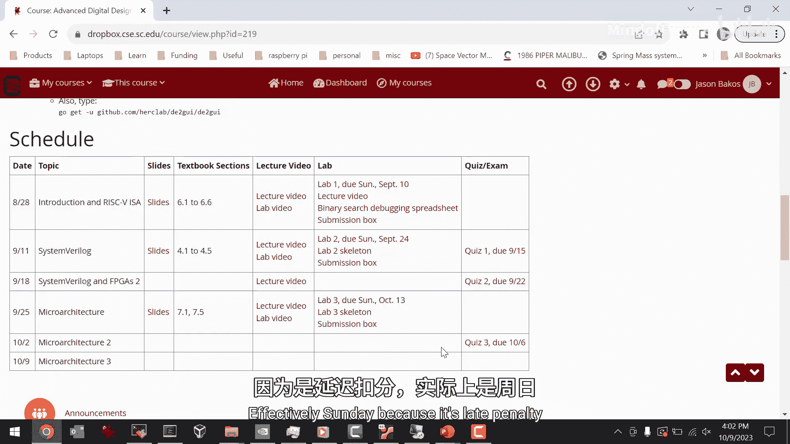
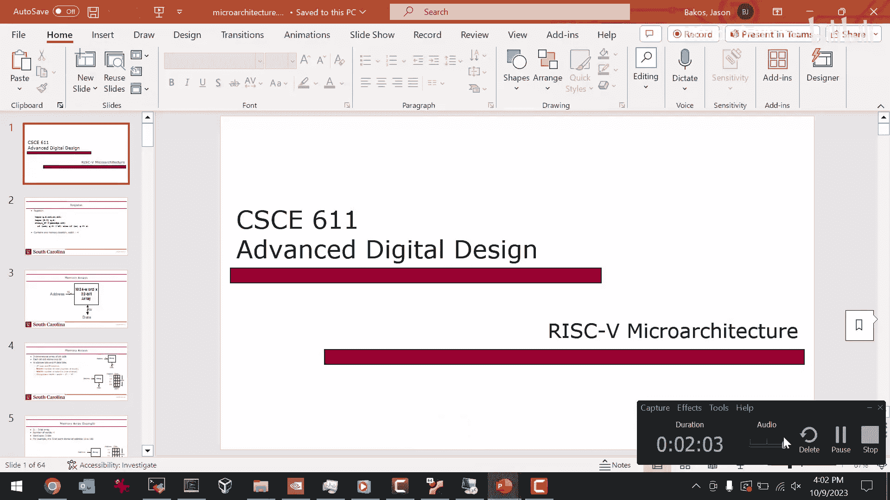
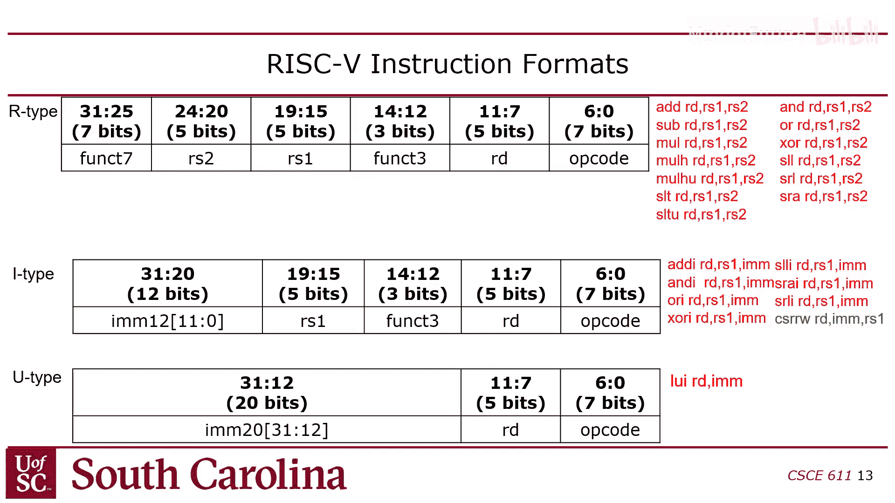
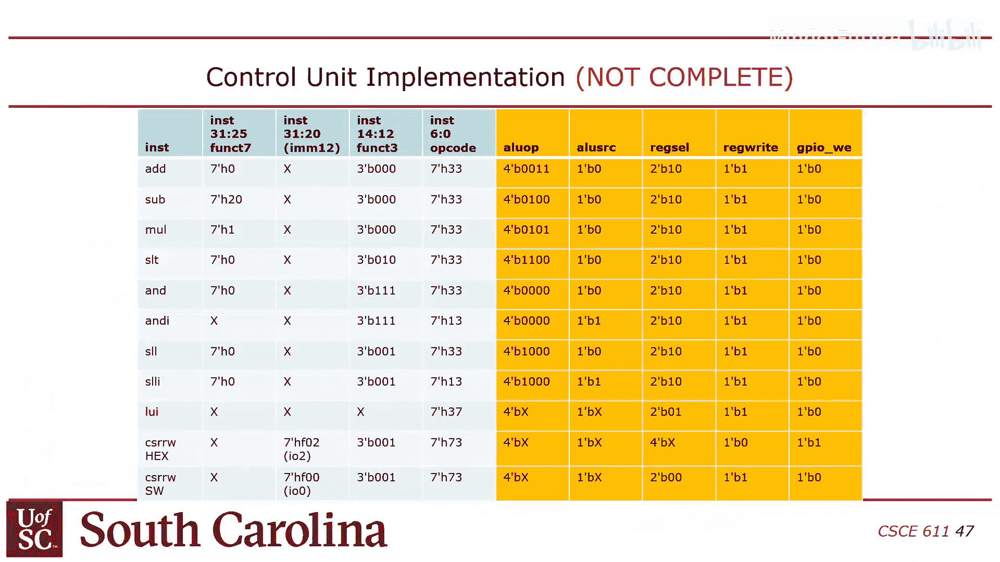
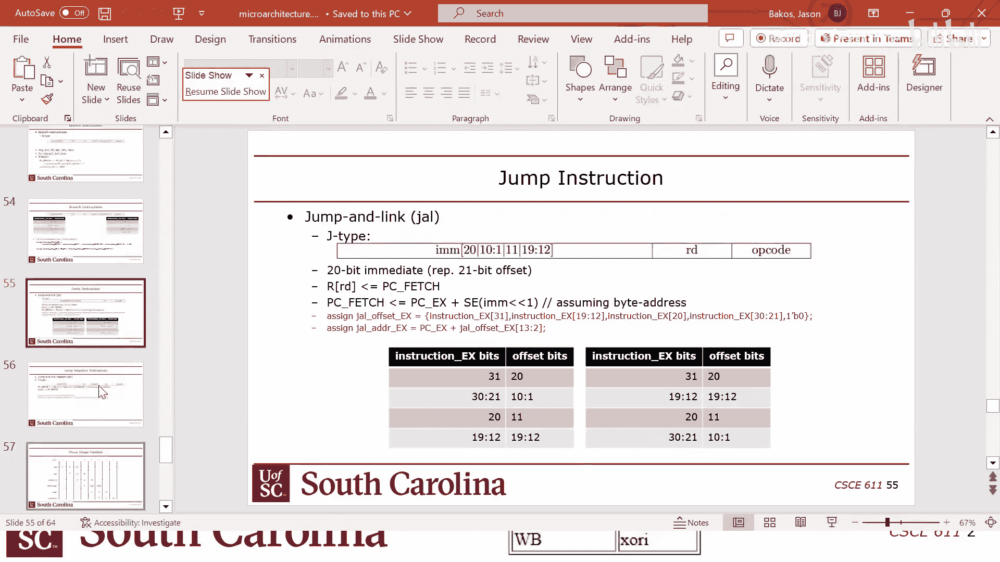
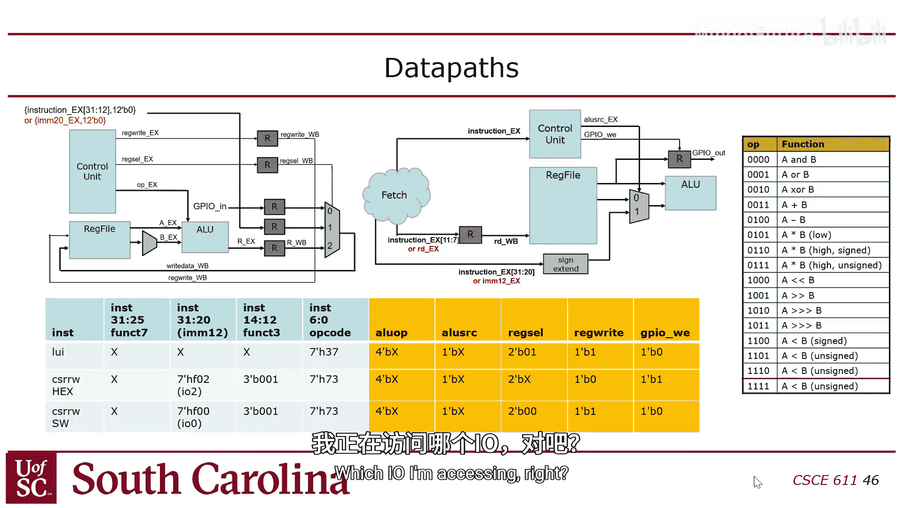
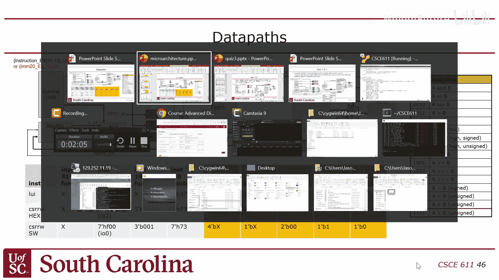
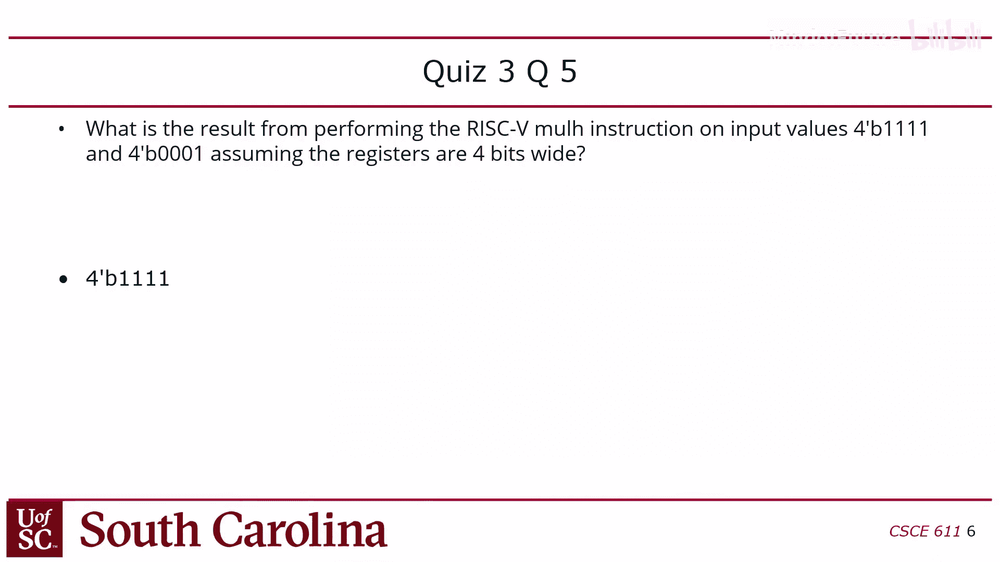

# 高级数字系统设计：P09：RISC-V分支与跳转指令 🚀





在本节课中，我们将要学习RISC-V处理器设计中的分支与跳转指令。我们将回顾即将到来的考试和实验安排，并深入探讨如何为RISC-V CPU添加分支和跳转功能，包括理解其指令格式、计算目标地址以及处理相关的控制信号。



## 课程与实验安排概述

上一节我们介绍了RISC-V的基本流水线结构。本节中，我们来看看近期的课程安排。

*   第一次考试将于10月23日至27日这一周进行。考试将通过Dropbox发布，学生可在该周内任意时间登录并开始考试。考试开始后，有75分钟时间完成。考试包含15道选择题，允许查阅资料。
*   考试内容将涵盖：SystemVerilog语法、RISC-V指令集架构以及RISC-V微架构（重点是三级流水线）。Dropbox上有往届试题可供参考。
*   实验三的截止日期是10月13日（本周五）。实验四将于下周发布。

## 实验三目标回顾

以下是实验三的核心目标：设计一个能够执行特定指令集的RISC-V处理器。

该处理器需要能够执行22条指令，主要包括算术、逻辑、比较和一条I/O指令。此最小指令集足以编写一个实用程序：在DE2开发板的开关上输入一个数字，进行二进制到十进制的转换，并将十进制结果输出到七段数码管上显示。

实验涉及的RISC-V指令格式主要有三种（实际可视为两种，因为U型仅用于LUI指令）：
*   **R型**：用于寄存器-寄存器操作。
*   **I型**：用于立即数操作和I/O访问。
*   **U型**：用于长立即数加载（LUI）。

## CPU数据通路与控制单元设计

理解了指令集后，我们来看看如何构建CPU。核心组件包括指令存储器、程序计数器、寄存器文件、ALU和控制单元。

控制单元的设计是关键，它通常是一个大型的`if-else`语句块，根据当前指令的操作码和功能码字段，生成控制数据通路的多路选择器、寄存器写使能等信号。

以下是控制信号解码的一个示例代码片段：
```verilog
// 解码器示例：提取指令字段
assign funct3 = instruction[14:12];
assign funct7 = instruction[31:25];
assign csr_field = instruction[31:20]; // 与imm12共享高位
```

对于CSRRW这条特殊的I/O指令，需要特别注意。它根据12位立即数字段的值（0或2）来决定是读取开关输入还是写入数码管输出。在我们的实现中，对此指令的行为进行了定制：
*   当立即数字段为0时，从开关读取数据到指定寄存器，并**不**向CSR写入。
*   当立即数字段为2时，将指定寄存器的数据写入数码管，并**不**向通用寄存器写回数据。

## 三级流水线结构

我们的处理器采用三级流水线设计，这意味着在任何时刻，最多有三条指令处于不同的执行阶段。

1.  **取指阶段**：主要包含程序计数器，负责生成下一条指令的地址。
2.  **执行阶段**：这是最复杂的阶段，包含寄存器文件的读写端口、ALU的输入输出以及控制单元。指令在此阶段被解码并执行操作。
3.  **写回阶段**：主要负责将结果写回寄存器文件。

数据在阶段之间通过寄存器（触发器）传递，以同步时序。例如，执行阶段产生的“寄存器写使能”信号需要延迟一个周期，在写回阶段才实际生效。

## 二进制转十进制程序示例

实验三要求编写一个将二进制数转换为十进制显示的程序。由于当前指令集不支持循环和分支，代码需要展开。

基本算法是重复进行“模10”和“除10”操作来提取每一位十进制数字。以下是该算法的核心思路描述：
```
结果寄存器 = 0
循环 8 次：
    当前数字 = 输入值 % 10
    输入值 = 输入值 / 10
    结果寄存器 = (结果寄存器 >> 4) | (当前数字 << 28)
```
每次迭代提取出的数字被放置到结果寄存器的高4位，然后结果寄存器逻辑右移4位。经过8次迭代后，最早提取的数字（最高位）将移动到最低位，最终结果寄存器中存储的32位数可以直接输出到数码管显示。

## 引入分支与跳转指令

接下来，我们为下一阶段的实验做准备：添加分支和跳转指令。这与MIPS架构有重要区别。

首先，RISC-V的分支指令采用**PC相对寻址**，且偏移量的计算是相对于**分支指令自身的地址**，而不是其下一条指令的地址。这与MIPS不同。



为了在流水线中计算分支目标地址，我们需要知道当前执行阶段指令的PC值。一个简便的方法是添加一个`PC_EX`寄存器，它比`PC_fetch`延迟一个周期，正好存储着执行阶段指令的地址。

分支指令使用一种新的**B型指令格式**。其12位偏移量在指令编码中被拆分成多个不连续字段，需要按特定规则拼接和符号扩展。以下是计算分支偏移量的示例代码：
```verilog
// 从B型指令中提取并拼接偏移量
assign branch_offset = { {19{instruction[31]}}, instruction[31], instruction[7], instruction[30:25], instruction[11:8], 1'b0 };
// 注意：由于我们采用字寻址，实际使用时常需忽略最低2位
```

跳转指令（如JAL）使用**J型指令格式**，同样采用PC相对寻址。其20位偏移量的编码方式也很特殊，需要类似的拼接操作。JAL指令总是会将返回地址（PC+4）写入目标寄存器，若想实现无条件跳转而不链接，可将目标寄存器设置为`x0`。

## 控制信号小测验解析

最后，我们通过一个小测验来巩固对控制信号的理解。问题涉及在流水线不同阶段，针对特定指令（如LUI, CSRRW, ADDI），控制信号`RegWrite`、`RegSel`和`ALUSrc`应如何设置。



关键点在于：
*   `LUI`指令不经过ALU，其`ALUSrc`为无关项，`RegSel`应选择立即数路径。
*   `CSRRW`指令的行为取决于立即数。在标准RISC-V中，它总是写寄存器；但在我们定制的I/O处理中，向数码管写数据时`RegWrite`应为0。
*   `ADDI`是I型指令，其`ALUSrc`应为1，以选择立即数作为ALU的第二个输入。





## 总结



本节课中我们一起学习了RISC-V处理器设计的多个重要主题。我们回顾了实验三的目标，即构建一个支持基础算术和I/O操作的CPU，并详细探讨了其数据通路、控制单元和三级流水线。我们还为接下来的实验做了铺垫，深入分析了RISC-V中独特的分支与跳转指令格式、PC相对寻址的计算方法，以及如何为流水线处理器实现这些功能。理解这些控制信号的生成与数据流向，是成功完成处理器设计的关键。