# 【南卡罗来纳大学】高级数字系统设计-CSCE611-（Advanced-Digital-Design，Fall-2023）-p10-P10-Sequential-Logic--BV19nf6YoEZ9_p10-

Sequential logic is digital logic that has memory in it so you've got combinational logic where the outputs are a function of only the inputs and sequential logic where the outputs are a function of both the inputs and the input history so in sequential logic you have some kind of memory in the circuit。

Now there's a couple of weird terms。That can be confusing so technically。As I mentioned。

 sequential logic is where the output depends on the present value。

 the inputs and the sequence of past inputs， it implies that there's memory。

 synchronous sequential logic is when specifically where you have sequential logic that uses a clock。

So you could technically have。Sequential logic without a clock。Asynchronous sequential logic。

But no one's ever really gotten that to work。 Unfortunately， it would be great if it worked。

 because the clock consumes a lot of power。And chips。

 because the clock is distributed all over the chip。So if you could come up with a practical way to。

Build sequential logic without a clock。 That would be。

That would be a billion dollar idea because that would be that would make chips consume much less power。

 but the much easier way to do it is with a clock。 So basically you've got a clock that's synchronizing all the sequential logic。

And then you've got this term state that I'll use a lot。

 which is all of the information in the circuit that's necessary to explain。Future behavior。

It's basically the contents of the memory that have to be registered inside the circuit。

 and the memory itself is built with either latches or flip flops。

Can you guys talk about latches and flip flops into  11， but you did cover that Okay， good okay so。

So before I talk about that， in Verlog， there's two ways that I know of。To create a memory in very。

The first way is to have in all actually what I should say is there's two ways to describe a logic circuit that has memory。

Both ways use the always， the always statement。So in the first case I have an always。

 and it says always at Po edge clock， A gets B。Why does that have memory。

 it's because B is an input in that always。But it's not part of the sensitivity list。

 So if B changes without the clock， positive edge of the clock， then that circuit has to remember。

The old value of B from when you got the the clock edge。 Does it makes sense。

The other way is if you have an always at star， so this looks like a combinational logic always。

So always it's star， star means that。Anything that's treated as an input in the always。

The circle will be sensitive to。Right so that should be combinational logic。 However， problem is。

 if you have an if statement in there that forgets that that causes the always to trigger but not assign one of the outputs。

 So in this case。C is an input， B is an output， A is an input， right， so a is an input。

Because it's part of a condition， C is an input because it's on the right hand side of an assignment and B is an output。

The problem is is that if any of those， if A or C changes， it'll activate the always。

 but when it's activated，If this if statement is evaluated false。

 if this if condition is evaluated to be false， then sign I don't assign the output， right。

 you guys see that。So they always may run。Without ever assigning its output， B。

So that has to create memory because that means that B has to hold on to its old value。

Whatever it was last assigned to。 So even though it activates on all the inputs。

 it doesn't necessarily assign， I mean， it doesn't assign all the outputs whenever it's activated。

 So to summarize that， you can either have a sensitivity list that doesn't include the inputs or you can have a control flow inside the always that doesn't。

Always assign every possible output every time the assign is activated。So in this case。

 this is going to create that first option is going to create a。That ends up creating a flip fl。

Because it activates on the edge of the clock。And it synchronizes the clock。

 the bottom one is creates a latch。Because it's using a to control whether or not the output gets assigned。

 so a is kind of like the clock in the second example， I don't call it clock， I call it A。

 but it's effectively a clock for a latch。Okay。So I've got on this timing diagram。

 I've got clock and D。D is the input。And Q is the output。 And I've got two always statements。

 which are the same two I showed you before。 I just changed， I changed the names of the signals here。

 So in the case of a latch， I say always at star。 If clock equals 1， then Q gets D。

And in the second one， I said always at pause edge clock， if clock equals 1， then  Q gets D。

Make sense。So how do these。How do these work well in the latch case， anytime the clock is high。

The D input will。Move straight out into the Q output。 right， So in other words， in the latch case。

The Q is doing whatever D is doing， essentially， right？D is always Q is always D， right？

When the clock is high。But then when the clock is low。Like it is。Here。Clock is low。

 D changes Q doesn't。You see that， so the clock， when the clock is high。

You know D propagates straight out to Q。When it's low， it doesn't， of course， in this case。

 there's no change in at this point， there's nothing interesting going on here。

RightWhen the clock is low there because D doesn't change， but when the clock is low over here。

 D does change， but Q doesn't correspondingly change。Now in the case of a flip flop。

Whenever you have the rising edge of the clock。It's like taking a snapshot of D。

So rising into the clock will sample。Whatever's on D。 So in this case， rising into the clock。

 D is low and the output is going to go low。In response to that。

Any other time that you D doesn't D can change and that won't change Q the only time that Q will change is on the rising edge of the clock。

 in this case Q you have a rising edge of the clock here， D is high。

 Q was low and transitions to high in response to that you're going to see that。

So in the case of the latch。The latch value now at the beginning here。

 both of these are don't know notice that there's a line on the top and the bottom because I don't know what Q is at the beginning。

 I don't know what the initial condition here of Q is。

 but the first time Q changes for or the first time I know what Q is is you know when we have D actually right here D and clock goes high initially D is low that will ensure that Q goes low D changes while the clock is still high and that will cause Q to go high right and then in the fliplo you just have to look at the rising edges the clock to see where the corresponding changes in QR does that make sense？

Okay， so。The problem is， is that。You don't want to ever use lashes。Because latches complicate。

timingiming。FPGAs can support latch behavior。But if you want to maximize your clock rate。

 you want to use。Fff flops。Make sense。 So you should avoid latch behavior in your code unless you really want it。

 But in this class， you should avoid it， right， which means that if you have。

 if use always underscore comm， that's good because then the compiler will。Give you an error。

 If you have a latch in there。 If you is always at star and you have a latch accidentally。

 you won't get an error message。 I think it does generate a warning， though， and models him。

Because latches are generally， you know， not something。You should use in general。Okay。

If if I have code like this and I want to avoid that latch， all I have to do is put an else here。

 right and problem solved。 right， If I put an else on this， if statement。

 I don't have a latch anymore， you just have to ensure that all the outputs get assigned no matter what control path is taken through the always block。

You guys with me or you could put a default， you know， you could assign Q。Before this。

 if statement to some default value and then have it redefined in the， in the if statement if needed。

ok。Okay。Now， if you have multiple flip flops in parallel that effectively create a multi bit flipflop。

 that's usually just referred to as a register。But it's confusing because we also have registers in the register file。

 so there's two types of registers， there's a register that you have in your circuit。

 which is a multi bit flipflop。Multiple bits in and out and you know D D and cube having multiple bits and then you have registers that are in like your assembly language and in your a register file right so those those aren't the same kind of register the register in your register file is actually register file is actually a Ram。

But they're still called registers。 So when you're in micro architectureit。

 like designing a circuit and you have a register， it's just a basically a flip flop。

 but if you have a register in your software， thenre referring to a location in the register file Ram。

Okay， so we talked about， I showed you examples like this before where you could create a flip flop really easily in Verlog。

 you just say always at FF and again， the underscore FF is just， it's optional。

It's just there for you to be able to give the compiler a hint or the synthesizer a hint on what you're intending to do。

But always underscore FF or just always at positive edge clock Q gets D that creates a。Register。

 you can put that in its own module like it's shown here or you can just inline it inside your your another module which hopefully you guys are already doing for lab three。

 you can also have enabled。Flip flops that have an additional feature where you can。

You have this enable input that if the enable is low， then it will ignore the clock。

And if the enable is high， it'll just act like a。A regular register。Ass with me。

 So do we need to use this in lab 3。 Yes， this is for your I O。Two out， I O2 out。

So you have one register in there， at least one register， is there another one？I think there's just。

 I think there's just one， so there's a register that drives the hex displays。

The only time that register should be enabled is when the CSR R W instruction。

Is in the execute stage and。The immediate field is two。

That's the only time that register should be enabled。Because otherwise。

 the hex displays would be changing every cycle。And they would be changing to。

I think the contents of the RRS register， so if you always enable the IO zero or sorry， excuse me。

 IO2 out。If you have it always enabled， then whatever your register file happens to be spitting out on the first readport is going to be shown。

On the hex displays， which means it's going to be changing。Add up to 50 million times per second。So。

 you know， you're not， it's going to be changing so fast， I think it'll probably just look like。

8s or something like on the on the hex display。 So you want to make sure that you only update the hexes。

During those one points in time when you want to update it。

 which is when you actually execute that instruction to update them。

 otherwise you want to lock that value in and hold the value of the hexes while other instructions are being executed。

And then there's also a feature for resetting。You can have a reset input where it'll reset the。

That registered to zero。 you want to， you want to have that for your program counter。

 So when you reset your machine， your your CPU， it should reset the program counter to 0 and start executing instructions at address 0。

 right， If you don't do that， you probably won't notice because。

If the program counter is not resetible。It'll just keep counting and eventually get to 0 anyway。

 right， So you probably wouldn't even notice if you didn't have a reset on there， but。

When you get your branch and jump instructions， it's important to have it because if the program counter comes up in a random value you might end up in a part of your program where you're kind of in an infinite loop and you never do roll back to zero right but right now with when you don't have branch and jump instructions then you're guaranteed to eventually get back to zero right because it's just counting up by one guys with me。

ok 啊。And the reset can be synchronous or asynchronous。

 so if you put the reset in the sensitivity list， that allows you to reset it independent of the clock。

Do we care about that？I don't。 I haven't seen。A case where that matters in this lab， in this class。

 I don't think it matters whether your program counter has a synchronous or asynchronous reset。

 I don't believe so。I usually just make it asynchronous， you know。

 just that way it resets immediately when you hit the reset button。But I don't think it。

 I don't know if it'll make any difference if you make it synchronous。 I don't think so。嗯。

So basically， you know， just to explain， if you have a if inside your always。

 you could say if reset is asserted then set Q to 0， otherwise set Q to BD。

 and then the sensitivity list can either have the just the Po edge clock or the Po edge clock and Po edge reset。

Makes sense。And I don't even know if you need pause edge reset， could just put reset here。Right。

I mean， if you execute the always when reset goes from like high to low。Oh no。

 you don't want that because if you did that， then it'll change Q， actually。Right so yeah。

 you do want to sorry， you do want to pause edge to reset because you don't want to inadvertently have the falling edge of reset update Q。

Makes sense， as with me on that， okay。Okay， that's just a de flip off with reset and enable then you could do other things like you can have。

 you don't necessarily have to build just just a register， you can have like for example。

 a counter in there。So your program counter works like this。

 I gave you the code for that in the lecture， but the program counter。

Has the logic for incrementing embedded inside that sequential logic， that always statement。

 So instead of having an input D that goes to Q， it just counts every cycle， right。

 synchronize of the clock。So you can， in this case， this example counts up and counts down。Or reset。

Okay， so。So use registers， in our case， we're using registers for pipelining。

RightAnd the program counter， so we' got a program counter and we got pipeline registers。

The pipeline registers are designed to break the execution of each instruction into three stages。

So the idea there is that if you executed instructions in one cycle， you would have a very long。

Chain of things that have to happen for each instruction right you'd have to fetch。嗯。

Decode the instruction and the control signals。And then activate the ALU and write the value back in the register file all within one cycle that' going that's going that's a lot of things to do in one clock cycle。

 so we break it up into three cycles and then have each have three instructions being executed executed in parallel in order to speed up the throughput and I'll talk more I have another lecture about timing analysis where I'll talk specifically why having those long those long paths are bad。

Another thing you may want to do with synchronous logic is build a finite state machine。

You guys ever heard of that？State machine。So a state machine is a circuit that introduces sequentiality。

Where the circuit could， if you have something that requires multiple steps sequentially to perform in hardware。

 you have to use a state machine。Makes sense。 You guys say， what do you mean。

 like software is always sequential。 Now， remember， system very log is concurrent。

 has concurrent semantic。 So if you write very log。

 everything in the very log code is happening at at the same time。 it's circuits that are concurrent。

But what happens if you have some hardware operation that you have to break it into phases？

makes sense， then you have to use a state machine。So a finite state machine is a way to describe that behavior。

 so it' it's defined by it's like it's it's sequential logic circuits so it has inputs and outputs。

 but it has a set of states which represent the kind of modes of operation it can be in。嗯。

And so let me give you an example here。 So here's a really simple kind of trivial example。

That the book the textbook has in it， I got this from the textbook。

 so this is a traffic light controller。And the idea is that。

You have an intersection of two roads called Academic Avenue and Bravado Boulevard。

And you have a traffic light。For un academic and at bravada。

And you also have a sensor on both streets that sense when there's。

Cars waiting at the intersection at both streets。 So your inputs are。TA and TBB。

 which is the traffic detector on academicmic in bravado。And you have the actual light。

 the traffic light at academic in bravado， which is L sub A L sub B。

 so TAT TB is a traffic L A LB or the lights right so。You define a state。Where。

The light at academic is green and the light at bravado is red。

And we're going to assign that to be our reset state。 So when you reset the system。

 that's how it comes up by default initially。And then。You create three more states。

That represent in total， the four modes of the intersection。

 So you can have a green light at one on one road and a red at the other or vice versa。

 or you can have a green on one。 I'm sorry， yellow on one road and a red on the other。

 So there's four different accommodations。And the。So you represent each one of those states as like a vertex and a graph。

 and then you have arrows that connect them that define the state transitions。

 how do you get from one state to the next？So if you have a green light on academic and a red light on bravado。

As long as you have traffic。On academic， you want to stay in that state So you have this loop back transition。

 Okay， so T A and TB are binary。And。嗯。The LA and LB are trinary。Cause you have to have read。

Yellow and green。So there are two bits， those light signals are two bits， right？

And so if you have traffic on， like I said， as long as you continue to have traffic on academic you're going to keep that green and in this case there's no like timer that'll time out。

 it'll just stay green indefinitely until we have no traffic on academic in which case it switches to having a yellow on academic and it keeps bravado blue I'm sorry keeps bravado red and it'll stay in that state for one clock cycle so in this case the clock period。

Has to be set up to be the amount of time。That you'd be in that yellow， yellow light would be on。

 So this would be like a clock period of， say。I don't know， five seconds， 10 seconds。

 something like that， so it wouldd be very slow clock， right？In reality。

 you'd have some kind of external timer and know that would signal。You know。

 you'd wait for the timer to reach some point you know and that way you could run the clock faster than the time you know you could run the clock faster。

 but in this case we just adjust the clock to be the yellow light time and then so so then you have this unconditional transition that comes into this state where we've switched now academic to be red and bravado to be green and we'll stay in that state for as long as there's traffic on bravado and in the instant there's no traffic on bravado we'll switch bravado to yellow academic to red and stay in that state for one cycle and then then go back to。

Green light on academics， does that make sense？Okay， so that's kind of it's really simple。

State machine， and so to build this in hardware， you have to create a state transition table。

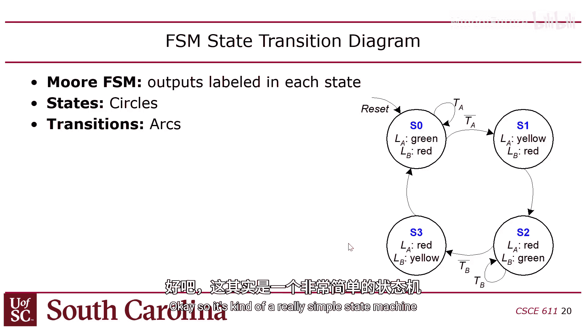

So this is basically just a truth table that relates the state。And the inputs to the next state。

So the current state is labeled S， the next state is S prime and the four states are S0 through S3 and the inputs I mentioned that the traffic sensors are binary and so if you're in state zero which is where you have a green light on academic as long as well actually as long as we have traffic on academic we're going to stay in the same state so this next state will be S0 right however。

 if you have no traffic on academic then your next state will be S1 which is where we have the yellow light on academic right。

If you're in that yellow light state then your next state is S2 and we use don't cares here。

 x is tot when we don't care what the value is and so whenever you have an unconditional transition from。

 in this case the yellow light state we don't care what TA and TBBR。

 we're just going to go to S2 as our next state， so the next time we get a tick clock edge。

 we're going to go to S2 which is the green light on bravada。You guys with me， does it make sense？

Okay。Now notice that when we're in green light on academic。

 we don't care what the traffic on bravado is right we only care about the traffic on on academic so you can fill this truth table out where each one of the rows of the truth table corresponds to one of these arrows right I think that's right one。

2，3，4，5， six arrows so there should be six。

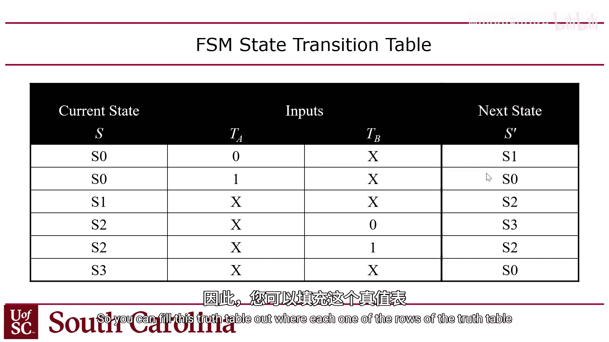

6 rows， Yeah，6 rows， right， one row for each arrow。

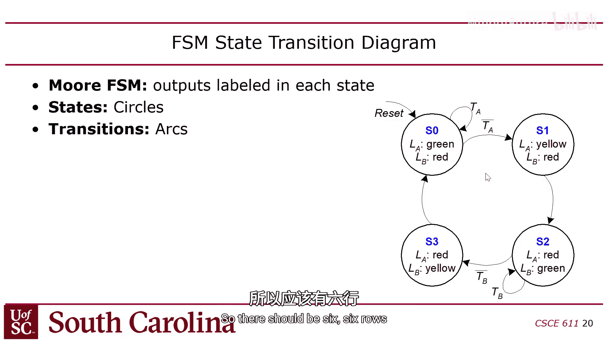

Okay， so then the hardware is going to have to have an encoding for each one of those states。

So we need a binary encoding for state S0 to S3 and there's。

 you know you don't at a minimum you need two bits because the log base2 of four is two。

 but you can actually use more bits for that encoding if you want。

 but you just have to assign a binary， a unique binary value for each state and then you would replace。

The state with the encoding。So S0 is 0，0， S1 is 01。S 2 is 1，0 and S 3 is 1，1。

 And so once you do that， you have a fully binary binary truth table at which point you can translate。

This truth table into into bullolean algebra， right。

 like you using the techniques you guys learned in 211。 In this case， the next state。

 So the output of this logic is the next S1。 So by the way， I once you split these state。

These states into binary values， we now have s sub1 and s sub0 which is the two bits。

 and so you have to generate a circuit for each one of those bits of the state。

 so there's a separate circuit for S1 prime and S2 prime as a function of both the inputs and the current state。

Right， you guys with me。 So there's two bullolean algebra expressions for。The two state bits。Okay。

 so that just determines the transitions and then there's a separate table you have to have where you translate the current state value into the outputs。

 so we have an encoding for the output so the light at academic and the light of bravado can be is a trinary value。

 green yellow red， so green to00， yellow is01， red is 10 it's just the arbitrary mappings that we have there and then for each state we have a light setting for the light。

 the corresponding light and then you that gives you four output bits from the output logic table and you can describe that with for Boolean algebra expressions。

Makes sense。All right， now by the way。Notice that the outputs are only a function of this current state。

You can also have the inputs here as well as input the traffic sensors could be columns on the input side if you want。

If you do that， that allows you to basically have the output。

Be its own little truth table relative to the inputs for each state you're in。

 that's called a mealy machine。 If you do it that way。

 If you do it this way where the outputs are only a function of the inputs。

 it's called a more machine， right in a more machine like this。The outputs are synchronous。

 the outputs only update when you change states， whereas an ammeian machine。

 the outputs could change within a state if you also manipulate the inputs inside of a state， right？

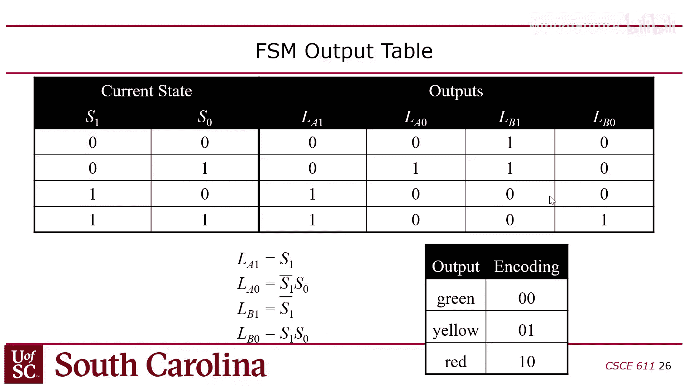

ok。Okay， so in their log then， so that was， I showed you the bullolean algebra implementation when you。

 when you do a state machine in。In in Verlo， well， in system Vlog。

 this is actually specific to system verylo in in regular very log， you have to actually。

Choose your own state encodings manually。But in system very log you can create an enumerated type for the state so and that's what I did up there I have type death en nuome logic1 down to0。

 you still have to give the number of bits for this enumerator type so I said it's a two bit signal。

 but I gave it actual symbolic values that can go there and I call it state type。Did you guys。

 did I do， I think I showed you last lecture how to do that in the lab3 for the instructions Did I show that？

Okay。So these enumerated types are kind of cool because if you。If you have a signal in your CPU。That。

Output that is of an enumerated type were the enumerations of the mneummonics for the instructions。

Then you can have it generate what instruction you're executing， right， you guys with me。

Like in English， like you can have the English pneummonic。In model Sim， using this。

Just as a debugging， it's just a debugging tool， right， it's easy to do because otherwise。

Like like you was saying like it crashes when I get to the subtract instruction， right。

 how do you know when you're executing the subtract instruction， it's just the machine code， right？

But if you have that， you know， if you have a little debugging fee。

 I mean you would know it's the third instruction。 I mean， you know。

 you could see it's the third instruction must be subtract。

 but if you have an enumerated type and you have a signal declared with that type and have you can actually have a print subtract at that moment in that clock cycle right you guys with me Okay anyway。

 But for the state machine， you can use it to label your state。 So I have S0 through3。

Which are really horrible state names， by the way， it should be。

The state names should have been like academic green， academic yellow， bravado green， bravado。

 yellow， right， That would be more。That would be more informative to use a statement。Yeah。

 it's more typing。 The reason these come from the textbook。 so I use the textbook names。

 but I think those are dumb names because I don't know what S2， like what is S2。

 Well S2 is when bravado is green， right， but you have to go back and look。So anyway。

 have so then I declare current state and next state with those types and then I have this always here that basically just says。

 whenever you have a pause edge clock or a pause edge reset， if it's a reset， I go into S0。

 that's my reset state。Otherwise， I'm going to take whatever the next state is and make it my current state。

 so this is the only sequential logic block you need to have， this is called the clocked logic。Right。

Guys with me it just controls the clocking， the synchronization。

 then you can have another always block， which is combinational that implements the next state logic because the next state logic is combinational logic。

 right？So this is going to set the current state。I'm sorry。

 this is going to set the next state rather as a function of the current state and。嗯。

The inputs right， so this says for example， if current state equals S2 and the traffic sensor bravado is zero。

 then I'm going to set my next state to be S3。So I create this。

This combination of logic within always just to create this。

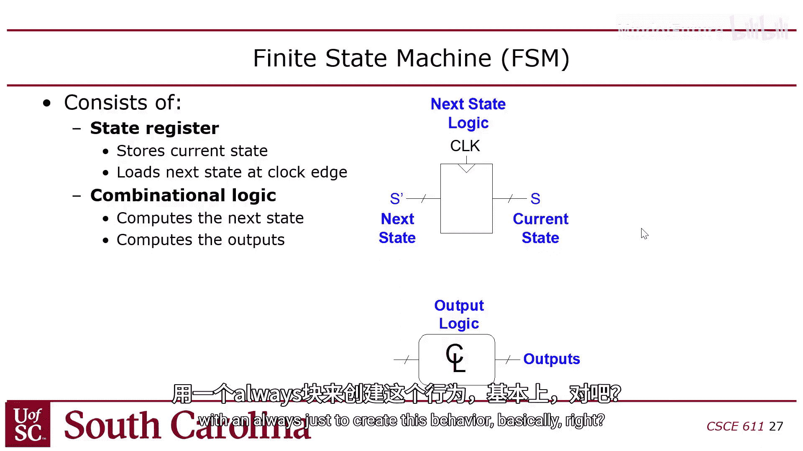

This behavior， basically， right， except instead of I don't have to write it up as bullolean。

 I can just write it in verlog， right with an FN else and using the。

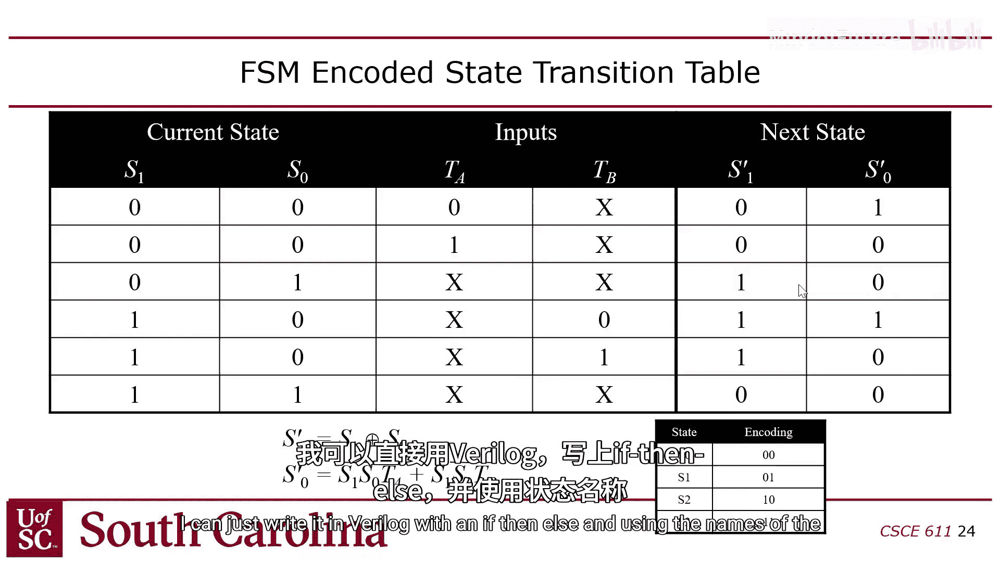

The names of the states。You guys with me？Okay， and then。Right。Basically， you write this code。

And it will probably。Generate this logic or something similar， right。

 something equivalent to this logic， this Boolean logic。And then it should generate。

A schematic that looks like this， right so you can see that the output here is S So the next state is S S prime S S sub1 prime S sub2 prime right。

 That's the next state。 Well， the next state of the two state bits。

And those are the inputs to the fliplo or the register。

And then the output of that register is the current state right so this thing is the clock logic and then these gates here are the next state logic。

You guys with me， obviously you don't have to build。

 you're just writing this and then you're hoping that it's going to synthesize into the corresponding hardware。

And then the output logic is similar。 You can have another always。Another always block。

 another always statement， and you can assign the output as a function of the current state using just an if then else。

And so that should again， generate this behavior with something that looks like that。Logic。

 in this case， the output logic is just that these three gates。Make sense。Okay。Alright。

 so then you end up with a timing diagram。 When you simulate this thing， you're going to want to put。

The UN want a plot。Next state。Current state。Light on academic， light on bravado。

And you run your clock， you reset it when you reset， that's going to reset your。

Current state to zero。Okay， and then。嗯。Every time you have a rising edge of the clock。

 whatever is in the next state is going to transition to the current state。 so， for example。

We have a few cycle， cycle 2 and cycle 3 is where we just have a green on academic。

 So it's just staying in state S 0 at some point。The traffic sensor on academic drops。

 which will correspondingly drop or set the next state to the yellow light on academic right。

 but but that won't take effect until the next rising edge of the clock at which point it'll become the current state right So there's a lag。

 There's a lag between the next state。So in other words。

 the next state is going to update right after the traffic sensor goes to zero。

 but there's going to be a delay because。That won't go into the current state until the next rising edge of the clock。

 right？And then remember that S1 is the yellow light on academic。

 so you'll stay in that state for a fixed amount of time one cycle because you're going to go to S2 on the following rising edge and then once you're in S2。

 you're going to stay in there until the bravado traffic is zero。

 so there's the bravado traffic going from1 to zero there。

 which is going to cause the next state to go to S3。

 but that's not going to do anything until the next clock edge where at which point the current statell become S3。

RightAnd then S3， of course， is a yellow light state。

 So we're there for one cycle when we automatically go to S0。Makes sense。

So when you plot these in model SIim， it'll actually show you。

The names of the states have used an enumerated titan。Okay。

 I mentioned that the encoding for those states can be binary， or you can use one hot encoding。

Where you know， if you have four states use four bits， one of those bits is one。

 depending on what state you're in。嗯。You don't have to decide that。

 though if you use that enumerated state and system very， it'll decide that。

 although even when you use an enumerated state， you have to tell it how many bits it's allowed to use。

So we told it it's only allowed to use two bits there。

 so the synthesizer will choose the encoding how to map each one of those states to a binary code。ok。

Okay， so here's an example question I had this on an exam。Back in fall 2018。

 you're designing a controller for an elevator and a two store building。

 The controller has the following input provided by the buttons outside the elevator。

The inputs a when a user inputs， these inputs a when a user presses the button and deassert automatically when the elevator is an idle and the corresponding floor。

 So we have a in input called first floor request up。

 second floor request down controller has the following inputs connected the buttons inside the elevator which is when a user presses a button and deserts when the elevator reaches the corresponding floor。

 meaning that know that's just defining the transitions floor one and floor2。

 and then the controller has outputs， meaning go go up， go down Basically So there's four inputs。

 there's a。two inputs corresponding the buttons outside the elevator。

 two inputs corresponding in the buttons inside the elevator。

 and then there's a signal that tells it to go up or go down right so you have to keep track of essentially where the elevator is and what it's going to do next so the solution here was just to create four states。

There's a state for first floor idle， second floor idle。

 state for first floor going up and a state for second floor going down and basically。

If you're on the first floor， idle， you'll transition to first floor going up when you know you get a request。

 you know to go up。Either from the inside buttons or the outside buttons， makes sense。

Right so it's pretty simple。 It's kind of like the traffic light controller。

 You have these loop back transitions that'll tell it to stay put if it doesn't if it's basically idle and there's no request。

Does that make sense？Okay。Okay so。Here's another example。 This one is a divide by three counter。

So this one counts from 01 and goes012 and back to zero。

 so you can see that we have in this case three states， all the transitions are unconditional。

 we have the next state logic that you know that's pretty boilerplate。

 you know basically if you have a reset signal you set the state to the reset state otherwise you set the state to be whatever the next state is。

And then。The next state logic is also very simple because all the transitions are unconditional。

 So we don't look at the inputs。 In fact， there are no inputs here。

 And then the output logic is basically just saying assign Q。Equals state equals equals0。

So Q is only， oh yeah， Q is just basically a1 bit output that just is inserted in the S0。

 So it's basically 1，0，0，1，0，0，10，0 as it flips through。Okay。All right。

 so let's take a look at a more realistic example then。So。Controllers are so by the way。

 just to be clear， the if you have an elevator controller， a traffic light controller。

It's probably going to be controlled by software because it's easier to write software than a state machine。

 right， You just write software on a microcontroller。

 And that's because the traffic light and the elevator are not operating。

 they're operating at a very。Long timescales right so you can afford to just write software right but what about an example where you actually have to design a state machine controller when would you have to do that Well that's whenever you have things going on at the timescales of the clock right like single clock cycles right'ss's when the dynamics are too fast to use software where you have to use a hardware controller right and I think one of the most common examples are bus protocols。

So the most common one is axie。Which stands for it's the one that's in everyone's phones。 basically。

 it controls。Basically， all the。Consumer embedded systems。嗯。All the arm processor base systems。

So a stands for arm advanced， extensible interface。

 and it's a master slave interface and it's used for programmed IO transactions。

 meaning that it's when you've got the CPU can issue read or write requests out to peripherals。

You guys with me and the peripherals that are targeted are targeted according to their address。

 So each peripheral has an address range。 and if you read or write to the address range corresponding to a peripheral。

 it goes out on the bus， and then theres there's auxiliary logic that routes that request to the peripheral。

You guys with me。So if you design a peripheral。You have to put these axie interface on it right you have to be able to talk。

 that's the language， basically that's the language that all these modules speak inside a system on chip。

 yes。Protocols where it sends the same thing to every device but only certain ones are like they're looking for certainre supposed to act on that。

 Yeah， that would be like a bus type architecture where they all are hooked into one bus but modern chips use a switch there's a switch interconnect。

 So instead of shared a shared bus there's these arbiters there's these switch well their switches actually they crossbar switches where the master has a port on that switch and the switch is aware of what the address ranges are what the IO ranges are and based on that address。

 it'll route to the request to the appropriate output or the switch just goes to the one peripheral that way you can have multiple things going on at one time and all the connections or point to point So everyone connects to a switch So everyones everyone that wants to communicate on axie it just basically have one connection to the switch and then everyone that wants to be know receive a request from axie is on is a one connection from the other side of the switch okay so axie is。

U。So the idea behind Axie is that it's a high performance protocol。

They want to be able to support multiple outstanding requests at one time。

And they want it to be full duplex。So you should be able to read and write at the same time。

 and you should be able to。Have like you should be able to issue like10 read requests before you know。

 the first one response， right In other words， they want to support multiple outstanding requests in flight Does it make sense right So it's not a simple thing where you just put in you know you send an address out and read and then you wait for the response to come back。

 You don't want to have to wait for the response to come back because that's going to lower your utilization right You want to be able to have you want it to be more flexible So the way they solve this is they have the bus has has actually five different channels in it。

There is a read address channel。A right address channel read data channel write data channel on a response channel so if I want to write to the bus I want to send something to a peripheral then I would send instead of saying I want to write you just put the address that you want to write to out on the right address channel right and because you've chosen that channel to put the address on it's implied that you want to write right？

Okay， likewise， the read address， if I put an address out on read address。

It's implied I want to read and then the data is then sent on the corresponding channel so there's a read data channel a write data channel does it makes sense so I can read and write at the same time basically right and then there's a response channel that allows for an acknowledgement mechanism it allows me to know that my request worked。

And that's a separate channel that makes sense。So the channels are labeled the AR channel。

 AW channel， R channel， W channel， and B channel。And this is， by the way。

 just to emphasize this is the state of the art。Bus protocol。 This is what is currently used。

To connect everything inside an iPhone processor even to this day。

Now there's some other features by the way， there's burst modes where you can do a read and you can send one address and tell it that you want to do 16 reads from that address and so it'll burst 16 values back on the read data channel so it has some and also has security features where you can you can have levels of protection there's a lot of stuff going on but this is just the basic concept of how you do single transactions。

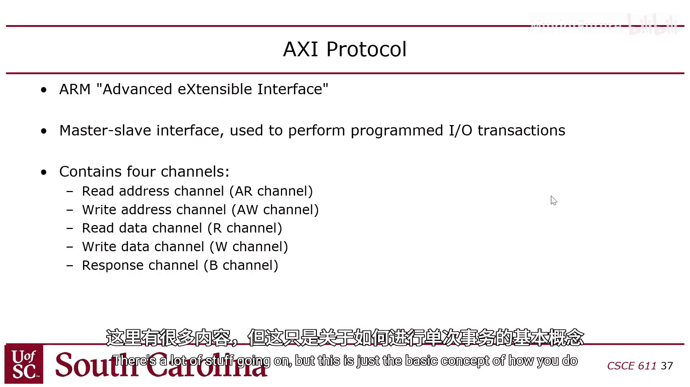

Okay， so basically， whenever I do， this is an example for a right。

So there's also this handha protocol that has to happen where if I want to put an address out。

On say the AW channel， the AW address， meaning I want to do a write， I want to write to an address。

So the master will say， you put the address out and you put the valid。

 you say I've got an address and it's valid， and I have to hold it there until。

The other side of the connection， you know， whoever that address is referring to。

 has to come back with a ready。So that's the way that it's like a handshake， I say I have an address。

 it's valid， and I gotta sit there and chill until the other side comes back and says， okay。

 I'm ready。Right at which point I can assume that I've now registered my request for the read and I drop。

 I can I can deassert the address and I can drop valid。 Does it make sense then。Once that happens。

 in this case， I'm doing a right。So because that was on the right address channel。

 then I got to send the data I want to write to the to the other side。

 That happens in a different phase。 So now I've got the address out there。

 I got to send the data I want to write。 So the same thing happens I put the data out on the right data channel and。

I assert。Oh， sorry， I got it wrong。 I wait until the right ready signal comes up from the other side。

 so I have to wait for the target to tell me he's ready for the data。You guys with me？

So it's almost like the opposite， I got to wait for him to be ready。

 at which point once that ready goes up， then I can wait for several cycles optionally if I want to。

 but when I'm ready to send the data， I send the data on there and I say the data is valid。

Makes sense。And then I do that for one cycle per word， and when I'm done， you assert the W last。

That's the last word， in this case， only had one word， so the first word was the last word。

Makes sense。Okay， then。I have to wait to see if that right worked。

 I have to wait for the the other side of the channel to report back that everything's okay。

 So that comes back on the B response。So for that， I have to assert be ready。

Signaling that I'm ready for a response。And then。Eventually I'll get a response code and a valid for the response。

And there's different response codes。 One of them is okay。 It means everything went fine。

 Another one says that something went wrong。 It was an error。Makes sense。It's kind of confusing。

 but that's that's the way。You know， that's that's the way that actually works， at least for right。

 Okay， so let's say now I want to create a interface for this， which is something that。

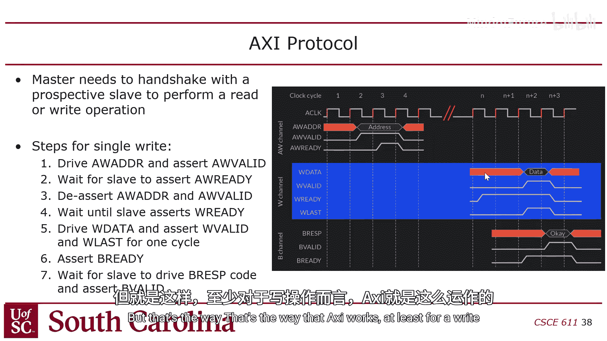

If any of you become hardware designers， you're probably going to have to do this because。

By by creating a axie interface for your hardware design。

 it means that you can drop your design into any system on ship that has an axie bus。

 which is basically all of embedded systems use axie。Makes sense。

 so you can design you can design something like say say you design a neural network accelerator of some kind or like you know like Apples Apple has the neural processor unit。

 the NPU right that NPU is a slave peripheral that just gets dropped into the SOC and it speaks Axie。

 which allows the arm processor on there to send it work to do right or the image processor or the GPU all of those things are peripherals。

That go in there and they can communicate with the rest of the system through this axi language。

So you might have this product interface design that allows your application logic。

To talk in a very simplified way where you can just say， I just want to write。

 you know you give it a right address and write data and then you allow this block。

 this module to translate for you soll it'll take you know the application logic just says here's what I want to write here's the address go take care of it for me and then this guy will take care of all the handhaking required to move that data through onto the axxibu makes sense。

 so basically the idea is that on the lefthand side I' have a very simplified interface where I've got clock and reset。

And then this thing just writes。ThisIt doesn't know how to read。

 so I'm just going to say this is my right， want to be able I want a master interface that can write。

And so what I do is if I want to write， I just give it an address and data。

 and then I just give it a right enable signal。Right。

 and then it'll come back with busy while it's working on sending that right request out。

 And that that way I know when it's done。 And if there's an error， it'll send an air flag out。

 that's real simple。 right， however， on the other side。

 this is the part that's going to connect to the bus infrastructure on the chip。

 This is the side that's going to have the axy protocol on it， right So the question is。

 how do I design this thing。 Well， the problem is is that I have to I have to do a design that's sequentialized。

 it has to go through these phases， the handshake process。 It has to go through the address part。

 the data part， the response part， it has to it has to walk through these steps。

 and doing that inve log， just in pure error log would be difficult because you know。

 you need you need a framework for。Not only synchronizing， but going through these steps。

 So this is this is typically what you'd use a state machine for。

 So this is my state machine for this。So I have one， two， three， four， five， six， that eight states。

 there's an idle state that's also my start state that's basically whenever nothing's going on。

And notice that in Ile， I'm assuming that I've got default output。

 So the busy output and the air output are just 0。 and all of the outputs to。嗯。

The bus are set up to be innocuous， basically where， you know。Write valid and be valid。

And right last， they're all zeros。And AW valid zeros， meaning I don't want to。

 I'm not engaging the bus。 So all of the， all the default values are like， don't do anything， right。

 And then if I get a right enabled。From the user logic， my application logic， if I。

 if I get a request for me to go and send a value out on that bus。

 that will be triggered by the right enable being high。

 so that'll cause me to go to this request to send rest state。

 which I will basically use to set first of all， I send busy back to my。

My user to tell him that I'm on it。 and then I set the AW valid to be one because that's the first step you have to tell。

 you have to say。You have to say valid is one， right， My address is valid。 Now， the address output。

Is not shown， but the idea is， is that the address output is going to be whatever the address input is。

 So I'm just going to take whatever the address input is here。The right address。

 And I'm going to just connect this directly to the AW address， right。

 I don't know why I didn't show that。 That should be there。

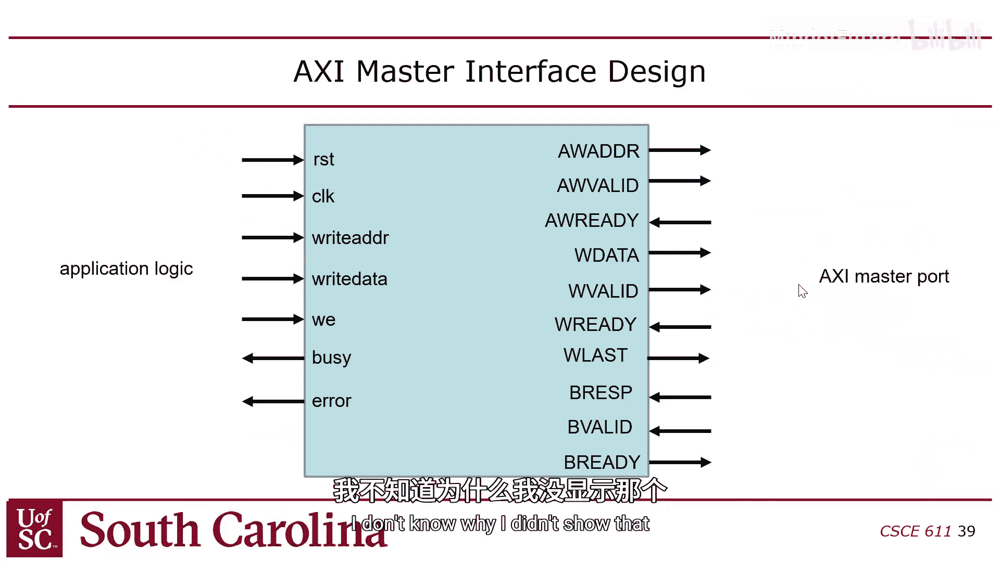

Yeah， that should be there。 It should say， sorry， it should say AW ADDR。Is going to get the。

Rightite address。Right address， right， Is that what I called it here， Yeah， right address， sorry。

 yep。

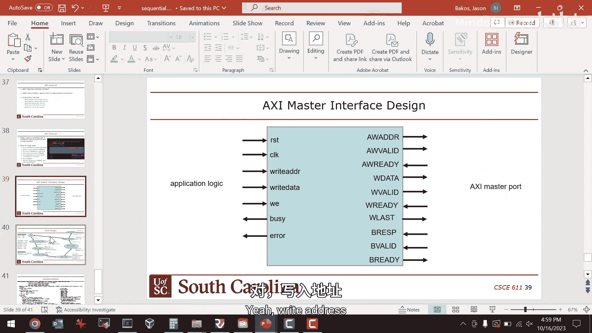

So basically I tell the Axie bus， here's your address and it's valid and I don't have to tell it I want to write because it knows I want to write because I'm using the address right channel。

 right？Okay， so you set that up。 and then my job is to wait until the ready is one。

 That's the the value back from the， the bus。 that's going to say。Okay， I got it， I got your address。

 I got your request at which point I go。Oh， actually， I'm sorry， no I did sorry。

 got ahead of myself there。

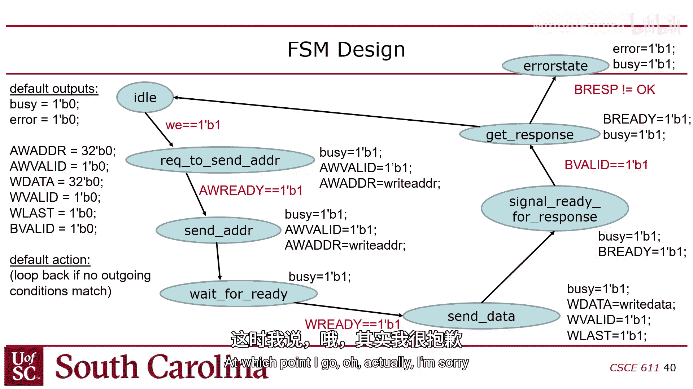

Scratch that。The way I have this set up is I send the request first。

 and then when I get the ready back， then I put the address out on the bus， sorry。

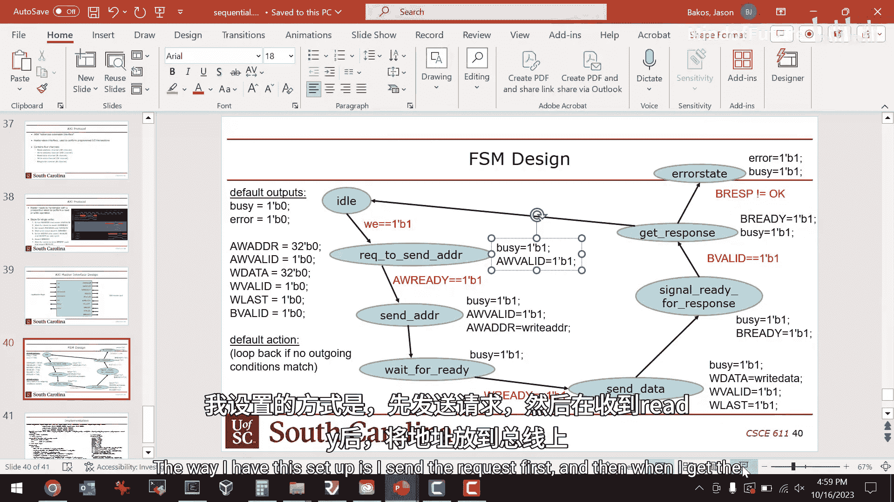

Yeah， so I wait for the request， I wait for the ready to go high。 Is that。

 that's how the timing diagram works， right。

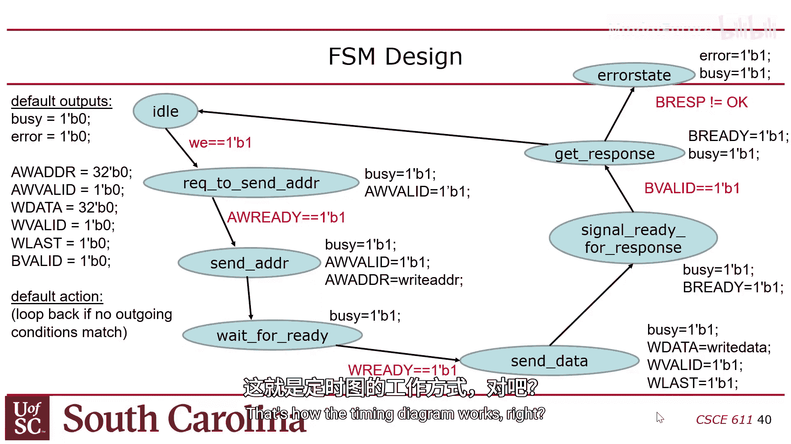

So。I send the ballot out and soon as the ready comes out， then I put the address。 Yeah。

 so technically you notice that the address was asserted at the same time as the right valid。

 but in this case I' to put I'm going to wait to the valid comes high before I put the address out。

 I don't think that matters。I'd have to， I'd have to。I think that should be fine， right， Okay。

 so the point is， is that I wait for the the bus to be ready。 I send the address out。

 I do that for one cycle， and then。

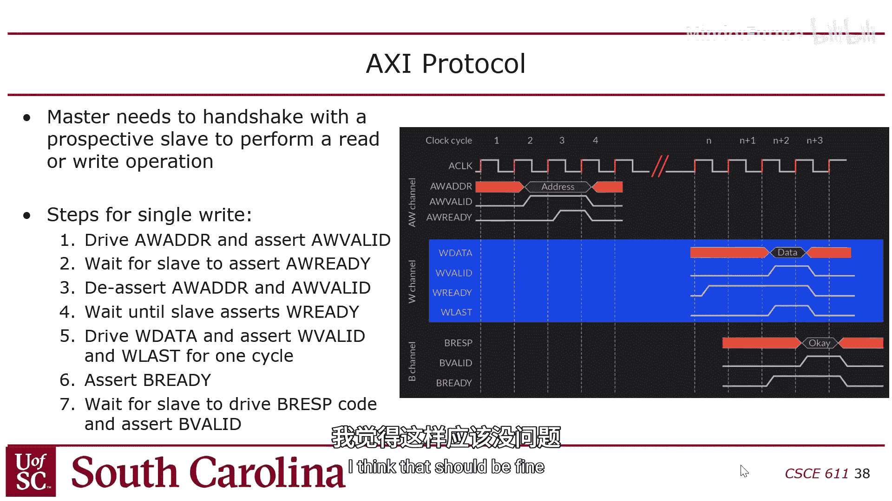

I go to the next state， which is where I wait for the data bus to be ready right so the next phase of the operation is。

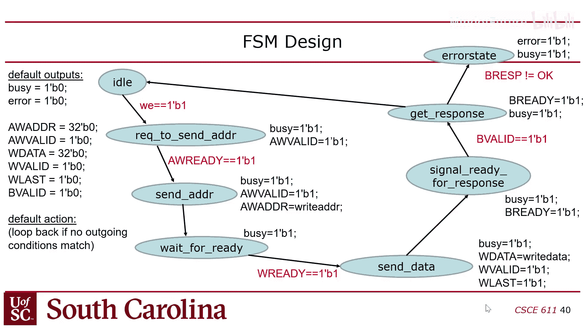

I have the I have the address registered and now I have to wait for this guy to come online this right ready。

 right data ready once that comes up， then I can send my data and my valid and my last right so I sit waiting for。

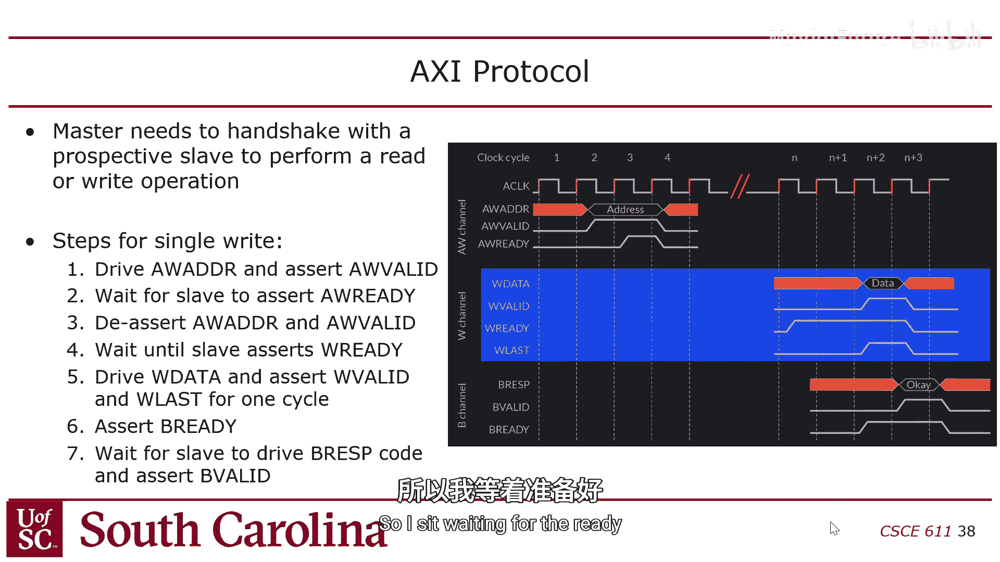

The ready。I'm waiting for right ready at which point I set up my right data， my right valid。

 my right last。 I'm still sitting busy to one this whole time。 by the way。

 all these states have busy as one， except for idle。

 And then I do that for one cycle because I'm not doing a burst transfer。

 I'm just saying one word at a time。 I'm just writing one word。

 you can write more than one word if you want， but I'm only doing a single word transaction So this is an unconditional transition here。

 at which point I say， okay， I'm ready for the acknowledgeknowment。 be ready is one。

 I stay there until be valid as one in which case。I go to the get response。

And as long as the B response is okay， then I just go back to Ile。 Otherwise。

 I go to that air state and say。I give it an error message and then I get locked up in there。

 I get hung。I get trapped in air state。So if there's an error。

 I just kind of lock up the whole interface in this case。

Probably I should have a transition back to Idle and just， you know。

Or have like a clear air input that brings me back to idle。 But I didn't put that in。

 Does it make sense。 So what what is the point here， The point is， is that I have。

 I need at least8 states in order to do an Ay right。 And I can't do this with software。 You can't。

Bit bitit bangang， if you ever heard the word bit bangang。

 Bi bang is when you use software to control like a bus like this。 Like。

 you want to use software to to manipulate the bits to create。An interface to communicate over bits。

You can't bit bangang because the software wouldn't be fast enough to do this。

 this is happening at single cycle granularity at timing right so the state machine is there to be able to walk through these states at the cycle by cycle granularity faster than software would be able to respond to these signals。

So。Anyway， that's more practical example。 Okay， so then I put the implementation in here。And。

Basically I split it again， I've got the clock logic， I've got the enumerated types there。

 the en nuerated type for the state， I've got the clock logic here， the next state logic here。

 the next state logic I in this case I use a case statement。

You can use a case statement so just in if else， so I have a case for every state， I for every state。

 the current state， I check the inputs and。Generate the next state value。

 the next state value is just nothing happens to that until I get the next clock edge at which point it becomes the current state and then the output logic is it's using a more style machine。

 I think。Yeah， it's more style because all of the if statements in here are only looking at the state。

 not the inputs right， so basically the outputs are driven as a function just of what state I am。

Make sense。And so， that's a。ThatYeah， so that's an axI interface。For writing anyway。

 you'd have to be in the reality， it would have to support reads too， so it would be。

Bigger than that， any questions？Of course， you'd have to design one of these for the other side。 too。

 This is for a master port。 If you had a slave port。

 you'd have to have a similar arrangement where you have a state machine that interprets things from the bus and then puts the values out to the user logic。

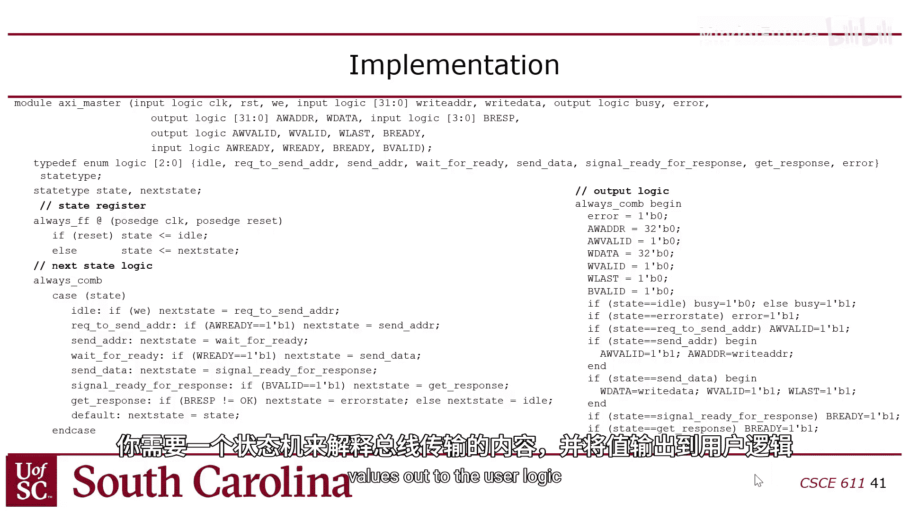

Okay， all right， great， any questions about that？Okay， so I have a few minutes left。

 I'm going just introduce the next topic。Which is timing analysis。

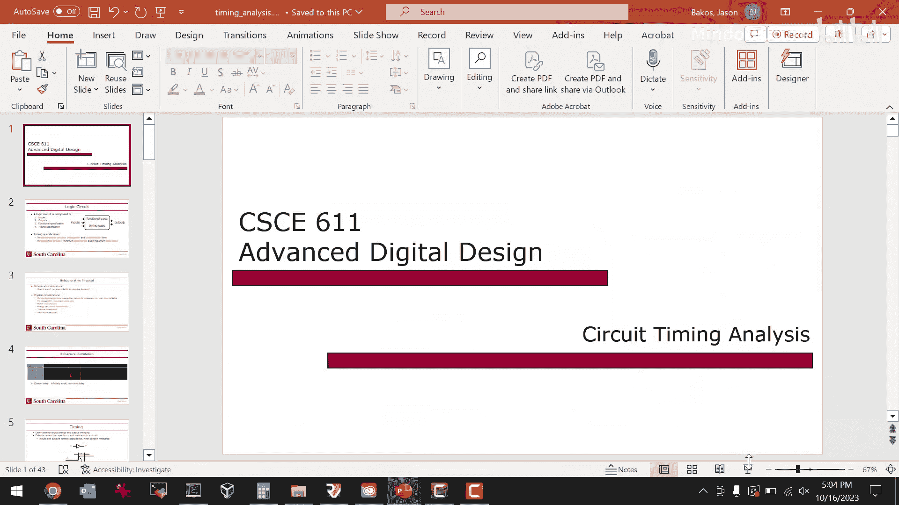

Okay， so at the beginning of the semester we talked about logic circuits， they have inputs， outputs。

 functional specification， and a timing specification， we didn't talk about the timing specification。

So what is that all about？That's okay， so when you simulate。When you simulate and model Sim。

 you guys。Haven't had to worry about timing。Delay， I should say。

 you've had to worry about timing in the sense of clock cycles， right。

 You have to synchronize things to clocks， clock signals。 But every time you have logic。

The output changes。Anytime right after the input。The inputs change， right， There's no delay。

 There's no propagation delay between the inputs and the outputs of the logic circuit， right。

 And that's because Model Sim doesn't know what those delays would be。

 It's just a functional behavioral simulator。 It's， it's just。

 it's simulating the behavior of your ver log code。

It not's not aware of the technology and how fast the technology is， how fast the logic circuits are。

 right？So in Cors， when you synthesize your design。We gave you a。We give you right yeah。

 we gave you the constraint， there's a constraint file an SDC file is part of your project。

 you might not see it if you use our scripts。By the way， is there any any issues with the scripts。

 you guys use CSE，6，11 do S H compile It compiles it in the program。 Okay， okay， good so。

I had one of my past students automated that so but the problem with automating is you're not seeing everything that goes into that project。

 One of the things in that project is a pin mapping file that maps the names of your top level inputs and outputs to specific pinNs on the FPGA。

 The other part is a constraint file that says that you need to synthesize it so it runs at 50 megahertz because we're assuming a 50 meHtz clock。

Which means that 50 mehertz is a 20 nanosecond clock period。

 which means that your worst case logic delay of all the combinational circuits in your in your I'm sorry。

 I should say all your data paths， the data path is when you have a memory element。

 a flipflop output that goes through combinational logic and then goes to the input of another flipop。

 right that's a data path right your CPU operates in terms of data path operations。

The worst case timing the worst case delay for data path has to be 020 nanoseconds right and so if you try to not pipeline the CPU。

 you try to make it a single cycle CPU and do everything in one cycle you'd probably violate that 20 nanoseconds and the compile would fail。

 but you you might not know why or what's going on right it would be kind of。

Or it would just take a really long time to synthesize because it would have to struggle to meet that requirement。

 you guys with me， so the timing specification is where you're saying what the clock like， well。

 what the clock speed that you want is essentially right。So well。

 specifically for combinational logic， the timing spec would be the amount of time it takes to propagate and that's comprised of propagation and contamination time and I'll talk about that in a second for sequential circuits it's the minimum。

The clock period。

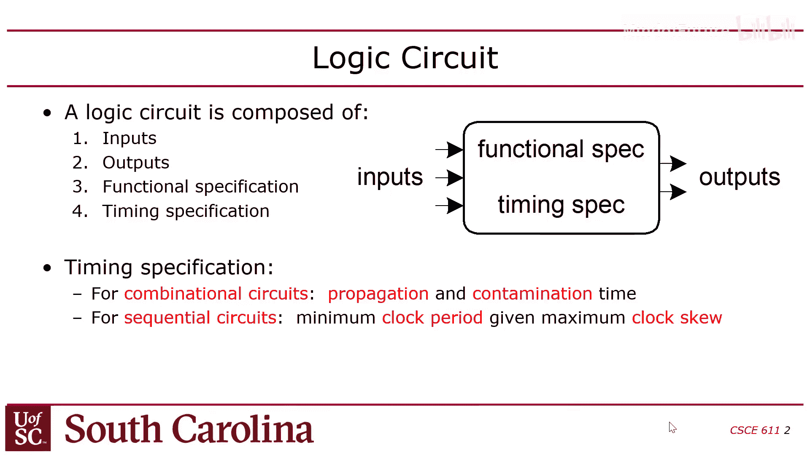

Minimum clock period。Should be should be maximum clock period。 actually， the maximum clock period。

 right， that defines the the maximum clock period that I'll tolerate， right。

 which is the minimum clock frequency that I'll allow guys with me。

 because period and frequency are inverse， right， So it's sorry。

 that was a typo maximum clock period， the longest clock period， you're allowed。

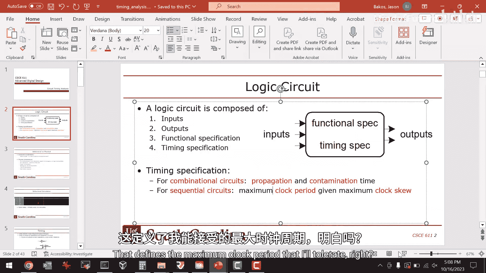

Okay， so。So yeah， I talked about at the beginning of the semester， I think you guys。

 I'm sure you at this point， you realize that when you simulate now。

 you only care about if your circuit works， you don't care about making it faster， you know。

 making the clock faster。嗯。

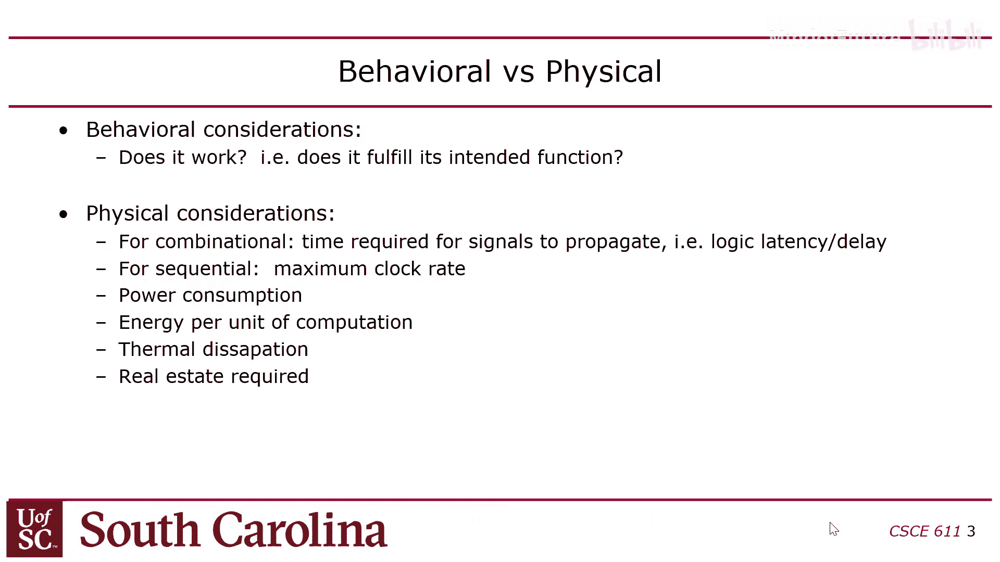

And so you have this in the simulator， they have this epsilon delay。

 which means that when you have an input change， the output changes not。Not at the same time。

 but after a delay， but the delay is infinitely small， right So， you know。

 when you guys run and model Sim， you have to run the simulator you have to advance the simulator to see changes。

 but you don't care how much you advance like you don't care what the clock time is in the simulator right It doesn't matter。

 In fact， in your test bench， you could use one unit like you could say set the clock high。

 delay for one unit set set it low delay for one。 It doesn't matter right， It's irrelevant。

 It just you have to have some passage of time， but it doesn't matter how much there is。

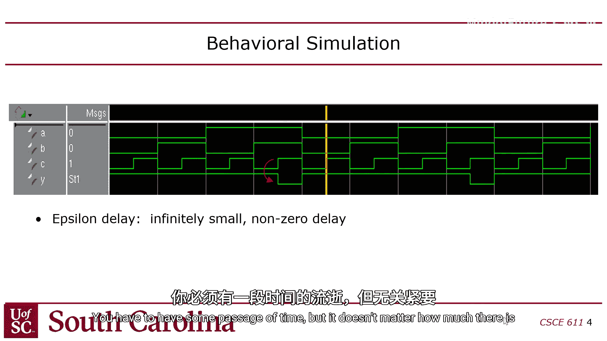

Okay， so， but in reality。When you have a logic gate。

 there is a delay between input changing and the output change， the corresponding output changing。

 there's a delay there。The input changes and then the output changes。So this is a buffer。

 buffer gate doesn't do anything。It just passes， but it's a gate。

RightDoes anyone know why there's a delay there， You know what the source of delay is。

AndThink about that wiser delay。Well， there's a delay because this is a RC circuit。

This circuit has resistance and capacitance。In fact。

 digital logic fundamentally uses capacitance to create these logic gates。 Right， exactly。 Yeah。

 it takes time to charge and discharge capacitors， and that time is generally just the resistance times the capacitance。

Believe it or not， it seems too simple， right？The time in seconds。In the units of seconds。

Is the resistance in ohms times the capacitance and fair ads？

It just happens when you multiply those two， you get seconds。Crazy， right。

 It seems It seems too simple to be true， but that's， that's literally what it is。

 It's the R C constant。And the capacitance。Well， what do you want to do， You want。

 you want that delay to be minimal， right， So you want。

 you want low capacitance and you want low resistance， right。

 The problem is is you can never get to 0。Well， you can't get the zero resistance unless you have a superconductor。

 but you can' never get to zero capacitance because。

The way these gates work is they use a capacitor to turn on and off the transistors。They use charge。

 They charge the gate of the transistor， which attracts minority charge carriers into the channel of the transistor。

 which actually makes the transistor conduct from source to drain。 So you can never get rid of it。

 But also wires have capacitance。 So when you run a wire， that wire is running over a ground plane。

 right， So you basically have wire Sil dioxide， which is a dielectric。

 and then you have another conductor semiconductoror under it。 So every wire is a capacitor。

 and the longer the wires is the more capacitance they have。 So the longer the wire run。

That that's what the tools are actually doing， by the way。When you place a route on the FPGA。

 you're trying to get the wire lengths to be minimal， so you're trying to put。

All the the gates that drive the signal and all the gates that receive the signal you're trying to get them close right except you have fan outs where you have one output goes to multiple inputs and you can't get them all near at each other because you have limited degrees of freedom on a two dimensional plane right so anyway that's basically that's where the delay comes from。

But there's actually two kinds of delays you have to worry about， there's propagation delay。

 which is the longest amount of time it could take。

From the time you change the input to a gate to the time the output changes。Makes sense。

That's the longest delay， but there's also something called the contamination delay。

 which is the shortest amount of delay。That you may see there。So it's a range of values， actually。

 it's the value can change any time between from the time you change the input plus the contamination delay。

Two， the time you change the input plus the propagation delay。

 that's the range of times that the output is considered unstable。

It's potentially changing anytime during that range of times， right？So。Now。

 the contamination delay and the propagation delay are different。

And there's a different reason why they're different for a single gate versus a multiple gates in a logic circuit for a single gate。

 you have gates or multiple transistors right and you have in an AsI anyway in an FPGA it's a lot。

 but you have different lengths of wire are inside the gate right also temperature affects gates。嗯。

They're slower when they're hot。They're faster when they're cold。No， that's a semiconductor property。

 device property， for whatever reason， the charge carriers inside the silicon。

Isn't it when a wire gets hotter， the resistance increases。 Well， that could be， that's true also。

 yeah， that's true too。 Yeah， you're right， you're right， yeah， that's for wires。 Yeah， so。

 but anyway， there's， yeah， there's differences。 temperature affects it also。

But with a logic circuit， typically when you talk about a logic circuit。

 you're talking about multiple gates right and there's multiple paths through that logic circuit。

 so sometimes you might change an input that has a short path and sometimes you'll change an input that has a longer path because not all the paths to the circuit are balanced。

So that's why those may be different， but I think my out of time， I've been out of time， yeah。

 sorry running late， sorry， okay， sorry see you guys on next I'll see you in lab and then we'll see in lecture again on Monday。

 have a good fall break。Actually， technically， I think I canceled lab on Wednesday because the Friday one is canceled。

 so we'll probably won't see you till next election then。

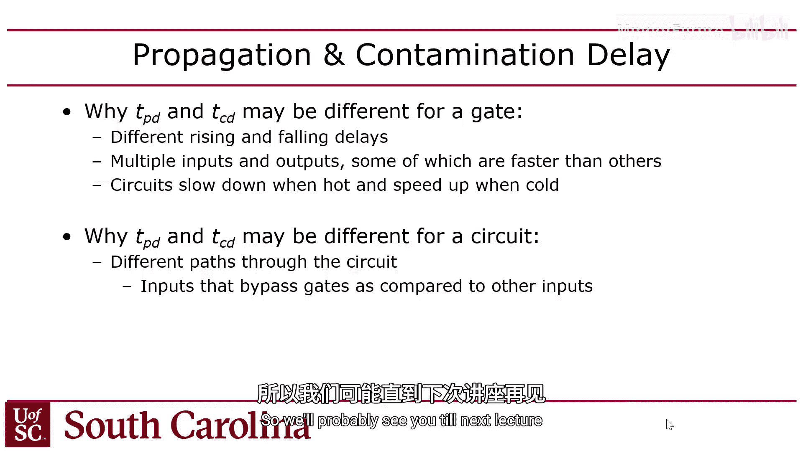