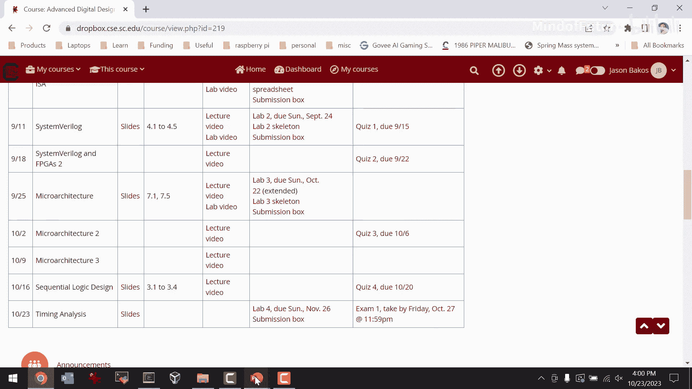
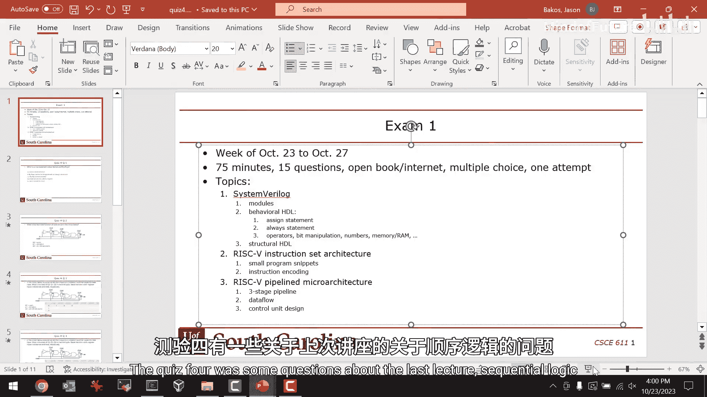
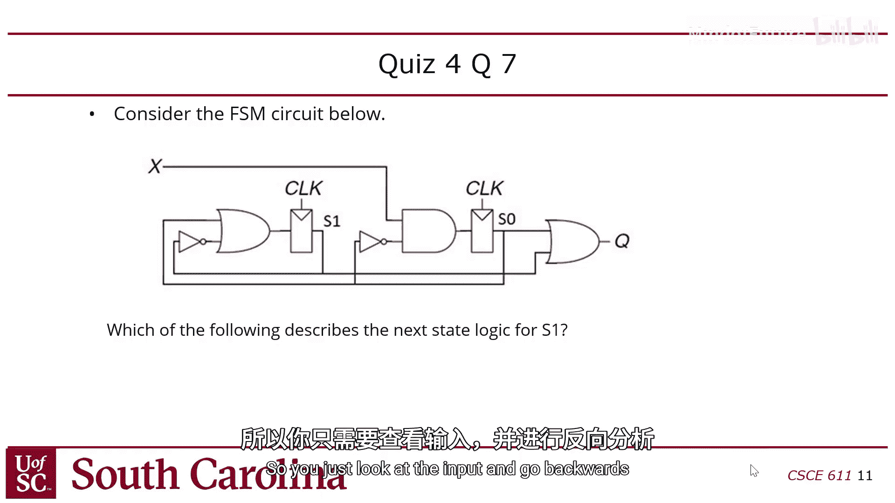
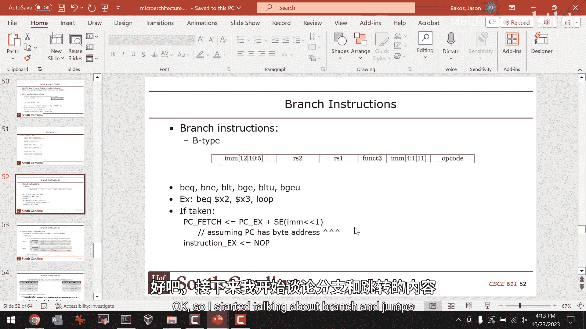
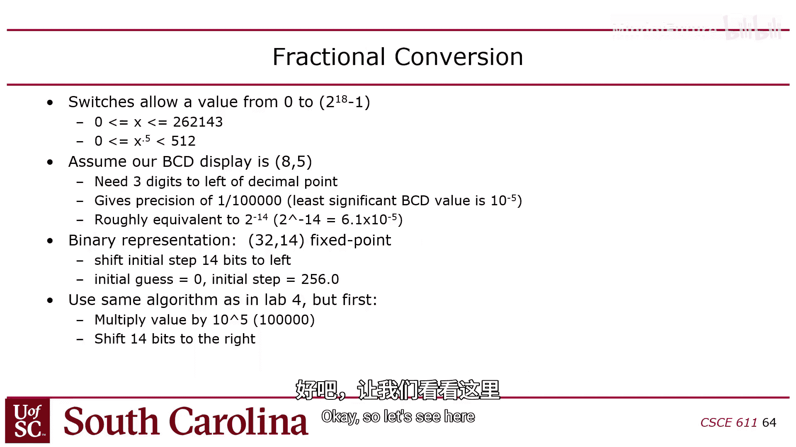
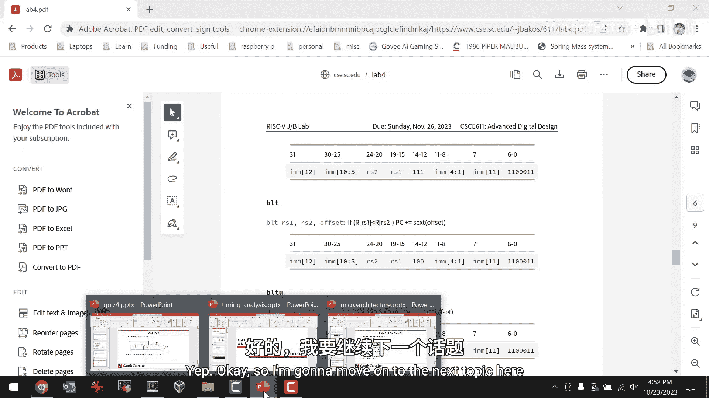
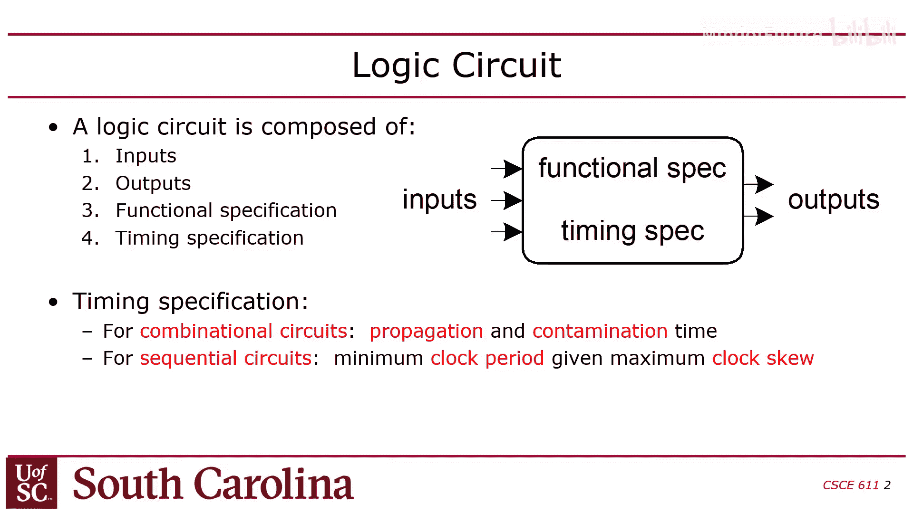
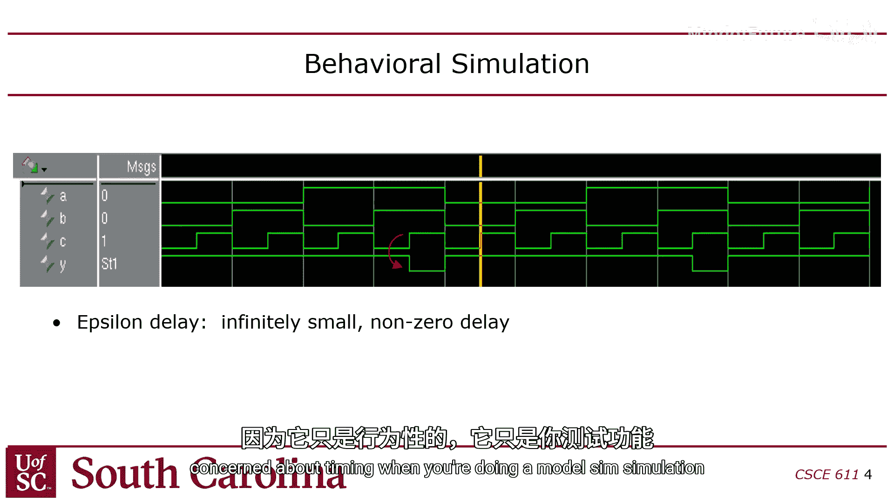
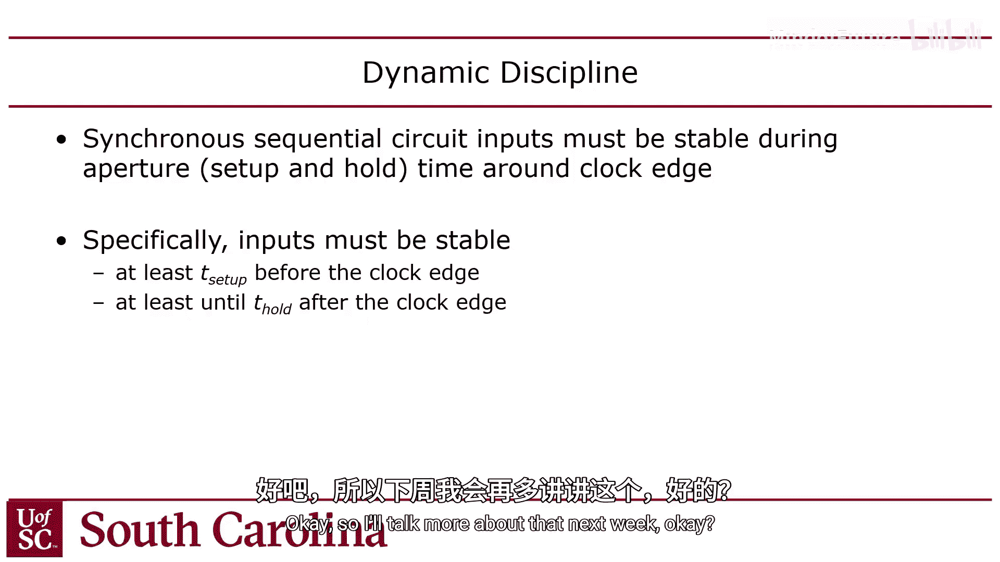

# 【南卡罗来纳大学】高级数字系统设计-CSCE611-（Advanced-Digital-Design，Fall-2023）-p11-P11-Timing-Analysis--BV19nf6YoEZ9_p11-

Okay， so let's see。 what am we talking about first here。 Let's first go over a quiz for quickly。

I just want to remind everyone exam one is up now， this is the midterm exam。

 you take it just by clicking this link， you get one chance to take it 75 minutes to open book and open internet。

 15 questions。Make sense， It's very similar to the quizzes。

So make sure you take it by Friday and midnight。So take it any time this week。

The quiz for。

It was some questions about the last lecture of sequential logic。

 the first question was what is a true statement about latches and flip flops？

A latch is level sensitive。 fliplip flops cannot be designed with an always statement。 Okay。

 so a latch is level sensitive， right？Flip flops cannot be designed with an always statement。

 that's not true。Flipflop is level sensitive， that's not true because flipflop is edge sensitive。

 right？Multibitit latch is called a register。That one's not really true， I mean。

 that one's kind of splitting hairs a bit， but a multi bit flip flop is called a register。

I've never heard of a multi bit latch being referred to as a register。And a latch cannot be reset。

 that's not true you can reset a latch。What is the next state function of state bit zero in the circuit below to answer this。

 you just have to look at the next state function is going to be whatever's feeding the input。

Of that flip flop。So you just have to look at the input and then go backwards and figure out what the Boolean logic is。

sense so it's going to be。The current state of Q1 or。The current state of Q0。Okay。

 and then ended with a。So。I went ahead and just put all。

All three net next state functions are in there。 So Q2 is just not A iss feeding the input。

Q1 is over here， that's Q2 and a。In the circuit below。

 suppose we set the a input to a constant one and then pulse the reset input。

 What is the state of Q2 Q1 Q0 in the third cycle recall that the S and R register inputs indicate set and reset。

 So the idea is that when you reset you're going to set Q2 to1。

Q1 is0 and Q0 to zero because Q2 has a set and the other two have reset。So。

You're going to start out with。100， does everyone see that？Okay， and then。

If you then just look at the next state logic， you can fill in the table for the next state of Q2。

 Q1， Q0， so oh I should have kept that on there but Q。Q2 is not a and a is hardwired to1。

 so the next Q2 will always be a0。And then Q1 is Q2 and A A is hardwired to1。

 so it's essentially just Q2 right， so the next Q1 will be the previous Q2。And then Q0 is。Q1 or。

Q1 or Q0 and a。 And again， a is hardwid to1。 So it's essentially just whether there's it's just going to be set to one if there's a one bit in Q1 or Q0。

 So like I said， Q0 is going to get a0。Q1 is going to be。Man， I should have left that on there， Q2。

 right？Q2 gets basically transferred over to Q in the next Q1， and then Q0 is going to be the or of。

The current Q1 and Q0。 So0 or 0 is0， right， And then once you have those next states。

 you then drop them down into the current state for the next cycle。 So you take that 0，1。

0 and you bring it down to the next row of the table and then。Re， oh。

 I did have the next state logic on there。 Sorry， and then you recalculate your next state。So。

Q2 is always a zero。Because A is hardwired。Q1 is the current Q2。So that would be a zero。

And then Q zero is。Q1。Or Q0， which is one。And so then you drop that down to the current state。And。

You calculate the next state and it's just going to it's not going to change。

 it's going to lock in at 001 because Q0 will is essentially fixed because a is fixed。Q1 is。

The old Q2 and that's。You know， that's fixed， right， So there was just it took it， you know。

 a cycle to get to that steady state point and then Q0 is。嗯。Is。You know。

Essentially ends up being fixed too， so the value is 0，01 is's just going to stay that way。

 Does it make sense， you guys with me。I didn't explain that very well。

 but the point of this problem is first you have to figure out the next state logic。

 which is just whatever logic is feeding the input to the flip fl。And then when you build this table。

You have to keep in mind that you have these three variables Q2 Q1 Q0。

 but there's two versions of them there's the current state in the next state right so the current state is is the input to the next state function so in the truth table you're considering the first three rows your input and the last three rows your output and then you always drop。

The next state down to the current state and the next cycle， right， so if you understand that。Yeah。

 that's all you need to know for this。ok。Okay， then in this question。

 I give you a finite state machine and ask what the output of the next state logic。Is for inputs。

 S0 equals1。I'm sorry， S1 equals0， S0 equals 1 and a equals1。So in this case， if I see that S。

S0 and S1 are the states right at the state the state。Bits。

So that means that we are currently in state 01， right？So it makes sense01， we're here， right。

 and then the input is a A is the input and a is1。So where are we going next。

 so if we're in this state and a is zero。Then。It says if we have not a。

 we're going to go to this state， right， So the next state it's going to be10， right so the next。

The next state for S1 and S0 is 10， does that make sense？看。Okay。

 and then consider the system very log module below， what's the problem with this design？

This is pretty subtle。So you've got a module called FSM， you've got a clocked。

A clocked always statement that transfers the next state into the current state。

 and then you have a next state logic which is combinational。

 and this is what's going to give you the next state as a function of the current state。

And in some cases， the input like go， right， goes in input。Make sense。

 So this thing is it looks like it's just like a counter right because it pretty much just once you tell it to go。

 it gets it out of state。Z to state one， and then it just kind of walks into state two， state three。

 and then back to zero， right？Does it Oh， actually， well， that's the problem， isn't it。

 We don't actually tell it to go to state zero。 We tell it to go to state 1，2 and 3。

RightBut there's no setting the next state back to zero， so it gets stuck at state three。

 so that's kind of a problem。But also the bigger problem here is that there's no default next state。

 like this if statement has this is this if statement doesn't have a fallback。

Like a default value for next state， so if this always activates。Which it will。

 whenever any of its inputs change。And if none of these if conditions are true， then then。

It ends up becoming a latch。So actually， this won't compile。Because we said always calm here。

 so the compiler will。Willll say you made a latch， but you told me it was combinational。

 so I won't compile。 but on the other hand， if you had made this with always at star。

 which is another way to write always calm。Except it doesn't do that check， right。

 then you would end up with a latch here。Youys with me so a better way to do this would be to have a little default right above this if statement that would say next state equals 0 zero right so if none of these match it'll by default go back to state zero zero on the next clock。

Okay， and it would also create that wraparound so it would end up going from。

It would stay at 0 and 2， give a go signal， and it would go 1，2，3，0。

 and then it would stay at 0 and 2。 give it the next go signal。 right， That's how it would work。

SoDoes that make sense？Okay， and this one says you're designing an FSM to keep track of the mood of five students working in the digital design lab。

Each student's mood is either happy， sad， busy， clueless。Or asleep。

What's the minimum number of bits necessary to represent these states。

 you need to store the state of all five students concurrently so I got this question from the book it's kind of a conceptual question。

 there are one，2，3，4，5， five states， yeah， there's five states and normally you would need log base two of five so you need three bits except there's five students that you have to keep track of。

So you would have to multiply the number of possible states is actually five。What is it now。

You'd have five possible states， right？Raised to the fifth power， right？Makes sense， right。

 because you have to keep track you have five students。And there's five states for each student。

So the total number combinations would be five rays of the fifth power right。

 and then you'd have to take the log base two of that。 you guys agree。ok。

I don't remember what I don't have the answer for it on here。

 but it's whatever five to the fifth power。12 bits， okay， yeah， makes sense。

 12 bits would give you up to 4096 states。Two to the 12th power。Okay。

 this says consider the FSM circuit below which of the following describes the next state logic for S1。

S1。 so look at the input to S1。 and it is an or of something or of。S is zero or。Not S1。

So you just look at the input and go backwards。

Okay， any questions？Okay， now I just realized that I don't think I ever finished the branch and jump lecture。

 we need that for the next lab Yes circuits sorry。嗯Yeah。Resets of the active the reset is。

The reset could be synchronous asynchronous， typically you give it a reset pulse。

And that would put it into these what they used to call the sanity state when I was in school。

 the reset state。And so if you hold the reset for longer than a cycle， it'll keep it。

In that in that state， you know， it'll ignore the inputs and it'll just freeze it right but soon as you drop the reset signal。

 then on the following edge of the clock， whatever edge you're sensitive to。

 you know rising or falling edge， whatever you've got the sensitivity list。

 then youll you'll transition。On that first edge， after reset is set to zero。

Does it answer your questionI usually use Ri， but it could be either one。

Sometimes you have a combination， like remember in the test bench design I showed you。

 we actually use both edges， we use the rising edge to go to the next test vector and then the falling edge to validate the test vector。

 So sometimes you know sometimes you use both clock edges， but generally I just。

Normally I just use the rising。It doesn't matter if you use the rising or falling。

 it makes no difference， it's just whatever you want either way you're getting you know the clock period。

You're changing state after every clock。Clock period。Okay。

 so I started talking about branch and jumps， I don't know if I finish this。

 so I mentioned that we for the next lab we need to add the B type and what was the other one J type。

 J type。

B type and J type。So this is different from MIPS， much different from MIPS。

 obnoxiously different from MIPS。This is really bad。Really bad， this encoding is terrible。So， the。

Branches and jumps both use PC relative addressing。 So basically， you put an immediate in there。

 and that represents。Where you're going， like where the program counter is going to go next。

 That's the basic idea。 There is a subtle difference， though。I brought this up last time in MIPS。

 the offset is the relative to。The next instructions address。So you guys have PC fetch， right。

 PC fetch is the address of the instruction in fetchch。

 which is actually the instruction that's after the branch。

So if you want to do that infinite loop thing， you know。

 the halt and catch fire thing where you just the instruction branches to itself endlessly。

 then the branch offset would be negative one。Neg one meaning I want to go back one from the next instruction。

 which means me the branch instruction right whereas in risk， risk 5。

 they change that and now the offset is relative to the branch instruction itself。

 So if you want to do the infinite loop thing your branch offset should be zero because zero means branch to myself right So in other words。

In MIPS， branch to yourself meant negative one offset and risk five， it was zero。

 so it's a slightly different way to calculate the branch target address。You might say， well。

 how does this relate to this class？In the past， when we use the MIPS processor or where we design the MIPS processor。

 your program counter， you would use the PC fetch and just add the offset。That's it。

 but now you can't do that， you have to use because PC fetch is the next instructions address that comes after the branch。

In program order， right， not an execution order， but in the order of your code。So。

You're going to have to add a delayed。A delayed version of PC fetch。

 you're gonna have to delay it by one cycle and call it PC E X。

 meaning the program counter address of the instruction， the E X stage。

 which is whatever PC fetch was in the last cycle， right， you guys with me。

 So you're just adding another pipeline register。 That's all it's not a big deal， but。

You have to make sure that you do it that way because。Remember that we're getting the code from Rars。

 so Rrs is going to calculate。These offsets， according to the labels that you're branching to。

So in order for your processor to work with the code that's generated from RAs。

 you've got to make sure that you calculate your branch target correctly。ok。ok 啊。Now。

 the thing that's really bad about the B type， I don't know why they do this， this is wild。

So the B type instruction format。I really hate this because I don't I never can memorize this。

 but the the B type is a。it's well， it's not like any other format， right， because they have。

The immediate， which is where you're going， the branch offset。

 right basically how many instructions you're skipping if you take the branch， right。

 That's essentially what that means。 But that value is kind of spread all the way across here。

 So you've got bit 12 and then bits 10 down to 5 and then bit 4 down 1 and bit 11。

 It's all over the place。 the way they encode these bits。 I don't know why they do it this way。mAlso。

The other thing that's weird is that in MIPS， that offset was。The units。

 the units of that offset was in terms of words。Four byte values。

Whereas here the units are 16 bit values， so that offset represents a 16 bit address。Okay。

 so what that means is on a byte addressed machine， like which is like every computer out there。

You would have to multiply the offset by two。Because all computers are by addressed。

Except for the one we're， the one we're designing is word addressed just to simplify it。So。

our program counter counts up by one right and that one is in increments of four bytes so we have to take the offset and divide it by two right so in a real machine you would multiply the offset by two。

 but in our computer we're just going to divide it by two because we want to convert it to a 32 bit address。

 so you start out with a 16 bit address a 16 sorry what I should say is a half word addressable value address value。

 a value that's pointing to 16 bit units of memory。

And we have to convert it to a value that's addressing 32 bit units of memory。So that makes sense。

 it's confusing， but it's not a big deal because I I'm going to give you the code for it just。

Because it's kind of torturous。So I have this branch offset， I give you the code for it。

 basically this will assign a signal here called branch offsetet EX。Now， obviously。

 this is going to be a don't care if it's not a branch instruction being executed。

 you just ignore it， right， your CPU will ignore it。

 So we calculate this for every instruction even if it's not a branch。

And I just have some bit twitling stuff here that takes the bits from the instruction。

And uses them to construct the actual offset。 And I actually multiply it by  two by adding this zero at the end。

 right， So I multiply it by  two。 So this branch offset is the actual branch offset in risk 5。

You know， convention， right， but then I have address thing， another signal called branch address EX。

 which then calculates the effective address。Which is where you take the program counter EX again。

 this this program counter EX is a new signal you have to add。

 it's the delayed version of program counterfetch， and I add it to the branch offset。

But then I divide it by four。By only taking it down to bit two， so I concatenate bits1 down to zero。

 which effectively divides by four and rounds down。Okay， and then you might say， wait a second。

 why do you have two bit 12， that's the sign extension。So this is the sign extension。

 I have to sign extend1 bit。 This is assuming， of course， that your， your program counter is。12。

 12 bits， right？You'll use a 12 bit program counter。 I think that's what we told you to use， right。

 assuming it's a 12 bit program counter。You end up with an 11 bit branch offset when you do this。

 so you have to do a one1 bit sign extend。So these two lines of code， you can copy and paste these。

 the first line will calculate the real offset and the second line will calculate。

 will' take that offset and add it to the program counter to give you the effective target of the branch。

Makes sense。Okay， so that's。Branches， jumps are also very confusing。 the J type。

Now remember branches just to make sure there's no confusion branches have two registers。

 Rs1 and RS2 because those are the registers you're comparing to determine whether you're gonna take the branch because branches are conditional jumps are unconditional so if you go to the J type there's no registers in there it's pretty much just they allocate all the bits well there is one sorry there is one RD there is a destination register and that's for the link address but there's no there's no branch resolution。

 the jumps are unconditional that's the difference between a branch and jump so the J type is an op code。

 a six bit op code I should have said that I don't know why I didn't put six on there Yeah。

 the op codes are all oh no， I'm sorry seven bits。Risk 5 is 7 B off code，0 Yeah，7 bit。 Sorry。

 I keep getting， see， to this day， I keep getting confused between MIps and risk 5。

 riskk 5 is a 7 B op code。 And then， of course， the R D is a 5 bits， right， So that's 12 B。

And that leaves 20 bits left over for just the offset， the jump offset。

 so we have a bigger offset for jumps， just like with MIps。We have a 20 bit offset。

But it's treated essentially the same way you just add it to the program counter。

You just have more bits， you have longer range， you have longer reach。

 right because you've got more offset bits in the J type。

 you can jump farther away than you can with a branch。

You with me okay and then the RD field is used for linking that's so you can get back to where you jump from this is for like a subr if you jump to a function you got to get back right so that JD is used for the program counters got to go in there and the destination registergistry。

You might say， what if I don't want a link， you just put a register zero in there then。

Like if you used a jump instruction instead of a jump and link。

Then the jump is treated as a pseudo instruction， it maps to a jump in link with register zero being the link address。

 link at register， okay。Everyone clear on linking， linking is just a return address， that's all。

 it just stores the return in the register file， the return address。Okay。

What would be the return address， by the way？What is the return if I'm executing a jump？

I want to return not back to the jump， but I want to actually go to the next instruction after the jump。

 So that would be the PC fetch， right， right， Yeah， PC fetch。 Remember， we have two PCs now。

 PC fetch， which is the address of the next instruction。 So that's where we're want to link to。

 But now we're gonna have PC E X， which is what we're going to use for calculating the branch offset just because that's。

Stupid way that risk calculates branch targets I don't know why they change that。ok。

And all and now the the bits are all scrambled。 So again， I just give you the code。

 I'm just gonna give you the code for the offset and the effective address because I can't make rhyme or reason。

 It's like bit 20。Then they cancatenate bit 20 with bits 10 down to one。

So the confusing part is that。These bits in the immediate field are referring to the bits of the immediate。

Right。Which is not the same as the No， it is the same。 It is the same as the offset。 Yeah。

 this is the bits of the offset， which is the bits of the immediate。

 But then those correspond to different bits in the instruction。

 So I I put these two tables together。 try to clear this up。 So， for example。

 bit 31 from the instruction is bit 20 from the offset because you see 20 is the first number there。

 right， But then bit 3030 down， I'm sorry， bits 30 down to 21 of the instruction are bits 10 down to one of the immediate。

 right， So this table is what's mapping the instruction bits to the offset bits。

 And then this table just reverses them。 And this goes the opposite。Right， oh no， it's just， oh wait。

 I'm confused， offset。I screwed this up， somehow。30 is 20。19。嗯。Instruction EX。

 I thought I had this table reversed。 I guess I screwed this up somehow。Yeah。

 I think I I don't know what happened to that， but this code is good。

 students have been using that code for the last few years or so。

You could just copy and paste those lines。Okay， any questions about that？Okay， so here's the。

The one issue you have to deal with here。That's a little different is when you encounter a take in branch。

Or a jump。 You have this problem where。The branch instruction。Is going to be fetched。

 And then in the next cycle， it's executed。 But while it's executing， you're going to be fetching。

The fall through instruction， whatever instruction comes after the branch or jump in the code， right？

Now， the problem is， is that。The way the pipeline is organized。

You're going to be calculating the branch target。Using the lines of code， I gave you。

And then resolving the branch， that's going to take a whole cycle。

So you don't even know what ends up happening is you don't know if you're going to take the branch。

 nor do you even know where you're branching to until。

The branch instruction gets to the very end of the time it's in the execute stage At that point。

 you've already fetched well， you've already nearly fetched the next the fall through。

 It's too late to do anything about it right so in other words。

By the time you know where you're branching to and if you're going to branch。

You've already fetched the next instruction， the pipeline。So the only thing you can do is to kill it。

Is to replace it with a stall。So what ends up happening is when the branch then goes to the right backstage。

The fall through is going the fall through instruction which is not supposed to be executed right because you're supposed to branch。

 it's not supposed to execute the it's going to be in the execute stage。

 but we'll have replaced it with a stall， so it'll act like a bubble in the pipeline。

And then at the same time， we'll be then fetching the target instruction。

So your pipeline executes one instruction per cycle once the pipeline is filled right get once you get once you get the pipeline all filled up。

 then new instruction rules off every cycle， except when you start doing branches and jumps。

 those are going to be followed by bubbles by stalls by by so you're going to end up executing no ops in the pipeline and so the throughput。

 your instructions per cycle are going to go down right you're not going to have one instruction per cycle it's going to be less than that depending on the frequency of the branch instructions so how do you implement the stall。

Well， I think I mentioned to you that。In MIPS， a stall instruction was all zeros， right， 32 zeros。

 that was a NOAah， right？But they change that in risk5 too， in risk5， the No opP is not all zeros。

It's there's actually some1 bits in there， right， but it turns out it doesn't matter what it is because a better we figured this out over the years as we've been teaching this class。

Instead of trying to actually put a no op instruction in the pipeline。

 because that's way too complicated。An easier way to do it is just to have a flag in the pipeline called Sta。

So you would have one in the fetch stage called Sta fetchch。

 and you have one in the execute stage called Fech Sta EX， right？And you just use that flag。

To indicate that whatever instruction is in that stage， yeah， just ignore it， don't do anything。

 I mean， execute it， but don't like write it back， don't't don't allow it to branch。

 like just render it inert。That way， you can fetch the fall through instruction。

But then you just have that stall flag there saying， yeah， I don't do anything with this thing。

You guys with me？but you have to be careful because this is where you can run into a combininatorial loop because your control unit is going to be inside your control unit。

 you're going to be executing the branch of the jump。

And the control unit is going to put that stall signal out， right？

 But you have to make sure that the control unit doesn't see that stall signal until the next cycle。

 because if it sees it immediately， then it's going to stall itself and then it's going to say， oh。

 wait， I got a branch stall。 Oh wait， I'm stalling。 It's not a branch。 Don't stall， Oh wait。

 I got a branch now again， stall and you're going go you're going to go into a loop。

 right're you're going to turn into an oscillator right So what ends up happening is that the control unit sees the branch instruction of the jump and it puts out the stall fetch。

So its output is called Sta fetchch， it'll have an input called Sta EX。

 which will be the delayed form of stall fetchch， so you'll have a pipeline to register that takes this input stall fetchch and has an output called Sta EX。

 right？The control unit。We'll then use stall fetches its output， install EX as its input。

 So basically what the control unit is going to say is。Note to self in the next cycle。

Treat that like a stall。It's like sending itself a message for the future， right？

So it'll set stall fetch。Next cycle， it'll become tall E X。

 And then the control unit will be reminded that in the previous cycle， it said to stall， right。

 So that's all you got to do with that。 So you add a。You basically have， if this is the fetch stage。

 ignore this for a second， you have this stall， this little register here， flip flop。

 it's only a single bit。Out of the execute stage， out of the control unit， you have stall fetch。

 that's an output from the control unit， it's going to go into a delay。

 and then it's going to feed back as an input to the control unit， which is in the execute stage。

 you guys with me？OkayBe careful with that， you got to have that in there or Model Sim will。

 it'll either lock up or it'll say iteration limit reached and fail。Makes sense。Okay。

 so the only other thing you have to add is in your fetch unit。Which know we gave you the fetch unit。

 it's essentially state that always block。You have to add。Those address calculations。

RightSo I've given you two of them so far， I've given you the branch address EX and the J address EX。

 that's the effective address calculation from the B type and the J type instruction。

 it's just combinational， but you're going to feed those in to a muX along with PCEX to figure out what the next program value。

 program countervalue is。Okay， and then there's a fourth one I haven't talked about yet jump and link register。

 so there's another instruction called jump and link register， which is just an R type instruction。

 but that allows you to jump to an address that's in a register so I think it's the Rs register。

 so read datata one， whatever the program the register file gives you as readdata1。

 that's your that's this。Except， not all 32 bits of it。12 bits of it， right。

 Could program kind of 12 bits。This is so you can return from a jump at link。You guys with me。

 so now there's four possible。Addresses that will go into the next program counterfech。

 it'll either just be program counterfetch plus one。

Or it'll be one of these three addresses that come from your execute stage。Makes sense。

So in terms of this actually， once you have this infrastructure and it's really simple because then in your control unit。

 all you got to do is when you want to branch or jump， all you have to do is set PC source EX。

 which selects this mugC， set that and set stall fetch to one and you're done。

It's all you got to do and everything else will be taken care of for you Of course the program the control unit needs to determine。

 you know if it's a branch or jump and if it's a branch。

 whether it should be taken so you'll have to do branch resolution。

 but the actual mechanics of taking the branch or jumper is very simple it's just set that two bit signal set that set that two bit signal and set that one that one bit signal。

Okay。Makes sense。嗯么。Okay， so this is the。So let's see， yeah。

 the changes to the EX stage and right back。嗯。Oh sorry， one thing I forgot to mention here。

 the program counter， I mentioned this earlier， but the program counter fetchch has to have its little delayed。

 has a delay in there to create program counter EX。so。

So we've added this mus and these connections in these two registers。

 this is a single bit register a fliplo， and this thing is a 12 bit， 12 bit register。ok。Okay。

 and then。The right back logic has to be changed slightly。 you had a mux。

That was controlled by Reg Select。And it was a three input mug。

 You have to add a fourth input now for。The program counter EX。

So this is for writing back the link address， right？

So that's not a big deal because you don't have to extend the size of Rexlux2 bits。

 it stays two bits。we kind of get this fourth input here for free in the sense that we don't have to widen the Re slacklack signal。

Okay， so you set the Regg select signal。wo。To three， if you're doing a jump and link。ok。Okay。

 so to summarize all that， you add the branch address， Jawl address and Jaler address。

So those are three signals， three logic declarations。And you put the code in that I gave you for。

The jump in the branch。Address calculation， and you add them as possible next state values for PC fetch。

 meaning that you add a NF statement in your branch logic， which will create a mux。Sorry。

 your fetch logic。And then you have to add a PC source EX。You didn't have that before。

 right because the program counter always just added one all the time right now you need a PC source。

That controls the PC mus and the next program counter， Okay， so you have to add that。

 you have to add the stall fetch and the stall EX。And add the program counter EX as the fourth input to the Regdgedes box。

看。So there's not a lot of changes， it's fairly minor changes to the structure。

And then you have to the big change here will be in the control unit， but you'll just be adding。

You know， if blocks your control unit to deal with those new instructions。Okay， make sense。

And then for resolving branches。How you resolve branches？Well， first of all， what are the branches。

 what are the branches， What are the lists， do we have a list？Yeah。So we have。Branch。

 branch equal branch not equal branch less than， branch less than un sign。

 branch greater than equal branch greater than equal is the sign。By the way。

 I think most of these were pseudo instructions and MIPS。

But these are all now real instructions in risk five。嗯。So how do you resolve them。

 meaning how do you determine whether they should be taken？Well use the ALU to do it。

It's not do anything else anyway， right during a branch。Right you might say， wait a minute。

 isn't adding the program counter to the offset No well no。

 we have a separate adder in there that code that I gave you to put that in。

 when you put that code in it's going to create another adder， 12 bit adder。

That's not the same matter as the OU one。DoesThat make sense？So your AOU has a 32 bit adder。

 and we can use that too。Do resolution， so you can use the subtract instruction for testing and quality。

So if you have a branch， if equal in the execute stage， you tell the ALU to subtract。

And if the result is zero， then you should。You should。Branch， right。

 because if the values are equal and you subtract them， they the result is 0， right。

 And then you just use complementary logic for the branch if not equal。And then for these four。

Less than greater than。Rder than or equal to。 Well， there's no greater that， luckily。

Its less than and greater than or equal， right？Why do I say that because we have an ALU operation for set on less than right sets it gives you a one if a is less than B on the ALU inputs。

If you want to know if A is and there's a set less than unsigned too。

 there's an unsigned version of it， those are two different ALU op codes。If A is not less than B。

Then it must be the case that a is greater than or equal to B， right？

So that's why you have these BGE， right？If you had greater than。Then we have a problem， right？

If we wanted a test to see if A was greater than B。There's no ALU code for that。Right。'Well。

 you'd have to like。You'd have to like do a set less than and a subtract at the same time， basically。

You'd have an ALU that would have to give you the zero。Bit。But we don't have to worry about it。

 right？You guys with me on this right， so basically what I'm saying is if you do a branch of greater than equal。

 just use SLT。And just do whatever the AU， just do the opposite of what the AluU tells you， right。

 you just complement the result。Makes sense。ok。The other option too is if you had branch of greater then you could swap A and B and do set less than。

 but then you'd need to have additional muxes on the inputs the AOU。

 right that would add hardware complexity。Okay， yeah，s that's the control logic。 I think I have some。

Okay， so I have a test program for you for the lab。 So this is a smaller test program than before。

 because we're just testing the。There's only。Two jumps and。How many instructions， two jumps in？

6ix branches。Two jumps in six branches， so eight new instructions， this tests all eight instructions。

So this is gets a little confusing because what happens here is that if it's working。

 it's going to fetch the first instruction， fetch the second instruction。

 fetch the third instruction right here， branch of equal four and five are they equal no。

 because I put negative one and four and two and five so that first branch instruction。

Doesn't take the branch， so it should fall through， so it doesn't stall。

 It just goes straight to instruction 3， right， which is a branch if not equal。

 That one should be taken， but remember that if it is taken。

 it is going to fetch the next instruction at four， but that'll be ignored because it's a stall。

 So all the branches and jumps have a delayed action to them。They do take the branch。

 but at one cycle late， so instruction two， no branch， instruction3 branch， but delayed reaction。

 so we still get four and then we then we go to eight because why do we go to8 because that's going to target three。

 Targ three is at address  eight。You see that so that where to go back to you then Well， no。

 that one actually doesn't that that one doesn't that one doesn't a link because it's a branch eventually you'll get to this jowl。

That will link。O。Now notice that。This jowl。Doesn't have a register listed there。Because it uses。

 I think the default register for link is one。Right。

But it doesn't matter because we never execute that instruction if you look at the fetch sequence。

5 is never actually executed， it's we always skip that， we always end up jumping over that one。

We fetch it here， but it's a stall。We do fetch it once， but we don't execute it because it's stall。

But I think the default right back in risk five is one in MIPS， it was 31， right？

If you remember from MIPS， it was the link address was Reg 31。Okay。

 and then it just continues like that。 It gets really complicated though， because it's going to。

It's going to you know kind of skip around in there。

 but this is what you're in order to test in order to know if the test programs working。

 all you have to do is look at your PC fetch and see if it matches this sequence right so you're looking for a time series sequence this is what the address should be in each cycle right？

It's a sequence of fetches。Of course， when I say stall in parentheses。

 that means that the program counter is nine， but then your stall EX should be set。Right。

Is it set in that cycle？No， it will be set in when PC fetch is9 or sorry PCX is9 right yeah sorry。

 so let me clarify that so this。This is， well， you can look at PC E X， too。 It doesn't really matter。

 It might be easier to look at PC E X because PC E X is the address of the instruction being executed。

 So you'll still get the same sequence here。 But that way。You can look at the stall。

 of course you could look at the stall fetch too sorry you could look at the so you can either look at PC fetch and stall fetch or you can look at PCEX and EX either way that'll allow you to just track and make sure that it goes through this sequence right if it goes through that sequence successfully eventually it'll get to the end and once it gets past the end it'll just keep going。

诶。Yeah， so 13 is the last instruction，14 is just a label。 there's no instruction there。

 so itll it will actually execute from 14 on just forever， but。You just have。

You have x's in there and your instruction memory will be empty at that point， right？

You guys with me， soll it'll eventually scoot off the edge of the program。

 but this should be how it begins。Okay， all right， so now once you have that done， then you can。

You can write your fool， you can actually take your square root program now。Your square root program。

Hopefully we'll not have any instructions that you don't have implemented。Hopefully。It shouldn't。

 if it does， you'll have to fix it。So your square root program should work。

 so we want to combine your square root with your bin to Hex。

 so we want to grab a value from the switches。Treat it like an integer。So in other words。

 treat it like all the fractional bits are zero。So you get an 18 bit value from the switches。

 you're going to basically shift it。To the left by 14 bits， right， to add the zeros。

 So the dad the dot 0。0000， right。And then you want to feed it into your square root program。

Calculate the square root。And then print it on the hex displays in decimal。 So you'll have a like a。

 you'll have designed the software and the hardware for a calculator that can calculate the square root。

 right now the only。The only caveat here is that。Your input is an integer。

 but your square root's probably going to be a fractional square root most likely， right。

 So you have to be able to display a fractional。Base 10 fractional number on the hex displays。

You guys with me。 So there's 8 hex displays and you know the square roots going to be between 0 and 511。

9999 right， is that what it is Yeah like if you put all the switches up and you give it its's maximum input。

 it's like 262000 something。 If you take the square root of that， it's 511。99 right so。

You're going to have8 hex displays。 You're going to allocate the firstx the first three hex digits as your。

You know， your integer digits。Base 10 digits and the other five will be your fractional base 10 digits。

 So you're basically going to use a fixed point， base 10 number， right。

 Just pretend there's a decimal point。After the third digit。

There is a decimal point after the third digit， but。Those guys didn't wire they didn't wire it。

 we can't light it up， we can't illuminate it， but it's actually in there。

 but there's no wire from the FG they didn't put a wire on the circuit board between the FPGA and the decimal point on that third digit Yeah that's exactly what they did they cut cost so。

You just have to pretend it's on you guys with me？Okay。

 so you might be wondering then final question。Is how do we do fixed point in base 10 easy。

 all you got to do is you'll have your square root with 14 fractional bits。

 you just have to multiply it by 100，000。And then convert it to decimal when you're done。

 that's all you got to do。By multiplying it by 100，000， you're effectively。You know， shifting it。

To the left。Right。You guys with me？One digit right like kind of like when you calculate tip at a restaurant。

 you divide by 10， you kind of shift the decimal point。Multiply by two to get like a 20% tip。

 This is the opposite we're actually multiplying it by 100，000。Right。Gys with me。Okay。

 so that's all you got to do。So the objectives of the lab are to add。One， two， three， four， five。

 six， six branches and two jumps。So once you have those in， in addition to the other instruction。

 you should have all the instructions that you had in your square root program。In fact。

If you run GCC on a risk five， cross compiler。You'll probably be able to execute anything that comes out of GCC。

I haven't done this with Rik5， we did it with MIPS though in the old version of the class。

 we actually ran a GCC that emitted you know MIPS code and we had。

 you know it generated the instructions that we did in class。So， yeah， you have。

 you have a pretty good， pretty good instruction set。 You don't have all the instructions。

 but you got all the most common ones， right， And then you want to test with the test program and then write a MIPS program that。

Confuutees the square root of the value on the switches and。Deploy it on the DE2。

So you flip your switches and you should see the square root value displayed within。嗯。You know。

 100 instructions。That are executed in 150 millionth of a second。Okay。Any questions about that？啊。

Okay。So the let's see here。

Yeah， and that's what I just said。 Okay， the lab sheet is on。On Dropbox where。

We have this described in excruciating detail。嗯。And。We have the grading rubric on there。

And we also have the instructions， all the descriptions of the instructions。O。All right so。

We're actually a little bit ahead of schedule compared to normal。 So you basically have until。

Almost the end of the semester to do this， five weeks。Okay， so， but。If you're planning to the lab。

 now remember， you have the option to opt out of this lab。

Because the grade for this class adds up to like 117 and a half%。

So if you're confident that you're going to do well in the final exam。Then。Okay。

W said I was going new way you can opt out of this lab if you want right in which case。

 if you really feel uncomfortable with the lab or if you have a bad partner or whatever the case may be right or if you do well in this lab。

 you don't have to take the final exam right so this way you can customize the course to be more applied or more conceptual The final exam will have a lot of conceptual material on and I'm going to talk about timing analysis and CMmoss design and digital building blocks So for the rest of the semester。

 I'm just going cover theory basically I've finished with all the applied you know practical。😊。

Material that you need to get the the final project done， which is。

Which is going to allow you to say if you do this project and when you're interviewing。

 you can tell whoever's interviewing you that you built a Ri 5 CPU from scratch。Yes。我公司。

So I had the question I want to member Str if we decide to do vote and do mediocre on both of them。

 will it be an average Yeah， yes， it will， yeah， yeah。

 we just we just all we did is we used to we used to try to。Physically drop a score。

 but now we just have the total be out a 117。Yeahep。Yeah。😊，Okay。

 so I'm going to move on to the next topic here have a。

About 10 minutes left， 18 minutes left。Okay， so the next topic is timing analysis。

 this is something that I should have well。Part of the problem is is that when you guys deploy your circuits on the FPGA。

 you're kind of missing a lot of what's going on， the place and route tools are trying to make your circuit。

Work at the clock speed that you want it to work at， which in our case is 50 megahertz。诶。Usually。

It's not too hard for the CAD tool to do that。 That's why it only takes like four minutes or so to compile。

 which is really great， because normally if you have a larger design and you're trying to meet a faster clock rate。

 it takes a lot longer to compile a design for an FPGA but' with these Intel tools and the FPG and the clock that we're at。

 it's really nice that you guys can iterate pretty rapidly you can do like a three to four minute compile right but one of the like I mentioned the job of the synthesizer is to meet timing requirements So you have this timing spec the timing spec of our CPU is that it has to run in 50 megaHtz which means the worst case delay inside your CPU design and when I say delay you know logic delay。

Is 20 nanoseconds， the reciprocal of 50 million0 50 million hertz， 50 megahertz， right？

So the timing spec is basically how fast the circuit has to run。

So。Now when you simulate， you guys， hopefully you guys are simulating。

 I know of some students in this class， they just test their design on the FPGA。

 which you know you can do but，That usually involves more trial and error because you can't。

 there'sss less visibility， you have less design visibility unless you use like signal tap。

 but then signal tapap requires you to put those probes in there and recompile every time you want to add a new signal to your list of probes。

Simulation is nice because it's fast， but you know as I mentioned。

 the simulator is not showing you a realistic view of what the actually hardware will give you because the hardware has delays in it right and the simullink is assuming that the circuits are infinitely fast right。

So there's no delay between simulant doesn't show a delay between when an input changes and when the corresponding output changes。

So because it's just behavioral， it's just your' testing functionality。

 you're not concerned about timing when you're doing a model Sim simulation。

 but there is a delay in reality， if you have a gate。

 you have an input change and you'll get a corresponding change in the output and there's that delay。

 The delay is usually measured from。

The time when the input gets halfway from zero to 1 or1 to zero。

To the time that the corresponding output goes。Halfway between 01 or 1 to0。

 depending on what the transition is right now， obviously sometimes you can change an input without the output changing right。

 So this is assuming， of course， that that the output is changing in response to an input changing you guys with me。

Right。Does that make sense， like if you have an an gate and one of the inputs is zero。

 it doesn't matter how you change the other input， the output will always be zero， right？

But if you change the input and there's a corresponding change in the output， there's a delay there。

 that delay is caused by the resistance and the capacitance。

ItIt's the product of resistance and capacitance， RC delay。So there's actually two delays。

 there's the propagation delay and contamination delay。

 the propagation delay is the point at which is the longest delay possible。

 so the propagation delay defines the point at which the output is not going to ever change again。

 it's stable， it's the time for the output to stabilize so the time between specifically the propagation delay is the time between an input changing and when the corresponding output has been stabilized。

Contamination delay， on the other hand。Is the earliest point。That the output。Can change。

 so in other words， the actual time it takes for the output to change is actually a range of time。

That's from the contamination delay to the propagation delay， you guys with me on that。

 may you might say， wait a minute。I mean， you heavily implied by the previous slide that there's just one delay。

 well this is what you see at any one moment of time， right？But in general。

 this delay is not a fixed number， it's a range， it's a range between the contamination and the propagation delay。

 you guys with me？Now， why are they different？Well， they're different because。In a Seamoss gate。

I'll talk about this later， but a CMOSs logic gate has transistors that are responsible for setting the output to one。

And they have other transistors that are responsible for setting the output to zero。

 those are called the pull up transistors and the pull down in transistors。You guys with me？

It turns out those transistors operate at different speeds。 So if the output。

 if your output is going from one to zero。It actually it'll happen faster。

Then if it goes from zero to one。Because that's because NOOSs transistors are faster than POSs transistors。

 they switch faster。It's just it has to do with the semiconductor properties。Specifically。

 the carrier mobility。The charge carriers inside the silicon lattice。

Go at different speeds and those two different transistors， you guys with me。So in other words。

 if you have a gate and the output goes from one to0。

 it'll happen faster than if the output changes from0 to1。

 So that's why you have this range of contamination versus propagation。

 but that's for a single gate for a whole circuit， on the other hand。For a circuit。

Once you start assembling multiple gates and you want to calculate the contamination of the propagation delay for the whole circuit。

 that also comes from the fact that there are short paths。And there's longer path。

 so if I change this D input。Then the output is only subjected to the propagation delay of this last one gate。

 right， but if I change A or B。It has to propagate through three gates before it gets to the output。

 right？You guys with me？So this is called the critical path delay。

 this is the longest path through the circuit， but there's also short paths through the circuit as well。

Okay， so。What ends up happening is is that。The contamination delay for this whole circuit。

Might be really small because of this short path。Compared to the propagation delay。

 which has to go through the critical path。You guys with me？O。Okay， so let's see。Okay。

 so propagation delay is abbreviated T subpD， and contamination delay is abbreviated。T sub C D。

 you have to remember this because we're going to have a lot of。Symbolic names for this stuff， okay。

 so we got our first two symbols， TPD TCD okay。Okay， so。Okay， so。Let's revisit this circuit again。

 so the critical path delay or the long path delay。The book uses。

I think the book uses both terms interchangeably， critical path， long path。

 same thing it's going to be。2。We're looking at worst case delay， basically， longest delay。

 two times the propagation delay of the and gates。Why。

 because you have to go through two an gates in series right serially right plus the propagation delay of the or gate。

 so if you add two times the PDDs of the an gates and one of the or gate。

 you get the total propagation delay。The contamination delay is when you look at the best case delay。

 so then you have to look at this short path， number one， and number two。

 you use the contamination delay for the short path。

 so when you're looking at the long path use the propagation delay orre calculating worst case。

But then when you look at the short path， use the contamination delay， which is the best case。

 so the contamination delay of this and gate is the overall contamination delay of the circuit。

 you guys with me。So you look at the shortest possible time and the longest possible time as a function of the topology of the circuit。

 right， and the CDs and PDs of the individual gates that you're going through， right？Okay。So。

So I was trying to figure out like how many possible paths you have to go through with a circuit。

How do you calculate how many paths are there？Well。

 it turns out that the number of paths is going to scale up。According to。The inputs。

So for every input， you have a path， right？But also， if you have fan outs。

 meaning that you have a branch， you have a wire that goes to two different spots internally in the circuit。

That will cause more paths。 That will create more paths。 So the number of paths is basically。

For each input。For each input， you add。The total fan out from each input。Right。A。A has one fan out。

Which happens here？You see that A is。Yeah， a is here， has a fans out along this point， right？

B has one fan out because it goes through the same fan out point as does C， but D has no fan out。

 so you just go straight through， right？So you add up for each of the inputs。

You add up two to the power of the fan out。That you have along that path of that。

Of that's that input， right， So in this case， there's 7。7even paths through the circuit。

 which I have illustrated by making seven colors， right，7。

 there' are seven colors representing the seven possible ways you can get through the circuit， right。

 Now you might say， why do you care how many paths。 Well。

 because you have to look at all those when you calculate the critical path to the critical path。

 you have to look at。The longest of all these seven， right， and of course。

 the short path is the shortest of all these seven。

So it can get complicated when you have a bigger circuit to find these critical paths and short paths。

Of course， I'm not going to， you know give you any big ones to do by hand。 Okay。

 now there's there's kind of this crazy thing that happens called a glitch when。

Sometimes when you have。Unbalanced paths through the circuit。You can change an input。

But because there was a fan out in that input。The input change propagates at different speeds through the network。

 through the circuit。Right， and it can cause the circuit to actually go。

From like 0 to1 in the back to0 again， right， that's called a glitch or from one to0 and back to one again。

 right， The glitch happens because of these imbalanced paths， right， So in this example。

 the imbalanced path is due to this inverter here because B fans out right here， right。

 and it goes to inverter but then it goes this way。

 So you have a longer path for B here versus what you have for the other branch of B。

 you see that Okay So if the input to the circuit is， say0，0，1，1。So zero，1，1。

The output should be one。And if I change B。B is the one with this weird you know。In balance。

 if I change B to to0， right， then I'm going to go from this row to the truth table to that row of the truth table。

 which shouldn't change the output because both rows have an output of one。

 It shouldn't make any difference。 So if I set B from one to 0。You shouldn't change the output。

 but in reality you're going to see a glitch， what you're going to see is the output will be one and it's going to glitch to zero and then back up to one again because of this imbalance in B。

So the reason for that is because。You got。You have B with two paths。

And so when you change B from 1 to zero。If we look at these two signals， N1 and N2。

 these are these internal signals。You see that N1。嗯。Actually， N2， sorry。

 I should say let's start with n2 because that's the faster one。 So if B changes from from from1 to0。

 that's going to cause N2。To go to zero。From one right because there's an gate right so basically what you're doing here is you're sticking a zero into this and gate。

 which is going to cause the an gate to go from one to zero， right？Okay， so when that happens。嗯。

That end gate above it。At that point was already a zero。

RightBecause we assume that the new input to that end gate hasn't caught up yet because it's being waylaed by this inverter right so N2 is going to go from one to0。

 no problem that's fine that's perfectly normal， but N1。N1。Is going to lag。

 right so what's supposed to be happening here is that。That orgate。

Orgate has had a one and a0 right and what we're trying to do is switch it to0 and1。

 we're basically trying to take the two it。 we're trying to take both inputs this and this or gate and flip them right and do it in a way that's transparent so the an gate sees10 and then it's going to see 01 and it shouldn't make a difference because and gate the orig gate' is going to put out at one either way。

 but because。The one input on the origgate changes faster than the other。

 you end up with a brief amount of time where you have a 0，0 here into that origgate。

 you see N2 and N1， right？So basically， the origgate has N1 and N2。And they're flipping， but。

The second input N1 is flipping a little slower。RightSo you end up with this time where both inputs are zero。

 in which case the origgate is going to put out a zero temporarily until its second input catches up。

 does that make sense， it's always kind of hard to explain because it's。But you get this glitch here。

 right？Like I said， you're trying to swap the inputs。

 but that that inverter is causing a delay in the swap。 So you get the glitch there， right now。

 I don't know if you guys have noticed this， but model Sim actually。Stimulates glitches。

 you ever see those every once in a while you simulate models them and you see a glitch It how I don't know how it determines whether there should be a glitch。

But sometimes you'll actually see him and models him。So how do you fix a glitch。

 you can actually fix glitches。But you have to add a redundant logic。So basically the book。

Has this example， in this case， you have this the original circuit。With ignore this。

This new gate for the moment in the original circuit， you had the following Kaw map。

 you had basically two groups in the Kaw map。so me back up here， you guys remember from 211。That。

This circuit is a sum of product circuit， right， This is just a sum of product style。

 You have those inverters there that are just inverting inputs， right。

 so you can provide complemented forms to the sum of product。

 But it's the sum of products and gates feeding into an or gate。

 So you can convert that circuit actually into a。😊，The Carnal map， right。

 where you've got these two groups in the carnal map that represent these two an gates， essentially。

 right？Well， what ends up happening with that glitch is when you go from one group to the next。

You leave one group and you enter another group on the Car map。That can cause a glitch。

So to fix the glitch， all you have to， again， that B， remember B was changing from。

B was changing from。1 to zero right so you're going from this part on the carnal map to that part this part right because that's where B changes right so you're going from here because you're moving across those two groups in the carnal map。

 you get the glitch， but you can add another term by enclosing those two cells in the carnal map which adds another end gate obviously right but that way when you move you' still moving within a group on the carol map and that'll actually prevent that glitch from happening。

Okay， you guys with me？Now， do we really care， though， do we have to do that？No。

 it doesn't actually matter。Because glitches usually don't cause a problem。Because when they happen。

They happen between the contamination delay and the propagation delay， you know。

 because they happen in a range right， we say that don't trust the output of any circuit from the contamination delay to the propagation delay because that's when it's in a state of flux right it can change it you can get glitches in there right。

 it's unpredictable So as long as you ignore the output of all your circuits until after the propagation delay is over。

 then if there's a glitch。ItDoesn't matter。 you just ignore it， right。

 but you have to make sure that you enforce that specifically。

Do you have to constrain the propagation delay right and that's what the timing closure does on the CAD tools and that's also called。

There's a name for that， what's it called？The dynamic discipline。

Dynamic discipline is when you make sure that you control that you constrain。

 you limit the propagation delay in such a way that you know that you can ignore anything that that happens before the propagation delay。

 you guys with me？Okay， so I'll talk more about that next week， okay？

So don't forget about the exam。